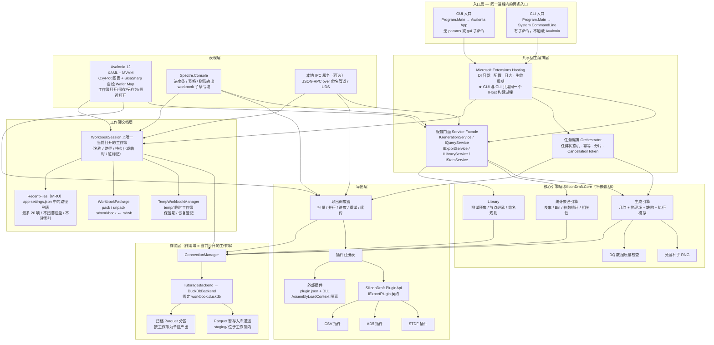
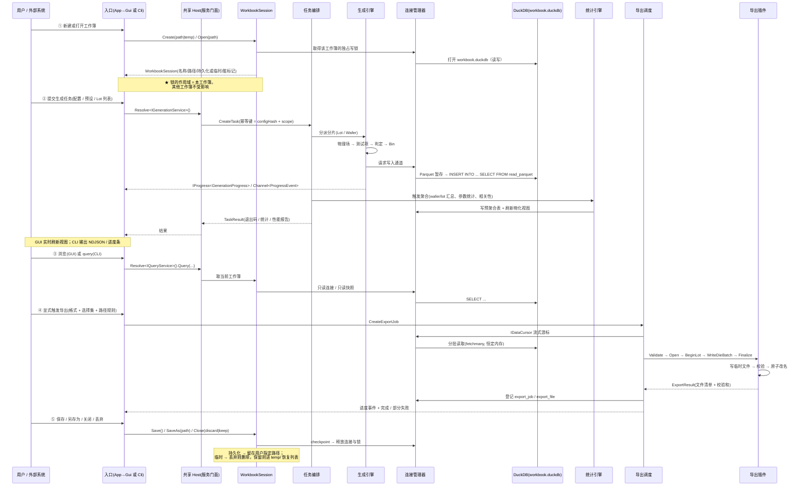
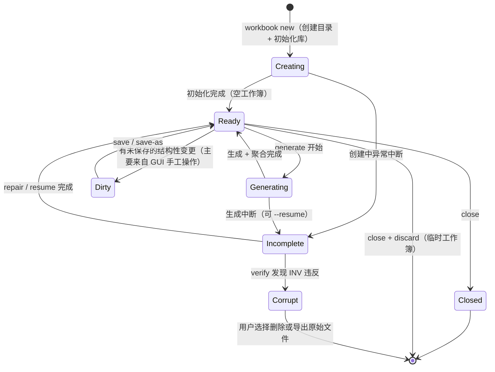
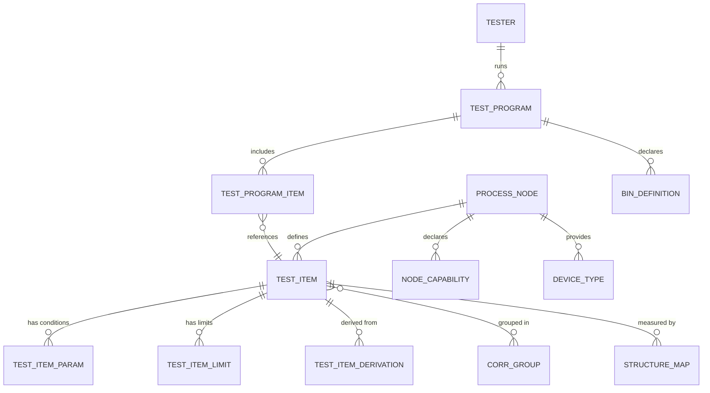

# SiliconDraft 技术设计说明书（How）

> **文档定位**：本文档承接 `doc/requirements-spec.MD`（**需求规格说明书**，回答"必须做到什么"）中移出的**实现细节**——技术选型、工程结构、数据结构、接口签名、算法步骤、格式实现与验证计划。本文档回答"**用什么技术、什么结构、什么代码**做到"。
>
> **本文档不构成需求**：其中的技术选择可在**不改变需求**的前提下重构。但**不包括** `doc/contracts/` 中定义的对外契约（CLI 命令与退出码、配置字段、输出格式、工作簿包格式）——契约变更属破坏性变更，必须公告。
>
> | 项 | 内容 |
> | --- | --- |
> | 文档版本 | **v1.0** |
> | 生成方式 | 由 `doc/requirements-merged.MD`（v1.0 合并版）按 `doc/requirements-scope-review.MD`（需求与实现分离评审）拆分而来；内容为**机械搬迁 + 仅补连接性文字**，无语义变更 |
> | 拆分日期 | 2026-10-14 |
> | 关联文档 | `requirements-spec.MD`（需求，What） · `contracts/`（契约，Contract） · `requirements-merged.MD`（拆分前基线，只读留档） |
>
> **编号约定**：需求编号（`SD-*` / `DQ-*` / `AC-*` / `US-*` / `D-*` / `R-*` / `BR-*`）在拆分过程中**保持不变**，用于与需求册、验收标准双向追溯。
> **章节引用约定**：正文中的 `§X.Y` 引用沿用**合并版**的章节号（拆分后相对位置已变），对照关系见下表。

**与需求册的章节对照**

| 本文档章节 | 承接自（合并版） | 对应需求册位置 |
| --- | --- | --- |
| §1 技术选型与理由（ADR） | §0.5（技术部分）、§1.1、§8.1.2、§8.2.1、§16.2 | 仅"技术约束"保留于需求册 §11.2 |
| §2 解决方案结构与依赖规则 | §1.2、§1.5 | 无（纯实现） |
| §3 架构与流程 | §1.3、§1.6（图）、§2.3（状态机） | 需求册 §4.3 |
| §4 关键接口与宿主入口 | §1.4、§4.4、§6.2、§6.3 | 需求册 §1.3、§6.6 |
| §5 存储设计 | §4 全章 | 需求册 §4.7（容量与磁盘空间） |
| §6 插件机制 | §6.4、§6.5、§6.6 | 需求册 §6.6 |
| §7 数值与算法 | §3.3.2、§3.3.3、§3.7.2 | 需求册 §3.3、§3.7.2 |
| §8 并发与锁机制 | §2.6 | 需求册 §4.5 |
| §9 数据模型（测试项库） | §7.2 | 需求册 §8.2 |
| §10 界面实现 | §8.1.4、§8.1.5 | 需求册 §5.4、§5.7 |
| §11 工程与质量约束 | §11.3、§11.8、§11.9 | 需求册 §11.7、§11.8 |
| §12 技术验证计划（Spike） | §15.3 | 无（纯实现计划） |
| §13 架构扩展点（接缝） | §15.6 | 需求册 §15.5 |
| §14 技术风险与待决事项 | §13（技术项）、§14（技术项） | 需求册 §13、§14 |
| 附录 A 完整配置示例 | §16.3 | `contracts/config.MD` |
| 附录 B C# 导出插件示例 | §16.9 | 无 |
| 附录 C 核心表 DDL | §16.10 | `contracts/workbook-package.MD` |

---

## 1. 技术选型与理由（ADR）

> 本章承接：已确认的技术决策记录（原 §0.5）、技术栈总览（原 §1.1）、GUI 与 CLI 的技术选型（原 §8.1.2 / §8.2.1）、完整包选型表（原 §16.2）。
> **注意**：原 §0.5 表中的 `D-05`~`D-15`、`D-18` 属**产品行为约定**（非技术选型），已在需求册 §0.4 与各功能章节中重述为需求；保留在此仅为决策记录完整性。

### 1.1 已确认决策记录（含产品行为，供追溯）

> 这些决策已经过确认，**不要再重新提出**。被否决的备选列在末列，避免重复讨论。

| 编号 | 决策项 | 选定方案 | 已否决的备选 |
| --- | --- | --- | --- |
| **D-01** | 技术栈 | **全 .NET / C#**，目标 **.NET 10 (LTS)**。单一语言、单一运行时、单一进程 | Python 核心 + Avalonia GUI（IPC）；C# 核心 + Python 算数值 |
| **D-02** | 交付形态 | **单一程序 + 双入口**：无子命令启动 GUI，带子命令走 CLI 且**不初始化 Avalonia** | 两个独立程序；GUI 内嵌命令行 |
| **D-03** | GUI 框架 | **Avalonia 12** + CommunityToolkit.Mvvm；**无 B/S、无本地 HTTP 服务** | 本地 Web 服务 + 浏览器（原 v0.2 方案） |
| **D-04** | 图表与可视化 | 统计图表用 **OxyPlot**（MIT）；**Wafer Map 用 SkiaSharp 自绘** | LiveCharts2；ScottPlot；Avalonia Pro 商业图表 |
| **D-05** | 目标平台 | **Windows / macOS / Linux 三平台对等**，6 个 RID（含 arm64） | Windows 优先；仅 Windows |
| **D-06** | 数据组织单元 | **工作簿模型**：一次生成任务 = 一个工作簿 = **一个独立 DuckDB 库** | 全局单库累积所有历史数据 |
| **D-07** | 工作簿与任务粒度 | **严格 1:1**：一个工作簿对应一轮生成；「继续后续任务」指同库内聚合/查询/导出/补算，**不追加新轮次** | 工程容器（一个工作簿含多轮生成、多 dataset）；两者兼容 |
| **D-08** | 工作簿磁盘形态 | **目录包** `<name>.sdworkbook/`；另提供 `pack`/`unpack` 打成单文件 `.sdwb` 用于分发 | 单文件 zip 容器；裸 `.duckdb` 文件 |
| ~~D-09~~ | ~~工作簿发现方式~~ | ❌ **已撤销**：原方案为"托管工作区 + 轻量索引（`workspaces/<ws>/` + `workspace.json`）"。由 **D-10** 替代 | — |
| **D-10** | 工作簿打开方式 | **Excel 式文档模型**：通过**文件选择对话框**选路径打开（也支持粘贴路径）；"新建 / 打开 / 最近打开"三个入口；**应用不维护文件清单、不扫描磁盘、不做文件管理** | 托管工作区 + 索引；全盘扫描自动发现 |
| **D-11** | 对外命名 | **工作簿 / `workbook` / `.sdworkbook`**（单文件包 `.sdwb`）。**不再使用"工作区 / Workspace"** | 工作区（Workspace）；项目（Project） |
| **D-12** | 工作簿间关系 | **完全隔离**：只允许单工作簿操作。**不提供**跨工作簿对比、汇总、查询、只读附加会话。**同一时刻只打开一个工作簿** | 保留双工作簿对比；对比 + 批量汇总 |
| **D-13** | 最近打开 | **保留 MRU**：最多 20 项，纯 `app-settings.json` 中的路径列表；不扫描磁盘、不读摘要、不做文件管理；可整体关闭；路径失效时提示而非静默移除 | 不保留（纯文件对话框） |
| **D-14** | 新建默认位置 | **系统文档目录下的 SiliconDraft 子目录**：`~/Documents/SiliconDraft/`（Windows `%USERPROFILE%\Documents\SiliconDraft`）。**默认目录只影响新建，不限制打开位置** | 记住上次位置；应用数据目录 |
| **D-15** | 临时工作簿 | 放 `SILICONDRAFT_HOME/temp/`，关闭时提示"保存 / 丢弃 / 保留以备恢复"，默认 7 天保留期；清理必须确认 + 优先进回收站。**不得放系统临时目录** | 退出即删；永不自动删 |
| **D-16** | 存储引擎 | **DuckDB**（通过 DuckDB.NET），**Parquet** 作为归档与暂存格式 | SQLite；纯 Parquet；HDF5；RocksDB |
| **D-17** | 插件机制 | **`plugin.json` 清单 + .NET 程序集 + `AssemblyLoadContext` 隔离**；插件只引用 `SiliconDraft.PluginApi` | Python Entry Points / `plugin.py` |
| **D-18** | 第一期格式范围 | CP → **STDF**；WAT → **AD5**；另提供 `csv` 内置插件仅供调试。**不做 YMS 归属识别** | 全格式一次性交付 |


> **拆分说明**：`D-01`（语言与运行时）、`D-03`（GUI 框架）、`D-04`（图表库）、`D-16`（存储引擎）、`D-17`（插件机制）为**技术选型**，仅约束本文档；`D-02`、`D-05`~`D-15`、`D-18` 为**产品行为或交付形态**，其需求表述见需求册 §0.4 与 §2、§4、§6 各章。`D-09` 为已撤销方案，保留供避免重复提出。

### 1.2 技术栈总览


| 领域 | 选型 | 说明 |
| --- | --- | --- |
| 语言 / 运行时 | **C# / .NET 10 (LTS)** | 单一语言、单一运行时、单一进程 |
| GUI 框架 | **Avalonia 12.x**（XAML + C# + MVVM） | Skia 渲染；跨平台一致；无 B/S |
| MVVM | **CommunityToolkit.Mvvm 8.x** | 源生成器，无需 Reactive 心智模型 |
| 宿主 / DI / 配置 / 日志 | `Microsoft.Extensions.Hosting` / `.DependencyInjection` / `.Configuration` / `.Logging` + `Serilog` | GUI 与 CLI 共用同一个 `IHost` 构建过程 |
| 命令行 | **System.CommandLine** + **Spectre.Console** | 参数解析 + 进度条/表格/树形输出 |
| 图表 | **OxyPlot.Avalonia** + **OxyPlot.SkiaSharp** | 统计图表 + PNG/SVG 导出 |
| Wafer Map | **SkiaSharp 自绘控件** | OxyPlot 的规则网格热力图模型不适合不规则 die 布局 |
| 数值与统计 | **MathNet.Numerics** | 分布、FFT（谱合成空间场）、线性代数、统计 |
| 数据库 | **DuckDB.NET**（`DuckDB.NET.Data.Full`） | 嵌入式列式 OLAP，含原生库 |
| 归档 / 暂存 | **Parquet** | 只读多实例共享；分区目录规范 |
| YAML | **YamlDotNet** | 配置文件、预设、节点包、测试项库 |
| JSON Schema | **JsonSchema.Net** + **JsonSchema.Net.Generation** | 配置校验 + 模板生成 + GUI 表单 |
| 测试 | **xUnit** + FluentAssertions + **Verify**（金标准快照）+ BenchmarkDotNet + coverlet | 见 §11.3 |
| 打包 | `dotnet publish`（self-contained 单文件 + ReadyToRun） | 6 个 RID |

> 完整包选型表（含许可）见 §16.2。


### 1.3 GUI 技术选型


**SD-GUI-020**（MUST）：技术选型与版本基线：

| 项 | 选型 |
| --- | --- |
| UI 框架 | Avalonia 12.x |
| MVVM 框架 | CommunityToolkit.Mvvm 8.x |
| 依赖注入 / 宿主 / 配置 / 日志 | Microsoft.Extensions.* + Serilog |
| 表格 | `Avalonia.Controls.DataGrid`（明细表）+ `Avalonia.Controls.TreeDataGrid`（层级导航），两者均需**开启虚拟化** |
| 统计图表 | OxyPlot.Avalonia + OxyPlot.SkiaSharp |
| Wafer Map | SkiaSharp 自绘自定义控件 |
| 主题 | Avalonia `FluentTheme`（浅色 / 深色），必须跟随系统并可手动切换 |
| 本地化 | `.resx` + Avalonia 本地化绑定（中文默认，英文 SHOULD） |

**SD-GUI-021**（MUST）：必须使用 OxyPlot 实现下列图表，且**必须使用同一套图表构建代码**为 GUI 展示与 DQ/HTML 报告出图服务（避免两套图表逻辑）：

| 图表 | OxyPlot 系列 | 数据源 |
| --- | --- | --- |
| 参数直方图 | `HistogramSeries`（+ `LineSeries` 叠加规格限与目标值） | `sd_param_hist` |
| 累积分布 | `LineSeries`（CDF） | 预聚合 + 增量计算 |
| 箱线图 | `BoxPlotSeries` | `sd_param_stat` |
| Wafer 间趋势 | `LineSeries` | `sd_yield_summary_wafer` / `sd_param_stat` |
| Lot 间趋势 | `LineSeries` | `sd_yield_summary_lot` |
| Bin Pareto | `BarSeries` + `LineSeries`（累计占比，次坐标轴） | `sd_bin_stat` |
| 径向 / 扇区曲线 | `LineSeries`（含误差带 `AreaSeries`） | `sd_radial_profile` / `sd_sector_profile` |
| 相关性矩阵 | `HeatMapSeries`（发散色阶，中心为 0） | `sd_corr_matrix` |
| 相关性散点 | `ScatterSeries`（+ 回归线） | 按需查询 |
| Wafer Map（Bin / 参数分布 / 缺陷叠加） | **不适用** —— 由自绘控件实现（§8.1.4） | `sd_die` / `sd_die_defect_hit` |

**SD-GUI-022**（MUST）：所有图表必须支持**导出 PNG 与 SVG**（通过 `OxyPlot.SkiaSharp` / `OxyPlot.SvgExporter`），用于 DQ 自检报告与用户手工取图。

**SD-GUI-023**（MUST）：图表必须标注**规格限（LSL/USL）与预警限**，越限区域必须有视觉区分（颜色 / 阴影带），**不得只画数据分布**。这是"人工快速判断数据是否合理"的核心诉求。

**SD-GUI-024**（SHOULD）：图表配色必须对色盲友好，且必须支持浅色 / 深色主题下的可读性（坐标轴、网格、文字颜色随主题切换，**不得硬编码深色背景配深色文字**）。

**SD-GUI-025**（SHOULD）：大量数据点的图表（如跨 100 Lot 的散点）必须做**抽稀或聚合**再渲染，**禁止把百万点直接交给图表控件**。


### 1.4 CLI 技术选型


**定位**：CLI 面向**自动化流水线**场景，核心目的是让外部系统（CI/CD、调度平台、YMS 测试框架）**无人值守地**调用。因此 CLI 的优先级是**确定性与可编排性**：参数稳定、退出码标准、日志结构化、**stdout 与 stderr 严格分离**。

**SD-CLI-010**（MUST）：CLI 必须基于以下实现，且不得引入 Python 运行时：

| 项 | 选型 |
| --- | --- |
| 参数解析 | **System.CommandLine** |
| 终端渲染 | **Spectre.Console**（进度条、表格、树、彩色错误、`--no-color`） |
| 日志 | `Microsoft.Extensions.Logging` + `Serilog`（Compact JSON） |
| YAML 解析 | **YamlDotNet**（含行号信息） |
| Schema 校验 | **JsonSchema.Net** + **JsonSchema.Net.Generation** |
| 进程退出 | `Environment.ExitCode` / `Main` 返回值 |

**SD-CLI-011**（MUST）：配置文件校验失败时，错误信息必须包含：**字段路径（JSON Pointer 形式）+ 期望类型 / 约束 + 实际值 + 修复建议 + 涉及的文件与行号**。

**SD-CLI-012**（MUST）：`silicondraft validate --explain` 必须输出"解析后的完整配置 + 每个生效值的来源（哪个文件 / 环境变量 / CLI 参数 / 默认值）"。

**SD-CLI-013**（MUST）：必须支持生成完整的**带中文注释的配置文件模板**（`silicondraft init --template`），模板内容必须与 Schema 保持同步（由 Schema 生成的注释与字段顺序驱动，避免模板与代码漂移）。


### 1.5 完整包选型表（含许可）


| 用途 | 包 | 许可 | 备注 |
| --- | --- | --- | --- |
| UI 框架 | `Avalonia` 12.x | MIT | 需 .NET 8 SDK+（本项目 .NET 10） |
| MVVM | `CommunityToolkit.Mvvm` | MIT | 源生成器；备选 `Avalonia.ReactiveUI` |
| 表格 | `Avalonia.Controls.DataGrid`、`Avalonia.Controls.TreeDataGrid` | MIT | TreeDataGrid 适合层级导航 |
| 统计图表 | `OxyPlot.Avalonia`、`OxyPlot.SkiaSharp` | MIT | SkiaSharp 包提供 PNG/SVG 导出 |
| 2D 图形 | `SkiaSharp`（Avalonia 已传递依赖） | MIT | 自绘 Wafer Map |
| 宿主 / DI / 配置 | `Microsoft.Extensions.Hosting`、`.DependencyInjection`、`.Configuration.*` | MIT | GUI 与 CLI 共用 |
| 日志 | `Microsoft.Extensions.Logging` + `Serilog` + `Serilog.Formatting.Compact` + `Serilog.Sinks.File` | MIT / Apache-2.0 | JSON Lines 轮转日志 |
| CLI 解析 | `System.CommandLine` | MIT | — |
| 终端渲染 | `Spectre.Console` | MIT | 进度条、表格、树、`--no-color` |
| YAML | `YamlDotNet` | MIT | 含行号信息（用于校验错误定位） |
| JSON | `System.Text.Json`（源生成器） | MIT (BCL) | 必须用源生成以支持裁剪 / AOT |
| JSON Schema | `JsonSchema.Net` + `JsonSchema.Net.Generation` | MIT | 配置校验 + 模板生成 + GUI 表单 |
| 数值与统计 | `MathNet.Numerics` | MIT | 分布、FFT、线性代数、Stat 模块 |
| 空间场谱合成 | 自研（基于 `MathNet.Numerics` 的 FFT） | — | 见 `SD-EXT-104` |
| 变差函数 / 克里金 | 自研 | — | 一期用 IDW（极简自研） |
| 缺失分布 | **自研**：skew-normal、GEV、混合分布、广义 Pareto | — | 第二期所需 |
| 数据库 | `DuckDB.NET.Data.Full` | MIT（**Secondary 支持级**） | 含原生库；必须固定版本 |
| Parquet 直写（可选） | `ParquetSharp` | Apache-2.0 | 仅在需要绕开 DuckDB 写 Parquet 时使用 |
| XLSX（第二期） | `ClosedXML` 或 `DocumentFormat.OpenXml` | MIT | 第二期格式扩展 |
| 打包 / 压缩 | `System.IO.Compression`（ZipArchive，BCL） | MIT (BCL) | `workbook pack` / `unpack`；**不需要第三方压缩库** |
| 工作簿锁 | **应用层锁文件（`FileMode.CreateNew`）+ DuckDB 原生文件锁兜底** | MIT (BCL) | 不使用 `FileShare` / `FileStream.Lock` 做跨进程仲裁：Unix 上非 `None` 的 `FileShare` 不提供写互斥，macOS 上 `FileStream.Lock` 抛 `PlatformNotSupportedException`；见 ADR-0002 |
| 回收站 / 垃圾箱 | 平台相关：Windows `SHFileOperation`/`IFileOperation`、macOS `NSFileManager.TrashItem`、Linux Freedesktop Trash 规范 | — | **无统一跨平台库**，需自研薄封装 + 降级路径（`extra/trash/`） |
| 状态机 | 自研（枚举 + 显式转移表） | — | 工作簿状态机不复杂，**不引入第三方状态机库** |
| 单测 | `xUnit`、`FluentAssertions` | Apache-2.0 / MIT | — |
| 快照 / 金标准测试 | `Verify`（VerifyTests） | MIT | 适合 STDF / AD5 / CSV 产物的金标准比对 |
| 架构测试 | `ArchUnitNET` 或自研 xUnit 断言 | Apache-2.0 | 强制依赖方向与隔离约束 |
| 性能基准 | `BenchmarkDotNet` | MIT | `SD-SCL-085` |
| 覆盖率 | `coverlet` | MIT | — |
| 模拟 / 桩 | `NSubstitute` 或 `Moq` | BSD / MIT | — |
| 依赖漏洞扫描 | `dotnet list package --vulnerable` + CI 集成 | — | 供应链安全 |

**许可合规**：全部首选包均为 MIT / Apache-2.0 等宽松许可，与项目 Apache-2.0 兼容。引入任何 GPL / AGPL 或商业授权包必须先评审。


---

## 2. 解决方案结构与依赖规则

> 本章承接原 §1.2（解决方案与项目结构）与 §1.5（依赖方向硬约束）。
> **需求侧对应**：仅"应用自身数据与用户产出必须分离存放"一条保留于需求册 §1.3（`SD-SYS-193`）。

### 2.1 解决方案与项目结构


**SD-SYS-160**：采用单一 .NET 解决方案，项目划分必须保证**依赖方向单向**：`Core` 不依赖任何 UI / CLI / 插件实现。

```
SiliconDraft.sln
├── Directory.Build.props            # 统一 TFM / LangVersion / Nullable / TreatWarningsAsErrors
├── Directory.Packages.props         # 中央包版本管理（CPM）
├── src/
│   ├── SiliconDraft.PluginApi/      # ★ 插件契约程序集（极薄，仅接口 + DTO）
│   │                                #   多目标 net8.0;net10.0，独立版本号（§6.1）
│   ├── SiliconDraft.Core/           # 核心引擎（net10.0，不引用 Avalonia / CLI）
│   │   ├── Workbook/                #   工作簿 / 目录包 / 生命周期 / MRU / 临时管理
│   │   ├── Geometry/                #   Wafer / DieMap / Scribe / WatLayout
│   │   ├── Physics/                 #   空间场 / 物理量 / 推导模型 / 数值分布
│   │   ├── Defects/                 #   缺陷注入（几何型 + 参数型）
│   │   ├── Execution/               #   CP/WAT 执行模拟 / Bin 分配 / Retest
│   │   ├── Library/                 #   测试项库 / 节点继承解析 / 命名规则
│   │   ├── Storage/                 #   IStorageBackend / DuckDbBackend / 连接管理
│   │   ├── Export/                  #   IExportPlugin / Registry / Scheduler / Naming
│   │   ├── Quality/                 #   DQ 检查与报告
│   │   ├── Orchestration/           #   任务编排 / 分片 / 幂等 / 取消
│   │   └── Rng/                     #   分层种子（种子派生）
│   ├── SiliconDraft.Plugins.Stdf/   # 内置插件：STDF（CP）
│   ├── SiliconDraft.Plugins.Ad5/    # 内置插件：AD5（WAT）
│   ├── SiliconDraft.Plugins.Csv/    # 内置插件：CSV（调试 / 参考实现）
│   ├── SiliconDraft.Sdk/            # 对外 SDK 门面（供外部 .NET 系统引用）
│   ├── SiliconDraft.Cli/            # CLI 层
│   ├── SiliconDraft.Gui/            # Avalonia 桌面应用
│   └── SiliconDraft.App/            # ★ 双入口宿主（唯一发布产物）
├── plugins/                         # 外部插件放置目录（开发期）
├── nodes/                           # 工艺节点包目录（nodepack）
└── tests/
    ├── SiliconDraft.Core.Tests/     # 含工作簿生命周期测试
    ├── SiliconDraft.Plugins.Tests/  # 含 Verify 金标准快照测试
    ├── SiliconDraft.Gui.Tests/      # ViewModel 层单测（headless）
    ├── SiliconDraft.E2E.Tests/      # 端到端：建工作簿 → 生成 → 入库 → 查询 → 导出 → 校验 → 存盘 → 重开
    └── SiliconDraft.Benchmarks/     # BenchmarkDotNet 性能基准
```

**运行期目录布局**

```
%SILICONDRAFT_HOME%/                    # 默认 ~/.silicondraft —— 只放"应用自身"的东西
├── config.yaml                      # 应用级默认配置（可被 CLI/GUI 参数覆盖）
├── app-settings.json                # GUI 应用设置（主题、窗口尺寸、默认目录、最近打开 MRU）
├── plugins/                         # 用户级插件目录
├── nodes/                           # 用户级节点包目录
├── temp/                            # ★ 临时工作簿目录（默认 7 天保留期）
│   └── tmp_20261014_113012_a1b2c3.sdworkbook/
└── recovery.json                    # ★ 异常退出时的会话登记（用于"恢复"列表）

%USERPROFILE%/Documents/SiliconDraft/   # ★ 新建工作簿的默认落点
├── centerhigh_25lot_20261014.sdworkbook/
└── baseline_25lot_20261014.sdworkbook/
                                         # 用户也可把工作簿放在任意位置
```

> **设计要点**：`SILICONDRAFT_HOME` 与"文档目录"是**两个不同的位置**——前者是应用自己的数据（配置/插件/临时/恢复登记），后者是用户的产出。这样用户备份/迁移自己的实验数据时不必连带应用状态。


### 2.2 依赖方向硬约束


**SD-SYS-180**（MUST）：以下依赖方向**不可违反**，由 CI 强制。

| 允许 | 禁止 |
| --- | --- |
| `App` → `Gui`、`Cli` | `Core` → `Gui` / `Cli` / `Avalonia*` |
| `Gui` → `Core`、`Sdk`、`PluginApi` | `Gui` ↔ `Cli` 互相引用 |
| `Cli` → `Core`、`Sdk`、`PluginApi` | `Core` → `System.CommandLine` / `Spectre.Console` |
| `Core` → `PluginApi`（仅契约） | `Core` → 任何插件的**实现**程序集 |
| `Plugins.*` → `PluginApi`（仅契约） | 插件 → `Core` |

**SD-SYS-181**（MUST）：`SiliconDraft.Core` 的项目文件中**禁止出现** `Avalonia*`、`System.CommandLine`、`Spectre.Console` 等 UI / 终端类包引用。必须通过架构测试（`ArchUnitNET` 或自定义 xUnit 断言）在 CI 中强制校验，违反即构建失败（§11.2）。

**SD-SYS-182**（MUST）：`Core` 向表现层汇报进度与状态的唯一通道是**抽象接口**（`IProgress<T>`、`Channel<T>`、`CancellationToken`），禁止 `Core` 中出现任何 UI 线程调度、`Dispatcher`、事件订阅等 UI 概念。

**SD-SYS-183**（MUST）：GUI 与 CLI **必须共用同一个 `IHost` 构建过程**（`HostBuilder` + 统一的 `ConfigureServices` / `ConfigureAppConfiguration` / `ConfigureLogging` 扩展方法），差异只能通过"是否注册 UI 相关服务"体现。禁止在 GUI 与 CLI 中各自 `new` 一套服务或各自解析配置。


---

## 3. 架构与流程

> 本章承接原 §1.3（分层架构图）、§1.6（端到端时序图）与 §2.3（工作簿状态机）。
> **需求侧对应**：原 §1.6 图末的三条行为约束已改写并移入需求册 §1.3、§4.5。

### 3.1 分层架构





### 3.2 端到端数据流

> 原 §1.6 图末的 `SD-SYS-190`/`SD-SYS-191`/`SD-SYS-192` 三条需求已改写并移入需求册（见需求册 §1.3、§4.5），此处只保留流程图。




### 3.3 工作簿生命周期状态机


**SD-SYS-220**（MUST）：工作簿的生命周期状态必须持久化在 `workbook.json` 的 `state` 字段与库内 `sd_workbook.state` 中：



**SD-SYS-221**（MUST）：**必须区分"数据未完成（Incomplete）"与"数据损坏（Corrupt）"**：前者可恢复（`workbook resume` / `workbook repair`），后者需人工介入。GUI 必须用不同视觉状态呈现（进度图标 vs 警告图标），**禁止混为一谈**。

**SD-SYS-222**（MUST）：`workbook verify` 必须可在**不打开为读写**的前提下执行（只读打开库 + 读取清单），用于校验任意外部收到的工作簿包。必须输出结构化结果（`--output json`），含逐条 INV 的结论。

**SD-SYS-223**（SHOULD）：`workbook repair` 必须能处理：① 清理残留锁；② 重建清单（`rebuild-manifest`）；③ 修正 `state` 字段；④ 清理 staging 中已入库的残留文件；⑤ **报告无法修复的问题而非静默修改**。修复必须写操作日志，且**必须在修复前自动备份 `workbook.json`**。

> **打开时的状态收敛（实现规则）**：取得写锁后，若清单 `state ∈ {Creating, Generating}`，说明上次进程未正常关闭。必须先在库内 `sd_workbook.state` 与 `workbook.json.state` 中收敛为 `Incomplete`（WARN 记录），再继续；除此之外不得对数据做任何自动修正。


---

## 4. 关键接口与宿主入口

> 本章承接原 §1.4（单一程序双入口）、§4.4（分片/并发/连接与 `IConnectionManager`）、§6.2（契约程序集）、§6.3（插件接口定义）。
> **需求侧对应**：仅"GUI 与 CLI 必须共享同一核心引擎、能力对齐、行为一致"保留于需求册（`SD-SYS-060`、`SD-NFR-122`）。

### 4.1 单一程序双入口


**SD-SYS-170**（MUST）：交付**一个可执行程序**。`Main(string[] args)` 必须先做参数判定：

- 无子命令（或 `gui`）→ 初始化 Avalonia 并进入桌面应用
- 有子命令 → **不初始化 Avalonia / Skia**，直接走 CLI 路径
- `--help` / `--version` 在任一路径下均可快速返回

```csharp
// SiliconDraft.App/Program.cs（示意，最终以实现为准）
[STAThread]
public static int Main(string[] args)
{
    // 1) 纯 CLI 判定：不触碰 Avalonia 程序集
    if (CliEntry.ShouldHandle(args))            // 有子命令 / --help / --version
        return CliEntry.Run(args);              // 返回进程退出码

    // 2) GUI 路径
    return GuiEntry.Run(args);                  // BuildAvaloniaApp().StartWithClassicDesktopLifetime
}
```

**SD-SYS-171**（MUST）：CLI 路径必须通过**独立的类型与方法边界**实现（`CliEntry` 不得引用任何 Avalonia 类型），以保证 JIT 不在 CLI 场景加载 Avalonia 程序集、不产生 GUI 初始化开销。必须有性能测试证明 CLI 冷启动达标（§10.3）。

**SD-SYS-172**（MUST）：退出码必须由 `Main` 原样返回，保证流水线可读取（§8.2.5 的 20 档退出码语义不变）。

**SD-SYS-173**（SHOULD）：必须支持 `silicondraft gui` 显式子命令（在无参数行为可能被脚本包装改变的场景下提供确定性入口）；必须支持 `silicondraft --headless <cmd>` 显式声明无图形环境运行。

**收益**：核心代码、DI 容器、配置系统、日志系统 **100% 共享**，不存在"GUI 与 CLI 行为不一致"的可能；只发布一份产物 ⇒ 无版本漂移；天然规避 DuckDB 跨进程写锁（同一时刻只有一个进程持有某个工作簿）。


### 4.2 连接管理、分片与并发（`IConnectionManager`）

> 本节承接**原 §4.4 全部内容**（连接管理接口、追加语义、同进程多连接语义、并发模型与分片）。原 §4 章的其余小节见本文档 §5 存储设计。


**SD-STO-060**（MUST）：必须实现 `IConnectionManager`，作为**当前工作簿内**唯一的数据访问入口（作用域由 `WorkbookSession` 持有并随会话创建/销毁）：

```csharp
public interface IConnectionManager : IAsyncDisposable
{
    /// 绑定的工作簿（只读属性，会话创建后不可变更）
    WorkbookHandle Workbook { get; }

    /// 写作用域：会话内唯一，串行使用；内部为短事务
    ValueTask<IWriteScope> BeginWriteAsync(CancellationToken ct);

    /// 读连接：可并发；DuckDB 在同一进程内按路径复用同一 Database 实例，
    /// 因此同进程多连接是安全的（跨进程则不安全）
    ValueTask<DuckDBConnection> RentReadAsync(CancellationToken ct);

    /// 当前工作簿内归档 Parquet 的只读挂载（无需额外锁）
    Task AttachArchiveAsync(string parquetGlob, CancellationToken ct);

    Task<StorageInfo> GetInfoAsync(CancellationToken ct);
    Task CheckpointAsync(CancellationToken ct);
}
```

> **注意**：不存在 `AttachForeignWorkbookAsync` 这类"挂载其他工作簿"的方法（D-12 禁止）。

**SD-STO-061**（MUST）：写入必须采用**追加（append）语义**，**禁止对已写入行做 `UPDATE` / `DELETE` 的热路径操作**。依据：DuckDB 保证"追加永不冲突，即使在同一张表上"，这使进程内多线程并发追加是安全的；而并发 `UPDATE` 同一行会因乐观并发控制抛事务冲突。若确需修正数据，必须走"写入新行 + 标记版本"或"**整工作簿重建**"。

**SD-STO-062**（MUST）：必须验证并固化**同进程多连接的可见性与快照语义**（写连接已提交的事务对读连接是否立即可见、读连接是否看到一致快照）。验证脚本纳入 CI。若实测不满足预期，必须退化为「单连接 + 读写串行队列（读优先，读查询限时）」策略，且该退化路径必须同样通过全部功能与性能测试。

**SD-STO-063**（MUST）：并发模型与目标：

| 指标 | 要求 |
| --- | --- |
| 进程内并行分片任务数 | **≥ 16**（`Parallel.For` / `Task` 并行度，可配 `--parallel`，上限为 CPU 核数 × 2） |
| 跨工作簿并行 | **≥ 4 个独立工作簿同时生成** —— 必须是**跨实例/跨进程**的并行（4 个进程各写自己的工作簿），或 `batch` 场景下单进程**并行创建**多个独立工作簿（每个工作簿任一时刻只被一个会话打开）。**不是**"一个实例里同时打开 4 个工作簿"（后者被 D-12 禁止） |
| 跨机跨进程分片 | **≥ 4 台机器**，各自生成**独立工作簿**，用 Parquet / `workbook pack` 交换。**禁止两个实例同时写同一个工作簿** |
| 并发只读连接数 | **≥ 32**（GUI + 多 CLI query） |
| 读写混合 | 写进行时读查询可用（读旧快照），延迟增加 ≤ 50% |
| 结果一致性 | 与串行执行**字节级一致**；且**同一配置拆为一个工作簿或 N 个工作簿，对应 Lot/Wafer 的数据必须完全一致** |
| 占用冲突 | 工作簿被其他进程以读写打开时返回 `ERR_WORKBOOK_LOCKED (14)`（见 §8.2.5） |
| 总并发配额 | `--parallel` 必须是**全局配额**：进程内分片并行度 × 跨工作簿并行度不得超过配额，避免核数/内存超订 |
| 冲突处理 | 不得死锁、不得静默丢数据；支持 `--on-lock wait\|fail` |

**SD-STO-064**（MUST）：必须保留 `--shard-index / --shard-total` 能力，语义为**跨机/跨进程分片**：

| 场景 | 要求 |
| --- | --- |
| 同一工作簿跨机分片 | **禁止**（两个进程不能同时写同一个工作簿）。必须改为各自生成**独立的工作簿** |
| 跨工作簿交换 | 必须使用 **Parquet** 或 `workbook pack` 单文件包作为交换格式 |
| 合并/汇总 | **不提供任何跨工作簿的合并或汇总工具**。各工作簿独立存在，需要跨库统计时由用户在外部工具完成 |


### 4.3 插件契约程序集（`SiliconDraft.PluginApi`）


**SD-PLG-020**（MUST）：必须存在独立的、极薄的契约程序集 `SiliconDraft.PluginApi`，**只包含**：

- `IExportPlugin` 接口
- 只读数据模型（`WorkbookInfo` / `DatasetInfo` / `LotInfo` / `WaferInfo` / `TestItemDef` / `DieRecord` / `WatRecord` / `ExportContext` / `ExportResult` / `FileArtifact` / `ExportIssue`）
- 抽象数据游标 `IDataCursor`
- 进度与取消的抽象（直接使用 BCL 的 `IProgress<T>` / `CancellationToken`）

**SD-PLG-021**（MUST）：`PluginApi` 必须满足：

| 要求 | 说明 |
| --- | --- |
| 独立版本号 | 与主程序版本**解耦**，用 `ApiVersion`（semver）表达；宿主与插件做兼容检查 |
| 多目标框架 | `net8.0;net10.0`，使插件作者可基于任一 LTS 构建 |
| 零依赖 | 除 BCL 外**不得**依赖任何第三方包，避免版本冲突（这是插件能稳定加载的前提） |
| 不引用 Core | `PluginApi` **不得**引用 `SiliconDraft.Core`；只定义"宿主推送给插件什么"和"插件必须实现什么" |
| API 兼容承诺 | 在同一主版本内只增不改不删；破坏性变更必须升主版本并在 `plugins doctor` 中明确报错 |

**SD-PLG-022**（MUST）：插件**只能引用 `PluginApi`**，不得引用 `SiliconDraft.Core`。这从根本上杜绝插件耦合内部实现 —— 插件所需的一切数据由宿主通过 `IDataCursor` 与推送的记录对象提供。


### 4.4 插件接口定义


**SD-PLG-030**（MUST）：插件必须实现以下接口：

```csharp
namespace SiliconDraft.PluginApi;

public static class PluginApi
{
    public const string Version = "1.0";
}

/// <summary>只读的工作簿元信息（v0.3.2 新增）。</summary>
public sealed record WorkbookInfo(
    string WorkbookId, string Name, string Path, bool IsTemporary,
    string Preset, string Node, string NodepackRef, string ConfigHash, long SeedRoot);

public interface IExportPlugin
{
    // ---------- 元信息（必须声明） ----------
    string Name { get; }                       // 唯一名，如 "stdf"
    string Version { get; }                    // 插件版本（semver）
    string ApiVersion { get; }                 // 依赖的宿主 API 版本
    string DisplayName { get; }                // 人类可读名
    IReadOnlySet<string> TestTypes { get; }    // {"CP"} / {"WAT"} / {"CP","WAT"}
    string FileExtension { get; }              // "stdf"
    bool SupportsSplitPerWafer { get; }
    bool SupportsParallel { get; }
    bool SupportsStreaming { get; }
    ExportPathTemplate DefaultPathTemplate { get; }

    // ---------- 配置 Schema ----------
    /// <summary>插件私有配置的 JSON Schema，供 GUI 生成表单与 CLI 校验。</summary>
    JsonSchema OptionsSchema { get; }

    // ---------- 生命周期 ----------
    IReadOnlyList<ExportIssue> ValidateContext(ExportContext context);
    void Open(ExportContext context);
    void BeginLot(LotInfo lot);
    void BeginWafer(WaferInfo wafer);
    int WriteDieBatch(IReadOnlyList<DieRecord> records);
    int WriteWatBatch(IReadOnlyList<WatRecord> records);
    void EndWafer(WaferInfo wafer, WaferStats stats);
    void EndLot(LotInfo lot, LotStats stats);
    ExportResult Finalize();
    void Abort();
}

/// <summary>宿主提供的数据入口；插件通过它订购额外数据（如统计、Bin 定义）。</summary>
public interface IDataCursor
{
    IAsyncEnumerable<IReadOnlyList<DieRecord>> IterDiesAsync(
        string? lotId = null, string? waferId = null, int batchSize = 5000,
        CancellationToken ct = default);

    IAsyncEnumerable<IReadOnlyList<WatRecord>> IterWatsAsync(
        string? lotId = null, string? waferId = null, int batchSize = 2000,
        CancellationToken ct = default);

    IReadOnlyList<TestItemDef> GetTestItems(string testType);
    Task<WaferStats> GetWaferStatsAsync(string lotId, string waferId, CancellationToken ct = default);
    Task<LotStats> GetLotStatsAsync(string lotId, CancellationToken ct = default);
    IReadOnlyList<BinDefinition> GetBinDefinitions();
}
```

**SD-PLG-031**（MUST）：`ExportContext` 必须包含以下成员，使插件能按工作簿组织输出并遵守落点策略：

```csharp
public sealed class ExportContext
{
    public WorkbookInfo Workbook { get; init; }        // 当前工作簿（只读）
    public DatasetInfo Dataset { get; init; }          // 本次生成轮次（语义收窄，§4.2）
    public string OutputRoot { get; init; }            // 本次导出的根目录（默认 {workbook_exports}）
    public bool OutputRootIsInsideWorkbook { get; init; } // 决定是否提示"产物不在包内"
    public ExportPathTemplate PathTemplate { get; init; }
    public ExportPathVariables PathVariables { get; init; }
    public IReadOnlyList<TestItemDef> TestItems { get; init; }
    public string TestProgramId { get; init; }
    public string TesterId { get; init; }
    public long Seed { get; init; }
    public bool DryRun { get; init; }
    public IProgress<ExportProgress> Progress { get; init; }
    public T GetOptions<T>() where T : class;          // 插件私有配置（已按 OptionsSchema 校验）
}
```

**SD-PLG-032**（MUST）：接口语义约束：

| 约束 | 说明 |
| --- | --- |
| 批量写 | `WriteDieBatch` / `WriteWatBatch` 必须支持批量；允许返回 0（全部跳过） |
| 流式 | 插件必须能在不缓存全量数据的前提下工作；`IDataCursor` 内部按 `batchSize` 流式读取 |
| 不得直连数据库 | 插件不得引用 Core、不得打开数据库、不得访问网络、不得修改宿主全局状态 |
| **不得自行决定落点** | 插件必须使用 `context.OutputRoot` 与 `context.PathTemplate` 渲染输出路径；**禁止插件硬编码绝对路径或写到工作簿之外**。若要写到工作簿外的位置，必须由用户在配置中指定并由宿主校验（§5.2 `SD-EXP-032`） |
| **不得依赖工作簿内部细节** | 插件只能通过 `WorkbookInfo` 读取元信息，禁止假设 `workbook.duckdb` 的存在路径或直接访问 `<workbook>/` 下的目录（除 `OutputRoot` 外） |
| 失败表达 | `ValidateContext` 返回的 `ExportIssue` 中 `severity == Error` ⇒ 宿主阻止导出并返回相应退出码 |
| 异常边界 | 插件抛出的异常必须被宿主捕获并包装为带插件名的错误；**决不允许插件异常穿透导致进程崩溃** |
| 异步边界 | 接口为同步（避免插件引入事件循环）；异步读取由宿主在内部完成，**禁止插件内 `.Result` / `.Wait()`** |
| `Finalize` | 若存在 `Error` 级问题，宿主视为该文件失败（可重试判定） |
| `Abort` | 必须幂等且不得抛异常 |

**SD-PLG-033**（MUST）：`ExportIssue` 必须包含机器可读的 `Code`（如 `ERR_STDF_NO_ITEMS`）、`Message`、`Hint`（修复建议）、`Severity`，以支撑 §11.7 的"错误信息必须附带修复建议"要求。


### 4.5 质量检查接缝（DQ observer）

> **需求侧对应**：需求册 §9 `DQ-06`、`SD-NFR-200`。`DQ-06` 的度量对象是**逐 die 物理量残差场**，而物理量值不入库（`sd_cp_result_wide` 只存测试项），因此生成引擎与质量检查之间需要一个**进程内、单向、流式**的接缝；不新增表、不落盘。

```csharp
namespace SiliconDraft.Core.Quality;

public interface IQualityObserver
{
    void OnQuantityFieldEvaluated(in QuantityFieldSample sample);
}

public readonly record struct QuantityFieldSample(
    string LotId,
    string WaferId,
    string QuantityId,
    ReadOnlyMemory<DieSample> Dies);

public readonly record struct DieSample(
    string DieId,
    double XMm,
    double YMm,
    double Value,
    bool IsTested,
    bool IsDefectHit);
```

| 约束 | 规定 |
| --- | --- |
| 调用时机 | 每个 `(wafer, 物理量)` 的场求值（含缺陷影响）完成后、测试项推导之前 |
| 消费者 | `Dq06Checker` 实现 `IQualityObserver`，边收边算；生成结束时由 `IQualityRunner` 汇总并写 `sd_dq_result` |
| 生命周期 | 只覆盖本次生成；对已存档数据集重跑 DQ 时无证据源，`DQ-06` 记为 `SKIP` 并给出提示 |
| 可见性 | `Core` 内部接缝，不进入 `PluginApi`，插件不可见 |
| 内存 | O(单个 `(wafer, 物理量)`)，不保留运行级全量样本 |


---

## 5. 存储设计

> 本章承接原 §4 全章（存储选型、库表结构、索引与查询、批量入库通道、归档与共享、容量估算、数据库运维）。
> **原 §4.4（分片、并发与连接）已移至本文档 §4.2**，此处不重复。
> **需求侧对应**：需求册 §4.7 只保留"容量与磁盘空间要求"，其余为纯实现。


> **本章合并 v0.2 §4.3（存储设计与表结构）与 v0.3.2 的实现修订。**
> **关键前提**：存储的**作用域是"当前打开的工作簿"**，不是"一个全局库"。§4.2 的全部表结构在**每个工作簿内逐库建立**。

### 设计目标与选型

**SD-STO-010**（MUST）：数据必须先持久化到工作簿内的嵌入式数据库，**导出为独立的显式动作**。该库是该工作簿的**单一事实来源（Single Source of Truth）**。

**SD-STO-011**（MUST）：存储选型必须满足以下原则：

| 原则 | 编号 | 说明 |
| --- | --- | --- |
| 嵌入式、零运维 | **SD-STO-012** | 不引入独立服务器进程；单文件或单目录可拷贝迁移 |
| 高吞吐批量写入 | **SD-STO-013** | 必须支持批量追加写入（Appender 类接口），满足 §10 的写入吞吐指标 |
| 列式分析性能 | **SD-STO-014** | 聚合查询（GROUP BY、直方图、相关系数）必须走列式向量化执行，禁止行式全表扫描 |
| 并发读、受控写 | **SD-STO-015** | 必须支持多线程并发只读；写入必须通过受控通道 |
| 与文件格式互通 | **SD-STO-016** | 必须能直接查询外部 Parquet/CSV（用于归档数据的联邦查询） |
| 跨平台 | **SD-STO-017** | 必须在 6 个 RID（Win/macOS/Linux × x64/arm64）上行为一致 |
| .NET 生态成熟 | **SD-STO-018** | 必须有稳定的 .NET 绑定与活跃维护 |
| 可替换 | **SD-STO-019** | 必须有 `IStorageBackend` 抽象层，允许未来替换为 ClickHouse / StarRocks 等 |

**SD-STO-020**（MUST）：第一期采用 **DuckDB 作为主数据引擎**，**Parquet 作为归档与暂存格式**。

**选型评估（决策依据留档）**

| 候选 | 优势 | 劣势 | 结论 |
| --- | --- | --- | --- |
| **DuckDB** | 嵌入式 OLAP；列式 + 向量化；批量写入吞吐高；单文件；可直接 `SELECT ... FROM 'x.parquet'`；聚合性能接近专业数仓 | 单文件写并发受限（单写多读）；无原生分区表 | ✅ **主选** |
| SQLite | 极成熟；事务完善；单文件 | 行式存储；大规模聚合慢；写入吞吐低 | ⚠️ 仅作元数据/任务状态库的备选 |
| HDF5 | 科学数据友好 | 无 SQL；无索引；关系查询困难 | ❌ |
| Parquet only | 压缩率高；列式；生态好 | 无事务；无索引；不适合频繁小范围点查 | ⚠️ 作为**归档层**与暂存格式 |
| RocksDB / LMDB | 极高 KV 吞吐 | KV 模型不适合分析型查询 | ❌ |
| PostgreSQL / ClickHouse | 能力最强 | 需独立服务部署，违背零运维 | ⚠️ 作为**水平扩展目标**（§10.5） |

**SD-STO-021**（MUST）：`IStorageBackend` 必须抽象为接口，至少定义：`init_schema()`、`bulk_append(table, rows)`、`query(sql, params) -> cursor`、`stream(table, filters) -> iterator`、`aggregate(...)`、`vacuum()/compact()`、`backup(path)`、`restore(path)`、`attach_parquet(path)`、`info()`。其**初始化入口必须接收工作簿句柄**，**禁止存在"从配置读库路径后直接打开"的路径**。

**SD-STO-022**（MUST）：DuckDB 具体配置要求：

| 项 | 值 | 理由 |
| --- | --- | --- |
| `threads` | 可配，默认 `min(8, cpu/2)` | 查询并行度 |
| `memory_limit` | 可配，默认 4 GB | 防止内存失控 |
| `temp_directory` | 必须显式设置（默认 `<workbook>/tmp`） | 控制溢写位置 |
| `checkpoint_threshold` | 可配（默认 256 MB） | 控制 WAL 合并频率 |
| `preserve_insertion_order` | `false`（写性能优先） | 写入吞吐 |
| WAL | 必须开启；提供 `db compact` 显式合并 | 崩溃可恢复 |
| 扩展 | 仅在**显式开启**时加载（`parquet` / `json` / `icu`） | 离线环境安全 |

**SD-STO-023**（MUST）：必须使用 **DuckDB.NET**（`DuckDB.NET.Data.Full`，含原生库）访问 DuckDB。版本策略：

| 项 | 要求 |
| --- | --- |
| 版本固定 | 必须**显式固定** DuckDB/DuckDB.NET 版本，禁止浮动升级；升级必须走"读旧工作簿 → 写入新工作簿 → 校验 → 切换"的演练流程 |
| 支持级别认知 | DuckDB 官方将 C# 客户端列为 **Secondary 支持级**（社区维护，非核心团队）。因此必须通过 `IStorageBackend` 抽象隔离风险，并保留 Parquet 备份路径 |
| 原生库分发 | 必须随 RID 分发对应原生库，并验证 self-contained 单文件发布下的原生库可加载（§11.2 `SD-NFR-055`） |
| 已知问题规避 | DuckDB.NET 在调试器下可能抛 `AccessViolationException`（官方已知问题，源于 native memory 与调试器交互）。必须在开发文档中记录规避方式，并确保**生产运行不受影响** |

### 库表结构

**SD-STO-030**（MUST）：必须实现以下表（表名前缀统一为 `sd_`，避免与用户数据冲突）。**完整 DDL 见 §16.10。**

**（1）元数据表**

| 表名 | 主键 | 说明 | 关键字段 |
| --- | --- | --- | --- |
| `sd_workbook` | `workbook_id` | 工作簿自描述（冗余于 `workbook.json`，便于 SQL 查询与自检比对） | `name, created_at, modified_at, app_version, schema_version, state, is_temporary, origin_path, derived_from, preset, node, nodepack_ref, config_hash, seed_root, notes` |
| `sd_dataset` | `dataset_id` | **本次生成轮次**（D-07 严格 1:1，一个工作簿内固定一条） | `name, created_at, config_hash, seed_root, preset, node, product, lot_count, wafer_count, die_count, overall_yield, dq_status, size_bytes, status, parent_dataset_id, is_synthetic, metadata_json` |
| `sd_task` | `task_id` | 任务与状态机 | `dataset_id, kind(generate/export/aggregate), status(pending/running/done/failed/interrupted), scope_json, progress_done, progress_total, started_at, ended_at, exit_code, error, shard_index, shard_total, perf_json` |
| `sd_config` | `config_hash` | 配置快照（**内容寻址**） | `config_hash, config_yaml, config_json_resolved, tool_version, schema_version, created_at` |
| `sd_export_job` | `job_id` | 导出任务 | `dataset_id, plugin, plugin_version, options_json, path_template, status, total_files, done_files, failed_files, retry_count, started_at, ended_at, exit_code` |
| `sd_export_file` | `(job_id, rel_path)` | 导出文件清单 | `size_bytes, checksum, checksum_algo, rows, status(ok/failed), error, duration_ms` |
| `sd_schema_version` | `version` | Schema 版本 | `version, applied_at, note` |
| `sd_plugin` | `(name, version)` | 已加载插件快照 | `api_version, test_types, extension, source(package/path/builtin), enabled, load_error` |

> **v0.3.2 变更**：`sd_foreign_workbook` 表（记录曾只读挂载过的外部工作簿）**已删除** —— D-12 完全隔离之下跨库能力不存在，该表无意义。

**（2）实体表**

| 表名 | 主键 | 说明 | 关键字段 |
| --- | --- | --- | --- |
| `sd_lot` | `(dataset_id, lot_id)` | Lot | `product, node, route, fab, test_site, wafer_count, die_count, yield_rate, started_at` |
| `sd_wafer` | `(dataset_id, lot_id, wafer_id)` | Wafer | `wafer_slot, diameter_mm, die_total, die_tested, die_pass, yield_rate, bin_1_count, sigma_within, tester_id, probe_card_id, sort_time_s` |
| `sd_die` | `(dataset_id, lot_id, wafer_id, die_id)` | Die（CP 主体） | 见 §3.1.2 `SD-GEN-021` 的字段清单 + `param_fail_mask`（位图）、`defect_hit_mask`（位图） |
| `sd_wat_structure` | `(dataset_id, lot_id, wafer_id, structure_id, measure_index)` | WAT 结构位置 | `structure_type, x_mm, y_mm, radius_mm, theta_deg, scribe_line_id, ring_index` |

**（3）测试项库表**

| 表名 | 主键 | 说明 |
| --- | --- | --- |
| `sd_process_node` | `(node_id, node_version)` | 工艺节点（含 `capabilities` JSON） |
| `sd_test_item` | `(item_id, node_id)` | 测试项定义（含物理含义、单位、结构类型、命名映射） |
| `sd_test_item_limit` | `(node_id, item_id, program_id)` | 判定上下限、目标值、Sigma、精度、限值版本 |
| `sd_test_item_derivation` | `(node_id, item_id, source_kind, source_id)` | 派生关系（CP ← WAT / 物理量） |
| `sd_tester` | `tester_id` | 测试机型号与能力 |
| `sd_test_program` | `(program_id, program_version)` | 测试程序 |
| `sd_test_program_item` | `(program_id, test_num)` | 程序-测试项关联（顺序、启用、limit 覆盖、单 die 耗时） |
| `sd_bin_definition` | `(program_id, bin_num)` | Bin 定义（Hard/Soft、含义） |
| `sd_corr_group` | `(node_id, group_id)` | 相关性分组 |

**（4）结果表**

| 表名 | 粒度 | 说明 |
| --- | --- | --- |
| `sd_cp_result_wide` | die × 测试项（宽表） | 每 Die 一行，列为测试项值（`FLOAT`）；**默认主存形式**，查询友好 |
| `sd_cp_result_flag` | die × 测试项（位图） | 每 Die 一行，每测试项 1 bit 的 Pass/Fail/未测状态 |
| `sd_cp_result_long` | (die, item) 一行 | 长表，由配置 `store_long: true` 开启（体积约为宽表的 3–4 倍） |
| `sd_wat_result_wide` | structure × 测试项（宽表） | WAT 主体 |
| `sd_wat_result_long` | (structure, item) 一行 | WAT 长表（默认开启，因 WAT 结构数远少于 Die） |
| `sd_wat_ring_stat` | (wafer, ring_index) | 空间统计（径向均值 / Sigma / Cpk） |
| `sd_die_defect_hit` | (die_key, defect_id) | Die 级缺陷命中记录（归因 ground truth） |
| `sd_defect_injection` | `(dataset_id, defect_id)` | 注入缺陷定义与参数（`seq` 与 `defect_hit_mask` 位序对应） |

**（5）统计与预聚合表**

| 表名 | 粒度 | 说明 |
| --- | --- | --- |
| `sd_yield_summary_wafer` | wafer | 良率与 Bin 分布 |
| `sd_yield_summary_lot` | lot | 良率与 Bin 分布 |
| `sd_bin_stat` | (lot/wafer, bin_num) | Bin 计数与占比 |
| `sd_param_stat` | (scope, scope_key, item_id) | N / Mean / Sigma / Min / Max / Median / P1 / P99 / Cp / Cpk / 超限率 |
| `sd_param_hist` | (scope, scope_key, item_id, bin_idx) | 预计算直方图（用于 GUI 快速渲染） |
| `sd_corr_matrix` | (dataset_id, item_a, item_b) | 预计算相关系数与样本数 |
| `sd_radial_profile` | (wafer_id, item_id, ring_idx) | 径向分布（均值 / Sigma） |
| `sd_sector_profile` | (wafer_id, item_id, sector_idx) | 扇区分布 |
| `sd_dq_result` | (dataset_id, check_id) | DQ 检查结果 |

**（6）视图**

| 视图 | 说明 |
| --- | --- |
| `v_die_full` | Die + Wafer + Lot + Bin 定义 + 缺陷命中的联合视图（GUI 与导出插件的统一读取入口） |
| `v_cp_item_long` | 宽表 UNPIVOT 为长表（按需，代价高，仅用于临时查询） |
| `v_yield_trend` | 跨 Lot 良率趋势 |
| `v_corr_wat_cp` | WAT 项与 CP 项的相关性（对应 `CP_WAT_CORRELATION_MAP` ground truth 对照） |
| `v_pareto_bin` | Bin Pareto |

**SD-STO-031**（MUST）：`sd_dataset` 的语义是"**本次生成轮次标识**"，一个工作簿内**固定一条**（D-07）：

| 字段 | 语义 |
| --- | --- |
| `dataset_id` | 值等于 `<workbookId>-r1`；为向后兼容保留该列，不复用不删除 |
| `parent_dataset_id` | 预留（若将来允许一个工作簿多轮生成，用于表达轮次血缘，见 SD-Q-057） |
| `lot_count` / `wafer_count` / `die_count` / `overall_yield` | 语义不变 |

**SD-STO-032**（MUST）：`sd_workbook` 必须包含 `derived_from` 字段，用于表达 `duplicate` / `unpack` 的派生来源（追溯链，见 §6.9 `SD-FMT-045`）。

### 索引与查询

**SD-STO-040**（MUST）：必须建立以下索引：

| 编号 | 强度 | 需求 |
| --- | --- | --- |
| SD-STO-041 | MUST | `sd_die` 复合主键索引 `(dataset_id, lot_id, wafer_id, die_id)` |
| SD-STO-042 | MUST | `(dataset_id, lot_id, wafer_id, die_x_mm, die_y_mm)` **唯一约束**（保证 Die 坐标不重复，支撑 Map 重建） |
| SD-STO-043 | MUST | `(dataset_id, lot_id, wafer_id, bin_num)` 辅助索引（Bin 过滤与良率统计） |
| SD-STO-044 | MUST | `(dataset_id, first_fail_item_id)` 辅助索引（Fail 模式分析） |
| SD-STO-045 | MUST | `sd_wat_structure` 建立 `(dataset_id, wafer_id, radius_mm)` 索引（径向查询） |
| SD-STO-046 | SHOULD | `sd_die_defect_hit` 建立 `(dataset_id, defect_id)` 索引 |

**SD-STO-047**（MUST）：DuckDB 无原生分区表，采用**分层 + 联邦查询**替代：

| 层级 | 策略 |
| --- | --- |
| **热数据** | 当前打开工作簿的 `workbook.duckdb`（可读写） |
| **温数据** | 其他已存盘的工作簿（按需以**只读**方式打开查看；**不提供跨工作簿联合查询**，D-12） |
| **冷数据** | 工作簿内 `exports/` 或外置归档目录中的 **Parquet 分区**；整体归档可用 `workbook pack` 打成 `.sdwb` 后移出本地 |
| 归档分区规范 | 必须使用分区目录规范（`lot_id=.../wafer_id=...`），与 Hive / ClickHouse / S3 生态兼容，可被 `read_parquet()` 直接查询 |

**SD-STO-048**（MUST）：查询方式要求：

| 编号 | 强度 | 需求 |
| --- | --- | --- |
| SD-STO-049 | MUST | 提供**参数化查询 API**（禁止字符串拼接 SQL，防注入） |
| SD-STO-050 | MUST | 提供**预定义查询注册表**，以名称引用（如 `yield_by_wafer`、`hist_item`、`corr_matrix`），供 CLI `--named` 与 GUI 调用；预定义查询必须带参数校验 |
| SD-STO-051 | MUST | 支持**流式游标** `stream(table, filters, batch_size)`，为导出插件提供恒定内存的读取接口（§6.5） |
| SD-STO-052 | MUST | `query --sql` 必须**默认只读**（只允许 `SELECT`/`WITH`/`DESCRIBE`/`PRAGMA` 白名单），写操作需显式 `--allow-write` 且仅限管理员 |
| SD-STO-053 | MUST | 必须设置查询超时（默认 300 s，可配）与行数上限（默认 10,000,000 行，可配），超限需显式确认 |
| SD-STO-054 | SHOULD | 支持**查询结果缓存**：预定义查询 + 相同参数 + 数据未变更 → 命中缓存（TTL 可配，默认 300 s） |
| SD-STO-055 | MUST | 必须定期 `ANALYZE` 更新统计信息（在数据写入完成后自动触发） |
| SD-STO-056 | MUST | 所有针对大表的查询必须**先做谓词下推**（`dataset_id`/`lot_id`/`wafer_id` 必须作为 WHERE 前置条件），预定义查询必须内置该约束 |
| SD-STO-057 | MUST | GUI 的长查询（相关矩阵、跨 Lot 直方图等）必须受查询超时与行数上限保护，且**不得长时间占用写事务队列** |


### 批量入库通道


**SD-STO-070**（MUST）：必须实现两条入库通道，可配置选择，且两者必须产出**完全相同的数据**：

| 通道 | 机制 | 适用 |
| --- | --- | --- |
| **A. 直写通道** | 通过 `IConnectionManager` 的写作用域，使用 DuckDB 批量 `INSERT` / Appender 逐批写入当前工作簿 | 中小规模（单工作簿 ≤ 10 Lot）、需要立即可查 |
| **B. Parquet 暂存通道（推荐用于大规模）** | 分片 worker 写出 `shard_<n>.parquet` → 单写通道执行 `INSERT INTO sd_die SELECT * FROM read_parquet('<staging>/*.parquet')` → 删除暂存 | 单工作簿 ≥ 10 Lot、需要规避长事务 |

**SD-STO-071**（MUST）：通道 B 必须满足：① 暂存目录**默认指向当前工作簿的 `staging/`**（可重定向，但**禁止**落到系统临时目录）；② 暂存文件在成功入库后必须删除，失败或中断时保留并记录（供 `--resume` 复用）；③ 入库必须是**事务性**的（按 Lot 或按分片组提交），中断后可续，且 `workbook.json.state` 必须同步标记 `Incomplete`；④ 必须校验入库行数与暂存文件行数一致，不一致即报错；⑤ 若用户在生成中断后选择丢弃临时工作簿，必须连同 `staging/` 一并清理。

**SD-STO-072**（SHOULD）：通道 B 的 Parquet 暂存必须使用与归档相同的**分区目录规范**（`lot_id=.../wafer_id=...`），使暂存文件在异常情况下可直接作为可用归档被 `ATTACH` 查询。


### 归档与共享


**SD-STO-080**（MUST）：归档必须以 **Parquet 分区**形式产出（工作簿内 `exports/` 或外置归档目录），并满足：

| 要求 | 说明 |
| --- | --- |
| 不可变 | 归档文件一经产出不得修改（写入方产出不可变 Parquet 分区） |
| 只读可共享 | **必须可被只读方式多实例共享**：任意数量的实例以 `read_parquet()` 只读访问，**无锁协调** |
| 生态兼容 | 分区目录命名必须与 Hive / ClickHouse / S3 生态兼容 |

> **这就是"不共享可变 `.duckdb` 文件"的设计目的**：DuckDB 的官方建议正是"写入方产出不可变 Parquet 分区，读取方只读打开"。工作簿模型让这条建议在**默认工作方式**下即被满足 —— 用户不是在"绕过"约束，而是本来就按推荐模式工作。

**SD-STO-081**（SHOULD）：支持 `db archive --older-than <dur> --to parquet`，把冷数据转入归档并更新 manifest。

**SD-STO-082**（MUST）：**多用户共享的唯一推荐模式**（与 §2.6 `SD-SYS-258` 一致）：

1. 各用户在本机运行各自实例、打开各自的**本地**工作簿
2. 需要交换数据时通过 `workbook pack` 的**单文件包**（主要方式）或 Parquet 只读归档目录
3. **不要把工作簿目录放在网络共享盘上让多人同时打开**


### 容量估算


**SD-STO-090**（MUST）：必须基于以下模型给出容量估算，并在 `db info` 中输出实测值。**计量单位是"单个工作簿"**。

**估算参数（28nm 基准）**

| 参数 | 符号 | 基准值 |
| --- | --- | --- |
| 晶圆直径 | D | 300 mm |
| Die 尺寸 | — | 8.0 × 8.0 mm |
| 单片净可测 Die 数 | `N_die` | **1,000** |
| 每 Lot Wafer 数 | `N_wafer` | 25 |
| CP 测试项数 | `N_cp_item` | 40 |
| WAT 结构数/片 | `N_wat_struct` | 96（6 环 × 16） |
| WAT 测试项/结构（均值） | `N_wat_item` | 20 |

**Die 数与晶圆尺寸关系**

| 直径 | 面积 (mm²) | 8×8mm Die 理论数 | 含部分 Die | **净可测（默认 edge exclusion 3mm）** |
| --- | --- | --- | --- | --- |
| 150 mm | 17,671 | 276 | ~300 | **~260** |
| 200 mm | 31,416 | 490 | ~540 | **~470** |
| 300 mm | 70,686 | 1,104 | ~1,210 | **~1,000** |

**单记录字节估算（未压缩）**

| 表 | 行大小构成 | 字节/行 |
| --- | --- | --- |
| `sd_die` | 键与属性 ~48 B + 40 × f32(4B) = 160 B | **~208 B** |
| `sd_cp_result_flag` | ~8 B（位图 40 bit → 5 B） | **~13 B** |
| `sd_wat_result_long` | 键 ~16 B + value 4 B + flag 1 B | **~21 B** |
| `sd_cp_result_long`（可选） | 键 ~16 B + value 4 B + flag 1 B | **~21 B** |

**100 Lot 规模估算**

| 对象 | 数量（100 Lot） | 未压缩 | 列式压缩后（4–8×） |
| --- | --- | --- | --- |
| Lot / Wafer | 100 / 2,500 | — | — |
| Die（CP） | **2,500,000** | — | — |
| `sd_die` 宽表 | 2.5M 行 | **~520 MB** | **~70 – 130 MB** |
| `sd_cp_result_flag` | 2.5M 行 | ~33 MB | ~10 MB |
| `sd_cp_result_long`（若开启） | 100,000,000 行 | **~2.1 GB** | **~420 – 700 MB** |
| WAT 结构 | 240,000 | — | — |
| `sd_wat_result_*` | 4,800,000 行 | ~100 MB | ~25 – 40 MB |
| 统计 / 预聚合表 | — | ~80 MB | ~25 MB |
| 索引 + 元数据 + 视图 | — | ~60 MB | ~60 MB |

**结论（100 Lot，不含长表）**：压缩后约 **190 – 290 MB**；**建议按 ≤ 1 GB 规划**（含 WAL、临时文件、版本余量、统计膨胀）。
**若开启 CP 长表**：压缩后约 **0.6 – 1.0 GB**；**建议按 ≤ 2 GB 规划**。

**单工作簿基准（工作簿模型的计量单位）**

| 项 | 基准 |
| --- | --- |
| 单个工作簿典型规模 | 1–25 Lot（25–625 Wafer） |
| 单个工作簿库文件典型大小 | 25 Lot 不含长表 ≈ 50–80 MB（压缩后）；含长表 ≈ 150–250 MB |
| 单工作簿上限告警 | 库文件 > 2 GB 或 die 数 > 2,000 万时 WARN 并建议拆分为多个工作簿 |

**SD-STO-091**（MUST）：容量规划必须提供换算公式，支持任意参数组合：

```
总行数(CP)      = N_lot × N_wafer × N_die
总字节(宽表)    = 总行数(CP) × (48 + 4 × N_cp_item)
总行数(WAT)     = N_lot × N_wafer × N_wat_struct × N_wat_item
总字节(WAT)     = 总行数(WAT) × 21
实际占用        ≈ (总字节 × 压缩比倒数) × 膨胀系数(1.35)
                  压缩比：宽表 6×，长表 5×，WAT 4×
                  膨胀系数：含索引/元数据/WAL/临时文件
```

**SD-STO-092**（MUST）：`db info` 必须输出：文件总大小、各表实测行数与压缩后大小、压缩比、索引大小、WAL 大小、磁盘可用空间，并在**剩余空间 < 20% 时抛出 WARN**。

**SD-STO-093**（MUST）：**生成前必须检查目标卷的可用空间**，预估所需空间并留 20% 余量；不足时**必须在开始生成前**报错（而不是写到一半失败）。

**SD-STO-094**（MUST）：必须用**实测**验证容量估算：

| 层级 | 验证方法 | 门槛 |
| --- | --- | --- |
| 单工作簿 | M5 阶段用 25 Lot 真实生成数据实测压缩比与磁盘占用 | 与估算偏差 > 30% 必须修正估算模型与文档 |
| 多工作簿（批量场景） | M8 阶段用 `batch generate` 产出 100 个单 Lot 工作簿，实测总体磁盘占用与单工作簿平均体积 | 单工作簿体积落在上述典型区间内，且总体积 ≈ 单库体积 × 数量（偏差 ≤ 15%） |

**SD-STO-095**（MUST）：数据保留策略：**持久化工作簿永不自动删除**（删除必须显式）；临时工作簿按 §2.4 的保留期回收。必须支持配置 `retention` 以提示待清理项清单，但**不得自动删除**。


### 数据库运维


| 编号 | 强度 | 需求 |
| --- | --- | --- |
| **SD-STO-100** | MUST | `db init` 创建库与 Schema；`db migrate` 按 `sd_schema_version` 执行版本迁移，迁移前**自动备份**（工作簿场景下由 `workbook migrate` 提供） |
| **SD-STO-101** | MUST | Schema 版本不匹配时，写操作必须拒绝并提示迁移命令（退出码 5）；读操作尽量兼容（≥ 3 个大版本之外拒绝） |
| **SD-STO-102** | MUST | 提供 `db backup <path>` / `db restore <path>`，备份必须是**一致的**（检查点 + 文件拷贝） |
| **SD-STO-103** | MUST | 提供 `db compact`（合并、重建索引、VACUUM）与 `db vacuum`（回收空间） |
| **SD-STO-104** | SHOULD | 支持 `db archive --older-than <dur> --to parquet`，把冷数据转入归档并更新 manifest |
| **SD-STO-105** | SHOULD | 支持 `db attach <path>` 临时挂载归档 Parquet 供查询（**仅限本工作簿范围内**） |
| **SD-STO-106** | MUST | 数据库文件必须存放在工作簿目录内或显式 `--workbook` 指定的路径；**不得写入系统目录** |
| **SD-STO-107** | MUST | 数据库文件的默认权限为 `0600`（仅属主可读写） |

---


---

## 6. 插件机制

> 本章承接原 §6.4（注册与发现）、§6.5（插件配置与数据供给）、§6.6（插件开发与交付）。
> **需求侧对应**：需求册 §6.6 保留扩展性目标（`SD-PLG-010`~`018`）；插件清单与目录形态见 `contracts/plugin.MD`。

### 6.1 注册与发现


**SD-PLG-040**（MUST）：宿主必须按以下**优先级顺序**发现插件（高优先级先注册；同名时高优先级**覆盖**低优先级并记录 WARN）：

| 优先级 | 来源 | 形式 | 加载方式 |
| --- | --- | --- | --- |
| 1 | **内置插件** | `SiliconDraft.Plugins.Stdf` / `.Ad5` / `.Csv` | 普通引用，DI 注册 |
| 2 | **项目本地插件** | `<project>/plugins/<name>/` | `AssemblyLoadContext` 隔离加载 |
| 3 | **用户级插件目录** | `%SILICONDRAFT_HOME%/plugins/<name>/` | `AssemblyLoadContext` 隔离加载 |
| 4 | **CLI/GUI 显式指定** | `--plugin-path <dir>` / 环境变量 `SILICONDRAFT_PLUGIN_PATH` | `AssemblyLoadContext` 隔离加载 |
| 5 | **启用 / 禁用与优先级覆盖** | `%SILICONDRAFT_HOME%/plugins.json` 中的 `disabled` / `priority` | 影响注册表装配 |

**SD-PLG-041**（MUST）：插件目录形态必须为：

```
plugins/
└── stdf_custom/                 # 目录名 = 插件名（约定）
    ├── plugin.json              # ★ 清单（必需）
    ├── StdfCustom.dll           # 程序集（必需；可多个）
    └── *.dll / *.json           # 依赖（可多个，含插件自带的 deps.json）
```

**SD-PLG-042**（MUST）：`plugin.json` 清单必须至少包含：`name`、`version`、`apiVersion`、`assembly`（相对路径）、`entryType`（实现 `IExportPlugin` 的完整类型名）、`displayName`、`testTypes`、`fileExtension`、`enabled`、`priority`、`author`、`description`、`dependencies`（可选）、`minHostVersion`（可选）。**完整规范见 §16.5。**

**SD-PLG-043**（MUST）：发现流程必须：

1. 扫描全部来源，构建"候选插件（清单路径 + 元信息）"列表
2. 按优先级与同名覆盖规则得到最终候选集合
3. 对每个候选：创建**独立可卸载的 `AssemblyLoadContext`** → 加载程序集（含依赖解析）→ 反射找到 `entryType` → 校验实现了 `IExportPlugin` 且**无参可构造** → 校验 `ApiVersion` 与宿主 semver 兼容 → 校验必需元信息完整 → 实例化
4. **任何一步失败**：只记录到 `sd_plugin` 表（`status=error`、`loadError`），**不得影响主程序启动**，并在 `plugins list` / `plugins doctor` 中显式呈现
5. 成功的插件注册到 `PluginRegistry`

**SD-PLG-044**（MUST）：必须使用 `AssemblyLoadContext`（可回收）实现插件隔离：

| 要求 | 说明 |
| --- | --- |
| 隔离加载 | 每个插件目录一个独立 ALC（或在检测到依赖冲突时按插件分组），避免插件间依赖版本互相污染 |
| **`PluginApi` 共享** | 插件对 `SiliconDraft.PluginApi` 的引用**必须由默认 ALC 提供**（通过 `Resolving` 事件重定向），保证 `IExportPlugin` 类型标识一致（否则无法转型） |
| 依赖解析 | 优先使用插件目录内的依赖；缺失时回退到宿主已加载的依赖（仅限 `PluginApi` 与 BCL） |
| 卸载 | 必须支持 `plugins reload` 卸载并重新加载指定插件（`AssemblyLoadContext.Unload()` + GC 确认），用于开发迭代 |
| 异常边界 | 插件抛出的异常必须在宿主侧捕获、包装为带插件名的错误、记录日志，并按"该文件失败 / 该任务失败"处理 |

**SD-PLG-045**（MUST）：必须提供以下诊断能力：

| 命令 | 要求 |
| --- | --- |
| `plugins list [--verbose]` | 输出 `name / displayName / version / apiVersion / testTypes / extension / source(builtin\|path) / location / enabled / status / loadError` |
| `plugins doctor` | 诊断：插件目录是否存在且可读、各插件清单是否合法、程序集是否可加载、`PluginApi` 版本是否兼容、依赖是否齐全、`OptionsSchema` 是否合法、`entryType` 是否可实例化 |
| `plugins test <name>` | 用内置构造数据驱动插件，校验：可生成文件、文件可被 `verify` 读取、行数与输入一致 |
| `plugins reload <name>` | 卸载并重新加载指定插件 |

**SD-PLG-046**（MUST）：**禁止**从在线源安装插件（离线与供应链安全考虑）；插件必须由用户手工放置到插件目录。是否支持在线安装列为 MAY（见 SD-Q-038）。


### 6.2 插件配置与数据供给


**SD-PLG-050**（MUST）：插件私有配置统一放在 `export.plugins.<plugin_name>` 下；宿主必须按插件的 `OptionsSchema` 做校验：

```yaml
export:
  path_template: "{workbook_exports}/{format}/{lot_id}_{wafer_id}_{test_type}.{ext}"
  plugins:
    stdf:
      stdf_version: 4                    # v1 唯一允许值
      compression: none                  # none | gzip
      split: per_wafer                   # per_wafer | per_lot
      optional_records: [WCR, HBR, TSR]  # 可选：WCR / HBR / TSR / SBR / SDR / RDR
      naming_profile: internal           # internal | foundry | customer
    ad5:
      layout: long
      split: per_lot
      encoding: gbk           # utf-8 | gbk
      delimiter: "\t"
      decimal_places: 4
      include_header_block: true
      template_file: null
```

**SD-PLG-051**（MUST）：`OptionsSchema` 必须返回合法 JSON Schema（推荐用 `JsonSchema.Net.Generation` 从插件的 Options 类型自动生成）；GUI 据此自动渲染配置表单，CLI 据此校验，**无需为核心代码硬编码插件参数**。

**SD-PLG-052**（MUST）：插件配置必须支持 `--set export.plugins.stdf.compression=gzip` 命令行覆盖。

**SD-PLG-053**（MUST）：`OptionsSchema` 变化（版本升级）时，已保存的插件配置必须做兼容处理：新增字段用默认值补齐，删除字段保留并 WARN。必须按 Schema 的 `additionalProperties` 语义处理未知字段；默认 `false`（**拒绝未知字段并报错**），避免拼写错误的配置静默失效。

**SD-PLG-054**（MUST）：`IDataCursor` 必须保证：

| 要求 | 说明 |
| --- | --- |
| 恒定内存 | 内部按 `batchSize` 从数据库流式读取，**不得一次性物化全量结果** |
| 预关联 | 必须**预关联**所有需要的数据（Die 值、flags、Bin 定义、缺陷命中），使插件无需再做多次查询 |
| 归档透明 | 实现必须支持归档数据的读取，对插件透明 |
| 可 mock | 必须可被 mock，供插件单元测试使用（`InMemoryDataCursor`） |


### 6.3 插件开发与交付


| 编号 | 强度 | 需求 |
| --- | --- | --- |
| **SD-PLG-060** | MUST | 提供**插件脚手架**：`silicondraft plugins new <name> --test-type cp` 生成完整插件工程（`.csproj` + `Plugin.cs` 骨架 + `plugin.json` + `Options.cs` + xUnit 测试工程 + README），生成后能 `dotnet build` 直接产出可被宿主发现的插件 |
| **SD-PLG-061** | MUST | 提供**插件开发文档**：契约程序集说明、生命周期时序图、`IDataCursor` 用法、命名引擎用法、错误码规范、`AssemblyLoadContext` 注意事项（哪些依赖会被隔离、为何不能引用 Core）、完整示例插件代码 |
| **SD-PLG-062** | MUST | 提供 `SiliconDraft.PluginApi.Testing`（或等价测试助手包）：`InMemoryDataCursor` + `PluginContractTestSuite`（一组标准契约测试，插件作者一行引用即可跑通全部合规性检查） |
| **SD-PLG-063** | MUST | 内置 **`csv` 参考插件**必须作为教学样例交付，代码量小、注释完整、覆盖 `OptionsSchema` / 批量写 / 原子写 / 校验和全流程（完整示例见 §16.9） |
| **SD-PLG-064** | MUST | 必须提供至少一个**通过 `AssemblyLoadContext` 隔离加载的外部插件示例**（可与 csv 插件同源但作为独立 DLL 放在 `plugins/` 下），用于验证隔离加载、依赖解析、卸载重载、异常边界四项能力 |
| **SD-PLG-065** | SHOULD | 必须验证**恶意 / 错误插件的边界**：① 抛异常不崩溃；② 死循环 / 超长执行须有超时中断手段；③ 尝试访问网络 / 写系统目录必须被阻止或至少被审计记录 |
| **SD-PLG-066** | MAY | 插件签名与准入校验（避免加载不可信代码） |

**SD-PLG-067**（MUST）：插件开发必须遵守的边界（通过接口设计+文档保证）：

| 约束 | 说明 |
| --- | --- |
| 不访问网络 | 插件不得进行任何网络访问 |
| 不写数据库 | 插件不得写任何数据库 |
| 不改全局状态 | 插件不得修改宿主全局状态（`IDataCursor` 为只读） |
| 不硬编码路径 | 见 §6.3 `SD-PLG-032` |


---

## 7. 数值与算法

> 本章承接原 §3.3.2（空间场模型）、§3.3.3（物理量→测试项推导）、§3.7.2（随机性与可复现的实现）。
> **需求侧对应**：需求册 §3.3 保留"空间分布必须由哪些成分构成 + 空间自相关门槛"与"推导必须满足什么"；§3.7.2 保留"可复现性要求"。**具体公式与实现手段属设计**。

### 7.1 空间场模型

> **编号说明**：本节原用 `SD-GEN-070`~`073`，这些编号已在需求册 2026-10-14 的改写中被 `SD-GEN-074`~`077` 取代（编号不复用）。以下实现说明引用**现行需求编号**，不再另立需求编号。

**空间场模型**（实现 `SD-GEN-074`）：每个物理量在 wafer 平面上的分布由以下成分线性叠加（默认权重可配置）：

```
P(x, y) = μ_P                          # 全局均值偏移（lot / wafer 级）
        + α · (r / R)^n                 # 径向趋势（n=1 线性 / n=2 中心对称）
        + β · g_θ                       # 扇区 / 方位角成分（θ = atan2(y,x)）
        + γ · L(x, y)                   # 平滑随机场（谱合成 / Perlin 或低阶傅里叶）
        + ε                             # 微观随机项（die 级高斯噪声）
```

| 成分 | 物理含义 | 默认参数 |
| --- | --- | --- |
| `μ` | 全局偏移：批次 / 机台级漂移 | lot 级 N(0, drift_sigma) |
| `α, n` | 径向趋势：刻蚀均匀性、旋涂边缘效应 | α 由 wafer 抽取 |
| `β, g_θ` | 扇区成分：旋涂/喷淋的方位角不均 | β 小，默认 0.1 |
| `γ, L` | 空间平滑随机场：颗粒 / 工艺微区 | γ 略大于 die 噪声 |
| `ε` | die 级微观噪声：随机测量误差 | σ = 目标 sigma 的一部分 |

**成分振幅**（实现 `SD-GEN-075`）：各成分振幅按 wafer 抽取（wafer 间变化），场形在单 wafer 内保持自洽。为保证 `DQ-06` 余量，逐 wafer 平滑场振幅必须满足 **`γ_w ≥ 0.8 · γ_nom`**。

**对照能力**（实现 `SD-GEN-076`）：

- `smooth_random_field.enabled=false` **只关闭 `L`**，径向 / 扇区按各自开关保留；这是 `DQ-06` 的特异性夹具，关闭后 `DQ-06` 必须 FAIL。
- `P-NO-SPATIAL` 预设关闭全部空间成分、CP↔WAT 联动与缺陷注入，仅保留 die 噪声；这是 YMS 误报对照，`DQ-06` 必须 FAIL。

**平滑随机场实现**（实现 `SD-GEN-077`）：`L(x,y)` 是目标协方差 `C(r) = exp(−r² / 2ℓ²)` 的高斯随机场，默认用 FFT 谱合成（circulant embedding），退化方案为 Perlin / Simplex 噪声叠加。实现约束：

- `l_corr_mm ≥ 0.8 × die_pitch_mm`（过 `DQ-06` 的必要条件）；
- **`ε/γ ≤ 1.0`**：由 `I_res ≈ I_L / (1 + (ε/γ)²)`、`I_L ≈ 0.95` 得残差场 I ≈ 0.48；再叠加 `γ_w ≥ 0.8γ_nom` 仍有 I ≈ 0.37，留出余量。原调研的 `ε ≤ 1.4γ` 是贴线值（I ≈ 0.32），不作为设计值；
- `h = box/n ≤ ℓ/2`；`box ≥ 2R + 4ℓ`（避免周期回绕）；
- `MathNet.Numerics` 的 provider 必须钉 `Mathematics.FourierTransformControl.UseManaged()`；**不得使用 `Inverse2D`**（托管 provider 无 2-D FFT），二维按行 / 列手工分解。


### 7.2 物理量 → 测试项推导


**SD-GEN-080**（MUST）：测试项值**必须由底层物理量按物理公式计算**（原 `FR-7.1`）。示例公式（实际系数由 §7.2 的 `test_item_derivation` 表与配置提供）：

```
VT_n        = VT0 + K_tox·(tox - tox_nom) + K_dose·ln(dose_n / dose_nom)
                + K_ovl·overlay_ns - K_grad·grad_mag

IDSAT_n     = (W / L_eff) · µ_eff · C_ox · (VG - VT) / 2 · mob_factor
                · FF(overlay, weff)

DIBL        = K_ovl2·overlay_ns / L_eff + K_grad2·grad_mag

RDS_ON      = (rsh·leff + rc·2) / (weff·ox) + rmetal_lN·rpath

IOFF_n      = I_leak·exp(−Vsd/…)·tox_factor·dop_factor + tbd_factor·overlay_ns

RSP_NMOD    = 1 / (q·µ·dose_n)

RUP_M1      = rho_M1·thickness_M1 / width_M1

CAP_ACOV    = ε_ox / tox

SUBTHR_S    = kT·ln10 / (q·√(2·φ_F·nit·ε_ox·ε_0 / t))

MISMATCH_CV = K_φ·grad_mag·leff / √Area
```

**SD-GEN-081**（MUST）：每个公式的系数 K 必须可通过配置文件覆盖（用于"不同工艺配方"场景）（原 `FR-7.2`）。

**SD-GEN-082**（MUST）：必须支持在测试项层面声明 `derived_from`，表达派生链：`IDSAT_CP ← [IDSAT_WAT, VT_CP, weff, mob_factor]`。该声明同时用于导出为元数据，标注每个 CP 项的数据来源，便于 YMS 侧做溯源（原 `FR-7.3`）。

**SD-GEN-083**（MUST）：每组 `corr_group` 内的测试项共享同一份相关噪声实现（同一 latent 因子），使相关性在统计上显著（原 `FR-7.4`）。


### 7.3 随机性与可复现的实现


**SD-GEN-190**（MUST）：所有随机数必须来自**显式种子管理**的 RNG 实例，禁止使用隐式全局随机状态（原 `FR-22.1`）。

**SD-GEN-191**（MUST）：采用**分层种子**派生：`seed_root → {lot_seed, wafer_seed, cp_seed, wat_seed, defect_seed}`，分片并行时结果与串行一致（原 `FR-22.2`）。

**SD-GEN-192**（MUST）：相同 `seed` + 相同配置 + 相同工具版本 → 输出**字节级一致**（含数据库内容与导出文件校验和）（原 `FR-22.3`）。

**SD-GEN-193**（MUST）：分片并行的结果必须与单进程串行**字节级一致**（原 `FR-22.4` + `AC-21`）。

**SD-GEN-194**（MUST）：**同一配置拆成一个大工作簿或 N 个工作簿，对应 Lot/Wafer 的数据必须完全一致**。分片种子派生的输入必须包含 `seed_root + lot_id + wafer_id` 等稳定成分，**不得依赖 `workbookId`**。

**SD-GEN-195**（MUST）：提供 `reseed` 策略：`fixed` / `increment_by_lot` / `from_manifest`（原 `FR-22.4`）。

**SD-GEN-196**（MUST）：数值输出必须统一舍入到配置的 `precision`（默认按测试项 `unit` 自适应：mV→3 位，uA→4 位，ohm/sq→4 位）（原 `FR-22.5`）。**这是跨平台/跨 RID 输出字节级一致的前提之一**（见 §11.1 `SD-NFR-010`）。

**SD-GEN-198**（MUST）：导出文件的时间字段必须由 `run.generated_at` + 确定性测试时长推导，**不得使用墙钟时间**；具体映射见 `contracts/formats/stdf.MD` `SD-FMT-022`。`run.generated_at` 为空时才允许退回任务启动时间，此时不满足 `SD-GEN-192` / `DQ-16`，必须在 `export_manifest.json` 标记 `time_source: "wall_clock"`。


### 7.4 DQ-06 残差算法

> **需求侧对应**：需求册 §9 `DQ-06`、§3.3.2 `SD-GEN-077`。输入为 §4.5 的 `IQualityObserver` 推送的逐 die 物理量样本。

**去趋势**：对每个 `(wafer, 物理量)`，在有效 die 集合上做最小二乘拟合：

```
v(x,y) ≈ c0 + Σ_{k=1..4} c_k (r/R)^k
        + Σ_{m=1..4} [a_m cos(mθ) + b_m sin(mθ)]
```

残差 `e = v − v̂`。**不剥离** die 级噪声 `ε`：白噪声对 I 的稀释属于"可被统计检出"的一部分。

| 约束 | 规定 |
| --- | --- |
| 有效 die | `IsTested && !IsDefectHit` 且 `Value` 有限；`n ≥ 100`，否则该 `(wafer, 物理量)` 记 `SKIP` |
| 基函数 | 径向 4 阶 + 角向 4 阶。`L` 的相关长度 ≥ 0.8 × die pitch，角向模态约 `R/ℓ ≈ 20`，低阶基函数吸收的方差可忽略；用回归测试锁定"拟合前后 I 的变化" |
| 权重 | `rook4`：上下左右边相邻；`queen8`：8 邻域（含对角） |
| 统计量 | `I = (n / S0) · ΣΣ w_ij (e_i − ē)(e_j − ē) / Σ (e_i − ē)²`，`S0 = ΣΣ w_ij`；边界 die 的邻居缺失时按实际度数计算，`(n/S0)` 归一化处理度不齐 |
| 判定 | 每个 `(wafer, 物理量)` 在两种权重下均须 `I > 0.3` |
| 记录 | `sd_dq_result.measured` 记逐 wafer 的 I（rook4 / queen8）、`n` 与排除数；`detail` 记失败项与修复建议（如"检查 `γ` / `ε` 配置比是否超过 1.0"） |


---

## 8. 并发与锁机制

> 本章承接原 §2.6（并发与锁）的机制细节。
> **需求侧对应**：需求册 §4.5 保留**行为要求**（同工作簿互斥、跨工作簿互不影响、失效锁不得跨主机自动清理、错误提示必须点名工作簿）；**锁文件字段、心跳、PID 判定表属实现**。


**SD-SYS-250**（MUST）：**工作簿文件的进程独占**是架构前提。打开工作簿时必须获得以下保护：

| 层级 | 机制 | 行为 |
| --- | --- | --- |
| 进程内（会话） | 会话单例 + 进程级路径注册表（规范化路径 → 会话令牌） | 同进程第二次打开同一工作簿立即以 `ERR_LOCKED (13)` 失败 |
| 进程间（应用层） | `workbook.lock` 以 `FileMode.CreateNew`（`O_CREAT\|O_EXCL`）原子创建；**文件存在即被占用** | 若该工作簿已被其他进程占用，立即以 `ERR_WORKBOOK_LOCKED (14)` 退出，并在提示中给出**持有者信息**（PID、主机、进程启动时间）与替代建议；**不得重试等待死等** |
| 进程间（存储层兜底） | 打开 `workbook.duckdb` 时由 DuckDB 获取**原生文件锁** | 作为失效锁清理的串行化原语；同时防御外部 DuckDB 客户端 |
| 进程内（写事务） | `SemaphoreSlim(1,1)` 守护的写事务队列（作用域 = 当前工作簿） | 所有写操作串行化 |

> **不使用的机制（ADR-0002）**：`workbook.lock` **不**使用 OS 级 `FileShare` 锁。.NET 在 Unix 上只把 `FileShare.None` 映射为 `flock(LOCK_EX)`，其余取值不提供写互斥；而持有 `FileShare.None` 又会让竞争进程无法读取持有者信息。`FileStream.Lock` 在 macOS 上直接抛 `PlatformNotSupportedException`。两者都无法同时满足"互斥"与"持有者信息可读"。

**SD-SYS-251**（MUST）：**锁的作用域只有一个工作簿**，必须显式呈现其影响面：

| 场景 | 预期行为 |
| --- | --- |
| 实例 A 打开工作簿 W1；实例 B 打开工作簿 W2 | **两者互不影响**，可同时读写。这是把锁作用域收缩到单个工作簿的主要目的 |
| 同一实例内：生成任务写入 W1 的同时 GUI 查询 W1 | 允许（同一 `IConnectionManager`，读走快照） |
| 实例 A 打开 W1；实例 B 尝试以读写打开 W1 | B 报 `ERR_WORKBOOK_LOCKED (14)`，提示持有者信息。GUI 给出两个可选动作：**以只读方式打开**或**取消** |
| 实例 B 以只读打开 W1 | 允许（`--read-only` / 只读对话框显式声明）。**只允许查看**，不产生任何"与其他工作簿关联"的能力 |

**SD-SYS-252**（MUST）：**同一时刻只允许打开一个工作簿**（D-12）：

| 会话类型 | 数量 | 说明 |
| --- | --- | --- |
| 工作簿会话 | **1** | 由 `WorkbookSession` 持有；所有生成/查询/导出都必须走它 |
| 只读模式 | 同一会话的一种模式 | 以 `--read-only` 打开时，该工作簿可被查看但**禁止一切写入**；这是"另一个人打开了同一文件"时的降级查看方式，**不构成第二个会话** |

**SD-SYS-252a**（MUST）：打开第二个工作簿的行为必须明确：

| 当前状态 | 用户动作 | 行为 |
| --- | --- | --- |
| 无打开的工作簿 | 新建 / 打开 / 最近打开 | 直接进入该工作簿 |
| 已打开工作簿，**无未保存变更** | 新建 / 打开 / 最近打开 | **直接切换**（先释放当前会话的连接与锁，再建立新会话；必须原子） |
| 已打开工作簿，**有未保存变更** | 新建 / 打开 / 最近打开 | 必须弹出「**保存 / 丢弃 / 取消**」三选对话框；选"取消"则停留在当前工作簿 |
| 已打开**临时**工作簿 | 新建 / 打开 / 最近打开 | 同上，但选项文案为「保存为…/ 丢弃 / 保留以备恢复 / 取消」四选 |

**SD-SYS-252b**（MUST）：必须**明确禁止**任何形式的"多工作簿同时打开"实现路径：禁止多标签页、禁止多窗口各开一个工作簿、禁止后台预打开。GUI 若需要展示"另一个工作簿里的某个数字"，**只能由用户先切换过去、记下数值、再切回来**；工具不提供并排查看。这条约束是"完全隔离"在实现层的落地检查点，必须由架构测试或 GUI 代码审查确认（**不存在第二个 `WorkbookSession` 实例**）。

**SD-SYS-253**（MUST）：`WorkbookSession` 是**全应用唯一的工作簿上下文**（单例服务），所有数据访问都必须经由它取得绑定。禁止任何组件自行拼接数据库文件路径、自行打开 `DuckDBConnection`。切换工作簿必须先释放当前会话的全部连接与锁，再建立新会话，且必须**原子**（失败时回滚到原会话或进入无工作簿状态）；若当前会话有未保存变更，必须先走「保存 / 丢弃 / 取消」流程。

> **终态接口签名**（实现层，`SiliconDraft.Core/Workbook/`）：
>
> ```csharp
> public interface IWorkbookSession
> {
>     WorkbookContext? Current { get; }          // null = 无工作簿，合法状态
>     WorkbookSessionState State { get; }
>     event EventHandler<WorkbookSessionChangedEventArgs>? Changed;
>
>     Task<WorkbookContext> CreateAsync(WorkbookCreateOptions options, CancellationToken ct = default);
>     Task<WorkbookContext> OpenAsync(WorkbookOpenOptions options, CancellationToken ct = default);
>     Task CloseAsync(CancellationToken ct = default);
> }
>
> public sealed record WorkbookContext(WorkbookHandle Handle, IConnectionManager Connections);
> public sealed record WorkbookHandle(WorkbookId Id, string Name, string RootPath, bool IsTemporary, WorkbookMode Mode);
> public enum WorkbookMode { ReadWrite, ReadOnly }
> public enum WorkbookState { Creating, Ready, Generating, Incomplete, Dirty, Corrupt }
> public enum WorkbookSessionState { NoWorkbook, Opening, Ready, Closing, Faulted }
> ```
>
> 实现约束：
>
> - `WorkbookId` 是 Crockford Base32 的只读 record struct（26 字符，字符串形式带 `wb_` 前缀）。
> - `WorkbookSession` 是实现 `IWorkbookSession` 的 `internal sealed` 类，DI **单例**；同一实例同时注册为门面 `IWorkbookService`（`IWorkbookService : IWorkbookSession`）。GUI 与 CLI 注入门面，Core 内部服务注入 `IWorkbookSession`。
> - `IConnectionManager` **不单独注册**为 DI 服务，只能从 `Current!.Connections` 取得，避免出现第二个隐藏的工作簿绑定。
> - 切换工作簿（在已有会话时调用 `CreateAsync`/`OpenAsync`）：目标路径与当前相同 → 幂等返回；否则在 `SemaphoreSlim(1,1)` 内**先完整建立新会话**（锁 → 清单 → 库 → 不变量），成功后再释放旧会话并交换；新会话建立失败则旧会话原样保留。
> - `Changed` 在触发操作的调用线程上同步触发；GUI 侧自行调度到 UI 线程，Core 不感知 UI。
> - 切片不实现 `ReadOnly` 路径、`SaveAs`、心跳与恢复页；`WorkbookMode` / `WorkbookState` 的枚举值按终态定义，不因切片而裁剪。

**SD-SYS-254**（MUST）：**"无当前工作簿"必须是一个合法的应用状态**（首次启动、关闭工作簿后）：此时 GUI 显示**起始页**（新建 / 打开 / 最近打开 / 恢复），CLI 的生成类命令必须报 `ERR_NO_WORKBOOK (16)` 并提示 `workbook new` 或 `--workbook <path>`。数据类命令（`query` / `export` / `stats`）必须强制显式指定 `--workbook`。

**SD-SYS-255**（MUST）：锁文件（`workbook.lock`）必须包含足以定位持有者的信息，并支持**失效锁检测**：

```json
{
  "workbookId": "wb_01J...",
  "pid": 41234,
  "host": "dev-mac-01",
  "user": "shaokp",
  "startedAt": "2026-10-14T11:30:12+08:00",
  "heartbeatAt": "2026-10-14T11:42:05+08:00",
  "mode": "readwrite",
  "appVersion": "1.0.0",
  "appProcessStartTicks": 63835
}
```

> 锁文件以仅属主可读写（Unix `0600`）创建；写入后关闭句柄，互斥语义由**文件存在性**承担。`heartbeatAt` 在写锁时等于 `startedAt`；周期心跳与恢复登记属产品层（`SD-SYS-232`），不参与锁仲裁。

**SD-SYS-256**（MUST）：打开时的锁判定逻辑必须为：

| 锁文件 | 持有进程状态 | 处理 |
| --- | --- | --- |
| 不存在 | — | 以 `FileMode.CreateNew` 原子创建锁文件，取得锁 |
| 存在，主机名相同，PID 存活且启动时间匹配 | 活着 | 报 `ERR_WORKBOOK_LOCKED (14)`，提示持有者信息与替代建议 |
| 存在，主机名相同，PID 不存在 **或** 启动时间不匹配（PID 被复用） | 已死 | 视为**失效锁**：先以读写打开 `workbook.duckdb` 证明无活写者，成功后删除旧锁并重新创建；必须 **WARN 并记录**（不静默） |
| 存在，主机名相同，PID 存活但启动时间**读取失败**（权限等原因） | **未知** | 不得当作已死；报 14 并提示"无法确认持有者状态" |
| 存在，主机名不同（网络共享目录场景） | **无法判定** | **禁止自动清理**（对方可能在另一台机器上活着）。必须报错并提示：① 显式 `--force-unlock`（打印强烈警告 + 要求 `--yes`）；② 或改用只读打开；③ 或使用 Parquet 只读归档 |

> **失效锁清理的串行化**：清理必须以"DuckDB 打开成功"为前提——DuckDB 原生文件锁保证同一时刻只有一个进程能完成"判定失效 → 删除 → 重建"，避免两个进程同时清理时误删对方刚建立的新锁。若数据库打开失败，不得清理锁文件，按 `ERR_WORKBOOK_INVALID (17)` / `ERR_IO (8)` / `ERR_STORAGE (5)` 分类。

**SD-SYS-257**（MUST）：**必须支持只读打开**（`--read-only` / GUI 只读对话框），且只读打开**不获取独占锁**。注意：若本机已有进程以读写打开该工作簿，同机只读会失败 —— 必须给出明确提示并建议改用共享 Parquet 归档。

**SD-SYS-258**（MUST）：必须明确并文档化**共享场景的唯一推荐模式**：多用户/多机共享时，**不要把工作簿放在网络共享目录上让多人打开**（DuckDB 官方明确警告文件锁在跨文件系统/网络存储上不可靠）。推荐做法：

1. 生成完成后执行 `workbook pack`（打成 `.sdwb`）或导出 Parquet 归档到共享目录
2. 共享目录中只放**不可变的**打包文件/Parquet，接收方各自解包到本地打开
3. 若确需直接共享工作簿目录，必须使用**只读**方式打开，且接受失效锁无法判定的限制

**SD-SYS-259**（MUST）：GUI 必须在**标题栏与状态栏恒显示**当前工作簿的名称、路径（悬停显示全文）与持久化状态，并在被外部占用/只读打开时以显著方式标注（图标 + 状态栏文字）。这是"用户必须随时知道自己在操作哪个工作簿、数据会落到哪里"的硬性要求。

**SD-SYS-260**（MUST）：`App` 退出（含异常退出、SIGTERM）时必须按顺序释放：**取消在途任务 → 读连接 → 写事务队列 → checkpoint → 释放工作簿锁**。必须有集成测试覆盖"强杀后再次启动可正常打开该工作簿且无残留锁"。

**SD-SYS-261**（SHOULD）：必须提供 `workbook unlock --force` 诊断命令，用于清理**确认无进程持有**情况下的残留锁文件（必须打印持有者信息与风险提示，并要求 `--yes`）。

**SD-SYS-262**（MUST）：`ERR_WORKBOOK_LOCKED` 的错误提示禁止表述为"数据库被占用"这类会引起全局误解的措辞，必须表述为"**工作簿「<名称>」正被其他进程占用（PID nnnn，主机 xxx，于 xx:xx 打开）**"，并给出替代建议。


---

## 9. 数据模型（测试项库）

> 本章承接原 §7.2（测试项库 11 张实体表的字段定义与 ER 图）。
> **需求侧对应**：需求册 §8.2 只保留"必须以内置数据而非硬编码形式存在""必须提供导入/导出/同步/差异对比能力"等要求；**表与字段定义属实现**。
> **注意**：本章的表与 §5 存储设计中的库内表一一对应（YAML 为权威来源，库内表为解析后的缓存）。


**SD-LIB-020**（MUST）：必须实现以下实体及其关系。



**（1）`process_node` — 工艺节点**

| 字段 | 类型 | 说明 | 28nm 示例 |
| --- | --- | --- | --- |
| `node_id` | str | 节点标识 | `28nm` |
| `node_version` | str | 库版本 | `1.0.0` |
| `display_name` | str | 展示名 | `28nm 平面 CMOS (Poly/SiON → HKMG)` |
| `device_architecture` | enum | 器件结构 | `planar`（`finfet` / `gaa` 为后续） |
| `gate_stack` | enum | 栅极堆叠 | `hkmg_last` |
| `vdd_nominal_v` | float | 标称电压 | `1.0` |
| `vdd_io_v` | float | IO 电压 | `1.8 / 2.5 / 3.3` |
| `min_metal_layers` | int | 金属层数 | `9` |
| `route_options` | list[str] | 工艺路线 | `LP, ULP` |
| `parent_node` | str\|null | 继承父节点 | `null` |
| `nodepack_ref` | str | 节点包引用 | `nodepack-28nm@1.0.0` |
| `capabilities` | json | 能力开关 | 见下 |

**`capabilities`（节点能力声明）** 用于让核心引擎按节点能力自适应：

```json
{
  "defect_types": ["circle", "annulus", "sector", "scratch", "cluster", "particle", "ring"],
  "distribution_shapes": ["normal", "lognormal"],
  "supports_skew": false,
  "supports_local_mismatch": true,
  "supports_multi_vt": true,
  "supports_redundant_structure": false,
  "wat_layout_model": "concentric_rings",
  "naming_rule": "SD_<DEV>_<PARAM>_<COND>"
}
```

**（2）`device_type` — 器件类型**

| 字段 | 说明 | 示例 |
| --- | --- | --- |
| `device_id` | 器件标识 | `NMOS_LV`, `PMOS_LV`, `NMOS_HV`, `PMOS_IO`, `SRAM_6T`, `NMOS_IO18` |
| `node_id` | 归属节点 | `28nm` |
| `category` | 类别 | `core` / `io` / `sram` / `analog` / `esd` |
| `vt_flavor` | 阈值档 | `SVT` / `HVT` / `LVT` / `ULVT` |
| `geom_w_um` / `geom_l_um` | 器件尺寸 | `1.0 / 0.03` |
| `structure_types` | 关联 WAT 结构类型 | `["T"]` |

**（3）`test_item` — 测试项（核心表）**

| 字段 | 类型 | 说明 | 示例 |
| --- | --- | --- | --- |
| `item_id` | str | 内部唯一 ID | `VT_NCH_N1` |
| `node_id` | str | 归属节点 | `28nm` |
| `device_id` | str\|null | 关联器件 | `NMOS_LV` |
| `test_type` | enum | `WAT` / `CP` | `WAT` |
| `structure_type` | enum\|null | WAT 结构类型 `T/S/M/C/R/D` | `T` |
| `physical_quantity` | str | 物理含义 | `threshold_voltage` |
| `description` | str | 中文说明 | `NMOS 驱动管阈值电压` |
| `unit` | str | 单位 | `mV` |
| `measurement_condition` | json | 测试条件（见 `test_item_param`） | `{"Vd":0.05,"Vs":0,"Vb":0,"W":10,"L":0.03,"T":25}` |
| `test_method` | str | 测试方法说明 | `Vg 扫描取固定电流点` |
| `naming_variants` | json | 命名映射（见 §7.3 五） | `{"foundry_a":"B1100-1_VTN","internal":"VT_NCH_N1"}` |
| `priority` | enum | 关键度 | `critical` / `monitor` / `informational` |
| `fail_class` | enum | 失效分类 | `hard_fail` / `soft_fail` / `parametric` |
| `corr_group_id` | str\|null | 相关性分组 | `threshold` |
| `coverage_group` | str\|null | 覆盖率组 | `core_mv` |
| `enabled` | bool | 是否启用 | `true` |
| `since_node_version` | str | 引入版本 | `1.0.0` |
| `deprecated_in` | str\|null | 废弃版本 | `null` |
| `tags` | list[str] | 标签（FEOL/BEOL 等） | `["FEOL","core"]` |

**（4）`test_item_param` — 测试条件参数**（测试项可有多组条件，每组一个测量值）

| 字段 | 说明 | 示例 |
| --- | --- | --- |
| `(item_id, cond_index)` | 条件序号 | `(VT_NCH_N1, 1)` |
| `param_name` | 参数名 | `Vd` |
| `param_value` | 参数值 | `0.05` |
| `param_unit` | 单位 | `V` |
| `is_corner` | 是否工艺角 | `false` |
| `temperature_c` | 温度 | `25` |

**（5）`test_item_limit` — 判定上下限**（**按测试程序维度**，因为不同程序的 limit 可能不同）

| 字段 | 说明 | 示例 |
| --- | --- | --- |
| `(node_id, item_id, program_id)` | 复合主键 | — |
| `target` | 目标值 | `420.0` |
| `lsl` / `usl` | 规格上下限（硬限） | `380 / 460` |
| `lsl_warn` / `usl_warn` | 预警限（软限） | `395 / 445` |
| `sigma` | 目标标准差 | `8.0` |
| `limit_type` | 限值类型 | `two_sided` / `one_sided_upper` / `one_sided_lower` |
| `res_scal` | 刻度（STDF 用） | `0` |
| `precision` | 小数位 | `1` |
| `sample_size` | 用于统计的样本数（null = 全部） | `null` |
| `effective_from` / `effective_to` | 生效区间 | `2026-01-01` / `null` |
| `limit_version` | 限值版本 | `v1` |

**（6）`test_item_derivation` — 派生关系**（结构化承载 §3.3.3 的物理公式）

| 字段 | 说明 | 示例 |
| --- | --- | --- |
| `(node_id, item_id, source_kind, source_id)` | 复合主键 | — |
| `source_kind` | 源类型 | `wat_item` / `process_quantity` / `cp_item` / `constant` |
| `source_id` | 源标识 | `VT_NCH_N1`（WAT）/ `tox`（物理量） |
| `relation` | 关系类型 | `linear` / `exp` / `poly` / `inverse` / `derived` |
| `coefficient` | 系数 | `1.0` |
| `offset` | 偏置 | `5.0` |
| `weight` | 权重（多源时） | `0.6` |
| `confidence` | 预期相关系数区间 | `[0.7, 0.95]` |

**（7）`tester` — 测试机**

| 字段 | 说明 | 示例 |
| --- | --- | --- |
| `tester_id` | 测试机标识 | `V93000_01` |
| `vendor` | 厂商 | `Advantest` |
| `model` | 型号 | `V93000 SmarTest` |
| `max_sites` | 最大并行 site 数 | `32` |
| `supported_test_types` | 支持类型 | `["CP","WAT"]` |
| `channel_count` | 通道数 | `1024` |
| `builtin_items` | 内置测试项能力（枚举） | — |

**（8）`test_program` / `test_program_item` — 测试程序**

| `test_program` 字段 | 说明 | 示例 |
| --- | --- | --- |
| `program_id` | 程序 ID | `tp_cp_28nm` |
| `program_version` | 版本 | `1.3.2` |
| `test_type` | `CP` / `WAT` | `CP` |
| `node_id` | 节点 | `28nm` |
| `product_id` | 产品 | `SOC_X` |
| `tester_ids` | 可用测试机 | `["V93000_01"]` |
| `probe_card_id` | 探针卡 | `PC_28N_A` |
| `temperature_c` | 测试温度 | `25` |
| `site_count` | site 数 | `2` |
| `tir` | 测试插入率 | `1.0` |
| `base_yield` | 基础良率 | `0.985` |
| `bin_rule` | Bin 分配规则 | `by_first_fail` |

| `test_program_item` 字段 | 说明 |
| --- | --- |
| `(program_id, test_num)` | **`test_num` 在此定义并保证稳定** |
| `item_id` | 引用测试项 |
| `enabled` | 是否启用 |
| `limit_override` | 覆盖 limit（json，null 表示用 `test_item_limit`） |
| `exec_order` | 执行顺序 |
| `time_per_die_ms` | 单 die 测试耗时（用于测试时间建模） |
| `required` | 是否必需（false 表示可跳过） |

**（9）`bin_definition`**：`(program_id, bin_num)` → `bin_type(hard/soft)`、`name`、`description`、`related_hard_bin`。

**（10）`corr_group`**：`(node_id, group_id)` → `name`、`description`、`member_items`、`expected_internal_corr`（组内预期相关系数）。

**（11）`structure_map`**：`(node_id, item_id, structure_type)` → 关联关系（用于 §7.3 二的结构共享与冗余设计）。

**SD-LIB-021**（MUST）：所有实体必须提供 **YAML 序列化 / 反序列化**（`items export` / `items import`）。**YAML 是权威来源**，数据库中的 `sd_test_item*` 表是**解析后的缓存 / 查询视图**。

**SD-LIB-022**（MUST）：YAML → 数据库的同步必须支持 `items sync --node 28nm`，且必须做**差异对比与冲突提示**（YAML 修改后未 sync 的项）。

**SD-LIB-023**（MUST）：YAML 序列化必须保证**字段顺序与注释稳定**（导出的 YAML 必须可 diff，不得每次重排字段导致无意义变更）；由类型生成的 JSON Schema 必须排除内部字段。

**SD-LIB-024**（MUST）：测试项库的 YAML Schema 必须有对应的强类型模型，并用 Schema 生成器生成 **JSON Schema**。Schema 是唯一权威，用于：① YAML 校验；② 生成配置模板；③ GUI 的配置编辑表单。


---

## 10. 界面实现

> 本章承接原 §8.1.4（Wafer Map 自绘控件）与 §8.1.5（数据加载、进度与取消）的实现部分。
> **需求侧对应**：需求册 §5.4 保留**能力要求**（着色维度、叠加图层、交互、性能门槛、图例、导出），§5.7 保留异步/可取消/分页等行为要求；**控件类型与线程调度 API 属实现**。

### 10.1 Wafer Map 自绘控件


**SD-GUI-040**（MUST）：必须实现独立的 `WaferMapControl`（Avalonia 自定义控件，基于 `ICustomDrawOperation` + SkiaSharp 绘制），职责单一：把 Die 数组渲染成 wafer 图。

**SD-GUI-041**（MUST）：控件必须支持以下能力：

| 能力 | 要求 |
| --- | --- |
| 坐标系 | 真实 mm 坐标系（Die 的 `die_x_mm` / `die_y_mm`），叠加晶圆边界圆、`notch`/`flat` 标记、边缘排除环 |
| Die 形状 | 支持矩形与圆角 / 切角（用于区分 `FULL` / `PARTIAL` / `EDGE` Die） |
| 着色维度 | **Bin 号** / **指定测试项值（连续色阶）** / **Pass-Fail** / **缺陷命中** / **Die 状态** |
| 连续色阶 | 支持色阶上下限手动设置、对称 / 非对称、发散色阶（用于"相对目标值偏差"视图） |
| 叠加图层 | 缺陷区域轮廓（圆/环/扇区/划痕/簇群）、WAT 结构位置点、选中的 Die 高亮、坐标网格 |
| 交互 | 缩放（滚轮 + 框选）、平移、悬停 tooltip（显示该 Die 的完整信息）、点击选中并联动其他视图 |
| 图例 | 必须显示着色维度说明与色阶条；Bin 视图必须显示 Bin 名称 |
| 性能 | ≥ 5,000 Die 时必须保持流畅；≥ 20,000 Die 时允许降级为静态重绘但**不得崩溃** |
| 导出 | 支持复制为位图与导出 PNG/SVG（含图例） |

**SD-GUI-042**（MUST）：`WaferMapControl` 必须与 ViewModel 解耦：控件只接受"Die 渲染模型数组 + 渲染选项"，**不查询数据库、不持有业务状态**。

**SD-GUI-043**（SHOULD）：必须支持**同一工作簿内双 Wafer 对比模式**（左右并排同一着色维度，或差值视图），用于人工核查"注入缺陷的 Wafer 与正常 Wafer 的差异是否可见"。
> **边界澄清**：这是**单个工作簿内两个 Wafer** 的并排，**不属于跨工作簿能力**，不违反 D-12。跨工作簿的双库对比**不提供**。


### 10.2 数据加载、进度与取消的实现


**SD-GUI-050**（MUST）：所有数据查询必须**异步**（`async`/`await` + `CancellationToken`），**禁止在 UI 线程上执行任何数据库查询或统计计算**。

**SD-GUI-051**（MUST）：长任务（生成 / 导出 / 聚合）必须通过 `IProgress<T>` 或 `Channel<ProgressEvent>` 从 `Core` 推送到 ViewModel，View 层更新必须经 `Dispatcher.UIThread` 调度。

**SD-GUI-052**（MUST）：所有长任务必须支持**取消**（`CancellationToken` 贯穿 `Core` 全部 API），取消后必须保持数据一致性（当前分片提交或回滚、临时文件清理、任务标记 `interrupted`）；必须可 `--resume` 续跑。

**SD-GUI-053**（MUST）：进度展示必须包含：已完成 / 总数、当前对象标识、已写入行数 / 字节数、速率、预估剩余时间（ETA）。若 ETA 不可靠（样本不足），必须显示"计算中"**而非显示错误数字**。

**SD-GUI-054**（MUST）：必须实现**查询结果缓存**与**分页 / 流式加载**：大表（Die 明细、参数统计）不得一次性加载全量到内存；必须支持"仅加载当前视口"的虚拟滚动。

**SD-GUI-055**（SHOULD）：必须提供"工作簿正在被写入"的状态提示，此期间只展示已提交数据（快照语义），并提供刷新操作；不得因并发写导致界面报错或数据错乱。

**SD-GUI-056**（MUST）：必须提供排序、过滤、列裁剪、关键字搜索；所有列表操作必须在**已加载的数据范围内**执行，且必须对未加载数据提供"在全部数据上搜索"的显式按钮而非静默错漏。该"搜索"只作用于**当前打开工作簿内**的 Lot/Wafer/Die/测试项。


---

## 11. 工程与质量约束

> 本章承接原 §11.3（架构约束）、§11.8（可维护性中的工具与构建部分）、§11.9（交付形态的实现方式）。
> **需求侧对应**：需求册 §11.7 保留覆盖率目标、端到端测试要求、需求↔用例可追溯性等**可验收条目**，§11.8 保留交付形态的**能力要求**；**依赖方向测试、静态分析配置、发布命令参数属实现**。

### 11.1 架构约束


| 编号 | 强度 | 需求 | 验收 |
| --- | --- | --- | --- |
| **SD-NFR-095** | MUST | 依赖方向必须单向（§1.5）；必须有架构测试覆盖全部禁止项（包括 `Core` 不得引用 Avalonia / System.CommandLine / Spectre.Console） | 自动化 |
| **SD-NFR-096** | MUST | 不得使用 `async void`（除事件处理器）；不得在 UI 线程执行 IO 或计算；不得使用 `.Result` / `.Wait()` 阻塞（除 `Main` 的顶层与明确标注处） | 静态分析（Roslyn 分析器 + `TreatWarningsAsErrors`） |
| **SD-NFR-097** | MUST | 插件只能引用 `SiliconDraft.PluginApi`；必须有测试加载一个"引用了 Core 的错误插件"并断言被拒绝加载且不影响启动 | 自动化 |
| **SD-NFR-130** | MUST | §2.7 的隔离约束（`SD-SYS-270a`~`270d`）必须由架构测试或 GUI 代码审查确认：全局只有一个 `WorkbookSession`；`IConnectionManager` 无附加外部库的方法；查询服务入参不含第二个工作簿标识；不存在多标签 / 多窗口多开路径 | 自动化 + 人工审查 |


### 11.2 代码规范与静态分析


| 编号 | 强度 | 需求 | 验收 |
| --- | --- | --- | --- |
| **SD-NFR-090** | MUST | 模块边界清晰；核心算法必须有公式推导注释 | 代码审查 |
| **SD-NFR-091** | MUST | 单元测试覆盖率：核心引擎 ≥ 80%，插件框架 ≥ 85%，存储层 ≥ 75%，**Workbook 模块 ≥ 85%**（生命周期与锁是高风险区），GUI ViewModel 层 ≥ 70% | CI 报告 |
| **SD-NFR-092** | MUST | 必须提供端到端集成测试：建工作簿 → 生成 → 入库 → 查询 → 导出 → 校验 → 存盘 → 重开 | CI |
| **SD-NFR-093** | MUST | 需求编号 ↔ 测试用例编号必须可追溯（至少覆盖全部 MUST 需求）；用例编号 = `TC-` + 需求编号后缀 | 人工审查 |
| **SD-NFR-094** | MUST | Codestyle 与静态分析：必须启用 `Nullable`、`TreatWarningsAsErrors`、`AnalysisLevel=latest`，并将关键规则（未处理异常、资源泄漏、不当异步）设为错误 | 构建 |
| **SD-NFR-098** | MUST | 必须提供 CLI-only 裁剪包（不引用 `SiliconDraft.Gui`），并实测其体积与启动时间；体积应显著小于含 GUI 的完整包 | 基准 |
| **SD-NFR-099** | SHOULD | 必须评估并记录 `PublishAot` / `PublishTrimmed` 的可行性（原生依赖与反射使用会限制裁剪；`System.Text.Json` 与配置绑定必须使用**源生成器**以支持裁剪 / AOT） | 自动化 |


### 11.3 交付与打包实现


| 编号 | 强度 | 需求 | 验收 |
| --- | --- | --- | --- |
| **SD-NFR-100** | MUST | 交付形态：① **原生 self-contained 包**（6 RID，主形态）；② **CLI 裁剪包**；③ `SiliconDraft.Sdk` **NuGet 包**；④ Docker 镜像（CLI-only，SHOULD）；⑤ `dotnet tool`（可选）。**不使用 pip** | 人工 |
| **SD-NFR-101** | MUST | 打包方式：`dotnet publish -r <rid> --self-contained -p:PublishSingleFile=true -p:PublishReadyToRun=true`。GUI 与 CLI 为同一产物 | 人工 + 自动化 |
| **SD-NFR-102** | MAY | 代码签名与公证：Windows Authenticode 签名；macOS Developer ID 签名 + notarization + staple。内网分发可暂不做，但必须预留构建脚本位置 | 人工 |
| **SD-NFR-103** | SHOULD | CLI 冷启动 ≤ 300 ms（ReadyToRun）；GUI 首窗口 ≤ 1.5 s（指标详见 §10.2） | 基准 |


---

## 12. 技术验证计划（Spike）

> 本章承接原 §15.3。每项都必须有可运行的 Demo 与结论记录；**任一项失败的应对必须提前写明**。
> 建议在第一期开工前完成，重点为 `SD-EXT-101`（锁与生命周期健壮性）、`SD-EXT-100`（多工作簿并发）、`SD-EXT-106`（跨 RID 一致性）。

> 每项都必须有可运行的 Demo 与结论记录。**任一项失败的应对必须提前写明。**

| 编号 | 强度 | Spike 项 | 验证内容 | 失败应对 |
| --- | --- | --- | --- | --- |
| **SD-EXT-100** | MUST | DuckDB.NET 入库吞吐与并发语义 | ① 实测批量入库吞吐是否达标；② 验证同进程多连接的可见性与快照语义；③ 验证 Parquet 暂存通道；④ 验证 `batch` 场景下同一进程依次 / 并行创建并释放多个独立工作簿时 DuckDB.NET 能正确处理；⑤ 验证"多实例各写不同工作簿"互不阻塞 | 直写通道不达标 ⇒ 定为通道 B 为默认；并发语义不满足 ⇒ 退化为单连接读写串行队列；并行创建多库不稳定 ⇒ `batch` 退化为串行创建 |
| **SD-EXT-101** | MUST | **工作簿生命周期与锁的健壮性** | ① 跨进程锁与失效锁检测（含 PID 复用与跨主机场景）；② 随机时刻 `SIGKILL` 后的可恢复性；③ 三平台上的文件锁行为差异（Windows 独占 vs POSIX 建议锁）；④ `File.Move` 原子替换在三平台的表现；⑤ 回收站机制在三平台的可用性与降级路径 | 已定：采用**应用层锁文件（`CreateNew`）+ DuckDB 原生锁兜底**，不依赖 `FileShare` / `FileStream.Lock`（ADR-0002；macOS 的 `FileStream.Lock` 为 PNSE、Unix 非 `None` 的 `FileShare` 无写互斥）。Spike 余下验证项：DuckDB 原生锁在网络盘上的行为、`File.Move` 原子替换、回收站降级；无回收站 ⇒ `extra/trash/` 软删除 + 定期清理 |
| **SD-EXT-102** | MUST | Avalonia + SkiaSharp 自绘 Wafer Map | 5,000 Die 下的缩放 / 平移帧率、tooltip、缺失 / 部分 Die 渲染、中文文本渲染 | 帧率不达标 ⇒ 引入位图缓存（按缩放级别预渲染）+ 分层绘制 |
| **SD-EXT-103** | MUST | C# 实现 STDF Writer | 记录结构（`FAR` 首条 / `MRR` 末条 / 配对不变式）、计数记录一致性、整文件 gzip、字节序、第三方解析器可读 | 第三方解析器拒绝 ⇒ 逐字段对齐 STDF V4 规范并用外部工具定位差异 |
| **SD-EXT-104** | MUST | FFT 谱合成空间场 + MathNet 数值 | 生成的场是否具有期望的空间自相关（`DQ-06`：残差场 Moran's I > 0.3）；性能是否满足 | 谱合成实现复杂 ⇒ 退化为 Perlin / Simplex 噪声叠加（质量略降但可控） |
| **SD-EXT-105** | MUST | AssemblyLoadContext 插件隔离 | 外部 DLL 被发现、加载、卸载重载、异常隔离、`PluginApi` 类型统一 | 卸载不可靠 ⇒ 放弃热重载，改为重启生效（功能不受影响） |
| **SD-EXT-106** | MUST | 跨 RID 输出一致性 | 6 个 RID 上相同配置种子的输出是否字节级相同；跨 RID 拷贝工作簿目录后重放 | 浮点差异不可消除 ⇒ 输出全部经 `precision` 舍入并在序列化层统一 |
| **SD-EXT-107** | SHOULD | OxyPlot 在 Avalonia 12 上的集成 | 系列类型、导出 PNG/SVG、深色主题、中文字体 | 某系列缺失 ⇒ 用自绘补充该图表 |
| **SD-EXT-108** | SHOULD | 导出路径模板与两段落点校验 | 恶意模板用例集（`..` 逃逸、保留名、超长、空组件）、工作簿内外落点提示 | 校验有漏 ⇒ 补充用例并回归 |


---

## 13. 架构扩展点（设计时必须保留的接缝）

> 本章承接原 §15.6。需求册 §15.5 只保留"扩展能力承诺"，此处给出对应的实现接缝。


| 扩展点 | 接口 / 位置 | 支持目标 | 对应需求 |
| --- | --- | --- | --- |
| 导出格式 | `IExportPlugin` + `plugin.json` + ALC | 新增任意格式（含第三方 DLL） | `SD-PLG-030` / `SD-PLG-040` |
| 插件契约 | `SiliconDraft.PluginApi`（多目标、零依赖） | 契约稳定、跨 .NET 版本 | `SD-PLG-020` |
| 数据供给 | `IDataCursor` | 插件与存储解耦 | `SD-PLG-030` |
| 存储后端 | `IStorageBackend` + `IConnectionManager` | DuckDB → MPP → 多进程协议 | `SD-STO-021` / `SD-STO-060` / `SD-EXT-041` |
| 表格式分层 | 归档 Parquet 分区规范 | 只读多实例共享、生态兼容 | `SD-STO-080` |
| 工艺节点 | `nodepack.json` + 目录包 + `parent_node` 继承 | 14nm / 7nm / GAA | `SD-LIB-060` / `SD-LIB-069` |
| 物理量模型 | 物理量注册 + `test_item_derivation` 表 | 新器件结构的物理量 | `SD-GEN-061` / `SD-LIB-064` |
| 数值分布 | 分布模型注册 | 正态 / 对数正态 / 偏态 / 拖尾 | `SD-LIB-041` / `SD-LIB-042` |
| WAT 布局 | `wat_layout_model` 可插拔 | 同心环 / reticle-based / 共享冗余 | `SD-GEN-033` / `SD-LIB-033` |
| 缺陷类型 | 缺陷注册 + `capabilities.defect_types` | 新几何 / 参数缺陷 | `SD-GEN-122` |
| 表现层 | 服务门面 | GUI 技术栈再变更时 Core 不受影响 | `SD-SYS-183` / `SD-NFR-095` |
| 对外集成 | `Sdk` 门面 + CLI 子进程协议 + IPC | .NET / 非 .NET 外部系统 | `SD-CLI-080` |
| 导出落地 | `ExportSink` | 本地 / 共享目录 / 对象存储 | `SD-EXT-042` |
| 认证与权限 | 中间件 | 单用户 → 多用户 | `SD-EXT-043` |
| 任务调度 | `sd_task` + 幂等 | 内置 → 外部调度系统 | `SD-CLI-074` |


---

## 14. 技术风险与待决事项

> 本章承接从原 §13（风险）与 §14（待确认）中移出的**技术类**条目。产品与项目类风险/待确认保留在需求册 §13、§14。

### 14.1 技术风险

| ID | 风险 | 影响 | 对策 |
| --- | --- | --- | --- |
| **R-10** | **DuckDB C# 客户端为 Secondary 支持级**（社区维护，非核心团队），存在维护风险 | 中 | 通过 `IStorageBackend` 抽象隔离；固定版本不浮动升级；保留 Parquet 路径作为备用；升级走"读旧工作簿 → 写新工作簿 → 校验 → 切换"演练流程 |
| **R-11** | **跨 RID 浮点末位差异破坏可复现性** | 中 | 全链路 `InvariantCulture` + 按 `precision` 显式舍入 + `BinaryPrimitives`（不用 `BitConverter`）+ CI 跨 RID 输出比对（`SD-NFR-054`） |
| **R-12** | 三平台文件锁 / 原子替换 / 回收站行为不一致 | 中 | 采用应用层锁文件（`CreateNew`）+ DuckDB 原生锁兜底 + PID/启动时间失效检测（ADR-0002），不依赖平台文件锁语义；无回收站时降级为 `extra/trash/` 软删除（见 Spike `SD-EXT-101`） |
| **R-15** | Avalonia 自绘 Wafer Map 性能不足 | 中 | Spike 验证（`SD-EXT-102`）；失败时按缩放级别预渲染位图 + 分层绘制 |
| **R-16** | .NET / XAML 团队技能不足导致架构复杂度过高 | 中 | 以 `SD-Q-041` 盘点团队技能；不足则简化抽象层次并加强文档 |

### 14.2 技术类待决事项

> 产品与业务类待确认见需求册 §14。

| 编号 | 问题 | 影响 | 建议默认 |
| --- | --- | --- | --- |
| **SD-Q-031** | **.NET 版本基线确认** | 高：影响 TFM、包版本、CI 镜像 | **.NET 10 (LTS)** |
| **SD-Q-032** | 是否需要"CLI-only 裁剪包"单独发布？ | 中高：影响发布流水线 | 需要 |
| **SD-Q-034** | 分发渠道（winget / Homebrew / apt / 内网 zip / 包管理器）？ | 中 | 内网 zip 为第一期；包管理器为 SHOULD |
| **SD-Q-035** | 是否需要代码签名证书与 macOS 公证（涉及采购与流程）？ | 中 | 内网先不做，预留构建脚本位置 |
| **SD-Q-036** | 是否需要移动端 / WebAssembly 目标？ | 低 | **明确不做**；仅桌面三平台 |
| **SD-Q-037** | 是否有预算采购商业图表组件？ | 低 | 不采购；现有方案已覆盖需求 |
| **SD-Q-038** | 插件是否需支持从在线源安装？ | 中 | 第一期**不支持**，手工放置（离线与供应链安全） |
| **SD-Q-040** | **MVVM 框架选型确认** | 中高：影响全部 GUI 代码风格 | **CommunityToolkit.Mvvm** |
| **SD-Q-041** | **团队 .NET 技能与既有资产盘点** | 中高：影响架构复杂度决策 | 假设团队熟悉 C# 与 XAML |
| **SD-Q-044** | 是否需要 DQ 报告的 PDF 导出？ | 低 | HTML 为 MUST；PDF 为 MAY |
| **SD-Q-045** | 是否需要 GUI 内嵌 WebView 展示报告？ | 低 | 不需要；用系统默认浏览器打开 |
| **SD-Q-046** | 是否采用中央包版本管理（CPM）？ | 低 | 采用 |
| **SD-Q-047** | 是否需要 UI 自动化测试？ | 低 | ViewModel 层单测为 MUST；UI 层为 SHOULD |
| **SD-Q-049** | 是否需要深色/浅色之外的第三主题（如高对比度）？ | 低 | 不做 |
| **SD-Q-050** | CI 平台选型（GitHub Actions / GitLab CI / Jenkins）？ | 中 | 需确认，影响流水线脚本形态 |

---

## 附录 A. 完整配置示例

> 本附录承接原 §16.3。配置**字段定义与约束**（对外输入契约）见 `doc/contracts/config.MD`。


```yaml
config_version: 1

# ============ 运行配置 ============
run:
  name: centerhigh_25lot_20261014
  preset: P-CENTER-HIGH          # 可选：使用内置预设（与 config 内联定义互斥）
  seed: 20261014                 # 主随机种子；null 则随机
  generated_at: 2026-10-14T14:30:12Z  # 固定生成时间；null 则用任务启动时间（不保证 DQ-16/DQ-21）
  reseed: fixed                  # fixed | increment_by_lot | from_manifest
  parallel: 8                    # 全局并发配额（进程内分片 × 跨工作簿并行 不得超过此值）
  parallel_workbooks: 4          # 批量场景下同时处理的工作簿数

# ============ 生产计划 ============
production:
  lots:
    - lot_id: LOT_A01
      wafers: 25
      wafer_slots: [1,2,3,5,6,7,8,9,10,11,12,13,14,15,16,17,18,19,20,21,22,23,24,25,26]
      product: PROD_X            # 产品型号
      test_program: tp_prod_x    # 测试程序
      route: ROUTE_A             # 工艺路线
      fab: FAB1
      test_site: SITE_1

# ============ 工艺 / 产品基础信息 ============
process:
  node: 28nm
  product: SOC_X
  device_family: CMOS
  design_tweaks:
    vt_offset_mv: 0
    target_base_yield: 0.985
    random_defect_density: 0.05      # D0
    systematic_loss_ratio: 0.005

# ============ 晶圆规格 ============
wafer:
  diameter_mm: 300
  thickness_um: 775
  edge_exclusion_mm: 3
  notch_direction_deg: 270
  flat_direction_deg: 0
  scribe_width_um: 60
  pitch_mm: 2.0
  retention_zone_mm: 3.0
  die:
    width_mm: 8.0
    height_mm: 8.0
    floor_plan: partial              # full | partial | circle | saw
    exclude_edge_dies: true

# ============ 测试项定义 ============
test_items:
  - file: ./items/wat_items.yaml
  - file: ./items/cp_items.yaml

# ============ WAT 布局 ============
wat:
  enabled: true
  layout_model: concentric_rings      # concentric_rings | reticle_based | shared_redundant
  rings_mm: [10, 25, 40, 55, 70, 85]
  structures_per_ring: 16
  types: [T_NMOS, T_PMOS, RS_NMOD, RS_PMOD, RS_POLY, RUP_M1, CAP_ACOV, BD_DRAIN, DIODE]
  redundant_structures:
    enabled: false
    repeat_count: 2

# ============ CP ↔ WAT 联动 ============
linkage:
  cp_wat:
    enabled: true
    strength: 0.8                    # 0~1（correlation_strength）
    mapping: kriging                 # radial_bin | nearest | kriging | global
    radial_bins: 8
    idw_power: 2
    enforce_correlation_groups: true

# ============ 物理场 ============
physics:
  spatial_field:
    radial_term: { enabled: true, exponent: 2 }
    sector_term: { enabled: true, amplitude: 0.1 }
    smooth_random_field: { enabled: true, method: fft_spectral }
    die_noise: { enabled: true }
  # 单成分开关：只关闭平滑场 L；径向 / 扇区按各自开关保留（DQ-06 特异性夹具）
  disable_smooth_field: false

# ============ 缺陷注入 ============
defects:
  - id: D-CENTER-HIGH
    type: geometric
    shape: circle
    geometry: { radius_mm: 60 }
    transition_mm: 10
    effects:
      - { quantity: vt_n, delta: 15, unit: mV }
      - { quantity: ioff_n, multiplier: 1.6 }
  - id: D-CLUSTER
    type: geometric
    shape: poisson_cluster
    geometry: { clusters: 8, radius_min_mm: 5, radius_max_mm: 15 }
    effects:
      - { quantity: tox, multiplier: 1.8 }
      - { quantity: leakage, multiplier: 5 }

# ============ 测试执行 ============
execution:
  cp:
    enabled: true
    tir: 1.0
    tir_mode: full                   # random | sequential | pattern | full
    bin_rule: by_first_fail          # by_first_fail | by_test | custom_rule
    retest: { enabled: true, max_count: 2, probability: 0.35 }
    multi_site: 2
    probe_fail_rate: 0.002
    dropped_rate: 0.001
  wat:
    enabled: true
    retest: { enabled: false, max_count: 1 }

# ============ 存储（作用域 = 当前工作簿） ============
storage:
  backend: duckdb
  # path: 已作废 —— 库路径由当前打开的工作簿决定
  threads: 8
  memory_limit: 4GB
  temp_directory: ~/.silicondraft/tmp
  store_long: false                  # CP 是否额外存长表
  ingest:
    channel: parquet_staging         # direct | parquet_staging
    staging_dir: null                # null = 用当前工作簿的 staging/
    commit_scope: per_lot            # per_lot | per_shard_group
  archive:
    enabled: true
    dir: null
    format: parquet

# ============ 工作簿（文档模型） ============
home: ~/.silicondraft
workbook:
  default_dir: ~/Documents/SiliconDraft      # 新建默认落点
  default_path_template: "{default_dir}/{name}.sdworkbook"
  temp_dir: ~/.silicondraft/temp
  recent: { enabled: true, max_entries: 20 }
  auto_save_on_close: true
  lock:
    on_locked: fail                  # fail | wait | readonly
    wait_timeout_s: 30
    heartbeat_interval_s: 10
  temp_retention:
    max_age_days: 7
    max_total_bytes: 20GB
    on_clean: trash                  # trash | delete
  pack:
    include: [workbook.json, workbook.duckdb, reports, preview, nodes]
    optional: [exports]
    exclude_default: [logs, staging]
  baseline_lock: false

# ============ 批量 ============
batch:
  workbook_per: lot_group            # lot | lot_group | all_in_one
  lot_group_size: 5
  out_dir: "{workbook.default_dir}"
  continue_on_error: true

# ============ 导出 ============
export:
  auto_after_generate: false         # 显式导出（默认）
  path_template: "{workbook_exports}/{format}/{lot_id}_{wafer_id}_{test_type}_{program}.{ext}"
  on_conflict: overwrite             # overwrite | skip | rename | fail
  retry: 3
  retry_delay: 1s
  retry_backoff: exponential
  checksum: sha256
  manifest: true
  verify_after_export: false
  max_files: 10000
  allow_outside_workbook: true       # 允许但必须提示
  record_external_exports: true
  plugins:
    stdf:
      stdf_version: 4                    # v1 唯一允许值
      compression: none                  # none | gzip
      split: per_wafer                   # per_wafer | per_lot
      optional_records: [WCR, HBR, TSR]  # 可选：WCR / HBR / TSR / SBR / SDR / RDR
      naming_profile: internal           # internal | foundry | customer
    ad5:
      layout: long                   # long | wide
      split: per_lot
      encoding: gbk
      delimiter: "\t"
      decimal_places: 4
      include_header_block: true
      template_file: null
      naming_profile: internal

# ============ 测试项库 ============
library:
  node: 28nm
  nodepack: nodepack-28nm@1.0.0
  programs:
    cp: tp_cp_28nm@1.3.2
    wat: tp_wat_28nm@1.0.0
  item_overrides: []

# ============ 插件 ============
plugins:
  search_paths: [./plugins, ~/.silicondraft/plugins]
  disabled: []
  priority: {}
  isolation:
    enabled: true
    allow_hot_reload: true

# ============ 质量门禁 ============
quality:
  enabled: true
  fail_on: WARN                      # PASS | WARN | FAIL
  skip_gate: false

# ============ 输出格式 ============
output:
  formats: [stdf, ad5, csv, json, png]
  png:
    bin_map: true
    die_map: true
    param_map: true
  html_report: true

# ============ 本地 IPC（可选） ============
ipc:
  enabled: false
  endpoint: default
  protocol: ndjson-jsonrpc
  max_connections: 8
  request_timeout_s: 600
```


---

## 附录 B. C# 导出插件示例（CSV 参考插件）

> 本附录承接原 §16.9。用于教学与自检；插件契约见 `doc/contracts/plugin.MD`。


```csharp
// SiliconDraft.Plugins.Csv/CsvExportPlugin.cs
using System.Globalization;
using System.Text;
using Json.Schema;
using Json.Schema.Generation;
using SiliconDraft.PluginApi;

namespace SiliconDraft.Plugins.Csv;

/// <summary>插件私有配置；OptionsSchema 由本类型生成。</summary>
public sealed class CsvOptions
{
    [Description("字段分隔符")]
    public string Delimiter { get; set; } = ",";

    [Description("是否输出限值列")]
    public bool IncludeLimits { get; set; } = true;

    [Description("浮点格式")]
    public string FloatFormat { get; set; } = "G6";
}

public sealed class CsvExportPlugin : IExportPlugin
{
    public string Name => "csv";
    public string Version => "1.0.0";
    public string ApiVersion => PluginApi.Version;
    public string DisplayName => "CSV（调试/自检）";
    public IReadOnlySet<string> TestTypes { get; } = new HashSet<string> { "CP", "WAT" };
    public string FileExtension => "csv";
    public bool SupportsSplitPerWafer => true;
    public bool SupportsParallel => true;
    public bool SupportsStreaming => true;

    public ExportPathTemplate DefaultPathTemplate { get; } =
        ExportPathTemplate.Parse("{workbook_exports}/{format}/{lot_id}_{wafer_id}_{test_type}.{ext}");

    public JsonSchema OptionsSchema { get; } = new JsonSchemaBuilder().FromType<CsvOptions>().Build();

    private CsvOptions _opt = new();
    private ExportContext? _ctx;
    private LotInfo? _lot;
    private StreamWriter? _writer;
    private string? _tmpPath;
    private string? _finalPath;
    private int _rows;
    private readonly List<FileArtifact> _files = new();

    public IReadOnlyList<ExportIssue> ValidateContext(ExportContext context) =>
        context.TestItems.Count == 0
            ? [new ExportIssue("ERR_CSV_NO_ITEMS", ExportSeverity.Error,
                 "测试项清单为空", "请检查测试程序配置中是否启用了测试项")]
            : [];

    public void Open(ExportContext context)
    {
        _ctx = context;
        _opt = context.GetOptions<CsvOptions>() ?? new CsvOptions();
    }

    public void BeginLot(LotInfo lot) => _lot = lot;

    public void BeginWafer(WaferInfo wafer)
    {
        // 落点由宿主决定（OutputRoot 默认 = 当前工作簿的 exports/）。
        // 插件只负责用宿主的模板与变量渲染，不得自行拼绝对路径。
        _finalPath = _ctx!.PathTemplate.Render(
            _ctx.PathVariables with
            {
                WaferId = wafer.WaferId,
                LotId = wafer.LotId,
                Workbook = _ctx.Workbook.Name,
                WorkbookId = _ctx.Workbook.WorkbookId,
                Root = _ctx.OutputRoot,
            });
        _tmpPath = _finalPath + ".tmp_" + Guid.NewGuid().ToString("N");
        Directory.CreateDirectory(Path.GetDirectoryName(_finalPath)!);
        _writer = new StreamWriter(_tmpPath, append: false, new UTF8Encoding(false));
        _rows = 0;
    }

    public int WriteDieBatch(IReadOnlyList<DieRecord> records)
    {
        var sb = new StringBuilder(64 * 1024);
        var delim = _opt.Delimiter;
        var items = _ctx!.TestItems.Where(i => i.TestType == "CP").ToArray();

        if (_rows == 0)
        {
            sb.Append("LOT_ID").Append(delim).Append("WAFER_ID").Append(delim)
              .Append("DIE_ID").Append(delim).Append("X").Append(delim).Append("Y")
              .Append(delim).Append("BIN").Append(delim).Append("HARD_BIN")
              .Append(delim).Append("FIRST_FAIL");
            foreach (var it in items) sb.Append(delim).Append(it.ItemId);
            sb.Append('\n');
        }

        var n = 0;
        foreach (var r in records)
        {
            sb.Append(r.LotId).Append(delim).Append(r.WaferId).Append(delim)
              .Append(r.DieId).Append(delim)
              .Append(r.DieXMm.ToString("0.###", CultureInfo.InvariantCulture)).Append(delim)
              .Append(r.DieYMm.ToString("0.###", CultureInfo.InvariantCulture)).Append(delim)
              .Append(r.BinNum).Append(delim).Append(r.HardBin).Append(delim)
              .Append(r.FirstFailItemId ?? "");
            foreach (var it in items)
            {
                sb.Append(delim);
                var v = r.Values.GetValueOrDefault(it.ItemId);
                // 关键：必须用 InvariantCulture 与固定精度，
                // 否则跨平台/跨区域输出不一致（破坏可复现性）
                if (v is not null) sb.Append(v.Value.ToString(_opt.FloatFormat, CultureInfo.InvariantCulture));
            }
            sb.Append('\n');
            n++;
        }
        _writer!.Write(sb);
        _rows += n;
        return n;
    }

    public int WriteWatBatch(IReadOnlyList<WatRecord> records) => 0; // 本参考插件只处理 CP

    public void EndWafer(WaferInfo wafer, WaferStats stats)
    {
        _writer!.Flush();
        _writer.Dispose();
        // 原子替换：跨平台差异见 SD-EXP-058
        // （Windows 上目标被占用会抛异常 ⇒ 必须按可重试错误处理）
        File.Move(_tmpPath!, _finalPath!, overwrite: true);
        _files.Add(new FileArtifact(_finalPath!, new FileInfo(_finalPath!).Length, _rows, "", "none"));
    }

    public void EndLot(LotInfo lot, LotStats stats) { }

    public ExportResult Finalize() => new(_files, new Dictionary<string, object>
    {
        ["rows"] = _rows,
        ["files"] = _files.Count,
    }, []);

    public void Abort()
    {
        try
        {
            _writer?.Dispose();
            if (_tmpPath is not null && File.Exists(_tmpPath)) File.Delete(_tmpPath);
        }
        catch (IOException) { /* Abort 必须不抛异常 */ }
    }
}
```


---

## 附录 C. 核心表 DDL（DuckDB 方言，逐工作簿建立）

> 本附录承接原 §16.10。**仅列出关键表与关键字段作为设计基线；完整 DDL 在详细设计阶段冻结。**
> 表清单与字段语义的说明见本文档 §5.2 库表结构。


> 仅列出关键表与关键字段作为设计基线；完整 DDL 在详细设计阶段冻结。

```sql
-- ========== Schema 版本 ==========
CREATE TABLE sd_schema_version (
  version     INTEGER PRIMARY KEY,
  applied_at  TIMESTAMP NOT NULL,
  note        VARCHAR
);

-- ========== 工作簿自描述 ==========
CREATE TABLE sd_workbook (
  workbook_id     VARCHAR PRIMARY KEY,   -- ULID，全局唯一
  name            VARCHAR NOT NULL,
  created_at      TIMESTAMP NOT NULL,
  modified_at     TIMESTAMP NOT NULL,
  app_version     VARCHAR,
  schema_version  INTEGER,
  state           VARCHAR,               -- Ready|Generating|Incomplete|Dirty|Corrupt
  is_temporary    BOOLEAN DEFAULT FALSE,
  origin_path     VARCHAR,
  derived_from    VARCHAR,
  preset          VARCHAR,
  node            VARCHAR,
  nodepack_ref    VARCHAR,
  config_hash     VARCHAR,
  seed_root       BIGINT,
  notes           VARCHAR
);

-- ========== 元数据 ==========
CREATE TABLE sd_dataset (
  dataset_id   VARCHAR PRIMARY KEY,
  name         VARCHAR NOT NULL,
  created_at   TIMESTAMP NOT NULL,
  config_hash  VARCHAR NOT NULL,
  seed_root    BIGINT,
  preset       VARCHAR,
  node         VARCHAR,
  product      VARCHAR,
  lot_count    INTEGER,
  wafer_count  INTEGER,
  die_count    BIGINT,
  overall_yield DOUBLE,
  dq_status    VARCHAR,      -- PASS | WARN | FAIL
  size_bytes   BIGINT,
  status       VARCHAR,      -- building | ready | archived | failed
  parent_dataset_id VARCHAR,
  is_synthetic BOOLEAN DEFAULT TRUE,
  metadata_json JSON
);

CREATE TABLE sd_config (
  config_hash    VARCHAR PRIMARY KEY,
  config_yaml    VARCHAR NOT NULL,
  config_resolved JSON NOT NULL,
  tool_version   VARCHAR NOT NULL,
  schema_version INTEGER NOT NULL,
  created_at     TIMESTAMP NOT NULL
);

CREATE TABLE sd_task (
  task_id        VARCHAR PRIMARY KEY,
  dataset_id     VARCHAR,
  kind           VARCHAR NOT NULL,   -- generate | export | aggregate
  status         VARCHAR NOT NULL,   -- pending|running|done|failed|interrupted
  scope_json     JSON,
  progress_done  BIGINT DEFAULT 0,
  progress_total BIGINT,
  shard_index    INTEGER,
  shard_total    INTEGER,
  exit_code      INTEGER,
  error          VARCHAR,
  perf_json      JSON,
  started_at     TIMESTAMP,
  ended_at       TIMESTAMP
);

CREATE TABLE sd_export_job (
  job_id         VARCHAR PRIMARY KEY,
  dataset_id     VARCHAR,
  plugin         VARCHAR,
  plugin_version VARCHAR,
  options_json   JSON,
  path_template  VARCHAR,
  status         VARCHAR,
  total_files    INTEGER,
  done_files     INTEGER,
  failed_files   INTEGER,
  retry_count    INTEGER,
  started_at     TIMESTAMP,
  ended_at       TIMESTAMP,
  exit_code      INTEGER
);

CREATE TABLE sd_export_file (
  job_id       VARCHAR NOT NULL,
  rel_path     VARCHAR NOT NULL,
  size_bytes   BIGINT,
  checksum     VARCHAR,
  checksum_algo VARCHAR,
  rows         BIGINT,
  status       VARCHAR,    -- ok | failed
  error        VARCHAR,
  duration_ms  INTEGER,
  PRIMARY KEY (job_id, rel_path)
);

CREATE TABLE sd_plugin (
  name         VARCHAR NOT NULL,
  version      VARCHAR NOT NULL,
  api_version  VARCHAR,
  test_types   VARCHAR[],
  extension    VARCHAR,
  source       VARCHAR,    -- package | path | builtin
  enabled      BOOLEAN,
  load_error   VARCHAR,
  PRIMARY KEY (name, version)
);

-- ========== 实体 ==========
CREATE TABLE sd_lot (
  dataset_id  VARCHAR NOT NULL,
  lot_id      VARCHAR NOT NULL,
  product     VARCHAR,
  node        VARCHAR,
  route       VARCHAR,
  fab         VARCHAR,
  test_site   VARCHAR,
  wafer_count INTEGER,
  die_count   BIGINT,
  yield_rate  DOUBLE,
  started_at  TIMESTAMP,
  PRIMARY KEY (dataset_id, lot_id)
);

CREATE TABLE sd_wafer (
  dataset_id       VARCHAR NOT NULL,
  lot_id           VARCHAR NOT NULL,
  wafer_id         VARCHAR NOT NULL,
  wafer_slot       VARCHAR,
  diameter_mm      DOUBLE,
  die_total        INTEGER,
  die_tested       INTEGER,
  die_pass         INTEGER,
  yield_rate       DOUBLE,
  bin_1_count      INTEGER,
  sigma_within     DOUBLE,
  tester_id        VARCHAR,
  probe_card_id    VARCHAR,
  sort_time_s      DOUBLE,
  PRIMARY KEY (dataset_id, lot_id, wafer_id)
);

CREATE TABLE sd_die (
  dataset_id        VARCHAR NOT NULL,
  lot_id            VARCHAR NOT NULL,
  wafer_id          VARCHAR NOT NULL,
  die_id            VARCHAR NOT NULL,
  die_x_mm          DOUBLE,
  die_y_mm          DOUBLE,
  radius_mm         DOUBLE,
  theta_deg         DOUBLE,
  reticle_id        VARCHAR,
  reticle_x         INTEGER,
  reticle_y         INTEGER,
  die_type          VARCHAR,          -- FULL | PARTIAL | EDGE | PROBE_FAIL
  die_state         VARCHAR,          -- TESTED|SKIPPED|PROBE_FAIL|DROPPED|RETESTED
  bin_num           SMALLINT,
  hard_bin          SMALLINT,
  func_bin          SMALLINT,
  first_fail_item_id VARCHAR,
  is_retest         BOOLEAN,
  retest_count      SMALLINT,
  param_fail_mask   BIGINT,           -- 位图：仅越限告警的参数
  defect_hit_mask   BIGINT,           -- 位图：命中的缺陷（对应 sd_defect_injection.seq）
  test_time_ms      INTEGER,
  site_id           SMALLINT,
  PRIMARY KEY (dataset_id, lot_id, wafer_id, die_id),
  UNIQUE (dataset_id, lot_id, wafer_id, die_x_mm, die_y_mm)
);

CREATE TABLE sd_wat_structure (
  dataset_id    VARCHAR NOT NULL,
  lot_id        VARCHAR NOT NULL,
  wafer_id      VARCHAR NOT NULL,
  structure_id  VARCHAR NOT NULL,
  measure_index SMALLINT DEFAULT 0,   -- 冗余结构重复测量序号
  structure_type VARCHAR,             -- T | S | M | C | R | D
  x_mm          DOUBLE,
  y_mm          DOUBLE,
  radius_mm     DOUBLE,
  theta_deg     DOUBLE,
  scribe_line_id VARCHAR,
  ring_index    SMALLINT,
  PRIMARY KEY (dataset_id, lot_id, wafer_id, structure_id, measure_index)
);

-- ========== 测试项库 ==========
CREATE TABLE sd_process_node (
  node_id        VARCHAR NOT NULL,
  node_version   VARCHAR NOT NULL,
  display_name   VARCHAR,
  device_architecture VARCHAR,        -- planar | finfet | gaa
  gate_stack     VARCHAR,
  vdd_nominal_v  DOUBLE,
  parent_node    VARCHAR,
  nodepack_ref   VARCHAR,
  capabilities   JSON,
  PRIMARY KEY (node_id, node_version)
);

CREATE TABLE sd_test_item (
  item_id         VARCHAR NOT NULL,
  node_id         VARCHAR NOT NULL,
  device_id       VARCHAR,
  test_type       VARCHAR NOT NULL,   -- WAT | CP
  structure_type  VARCHAR,
  physical_quantity VARCHAR,
  description     VARCHAR,
  unit            VARCHAR,
  measurement_condition JSON,
  test_method     VARCHAR,
  naming_variants JSON,
  priority        VARCHAR,            -- critical | monitor | informational
  fail_class      VARCHAR,            -- hard_fail | soft_fail | parametric
  corr_group_id   VARCHAR,
  coverage_group  VARCHAR,
  enabled         BOOLEAN DEFAULT TRUE,
  since_node_version VARCHAR,
  deprecated_in   VARCHAR,
  tags            VARCHAR[],
  PRIMARY KEY (item_id, node_id)
);

CREATE TABLE sd_test_item_limit (
  node_id      VARCHAR NOT NULL,
  item_id      VARCHAR NOT NULL,
  program_id   VARCHAR NOT NULL,
  target       DOUBLE,
  lsl          DOUBLE,
  usl          DOUBLE,
  lsl_warn     DOUBLE,
  usl_warn     DOUBLE,
  sigma        DOUBLE,
  limit_type   VARCHAR,               -- two_sided|one_sided_upper|one_sided_lower
  res_scal     SMALLINT DEFAULT 0,
  precision    SMALLINT DEFAULT 3,
  sample_size  BIGINT,
  limit_version VARCHAR,
  effective_from DATE,
  effective_to   DATE,
  PRIMARY KEY (node_id, item_id, program_id)
);

CREATE TABLE sd_test_item_derivation (
  node_id      VARCHAR NOT NULL,
  item_id      VARCHAR NOT NULL,
  source_kind  VARCHAR NOT NULL,      -- wat_item|process_quantity|cp_item|constant
  source_id    VARCHAR NOT NULL,
  relation     VARCHAR,               -- linear|exp|poly|inverse|derived
  coefficient  DOUBLE,
  offset_value DOUBLE,
  weight       DOUBLE,
  confidence   VARCHAR,               -- 预期相关系数区间
  PRIMARY KEY (node_id, item_id, source_kind, source_id)
);

CREATE TABLE sd_tester (
  tester_id   VARCHAR PRIMARY KEY,
  vendor      VARCHAR,
  model       VARCHAR,
  max_sites   SMALLINT,
  supported_test_types VARCHAR[],
  channel_count INTEGER,
  builtin_items VARCHAR[]
);

CREATE TABLE sd_test_program (
  program_id       VARCHAR NOT NULL,
  program_version  VARCHAR NOT NULL,
  test_type        VARCHAR NOT NULL,
  node_id          VARCHAR,
  product_id       VARCHAR,
  tester_ids       VARCHAR[],
  probe_card_id    VARCHAR,
  temperature_c    DOUBLE,
  site_count       SMALLINT,
  tir              DOUBLE,
  base_yield       DOUBLE,
  bin_rule         VARCHAR,
  PRIMARY KEY (program_id, program_version)
);

CREATE TABLE sd_test_program_item (
  program_id     VARCHAR NOT NULL,
  test_num       INTEGER NOT NULL,    -- STDF TEST_NUM，必须稳定
  item_id        VARCHAR NOT NULL,
  enabled        BOOLEAN DEFAULT TRUE,
  required       BOOLEAN DEFAULT TRUE,
  exec_order     INTEGER,
  time_per_die_ms DOUBLE,
  limit_override JSON,
  PRIMARY KEY (program_id, test_num)
);

CREATE TABLE sd_bin_definition (
  program_id      VARCHAR NOT NULL,
  bin_num         SMALLINT NOT NULL,
  bin_type        VARCHAR,            -- hard | soft
  name            VARCHAR,
  description     VARCHAR,
  related_hard_bin SMALLINT,
  PRIMARY KEY (program_id, bin_num)
);

CREATE TABLE sd_corr_group (
  node_id              VARCHAR NOT NULL,
  group_id             VARCHAR NOT NULL,
  name                 VARCHAR,
  description          VARCHAR,
  member_items         VARCHAR[],
  expected_internal_corr DOUBLE,
  PRIMARY KEY (node_id, group_id)
);

-- ========== 结果 ==========
-- 宽表（列随测试项库动态生成，由 migrate/ensure_columns 保证存在）
CREATE TABLE sd_cp_result_wide (
  dataset_id  VARCHAR NOT NULL,
  lot_id      VARCHAR NOT NULL,
  wafer_id    VARCHAR NOT NULL,
  die_id      VARCHAR NOT NULL,
  vt_nch_n1   FLOAT, idsat_nch FLOAT, ioff_nch FLOAT, /* … 40+ 列 … */
  PRIMARY KEY (dataset_id, lot_id, wafer_id, die_id)
);

CREATE TABLE sd_cp_result_flag (
  dataset_id  VARCHAR NOT NULL,
  lot_id      VARCHAR NOT NULL,
  wafer_id    VARCHAR NOT NULL,
  die_id      VARCHAR NOT NULL,
  flag_bits   BLOB,                   -- 每测试项 1 bit：P/F/W/N
  PRIMARY KEY (dataset_id, lot_id, wafer_id, die_id)
);

CREATE TABLE sd_wat_result_long (
  dataset_id    VARCHAR NOT NULL,
  lot_id        VARCHAR NOT NULL,
  wafer_id      VARCHAR NOT NULL,
  structure_id  VARCHAR NOT NULL,
  measure_index SMALLINT DEFAULT 0,
  item_id       VARCHAR NOT NULL,
  value         FLOAT,
  flag          VARCHAR,              -- P | F | W | N
  PRIMARY KEY (dataset_id, lot_id, wafer_id, structure_id, measure_index, item_id)
);

CREATE TABLE sd_die_defect_hit (
  dataset_id VARCHAR NOT NULL,
  lot_id     VARCHAR NOT NULL,
  wafer_id   VARCHAR NOT NULL,
  die_id     VARCHAR NOT NULL,
  defect_id  VARCHAR NOT NULL,
  PRIMARY KEY (dataset_id, lot_id, wafer_id, die_id, defect_id)
);

CREATE TABLE sd_defect_injection (
  dataset_id VARCHAR NOT NULL,
  defect_id  VARCHAR NOT NULL,
  seq        SMALLINT NOT NULL,       -- 与 defect_hit_mask 位序对应
  defect_type VARCHAR,
  shape      VARCHAR,
  geometry   JSON,
  effects    JSON,
  forced     BOOLEAN DEFAULT FALSE,
  PRIMARY KEY (dataset_id, defect_id)
);

-- ========== 统计与预聚合 ==========
CREATE TABLE sd_param_stat (
  dataset_id  VARCHAR NOT NULL,
  scope       VARCHAR NOT NULL,       -- dataset | lot | wafer | ring | sector
  scope_key   VARCHAR NOT NULL,
  item_id     VARCHAR NOT NULL,
  n           BIGINT, mean DOUBLE, sigma DOUBLE,
  min_val DOUBLE, max_val DOUBLE, median DOUBLE,
  p1 DOUBLE, p99 DOUBLE, cp DOUBLE, cpk DOUBLE,
  out_of_limit_rate DOUBLE,
  PRIMARY KEY (dataset_id, scope, scope_key, item_id)
);

CREATE TABLE sd_param_hist (
  dataset_id VARCHAR NOT NULL,
  scope      VARCHAR NOT NULL,
  scope_key  VARCHAR NOT NULL,
  item_id    VARCHAR NOT NULL,
  bin_idx    INTEGER NOT NULL,
  bin_lo     DOUBLE, bin_hi DOUBLE, cnt BIGINT,
  PRIMARY KEY (dataset_id, scope, scope_key, item_id, bin_idx)
);

CREATE TABLE sd_corr_matrix (
  dataset_id VARCHAR NOT NULL,
  item_a     VARCHAR NOT NULL,
  item_b     VARCHAR NOT NULL,
  scope      VARCHAR,                 -- dataset | lot
  scope_key  VARCHAR,
  n          BIGINT,
  pearson    DOUBLE,
  spearman   DOUBLE,
  PRIMARY KEY (dataset_id, item_a, item_b, scope, scope_key)
);

CREATE TABLE sd_yield_summary_wafer (
  dataset_id VARCHAR NOT NULL, lot_id VARCHAR NOT NULL, wafer_id VARCHAR NOT NULL,
  die_total INTEGER, die_tested INTEGER, die_pass INTEGER,
  yield_rate DOUBLE, bin_1_count INTEGER,
  PRIMARY KEY (dataset_id, lot_id, wafer_id)
);

CREATE TABLE sd_yield_summary_lot (
  dataset_id VARCHAR NOT NULL, lot_id VARCHAR NOT NULL,
  wafer_count INTEGER, die_count BIGINT, yield_rate DOUBLE,
  PRIMARY KEY (dataset_id, lot_id)
);

CREATE TABLE sd_radial_profile (
  dataset_id VARCHAR NOT NULL, wafer_id VARCHAR NOT NULL,
  item_id VARCHAR NOT NULL, ring_idx SMALLINT NOT NULL,
  radius_mm DOUBLE, mean DOUBLE, sigma DOUBLE, cnt BIGINT,
  PRIMARY KEY (dataset_id, wafer_id, item_id, ring_idx)
);

CREATE TABLE sd_sector_profile (
  dataset_id VARCHAR NOT NULL, wafer_id VARCHAR NOT NULL,
  item_id VARCHAR NOT NULL, sector_idx SMALLINT NOT NULL,
  theta_mid_deg DOUBLE, mean DOUBLE, sigma DOUBLE, cnt BIGINT,
  PRIMARY KEY (dataset_id, wafer_id, item_id, sector_idx)
);

CREATE TABLE sd_dq_result (
  dataset_id VARCHAR NOT NULL,
  check_id   VARCHAR NOT NULL,        -- DQ-01 … DQ-22
  status     VARCHAR,                 -- PASS | WARN | FAIL | SKIP
  measured   VARCHAR,
  threshold  VARCHAR,
  detail     VARCHAR,
  hint       VARCHAR,
  PRIMARY KEY (dataset_id, check_id)
);

-- ========== 视图 ==========
CREATE VIEW v_die_full AS
SELECT d.*, w.wafer_slot, l.product, l.node
FROM sd_die d
JOIN sd_wafer w USING (dataset_id, lot_id, wafer_id)
JOIN sd_lot   l USING (dataset_id, lot_id);

CREATE VIEW v_pareto_bin AS
SELECT dataset_id, lot_id, wafer_id, bin_num, COUNT(*) AS cnt
FROM sd_die GROUP BY 1,2,3,4;

CREATE VIEW v_corr_wat_cp AS
SELECT c.*, iw.item_id AS wat_item, ic.item_id AS cp_item
FROM sd_corr_matrix c
LEFT JOIN sd_test_item iw ON iw.item_id = c.item_a AND iw.test_type = 'WAT'
LEFT JOIN sd_test_item ic ON ic.item_id = c.item_b AND ic.test_type = 'CP';

CREATE VIEW v_yield_trend AS
SELECT dataset_id, lot_id, yield_rate FROM sd_yield_summary_lot ORDER BY lot_id;
```
