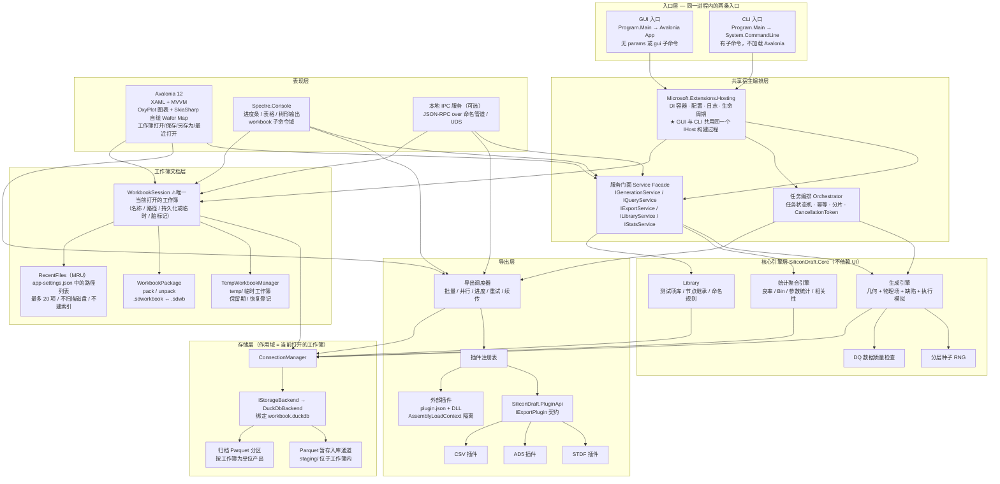
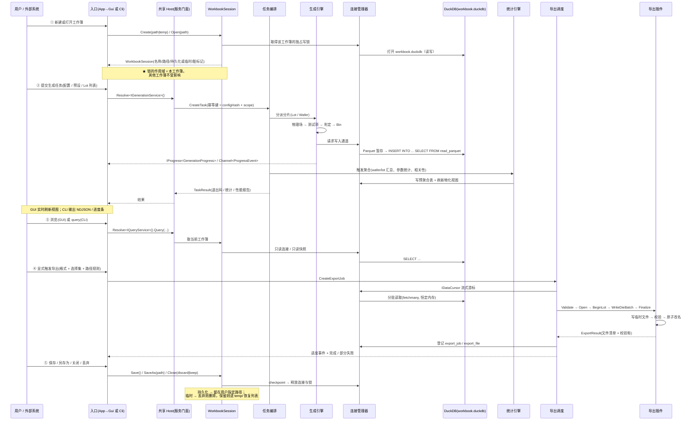
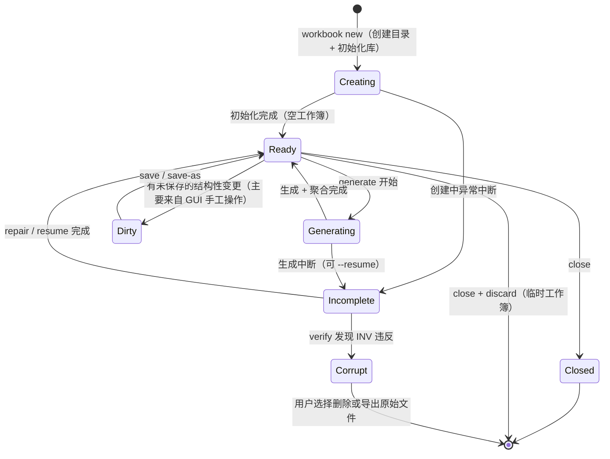
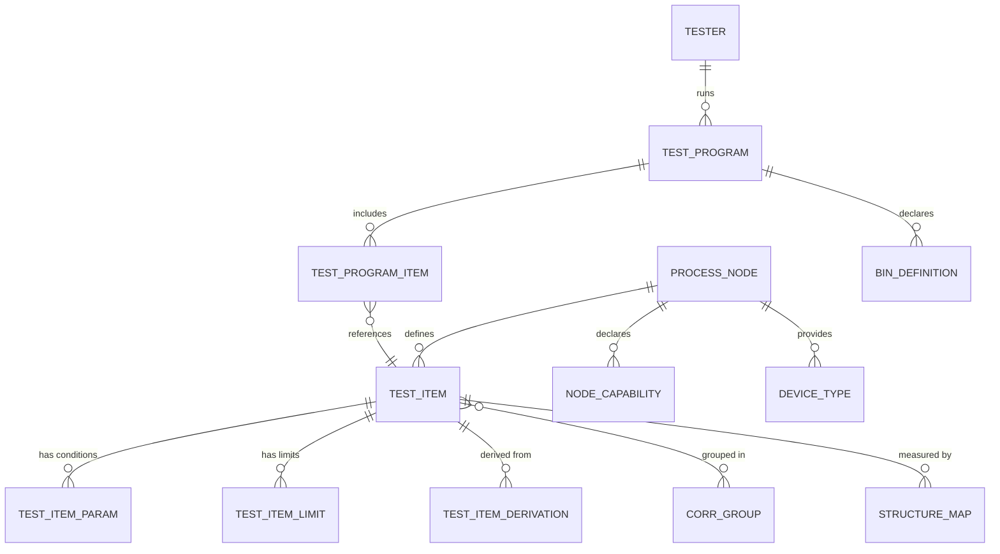
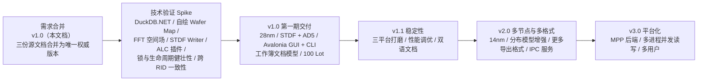

# SiliconDraft 需求规格说明书（合并版）

> **⚠️ 本文档是三份历史需求文档合并后的唯一权威版本。**
> 合并来源：`doc/requirements.MD`（v0.1）、`doc/requirements-v2.MD`（v0.2）、`doc/requirements-v3.MD`（v0.3.2）。
> 三份源文档自本版起转为**历史归档**，不再修订；后续需求的增删改一律在本文档进行。

| 项目 | 内容 |
| --- | --- |
| 项目名称 | SiliconDraft — 半导体测试数据生成工具 |
| 文档版本 | **v1.0（合并版）** |
| 文档状态 | 待评审 |
| 合并日期 | 2026-10-14 |
| 合并基线 | v0.1（业务与数据模型）+ v0.2（工程化）+ v0.3.2（技术栈与工作簿文档模型） |
| 目标读者 | 良率管理系统（YMS）开发/测试团队、SiliconDraft 开发团队 |

---

## 目录

- [0. 文档说明](#0-文档说明)
  - [0.1 合并方式与冲突消解原则](#01-合并方式与冲突消解原则)
  - [0.2 术语表](#02-术语表)
  - [0.3 需求编号体系](#03-需求编号体系)
  - [0.4 需求强度、验收与状态约定](#04-需求强度验收与状态约定)
  - [0.5 已冻结的核心决策](#05-已冻结的核心决策)
  - [0.6 项目背景与目标](#06-项目背景与目标)
  - [0.7 非目标与范围边界](#07-非目标与范围边界)
  - [0.8 目标用户与典型场景](#08-目标用户与典型场景)
- [1. 总体架构](#1-总体架构)
- [2. 工作簿文档模型](#2-工作簿文档模型)
- [3. 数据生成引擎](#3-数据生成引擎)
- [4. 数据存储](#4-数据存储)
- [5. 数据导出](#5-数据导出)
- [6. 导出格式与插件体系](#6-导出格式与插件体系)
- [7. 工艺节点与测试项库](#7-工艺节点与测试项库)
- [8. 用户界面与对外集成](#8-用户界面与对外集成)
- [9. 数据质量需求](#9-数据质量需求)
- [10. 规模与性能](#10-规模与性能)
- [11. 非功能需求](#11-非功能需求)
- [12. 验收标准](#12-验收标准)
- [13. 风险与对策](#13-风险与对策)
- [14. 待确认事项](#14-待确认事项)
- [15. 版本与扩展规划](#15-版本与扩展规划)
- [16. 附录](#16-附录)
  - [16.1 源文档编号映射表](#161-源文档编号映射表)
  - [16.2 .NET 包选型表](#162-net-包选型表)
  - [16.3 完整配置示例](#163-完整配置示例)
  - [16.4 workbook.json 清单规范](#164-workbookjson-清单规范)
  - [16.5 plugin.json 清单规范](#165-pluginjson-清单规范)
  - [16.6 CLI 退出码速查](#166-cli-退出码速查)
  - [16.7 CLI 命令速查](#167-cli-命令速查)
  - [16.8 环境变量表](#168-环境变量表)
  - [16.9 C# 导出插件示例](#169-c-导出插件示例csv-参考插件)
  - [16.10 核心表 DDL](#1610-核心表-ddl-duckdb-方言逐工作簿建立)
- [17. 合并说明与变更记录](#17-合并说明与变更记录)

> **目录说明**：§0（文档说明）、§16（附录）与 §17（合并说明）因条目密集、常被回查，展开到二级目录；§1 ~ §15 为主体需求章节，按一级目录导航即可。各章内的三级小节标题（如 `### 3.4`、`### 11.7`）在文档内可直接检索。

---

## 0. 文档说明

### 0.1 合并方式与冲突消解原则

本文档由三份源文档合并而成，合并遵循以下规则：

| 规则 | 说明 |
| --- | --- |
| **R1 冲突以后者为准** | 三份文档对同一问题的表述不一致时，以**时间上最新且已被明确确认**的决策为准（v0.3.2 > v0.2 > v0.1）。典型冲突见下表。 |
| **R2 已被取代的规格不保留** | 早期文档中已被后续文档给出**完整替代实现规格**的章节（如 v0.1 的 STDF 输出规格被 v0.2/v0.3 的 `SD-FMT-*` 取代），只保留语义要求，不重复保留旧表述。 |
| **R3 重复内容只写一次** | 同一需求在多个文档中重复出现的，合并为一条，并标注全部来源。 |
| **R4 统一编号** | 全文统一使用 `SD-<模块码>-<三位序号>`；v0.1 的 `FR-xx` 全部映射到 `SD-GEN-xxx`（生成引擎模块）。附录 §16.1 给出完整映射表，保证可追溯。 |
| **R5 保留 DQ / AC 编号** | 数据质量需求（`DQ-xx`）与验收标准（`AC-xx`）在源文档中已是**独立的编号族**（分别对应"数据质量标准"与"验收判据"，与功能需求不是同一类条目），且被大量交叉引用，因此**保持原编号不变**。 |
| **R6 历史决策留痕** | 已被撤销的决策与需求不删除，在 §0.5 与相关章节中以 `~~删除线~~` 或 ❌ 标注，避免后续重新提出已否决的方案。 |

**主要冲突及消解（逐条）**

| 冲突点 | v0.1 / v0.2 的表述 | 最终采信（v0.3.2） |
| --- | --- | --- |
| 语言与技术栈 | v0.1：Python + NumPy；v0.2：Python 核心 + 本地 Web/B-S GUI | **全 .NET / C#，.NET 10 LTS；Avalonia 桌面 GUI**（§0.5 D-01/D-03） |
| GUI 形态 | v0.2：本地 Web 服务 + 浏览器（FastAPI + REST） | **Avalonia 桌面客户端，无 B/S、无本地 HTTP 服务** |
| 数据组织 | v0.2：全局单 DuckDB 库累积所有数据集 | **一次生成任务 = 一个工作簿 = 一个独立 DuckDB 库**（D-05/D-06） |
| 数据发现方式 | v0.3.1：托管工作区 + `workspace.json` 索引 | **撤销工作区，改为 Excel 式文件对话框模型**（D-10，ADR-006） |
| 跨工作簿能力 | v0.3.1：联邦查询 + `workbook compare` 五维度对比 | **完全隔离，不提供任何跨工作簿能力**（D-12） |
| CLI 退出码 13 | v0.2：`ERR_LOCKED` = 数据库被其他写任务占用 | **13 收窄为"同进程内资源占用"；跨进程工作簿占用改为新增的 14**（§8.2.5 / §16.6） |
| 插件机制 | v0.2：Python Entry Points / `plugin.py` | **.NET 程序集 + `plugin.json` + `AssemblyLoadContext` 隔离** |
| STDF 输出规格 | v0.1：记录类型清单 + 字段映射（初版） | v0.2/v0.3 的 `SD-FMT-020～029`（保留 v0.1 语义，补全实现细节）→ 合并至 §6.7 |
| 性能目标 | v0.1 AC-25：25 lot × 25 wafer ≤ 180 s | 保留为**目标**；v0.2 的 `SD-SCL-*` 给出更细的分级指标（§10） |
| 交付形态 | v0.2：pip 包 + Docker | **原生 self-contained 可执行程序（6 RID）+ 可选 Docker（CLI-only）+ NuGet SDK** |

### 0.2 术语表

| 术语 | 含义 |
| --- | --- |
| **CP**（Chip Probing / Final Test） | 芯片级测试（探针台测试 / 终测），针对单颗 die |
| **WAT**（Wafer Acceptance Test） | 晶圆级测试，测试 scribe line 上的工艺监控结构（T/C/R/M/S/D structures），又称 PCM / ET |
| **Scribe** | 划片道，芯片之间的切割通道，内嵌工艺监控器件 |
| **Die** | 芯片粒，取自 reticle 上的重复单元 |
| **Reticle / Shot** | 光掩模版 / 曝光单元 |
| **Site** | 测试机的一个测试通道位；同一批次可并行测试多 site |
| **Bin** | 良率分档（Pass/Fail 分档编号）；分 Hard Bin（硬失效）与 Soft/Func Bin（功能分档） |
| **Limit** | 测试限值：`LSL`/`USL` 规格硬限，`LSL_Warn`/`USL_Warn` 预警软限，`Target` 目标值 |
| **STDF** | Standard Test Data Format，SEMI 标准测试数据格式（E10 规范） |
| **AD5** | 代工厂/客户侧的 WAT（PCM/ET）表格型数据交换格式（**规格待冻结**，见 SD-Q-003） |
| **PTR / HDR / SMR / PIR / WIR / HBR / PCR / MRR / GDR / DIE** | STDF 记录类型（详见 §6.7） |
| **YMS** | Yield Management System，良率管理系统 |
| **Floor Plan** | 芯片在 wafer 上的排布规则（Full / Partial / Circle / SAW） |
| **Notch / Flat** | 晶圆定位缺口 / 平边 |
| **空间场（Spatial Field）** | 参数在 wafer 平面上的连续分布函数 |
| **良率（Yield）** | Pass die 数 / 总测试 die 数 |
| **D0** | 缺陷密度参数（单位面积缺陷数） |
| **工作簿（Workbook）** | SiliconDraft 的数据组织顶层单元：一次生成任务的完整载体（目录包 `.sdworkbook/`，内含一个独立 DuckDB 库） |
| **单文件包（`.sdwb`）** | 工作簿目录包打包成的单文件（zip 容器），用于分发与归档 |
| **Cpk / Cp** | 过程能力指数 |
| **TIR** | Test Insertion Rate，测试插入率 |
| **Moran's I** | 空间自相关指数（本项目中用于判定参数的空间相关性是否达到"可被 YMS 检出"的水平） |
| **RID** | Runtime Identifier（.NET 的发布目标标识，如 `win-x64`、`osx-arm64`） |

### 0.3 需求编号体系

```
SD-<模块码>-<三位序号>
```

- `SD` = SiliconDraft 固定前缀
- `<模块码>` = 三位大写字母模块标识（见下表）
- `<三位序号>` = 从 010 起，步长 10，便于后续插入

| 模块码 | 模块 | 本文档章节 |
| --- | --- | --- |
| `SYS` | 系统级 / 总体架构 / 工作簿文档模型 | §1、§2 |
| `GEN` | **数据生成引擎**（几何/物理场/联动/缺陷/执行） | §3 |
| `STO` | 内部数据存储 | §4 |
| `EXP` | 数据导出（调度/命名/进度/重试） | §5 |
| `PLG` | 导出插件框架 | §6 |
| `FMT` | 具体格式实现（STDF / AD5） | §6.7、§6.8 |
| `LIB` | 工艺节点与测试项库 | §7 |
| `GUI` | 图形界面 | §8.1 |
| `CLI` | 命令行与配置体系 | §8.2 |
| `SCL` | 规模与性能 | §10 |
| `NFR` | 非功能需求 | §11 |
| `EXT` | 后续扩展预留 | §15 |
| `Q` | 待确认事项 | §14 |

**独立编号族（保持原编号）**

| 编号族 | 含义 | 章节 |
| --- | --- | --- |
| `DQ-01` ~ `DQ-21` | 数据质量需求（本项目的首要成功标准） | §9 |
| `AC-01` ~ `AC-32` | 验收标准（判据，不是需求本身） | §12 |
| `D-01` ~ `D-14` | 已冻结的核心决策 | §0.5 |
| `US-1` ~ `US-4` | 典型使用场景 | §0.8 |
| `B-1` ~ `B-7` | 工程化背景问题 | §0.6 |
| `R-01` ~ `R-08` | 风险 | §13 |

**编号使用规则**

1. **一条需求一个编号**，编号在项目生命周期内**永不复用**。作废/撤销的需求**保留编号**并标 `[作废]` / `[已撤销]` 并注明替代项，**不得回收给新需求**。
2. 需求强度使用 **必须（MUST）/ 应当（SHOULD）/ 可以（MAY）** 三级（RFC 2119 语义）。
3. 需求编号与测试用例编号一一对应（用例编号 = `TC-` + 需求编号后缀），保证可追溯。
4. 从 v0.1 的 `FR-xx` 到 `SD-GEN-xxx` 的**完整映射见 §16.1**。

### 0.4 需求强度、验收与状态约定

**强度**

| 强度 | 含义 |
| --- | --- |
| **MUST** | 第一期必须交付；未达成不得发布 |
| **SHOULD** | 第一期尽量交付；延后需在评审中记录理由 |
| **MAY** | 列为规划，不纳入第一期验收 |

**变更状态标记**

| 标记 | 含义 |
| --- | --- |
| ✅ 有效 | 当前有效需求 |
| 🔁 修订 | 相对源文档语义或实现发生变化 |
| ❌ 作废 | v0.1/v0.2 中的表述已不适用（如 Python、B/S 相关） |
| 🚫 已撤销 | 曾被引入但经决策撤销（如工作区、跨工作簿能力） |
| ➕ 新增 | 合并过程中补齐的需求 |

**验收方式**

每条需求列出至少一种验收方式：`自动化`（测试/断言）、`基准测试`（性能）、`人工审查`（界面/文档/可读性）。

### 0.5 已冻结的核心决策

> 这些决策已经过确认，**不要再重新提出**。被否决的备选列在末列，避免重复讨论。

| 编号 | 决策项 | 选定方案 | 已否决的备选 |
| --- | --- | --- | --- |
| **D-01** | 技术栈 | **全 .NET / C#**，目标 **.NET 10 (LTS)**。单一语言、单一运行时、单一进程 | Python 核心 + Avalonia GUI（IPC）；C# 核心 + Python 算数值 |
| **D-02** | 交付形态 | **单一程序 + 双入口**：无子命令启动 GUI，带子命令走 CLI 且**不初始化 Avalonia** | 两个独立程序；GUI 内嵌命令行 |
| **D-03** | GUI 框架 | **Avalonia 12** + CommunityToolkit.Mvvm；**无 B/S、无本地 HTTP 服务** | 本地 Web 服务 + 浏览器（原 v0.2 方案） |
| **D-04** | 图表与可视化 | 统计图表用 **OxyPlot**（MIT）；**Wafer Map 用 SkiaSharp 自绘** | LiveCharts2；ScottPlot；Avalonia Pro 商业图表 |
| **D-05** | 目标平台 | **Windows / macOS / Linux 三平台对等**，6 个 RID（含 arm64） | Windows 优先；仅 Windows |
| **D-06** | 数据组织单元 | **工作簿模型**：一次生成任务 = 一个工作簿 = **一个独立 DuckDB 库** | 全局单库累积所有历史数据 |
| **D-07** | 工作簿与任务粒度 | **严格 1:1**：一个工作簿对应一轮生成；「继续后续任务」指同库内聚合/查询/导出/补算，**不追加新轮次** | 工程容器（一个工作簿含多轮生成、多 dataset）；两者兼容 |
| **D-08** | 工作簿磁盘形态 | **目录包** `<name>.sdworkbook/`；另提供 `pack`/`unpack` 打成单文件 `.sdwb` 用于分发 | 单文件 zip 容器；裸 `.duckdb` 文件 |
| ~~D-09~~ | ~~工作簿发现方式~~ | ❌ **已撤销**：原方案为"托管工作区 + 轻量索引（`workspaces/<ws>/` + `workspace.json`）"。由 **D-10** 替代 | — |
| **D-10** | 工作簿打开方式 | **Excel 式文档模型**：通过**文件选择对话框**选路径打开（也支持粘贴路径）；"新建 / 打开 / 最近打开"三个入口；**应用不维护文件清单、不扫描磁盘、不做文件管理** | 托管工作区 + 索引；全盘扫描自动发现 |
| **D-11** | 对外命名 | **工作簿 / `workbook` / `.sdworkbook`**（单文件包 `.sdwb`）。**不再使用"工作区 / Workspace"** | 工作区（Workspace）；项目（Project） |
| **D-12** | 工作簿间关系 | **完全隔离**：只允许单工作簿操作。**不提供**跨工作簿对比、汇总、查询、只读附加会话。**同一时刻只打开一个工作簿** | 保留双工作簿对比；对比 + 批量汇总 |
| **D-13** | 最近打开 | **保留 MRU**：最多 20 项，纯 `app-settings.json` 中的路径列表；不扫描磁盘、不读摘要、不做文件管理；可整体关闭；路径失效时提示而非静默移除 | 不保留（纯文件对话框） |
| **D-14** | 新建默认位置 | **系统文档目录下的 SiliconDraft 子目录**：`~/Documents/SiliconDraft/`（Windows `%USERPROFILE%\Documents\SiliconDraft`）。**默认目录只影响新建，不限制打开位置** | 记住上次位置；应用数据目录 |
| **D-15** | 临时工作簿 | 放 `SILICONDRAFT_HOME/temp/`，关闭时提示"保存 / 丢弃 / 保留以备恢复"，默认 7 天保留期；清理必须确认 + 优先进回收站。**不得放系统临时目录** | 退出即删；永不自动删 |
| **D-16** | 存储引擎 | **DuckDB**（通过 DuckDB.NET），**Parquet** 作为归档与暂存格式 | SQLite；纯 Parquet；HDF5；RocksDB |
| **D-17** | 插件机制 | **`plugin.json` 清单 + .NET 程序集 + `AssemblyLoadContext` 隔离**；插件只引用 `SiliconDraft.PluginApi` | Python Entry Points / `plugin.py` |
| **D-18** | 第一期格式范围 | CP → **STDF**；WAT → **AD5**；另提供 `csv` 内置插件仅供调试。**不做 YMS 归属识别** | 全格式一次性交付 |

### 0.6 项目背景与目标

**背景**

良率管理系统（YMS）需要**真实且结构化**的测试数据才能验证其核心分析能力：

- **空间相关性分析**：die 间、wafer 间、lot 间的参数与良率相关性
- **缺陷特征识别**：中心/边缘异常、扇区失效、簇群缺陷、划痕
- **参数-良率关联分析**：哪些测试项是良率的主要驱动因子（KPI 归因）
- **趋势与预警分析**：批间漂移、机台/轨道偏移的横向对比

**业务痛点**

| 痛点 | 说明 |
| --- | --- |
| 真实数据不可得 | 量产数据涉及商业机密，无法用于开发测试 |
| 随机数据无结构 | 简单随机数生成的数据无法触发相关性分析，等于无效数据 |
| 缺陷不可控 | 真实数据中的缺陷无法定向复现，难以验证检测算法灵敏度 |
| 格式门槛高 | STDF 等格式手写复杂，多份测试数据格式不统一 |

**工程化痛点（源 v0.2 评审暴露）**

| 序号 | 问题 | 对策章节 |
| --- | --- | --- |
| B-1 | 只有 CLI，工程师无法直观查看生成的数据是否合理 | §8.1 GUI |
| B-2 | 数据生成后直接落盘成文件，重复生成/多次导出产生文件爆炸，且缺少"数据集"概念 | §2、§4 工作簿与内部数据库 |
| B-3 | 格式写死在代码里，新增一种格式要改核心代码 | §6 插件架构 |
| B-4 | 格式范围未收敛，第一期目标不清晰 | §6.1 第一期 STDF + AD5 |
| B-5 | 工艺节点只考虑 28nm，缺少跨节点扩展的结构化设计 | §7 节点与测试项库模型 |
| B-6 | 未定义规模与性能指标，无法验证是否支撑真实 YMS 测试场景 | §10 规模与性能 |
| B-7 | 无标准退出码与日志规范，无法接入自动化流水线 | §8.2 CLI |
| B-8 | 全局单库导致并发冲突域过大（任一进程打开库即锁住全部历史数据） | §2 工作簿模型 |
| B-9 | 工作簿无法按任务交付/归档，生命周期不可区分（试跑数据与回归基线混在一起） | §2.4、D-08 |

**项目目标**

| 编号 | 目标 |
| --- | --- |
| **SD-SYS-010** | 用户仅配置晶圆尺寸等基础信息，即可批量生成结构完整、分布可信的 CP/WAT 测试数据 |
| **SD-SYS-020** | 生成的数据必须具备**真实的物理关联性**（WAT↔CP、die 间、wafer 间），使 YMS 的相关性分析产出显著且符合预期的结果 |
| **SD-SYS-030** | 可定向注入已知缺陷特征，且缺陷在空间分布与参数影响上均可被 YMS 检出与量化 |
| **SD-SYS-040** | 支持导出为 STDF、AD5 等标准格式，可直接被主流 Yield Viewer / YMS 加载 |
| **SD-SYS-050** | 生成过程完全可复现（相同随机种子 + 相同配置 + 相同版本 → 完全相同的数据集），便于回归测试 |
| **SD-SYS-060** | 提供 GUI 与 CLI **双模式入口**，共享同一套核心引擎与同一份数据，能力对齐、无功能割裂 |
| **SD-SYS-070** | 实现**生成与导出分离**：生成数据先落工作簿内的嵌入式数据库，导出为显式动作，支持多次、多格式、多子集导出 |
| **SD-SYS-080** | 导出格式采用**可插拔插件架构**，新增格式零侵入核心代码 |
| **SD-SYS-090** | 第一期格式范围收敛为 **CP → STDF**、**WAT → AD5** |
| **SD-SYS-100** | 以 **28nm** 为第一期基准节点，测试项库采用**节点可继承的数据模型**，为 14nm/7nm 预留扩展机制 |
| **SD-SYS-110** | 支撑 **100 Lot 以上**规模的数据生成、存储、查询与导出，并定义量化性能指标与水平扩展路径 |
| **SD-SYS-120** | 明确 **YMS 归属识别不在第一期范围** |
| **SD-SYS-130** | 建立完整的**需求-验收-测试**可追溯体系，所有需求带编号与验收方式 |
| **SD-SYS-140** | 以 **工作簿** 为数据交付单元：可存盘复用、可打包分发、可独立重放 |

### 0.7 非目标与范围边界

| 编号 | 内容 | 说明 |
| --- | --- | --- |
| **SD-SYS-150** | YMS 归属识别（Which-lot / Which-product 归属推断） | 第一期不做。生成的数据**不写入 YMS 侧归属标识字段**，不模拟归属冲突场景 |
| **SD-SYS-151** | 14nm / 7nm 测试项库的实际交付 | 第一期只交付 28nm 库 + 多节点扩展机制（数据模型 + 接口 + 文档），不交付先进节点数据内容 |
| **SD-SYS-152** | 云端多租户、公网 Web 服务 | 不在范围。GUI 是本地桌面应用，不提供网络访问 |
| **SD-SYS-153** | 与真实 ATE 设备的物理对接（设备驱动、SECS/GEM 通信、针尖磨损、Handler 行程仿真） | 不在范围 |
| **SD-SYS-154** | 电路功能验证（DFT / ATPG 覆盖率仿真） | 不在范围 |
| **SD-SYS-155** | 量产数据分析本身 | 不在范围。工具只负责产出数据，分析交给 YMS |
| **SD-SYS-156** | 跨工作簿的分析能力（对比 / 汇总 / 联合查询） | 不在范围（D-12）。需要跨工作簿分析时，各自导出后在**外部工具**完成 |
| **SD-SYS-157** | 移动端 / WebAssembly 目标 | 不在范围（当前明确不做） |
| **SD-SYS-158** | 与客户实际量产数据分布的拟合精度 | 第一期不做参数拟合；预留 `fit` 扩展位 |

### 0.8 目标用户与典型场景

**目标用户**

| 角色 | 诉求 |
| --- | --- |
| **YMS 测试工程师** | 生成一批标准数据集，回归验证 YMS 分析模块（含历史版本对比） |
| **良率工程师（Yield Engineer）** | 生成指定缺陷场景的数据，验证缺陷检测与归因算法的灵敏度 |
| **YMS 演示 / 售前** | 生成"看起来像真数据"的演示数据集 |
| **工具链开发** | 需要可复现、可脚本化、可批量运行的数据生成器 |

**典型场景**

| 编号 | 场景 | 配置与预期 |
| --- | --- | --- |
| **US-1** | 基础回归数据集 | 200mm 晶圆、1 lot × 25 wafer、CP 30 项、WAT 15 项 → 导出的 STDF/AD5 可直接导入 YMS |
| **US-2** | 缺陷检出能力验证 | 注入「中心 Vth 偏高 15mV，覆盖中心 R=60mm」→ YMS 空间分析应识别出中心异常区域并给出半径估计 |
| **US-3** | 跨 wafer 相关性验证 | 分别生成「wafer 间 Vth 均值线性漂移」与「无相关性」两个工作簿 → 各自导出后在 YMS 中对比，前者应报出高相关、后者应报无相关 |
| **US-4** | 批量压力测试 | 用 `batch generate` 产出 100 个单 Lot 工作簿（或 1 个大工作簿含 100 Lot）→ 验证 YMS 大数据量处理与聚合正确性 |
| **US-5** | 数据交付 | `workbook pack` 打成 `.sdwb` 发给同事或归档，对方 `unpack` 后独立打开，可重放验证 |

---

## 1. 总体架构

### 1.1 技术栈总览

| 领域 | 选型 | 说明 |
| --- | --- | --- |
| 语言 / 运行时 | **C# / .NET 10 (LTS)** | 单一语言、单一运行时、单一进程 |
| GUI 框架 | **Avalonia 12.x**（XAML + C# + MVVM） | Skia 渲染；跨平台一致；无 B/S |
| MVVM | **CommunityToolkit.Mvvm 8.x** | 源生成器，无需 Reactive 心智模型 |
| 宿主 / DI / 配置 / 日志 | `Microsoft.Extensions.Hosting` / `.DependencyInjection` / `.Configuration` / `.Logging` + `Serilog` | GUI 与 CLI 共用同一个 `IHost` 构建过程 |
| 命令行 | **System.CommandLine** + **Spectre.Console** | 参数解析 + 进度条/表格/树形输出 |
| 图表 | **OxyPlot.Avalonia** + **OxyPlot.SkiaSharp** | 统计图表 + PNG/SVG 导出 |
| Wafer Map | **SkiaSharp 自绘控件** | OxyPlot 的规则网格热力图模型不适合不规则 die 布局 |
| 数值与统计 | **MathNet.Numerics** | 分布、FFT（谱合成空间场）、线性代数、统计 |
| 数据库 | **DuckDB.NET**（`DuckDB.NET.Data.Full`） | 嵌入式列式 OLAP，含原生库 |
| 归档 / 暂存 | **Parquet** | 只读多实例共享；分区目录规范 |
| YAML | **YamlDotNet** | 配置文件、预设、节点包、测试项库 |
| JSON Schema | **JsonSchema.Net** + **JsonSchema.Net.Generation** | 配置校验 + 模板生成 + GUI 表单 |
| 测试 | **xUnit** + FluentAssertions + **Verify**（金标准快照）+ BenchmarkDotNet + coverlet | 见 §11.3 |
| 打包 | `dotnet publish`（self-contained 单文件 + ReadyToRun） | 6 个 RID |

> 完整包选型表（含许可）见 §16.2。

### 1.2 解决方案与项目结构

**SD-SYS-160**：采用单一 .NET 解决方案，项目划分必须保证**依赖方向单向**：`Core` 不依赖任何 UI / CLI / 插件实现。

```
SiliconDraft.sln
├── Directory.Build.props            # 统一 TFM / LangVersion / Nullable / TreatWarningsAsErrors
├── Directory.Packages.props         # 中央包版本管理（CPM）
├── src/
│   ├── SiliconDraft.PluginApi/      # ★ 插件契约程序集（极薄，仅接口 + DTO）
│   │                                #   多目标 net8.0;net10.0，独立版本号（§6.1）
│   ├── SiliconDraft.Core/           # 核心引擎（net10.0，不引用 Avalonia / CLI）
│   │   ├── Workbook/                #   工作簿 / 目录包 / 生命周期 / MRU / 临时管理
│   │   ├── Geometry/                #   Wafer / DieMap / Scribe / WatLayout
│   │   ├── Physics/                 #   空间场 / 物理量 / 推导模型 / 数值分布
│   │   ├── Defects/                 #   缺陷注入（几何型 + 参数型）
│   │   ├── Execution/               #   CP/WAT 执行模拟 / Bin 分配 / Retest
│   │   ├── Library/                 #   测试项库 / 节点继承解析 / 命名规则
│   │   ├── Storage/                 #   IStorageBackend / DuckDbBackend / 连接管理
│   │   ├── Export/                  #   IExportPlugin / Registry / Scheduler / Naming
│   │   ├── Quality/                 #   DQ 检查与报告
│   │   ├── Orchestration/           #   任务编排 / 分片 / 幂等 / 取消
│   │   └── Rng/                     #   分层种子（种子派生）
│   ├── SiliconDraft.Plugins.Stdf/   # 内置插件：STDF（CP）
│   ├── SiliconDraft.Plugins.Ad5/    # 内置插件：AD5（WAT）
│   ├── SiliconDraft.Plugins.Csv/    # 内置插件：CSV（调试 / 参考实现）
│   ├── SiliconDraft.Sdk/            # 对外 SDK 门面（供外部 .NET 系统引用）
│   ├── SiliconDraft.Cli/            # CLI 层
│   ├── SiliconDraft.Gui/            # Avalonia 桌面应用
│   └── SiliconDraft.App/            # ★ 双入口宿主（唯一发布产物）
├── plugins/                         # 外部插件放置目录（开发期）
├── nodes/                           # 工艺节点包目录（nodepack）
└── tests/
    ├── SiliconDraft.Core.Tests/     # 含工作簿生命周期测试
    ├── SiliconDraft.Plugins.Tests/  # 含 Verify 金标准快照测试
    ├── SiliconDraft.Gui.Tests/      # ViewModel 层单测（headless）
    ├── SiliconDraft.E2E.Tests/      # 端到端：建工作簿 → 生成 → 入库 → 查询 → 导出 → 校验 → 存盘 → 重开
    └── SiliconDraft.Benchmarks/     # BenchmarkDotNet 性能基准
```

**运行期目录布局**

```
%SILICONDRAFT_HOME%/                    # 默认 ~/.silicondraft —— 只放"应用自身"的东西
├── config.yaml                      # 应用级默认配置（可被 CLI/GUI 参数覆盖）
├── app-settings.json                # GUI 应用设置（主题、窗口尺寸、默认目录、最近打开 MRU）
├── plugins/                         # 用户级插件目录
├── nodes/                           # 用户级节点包目录
├── temp/                            # ★ 临时工作簿目录（默认 7 天保留期）
│   └── tmp_20261014_113012_a1b2c3.sdworkbook/
└── recovery.json                    # ★ 异常退出时的会话登记（用于"恢复"列表）

%USERPROFILE%/Documents/SiliconDraft/   # ★ 新建工作簿的默认落点
├── centerhigh_25lot_20261014.sdworkbook/
└── baseline_25lot_20261014.sdworkbook/
                                         # 用户也可把工作簿放在任意位置
```

> **设计要点**：`SILICONDRAFT_HOME` 与"文档目录"是**两个不同的位置**——前者是应用自己的数据（配置/插件/临时/恢复登记），后者是用户的产出。这样用户备份/迁移自己的实验数据时不必连带应用状态。

### 1.3 分层架构



### 1.4 单一程序双入口

**SD-SYS-170**（MUST）：交付**一个可执行程序**。`Main(string[] args)` 必须先做参数判定：

- 无子命令（或 `gui`）→ 初始化 Avalonia 并进入桌面应用
- 有子命令 → **不初始化 Avalonia / Skia**，直接走 CLI 路径
- `--help` / `--version` 在任一路径下均可快速返回

```csharp
// SiliconDraft.App/Program.cs（示意，最终以实现为准）
[STAThread]
public static int Main(string[] args)
{
    // 1) 纯 CLI 判定：不触碰 Avalonia 程序集
    if (CliEntry.ShouldHandle(args))            // 有子命令 / --help / --version
        return CliEntry.Run(args);              // 返回进程退出码

    // 2) GUI 路径
    return GuiEntry.Run(args);                  // BuildAvaloniaApp().StartWithClassicDesktopLifetime
}
```

**SD-SYS-171**（MUST）：CLI 路径必须通过**独立的类型与方法边界**实现（`CliEntry` 不得引用任何 Avalonia 类型），以保证 JIT 不在 CLI 场景加载 Avalonia 程序集、不产生 GUI 初始化开销。必须有性能测试证明 CLI 冷启动达标（§10.3）。

**SD-SYS-172**（MUST）：退出码必须由 `Main` 原样返回，保证流水线可读取（§8.2.5 的 20 档退出码语义不变）。

**SD-SYS-173**（SHOULD）：必须支持 `silicondraft gui` 显式子命令（在无参数行为可能被脚本包装改变的场景下提供确定性入口）；必须支持 `silicondraft --headless <cmd>` 显式声明无图形环境运行。

**收益**：核心代码、DI 容器、配置系统、日志系统 **100% 共享**，不存在"GUI 与 CLI 行为不一致"的可能；只发布一份产物 ⇒ 无版本漂移；天然规避 DuckDB 跨进程写锁（同一时刻只有一个进程持有某个工作簿）。

### 1.5 依赖方向硬约束

**SD-SYS-180**（MUST）：以下依赖方向**不可违反**，由 CI 强制。

| 允许 | 禁止 |
| --- | --- |
| `App` → `Gui`、`Cli` | `Core` → `Gui` / `Cli` / `Avalonia*` |
| `Gui` → `Core`、`Sdk`、`PluginApi` | `Gui` ↔ `Cli` 互相引用 |
| `Cli` → `Core`、`Sdk`、`PluginApi` | `Core` → `System.CommandLine` / `Spectre.Console` |
| `Core` → `PluginApi`（仅契约） | `Core` → 任何插件的**实现**程序集 |
| `Plugins.*` → `PluginApi`（仅契约） | 插件 → `Core` |

**SD-SYS-181**（MUST）：`SiliconDraft.Core` 的项目文件中**禁止出现** `Avalonia*`、`System.CommandLine`、`Spectre.Console` 等 UI / 终端类包引用。必须通过架构测试（`ArchUnitNET` 或自定义 xUnit 断言）在 CI 中强制校验，违反即构建失败（§11.2）。

**SD-SYS-182**（MUST）：`Core` 向表现层汇报进度与状态的唯一通道是**抽象接口**（`IProgress<T>`、`Channel<T>`、`CancellationToken`），禁止 `Core` 中出现任何 UI 线程调度、`Dispatcher`、事件订阅等 UI 概念。

**SD-SYS-183**（MUST）：GUI 与 CLI **必须共用同一个 `IHost` 构建过程**（`HostBuilder` + 统一的 `ConfigureServices` / `ConfigureAppConfiguration` / `ConfigureLogging` 扩展方法），差异只能通过"是否注册 UI 相关服务"体现。禁止在 GUI 与 CLI 中各自 `new` 一套服务或各自解析配置。

### 1.6 端到端数据流



**SD-SYS-190**（MUST）：端到端路径中**不存在** HTTP 服务、端口、浏览器、前端静态资源。GUI 的数据来自 `IQueryService` 的直接调用（同进程、强类型、无序列化）。

**SD-SYS-191**（MUST）：端到端流程必须以 **工作簿会话**为边界（上图 ①⑤ 两步）：**所有数据操作都必须发生在某个已打开的工作簿会话之内**。禁止存在"隐式打开某个数据库"的代码路径。

**SD-SYS-192**（MUST）：由于 D-12 完全隔离，流程中**不存在**"打开第二个工作簿"这条路径；任何需要两库数据的比较都必须由用户在工具之外完成。

---

## 2. 工作簿文档模型

> **本章是合并后新增的核心章节**，取代源文档中"全局单库 + 托管工作区"的表述。对应决策 D-06 ~ D-15。

### 2.1 概念定义与不变量

**SD-SYS-200**（MUST）：**工作簿（Workbook）** 是 SiliconDraft 的顶层数据组织单元：

> 一次生成任务的**完整载体** = 一个目录包（`<name>.sdworkbook/`）= 一个独立 DuckDB 库 + 一份清单 + 该任务的日志 / 导出产物 / 报告 / 暂存区。

**SD-SYS-201**（MUST）：必须维护以下**不变量（Invariants）**，并在 `workbook verify` 中逐条检查：

| 编号 | 不变量 | 违反时的处理 |
| --- | --- | --- |
| INV-1 | 一个工作簿目录内**恰好一个** `workbook.duckdb` | 报错并拒绝打开 |
| INV-2 | 一个工作簿内 `sd_dataset` **恰好一条**记录（D-07 严格 1:1） | 0 条 = 尚未完成生成（允许，标记 `Incomplete`）；> 1 条 = 数据损坏（报错） |
| INV-3 | 同一时刻最多一个**读写**进程持有该工作簿（只读打开不受此限） | 见 §2.6 |
| INV-4 | 工作簿内数据的 `config_hash` 必须与其 `sd_config` 记录自洽，可重放 | 报错并标记 `unreproducible` |
| INV-5 | 除已声明的子目录/文件外，目录内不得出现未声明的顶层条目 | WARN（不阻止打开），提供 `workbook tidy` 迁移到 `extra/` |
| INV-6 | `workbook.json` 的 `schemaVersion` 与库内 `sd_schema_version` 必须一致 | 不一致 = 需要 `workbook migrate` |
| INV-7 | 工作簿的 `state` 字段必须反映真实状态（见 §2.3） | 异常残留状态由 `workbook repair` 修正 |

**SD-SYS-202**（MUST）：`workbook.json` 是工作簿的**自描述清单**：

| 要求 | 说明 |
| --- | --- |
| 人类可读 | 缩进 JSON，字段顺序稳定（`System.Text.Json` 源生成 + 固定属性顺序），保证可 diff |
| 冗余而非唯一 | 清单中的摘要统计是**缓存**，权威值在库内。清单损坏时可由 `workbook rebuild-manifest` 从库重建 |
| 路径分隔符统一 | 清单内路径一律使用 `/`，保证工作簿目录可跨 RID 直接拷贝使用 |
| 兼容演进 | 必须有 `schemaVersion`；新版读到旧清单必须能升级（只读打开时降级为只读） |
| 不存敏感信息 | 禁止出现凭据类信息；不得内嵌完整配置（配置在库内 `sd_config`） |

> 完整清单规范见 §16.4。

### 2.2 目录包结构

**SD-SYS-210**（MUST）：`<name>.sdworkbook/` 目录结构必须如下（★ = 必需，○ = 按需创建）：

```
<name>.sdworkbook/
├── workbook.json          ★ 清单
├── workbook.duckdb        ★ 数据（含 §4.2 全部 sd_* 表/视图/索引）
├── workbook.lock          ○ 运行时独占锁（关闭时删除；崩溃遗留由失效检测处理）
├── logs/                  ○ 日志（JSON Lines，轮转）
├── exports/               ○ 导出产物根（默认输出目录，见 §5.2）
├── staging/               ○ Parquet 暂存（运行时；入库成功后清空，中断时保留供 --resume）
├── reports/               ○ DQ 自检报告 HTML、图表 PNG/SVG
├── preview/               ○ 缩略图（Wafer Map 概览 / Bin 分布小图）
├── nodes/                 ○ 固化本次使用的节点包快照（保证可重放）
└── extra/                 ○ 用户自由放置（不参与任何校验，不进入 INV-5 检查）
```

**SD-SYS-211**（MUST）：`logs/` `exports/` `staging/` `reports/` `preview/` 的路径必须**可重定向**（配置项），默认指向工作簿内；**禁止**把 staging 放在系统临时目录（否则中断后无法 `--resume`）。

**SD-SYS-212**（MUST）：`nodes/` 中必须固化本次生成所用的**节点包快照**。理由：全局 `nodes/` 目录可能被升级或删除，而工作簿必须能独立重放。存储成本低（YAML 文本）。

### 2.3 生命周期与状态机

**SD-SYS-220**（MUST）：工作簿的生命周期状态必须持久化在 `workbook.json` 的 `state` 字段与库内 `sd_workbook.state` 中：



**SD-SYS-221**（MUST）：**必须区分"数据未完成（Incomplete）"与"数据损坏（Corrupt）"**：前者可恢复（`workbook resume` / `workbook repair`），后者需人工介入。GUI 必须用不同视觉状态呈现（进度图标 vs 警告图标），**禁止混为一谈**。

**SD-SYS-222**（MUST）：`workbook verify` 必须可在**不打开为读写**的前提下执行（只读打开库 + 读取清单），用于校验任意外部收到的工作簿包。必须输出结构化结果（`--output json`），含逐条 INV 的结论。

**SD-SYS-223**（SHOULD）：`workbook repair` 必须能处理：① 清理残留锁；② 重建清单（`rebuild-manifest`）；③ 修正 `state` 字段；④ 清理 staging 中已入库的残留文件；⑤ **报告无法修复的问题而非静默修改**。修复必须写操作日志，且**必须在修复前自动备份 `workbook.json`**。

### 2.4 持久化与临时

**SD-SYS-230**（MUST）：两种生命周期的行为必须明确区分，且必须在界面上**恒可见**：

| 维度 | 持久化工作簿 | 临时工作簿 |
| --- | --- | --- |
| 默认位置 | `~/Documents/SiliconDraft/`（D-14，可配）；也允许任意路径 | `%SILICONDRAFT_HOME%/temp/` |
| 命名 | 用户指定（默认由预设 + lot + 日期生成，见 SD-Q-051） | `tmp_<yyyyMMdd_HHmmss>_<rand6>.sdworkbook` |
| 关闭时 | 直接关闭（已存盘） | **必须提示"保存 / 丢弃 / 保留以备恢复"** |
| GUI 标题栏 | `<工作簿名称> — SiliconDraft` | `未保存：<名称> — SiliconDraft`（必须带"未保存"前缀） |
| 是否被应用记录 | 仅进入 **MRU 最近打开列表**（上限 20 项路径） | 不进 MRU；进 `temp/` 恢复登记 |
| 自动清理 | **永不自动删除** | 超过保留期（默认 **7 天**，可配）自动清理 |
| 空间统计 | 无跨工作簿空间统计（D-12） | 单独计量，超出配额时提示（默认不限制，超出 20 GB WARN） |

**SD-SYS-231**（MUST）：临时工作簿的清理必须遵循：

1. **绝不静默删除**：清理前必须打印/显示将删除的清单（名称、路径、大小、创建时间）并要求确认（CLI 用 `--yes`；GUI 用对话框）
2. **不得删除已加锁的工作簿**（可能有其他进程正在用）
3. **优先移入回收站/垃圾箱**；无回收站机制时降级为直接删除并要求二次确认
4. `temp` 目录**不得**位于系统临时目录（`/tmp` / `%TEMP%`），必须是 `SILICONDRAFT_HOME/temp/` —— 理由：系统临时目录可能被 OS 或清理工具主动删除，且可能位于空间更小的卷
5. 必须提供 `workbook temp list` / `workbook temp clean [--older-than]` 与 GUI 的等价界面

**SD-SYS-232**（MUST）：必须实现**崩溃恢复**：

| 要求 | 说明 |
| --- | --- |
| 会话登记 | 打开/创建工作簿时，必须把 `(路径, 模式, PID, 主机, 启动时间, 最后心跳)` 写入 `%SILICONDRAFT_HOME%/recovery.json`；正常关闭时移除 |
| 心跳 | 必须周期性更新心跳（默认 10 s），用于区分"进程已死"与"进程仍在运行" |
| 恢复列表 | 下次启动时，把 `recovery.json` 中**心跳过期且锁文件仍存在**的工作簿列入"可恢复" |
| 恢复动作 | 清理残留锁 + 以读写模式打开 + `state` 置回 `Ready` 或 `Incomplete`；**必须保留原数据不做任何"自动修正"**（除残留锁文件外） |
| 不覆盖 | 恢复不得覆盖 `workbook.duckdb`；DuckDB 的 WAL 会自行完成未提交事务的回滚（ACID 保证） |

**SD-SYS-233**（MUST）：必须支持从临时转为持久：`workbook save-as <path>` 与 GUI 的"另存为"。转换必须按 **先复制到目标 → 校验通过 → 再删除源** 的顺序（避免中途失败导致数据丢失）；大工作簿的复制必须显示进度且可取消（取消时清理目标半成品）。

**SD-SYS-234**（SHOULD）：必须支持 `workbook duplicate <new-path>`：使用 DuckDB 的 `ATTACH` + `COPY FROM DATABASE` 或文件级复制 + 新名称/新 ID 重置，用于"以本工作簿为基线做变体实验"。复制后必须**重写 `workbookId`** 并清空恢复登记，避免两个工作簿被认为是同一个。

### 2.5 文档模型与最近打开

**SD-SYS-240**（MUST）：必须实现 **Excel 式文档模型**（D-10）。工作簿的打开与新建只有三个入口，且**应用不持有任何"工作簿清单"**：

| 入口 | 行为 | 是否需用户指定路径 |
| --- | --- | --- |
| **新建工作簿** | 走"新建向导"（§8.1.8），默认落点 `~/Documents/SiliconDraft/<自动名称>.sdworkbook`，用户可在文件对话框中改路径 | 是（可通过对话框确认/修改默认路径） |
| **打开工作簿** | 系统文件选择对话框选路径（`.sdworkbook` 目录 / `.sdwb` 单文件包）；也可在对话框外直接**输入/粘贴路径** | 是 |
| **最近打开** | MRU 列表中的路径直接打开 | 否（但可能失效，见 SD-SYS-242） |

**SD-SYS-241**（MUST）：**"按路径打开任意工作簿"是唯一主路径**，要求：

| 要求 | 说明 |
| --- | --- |
| 路径输入 | 除文件对话框外，GUI 必须提供**可直接粘贴路径的输入框**（工程师常从终端/邮件里复制路径） |
| `.sdwb` 单文件包 | 允许直接选择 `.sdwb`：必须提示"将解包到临时目录后打开"并**显示解包位置**；解包后的临时工作簿按临时工作簿生命周期管理 |
| 路径不存在 | 必须报 `ERR_WORKBOOK_NOT_FOUND (15)` 并给出可操作提示（检查路径 / 是否需先解包 `.sdwb`） |
| 不自动加入任何集合 | 打开一个外部工作簿**不得**触发"加入某处"之类的副作用（无集合概念） |

**SD-SYS-242**（MUST）：**MRU 最近打开列表**（D-13）：

| 编号 | 强度 | 需求 |
| --- | --- | --- |
| **SD-SYS-242a** | MUST | 最多 **20** 项，FIFO 淘汰；每项显示**名称 + 完整路径 + 最近打开时间 + 是否存在**；支持单条移除与"清空列表"；**可整体关闭**（关闭后起始页只显示"新建/打开"两个入口，并记住该偏好） |
| **SD-SYS-242b** | MUST | MRU **必须只存路径**，不得存任何工作簿内容（摘要、良率、标签等）。每次显示列表时可**按需读取命中的 `workbook.json` 清单**以展示名称与基本元信息（**不打开 DuckDB 库**）；读取失败（路径不可达）时该项标记为"不可用"而**不得**从列表移除 |
| **SD-SYS-242c** | SHOULD | 提供 `workbook list --dir <目录> [--glob <模式>] [--filter preset=...] [--output json]`：**一次性枚举**指定范围内的目录包并读取清单做展示/过滤 |
| **SD-SYS-242d** | SHOULD | GUI 起始页与菜单提供"**在文件管理器中打开默认目录**"与"**显示当前工作簿位置**"两个快捷操作 |

**SD-SYS-243**（MUST）：**应用不得扫描用户磁盘来发现工作簿**。唯一允许的按需枚举入口是显式的 `workbook list --dir` 与 `--glob`，其语义是"对指定目录做一次文件系统枚举并读取命中目录包的清单"，**结果不得缓存**、不得跨调用保留、不得写入任何索引文件。

**SD-SYS-244**（MUST）：`app-settings.json` 必须只保存**应用自身的设置与 MRU 路径**，禁止保存任何来自工作簿的数据（统计、摘要、标签、良率等）。这保证"设置文件"与"数据"的边界清晰，**删掉设置文件不损失任何数据**。

**SD-SYS-245**（MUST）：必须明确"**默认目录只影响新建，不影响打开**"：配置项 `workbook.default_dir` 仅用于"新建向导的初始路径"与"在文件管理器中打开默认目录"两个用途；**应用不得以任何方式限制或约束工作簿的实际存放位置**（可放在任意可读写路径，包括网络盘与外部硬盘）。

**SD-SYS-246**（MUST）：**必须提供 `workbook pack` / `workbook unpack`**：

| 命令 | 行为 |
| --- | --- |
| `workbook pack <wb> -o <file>.sdwb` | 把工作簿目录打包为单文件（zip 容器，含 `workbook.json` 与 `workbook.duckdb` 及选定子目录）。必须支持 `--exclude logs,staging` 之类的选择性打包；`--out-dir` 可批量打包一个目录下的全部工作簿 |
| `workbook unpack <file>.sdwb -o <dir> [--verify]` | 解包为目录，之后可正常打开。**必须校验**清单中的校验和（打包时写入），不一致则报错 |
| 可打开性 | **单文件包不可直接作为工作簿打开**（DuckDB 需要真实文件路径）。若用户直接打开 `.sdwb`，必须提示"将解包到临时目录后打开"，并说明解包位置 |
| 定位 | 由于**没有工作区索引**、且**没有跨库能力**，`pack`/`unpack` 是**唯一的跨机器/跨人交换方式**：把 `.sdwb` 发出去，对方解包后独立打开 |

**SD-SYS-247**（SHOULD）：`workbook pack` 必须默认包含 `exports/` 但显示包含项与体积，允许 `--exclude exports`（见 SD-Q-058）；默认排除 `logs/` 与 `staging/`。

### 2.6 并发与锁

**SD-SYS-250**（MUST）：**工作簿文件的进程独占**是架构前提。`DuckDbBackend` 必须在打开工作簿时获取**进程内互斥 + 进程间文件锁双重保护**：

| 层级 | 机制 | 行为 |
| --- | --- | --- |
| 进程间 | 独占文件锁（`<workbook>/workbook.lock`）+ 打开时的 DuckDB 原生文件锁 | 若该工作簿已被其他进程占用，立即以 `ERR_WORKBOOK_LOCKED (14)` 退出，并在提示中给出**持有者信息**（PID、主机、进程启动时间）与**可选替代方案**；**不得重试等待死等**（可用 `--on-lock wait\|fail` 配置） |
| 进程内 | `SemaphoreSlim(1,1)` 守护的写事务队列（作用域 = 当前工作簿） | 所有写操作串行化 |

**SD-SYS-251**（MUST）：**锁的作用域只有一个工作簿**，必须显式呈现其影响面：

| 场景 | 预期行为 |
| --- | --- |
| 实例 A 打开工作簿 W1；实例 B 打开工作簿 W2 | **两者互不影响**，可同时读写。这是把锁作用域收缩到单个工作簿的主要目的 |
| 同一实例内：生成任务写入 W1 的同时 GUI 查询 W1 | 允许（同一 `IConnectionManager`，读走快照） |
| 实例 A 打开 W1；实例 B 尝试以读写打开 W1 | B 报 `ERR_WORKBOOK_LOCKED (14)`，提示持有者信息。GUI 给出两个可选动作：**以只读方式打开**或**取消** |
| 实例 B 以只读打开 W1 | 允许（`--read-only` / 只读对话框显式声明）。**只允许查看**，不产生任何"与其他工作簿关联"的能力 |

**SD-SYS-252**（MUST）：**同一时刻只允许打开一个工作簿**（D-12）：

| 会话类型 | 数量 | 说明 |
| --- | --- | --- |
| 工作簿会话 | **1** | 由 `WorkbookSession` 持有；所有生成/查询/导出都必须走它 |
| 只读模式 | 同一会话的一种模式 | 以 `--read-only` 打开时，该工作簿可被查看但**禁止一切写入**；这是"另一个人打开了同一文件"时的降级查看方式，**不构成第二个会话** |

**SD-SYS-252a**（MUST）：打开第二个工作簿的行为必须明确：

| 当前状态 | 用户动作 | 行为 |
| --- | --- | --- |
| 无打开的工作簿 | 新建 / 打开 / 最近打开 | 直接进入该工作簿 |
| 已打开工作簿，**无未保存变更** | 新建 / 打开 / 最近打开 | **直接切换**（先释放当前会话的连接与锁，再建立新会话；必须原子） |
| 已打开工作簿，**有未保存变更** | 新建 / 打开 / 最近打开 | 必须弹出「**保存 / 丢弃 / 取消**」三选对话框；选"取消"则停留在当前工作簿 |
| 已打开**临时**工作簿 | 新建 / 打开 / 最近打开 | 同上，但选项文案为「保存为…/ 丢弃 / 保留以备恢复 / 取消」四选 |

**SD-SYS-252b**（MUST）：必须**明确禁止**任何形式的"多工作簿同时打开"实现路径：禁止多标签页、禁止多窗口各开一个工作簿、禁止后台预打开。GUI 若需要展示"另一个工作簿里的某个数字"，**只能由用户先切换过去、记下数值、再切回来**；工具不提供并排查看。这条约束是"完全隔离"在实现层的落地检查点，必须由架构测试或 GUI 代码审查确认（**不存在第二个 `WorkbookSession` 实例**）。

**SD-SYS-253**（MUST）：`WorkbookSession` 是**全应用唯一的工作簿上下文**（单例服务），所有数据访问都必须经由它取得绑定。禁止任何组件自行拼接数据库文件路径、自行打开 `DuckDBConnection`。切换工作簿必须先释放当前会话的全部连接与锁，再建立新会话，且必须**原子**（失败时回滚到原会话或进入无工作簿状态）；若当前会话有未保存变更，必须先走「保存 / 丢弃 / 取消」流程。

**SD-SYS-254**（MUST）：**"无当前工作簿"必须是一个合法的应用状态**（首次启动、关闭工作簿后）：此时 GUI 显示**起始页**（新建 / 打开 / 最近打开 / 恢复），CLI 的生成类命令必须报 `ERR_NO_WORKBOOK (16)` 并提示 `workbook new` 或 `--workbook <path>`。数据类命令（`query` / `export` / `stats`）必须强制显式指定 `--workbook`。

**SD-SYS-255**（MUST）：锁文件（`workbook.lock`）必须包含足以定位持有者的信息，并支持**失效锁检测**：

```json
{
  "workbookId": "wb_01J...",
  "pid": 41234,
  "host": "dev-mac-01",
  "user": "shaokp",
  "startedAt": "2026-10-14T11:30:12+08:00",
  "heartbeatAt": "2026-10-14T11:42:05+08:00",
  "mode": "readwrite",
  "appVersion": "1.0.0",
  "appProcessStartTicks": 63835
}
```

**SD-SYS-256**（MUST）：打开时的锁判定逻辑必须为：

| 锁文件 | 持有进程状态 | 处理 |
| --- | --- | --- |
| 不存在 | — | 正常获取锁，进入读写 |
| 存在，主机名相同，PID 存活且启动时间匹配 | 活着 | 报 `ERR_WORKBOOK_LOCKED (14)`，提示持有者信息与替代方案 |
| 存在，主机名相同，PID 不存在 **或** 启动时间不匹配（PID 被复用） | 已死 | 视为**失效锁**，允许清理后重新获取；必须 **WARN 并记录**（不静默） |
| 存在，主机名不同（网络共享目录场景） | **无法判定** | **禁止自动清理**（对方可能在另一台机器上活着）。必须报错并提示：① 显式 `--force-unlock`（打印强烈警告 + 要求 `--yes`）；② 或改用只读打开；③ 或使用 Parquet 只读归档 |

**SD-SYS-257**（MUST）：**必须支持只读打开**（`--read-only` / GUI 只读对话框），且只读打开**不获取独占锁**。注意：若本机已有进程以读写打开该工作簿，同机只读会失败 —— 必须给出明确提示并建议改用共享 Parquet 归档。

**SD-SYS-258**（MUST）：必须明确并文档化**共享场景的唯一推荐模式**：多用户/多机共享时，**不要把工作簿放在网络共享目录上让多人打开**（DuckDB 官方明确警告文件锁在跨文件系统/网络存储上不可靠）。推荐做法：

1. 生成完成后执行 `workbook pack`（打成 `.sdwb`）或导出 Parquet 归档到共享目录
2. 共享目录中只放**不可变的**打包文件/Parquet，接收方各自解包到本地打开
3. 若确需直接共享工作簿目录，必须使用**只读**方式打开，且接受失效锁无法判定的限制

**SD-SYS-259**（MUST）：GUI 必须在**标题栏与状态栏恒显示**当前工作簿的名称、路径（悬停显示全文）与持久化状态，并在被外部占用/只读打开时以显著方式标注（图标 + 状态栏文字）。这是"用户必须随时知道自己在操作哪个工作簿、数据会落到哪里"的硬性要求。

**SD-SYS-260**（MUST）：`App` 退出（含异常退出、SIGTERM）时必须按顺序释放：**取消在途任务 → 读连接 → 写事务队列 → checkpoint → 释放工作簿锁**。必须有集成测试覆盖"强杀后再次启动可正常打开该工作簿且无残留锁"。

**SD-SYS-261**（SHOULD）：必须提供 `workbook unlock --force` 诊断命令，用于清理**确认无进程持有**情况下的残留锁文件（必须打印持有者信息与风险提示，并要求 `--yes`）。

**SD-SYS-262**（MUST）：`ERR_WORKBOOK_LOCKED` 的错误提示禁止表述为"数据库被占用"这类会引起全局误解的措辞，必须表述为"**工作簿「<名称>」正被其他进程占用（PID nnnn，主机 xxx，于 xx:xx 打开）**"，并给出替代建议。

### 2.7 工作簿间隔离约束

**SD-SYS-270**（MUST）：必须实现并验证以下**隔离约束**（D-12 落地检查点）：

| 编号 | 约束 | 验证方式 |
| --- | --- | --- |
| **SD-SYS-270a** | `WorkbookSession` **只允许存在一个实例**，且同一时刻只绑定一个工作簿；不存在任何"附加/挂载其他工作簿"的 API 或内部路径 | 架构测试：断言 `IConnectionManager` 无附加外部库的方法；断言全局只有一个会话实例 |
| **SD-SYS-270b** | 不得存在任何"跨工作簿"的查询、聚合或比较 API。查询服务（`IQueryService` / `IStatsService`）的入参**不得包含第二个工作簿标识** | 接口审查 + 架构测试 |
| **SD-SYS-270c** | 不得实现多标签页 / 多窗口各开一个工作簿 / 后台预打开；GUI 的"打开另一个工作簿"必须是**替换当前会话** | GUI 代码审查 + 集成测试 |
| **SD-SYS-270d** | 需要在两个工作簿之间做对比时，唯一支持的做法是：**各自打开并导出结果，在 SiliconDraft 之外比较**。GUI 与 CLI **不得**为此提供任何内置的并排视图或自动对比产出 | 需求确认 + 人工审查 |

**SD-SYS-271**（SHOULD）：虽然不提供跨库能力，但必须**保证单库内的对比能力完整**，以尽量弥补隔离带来的分析缺口（这些能力都在**同一个工作簿内部**，不违反 D-12）：

| 单库内可做的对比 | 说明 |
| --- | --- |
| 同一工作簿内 Lot 之间对比 | 良率/Bin/参数统计的跨 Lot 对比与趋势图 |
| 同一工作簿内 Wafer 之间对比 | Wafer 间趋势、按 Wafer 的参数分布对比 |
| 同一工作簿内 Die 之间对比 | Die 明细对比、Wafer Map 着色切换 |
| 同一工作簿内 **双 Wafer Map 并排** | 这是**单个工作簿内**两个 Wafer 的并排，**不属于跨工作簿能力**（见 §8.1.6） |
| 同一工作簿内 WAT 与 CP 的关联分析 | CP↔WAT 六层联动与相关性矩阵（§3.5、`v_corr_wat_cp`），本来就是单库内分析 |

**SD-SYS-272**（MUST）：**必须由工具明确告知用户"如何对比两个场景"**。由于不做跨工作簿对比，GUI 必须在**帮助菜单**与**起始页的提示区**给出可操作的做法说明：

> "需要对比两个生成场景（例如不同缺陷注入）时：分别新建两个工作簿、各自生成与导出，然后用你自己的工具（Excel / Python / 你们现有的分析软件）对比两份导出文件。SiliconDraft 不提供跨工作簿对比，以保证每个工作簿都是自包含、可独立交付的。"

这条文案不是可选项 —— 它是隔离决策下避免用户困惑的必要补偿。

---

## 3. 数据生成引擎

> **本章是全部源文档中最核心、与实现无关的业务内容**，源自 v0.1 的 `FR-1` ~ `FR-16` 与 `FR-20`，已统一编号为 `SD-GEN-xxx`（映射见 §16.1）。
>
> **首要原则**：**禁止直接对测试项值加随机噪声**。必须先生成底层工艺物理量，再由物理量按物理公式推导测试项。这是本项目区别于"随机数生成器"的根本。

### 3.1 晶圆与测试对象建模

#### 3.1.1 晶圆规格配置

**SD-GEN-010**（MUST）：用户必须可配置以下晶圆几何参数（原 `FR-1`）：

| 参数 | 说明 | 取值范围 |
| --- | --- | --- |
| `wafer_diameter_mm` | 晶圆直径 | 100 / 150 / 200 / 300（英寸：4 / 6 / 8 / 12） |
| `wafer_thickness_um` | 晶圆厚度 | 正数，默认 525 / 775 / 1425 |
| `edge_exclusion_mm` | 边缘排除宽度 | 0–10，默认 3 |
| `notch_direction_deg` | 缺口方向角 | 0–360，默认 270 |
| `flat_direction_deg` | 平边方向角 | 0–360 |
| `scribe_width_um` | 划片道宽度 | 正数 |
| `wafer_pitch_mm` | 掰边距离（Notch → 平边距离） | 正数 |
| `retention_zone_mm` | 工艺监控保留环宽度 | 0–10，默认 3.0 |
| `die.width_mm` / `die.height_mm` | Die 尺寸 | 正数 |
| `die.floor_plan` | 排布规则 | `full` / `partial` / `circle` / `saw` |
| `die.exclude_edge_dies` | 是否排除边缘不完整 Die | 布尔，默认 `true` |

#### 3.1.2 Die Map 生成

**SD-GEN-020**（MUST）：支持 4 种 wafer floor plan，每种均以 die 原点坐标列表输出（原 `FR-2.1`）：

| Floor Plan | 说明 | 适用 |
| --- | --- | --- |
| `full` | 整片矩形 die 网格 | 长方形 die |
| `partial` | 最外圈 die 边缘缺失（cut-off die），标记为 `PARTIAL` | 所有工艺 |
| `circle` | 仅完整包含在晶圆圆内的 die | 圆形 die |
| `saw` | SAWING 半圆刀痕，末行半 die | SAW 工艺 |

**SD-GEN-021**（MUST）：每个 Die 必须记录以下字段（原 `FR-2.2`，与 §4.2 的 `sd_die` 表对应）：

`lot_id, wafer_id, wafer_slot, die_id, die_x_mm, die_y_mm, radius_mm, theta_deg, die_type, reticle_id, reticle_x, reticle_y, die_state, bin_num, hard_bin, func_bin, first_fail_item_id, is_retest, retest_count, param_fail_mask, defect_hit_mask, test_time_ms, site_id`

其中：
- `die_type` ∈ {`FULL`, `PARTIAL`, `EDGE`, `PROBE_FAIL`}
- `die_state` ∈ {`TESTED`, `SKIPPED`, `PROBE_FAIL`, `DROPPED`, `RETESTED`}

**SD-GEN-022**（MUST）：支持将 `edge_exclusion` 内的 die 标记为 `EXCLUDED` 且不参与测试（可在配置中关闭该行为）（原 `FR-2.3`）。

**SD-GEN-023**（MUST）：Die 坐标必须满足：**在晶圆圆内、编号唯一无缺失**（对应 `DQ-14`）。必须建立 `(dataset_id, lot_id, wafer_id, die_x_mm, die_y_mm)` 唯一约束保护。

**SD-GEN-024**（MUST）：提供 die map 可视化导出（PNG / SVG），用于人工核对空间布局正确性（原 `FR-2.4`）。

#### 3.1.3 WAT 结构布局

**SD-GEN-030**（MUST）：必须在 scribe line 上沿环形路径生成 WAT 测试结构位置，每个结构包含（原 `FR-3.1`）：

| 字段 | 说明 |
| --- | --- |
| `structure_id` | 结构编号 |
| `measure_index` | 冗余结构的重复测量序号（默认 0） |
| `structure_type` | `T`(transistor) / `S`(spreading resistance) / `M`(metal/contact) / `C`(capacitor) / `R`(resistor) / `D`(diode) |
| `x_mm`, `y_mm`, `radius_mm`, `theta_deg` | 位置与极坐标 |
| `scribe_line_id` | 所属划片道（径向 / 环形 / 局部） |
| `ring_index` | 所属环序号 |

**SD-GEN-031**（MUST）：默认布局为**多半径同心环**（如 R = 10 / 25 / 40 / 55 / 70 / 85 mm，每环 16 个结构），保证中心与边缘均有足够采样点以支撑缺陷检出（原 `FR-3.2`）。

**SD-GEN-032**（MUST）：同一结构类型必须在多环上重复出现（multi-site / 同结构多位置测量），用于建立径向相关性（原 `FR-3.3`）。

**SD-GEN-033**（MUST）：WAT 布局模型必须**可插拔**（配置驱动 `wat_layout_model`）：

| 模型 | 适用 | 说明 |
| --- | --- | --- |
| `concentric_rings` | 28nm 默认 | 同心环多结构 |
| `reticle_based` | 先进节点 | 按 reticle 布局结构 |
| `shared_redundant` | 先进节点 | 共享结构 + 强冗余 |

**SD-GEN-034**（MUST）：必须支持 `redundant_structures` 配置：同一结构多次测量（`repeat_count`），生成独立记录（同一 `structure_id` 不同 `measure_index`），供 YMS 做重复性分析（repeatability）。

**SD-GEN-035**（SHOULD）：必须支持 `structure_sharing` 配置：多个器件/参数共享同一物理结构，影响 WAT 数据的结构-参数映射关系。

### 3.2 测试程序与测试项定义

**SD-GEN-040**（MUST）：每个测试程序由**测试项列表**组成，每个测试项必须可定义以下字段（原 `FR-4.1`；完整数据模型见 §7.2）：

| 字段 | 说明 | 必填 |
| --- | --- | --- |
| `test_name` / `item_id` | 测试项名称，如 `IDSAT_NCH` | 是 |
| `alias` | 物理别名 / 量纲说明 | 否 |
| `test_type` | `WAT` / `CP`（`SPICE` 预留为派生类型） | 是 |
| `site` | 测试通道位 | 否 |
| `unit` | 单位（mV、uA、nS、pF、ns…） | 是 |
| `target` | 目标值（中心值） | 是 |
| `LSL` / `USL` | 规格上下限（硬限） | 是（至少一个） |
| `LSL_Warn` / `USL_Warn` | 预警限（软限，用于产生 warning bin） | 否 |
| `sigma` | 目标标准差 | 是 |
| `corr_group` | 相关性分组标识（同组共享同一 latent 因子） | 否 |
| `fail_class` | `hard_fail` / `soft_fail` / `parametric` | 否 |
| `derived_from` | 派生链声明（见 §3.4） | 否 |
| `enabled` | 是否启用 | 否 |

**SD-GEN-050**（MUST）：必须内置**测试项模板库**（默认配置），用户可直接使用或修改（原 `FR-4.2`）。

**WAT 类（工艺监控）**

| 测试项 | 物理含义 | 单位 | 监控目标 |
| --- | --- | --- | --- |
| `VT_NCH_N1` | NMOS 驱动晶体管阈值电压 | mV | 光刻/CD、栅氧 |
| `VT_NCH_N2` | 应力 NMOS 阈值电压（TDDB 相关） | mV | 栅氧退化 |
| `IDSAT_N1` | NMOS 饱和电流 | uA | 剂量 / 沟道迁移率 |
| `ION_N1` | NMOS 线性区电流 | uA | 有效长度 |
| `IOFF_N1` | NMOS 关态漏电 | nA | 栅氧 / 结漏电 |
| `ROFF_N1` | 接触电阻（含硅化物） | ohm | 硅化 / 接触工艺 |
| `RSP_NMOD` | N+ 扩散体方块电阻 | ohm/sq | 激活 / 掺杂 |
| `RSP_PMOD` | P+ 扩散体方块电阻 | ohm/sq | 同上 |
| `RSP_POLY` | 多晶硅方块电阻 | ohm/sq | 多晶沉积 |
| `RUP_M1` ~ `RUP_M4` | 各层金属线电阻 | ohm/sq | 金属沉积 / 刻蚀 / 通孔 |
| `CAP_ACOV` | 栅氧电容（单位面积） | fF/um² | Tox |
| `TBD_VBD` | 漏-体结击穿电压 | V | 漏区边缘套刻 |
| `LEAKAGE_JUNC` | 体-结反向漏电 | nA | 结质量 |
| `VBIN_DIODE` | 二极管正向压降 | V | 掺杂浓度 |
| `TNOM` | 迁移率归一化指标 | — | 派生 |

**CP 类（芯片级）**

| 测试项 | 物理含义 | 单位 | 与 WAT 的联动源 |
| --- | --- | --- | --- |
| `VT_NCH_N1` / `VT_PCH_N1` | 器件阈值电压 | mV | `VT_NCH_N1`(WAT)、`RSP_NMOD` |
| `IDSAT_NCH` / `IDSAT_PCH` | 饱和电流 | uA | `IDSAT_N1`、`VT` |
| `ION_NCH` | 线性电流 | uA | `ION_N1`、`VT` |
| `IOFF_NCH` / `IOFF_PCH` | 关态漏电 | nA | `IOFF_N1`、`TBD_VBD` |
| `RDS_ON_NCH` / `PCH` | 导通电阻 | kΩ | `ROFF_N1`、`RUP_M1`、`IDSAT` |
| `DIBL` | 漏诱导势垒降低 | mV | `TBD_VBD`、`VT`、`Lpoly` |
| `SUBTHR_SLOPE` | 亚阈值摆幅 | mV/dec | `TBD_VBD`、`IOFF` |
| `GM_NCH` | 跨导 | mS | `IDSAT`、`VT` |
| `BV_DRAIN` | 漏-体击穿电压 | V | `TBD_VBD`、`RSP_NMOD` |
| `FREQ_MAX` | 最大工作频率 | MHz | 派生自 `IDSAT` + `CAP` |
| `LEAKAGE_TOTAL` | 总漏电 | nA | 各 `IOFF` 求和 |
| `RUP_M1_CP` | 芯片内金属电阻 | ohm/sq | `RUP_M1`(WAT) |
| `CP_RCONT` | 接触电阻（CP 结构） | ohm | `ROFF_N1`(WAT) |
| `STATIC_NOISE` | 热噪声电压密度 | nV/rtHz | 派生自 `GM` |
| `MISMATCH_CV` | 失配电压（Pelgrom） | mV | 局部工艺梯度 |
| `EM_RHO` | 电流密度（EM 评估） | A/cm² | 派生 |

**SD-GEN-051**（MUST）：支持用户自定义测试项（同一套 Schema 即可扩展到 BCD / CIS / DRAM / NOR 等工艺）（原 `FR-4.3`）。

### 3.3 物理参数场生成引擎

#### 3.3.1 底层工艺物理量

**SD-GEN-060**（MUST）：每 wafer 必须生成一组底层物理量场（每物理量在 wafer 平面上是一个连续曲面）（原 `FR-6.1`）：

| 物理量 | 符号 | 单位 | 影响的下游测试项 |
| --- | --- | --- | --- |
| 有效栅氧厚度 | `tox` | nm | `CAP_ACOV`, `VT`, `IOFF`, `TBD` |
| 沟道有效长度 | `leff` | nm | `IDSAT`, `ION`, `DIBL`, `VT` |
| 沟道宽度 | `weff` | nm | `IDSAT`, `IOFF`, `GM` |
| 源漏剂量 | `dose_n/p` | cm⁻² | `RSP_*MOD`, `IDSAT`, `VT` |
| 激活掺杂浓度 | `dop_n/p` | cm⁻³ | `RSP`, `IOFF`, `VT` |
| 栅多晶长度 | `lpoly` | nm | `VT`, `RSP_POLY` |
| 套刻误差 | `overlay_ns/p` | nm | `DIBL`, `TBD_VBD`, `IOFF` |
| 接触电阻 | `rc` | ohm | `ROFF`, `RDS_ON`, `CP_RCONT` |
| 金属线电阻 | `rmetal_lN` | ohm/sq | `RUP_M*`, `RDS_ON`, `EM_RHO` |
| 界面态密度 | `nit` | cm⁻²eV⁻¹ | `SUBTHR_SLOPE`, `VT` |
| 迁移率因子 | `mob_factor` | — | `IDSAT`, `GM`, `RON` |
| 局部工艺梯度 | `grad_mag` | nm/mm | `MISMATCH_CV`、边缘异常 |

**SD-GEN-061**（MUST）：物理量模型必须**可扩展**：新增工艺节点时只需注册新物理量 + 定义派生关系，**不得修改已有节点的行为**。必须有一个单元测试证明"注册一个新物理量后，既有 28nm 库的输出字节级不变"。

#### 3.3.2 空间场模型

**SD-GEN-070**（MUST）：每个物理量在 wafer 平面上的分布由以下成分线性叠加（默认权重可配置）（原 `FR-6.2`）：

```
P(x, y) = μ_P                          # 全局均值偏移（lot / wafer 级）
        + α · (r / R)^n                 # 径向趋势（n=1 线性 / n=2 中心对称）
        + β · g_θ                       # 扇区 / 方位角成分（θ = atan2(y,x)）
        + γ · L(x, y)                   # 平滑随机场（谱合成 / Perlin 或低阶傅里叶）
        + ε                             # 微观随机项（die 级高斯噪声）
```

| 成分 | 物理含义 | 默认参数 |
| --- | --- | --- |
| `μ` | 全局偏移：批次 / 机台级漂移 | lot 级 N(0, drift_sigma) |
| `α, n` | 径向趋势：刻蚀均匀性、旋涂边缘效应 | α 由 wafer 抽取 |
| `β, g_θ` | 扇区成分：旋涂/喷淋的方位角不均 | β 小，默认 0.1 |
| `γ, L` | 空间平滑随机场：颗粒 / 工艺微区 | γ 略大于 die 噪声 |
| `ε` | die 级微观噪声：随机测量误差 | σ = 目标 sigma 的一部分 |

**SD-GEN-071**（MUST）：**成分振幅按 wafer 抽取**（wafer 间变化），而**场形在单 wafer 内保持自洽** —— 这是制造 wafer 间相关性能被检出的前提（原 `FR-6.3`）。

**SD-GEN-072**（MUST）：必须提供"**关闭平滑场、仅保留 die 级独立噪声**"的开关，用于生成对照组（验证 YMS 是否会误报相关）（原 `FR-6.4`）。

**SD-GEN-073**（MUST）：平滑随机场 `L(x,y)` 的实现必须产生**具备期望空间自相关**的场 —— 验收门限为 Moran's I > 0.3（对应 `DQ-06`）。推荐用 FFT 谱合成（Gaussian random field），退化方案为 Perlin / Simplex 噪声叠加。

#### 3.3.3 物理量 → 测试项推导

**SD-GEN-080**（MUST）：测试项值**必须由底层物理量按物理公式计算**（原 `FR-7.1`）。示例公式（实际系数由 §7.2 的 `test_item_derivation` 表与配置提供）：

```
VT_n        = VT0 + K_tox·(tox - tox_nom) + K_dose·ln(dose_n / dose_nom)
                + K_ovl·overlay_ns - K_grad·grad_mag

IDSAT_n     = (W / L_eff) · µ_eff · C_ox · (VG - VT) / 2 · mob_factor
                · FF(overlay, weff)

DIBL        = K_ovl2·overlay_ns / L_eff + K_grad2·grad_mag

RDS_ON      = (rsh·leff + rc·2) / (weff·ox) + rmetal_lN·rpath

IOFF_n      = I_leak·exp(−Vsd/…)·tox_factor·dop_factor + tbd_factor·overlay_ns

RSP_NMOD    = 1 / (q·µ·dose_n)

RUP_M1      = rho_M1·thickness_M1 / width_M1

CAP_ACOV    = ε_ox / tox

SUBTHR_S    = kT·ln10 / (q·√(2·φ_F·nit·ε_ox·ε_0 / t))

MISMATCH_CV = K_φ·grad_mag·leff / √Area
```

**SD-GEN-081**（MUST）：每个公式的系数 K 必须可通过配置文件覆盖（用于"不同工艺配方"场景）（原 `FR-7.2`）。

**SD-GEN-082**（MUST）：必须支持在测试项层面声明 `derived_from`，表达派生链：`IDSAT_CP ← [IDSAT_WAT, VT_CP, weff, mob_factor]`。该声明同时用于导出为元数据，标注每个 CP 项的数据来源，便于 YMS 侧做溯源（原 `FR-7.3`）。

**SD-GEN-083**（MUST）：每组 `corr_group` 内的测试项共享同一份相关噪声实现（同一 latent 因子），使相关性在统计上显著（原 `FR-7.4`）。

### 3.4 CP ↔ WAT 联动性设计

> 这是本项目区别于"随机数生成器"的核心。YMS 的相关性分析要有意义，必须让 WAT 与 CP 之间存在**可被统计检出的关联**。

#### 3.4.1 联动层级

**SD-GEN-090**（MUST）：必须实现以下六层联动（原 `FR-8`）：

| 层级 | 联动方式 | YMS 可分析出的结论 |
| --- | --- | --- |
| **L1 参数级** | WAT 项的 wafer/位置均值与 CP 项均值直接相关（如 CP 的 `VT` 均值 ≈ WAT 的 `VT` 均值 + 偏置） | 参数-参数相关性矩阵、回归关系 |
| **L2 空间级** | 同一 wafer 内，CP die 与邻近 WAT 结构共享同一物理场；CP die 的值与**径向距离**相关 | Die 与 WAT 点空间相关性、径向趋势拟合 |
| **L3 良率级** | WAT 参数偏移 → CP Limit 判定恶化 → 特定空间区域的 yield 塌陷 | WAT 早期预警、良率归因分析 |
| **L4 截面级** | 部分 wafer 存在明显的"边缘死区"，WAT `RSP` 边缘值异常高 → 对应 CP 边缘 ring 内 bin 恶化 | 边缘 vs 中心良率对比 |
| **L5 片间级** | 同一 lot 内 wafer 间存在机台/槽位相关偏移，WAT 与 CP 同向 | Wafer 间 / 槽位间相关性分析 |
| **L6 批间漂移** | 不同 lot 之间存在时间趋势（litho 漂移、维护后恢复等） | 批间趋势图、漂移告警 |

#### 3.4.2 联动性的强制约束

**SD-GEN-100**（MUST）：同一 wafer 内，CP die 与同一径向位置的 WAT 结构，其**底层物理场值必须一致**（同一场函数求值，**不允许独立抽样**）（原 `FR-9.1`）。

**SD-GEN-101**（MUST）：WAT 结构与 CP die 的映射规则必须可配置（原 `FR-9.2`）：

| 映射模式 | 说明 |
| --- | --- |
| `radial_bin` | 按径向距离分箱（默认 8 箱），箱内取该箱 WAT 均值 |
| `nearest` | 取空间距离最近的 WAT 结构 |
| `kriging` | IDW 反距离加权插值（权重 `idw_power` 可配） |
| `global` | 全 wafer WAT 均值（最弱联动，用于对照） |

**SD-GEN-102**（MUST）：必须提供 `correlation_strength` 参数（0–1）（原 `FR-9.3`）：

- `0` → 完全独立（WAT 视为不提供信息）
- `1` → 完全由 WAT 场决定（CP 值 = f(WAT 场) + 极小噪声）
- 中间值 → 按强度混合，便于生成"弱/中/强关联"多档数据集，测试 YMS 检出灵敏度

**SD-GEN-103**（MUST）：同一配置下，默认 `correlation_strength ≥ 0.6`，保证 YMS 能检出显著相关（原 `FR-9.4`）。该默认值必须**可按工艺节点配置**（28nm 默认 0.8；先进节点应更高，如 0.9）。

**SD-GEN-104**（MUST）：必须内置 **`CP_WAT_CORRELATION_MAP`** 元数据表（可导出为 JSON/CSV），明确声明"哪个 CP 项受哪个 WAT 项影响、影响方向、预期相关系数区间"。**该表即 YMS 相关性分析的 ground truth**（原 `FR-9.5`），并必须有对应的数据库视图 `v_corr_wat_cp` 用于对照。

#### 3.4.3 相关性预设（Preset）

**SD-GEN-110**（MUST）：必须内置以下预设数据集配方，一键生成典型场景（原 `FR-10.1`）：

| Preset ID | 名称 | 描述 | 预期 YMS 输出 |
| --- | --- | --- | --- |
| `P-BASE` | 基准健康数据 | 无缺陷，工艺参数受控，良率 98%+ | 低相关性、无缺陷告警 |
| `P-CENTER-HIGH` | 中心 Vth 偏高 | 中心 R<60mm Vth +15mV | 中心异常 + 中心 yield 轻微下降 |
| `P-CENTER-LOW` | 中心 Vth 偏低 | 中心 Vth −15mV | 中心异常 + 高 Vt 相关 bin 上升 |
| `P-EDGE-HIGH` | 边缘偏高（Radial） | r>0.8R 区域 Vth +20mV | 边缘环形 yield 塌陷 |
| `P-EDGE-LOW` | 边缘电阻偏高 | 边缘 `ROFF`/`RUP_M1` +30% | 边缘 RDS_ON bin 恶化 |
| `P-RING` | 环形失效 | R=70mm 环带参数严重异常 | 特定 ring yield=0，检验空间聚类能力 |
| `P-SECTOR` | 扇区失效 | 30°–90° 扇区整段失效 | 扇区级 yield 塌陷 |
| `P-SCRATCH` | 划痕 | 贯穿 wafer 的直线/曲线划痕 | 线状 yield 塌陷，检验轮廓分析 |
| `P-CLUSTER` | 簇群缺陷 | 5–10 处随机簇群（Poisson 盘） | 簇群缺陷检出与计数 |
| `P-PARTICLE` | 颗粒污染 | 随机颗粒导致的孤立失效 die | 随机缺陷率上升，空间随机性 |
| `P-GRADIENT` | 单向工艺梯度 | 沿 +X 方向单调漂移 | 线性梯度拟合，R² > 0.9 |
| `P-BOW` | Wafer 翘曲 | 弯曲应力导致环状/条状分布 | 复杂空间分布 |
| `P-DRIFT` | 批间漂移 | 10 lot 线性漂移 + 一次维护后阶跃恢复 | 批间趋势 + 阶跃点检测 |
| `P-TOOL-CLUSTER` | 机台簇群 | 同机台 wafer 参数整体偏移 | 机台/轨道间相关性 |
| `P-MULTI-DEFECT` | 复合缺陷 | 边缘 + 簇群 + 随机同时存在 | 综合能力验证 |
| `P-WEAK-CORR` | 弱相关对照 | `correlation_strength = 0.15` | 相关性分析应报"无显著相关"（**负向验证**） |
| `P-NO-CORR` | 无关对照 | `correlation_strength = 0` | 矩阵全随机，验证不误报（**负向验证**） |
| `P-FLOOR` | 极端良率 | 良率跌至 40–60% | 低良率数据处理鲁棒性 |

**SD-GEN-111**（MUST）：必须支持**用户自定义预设**（YAML），语义与内置预设一致。

### 3.5 缺陷特征注入引擎

#### 3.5.1 缺陷分类体系

**SD-GEN-120**（MUST）：必须支持以下**几何型缺陷（空间形貌类）**（原 `FR-11.1`）：

| 缺陷 ID | 名称 | 几何定义 | 默认参数 | 主要影响对象 |
| --- | --- | --- | --- | --- |
| `D-CENTER-HIGH` | 中心偏高 | 圆形：`r < R_center` | `R=60mm, Δ=+15mV` | `VT`, `IOFF` |
| `D-CENTER-LOW` | 中心偏低 | 圆形：`r < R_center` | `R=60mm, Δ=−15mV` | `VT`, `IDSAT` |
| `D-EDGE-HIGH` | 边缘偏高 | 圆环：`r > R_edge` | `R=0.8R, Δ=+20mV` | `VT`, `IOFF` |
| `D-EDGE-LOW` | 边缘偏低 | 圆环：`r > R_edge` | `R=0.8R, Δ=−20mV` | `IDSAT`, `RDS_ON` |
| `D-RING` | 环带异常 | 圆环：`R_ring ± W/2` | `R=70mm, W=8mm, Δ=3×` | `RSP`, `ROFF` |
| `D-SECTOR` | 扇区异常 | 角度区间 `[θ1, θ2]`，可含全半径或限定半径 | `θ∈[30°,90°]` | 全部 |
| `D-HALF` | 半片异常 | 平面半区 | `x > 0` | 全部 |
| `D-SCRATCH` | 划痕 | 直线/圆弧/贝塞尔，宽度 W | `W=0.3mm, 失效=100%` | 全部（沿路径） |
| `D-CLUSTER` | 簇群 | Poisson 盘随机圆斑 | `n=8, R=5–15mm` | 全部 |
| `D-PARTICLE` | 随机颗粒 | 完全随机孤立点 | `rate=1.5% die` | 随机 bin |
| `D-STREAK` | 扫描条纹 | 平行/同心条纹 | `pitch=8mm` | `RUP_M*` |
| `D-BUMP` | 局部鼓包 | 高斯凸起场 | `σ=20mm` | `tox`, `CAP` |

**SD-GEN-121**（MUST）：必须支持以下**参数型缺陷**（无空间形貌，影响全片或多片）（原 `FR-11.2`）：

| 缺陷 ID | 名称 | 影响 | 说明 |
| --- | --- | --- | --- |
| `D-GLOBAL-SHIFT` | 全局偏移 | 指定物理量整体均值偏移 | 模拟系统性工艺漂移 |
| `D-WAFER-OFFSET` | 单片偏移 | 指定 wafer 参数整体偏移 | 模拟单片异常 |
| `D-LOT-OFFSET` | 单批偏移 | 指定 lot 参数整体偏移 | 模拟批次问题 |
| `D-SIGMA-INFLATE` | 方差放大 | 指定 wafer 噪声放大 | 模拟工艺失控 |
| `D-LIMIT-TIGHTEN` | 限值收紧 | 收紧测试限值或目标值偏移 | 模拟规格变更 / 误设 |
| `D-BIN-SHIFT` | 分档偏移 | 修改 Bin 边界 | 模拟测试程序版本差异 |

**SD-GEN-122**（MUST）：缺陷类型必须**可注册扩展**，且可用的缺陷类型由工艺节点的 `capabilities.defect_types` 声明，核心引擎按能力开关自适应。

#### 3.5.2 缺陷-参数影响映射

**SD-GEN-130**（MUST）：每个缺陷必须可配置它影响的物理量及影响强度（原 `FR-12.1`）：

```yaml
defects:
  - id: D-CENTER-HIGH
    type: geometric
    shape: circle
    geometry: { radius_mm: 60 }
    apply_zone_only: true          # 仅在区域内生效
    transition_mm: 8               # 边界平滑过渡宽度
    effects:
      - quantity: vt_n
        delta: +15
        unit: mV
      - quantity: ioff_n
        multiplier: 1.6
      - quantity: ioff_p
        multiplier: 1.5
      - quantity: yield_bias       # 可选：直接给出区域内良率目标
        delta: -0.03
```

**SD-GEN-131**（MUST）：区域边界必须使用**平滑过渡**（`smoothstep` / 高斯核），**不得出现数学上的阶跃** —— 否则会生成物理上不可信的数据（原 `FR-12.2`）。

**SD-GEN-132**（MUST）：多个缺陷同时存在时，参数影响按**可乘叠加**（`multiplier` 相乘、`delta` 相加）合成，且必须在元数据与库中记录每个 die 命中的缺陷列表（`sd_die_defect_hit`），供 YMS 做归因验证（原 `FR-12.3`）。

#### 3.5.3 缺陷对良率的影响路径

**SD-GEN-140**（MUST）：缺陷**不得直接设置"该 die 为 Fail"**，必须通过以下路径产生良率影响（原 `FR-13.1`）：

```
缺陷 → 物理量偏移 → 测试项值偏移 → 与 LSL/USL 比较 → Fail → Bin 分配 → 良率变化
```

**SD-GEN-141**（SHOULD）：允许通过 `yield_bias` 做"极端场景强制干预"，但必须显式标记为 `forced` 并在元数据中单独记录，**默认关闭**（原 `FR-13.2`）。

### 3.6 测试执行模拟

#### 3.6.1 CP 测试执行

**SD-GEN-150**（MUST）：CP 执行模拟必须满足以下要求（原 `FR-14`）：

| 子项 | 要求 |
| --- | --- |
| **良率模型** | 综合良率 = 基础良率（工艺/设计 limit）− 空间缺陷贡献 − 随机失效贡献。默认可设 `base_yield = 0.98`；必须支持按节点配置 `random_defect_density`（D0）与 `systematic_loss_ratio` |
| **Fail 判定** | 任一必需测试项超出 LSL/USL → die Fail；记录**首要失败测试项**（`first_fail_item_id`）用于 Fail 模式分析 |
| **Bin 分配** | 支持三种模式：`by_first_fail`（按首个失败项分组）/ `by_test`（按测试项分组）/ `custom_rule`（用户自定义规则） |
| **硬失效（Hard Fail）** | 分类为 `hard_fail` 的测试项（如 `BV_DRAIN < 0`、漏电超规格数个数量级）一旦失败直接进入 `bin 1`（Hard Fail Bin） |
| **软失效（Soft Fail）** | 分类为 `soft_fail` 的测试项失败进入功能 bin（如 `bin 10/11/12`） |
| **参数性失效（Parametric Fail）** | 不改变 Pass/Fail，仅越限并置 `param_fail_mask` 对应位，仍计为 Pass —— 用于验证 YMS 的"仅告警"分支 |
| **抽样（TIR）** | 支持 `random` / `sequential` / `pattern`（按 pattern 抽样）/ `full`，默认 `full`；未测 die 标记 `SKIPPED` |
| **Retest** | 支持配置 retest 概率与次数上限；重测 die 记录 `is_retest` / `retest_count` 与原始结果（对应 STDF `MRR`） |
| **测试时间** | 基于 `time_per_die_ms`（按测试项粒度）与 `site_count` 生成 `test_time_ms`，用于验证 YMS 的产能/工时分析 |
| **Site 分配** | 支持 `multi-site`（多 DUT 同时测试），数据中体现为同一 Die 记录的不同 `site_id` |
| **异常 die** | 支持按概率注入 `PROBE_FAIL`（针测接触失败）、`DROPPED`（未测/掉测）die，用于验证 YMS 的数据清洗能力 |

**SD-GEN-151**（MUST）：必须保证 **Limit 逻辑自洽**：所有 Fail die **至少有一个**越限项；所有 Pass die **无**越限项（对应 `DQ-12` / `DQ-13`，且属于硬性内部一致性自检）。

**SD-GEN-152**（SHOULD）：必须支持**测试时间模型**：`test_time = Σ(item.time_per_die_ms) + site_overhead + wafer_overhead`，并可按节点/程序调整。

**SD-GEN-153**（SHOULD）：必须支持 `cost_model`（可选）：按 site 数、针数、每小时成本估算测试成本，供 YMS 侧成本分析用例。

**SD-GEN-154**（MAY）：支持"测试项裁剪"场景：模拟因成本压力减少测试项后良率的变化（与缺陷注入联动）。

#### 3.6.2 WAT 测试执行

**SD-GEN-160**（MUST）（原 `FR-15`）：

| 子项 | 要求 |
| --- | --- |
| **结构级测试** | 每个 WAT 结构按其类型对应的测试项组进行参数测试 |
| **结构级判定** | 支持 WAT 结构级 Pass/Fail 判定与 fail 标记（不直接决定 die 良率，但可通过 `wat_gate` 配置间接影响） |
| **径向信息输出** | 输出每个 WAT 结构的 `radius_mm`、所属 scribe 线、扇区角 `theta_deg`，供 YMS 直接做径向分析 |

#### 3.6.3 片内均匀性指标

**SD-GEN-170**（MUST）：工具必须计算并输出以下**空间统计量**（作为 `sd_wat_ring_stat` / `sd_radial_profile` / `sd_sector_profile` 表或导出列）（原 `FR-16`）：

- 径向均值曲线（按径向分箱）
- 方位角均值曲线（按扇区分箱）
- 环形（Ring）分布统计
- `sigma_within_wafer` / `sigma_between_wafer`
- 各测试项的 `Cp` / `Cpk` 过程能力指数
- Wafer 内 `n-sigma` 台阶指示（关键参数是否发生整体阶跃）

### 3.7 配置体系与可复现性

#### 3.7.1 配置文件

**SD-GEN-180**（MUST）：主配置使用 **YAML**（也支持 JSON），单文件即可完整描述一次生成任务（原 `FR-21.1`）。完整示例见 §16.3。

**SD-GEN-181**（MUST）：配置必须支持**继承与多文件组合**：`extends` 字段、YAML Anchor/别名、以及 `test_items: [{ file: … }]` 形式的引用（原 `FR-21.3`）。

**SD-GEN-182**（MUST）：配置中的引用解析必须满足（原 v0.2 `SD-LIB-102` 的实现细则）：
- 相对路径相对于**当前引用文件**所在目录（而非进程工作目录）
- 必须检测**循环引用**并报错（含完整引用链）
- `extends` 多继承必须显式声明合并顺序；字段级合并规则见 §7.4
- `--explain` 必须能指出每个最终值的**来源文件与行号**

#### 3.7.2 随机性与可复现

**SD-GEN-190**（MUST）：所有随机数必须来自**显式种子管理**的 RNG 实例，禁止使用隐式全局随机状态（原 `FR-22.1`）。

**SD-GEN-191**（MUST）：采用**分层种子**派生：`seed_root → {lot_seed, wafer_seed, cp_seed, wat_seed, defect_seed}`，分片并行时结果与串行一致（原 `FR-22.2`）。

**SD-GEN-192**（MUST）：相同 `seed` + 相同配置 + 相同工具版本 → 输出**字节级一致**（含数据库内容与导出文件校验和）（原 `FR-22.3`）。

**SD-GEN-193**（MUST）：分片并行的结果必须与单进程串行**字节级一致**（原 `FR-22.4` + `AC-21`）。

**SD-GEN-194**（MUST）：**同一配置拆成一个大工作簿或 N 个工作簿，对应 Lot/Wafer 的数据必须完全一致**。分片种子派生的输入必须包含 `seed_root + lot_id + wafer_id` 等稳定成分，**不得依赖 `workbookId`**。

**SD-GEN-195**（MUST）：提供 `reseed` 策略：`fixed` / `increment_by_lot` / `from_manifest`（原 `FR-22.4`）。

**SD-GEN-196**（MUST）：数值输出必须统一舍入到配置的 `precision`（默认按测试项 `unit` 自适应：mV→3 位，uA→4 位，ohm/sq→4 位）（原 `FR-22.5`）。**这是跨平台/跨 RID 输出字节级一致的前提之一**（见 §11.1 `SD-NFR-010`）。

#### 3.7.3 元数据与可追溯性

**SD-GEN-200**（MUST）：每次生成必须输出工作簿级 `metadata`（存于库内 `sd_dataset.metadata_json` + `workbook.json`），包含（原 `FR-20.1`）：

| 字段 | 说明 |
| --- | --- |
| `silicondraft_version` | 生成器版本号 |
| `timestamp_utc` | 生成时间（ISO 8601） |
| `config_full` / `config_hash` | 完整配置深拷贝 + SHA-256 配置哈希（判定两次生成是否同源） |
| `random_seed` / `derived_seeds` | 主随机种子与各模块派生的子种子 |
| `test_items` | 完整测试项清单（含 limit、unit、type、derived_from） |
| `cp_wat_correlation_map` | CP↔WAT 关联 ground truth 表 |
| `defects_applied` | 注入的缺陷列表及参数 |
| `generated_die_defect_hits` | die 级缺陷命中记录数 |
| `statistics` | 生成数据的实际统计量（用于与目标值核对） |
| `tool_versions` | 依赖库版本（含 DuckDB 版本、插件 API 版本） |
| `is_synthetic` | 固定为 `true`（见 §11.4 `SD-NFR-110`） |

**SD-GEN-201**（MUST）：根据 metadata 中的配置，**能够精确复现**完全相同的数据集（原 `FR-20.2`）。

**SD-GEN-202**（MUST）：**工作簿必须自包含可重放**：仅凭一个工作簿目录包 + SiliconDraft 可执行程序，必须能重放出一模一样的数据（含 `nodes/` 快照、`sd_config`、种子、工具版本）。必须有端到端测试：在**另一台机器（不同 RID）**上 unpack 后重放并比对校验和（见 §11.2 `SD-NFR-056`）。

---

## 4. 数据存储

> **本章合并 v0.2 §4.3（存储设计与表结构）与 v0.3.2 的实现修订。**
> **关键前提**：存储的**作用域是"当前打开的工作簿"**，不是"一个全局库"。§4.2 的全部表结构在**每个工作簿内逐库建立**。

### 4.1 设计目标与选型

**SD-STO-010**（MUST）：数据必须先持久化到工作簿内的嵌入式数据库，**导出为独立的显式动作**。该库是该工作簿的**单一事实来源（Single Source of Truth）**。

**SD-STO-011**（MUST）：存储选型必须满足以下原则：

| 原则 | 编号 | 说明 |
| --- | --- | --- |
| 嵌入式、零运维 | **SD-STO-012** | 不引入独立服务器进程；单文件或单目录可拷贝迁移 |
| 高吞吐批量写入 | **SD-STO-013** | 必须支持批量追加写入（Appender 类接口），满足 §10 的写入吞吐指标 |
| 列式分析性能 | **SD-STO-014** | 聚合查询（GROUP BY、直方图、相关系数）必须走列式向量化执行，禁止行式全表扫描 |
| 并发读、受控写 | **SD-STO-015** | 必须支持多线程并发只读；写入必须通过受控通道 |
| 与文件格式互通 | **SD-STO-016** | 必须能直接查询外部 Parquet/CSV（用于归档数据的联邦查询） |
| 跨平台 | **SD-STO-017** | 必须在 6 个 RID（Win/macOS/Linux × x64/arm64）上行为一致 |
| .NET 生态成熟 | **SD-STO-018** | 必须有稳定的 .NET 绑定与活跃维护 |
| 可替换 | **SD-STO-019** | 必须有 `IStorageBackend` 抽象层，允许未来替换为 ClickHouse / StarRocks 等 |

**SD-STO-020**（MUST）：第一期采用 **DuckDB 作为主数据引擎**，**Parquet 作为归档与暂存格式**。

**选型评估（决策依据留档）**

| 候选 | 优势 | 劣势 | 结论 |
| --- | --- | --- | --- |
| **DuckDB** | 嵌入式 OLAP；列式 + 向量化；批量写入吞吐高；单文件；可直接 `SELECT ... FROM 'x.parquet'`；聚合性能接近专业数仓 | 单文件写并发受限（单写多读）；无原生分区表 | ✅ **主选** |
| SQLite | 极成熟；事务完善；单文件 | 行式存储；大规模聚合慢；写入吞吐低 | ⚠️ 仅作元数据/任务状态库的备选 |
| HDF5 | 科学数据友好 | 无 SQL；无索引；关系查询困难 | ❌ |
| Parquet only | 压缩率高；列式；生态好 | 无事务；无索引；不适合频繁小范围点查 | ⚠️ 作为**归档层**与暂存格式 |
| RocksDB / LMDB | 极高 KV 吞吐 | KV 模型不适合分析型查询 | ❌ |
| PostgreSQL / ClickHouse | 能力最强 | 需独立服务部署，违背零运维 | ⚠️ 作为**水平扩展目标**（§10.5） |

**SD-STO-021**（MUST）：`IStorageBackend` 必须抽象为接口，至少定义：`init_schema()`、`bulk_append(table, rows)`、`query(sql, params) -> cursor`、`stream(table, filters) -> iterator`、`aggregate(...)`、`vacuum()/compact()`、`backup(path)`、`restore(path)`、`attach_parquet(path)`、`info()`。其**初始化入口必须接收工作簿句柄**，**禁止存在"从配置读库路径后直接打开"的路径**。

**SD-STO-022**（MUST）：DuckDB 具体配置要求：

| 项 | 值 | 理由 |
| --- | --- | --- |
| `threads` | 可配，默认 `min(8, cpu/2)` | 查询并行度 |
| `memory_limit` | 可配，默认 4 GB | 防止内存失控 |
| `temp_directory` | 必须显式设置（默认 `<workbook>/tmp`） | 控制溢写位置 |
| `checkpoint_threshold` | 可配（默认 256 MB） | 控制 WAL 合并频率 |
| `preserve_insertion_order` | `false`（写性能优先） | 写入吞吐 |
| WAL | 必须开启；提供 `db compact` 显式合并 | 崩溃可恢复 |
| 扩展 | 仅在**显式开启**时加载（`parquet` / `json` / `icu`） | 离线环境安全 |

**SD-STO-023**（MUST）：必须使用 **DuckDB.NET**（`DuckDB.NET.Data.Full`，含原生库）访问 DuckDB。版本策略：

| 项 | 要求 |
| --- | --- |
| 版本固定 | 必须**显式固定** DuckDB/DuckDB.NET 版本，禁止浮动升级；升级必须走"读旧工作簿 → 写入新工作簿 → 校验 → 切换"的演练流程 |
| 支持级别认知 | DuckDB 官方将 C# 客户端列为 **Secondary 支持级**（社区维护，非核心团队）。因此必须通过 `IStorageBackend` 抽象隔离风险，并保留 Parquet 备份路径 |
| 原生库分发 | 必须随 RID 分发对应原生库，并验证 self-contained 单文件发布下的原生库可加载（§11.2 `SD-NFR-055`） |
| 已知问题规避 | DuckDB.NET 在调试器下可能抛 `AccessViolationException`（官方已知问题，源于 native memory 与调试器交互）。必须在开发文档中记录规避方式，并确保**生产运行不受影响** |

### 4.2 库表结构

**SD-STO-030**（MUST）：必须实现以下表（表名前缀统一为 `sd_`，避免与用户数据冲突）。**完整 DDL 见 §16.10。**

**（1）元数据表**

| 表名 | 主键 | 说明 | 关键字段 |
| --- | --- | --- | --- |
| `sd_workbook` | `workbook_id` | 工作簿自描述（冗余于 `workbook.json`，便于 SQL 查询与自检比对） | `name, created_at, modified_at, app_version, schema_version, state, is_temporary, origin_path, derived_from, preset, node, nodepack_ref, config_hash, seed_root, notes` |
| `sd_dataset` | `dataset_id` | **本次生成轮次**（D-07 严格 1:1，一个工作簿内固定一条） | `name, created_at, config_hash, seed_root, preset, node, product, lot_count, wafer_count, die_count, overall_yield, dq_status, size_bytes, status, parent_dataset_id, is_synthetic, metadata_json` |
| `sd_task` | `task_id` | 任务与状态机 | `dataset_id, kind(generate/export/aggregate), status(pending/running/done/failed/interrupted), scope_json, progress_done, progress_total, started_at, ended_at, exit_code, error, shard_index, shard_total, perf_json` |
| `sd_config` | `config_hash` | 配置快照（**内容寻址**） | `config_hash, config_yaml, config_json_resolved, tool_version, schema_version, created_at` |
| `sd_export_job` | `job_id` | 导出任务 | `dataset_id, plugin, plugin_version, options_json, path_template, status, total_files, done_files, failed_files, retry_count, started_at, ended_at, exit_code` |
| `sd_export_file` | `(job_id, rel_path)` | 导出文件清单 | `size_bytes, checksum, checksum_algo, rows, status(ok/failed), error, duration_ms` |
| `sd_schema_version` | `version` | Schema 版本 | `version, applied_at, note` |
| `sd_plugin` | `(name, version)` | 已加载插件快照 | `api_version, test_types, extension, source(package/path/builtin), enabled, load_error` |

> **v0.3.2 变更**：`sd_foreign_workbook` 表（记录曾只读挂载过的外部工作簿）**已删除** —— D-12 完全隔离之下跨库能力不存在，该表无意义。

**（2）实体表**

| 表名 | 主键 | 说明 | 关键字段 |
| --- | --- | --- | --- |
| `sd_lot` | `(dataset_id, lot_id)` | Lot | `product, node, route, fab, test_site, wafer_count, die_count, yield_rate, started_at` |
| `sd_wafer` | `(dataset_id, lot_id, wafer_id)` | Wafer | `wafer_slot, diameter_mm, die_total, die_tested, die_pass, yield_rate, bin_1_count, sigma_within, tester_id, probe_card_id, sort_time_s` |
| `sd_die` | `(dataset_id, lot_id, wafer_id, die_id)` | Die（CP 主体） | 见 §3.1.2 `SD-GEN-021` 的字段清单 + `param_fail_mask`（位图）、`defect_hit_mask`（位图） |
| `sd_wat_structure` | `(dataset_id, lot_id, wafer_id, structure_id, measure_index)` | WAT 结构位置 | `structure_type, x_mm, y_mm, radius_mm, theta_deg, scribe_line_id, ring_index` |

**（3）测试项库表**

| 表名 | 主键 | 说明 |
| --- | --- | --- |
| `sd_process_node` | `(node_id, node_version)` | 工艺节点（含 `capabilities` JSON） |
| `sd_test_item` | `(item_id, node_id)` | 测试项定义（含物理含义、单位、结构类型、命名映射） |
| `sd_test_item_limit` | `(node_id, item_id, program_id)` | 判定上下限、目标值、Sigma、精度、限值版本 |
| `sd_test_item_derivation` | `(node_id, item_id, source_kind, source_id)` | 派生关系（CP ← WAT / 物理量） |
| `sd_tester` | `tester_id` | 测试机型号与能力 |
| `sd_test_program` | `(program_id, program_version)` | 测试程序 |
| `sd_test_program_item` | `(program_id, test_num)` | 程序-测试项关联（顺序、启用、limit 覆盖、单 die 耗时） |
| `sd_bin_definition` | `(program_id, bin_num)` | Bin 定义（Hard/Soft、含义） |
| `sd_corr_group` | `(node_id, group_id)` | 相关性分组 |

**（4）结果表**

| 表名 | 粒度 | 说明 |
| --- | --- | --- |
| `sd_cp_result_wide` | die × 测试项（宽表） | 每 Die 一行，列为测试项值（`FLOAT`）；**默认主存形式**，查询友好 |
| `sd_cp_result_flag` | die × 测试项（位图） | 每 Die 一行，每测试项 1 bit 的 Pass/Fail/未测状态 |
| `sd_cp_result_long` | (die, item) 一行 | 长表，由配置 `store_long: true` 开启（体积约为宽表的 3–4 倍） |
| `sd_wat_result_wide` | structure × 测试项（宽表） | WAT 主体 |
| `sd_wat_result_long` | (structure, item) 一行 | WAT 长表（默认开启，因 WAT 结构数远少于 Die） |
| `sd_wat_ring_stat` | (wafer, ring_index) | 空间统计（径向均值 / Sigma / Cpk） |
| `sd_die_defect_hit` | (die_key, defect_id) | Die 级缺陷命中记录（归因 ground truth） |
| `sd_defect_injection` | `(dataset_id, defect_id)` | 注入缺陷定义与参数（`seq` 与 `defect_hit_mask` 位序对应） |

**（5）统计与预聚合表**

| 表名 | 粒度 | 说明 |
| --- | --- | --- |
| `sd_yield_summary_wafer` | wafer | 良率与 Bin 分布 |
| `sd_yield_summary_lot` | lot | 良率与 Bin 分布 |
| `sd_bin_stat` | (lot/wafer, bin_num) | Bin 计数与占比 |
| `sd_param_stat` | (scope, scope_key, item_id) | N / Mean / Sigma / Min / Max / Median / P1 / P99 / Cp / Cpk / 超限率 |
| `sd_param_hist` | (scope, scope_key, item_id, bin_idx) | 预计算直方图（用于 GUI 快速渲染） |
| `sd_corr_matrix` | (dataset_id, item_a, item_b) | 预计算相关系数与样本数 |
| `sd_radial_profile` | (wafer_id, item_id, ring_idx) | 径向分布（均值 / Sigma） |
| `sd_sector_profile` | (wafer_id, item_id, sector_idx) | 扇区分布 |
| `sd_dq_result` | (dataset_id, check_id) | DQ 检查结果 |

**（6）视图**

| 视图 | 说明 |
| --- | --- |
| `v_die_full` | Die + Wafer + Lot + Bin 定义 + 缺陷命中的联合视图（GUI 与导出插件的统一读取入口） |
| `v_cp_item_long` | 宽表 UNPIVOT 为长表（按需，代价高，仅用于临时查询） |
| `v_yield_trend` | 跨 Lot 良率趋势 |
| `v_corr_wat_cp` | WAT 项与 CP 项的相关性（对应 `CP_WAT_CORRELATION_MAP` ground truth 对照） |
| `v_pareto_bin` | Bin Pareto |

**SD-STO-031**（MUST）：`sd_dataset` 的语义是"**本次生成轮次标识**"，一个工作簿内**固定一条**（D-07）：

| 字段 | 语义 |
| --- | --- |
| `dataset_id` | 值等于 `<workbookId>-r1`；为向后兼容保留该列，不复用不删除 |
| `parent_dataset_id` | 预留（若将来允许一个工作簿多轮生成，用于表达轮次血缘，见 SD-Q-057） |
| `lot_count` / `wafer_count` / `die_count` / `overall_yield` | 语义不变 |

**SD-STO-032**（MUST）：`sd_workbook` 必须包含 `derived_from` 字段，用于表达 `duplicate` / `unpack` 的派生来源（追溯链，见 §6.9 `SD-FMT-110`）。

### 4.3 索引与查询

**SD-STO-040**（MUST）：必须建立以下索引：

| 编号 | 强度 | 需求 |
| --- | --- | --- |
| SD-STO-041 | MUST | `sd_die` 复合主键索引 `(dataset_id, lot_id, wafer_id, die_id)` |
| SD-STO-042 | MUST | `(dataset_id, lot_id, wafer_id, die_x_mm, die_y_mm)` **唯一约束**（保证 Die 坐标不重复，支撑 Map 重建） |
| SD-STO-043 | MUST | `(dataset_id, lot_id, wafer_id, bin_num)` 辅助索引（Bin 过滤与良率统计） |
| SD-STO-044 | MUST | `(dataset_id, first_fail_item_id)` 辅助索引（Fail 模式分析） |
| SD-STO-045 | MUST | `sd_wat_structure` 建立 `(dataset_id, wafer_id, radius_mm)` 索引（径向查询） |
| SD-STO-046 | SHOULD | `sd_die_defect_hit` 建立 `(dataset_id, defect_id)` 索引 |

**SD-STO-047**（MUST）：DuckDB 无原生分区表，采用**分层 + 联邦查询**替代：

| 层级 | 策略 |
| --- | --- |
| **热数据** | 当前打开工作簿的 `workbook.duckdb`（可读写） |
| **温数据** | 其他已存盘的工作簿（按需以**只读**方式打开查看；**不提供跨工作簿联合查询**，D-12） |
| **冷数据** | 工作簿内 `exports/` 或外置归档目录中的 **Parquet 分区**；整体归档可用 `workbook pack` 打成 `.sdwb` 后移出本地 |
| 归档分区规范 | 必须使用分区目录规范（`lot_id=.../wafer_id=...`），与 Hive / ClickHouse / S3 生态兼容，可被 `read_parquet()` 直接查询 |

**SD-STO-048**（MUST）：查询方式要求：

| 编号 | 强度 | 需求 |
| --- | --- | --- |
| SD-STO-049 | MUST | 提供**参数化查询 API**（禁止字符串拼接 SQL，防注入） |
| SD-STO-050 | MUST | 提供**预定义查询注册表**，以名称引用（如 `yield_by_wafer`、`hist_item`、`corr_matrix`），供 CLI `--named` 与 GUI 调用；预定义查询必须带参数校验 |
| SD-STO-051 | MUST | 支持**流式游标** `stream(table, filters, batch_size)`，为导出插件提供恒定内存的读取接口（§6.5） |
| SD-STO-052 | MUST | `query --sql` 必须**默认只读**（只允许 `SELECT`/`WITH`/`DESCRIBE`/`PRAGMA` 白名单），写操作需显式 `--allow-write` 且仅限管理员 |
| SD-STO-053 | MUST | 必须设置查询超时（默认 300 s，可配）与行数上限（默认 10,000,000 行，可配），超限需显式确认 |
| SD-STO-054 | SHOULD | 支持**查询结果缓存**：预定义查询 + 相同参数 + 数据未变更 → 命中缓存（TTL 可配，默认 300 s） |
| SD-STO-055 | MUST | 必须定期 `ANALYZE` 更新统计信息（在数据写入完成后自动触发） |
| SD-STO-056 | MUST | 所有针对大表的查询必须**先做谓词下推**（`dataset_id`/`lot_id`/`wafer_id` 必须作为 WHERE 前置条件），预定义查询必须内置该约束 |
| SD-STO-057 | MUST | GUI 的长查询（相关矩阵、跨 Lot 直方图等）必须受查询超时与行数上限保护，且**不得长时间占用写事务队列** |

### 4.4 分片、并发与连接

**SD-STO-060**（MUST）：必须实现 `IConnectionManager`，作为**当前工作簿内**唯一的数据访问入口（作用域由 `WorkbookSession` 持有并随会话创建/销毁）：

```csharp
public interface IConnectionManager : IAsyncDisposable
{
    /// 绑定的工作簿（只读属性，会话创建后不可变更）
    WorkbookHandle Workbook { get; }

    /// 写作用域：会话内唯一，串行使用；内部为短事务
    ValueTask<IWriteScope> BeginWriteAsync(CancellationToken ct);

    /// 读连接：可并发；DuckDB 在同一进程内按路径复用同一 Database 实例，
    /// 因此同进程多连接是安全的（跨进程则不安全）
    ValueTask<DuckDBConnection> RentReadAsync(CancellationToken ct);

    /// 当前工作簿内归档 Parquet 的只读挂载（无需额外锁）
    Task AttachArchiveAsync(string parquetGlob, CancellationToken ct);

    Task<StorageInfo> GetInfoAsync(CancellationToken ct);
    Task CheckpointAsync(CancellationToken ct);
}
```

> **注意**：不存在 `AttachForeignWorkbookAsync` 这类"挂载其他工作簿"的方法（D-12 禁止）。

**SD-STO-061**（MUST）：写入必须采用**追加（append）语义**，**禁止对已写入行做 `UPDATE` / `DELETE` 的热路径操作**。依据：DuckDB 保证"追加永不冲突，即使在同一张表上"，这使进程内多线程并发追加是安全的；而并发 `UPDATE` 同一行会因乐观并发控制抛事务冲突。若确需修正数据，必须走"写入新行 + 标记版本"或"**整工作簿重建**"。

**SD-STO-062**（MUST）：必须验证并固化**同进程多连接的可见性与快照语义**（写连接已提交的事务对读连接是否立即可见、读连接是否看到一致快照）。验证脚本纳入 CI。若实测不满足预期，必须退化为「单连接 + 读写串行队列（读优先，读查询限时）」策略，且该退化路径必须同样通过全部功能与性能测试。

**SD-STO-063**（MUST）：并发模型与目标：

| 指标 | 要求 |
| --- | --- |
| 进程内并行分片任务数 | **≥ 16**（`Parallel.For` / `Task` 并行度，可配 `--parallel`，上限为 CPU 核数 × 2） |
| 跨工作簿并行 | **≥ 4 个独立工作簿同时生成** —— 必须是**跨实例/跨进程**的并行（4 个进程各写自己的工作簿），或 `batch` 场景下单进程**并行创建**多个独立工作簿（每个工作簿任一时刻只被一个会话打开）。**不是**"一个实例里同时打开 4 个工作簿"（后者被 D-12 禁止） |
| 跨机跨进程分片 | **≥ 4 台机器**，各自生成**独立工作簿**，用 Parquet / `workbook pack` 交换。**禁止两个实例同时写同一个工作簿** |
| 并发只读连接数 | **≥ 32**（GUI + 多 CLI query） |
| 读写混合 | 写进行时读查询可用（读旧快照），延迟增加 ≤ 50% |
| 结果一致性 | 与串行执行**字节级一致**；且**同一配置拆为一个工作簿或 N 个工作簿，对应 Lot/Wafer 的数据必须完全一致** |
| 占用冲突 | 工作簿被其他进程以读写打开时返回 `ERR_WORKBOOK_LOCKED (14)`（见 §8.2.5） |
| 总并发配额 | `--parallel` 必须是**全局配额**：进程内分片并行度 × 跨工作簿并行度不得超过配额，避免核数/内存超订 |
| 冲突处理 | 不得死锁、不得静默丢数据；支持 `--on-lock wait\|fail` |

**SD-STO-064**（MUST）：必须保留 `--shard-index / --shard-total` 能力，语义为**跨机/跨进程分片**：

| 场景 | 要求 |
| --- | --- |
| 同一工作簿跨机分片 | **禁止**（两个进程不能同时写同一个工作簿）。必须改为各自生成**独立的工作簿** |
| 跨工作簿交换 | 必须使用 **Parquet** 或 `workbook pack` 单文件包作为交换格式 |
| 合并/汇总 | **不提供任何跨工作簿的合并或汇总工具**。各工作簿独立存在，需要跨库统计时由用户在外部工具完成 |

### 4.5 批量入库通道

**SD-STO-070**（MUST）：必须实现两条入库通道，可配置选择，且两者必须产出**完全相同的数据**：

| 通道 | 机制 | 适用 |
| --- | --- | --- |
| **A. 直写通道** | 通过 `IConnectionManager` 的写作用域，使用 DuckDB 批量 `INSERT` / Appender 逐批写入当前工作簿 | 中小规模（单工作簿 ≤ 10 Lot）、需要立即可查 |
| **B. Parquet 暂存通道（推荐用于大规模）** | 分片 worker 写出 `shard_<n>.parquet` → 单写通道执行 `INSERT INTO sd_die SELECT * FROM read_parquet('<staging>/*.parquet')` → 删除暂存 | 单工作簿 ≥ 10 Lot、需要规避长事务 |

**SD-STO-071**（MUST）：通道 B 必须满足：① 暂存目录**默认指向当前工作簿的 `staging/`**（可重定向，但**禁止**落到系统临时目录）；② 暂存文件在成功入库后必须删除，失败或中断时保留并记录（供 `--resume` 复用）；③ 入库必须是**事务性**的（按 Lot 或按分片组提交），中断后可续，且 `workbook.json.state` 必须同步标记 `Incomplete`；④ 必须校验入库行数与暂存文件行数一致，不一致即报错；⑤ 若用户在生成中断后选择丢弃临时工作簿，必须连同 `staging/` 一并清理。

**SD-STO-072**（SHOULD）：通道 B 的 Parquet 暂存必须使用与归档相同的**分区目录规范**（`lot_id=.../wafer_id=...`），使暂存文件在异常情况下可直接作为可用归档被 `ATTACH` 查询。

### 4.6 归档与共享

**SD-STO-080**（MUST）：归档必须以 **Parquet 分区**形式产出（工作簿内 `exports/` 或外置归档目录），并满足：

| 要求 | 说明 |
| --- | --- |
| 不可变 | 归档文件一经产出不得修改（写入方产出不可变 Parquet 分区） |
| 只读可共享 | **必须可被只读方式多实例共享**：任意数量的实例以 `read_parquet()` 只读访问，**无锁协调** |
| 生态兼容 | 分区目录命名必须与 Hive / ClickHouse / S3 生态兼容 |

> **这就是"不共享可变 `.duckdb` 文件"的设计目的**：DuckDB 的官方建议正是"写入方产出不可变 Parquet 分区，读取方只读打开"。工作簿模型让这条建议在**默认工作方式**下即被满足 —— 用户不是在"绕过"约束，而是本来就按推荐模式工作。

**SD-STO-081**（SHOULD）：支持 `db archive --older-than <dur> --to parquet`，把冷数据转入归档并更新 manifest。

**SD-STO-082**（MUST）：**多用户共享的唯一推荐模式**（与 §2.6 `SD-SYS-258` 一致）：

1. 各用户在本机运行各自实例、打开各自的**本地**工作簿
2. 需要交换数据时通过 `workbook pack` 的**单文件包**（主要方式）或 Parquet 只读归档目录
3. **不要把工作簿目录放在网络共享盘上让多人同时打开**

### 4.7 容量估算

**SD-STO-090**（MUST）：必须基于以下模型给出容量估算，并在 `db info` 中输出实测值。**计量单位是"单个工作簿"**。

**估算参数（28nm 基准）**

| 参数 | 符号 | 基准值 |
| --- | --- | --- |
| 晶圆直径 | D | 300 mm |
| Die 尺寸 | — | 8.0 × 8.0 mm |
| 单片净可测 Die 数 | `N_die` | **1,000** |
| 每 Lot Wafer 数 | `N_wafer` | 25 |
| CP 测试项数 | `N_cp_item` | 40 |
| WAT 结构数/片 | `N_wat_struct` | 96（6 环 × 16） |
| WAT 测试项/结构（均值） | `N_wat_item` | 20 |

**Die 数与晶圆尺寸关系**

| 直径 | 面积 (mm²) | 8×8mm Die 理论数 | 含部分 Die | **净可测（默认 edge exclusion 3mm）** |
| --- | --- | --- | --- | --- |
| 150 mm | 17,671 | 276 | ~300 | **~260** |
| 200 mm | 31,416 | 490 | ~540 | **~470** |
| 300 mm | 70,686 | 1,104 | ~1,210 | **~1,000** |

**单记录字节估算（未压缩）**

| 表 | 行大小构成 | 字节/行 |
| --- | --- | --- |
| `sd_die` | 键与属性 ~48 B + 40 × f32(4B) = 160 B | **~208 B** |
| `sd_cp_result_flag` | ~8 B（位图 40 bit → 5 B） | **~13 B** |
| `sd_wat_result_long` | 键 ~16 B + value 4 B + flag 1 B | **~21 B** |
| `sd_cp_result_long`（可选） | 键 ~16 B + value 4 B + flag 1 B | **~21 B** |

**100 Lot 规模估算**

| 对象 | 数量（100 Lot） | 未压缩 | 列式压缩后（4–8×） |
| --- | --- | --- | --- |
| Lot / Wafer | 100 / 2,500 | — | — |
| Die（CP） | **2,500,000** | — | — |
| `sd_die` 宽表 | 2.5M 行 | **~520 MB** | **~70 – 130 MB** |
| `sd_cp_result_flag` | 2.5M 行 | ~33 MB | ~10 MB |
| `sd_cp_result_long`（若开启） | 100,000,000 行 | **~2.1 GB** | **~420 – 700 MB** |
| WAT 结构 | 240,000 | — | — |
| `sd_wat_result_*` | 4,800,000 行 | ~100 MB | ~25 – 40 MB |
| 统计 / 预聚合表 | — | ~80 MB | ~25 MB |
| 索引 + 元数据 + 视图 | — | ~60 MB | ~60 MB |

**结论（100 Lot，不含长表）**：压缩后约 **190 – 290 MB**；**建议按 ≤ 1 GB 规划**（含 WAL、临时文件、版本余量、统计膨胀）。
**若开启 CP 长表**：压缩后约 **0.6 – 1.0 GB**；**建议按 ≤ 2 GB 规划**。

**单工作簿基准（工作簿模型的计量单位）**

| 项 | 基准 |
| --- | --- |
| 单个工作簿典型规模 | 1–25 Lot（25–625 Wafer） |
| 单个工作簿库文件典型大小 | 25 Lot 不含长表 ≈ 50–80 MB（压缩后）；含长表 ≈ 150–250 MB |
| 单工作簿上限告警 | 库文件 > 2 GB 或 die 数 > 2,000 万时 WARN 并建议拆分为多个工作簿 |

**SD-STO-091**（MUST）：容量规划必须提供换算公式，支持任意参数组合：

```
总行数(CP)      = N_lot × N_wafer × N_die
总字节(宽表)    = 总行数(CP) × (48 + 4 × N_cp_item)
总行数(WAT)     = N_lot × N_wafer × N_wat_struct × N_wat_item
总字节(WAT)     = 总行数(WAT) × 21
实际占用        ≈ (总字节 × 压缩比倒数) × 膨胀系数(1.35)
                  压缩比：宽表 6×，长表 5×，WAT 4×
                  膨胀系数：含索引/元数据/WAL/临时文件
```

**SD-STO-092**（MUST）：`db info` 必须输出：文件总大小、各表实测行数与压缩后大小、压缩比、索引大小、WAL 大小、磁盘可用空间，并在**剩余空间 < 20% 时抛出 WARN**。

**SD-STO-093**（MUST）：**生成前必须检查目标卷的可用空间**，预估所需空间并留 20% 余量；不足时**必须在开始生成前**报错（而不是写到一半失败）。

**SD-STO-094**（MUST）：必须用**实测**验证容量估算：

| 层级 | 验证方法 | 门槛 |
| --- | --- | --- |
| 单工作簿 | M5 阶段用 25 Lot 真实生成数据实测压缩比与磁盘占用 | 与估算偏差 > 30% 必须修正估算模型与文档 |
| 多工作簿（批量场景） | M8 阶段用 `batch generate` 产出 100 个单 Lot 工作簿，实测总体磁盘占用与单工作簿平均体积 | 单工作簿体积落在上述典型区间内，且总体积 ≈ 单库体积 × 数量（偏差 ≤ 15%） |

**SD-STO-095**（MUST）：数据保留策略：**持久化工作簿永不自动删除**（删除必须显式）；临时工作簿按 §2.4 的保留期回收。必须支持配置 `retention` 以提示待清理项清单，但**不得自动删除**。

### 4.8 数据库运维

| 编号 | 强度 | 需求 |
| --- | --- | --- |
| **SD-STO-100** | MUST | `db init` 创建库与 Schema；`db migrate` 按 `sd_schema_version` 执行版本迁移，迁移前**自动备份**（工作簿场景下由 `workbook migrate` 提供） |
| **SD-STO-101** | MUST | Schema 版本不匹配时，写操作必须拒绝并提示迁移命令（退出码 5）；读操作尽量兼容（≥ 3 个大版本之外拒绝） |
| **SD-STO-102** | MUST | 提供 `db backup <path>` / `db restore <path>`，备份必须是**一致的**（检查点 + 文件拷贝） |
| **SD-STO-103** | MUST | 提供 `db compact`（合并、重建索引、VACUUM）与 `db vacuum`（回收空间） |
| **SD-STO-104** | SHOULD | 支持 `db archive --older-than <dur> --to parquet`，把冷数据转入归档并更新 manifest |
| **SD-STO-105** | SHOULD | 支持 `db attach <path>` 临时挂载归档 Parquet 供查询（**仅限本工作簿范围内**） |
| **SD-STO-106** | MUST | 数据库文件必须存放在工作簿目录内或显式 `--workbook` 指定的路径；**不得写入系统目录** |
| **SD-STO-107** | MUST | 数据库文件的默认权限为 `0600`（仅属主可读写） |

---

## 5. 数据导出

> **核心原则**：导出**仅由显式动作触发**，且**只读**（不改动工作簿数据）。本章合并 v0.2 §4.4 与 v0.3.2 的工作簿适配修订。

### 5.1 触发模型与选择集

**SD-EXP-010**（MUST）：导出**仅由显式动作触发**，触发方式包括：

| 触发源 | 方式 |
| --- | --- |
| CLI | `silicondraft export --workbook <path> --format <plugin> [选择集]` |
| GUI | 导出中心页面点选后执行（§8.1.8） |
| .NET SDK | `sd.ExportAsync(workbookPath, plugin: "stdf", select: …)` |
| 本地 IPC | JSON-RPC 调用（见 §8.3） |
| 外部系统 | CLI 子进程调用 / SDK / IPC |

**SD-EXP-011**（MUST）：生成过程中**不得自动导出文件**（除非配置显式开启 `export.auto_after_generate: true`，且需同时指定格式与路径）。

**SD-EXP-012**（MUST）：同一次导出必须记录为一条 `sd_export_job`，其下每个产出文件记录一条 `sd_export_file`。

**SD-EXP-020**（MUST）：导出必须支持以下选择维度，可组合：

| 维度 | 语法 | 说明 |
| --- | --- | --- |
| 工作簿 | `--workbook <path>` | 必填 |
| Lot | `--select-lots A,B` / `--select-lots 1-10` | 默认全部 |
| Wafer | `--select-wafers 1,5,10-20` | 默认全部 |
| 测试类型 | `--select-test-type cp\|wat\|both` | 默认 both |
| 测试项 | `--select-items VT_NCH_N1,IDSAT_NCH` | 默认全部（STDF 需保留 `test_num` 稳定性，见 §6.7） |
| Die 状态 | `--select-die-state tested\|all` | 默认 `tested`（排除 SKIPPED/DROPPED） |
| Bin | `--select-bins 1,10,11` | 默认全部 |
| 时间 | `--select-created-after <ts>` | 按生成时间筛选 Lot |
| 分片 | `--split-per-wafer` / `--split-per-lot` | 控制文件粒度 |

**SD-EXP-021**（MUST）：选择集解析后必须生成**显式清单**（lot/wafer 展开列表），并在 `--dry-run` 下输出该清单，避免"猜"导出范围。

**SD-EXP-022**（MUST）：选择集为空（无匹配数据）时必须返回 `0` 并输出 `{"status":"no_match","matched":0}`，而非报错。

### 5.2 路径命名规则

**SD-EXP-030**（MUST）：导出路径必须由**模板表达式**生成，模板由 `--path-template` 或配置 `export.path_template` 指定。

**变量表（必须支持）**

| 变量 | 含义 | 示例 |
| --- | --- | --- |
| `{format}` | 插件名 | `stdf` |
| `{workbook}` / `{workbook_id}` | 工作簿名称 / ID | `centerhigh_25lot_20261014` / `wb_01J…` |
| `{workbook_path}` | 工作簿绝对路径（**必须做沙箱校验**） | `/Users/x/Documents/SiliconDraft/lot2026w42.sdworkbook` |
| `{workbook_exports}` | **当前工作簿的 `exports/` 目录**（推荐的默认根） | `<workbook>/exports` |
| `{dataset_id}` / `{dataset_name}` | 生成轮次标识 | `wb_01J…-r1` / `centerhigh_25lot` |
| `{preset}` | 本次生成使用的预设 | `P-CENTER-HIGH` |
| `{product}` | 产品型号 | `SOC_X` |
| `{node}` | 工艺节点 | `28nm` |
| `{lot_id}` | Lot ID | `LOT_A01` |
| `{wafer_id}` / `{wafer_slot}` | Wafer 编号 / 槽位（补零） | `W01` / `01` |
| `{test_type}` | `cp` / `wat` | `cp` |
| `{program}` | 测试程序名 | `tp_cp_28nm` |
| `{tester}` | 测试机 | `V93000_01` |
| `{date}` / `{time}` / `{timestamp}` | 日期时间 | `20261014` / `143012` / `20261014_143012` |
| `{job_id}` | 导出任务 ID | `exp_000123` |
| `{seq}` | 序号（补零 4 位） | `0007` |
| `{ext}` | 插件声明的扩展名 | `stdf` |
| ~~`{workspace}`~~ | 🚫 **已撤销**（无工作区概念，D-09/D-10） | — |

**SD-EXP-031**（MUST）：内置 4 套默认模板（可配置切换），**默认根目录为工作簿内的 `exports/`**：

| 模板名 | 表达式 |
| --- | --- |
| `flat`（默认） | `{workbook_exports}/{format}/{lot_id}_{wafer_id}_{test_type}_{program}.{ext}` |
| `hierarchical` | `{workbook_exports}/{format}/{lot_id}/{wafer_id}/{product}_{lot_id}_{wafer_slot}_{test_type}.{ext}` |
| `ymslike` | `{workbook_exports}/{format}/{lot_id}/{lot_id}_{wafer_id}.{ext}` |
| `timestamped` | `{workbook_exports}/{date}/{lot_id}_{wafer_id}_{job_id}_{seq}.{ext}` |

**SD-EXP-032**（MUST）：模板必须做**两段安全校验**：

| 段 | 校验 | 要求 |
| --- | --- | --- |
| **第一段：渲染结果约束** | 变量合法性 | 未知变量报错 `ERR_CONFIG` 并列出可用变量 |
| | 路径逃逸 | 禁止 `..` 及绝对路径片段；渲染后必须校验结果仍在允许根目录内 |
| | 非法字符 | 文件名非法字符（`/\:*?"<>|` 及控制字符）必须替换为 `_` 并告警 |
| | 长度限制 | 单段文件名 ≤ 200 字符（Windows 兼容）；超限必须报错要求简化模板 |
| | 跨平台 | 路径分隔符必须按目标 OS 处理 |
| | 保留名 | Windows 保留名（`CON`/`PRN`/`AUX`/`NUL`/`COM1`…）必须拒绝 |
| | 组件为空 | 任一渲染后组件为空时必须回退为占位符并 WARN |
| **第二段：落点策略** | 落点在**工作簿内** | 允许，且必须计入 `sd_export_file` |
| | 落点在**工作簿外**（用户显式指定） | 允许，但**必须显著提示**"导出产物不在工作簿内，`workbook pack` 时不会被包含，跨机分发会缺失"，并记录到 `workbook.json` 的 `externalExports` 列表，以便 `workbook verify` 能报告"本工作簿有 N 个外部导出产物" |
| | 落点在系统目录 / 工作簿根（会污染 INV-5） | **拒绝** |

**SD-EXP-033**（MUST）：命名冲突策略 `--on-conflict`：

| 策略 | 行为 |
| --- | --- |
| `overwrite`（默认） | 覆盖已存在文件（先写临时文件再原子替换） |
| `skip` | 跳过已存在文件，计入 `skipped` 统计 |
| `rename` | 自动追加 `_{seq}` 或 `_{timestamp}` 后缀 |
| `fail` | 检测到冲突立即失败，退出码 8 |

### 5.3 批量导出

**SD-EXP-040**（MUST）：必须支持批量导出：`--select-lots`、`--select-wafers` 展开后逐目标导出，等同多次单目标导出但共享一个 job。

**SD-EXP-041**（MUST）：支持并行导出 `--parallel N`，并行单位必须是**文件级**（不同 Wafer 的文件可并行，同一文件不允许并发写）。

**SD-EXP-042**（MUST）：并行导出必须保证结果与串行**完全一致**（文件内容与命名一致），且 `sd_export_file` 的登记顺序不影响最终清单。

**SD-EXP-043**（MUST）：必须支持"导出当前工作簿的全部 Lot"与"导出指定子集"两种批量模式。多工作簿的批量导出由 `batch export` 提供（见 §8.2.2），其语义是"对一组**显式指定**的工作簿逐个执行单文件导出"，**不建立任何跨工作簿关联**。

**SD-EXP-044**（MUST）：批量导出必须支持**限额保护**：`--max-files N`（默认 10,000），超出时需 `--yes` 确认，避免误操作产生海量文件。

### 5.4 进度、失败与重试

| 编号 | 强度 | 需求 |
| --- | --- | --- |
| **SD-EXP-050** | MUST | 必须输出进度：CLI 下为进度条（TTY）或 NDJSON（非 TTY），GUI 下为实时进度事件 |
| **SD-EXP-051** | MUST | 进度粒度至少为**文件级**，并额外提供 **Wafer 级 / Lot 级** 汇总进度；上报内容含 `done/total`、当前文件、已写字节、速率、ETA |
| **SD-EXP-052** | MUST | 进度事件必须可被中断（SIGINT）并优雅收尾（当前文件写完或删除临时文件，任务标记 `interrupted`） |
| **SD-EXP-053** | MUST | 失败重试：默认 `--retry 3`，退避策略 `exponential`（1s/2s/4s，上限 30s），仅对**可重试错误**（IO 瞬时错误、锁冲突、磁盘暂时不可用）重试；**不可重试错误**（路径非法、插件不支持、Schema 不兼容）立即失败不重试 |
| **SD-EXP-054** | MUST | 每个文件失败必须记录到 `sd_export_file`（`status='failed'`、`error`、`retry_count`） |
| **SD-EXP-055** | MUST | 部分失败时返回 **`ERR_PARTIAL (9)`**，并输出成功/失败清单（JSON 与文本双格式） |
| **SD-EXP-056** | MUST | 支持**断点续传** `--resume <job_id>`：跳过已 `ok` 的文件，仅重试 `failed` 与未处理的文件；续传必须校验目标文件校验和（若与记录一致则跳过） |
| **SD-EXP-057** | SHOULD | 支持**失败隔离与限额**：单 job 连续失败超过 `max_consecutive_failures`（默认 20）时中止整个 job，避免无效重试 |
| **SD-EXP-058** | MUST | 导出必须**原子**：写临时文件（`.tmp_<uuid>`）→ `FlushToDisk()` → 原子 `File.Move(tmp, final, overwrite: true)`；**不得产生半截文件**。必须考虑跨平台差异：Windows 上目标被占用时 `File.Move` 会抛异常（纳入可重试判定），Linux/macOS 上 `POSIX rename` 天然原子 |
| **SD-EXP-059** | MUST | 必须生成 `export_manifest.json`（可用 `--manifest` 指定路径），内容：job 元信息、工作簿与配置哈希、插件名/版本、选择集、文件清单（路径、大小、行数、校验和）、统计与耗时、失败清单 |
| **SD-EXP-060** | MUST | 导出可以"无文件产出"（选择集为空）并返回 0，manifest 中记录 `files: []` |
| **SD-EXP-061** | SHOULD | 导出完成后可 `--verify-after-export` 自动调用 `verify` 校验生成文件的格式正确性（默认关闭，因有性能开销） |
| **SD-EXP-062** | MUST | 导出不得修改工作簿中的数据（严格只读）；除 `sd_export_job` / `sd_export_file` 两张登记表外不得写入 |

**SD-EXP-063**（MUST）：文件校验和计算必须**流式**（`SHA256` 增量哈希，避免整文件读入内存），且必须验证对 1 GB 文件的内存占用恒定。

**SD-EXP-064**（MUST）：进度报告必须同时适配两种消费方（GUI 通过 `IProgress<ExportProgress>`；CLI 通过进度条或 NDJSON），**同一进度事件模型**驱动两者，不得各写一套。

### 5.5 与统计的一致性

**SD-EXP-070**（MUST）：导出内容必须与 GUI/CLI 展示的统计**同源** —— 统计基于同一批数据计算，**禁止导出时重新生成随机值**。

**SD-EXP-071**（MUST）：`export_manifest.json` 中必须记录工作簿标识、`config_hash` 与 `dataset_id`，保证"这份文件来自哪个工作簿"可追溯。

**SD-EXP-072**（MUST）：导出必须记录**数据快照语义**：工作簿在导出过程中被并发修改（不允许，通过读锁保证）或被删除时，必须报错而非产出不一致文件。

**SD-EXP-073**（MUST）：导出调度器必须由 GUI 与 CLI **共用**（`IExportScheduler`）。GUI 的导出向导与 CLI 的 `export` 子命令必须产出**完全一致**的文件（相同选择集 + 相同参数 ⇒ 相同文件与相同命名）。必须有一条集成测试直接比对"GUI 路径"与"CLI 路径"的产出校验和。

**SD-EXP-074**（SHOULD）：必须支持**导出到工作簿内并随包分发**的完整闭环：`export → workbook pack`（含 `exports/`）→ `workbook unpack`（在另一台机器上）→ 打开即可看到导出历史与产物。必须有端到端测试覆盖。

---

## 6. 导出格式与插件体系

> **核心原则**：新增格式**不得修改核心代码**。本章合并 v0.2 §4.5/§4.6 与 v0.3.2 的 .NET 插件机制。

### 6.1 插件设计目标与范围界定

**SD-PLG-010**（MUST）：必须满足以下设计目标：

| 编号 | 强度 | 目标 |
| --- | --- | --- |
| **SD-PLG-011** | MUST | 新增格式**不得修改核心代码**，只需实现插件接口并注册 |
| **SD-PLG-012** | MUST | 插件必须能在**进程外分发**：以独立程序集 + 清单目录形式安装即可被发现并加载 |
| **SD-PLG-013** | MUST | 插件加载失败**不得导致主程序崩溃**，必须以 WARN 记录并在 `plugins list` 中标记 `load_error` |
| **SD-PLG-014** | MUST | 插件必须声明其**支持的测试类型**（CP/WAT）与**依赖的数据形状**，调度器据此做前置校验 |
| **SD-PLG-015** | MUST | 插件必须**流式处理**（按 Wafer 或按 Die 批量），不得要求一次性加载整个数据集 |
| **SD-PLG-016** | MUST | 插件 API 必须**版本化**（`api_version`），宿主与插件做 semver 兼容检查 |
| **SD-PLG-017** | MUST | 插件必须可**独立单元测试**：提供契约测试套件，可用构造数据驱动插件，无需数据库 |

**SD-PLG-018**（MUST）：**第一期格式范围收敛**：

| 编号 | 强度 | 需求 |
| --- | --- | --- |
| **SD-PLG-018a** | MUST | 第一期 CP 导出**仅支持 STDF**（SEMI E10）；其他 CP 格式（ATDF、CSV 模板等）延后 |
| **SD-PLG-018b** | MUST | 第一期 WAT 导出**仅支持 AD5**；其他 WAT 格式延后 |
| **SD-PLG-018c** | MUST | 第一期**不考虑 YMS 归属识别**（§0.7 `SD-SYS-150`）：不写入任何归属判定所需的自定义标识；不实现"归属冲突 / 归属推断"相关逻辑 |
| **SD-PLG-018d** | MUST | 第一期除 STDF/AD5 外，额外提供一个 `csv` 内置插件用于自检与调试（**不纳入对外格式承诺**） |
| **SD-PLG-018e** | SHOULD | 第二期起再考虑：STDF 的 E5/X8/X14 变体、AD5 变体、CSV 模板族、Parquet、JSON、XLSX、HTML |

### 6.2 契约程序集

**SD-PLG-020**（MUST）：必须存在独立的、极薄的契约程序集 `SiliconDraft.PluginApi`，**只包含**：

- `IExportPlugin` 接口
- 只读数据模型（`WorkbookInfo` / `DatasetInfo` / `LotInfo` / `WaferInfo` / `TestItemDef` / `DieRecord` / `WatRecord` / `ExportContext` / `ExportResult` / `FileArtifact` / `ExportIssue`）
- 抽象数据游标 `IDataCursor`
- 进度与取消的抽象（直接使用 BCL 的 `IProgress<T>` / `CancellationToken`）

**SD-PLG-021**（MUST）：`PluginApi` 必须满足：

| 要求 | 说明 |
| --- | --- |
| 独立版本号 | 与主程序版本**解耦**，用 `ApiVersion`（semver）表达；宿主与插件做兼容检查 |
| 多目标框架 | `net8.0;net10.0`，使插件作者可基于任一 LTS 构建 |
| 零依赖 | 除 BCL 外**不得**依赖任何第三方包，避免版本冲突（这是插件能稳定加载的前提） |
| 不引用 Core | `PluginApi` **不得**引用 `SiliconDraft.Core`；只定义"宿主推送给插件什么"和"插件必须实现什么" |
| API 兼容承诺 | 在同一主版本内只增不改不删；破坏性变更必须升主版本并在 `plugins doctor` 中明确报错 |

**SD-PLG-022**（MUST）：插件**只能引用 `PluginApi`**，不得引用 `SiliconDraft.Core`。这从根本上杜绝插件耦合内部实现 —— 插件所需的一切数据由宿主通过 `IDataCursor` 与推送的记录对象提供。

### 6.3 插件接口定义

**SD-PLG-030**（MUST）：插件必须实现以下接口：

```csharp
namespace SiliconDraft.PluginApi;

public static class PluginApi
{
    public const string Version = "1.0";
}

/// <summary>只读的工作簿元信息（v0.3.2 新增）。</summary>
public sealed record WorkbookInfo(
    string WorkbookId, string Name, string Path, bool IsTemporary,
    string Preset, string Node, string NodepackRef, string ConfigHash, long SeedRoot);

public interface IExportPlugin
{
    // ---------- 元信息（必须声明） ----------
    string Name { get; }                       // 唯一名，如 "stdf"
    string Version { get; }                    // 插件版本（semver）
    string ApiVersion { get; }                 // 依赖的宿主 API 版本
    string DisplayName { get; }                // 人类可读名
    IReadOnlySet<string> TestTypes { get; }    // {"CP"} / {"WAT"} / {"CP","WAT"}
    string FileExtension { get; }              // "stdf"
    bool SupportsSplitPerWafer { get; }
    bool SupportsParallel { get; }
    bool SupportsStreaming { get; }
    ExportPathTemplate DefaultPathTemplate { get; }

    // ---------- 配置 Schema ----------
    /// <summary>插件私有配置的 JSON Schema，供 GUI 生成表单与 CLI 校验。</summary>
    JsonSchema OptionsSchema { get; }

    // ---------- 生命周期 ----------
    IReadOnlyList<ExportIssue> ValidateContext(ExportContext context);
    void Open(ExportContext context);
    void BeginLot(LotInfo lot);
    void BeginWafer(WaferInfo wafer);
    int WriteDieBatch(IReadOnlyList<DieRecord> records);
    int WriteWatBatch(IReadOnlyList<WatRecord> records);
    void EndWafer(WaferInfo wafer, WaferStats stats);
    void EndLot(LotInfo lot, LotStats stats);
    ExportResult Finalize();
    void Abort();
}

/// <summary>宿主提供的数据入口；插件通过它订购额外数据（如统计、Bin 定义）。</summary>
public interface IDataCursor
{
    IAsyncEnumerable<IReadOnlyList<DieRecord>> IterDiesAsync(
        string? lotId = null, string? waferId = null, int batchSize = 5000,
        CancellationToken ct = default);

    IAsyncEnumerable<IReadOnlyList<WatRecord>> IterWatsAsync(
        string? lotId = null, string? waferId = null, int batchSize = 2000,
        CancellationToken ct = default);

    IReadOnlyList<TestItemDef> GetTestItems(string testType);
    Task<WaferStats> GetWaferStatsAsync(string lotId, string waferId, CancellationToken ct = default);
    Task<LotStats> GetLotStatsAsync(string lotId, CancellationToken ct = default);
    IReadOnlyList<BinDefinition> GetBinDefinitions();
}
```

**SD-PLG-031**（MUST）：`ExportContext` 必须包含以下成员，使插件能按工作簿组织输出并遵守落点策略：

```csharp
public sealed class ExportContext
{
    public WorkbookInfo Workbook { get; init; }        // 当前工作簿（只读）
    public DatasetInfo Dataset { get; init; }          // 本次生成轮次（语义收窄，§4.2）
    public string OutputRoot { get; init; }            // 本次导出的根目录（默认 {workbook_exports}）
    public bool OutputRootIsInsideWorkbook { get; init; } // 决定是否提示"产物不在包内"
    public ExportPathTemplate PathTemplate { get; init; }
    public ExportPathVariables PathVariables { get; init; }
    public IReadOnlyList<TestItemDef> TestItems { get; init; }
    public string TestProgramId { get; init; }
    public string TesterId { get; init; }
    public long Seed { get; init; }
    public bool DryRun { get; init; }
    public IProgress<ExportProgress> Progress { get; init; }
    public T GetOptions<T>() where T : class;          // 插件私有配置（已按 OptionsSchema 校验）
}
```

**SD-PLG-032**（MUST）：接口语义约束：

| 约束 | 说明 |
| --- | --- |
| 批量写 | `WriteDieBatch` / `WriteWatBatch` 必须支持批量；允许返回 0（全部跳过） |
| 流式 | 插件必须能在不缓存全量数据的前提下工作；`IDataCursor` 内部按 `batchSize` 流式读取 |
| 不得直连数据库 | 插件不得引用 Core、不得打开数据库、不得访问网络、不得修改宿主全局状态 |
| **不得自行决定落点** | 插件必须使用 `context.OutputRoot` 与 `context.PathTemplate` 渲染输出路径；**禁止插件硬编码绝对路径或写到工作簿之外**。若要写到工作簿外的位置，必须由用户在配置中指定并由宿主校验（§5.2 `SD-EXP-032`） |
| **不得依赖工作簿内部细节** | 插件只能通过 `WorkbookInfo` 读取元信息，禁止假设 `workbook.duckdb` 的存在路径或直接访问 `<workbook>/` 下的目录（除 `OutputRoot` 外） |
| 失败表达 | `ValidateContext` 返回的 `ExportIssue` 中 `severity == Error` ⇒ 宿主阻止导出并返回相应退出码 |
| 异常边界 | 插件抛出的异常必须被宿主捕获并包装为带插件名的错误；**决不允许插件异常穿透导致进程崩溃** |
| 异步边界 | 接口为同步（避免插件引入事件循环）；异步读取由宿主在内部完成，**禁止插件内 `.Result` / `.Wait()`** |
| `Finalize` | 若存在 `Error` 级问题，宿主视为该文件失败（可重试判定） |
| `Abort` | 必须幂等且不得抛异常 |

**SD-PLG-033**（MUST）：`ExportIssue` 必须包含机器可读的 `Code`（如 `ERR_STDF_NO_ITEMS`）、`Message`、`Hint`（修复建议）、`Severity`，以支撑 §11.7 的"错误信息必须附带修复建议"要求。

### 6.4 注册与发现

**SD-PLG-040**（MUST）：宿主必须按以下**优先级顺序**发现插件（高优先级先注册；同名时高优先级**覆盖**低优先级并记录 WARN）：

| 优先级 | 来源 | 形式 | 加载方式 |
| --- | --- | --- | --- |
| 1 | **内置插件** | `SiliconDraft.Plugins.Stdf` / `.Ad5` / `.Csv` | 普通引用，DI 注册 |
| 2 | **项目本地插件** | `<project>/plugins/<name>/` | `AssemblyLoadContext` 隔离加载 |
| 3 | **用户级插件目录** | `%SILICONDRAFT_HOME%/plugins/<name>/` | `AssemblyLoadContext` 隔离加载 |
| 4 | **CLI/GUI 显式指定** | `--plugin-path <dir>` / 环境变量 `SILICONDRAFT_PLUGIN_PATH` | `AssemblyLoadContext` 隔离加载 |
| 5 | **启用 / 禁用与优先级覆盖** | `%SILICONDRAFT_HOME%/plugins.json` 中的 `disabled` / `priority` | 影响注册表装配 |

**SD-PLG-041**（MUST）：插件目录形态必须为：

```
plugins/
└── stdf_custom/                 # 目录名 = 插件名（约定）
    ├── plugin.json              # ★ 清单（必需）
    ├── StdfCustom.dll           # 程序集（必需；可多个）
    └── *.dll / *.json           # 依赖（可多个，含插件自带的 deps.json）
```

**SD-PLG-042**（MUST）：`plugin.json` 清单必须至少包含：`name`、`version`、`apiVersion`、`assembly`（相对路径）、`entryType`（实现 `IExportPlugin` 的完整类型名）、`displayName`、`testTypes`、`fileExtension`、`enabled`、`priority`、`author`、`description`、`dependencies`（可选）、`minHostVersion`（可选）。**完整规范见 §16.5。**

**SD-PLG-043**（MUST）：发现流程必须：

1. 扫描全部来源，构建"候选插件（清单路径 + 元信息）"列表
2. 按优先级与同名覆盖规则得到最终候选集合
3. 对每个候选：创建**独立可卸载的 `AssemblyLoadContext`** → 加载程序集（含依赖解析）→ 反射找到 `entryType` → 校验实现了 `IExportPlugin` 且**无参可构造** → 校验 `ApiVersion` 与宿主 semver 兼容 → 校验必需元信息完整 → 实例化
4. **任何一步失败**：只记录到 `sd_plugin` 表（`status=error`、`loadError`），**不得影响主程序启动**，并在 `plugins list` / `plugins doctor` 中显式呈现
5. 成功的插件注册到 `PluginRegistry`

**SD-PLG-044**（MUST）：必须使用 `AssemblyLoadContext`（可回收）实现插件隔离：

| 要求 | 说明 |
| --- | --- |
| 隔离加载 | 每个插件目录一个独立 ALC（或在检测到依赖冲突时按插件分组），避免插件间依赖版本互相污染 |
| **`PluginApi` 共享** | 插件对 `SiliconDraft.PluginApi` 的引用**必须由默认 ALC 提供**（通过 `Resolving` 事件重定向），保证 `IExportPlugin` 类型标识一致（否则无法转型） |
| 依赖解析 | 优先使用插件目录内的依赖；缺失时回退到宿主已加载的依赖（仅限 `PluginApi` 与 BCL） |
| 卸载 | 必须支持 `plugins reload` 卸载并重新加载指定插件（`AssemblyLoadContext.Unload()` + GC 确认），用于开发迭代 |
| 异常边界 | 插件抛出的异常必须在宿主侧捕获、包装为带插件名的错误、记录日志，并按"该文件失败 / 该任务失败"处理 |

**SD-PLG-045**（MUST）：必须提供以下诊断能力：

| 命令 | 要求 |
| --- | --- |
| `plugins list [--verbose]` | 输出 `name / displayName / version / apiVersion / testTypes / extension / source(builtin\|path) / location / enabled / status / loadError` |
| `plugins doctor` | 诊断：插件目录是否存在且可读、各插件清单是否合法、程序集是否可加载、`PluginApi` 版本是否兼容、依赖是否齐全、`OptionsSchema` 是否合法、`entryType` 是否可实例化 |
| `plugins test <name>` | 用内置构造数据驱动插件，校验：可生成文件、文件可被 `verify` 读取、行数与输入一致 |
| `plugins reload <name>` | 卸载并重新加载指定插件 |

**SD-PLG-046**（MUST）：**禁止**从在线源安装插件（离线与供应链安全考虑）；插件必须由用户手工放置到插件目录。是否支持在线安装列为 MAY（见 SD-Q-038）。

### 6.5 插件配置与数据供给

**SD-PLG-050**（MUST）：插件私有配置统一放在 `export.plugins.<plugin_name>` 下；宿主必须按插件的 `OptionsSchema` 做校验：

```yaml
export:
  path_template: "{workbook_exports}/{format}/{lot_id}_{wafer_id}_{test_type}.{ext}"
  plugins:
    stdf:
      version: E10            # 或 E5
      data_type: R4
      compression: true
      records: [HDR, SMR, PIR, HBR, WIR, PCR, RDR, MRR, GDR, PTR, DIE]
      include_xy_in_ptr: false
      profile: strict         # strict | yms_extended
      naming_profile: internal
    ad5:
      layout: long
      split: per_lot
      encoding: gbk           # utf-8 | gbk
      delimiter: "\t"
      decimal_places: 4
      include_header_block: true
      template_file: null
```

**SD-PLG-051**（MUST）：`OptionsSchema` 必须返回合法 JSON Schema（推荐用 `JsonSchema.Net.Generation` 从插件的 Options 类型自动生成）；GUI 据此自动渲染配置表单，CLI 据此校验，**无需为核心代码硬编码插件参数**。

**SD-PLG-052**（MUST）：插件配置必须支持 `--set export.plugins.stdf.version=E5` 命令行覆盖。

**SD-PLG-053**（MUST）：`OptionsSchema` 变化（版本升级）时，已保存的插件配置必须做兼容处理：新增字段用默认值补齐，删除字段保留并 WARN。必须按 Schema 的 `additionalProperties` 语义处理未知字段；默认 `false`（**拒绝未知字段并报错**），避免拼写错误的配置静默失效。

**SD-PLG-054**（MUST）：`IDataCursor` 必须保证：

| 要求 | 说明 |
| --- | --- |
| 恒定内存 | 内部按 `batchSize` 从数据库流式读取，**不得一次性物化全量结果** |
| 预关联 | 必须**预关联**所有需要的数据（Die 值、flags、Bin 定义、缺陷命中），使插件无需再做多次查询 |
| 归档透明 | 实现必须支持归档数据的读取，对插件透明 |
| 可 mock | 必须可被 mock，供插件单元测试使用（`InMemoryDataCursor`） |

### 6.6 插件开发与交付

| 编号 | 强度 | 需求 |
| --- | --- | --- |
| **SD-PLG-060** | MUST | 提供**插件脚手架**：`silicondraft plugins new <name> --test-type cp` 生成完整插件工程（`.csproj` + `Plugin.cs` 骨架 + `plugin.json` + `Options.cs` + xUnit 测试工程 + README），生成后能 `dotnet build` 直接产出可被宿主发现的插件 |
| **SD-PLG-061** | MUST | 提供**插件开发文档**：契约程序集说明、生命周期时序图、`IDataCursor` 用法、命名引擎用法、错误码规范、`AssemblyLoadContext` 注意事项（哪些依赖会被隔离、为何不能引用 Core）、完整示例插件代码 |
| **SD-PLG-062** | MUST | 提供 `SiliconDraft.PluginApi.Testing`（或等价测试助手包）：`InMemoryDataCursor` + `PluginContractTestSuite`（一组标准契约测试，插件作者一行引用即可跑通全部合规性检查） |
| **SD-PLG-063** | MUST | 内置 **`csv` 参考插件**必须作为教学样例交付，代码量小、注释完整、覆盖 `OptionsSchema` / 批量写 / 原子写 / 校验和全流程（完整示例见 §16.9） |
| **SD-PLG-064** | MUST | 必须提供至少一个**通过 `AssemblyLoadContext` 隔离加载的外部插件示例**（可与 csv 插件同源但作为独立 DLL 放在 `plugins/` 下），用于验证隔离加载、依赖解析、卸载重载、异常边界四项能力 |
| **SD-PLG-065** | SHOULD | 必须验证**恶意 / 错误插件的边界**：① 抛异常不崩溃；② 死循环 / 超长执行须有超时中断手段；③ 尝试访问网络 / 写系统目录必须被阻止或至少被审计记录 |
| **SD-PLG-066** | MAY | 插件签名与准入校验（避免加载不可信代码） |

**SD-PLG-067**（MUST）：插件开发必须遵守的边界（通过接口设计+文档保证）：

| 约束 | 说明 |
| --- | --- |
| 不访问网络 | 插件不得进行任何网络访问 |
| 不写数据库 | 插件不得写任何数据库 |
| 不改全局状态 | 插件不得修改宿主全局状态（`IDataCursor` 为只读） |
| 不硬编码路径 | 见 §6.3 `SD-PLG-032` |

### 6.7 第一期格式：STDF（CP）

**SD-FMT-010**（MUST）：STDF 记录集合必须包含以下记录（SEMI E10）：

| 记录 | 必需性 | 说明 |
| --- | --- | --- |
| `HDR` | **必需（必须唯一，必须在文件首）** | 版本、创建时间、记录计数 |
| `SMR` | 必需 | 产品、客户、作业、测试机、程序 |
| `PIR` | 必需 | 每 Wafer 一条 Part Information |
| `HBR` | 必需 | 测试机 / 探针台配置 |
| `WIR` | 必需 | Wafer 信息（wafer_id、lot_id、wafer 计数） |
| `PCR` | SHOULD | Pin 配置 |
| `RDR` | SHOULD | 复测信息 |
| `MRR` | **必需（必须唯一）** | 多结果汇总（含 Retest） |
| `PTR` | **必需（核心）** | 参数测试结果；每个 Die × 每个测试项一条 |
| `GDR` | SHOULD | 通用数据（WAT 空间统计；CP 场景下的扩展元数据） |
| `DIE` | SHOULD（默认开启） | 部分 YMS 需要 part 级摘要 |
| `TCR` / `TSR` | 可选 | 测试计时汇总 |
| `PMR` | 可选 | 多工位引脚复用 |
| `HIL` | 可选 | 硬件实例 |

**SD-FMT-011**（MUST）：必须严格按 E10 规范实现**字段顺序与类型**：

| PTR 字段 | 来源 | 备注 |
| --- | --- | --- |
| `TEST_NUM` | `TestItemDef.test_num` | **必须稳定**（同一 program 多次导出数值一致） |
| `HEAD_NUM` | 固定 `1` | — |
| `SITE_NUM` | `DieRecord.site_id` | — |
| `TEST_FLG` | 判定 / 告警位（bit0=alarm、bit1=invalid、bit3=not executed、bit4=result invalid、bit6=fail） | 必须正确使用 bit 语义 |
| `PARM_FLG` | 参数标志（超限、异常等） | — |
| `RESULT` | `DieRecord.values[item]` | 按 `data_type` 转换 |
| `TEST_TXT` | `TestItemDef.item_id`（或按 `naming_profile` 输出别名） | 测试项名 |
| `ALARM_ID` | 空 | — |
| `OPT_FLAG` | 空 | — |
| `RES_SCAL` | 由 `precision` 推导（数量级缩放） | 必须与 `LLM/HLM` 一致 |
| `LLM` / `HLM` | `lsl` / `usl` | 按 `RES_SCAL` 缩放 |
| `LO_SPEC` / `HI_SPEC` | `lsl_warn` / `usl_warn` | 预警限 |
| `UNITS` | `TestItemDef.unit` | — |

**SD-FMT-012**（MUST）：**XY 坐标扩展** —— 标准 PTR 不含 Die XY 坐标。必须按以下策略之一实现 Wafer Map 可重建，通过 `profile` 配置选择：

| profile | 策略 | 兼容性 |
| --- | --- | --- |
| `strict`（默认） | 只写标准记录；Die 坐标通过 `PIR` 的 `PART_ID` + `X_COORD/Y_COORD` 字段（若 YMS 支持）或由 `WIR` + Die 序号隐式恢复 | 最强兼容，但部分 YMS 无法直接出 Map |
| `yms_extended` | 在标准记录之外，追加自定义 **`GDR`** 记录承载 `DIE_XY` 表（`TEST_TXT` 定义为 `SD_DIE_XY`） | 兼容性略低但可被自定义解析器读取 |

**SD-FMT-013**（MUST）：`profile: yms_extended` 时必须保证：自定义记录**不破坏标准记录的字段顺序与长度**（`GDR` 是标准记录，仅语义自定义），且解析器忽略未知 `GDR` 仍可正常读取标准部分。

**SD-FMT-014**（MUST）：**数值与舍入**必须统一：

| 项 | 要求 |
| --- | --- |
| 内部计算 | 全程 `f64` |
| 序列化 | 按 `data_type`（`R4`/`R8`/`U4`/`I2`）转换；默认 `R4` |
| 舍入 | 按 `TestItemDef.precision` 舍入（避免跨平台差异导致不可复现） |
| 字节序 | 默认 `little_endian`；**必须使用 `BinaryPrimitives` 而非 `BitConverter`**（后者依赖主机字节序，会导致跨 RID 字节不一致） |
| 单位与刻度 | `RES_SCAL` 必须与 `LLM/HLM/LO_SPEC/HI_SPEC` 保持一致 |
| 非法值 | 未测 / 无效必须使用 `TEST_FLG` 标记，**不得写入 `NaN`**（STDF 无 NaN 语义） |

**SD-FMT-015**（MUST）：**`HDR` 一致性** —— `HDR` 中的各类记录计数（`D_CNT`/`H_CNT`/`P_CNT`/`R_CNT`/`T_CNT` 等）必须与实际写入的记录数一致。实现要求：**写文件头时预留位置，`Finalize()` 时回填**（两遍写或随机访问回填）；必须处理"输出流不可 Seek"的情况（若目标为管道 / 网络流，则必须先在临时文件完成再搬运）。

**SD-FMT-016**（MUST）：**字节序与压缩** —— 默认小端；`compression: true` 时按 E10 压缩规则（各数值字段前带 1 字节长度）实现，且必须与 `false` 模式产出**语义等价**的可解析文件。

**SD-FMT-017**（MUST）：**文件名与内容一致性** —— STDF 内部的 `WIR.WAFER_ID` / `SMR.LOT_ID` 必须与文件名模板渲染出的 `lot_id`/`wafer_id` 一致（防止人工改名后内容不匹配）。

**SD-FMT-018**（MUST）：**拆分粒度** —— 支持 `per_wafer`（默认，一片一个 STDF）与 `per_lot`（一个 Lot 一个 STDF，含多 Wafer 的 `WIR`/`PIR` 序列）两种模式；两种模式的**记录链必须都合法**。

**SD-FMT-019**（MUST）：**性能与实现要求**：

| 要求 | 说明 |
| --- | --- |
| 缓冲区 | 必须使用 `Span<byte>` / `ArrayPool<byte>` / 预分配缓冲区，避免逐字段装箱与 GC 压力 |
| 吞吐 | 见 §10.2 的 STDF 写入吞吐指标 |

### 6.8 第一期格式：AD5（WAT）

> **⚠️ 重要前置**：AD5 属于**代工厂 / 客户侧的私有或行业约定 WAT 数据交换格式**，公开渠道**未能检索到权威的格式规范文档**。因此本节定义**接口契约与占位规格**，**具体字段规格冻结依赖用户提供样例文件**（见 **SD-Q-003，唯一开工阻塞项**）。
> **规格冻结前，AD5 插件的 `ValidateContext` 必须返回错误阻止导出**，避免产出错误格式。

**SD-FMT-030**（MUST）：AD5 是 WAT（PCM/ET）数据的**表格型交换格式**，典型组织维度为：

```
Lot → Wafer → Site（测试点） → Test Key（测试结构） → Parameter（参数）
```

**SD-FMT-031**（MUST）：必须支持的字段集（依据 WAT 数据通用字段约定，最终以样例为准）：

| 分组 | 字段 | 来源 |
| --- | --- | --- |
| 归属 | `LOT_ID`, `WAFER_ID`, `WAFER_SLOT` | `sd_lot` / `sd_wafer` |
| 位置 | `SITE_ID`, `X_COORD`, `Y_COORD`, `RADIUS` | `sd_wat_structure` |
| 结构 | `TEST_KEY_ID`, `STRUCTURE_TYPE`, `DUT_TYPE` | `sd_wat_structure` |
| 程序 | `TEST_PROGRAM_REV`, `TESTER_ID`, `PROBE_CARD_ID` | 元数据 |
| 条件 | `TEMPERATURE`, `BIAS_CONDITION` | 测试项参数（§7.2） |
| 参数 | `PARAMETER_NAME`, `MEASURED_VALUE`, `UNIT` | `sd_test_item` / 结果 |
| 判定 | `LOWER_SPEC_LIMIT`, `UPPER_SPEC_LIMIT`, `PASS_FAIL` | `sd_test_item_limit` |
| 其他 | `RETEST_FLAG`, `TIMESTAMP` | 派生 |

**SD-FMT-032**（MUST）：**排布形态** —— AD5 通常有两种排布，插件必须两种都支持（`options.layout`）：

| layout | 说明 | 典型列 |
| --- | --- | --- |
| `long`（默认） | 每行一个（Site, Parameter）测量值 | `LOT,WAFER,SITE,KEY,PARAM,VALUE,UNIT,LSL,USL,PF` |
| `wide` | 每行一个 Site，列为各 Params | `LOT,WAFER,SITE,X,Y,<Param1>,<Param2>,...` |

**SD-FMT-033**（MUST）：**文件组织**：

| 模式 | 说明 |
| --- | --- |
| `per_lot`（默认） | 一个 Lot 一个文件（WAT 数据惯例：一个文件含 25 片 Wafer） |
| `per_wafer` | 一片一个文件 |
| `per_lot_per_test` | 按参数拆文件（部分老工具要求） |

**SD-FMT-034**（MUST）：**编码与格式细节**（默认值，以样例为准）：

| 项 | 默认 |
| --- | --- |
| 编码 | `gbk`（国内代工厂常见）/ 可切 `utf-8` |
| 分隔符 | `\t`（可切 `,` / 空格） |
| 换行 | `\r\n`（Windows 兼容）/ 可切 `\n` |
| 小数位 | 4（可配） |
| 表头块 | 可选的文件级 Key-Value 头（`options.include_header_block`），含产品、节点、日期、程序版本 |
| 缺失值 | 空串或 `NA`（可配） |
| 科学计数 | 小值必须用科学计数（阈值可配，默认 `<1e-4`） |

**SD-FMT-035**（MUST）：**必须提供模板机制** —— `options.template_file` 指向外部模板文件（表头文本 + 列顺序声明），使同一插件可适配不同代工厂的 AD5 变体，无需改代码。

**SD-FMT-036**（MUST）：**AD5 自检**必须校验：

- 行数 = 结构数 × 启用参数数（long 布局）
- 每个 `(LOT, WAFER, SITE, KEY, PARAM)` 组合唯一
- 数值可被解析为浮点（或为约定的缺失标记）
- 编码与分隔符与声明一致（**重新读回验证**）
- `PASS_FAIL` 与 `LSL/USL` 判定一致

**SD-FMT-037**（MUST）：**与 STDF 的坐标一致性** —— AD5 的 Site 坐标必须与 `sd_wat_structure` 一致，且同 Wafer 的 CP STDF 与 WAT AD5 必须共享同一 Wafer 坐标系（保证 YMS 侧空间叠加正确）。

### 6.9 格式校验、追溯与对照

**SD-FMT-040**（MUST）：必须有**独立实现**的格式校验器 `IFormatVerifier`，且**校验器与 Writer 不得共享序列化 / 解析代码路径**（可在同一解决方案，但读写逻辑必须独立编写）。**目的：避免"自己写自己读"掩盖格式错误。**

必须覆盖的校验项：

| 校验项 | 说明 |
| --- | --- |
| STDF 结构 | 记录链完整性（`NEXT_REC` 一致、无截断）、`HDR` 计数与实际一致、`PTR` 必在某个 `PIR` 之后、数值字段长度与 `data_type` 匹配、`HDR` 唯一且位于文件首、`MRR` 唯一 |
| STDF 语义 | `WIR.WAFER_ID` / `SMR.LOT_ID` 与文件名模板渲染值一致、`TEST_FLG` 位语义正确、不存在 `NaN` |
| AD5 结构 | 行数与结构数 × 启用参数数一致、`(LOT,WAFER,SITE,KEY,PARAM)` 唯一、数值可解析、编码与分隔符可回读 |
| 交叉一致性 | 同 Wafer 的 CP 与 WAT 坐标系统一致；同一数据的 CSV / STDF / AD5 三者 limit 一致（对应 `DQ-19`） |

**SD-FMT-041**（MUST）：CI 中必须额外执行**外部交叉校验**：在 CI 环境（允许安装 Python 等）使用第三方 STDF 解析器对生成的 STDF 做一次独立解析并断言关键记录数与字段值。**该外部工具仅用于 CI 交叉验证，绝不作为产品运行时依赖**（产品不得依赖 Python 运行时）。

**SD-FMT-042**（MUST）：必须提供 `silicondraft verify --file <path> --format stdf|ad5`，且 `verify` 必须调用 `SD-FMT-040` 的**独立校验器**，而不是 Writer 内部的 `Finalize` 自检。

**SD-FMT-043**（MUST）：必须建立**金标准（golden file）测试**：一组固定的配置 + 固定种子 ⇒ 产出固定的 STDF/AD5 文件，把文件的 SHA-256 与关键字段抽样写入测试基线（用 Verify 快照测试框架）。任何导致输出变化的改动都必须显式更新基线并评审。

**SD-FMT-044**（MUST）：**导出产物必须可追溯到产生它的工作簿**，且不得破坏标准格式的兼容性：

| 格式 | 追溯方式 |
| --- | --- |
| STDF | ① 标准字段：`SMR` 的 job/setup 相关字段中写入工作簿名称与 `configHash` 短码（超长必须截断并记录告警）；② `strict` profile 下**只允许使用标准字段**，不得为了追溯而破坏兼容性；③ `yms_extended` profile 下可另写一条自定义 `GDR`（`TEST_TXT = SD_PROVENANCE`）承载 `workbookId` / `workbookName` / `configHash` / `preset` / 生成时间 / 工具版本；④ 无论如何，`export_manifest.json` 必须记录完整追溯信息 |
| AD5 | 在文件级 header block 与 / 或附加列中写入工作簿名称与 `configHash`（受 `options` 控制）；若 AD5 规格不允许扩展字段，则**必须**依赖旁路的 `export_manifest.json`，并在界面中说明"本格式不支持内嵌追溯信息" |

**SD-FMT-045**（MUST）：**必须明确"迁移与重放的追溯链"**：当工作簿由 `save-as` / `duplicate` / `pack-unpack` / `migrate` 产生时，`workbook.json` 与库内 `sd_workbook.derived_from` 必须保留来源信息，且该信息必须能体现在 `export_manifest.json` 的 `derivedFrom` 字段中。目的：同一批数据出现多份副本时，能判断哪份是原始、哪份是派生。

**SD-FMT-046**（MUST）：**格式对照总表**

| 数据 | 第一期格式 | 插件名 | 拆分默认 | 状态 |
| --- | --- | --- | --- | --- |
| CP | STDF (SEMI E10) | `stdf` | per_wafer | ✅ 第一期交付 |
| WAT | AD5 | `ad5` | per_lot | ⚠️ 需样例冻结规格（SD-Q-003） |
| 通用（调试） | CSV | `csv` | per_lot | ✅ 第一期交付（不对外承诺） |
| CP/WAT | Parquet / JSON / XLSX | — | — | 📅 第二期 |
| CP | STDF E5 / X8 / X14 变体 | — | — | 📅 第二期 |
| WAT | ATDF / 其他 PCM 格式 | — | — | 📅 第二期 |

---

## 7. 工艺节点与测试项库

> 本章合并 v0.2 §4.7 全部内容（源文档中该章为 ✅ 完全有效，未受技术栈变更影响）。

### 7.1 基准节点与目标

| 编号 | 强度 | 需求 |
| --- | --- | --- |
| **SD-LIB-010** | MUST | 第一期以 **28nm 平面 CMOS（Planar CMOS）** 为唯一交付基准节点 |
| **SD-LIB-011** | MUST | 28nm 测试项库必须包含 §3.2 `SD-GEN-050` 定义的 WAT 与 CP 清单（可扩充），并为每项补齐 §7.2 的**完整数据模型字段** |
| **SD-LIB-012** | MUST | 测试项库必须**以数据（YAML + 数据库表）形式存在**，不得硬编码在代码中 |
| **SD-LIB-013** | MUST | 必须交付**多工艺节点扩展的机制**（数据模型 + 继承解析 + 命名规范接口 + 文档），可独立于 28nm 库验证 |

### 7.2 测试项库数据模型

**SD-LIB-020**（MUST）：必须实现以下实体及其关系。



**（1）`process_node` — 工艺节点**

| 字段 | 类型 | 说明 | 28nm 示例 |
| --- | --- | --- | --- |
| `node_id` | str | 节点标识 | `28nm` |
| `node_version` | str | 库版本 | `1.0.0` |
| `display_name` | str | 展示名 | `28nm 平面 CMOS (Poly/SiON → HKMG)` |
| `device_architecture` | enum | 器件结构 | `planar`（`finfet` / `gaa` 为后续） |
| `gate_stack` | enum | 栅极堆叠 | `hkmg_last` |
| `vdd_nominal_v` | float | 标称电压 | `1.0` |
| `vdd_io_v` | float | IO 电压 | `1.8 / 2.5 / 3.3` |
| `min_metal_layers` | int | 金属层数 | `9` |
| `route_options` | list[str] | 工艺路线 | `LP, ULP` |
| `parent_node` | str\|null | 继承父节点 | `null` |
| `nodepack_ref` | str | 节点包引用 | `nodepack-28nm@1.0.0` |
| `capabilities` | json | 能力开关 | 见下 |

**`capabilities`（节点能力声明）** 用于让核心引擎按节点能力自适应：

```json
{
  "defect_types": ["circle", "annulus", "sector", "scratch", "cluster", "particle", "ring"],
  "distribution_shapes": ["normal", "lognormal"],
  "supports_skew": false,
  "supports_local_mismatch": true,
  "supports_multi_vt": true,
  "supports_redundant_structure": false,
  "wat_layout_model": "concentric_rings",
  "naming_rule": "SD_<DEV>_<PARAM>_<COND>"
}
```

**（2）`device_type` — 器件类型**

| 字段 | 说明 | 示例 |
| --- | --- | --- |
| `device_id` | 器件标识 | `NMOS_LV`, `PMOS_LV`, `NMOS_HV`, `PMOS_IO`, `SRAM_6T`, `NMOS_IO18` |
| `node_id` | 归属节点 | `28nm` |
| `category` | 类别 | `core` / `io` / `sram` / `analog` / `esd` |
| `vt_flavor` | 阈值档 | `SVT` / `HVT` / `LVT` / `ULVT` |
| `geom_w_um` / `geom_l_um` | 器件尺寸 | `1.0 / 0.03` |
| `structure_types` | 关联 WAT 结构类型 | `["T"]` |

**（3）`test_item` — 测试项（核心表）**

| 字段 | 类型 | 说明 | 示例 |
| --- | --- | --- | --- |
| `item_id` | str | 内部唯一 ID | `VT_NCH_N1` |
| `node_id` | str | 归属节点 | `28nm` |
| `device_id` | str\|null | 关联器件 | `NMOS_LV` |
| `test_type` | enum | `WAT` / `CP` | `WAT` |
| `structure_type` | enum\|null | WAT 结构类型 `T/S/M/C/R/D` | `T` |
| `physical_quantity` | str | 物理含义 | `threshold_voltage` |
| `description` | str | 中文说明 | `NMOS 驱动管阈值电压` |
| `unit` | str | 单位 | `mV` |
| `measurement_condition` | json | 测试条件（见 `test_item_param`） | `{"Vd":0.05,"Vs":0,"Vb":0,"W":10,"L":0.03,"T":25}` |
| `test_method` | str | 测试方法说明 | `Vg 扫描取固定电流点` |
| `naming_variants` | json | 命名映射（见 §7.3 五） | `{"foundry_a":"B1100-1_VTN","internal":"VT_NCH_N1"}` |
| `priority` | enum | 关键度 | `critical` / `monitor` / `informational` |
| `fail_class` | enum | 失效分类 | `hard_fail` / `soft_fail` / `parametric` |
| `corr_group_id` | str\|null | 相关性分组 | `threshold` |
| `coverage_group` | str\|null | 覆盖率组 | `core_mv` |
| `enabled` | bool | 是否启用 | `true` |
| `since_node_version` | str | 引入版本 | `1.0.0` |
| `deprecated_in` | str\|null | 废弃版本 | `null` |
| `tags` | list[str] | 标签（FEOL/BEOL 等） | `["FEOL","core"]` |

**（4）`test_item_param` — 测试条件参数**（测试项可有多组条件，每组一个测量值）

| 字段 | 说明 | 示例 |
| --- | --- | --- |
| `(item_id, cond_index)` | 条件序号 | `(VT_NCH_N1, 1)` |
| `param_name` | 参数名 | `Vd` |
| `param_value` | 参数值 | `0.05` |
| `param_unit` | 单位 | `V` |
| `is_corner` | 是否工艺角 | `false` |
| `temperature_c` | 温度 | `25` |

**（5）`test_item_limit` — 判定上下限**（**按测试程序维度**，因为不同程序的 limit 可能不同）

| 字段 | 说明 | 示例 |
| --- | --- | --- |
| `(node_id, item_id, program_id)` | 复合主键 | — |
| `target` | 目标值 | `420.0` |
| `lsl` / `usl` | 规格上下限（硬限） | `380 / 460` |
| `lsl_warn` / `usl_warn` | 预警限（软限） | `395 / 445` |
| `sigma` | 目标标准差 | `8.0` |
| `limit_type` | 限值类型 | `two_sided` / `one_sided_upper` / `one_sided_lower` |
| `res_scal` | 刻度（STDF 用） | `0` |
| `precision` | 小数位 | `1` |
| `sample_size` | 用于统计的样本数（null = 全部） | `null` |
| `effective_from` / `effective_to` | 生效区间 | `2026-01-01` / `null` |
| `limit_version` | 限值版本 | `v1` |

**（6）`test_item_derivation` — 派生关系**（结构化承载 §3.3.3 的物理公式）

| 字段 | 说明 | 示例 |
| --- | --- | --- |
| `(node_id, item_id, source_kind, source_id)` | 复合主键 | — |
| `source_kind` | 源类型 | `wat_item` / `process_quantity` / `cp_item` / `constant` |
| `source_id` | 源标识 | `VT_NCH_N1`（WAT）/ `tox`（物理量） |
| `relation` | 关系类型 | `linear` / `exp` / `poly` / `inverse` / `derived` |
| `coefficient` | 系数 | `1.0` |
| `offset` | 偏置 | `5.0` |
| `weight` | 权重（多源时） | `0.6` |
| `confidence` | 预期相关系数区间 | `[0.7, 0.95]` |

**（7）`tester` — 测试机**

| 字段 | 说明 | 示例 |
| --- | --- | --- |
| `tester_id` | 测试机标识 | `V93000_01` |
| `vendor` | 厂商 | `Advantest` |
| `model` | 型号 | `V93000 SmarTest` |
| `max_sites` | 最大并行 site 数 | `32` |
| `supported_test_types` | 支持类型 | `["CP","WAT"]` |
| `channel_count` | 通道数 | `1024` |
| `builtin_items` | 内置测试项能力（枚举） | — |

**（8）`test_program` / `test_program_item` — 测试程序**

| `test_program` 字段 | 说明 | 示例 |
| --- | --- | --- |
| `program_id` | 程序 ID | `tp_cp_28nm` |
| `program_version` | 版本 | `1.3.2` |
| `test_type` | `CP` / `WAT` | `CP` |
| `node_id` | 节点 | `28nm` |
| `product_id` | 产品 | `SOC_X` |
| `tester_ids` | 可用测试机 | `["V93000_01"]` |
| `probe_card_id` | 探针卡 | `PC_28N_A` |
| `temperature_c` | 测试温度 | `25` |
| `site_count` | site 数 | `2` |
| `tir` | 测试插入率 | `1.0` |
| `base_yield` | 基础良率 | `0.985` |
| `bin_rule` | Bin 分配规则 | `by_first_fail` |

| `test_program_item` 字段 | 说明 |
| --- | --- |
| `(program_id, test_num)` | **`test_num` 在此定义并保证稳定** |
| `item_id` | 引用测试项 |
| `enabled` | 是否启用 |
| `limit_override` | 覆盖 limit（json，null 表示用 `test_item_limit`） |
| `exec_order` | 执行顺序 |
| `time_per_die_ms` | 单 die 测试耗时（用于测试时间建模） |
| `required` | 是否必需（false 表示可跳过） |

**（9）`bin_definition`**：`(program_id, bin_num)` → `bin_type(hard/soft)`、`name`、`description`、`related_hard_bin`。

**（10）`corr_group`**：`(node_id, group_id)` → `name`、`description`、`member_items`、`expected_internal_corr`（组内预期相关系数）。

**（11）`structure_map`**：`(node_id, item_id, structure_type)` → 关联关系（用于 §7.3 二的结构共享与冗余设计）。

**SD-LIB-021**（MUST）：所有实体必须提供 **YAML 序列化 / 反序列化**（`items export` / `items import`）。**YAML 是权威来源**，数据库中的 `sd_test_item*` 表是**解析后的缓存 / 查询视图**。

**SD-LIB-022**（MUST）：YAML → 数据库的同步必须支持 `items sync --node 28nm`，且必须做**差异对比与冲突提示**（YAML 修改后未 sync 的项）。

**SD-LIB-023**（MUST）：YAML 序列化必须保证**字段顺序与注释稳定**（导出的 YAML 必须可 diff，不得每次重排字段导致无意义变更）；由类型生成的 JSON Schema 必须排除内部字段。

**SD-LIB-024**（MUST）：测试项库的 YAML Schema 必须有对应的强类型模型，并用 Schema 生成器生成 **JSON Schema**。Schema 是唯一权威，用于：① YAML 校验；② 生成配置模板；③ GUI 的配置编辑表单。

### 7.3 多工艺节点差异维度

> 本节是**说明性章节**，用于指导测试项库的可扩展设计。每个维度后附该维度对应的需求编号。

**（一）器件结构与测试覆盖率**

| 维度 | 28nm（Planar） | 14nm（FinFET） | 7nm（FinFET+/EUV） | 后续（GAA/3nm-） |
| --- | --- | --- | --- | --- |
| 器件结构 | 平面沟道 + HKMG(Last) | FinFET（多栅三面） | FinFET + 多重曝光/EUV | GAA 纳米片（四面环绕） |
| 关键结构参数 | `Leff`, `Weff`, `Tox`, `Lpoly` | + `FinHeight`, `FinWidth`, `FinPitch`, `FinCount` | + `Fin Profile`, `S/D Epi 应力`, `WFM 功函数金属厚度` | + `Nanosheet Width`, `Inner Spacer`, `Sheet Count` |
| 新增物理量 | — | `fin_h`, `fin_w`, `fin_pitch`, `fin_count`, `epi_rs` | `epi_stress`, `wfm_thk`, `euv_overlay`, `sdb_leak` | `ns_w`, `inner_spacer_thk`, `sheet_thk` |
| 新增测试项 | — | `FIN_H_*`, `FIN_W_*`, `EPI_RS_*`, `FIN_CAP_*` | `SDB_LEAK_*`, `EPI_STRESS_*`, `WFM_VT_*` | `NS_W_*`, `SHEET_UNIF_*` |
| 覆盖率差异 | 单器件模型覆盖度高 | 需覆盖 Fin 几何 + Epi + 应力组合 | 需覆盖多层金属 + EUV 对套刻的敏感性 | 需覆盖片数与内墙的组合维度 |

| 编号 | 强度 | 需求 |
| --- | --- | --- |
| **SD-LIB-030** | SHOULD | 测试项库必须支持 `device_type` 扩展（新增器件类型无需改代码） |
| **SD-LIB-031** | MUST | 测试项必须可声明**依赖的物理量**（`derivation.source_kind=process_quantity`），使新增节点只需扩展物理量模型与派生关系 |
| **SD-LIB-032** | SHOULD | 测试项必须可声明**覆盖率组**（`coverage_group`），用于统计"该节点关键结构的测试覆盖率" |

**（二）WAT 测试结构与冗余设计**

| 维度 | 28nm | 14nm | 7nm |
| --- | --- | --- | --- |
| Scribe 空间 | 相对充裕，标准宽度 | 紧张（多重曝光占用） | 极紧张，需共享结构 |
| 结构数量 | 多（可 ~100 结构/片） | 中（~60–80，部分结构合并） | 少（~30–50，大量共享） |
| 冗余设计 | 常规（少量冗余） | 需要冗余结构（redundant structure） | 强冗余 + Pad 复用 + on-die monitor |
| 结构与 Die 关系 | per-die-type 独立结构 | per-reticle 结构 | 跨 reticle 共享 + 内嵌监控 |
| 测量次数 | 结构数 × 1 | 结构数 × 1~2 | 结构数 × 2~4（以时间换空间） |
| 数据形态影响 | 结构数多、每结构项少 | 结构数中、项数增 | 结构数少、项数多、重复测量多 |

| 编号 | 强度 | 需求 |
| --- | --- | --- |
| **SD-LIB-033** | MUST | WAT 布局模型必须可插拔：`wat_layout_model` 支持 `concentric_rings`（28nm 默认）、`reticle_based`（先进节点）、`shared_redundant`（共享冗余），新模型以配置 / 插件形式加入（对应 §3.1.3 `SD-GEN-033`） |
| **SD-LIB-034** | MUST | 必须支持 `redundant_structures` 配置：同一结构多次测量（`repeat_count`），生成独立测量记录（见 §3.1.3 `SD-GEN-034`） |
| **SD-LIB-035** | SHOULD | 必须支持 `structure_sharing` 配置：多个器件 / 参数共享同一物理结构（`structure_map` 表），影响 WAT 数据的结构-参数映射关系 |
| **SD-LIB-036** | MUST | 上述能力通过 `process_node.capabilities` 声明，核心引擎按能力开关自适应，**不得硬编码"必须每结构测一次"** |

**（三）测试成本与时间**

| 维度 | 28nm | 14nm | 7nm |
| --- | --- | --- | --- |
| CP 测试项数 | 30–80 | 60–150 | 100–250 |
| 单 Die 测试时间 | 基准 | 1.3–1.8× | 1.8–2.5× |
| Multi-site | 8–32 site | 4–16 site（pad / 功耗限制） | 2–8 site |
| 探针卡针数 | 中等 | 高 | 很高（成本显著） |
| 测试成本占比 | 基准 | 上升 | 显著上升 |

| 编号 | 强度 | 需求 |
| --- | --- | --- |
| **SD-LIB-037** | MUST | 必须支持 `time_per_die_ms`（按测试项粒度）与 `site_count`，据此生成 `test_time_ms`（对应 §3.6.1 `SD-GEN-150`） |
| **SD-LIB-038** | SHOULD | 必须支持**测试时间模型**：`test_time = Σ(item.time_per_die_ms) + site_overhead + wafer_overhead`，并可按节点 / 程序调整 |
| **SD-LIB-039** | SHOULD | 必须支持 `cost_model`（可选）：按 site 数、针数、每小时成本估算测试成本，供 YMS 侧成本分析用例 |
| **SD-LIB-040** | MAY | 支持"测试项裁剪"场景：模拟因成本压力减少测试项后良率的变化（与缺陷注入联动） |

**（四）参数分布与良率特征**

| 维度 | 28nm | 14nm | 7nm |
| --- | --- | --- | --- |
| 工艺窗口 | 相对宽松 | 收紧 | 极紧 |
| 参数分布形态 | 接近正态 | 出现偏态（skew） | 明显偏态 + 右尾拖尾（heavy tail，如 Ioff） |
| 片内失配 | 中等 | 加剧（局部工艺波动） | 显著（Pelgrom 常数上升） |
| 随机缺陷敏感度 | 中 | 高（RDF/LER 影响占比上升） | 很高 |
| WAT-CP 相关性 | 中强 | 强（窗口小、传导直接） | 很强（几乎线性传导） |
| 良率水平 | 成熟期 95–99% | 成熟期 90–97% | 成熟期 85–95%（ramp 期更低） |

| 编号 | 强度 | 需求 |
| --- | --- | --- |
| **SD-LIB-041** | MUST（第一期） | 分布模型必须支持 `normal` 与 `lognormal`，且 `sigma`/`mean` 可按节点 / 器件配置 |
| **SD-LIB-042** | SHOULD（第二期） | 分布模型必须可扩展支持 **skew-normal / 广义极值 / 混合分布**，并新增节点级参数 `skew`、`tail_weight`、`tail_decay` |
| **SD-LIB-043** | MUST（第一期） | `correlation_strength` 默认值必须可按节点配置（28nm 默认 0.8；先进节点应更高，如 0.9）（对应 §3.4.2 `SD-GEN-103`） |
| **SD-LIB-044** | SHOULD | 必须支持**节点级良率特征配置**：`base_yield`、`random_defect_density`（D0）、`systematic_loss_ratio`，形成节点良率画像 |
| **SD-LIB-045** | MAY | 支持按节点提供"工艺爬坡曲线"（ramp curve）：良率随时间 / lot 序号提升的模板 |

**（五）测试项数量与命名规范差异**

| 维度 | 28nm | 14nm | 7nm |
| --- | --- | --- | --- |
| WAT 测试项数 | 15–30 | 25–45 | 40–70 |
| CP 测试项数 | 30–80 | 60–150 | 100–250 |
| 命名来源 | 代工厂定义 | 代工厂定义（更复杂） | 代工厂定义 + 内部映射层 |
| 命名示例（代工厂风格） | `B1100-1_VTN` / `N28_VT_N` | `B1400-2_FinH_N` | `N7_EPI_RS_P` |
| 内部规范 | `<NODE>_<DEV>_<PARAM>_<COND>` | 同 | 同 + `<FLAVOR>` |
| 变更频率 | 低 | 中 | 高（版本迭代快） |

| 编号 | 强度 | 需求 |
| --- | --- | --- |
| **SD-LIB-050** | MUST | 测试项必须支持**多命名别名**：`naming_variants`（代工厂名 ↔ 内部名 ↔ 客户名），并在导出时按 `options.naming_profile` 选择输出名 |
| **SD-LIB-051** | MUST | 必须提供**命名规则引擎**：`naming_rule` 模板化（`SD_<DEV>_<PARAM>_<COND>`），支持按节点覆写 |
| **SD-LIB-052** | MUST | 必须提供**命名映射表导入**能力：`items import-naming --file mapping.csv`，从代工厂提供的映射表批量建立别名（先进节点必需） |
| **SD-LIB-053** | SHOULD | 导出 STDF 时 `TEST_TXT` 应支持按 `naming_profile` 输出（`internal` / `foundry` / `customer`），便于不同 YMS 场景 |
| **SD-LIB-054** | MUST | 测试项数量必须**可配置**（不硬编码），且必须保证 `test_num` 在同一 program 内稳定、连续、唯一 |

**（六）节点差异汇总表**

| 维度 | 28nm | 14nm | 7nm | 扩展机制 |
| --- | --- | --- | --- | --- |
| 器件结构 | Planar | FinFET | FinFET+EUV | `device_type` 表 + `process_quantity` 扩展 |
| 覆盖率 | 单器件 | Fin 几何/应力 | 多层金属/EUV | `coverage_group` |
| WAT 结构 | 同心环多结构 | reticle-based | 共享冗余 | `wat_layout_model` 可插拔 |
| 测试成本 | 中 | 高 | 很高 | `time_per_die_ms` + `cost_model` |
| 分布形态 | 正态 | 偏态 | 偏态 + 拖尾 | `distribution` 可插拔（第二期） |
| 参数数量 | 少 | 中 | 多 | 节点库独立版本化 |
| 命名 | 简单 | 中 | 复杂 + 映射层 | `naming_variants` + 规则引擎 |

### 7.4 多节点扩展的设计预留

| 编号 | 强度 | 需求 |
| --- | --- | --- |
| **SD-LIB-060** | MUST | 必须支持**节点继承**：`process_node.parent_node` 指向父节点，子节点只定义差异项（新增 / 覆盖 / 废弃），解析时按 `base → override` 合并 |
| **SD-LIB-061** | MUST | 继承合并规则必须明确且可预测：① 同名项按 `node_version` 覆盖；② 子节点可通过 `deprecated_in` 废弃父项；③ **字段级合并**（只覆盖显式给出的字段）；④ 合并结果必须可导出（`items export --resolved`）供人工核查 |
| **SD-LIB-062** | MUST | 测试项库必须**独立版本化**（nodepack semver），且工作簿必须记录其使用的 nodepack 版本（写入 `sd_workbook.nodepack_ref`）。**该 nodepack 必须随工作簿固化到 `nodes/` 快照**（§2.2 `SD-SYS-212`） |
| **SD-LIB-063** | MUST | 必须提供 `items diff --node-a 28nm --node-b 14nm` 直观对比两个节点的测试项差异（新增 / 删除 / limit 变化 / 命名变化） |
| **SD-LIB-064** | MUST | 物理量模型必须可扩展：新增节点时只需注册新物理量 + 定义派生关系，**不得修改已有节点的行为**（对应 §3.3.1 `SD-GEN-061`） |
| **SD-LIB-065** | SHOULD | 必须支持**节点包热插拔**：`nodepack-14nm` 作为独立目录 / zip 安装后即可通过 `nodes list` 看到并用于生成 |
| **SD-LIB-066** | SHOULD | 必须提供**节点包脚手架**：`silicondraft nodes new 14nm --based-on 28nm` 生成可编辑的节点包骨架 |
| **SD-LIB-067** | MAY | 支持从真实量产数据**反向拟合**节点模型参数（`fit` 扩展），用于提升拟真度 |
| **SD-LIB-068** | MUST | 第一期必须**至少验证一次**扩展机制可用：用 `--based-on 28nm` 派生一个演示节点（如 `demo-node`），只改 3 个测试项并成功生成数据；`items diff` 与输出比对必须全部可自动化执行 |
| **SD-LIB-069** | MUST | 节点包（nodepack）的交付形态为：**一个目录 / 一个 zip**，含 `nodepack.json`（清单：`nodeId` / `version` / `parentNode` / `itemsFile` / `programsFile` / `binsFile`）+ YAML 文件。**不采用程序集包形态**（节点包是纯数据）。安装 = 解压到 `nodes/` 目录 |

### 7.5 28nm 测试项库交付清单

**SD-LIB-070**（MUST）：第一期交付的 28nm 库必须包含：

| 类别 | 内容 | 数量 |
| --- | --- | --- |
| 测试项 - WAT | §3.2 `SD-GEN-050` 的 WAT 清单（可扩充） | ≥ 17 |
| 测试项 - CP | §3.2 `SD-GEN-050` 的 CP 清单（可扩充） | ≥ 16 |
| 器件类型 | `NMOS_LV`, `PMOS_LV`, `NMOS_IO18`, `PMOS_IO18`, `SRAM_6T`, `NMOS_HV`, `PMOS_HV` | ≥ 7 |
| 测试程序 | `tp_cp_28nm`, `tp_wat_28nm` | 2 |
| 测试机 | `V93000_01`, `T2000_01`（示例） | 2 |
| Bin 定义 | Pass(1)、Hard Fail(2)、Func bins(10–19)、Parametric(20) | ≥ 8 |
| 相关性分组 | `threshold`, `resistance`, `oxide`, `leakage`, `breakdown`, `mobility` | ≥ 6 |
| 派生关系 | CP ← WAT / CP ← 物理量 | ≥ 40 条 |
| 物理量 | §3.3.1 `SD-GEN-060` 的 12 个 | 12 |

---

## 8. 用户界面与对外集成

### 8.1 GUI（Avalonia）

#### 8.1.1 定位与设计原则

**定位**：GUI 面向**工程师人工核查**场景，核心目的是回答："我刚生成的数据，**看起来像不像真的**？" 因此 GUI 的优先级是**可读性与可视化**，而非完整的数据操作能力。

**SD-GUI-010**（MUST）：GUI 是**桌面客户端应用**（Avalonia 12 + XAML + C#），随主程序发布，**不依赖浏览器、不监听网络端口、不部署任何服务端组件**。操作单位是 **工作簿**，且**同一时刻只打开一个**（D-12）。应用启动后处于"无工作簿"状态并显示**起始页**，用户新建或通过**文件对话框**打开一个工作簿后才进入数据视图。

**SD-GUI-011**（MUST）：GUI 必须遵循 MVVM 分层：View（XAML）只负责布局与视觉状态，ViewModel 负责状态与命令，业务能力全部经 `SiliconDraft.Core` 的服务门面调用。**View 与 ViewModel 中禁止出现 SQL 语句、禁止直接持有数据库连接、禁止重新实现统计逻辑。**

**SD-GUI-012**（MUST）：GUI 与 CLI 必须通过同一套服务门面（`IGenerationService` / `IQueryService` / `IExportService` / `ILibraryService` / `IStatsService` / `IWorkbookService` / `IRecentFilesService`）访问能力。禁止 GUI 使用任何 CLI 侧的类型或参数模型。

**SD-GUI-013**（MUST）：必须通过架构测试强制 `SD-GUI-011` 与 `SD-GUI-012`；违反即构建失败。

**SD-GUI-014**（MUST）：GUI 不提供任何"文件列表 / 工作区列表"式的导航 —— 除了"最近打开"（MRU，最多 20 项）。

**SD-GUI-015**（MUST）：所有资源（图标、字体、模板、示例配置）必须**内嵌打包**，运行时不得依赖外网 CDN 或外部文件。

**SD-GUI-016**（MUST）：必须做**中文渲染验证**：在 Windows / macOS / Linux 三平台验证中文界面文案、中文虚拟产品名 / 测试项名、以及 Die 明细表中的中英混排无缺字、无豆腐块、无错位。必须有截图对比测试（可在 CI 中用 headless 渲染断言，或纳入发布前人工核查清单）。

**SD-GUI-017**（MUST）：必须处理 Linux 缺少中文字体的环境：GUI 与图表必须内置或回退到可用的中文字体（不得出现豆腐块）；图表导出（PNG/SVG）必须在无系统中文字体的环境下也能正确渲染中文。

#### 8.1.2 技术栈与图表要求

**SD-GUI-020**（MUST）：技术选型与版本基线：

| 项 | 选型 |
| --- | --- |
| UI 框架 | Avalonia 12.x |
| MVVM 框架 | CommunityToolkit.Mvvm 8.x |
| 依赖注入 / 宿主 / 配置 / 日志 | Microsoft.Extensions.* + Serilog |
| 表格 | `Avalonia.Controls.DataGrid`（明细表）+ `Avalonia.Controls.TreeDataGrid`（层级导航），两者均需**开启虚拟化** |
| 统计图表 | OxyPlot.Avalonia + OxyPlot.SkiaSharp |
| Wafer Map | SkiaSharp 自绘自定义控件 |
| 主题 | Avalonia `FluentTheme`（浅色 / 深色），必须跟随系统并可手动切换 |
| 本地化 | `.resx` + Avalonia 本地化绑定（中文默认，英文 SHOULD） |

**SD-GUI-021**（MUST）：必须使用 OxyPlot 实现下列图表，且**必须使用同一套图表构建代码**为 GUI 展示与 DQ/HTML 报告出图服务（避免两套图表逻辑）：

| 图表 | OxyPlot 系列 | 数据源 |
| --- | --- | --- |
| 参数直方图 | `HistogramSeries`（+ `LineSeries` 叠加规格限与目标值） | `sd_param_hist` |
| 累积分布 | `LineSeries`（CDF） | 预聚合 + 增量计算 |
| 箱线图 | `BoxPlotSeries` | `sd_param_stat` |
| Wafer 间趋势 | `LineSeries` | `sd_yield_summary_wafer` / `sd_param_stat` |
| Lot 间趋势 | `LineSeries` | `sd_yield_summary_lot` |
| Bin Pareto | `BarSeries` + `LineSeries`（累计占比，次坐标轴） | `sd_bin_stat` |
| 径向 / 扇区曲线 | `LineSeries`（含误差带 `AreaSeries`） | `sd_radial_profile` / `sd_sector_profile` |
| 相关性矩阵 | `HeatMapSeries`（发散色阶，中心为 0） | `sd_corr_matrix` |
| 相关性散点 | `ScatterSeries`（+ 回归线） | 按需查询 |
| Wafer Map（Bin / 参数分布 / 缺陷叠加） | **不适用** —— 由自绘控件实现（§8.1.4） | `sd_die` / `sd_die_defect_hit` |

**SD-GUI-022**（MUST）：所有图表必须支持**导出 PNG 与 SVG**（通过 `OxyPlot.SkiaSharp` / `OxyPlot.SvgExporter`），用于 DQ 自检报告与用户手工取图。

**SD-GUI-023**（MUST）：图表必须标注**规格限（LSL/USL）与预警限**，越限区域必须有视觉区分（颜色 / 阴影带），**不得只画数据分布**。这是"人工快速判断数据是否合理"的核心诉求。

**SD-GUI-024**（SHOULD）：图表配色必须对色盲友好，且必须支持浅色 / 深色主题下的可读性（坐标轴、网格、文字颜色随主题切换，**不得硬编码深色背景配深色文字**）。

**SD-GUI-025**（SHOULD）：大量数据点的图表（如跨 100 Lot 的散点）必须做**抽稀或聚合**再渲染，**禁止把百万点直接交给图表控件**。

#### 8.1.3 页面与导航

**SD-GUI-030**（MUST）：必须实现以下视图（**共 15 个**），全部为 Avalonia `Window`/`UserControl`（**单主窗口 + 内容区切换**；对话框与文件选择器除外，不使用多窗口，也不使用多标签页）：

| 视图 | 主要控件 | ViewModel |
| --- | --- | --- |
| **起始页** `StartPageView` | **新建 / 打开 / 最近打开 / 恢复** 四个区块 | `StartPageViewModel` |
| **临时工作簿管理** `TempWorkbooksView` | 临时 / 可恢复工作簿列表 + 恢复 / 删除 / 清理 | `TempWorkbooksViewModel` |
| **崩溃恢复** `RecoveryView` | 恢复候选清单 + 逐条恢复 / 忽略 | `RecoveryViewModel` |
| 数据集总览 `DatasetsView` | `TreeDataGrid`（或 `DataGrid`）+ 筛选栏 + 概览卡片 | `DatasetsViewModel` |
| 数据集详情 `DatasetDetailView` | 概览卡片 + Lot 列表 + 缺陷清单 | `DatasetDetailViewModel` |
| Lot 详情 `LotDetailView` | Wafer 列表 `DataGrid` + Wafer 间趋势 + Bin Pareto | `LotDetailViewModel` |
| Wafer 详情 `WaferDetailView` | **WaferMapControl** + 参数统计 `DataGrid` + 径向 / 扇区曲线 | `WaferDetailViewModel` |
| Die 详情 `DieDetailView` | Die 明细 `DataGrid`（全测试项 + 限值指示） | `DieDetailViewModel` |
| 测试项分析 `ItemAnalysisView` | 直方图 + 累积分布 + 跨 Lot 箱线图 | `ItemAnalysisViewModel` |
| 相关性分析 `CorrelationView` | 相关矩阵 `HeatMapSeries` + 点击单元格弹出散点 | `CorrelationViewModel` |
| 缺陷分析 `DefectAnalysisView` | 缺陷清单 `DataGrid` + **WaferMapControl 叠加缺陷轮廓** | `DefectAnalysisViewModel` |
| 生成任务 `TasksView` | 任务 `DataGrid` + 日志尾部 + 进度条 + 取消按钮 | `TasksViewModel` |
| 导出中心 `ExportCenterView` | 导出向导（格式 / 子集 / 路径模板 / 文件清单预览）+ 历史 + 进度 + 重试 | `ExportCenterViewModel` |
| 配置编辑 `ConfigEditorView` | Schema 表单（由 JSON Schema 生成）+ YAML 文本双模式 + 校验结果面板 | `ConfigEditorViewModel` |
| 自检报告 `QualityReportView` | DQ 检查项列表（PASS/WARN/FAIL）+ 详情展开 + 导出 HTML | `QualityReportViewModel` |

> **操作动线**：起始页 →（新建向导 / 文件对话框 / 最近打开）→ 打开工作簿 → 数据视图（数据集总览 → Lot → Wafer → Die）。**没有中间层**。

**SD-GUI-031**（MUST）：层级导航必须为 **Workbook → Lot → Wafer → Die**，必须用 `TreeDataGrid` 或等效的**虚拟化、支持懒加载**的控件实现；节点展开时才查询子层级，**禁止一次性加载整棵层级树**。

**SD-GUI-032**（MUST）：各层的展示内容：

| 层 | 必须展示 |
| --- | --- |
| 数据集总览 | 工作簿名称、创建时间、配置哈希、Lot 数、Wafer 数、Die 总数、整体良率、磁盘占用、DQ 结论（PASS/WARN/FAIL） |
| Lot 层 | Lot ID、Wafer 数、良率、各 Bin 占比、关键参数均值 / Sigma、Wafer 间趋势图（折线，每点一片 Wafer） |
| Wafer 层 | **Wafer Map 热力图**（着色维度可选：Bin / 指定测试项值 / 良率 / 缺陷命中），支持缩放与悬停显示该 Die 的详细值；参数统计表；径向 / 扇区曲线 |
| Die 层 | **Die 明细表** —— 该 Die 全部测试项的名称、值、单位、上下限、判定结果（Pass/Fail/超限警告）、Bin 号、坐标、是否复测、命中的缺陷列表 |
| Die 明细表增强 | SHOULD：**与限值对比的迷你条形 / 刻度指示**（在表中直观看出离限值多远） |
| 测试项分析 | 对任意测试项生成直方图 + 累积分布 + 规格限标注，支持切换统计范围（单 Wafer / 单 Lot / 全工作簿） |
| 参数统计表 | 全部测试项的 N、Mean、Sigma、Min、Max、Median、P1/P99、Cp、Cpk、超限率 |
| 相关性分析 | 测试项之间、以及 WAT 项与 CP 项之间的相关系数矩阵（热力图），支持点击单元格查看散点图 |
| 缺陷分析 | 本次生成注入的缺陷清单（ID、类型、几何参数、影响物理量），并在 Wafer Map 上叠加缺陷区域轮廓，便于核对"注入与呈现一致" |

**SD-GUI-033**（SHOULD）：缺陷分析必须提供**"缺陷 vs 实际数据"对比**：注入缺陷的预期区域与可检出的实际异常区域做叠加显示。

#### 8.1.4 Wafer Map 自绘控件

**SD-GUI-040**（MUST）：必须实现独立的 `WaferMapControl`（Avalonia 自定义控件，基于 `ICustomDrawOperation` + SkiaSharp 绘制），职责单一：把 Die 数组渲染成 wafer 图。

**SD-GUI-041**（MUST）：控件必须支持以下能力：

| 能力 | 要求 |
| --- | --- |
| 坐标系 | 真实 mm 坐标系（Die 的 `die_x_mm` / `die_y_mm`），叠加晶圆边界圆、`notch`/`flat` 标记、边缘排除环 |
| Die 形状 | 支持矩形与圆角 / 切角（用于区分 `FULL` / `PARTIAL` / `EDGE` Die） |
| 着色维度 | **Bin 号** / **指定测试项值（连续色阶）** / **Pass-Fail** / **缺陷命中** / **Die 状态** |
| 连续色阶 | 支持色阶上下限手动设置、对称 / 非对称、发散色阶（用于"相对目标值偏差"视图） |
| 叠加图层 | 缺陷区域轮廓（圆/环/扇区/划痕/簇群）、WAT 结构位置点、选中的 Die 高亮、坐标网格 |
| 交互 | 缩放（滚轮 + 框选）、平移、悬停 tooltip（显示该 Die 的完整信息）、点击选中并联动其他视图 |
| 图例 | 必须显示着色维度说明与色阶条；Bin 视图必须显示 Bin 名称 |
| 性能 | ≥ 5,000 Die 时必须保持流畅；≥ 20,000 Die 时允许降级为静态重绘但**不得崩溃** |
| 导出 | 支持复制为位图与导出 PNG/SVG（含图例） |

**SD-GUI-042**（MUST）：`WaferMapControl` 必须与 ViewModel 解耦：控件只接受"Die 渲染模型数组 + 渲染选项"，**不查询数据库、不持有业务状态**。

**SD-GUI-043**（SHOULD）：必须支持**同一工作簿内双 Wafer 对比模式**（左右并排同一着色维度，或差值视图），用于人工核查"注入缺陷的 Wafer 与正常 Wafer 的差异是否可见"。
> **边界澄清**：这是**单个工作簿内两个 Wafer** 的并排，**不属于跨工作簿能力**，不违反 D-12。跨工作簿的双库对比**不提供**。

#### 8.1.5 数据加载、进度与取消

**SD-GUI-050**（MUST）：所有数据查询必须**异步**（`async`/`await` + `CancellationToken`），**禁止在 UI 线程上执行任何数据库查询或统计计算**。

**SD-GUI-051**（MUST）：长任务（生成 / 导出 / 聚合）必须通过 `IProgress<T>` 或 `Channel<ProgressEvent>` 从 `Core` 推送到 ViewModel，View 层更新必须经 `Dispatcher.UIThread` 调度。

**SD-GUI-052**（MUST）：所有长任务必须支持**取消**（`CancellationToken` 贯穿 `Core` 全部 API），取消后必须保持数据一致性（当前分片提交或回滚、临时文件清理、任务标记 `interrupted`）；必须可 `--resume` 续跑。

**SD-GUI-053**（MUST）：进度展示必须包含：已完成 / 总数、当前对象标识、已写入行数 / 字节数、速率、预估剩余时间（ETA）。若 ETA 不可靠（样本不足），必须显示"计算中"**而非显示错误数字**。

**SD-GUI-054**（MUST）：必须实现**查询结果缓存**与**分页 / 流式加载**：大表（Die 明细、参数统计）不得一次性加载全量到内存；必须支持"仅加载当前视口"的虚拟滚动。

**SD-GUI-055**（SHOULD）：必须提供"工作簿正在被写入"的状态提示，此期间只展示已提交数据（快照语义），并提供刷新操作；不得因并发写导致界面报错或数据错乱。

**SD-GUI-056**（MUST）：必须提供排序、过滤、列裁剪、关键字搜索；所有列表操作必须在**已加载的数据范围内**执行，且必须对未加载数据提供"在全部数据上搜索"的显式按钮而非静默错漏。该"搜索"只作用于**当前打开工作簿内**的 Lot/Wafer/Die/测试项。

#### 8.1.6 工作簿会话与文件界面

**SD-GUI-060**（MUST）：GUI 的**入口是工作簿**。以下能力必须全部经服务调用（**禁止 ViewModel 直接读写文件系统、禁止 ViewModel 自己维护最近打开列表**）：

| 编号 | 强度 | 需求 |
| --- | --- | --- |
| **SD-GUI-061** | MUST | **起始页（Start Page）**：无打开工作簿时显示，**只有四个区块** —— ① 新建工作簿；② 打开工作簿（文件对话框 + 可直接粘贴路径的输入框）；③ 最近打开（MRU，最多 20 项）；④ 恢复未保存的工作簿（若有）。**不得包含"工作区列表"** |
| **SD-GUI-062** | MUST | **新建工作簿向导**：选择预设或自定义配置 → **指定保存位置**（`FilePickerSave` 对话框，**初始定位到 `workbook.default_dir`，默认 `~/Documents/SiliconDraft/`**，自动填入建议名称）→ 可选"仅临时使用，不保存"（走 `temp/`）→ 预览（Die Map、预估 Die 数、预估库大小、**目标卷可用空间检查**）→ 创建并开始生成。**必须在创建前明确告知数据将写到哪里**（显示完整绝对路径） |
| **SD-GUI-063** | MUST | **打开工作簿对话框**：使用 Avalonia `StorageProvider` 的文件选择器（**选择目录 `.sdworkbook`** 或**选择文件 `.sdwb`**，两种都必须支持）；同时提供"**直接粘贴路径**"的输入框。选择 `.sdwb` 时提示将解包到临时目录并给出解包位置。打开前必须执行锁判定与 `schemaVersion` 检查，失败时给出可操作的提示（含 `ERR_WORKBOOK_LOCKED` 的"以只读打开 / 取消"选项） |
| **SD-GUI-064** | MUST | **标题栏与状态栏**：恒显示工作簿名称、持久化状态（已保存 / 未保存 / 只读打开 / **被其他进程占用**）、脏标记（`●` 圆点）、**完整绝对路径**（悬停显示全文 + 提供"复制路径"）；**不得显示"当前工作区"** |
| **SD-GUI-065** | MUST | **保存 / 另存为 / 关闭**：`Ctrl+S` 保存；关闭非临时工作簿时若有未保存变更，必须弹「保存 / 丢弃 / 取消」；关闭**临时**工作簿时必须弹"保存 / 丢弃 / 保留以备恢复"；"另存为"必须显示进度且可取消。**打开另一个工作簿时同样走这套流程** |
| **SD-GUI-066** | SHOULD | **临时工作簿管理页**：列出 `temp/` 中的临时工作簿（名称、大小、创建时间、剩余保留天数、是否可恢复），支持手工"保存为…"转为持久化、手工删除（进回收站）、一键清理过期项（**必须确认**） |
| **SD-GUI-067** | MUST | **崩溃恢复入口**：启动时若检测到 `recovery.json` 中存在心跳过期且锁文件残留的工作簿，必须显示恢复页（**不静默清理**），逐条展示"工作簿名称 / 上次活动时间 / 状态（Incomplete 或未知）/ 预计可恢复的数据量"，由用户选择恢复或忽略 |
| **SD-GUI-068** | SHOULD | **打包 / 解包界面**：`workbook pack` 的 GUI 等价（选择工作簿 → 选择排除项 → 选择输出文件 → 进度）；`unpack` 的 GUI 等价。由于 `pack` 是**主要的跨机器交换方式**，界面必须把"打包发给同事"这条路径做得显眼 |
| **SD-GUI-069** | MUST | **文件系统集成**：提供"在文件管理器中显示当前工作簿"、"复制工作簿路径"、"在文件管理器中打开默认目录"；导出完成后提供"打开导出目录"按钮 |
| **SD-GUI-070** | MUST | **同步提示**：若检测到当前工作簿被其他进程请求写入、或自身以只读方式打开，必须立即以非阻塞方式提示，并说明"当前无法保存"的原因 |
| **SD-GUI-071** | MUST | **单工作簿模型的呈现**：同一时刻只有一个工作簿处于打开状态。GUI 必须：① 不提供多标签页、不提供"新窗口打开另一个工作簿"；② 打开新工作簿时若当前有未保存变更，必须走「保存 / 丢弃 / 取消」；③ 以只读模式打开时，**必须在标题栏与状态栏显著标注"只读"**，并**禁用全部写入入口**（生成、保存、导出登记等）并给出解释；**禁止让用户误以为正在编辑一个只读的工作簿** |
| **SD-GUI-072** | SHOULD | **最近打开（MRU）区块**：显示最多 20 项，每项含名称、完整路径、最近打开时间、可用性标记（路径不存在时标灰并提示）；支持单条移除、清空列表、**整体关闭该功能** |
| **SD-GUI-073** | MUST | **默认目录不可用时的处理**：若 `workbook.default_dir` 指向的位置不存在或不可写（如 Documents 被重定向、权限受限），启动时必须**静默降级到用户主目录并 WARN 一次**，不得阻止应用启动，也不得在每次新建时反复弹错 |

**SD-GUI-074**（MUST）：**必须移除对"全局数据集"与"工作区"的心智模型**：GUI 中所有涉及数据定位的文案（标题、面包屑、状态栏、导出路径回显、错误信息、对话框文案）都必须以 **工作簿 + Lot + Wafer + Die** 为层级，禁止出现"当前数据库"、"所有数据集"、"当前工作区"、"把工作簿加入工作区"这类表述。

#### 8.1.7 工作簿文档界面（Excel 式操作）

**SD-GUI-080**（MUST）：GUI 的文档操作必须与 Excel 的操作直觉一致，**核心动作只有五个**：

| 动作 | 入口 | 快捷键 | 行为要点 |
| --- | --- | --- | --- |
| **新建** | 起始页按钮 / 菜单 文件→新建 | `Ctrl+N` | 走新建向导（SD-GUI-062），默认落 `~/Documents/SiliconDraft/` |
| **打开** | 起始页按钮 / 菜单 文件→打开 / 工具栏 | `Ctrl+O` | 系统文件对话框（支持选目录与选 `.sdwb`）+ 路径粘贴框 |
| **保存** | 菜单 文件→保存 / 工具栏 | `Ctrl+S` | 已存盘的工作簿直接写回原位；临时工作簿转"另存为" |
| **另存为** | 菜单 文件→另存为 | `Ctrl+Shift+S` | 显示进度、可取消；成功后**关闭原路径、切到新路径** |
| **关闭** | 菜单 文件→关闭 / 标题栏关闭按钮 | `Ctrl+W` | 按 SD-GUI-065 的规则处理未保存变更；关闭后回到起始页 |

**SD-GUI-081**（MUST）：必须提供**最小"安全性"保障**：

| 要求 | 说明 |
| --- | --- |
| 破坏性操作二次确认 | 删除工作簿、清空 MRU、清理临时工作簿、覆盖已存在文件 —— 全部需要显式确认，并显示绝对路径与大小 |
| **删除工作簿的最严确认** | 显示将删除的绝对路径与大小、**要求输入工作簿名称确认**、并优先移入回收站 |
| 优先回收站 | 删除工作簿与清理临时工作簿**必须优先移入回收站 / 垃圾箱**；无回收站时降级为 `extra/trash/` 软删除 |
| **外部修改检测** | 若工作簿在本次会话打开期间被**外部程序**修改（例如在文件管理器里删了 `workbook.duckdb`、或另有程序写了 `workbook.json`），必须在保存前检测到并提示冲突，**禁止静默覆盖** |
| 只读媒体保护 | 若工作簿位于只读卷（只读挂载的镜像、只读网络共享），必须允许以只读模式打开并明确提示"不可写入" |

**SD-GUI-082**（MUST）：**必须给出"如何对比两个场景"的明确指引**。由于不提供跨工作簿对比，GUI 必须在**帮助菜单**与**起始页的提示区**给出可操作的做法说明（文案见 §2.7 `SD-SYS-272`）。这条不是可选项 —— 它是隔离决策下避免用户困惑的必要补偿。

**SD-GUI-083**（SHOULD）：**配置预览影响** —— 修改晶圆尺寸 / Die 尺寸后实时预览 Die Map 图与预估 Die 数量，避免"生成完才发现配错"。

**SD-GUI-084**（SHOULD）：**任务列表**必须展示历史任务，含配置哈希、状态、耗时、产出统计；相同配置哈希的任务提示"已有相同工作簿，是否复用"。

**SD-GUI-085**（MUST）：GUI 必须支持**提交生成任务**（等同 CLI `generate`），展示任务状态与日志尾部，支持取消。

**SD-GUI-086**（MUST）：**任意表格视图**（Die 明细 / 参数统计 / 相关性矩阵）必须支持导出 CSV / XLSX（当前视图或全量）。

**SD-GUI-087**（MUST）：GUI 默认**只读优先**：修改已入库数据（重命名、删除数据集、覆盖导出文件）必须二次确认，并在本地操作日志中记录。

**SD-GUI-088**（MUST）：**GUI 无网络暴露面**。多用户共享按 §4.6 `SD-STO-082` 的三条推荐模式执行。

**SD-GUI-089**（MUST）：启动参数：

| 参数 | 行为 |
| --- | --- |
| `silicondraft`（无参数） | 打开 GUI **起始页**，**不自动打开任何工作簿** |
| `silicondraft gui --workbook <path>` | 直接打开指定路径的工作簿（**只接受真实路径**） |
| `silicondraft gui --open-latest` | 打开 MRU 中最近一项 |
| `silicondraft gui --read-only` | 以只读方式打开 |
| ~~`silicondraft gui --workspace <name>`~~ | 🚫 **已撤销**（工作区概念不存在） |
| ~~`--db <path>`~~ | ❌ **作废**（全局单库概念已取消）；保留为隐藏的兼容别名，解析后给出迁移提示 |

**SD-GUI-090**（MUST）：GUI 的**导出默认输出目录**必须指向当前工作簿的 `exports/`，并把保留 `exports/` 内的目录结构作为默认路径模板。若用户改为工作簿外的路径，必须显著提示"导出产物将不在工作簿内，打包分发时会缺失"。

#### 8.1.8 已作废的 GUI 需求（留档，避免重复提出）

**SD-GUI-095**（❌ 作废 / 🚫 已撤销）：以下需求**不再适用**：

| 源编号 | 原需求 | 原因 | 替代 |
| --- | --- | --- | --- |
| SD-GUI-010（v0.2） | `silicondraft gui` 启动本地服务并自动打开浏览器 | 不再是 Web 服务 | §8.1.1、§1.4 |
| SD-GUI-011（v0.2） | `--host` / `--port` / `--allow-remote` | 无监听端口 | — |
| SD-GUI-121（v0.2） | 多用户并发访问 + 访问令牌 | 无网络服务 | SD-GUI-088 / §4.6 |
| SD-GUI-150（v0.2） | 本地 Web 服务 + REST + FastAPI | 技术栈变更 | SD-GUI-010（本版） |
| SD-GUI-151（v0.2） | 服务端出图 + 前端交互图 | 无前端 | §8.1.2 |
| SD-GUI-152（v0.2） | 前端资源内置 | 无前端资源 | SD-GUI-015 |
| SD-GUI-153（v0.2） | PyInstaller / Nuitka 单文件打包 | 打包方式变更 | §11.9 |
| 🚫 工作区浏览器 `WorkspaceView` | 列出工作区全部工作簿 + 标签 / 收藏 | 工作区概念撤销（D-09/D-10） | MRU + 文件管理器 + `workbook list --dir` |
| 🚫 工作区管理 | 新建 / 重命名 / 删除 / 切换工作区、`rescan` | 概念不存在 | — |
| 🚫 工作区统计页 | 跨工作簿汇总良率分布与磁盘排行 | D-12 完全隔离 | — |
| 🚫 跨工作簿对比视图 `WorkbookCompareView` | 可比性警告 + 五维度对比 + 双库差值 | D-12 完全隔离 | 各自导出后在外部工具比较 |

### 8.2 CLI

#### 8.2.1 定位与实现技术栈

**定位**：CLI 面向**自动化流水线**场景，核心目的是让外部系统（CI/CD、调度平台、YMS 测试框架）**无人值守地**调用。因此 CLI 的优先级是**确定性与可编排性**：参数稳定、退出码标准、日志结构化、**stdout 与 stderr 严格分离**。

**SD-CLI-010**（MUST）：CLI 必须基于以下实现，且不得引入 Python 运行时：

| 项 | 选型 |
| --- | --- |
| 参数解析 | **System.CommandLine** |
| 终端渲染 | **Spectre.Console**（进度条、表格、树、彩色错误、`--no-color`） |
| 日志 | `Microsoft.Extensions.Logging` + `Serilog`（Compact JSON） |
| YAML 解析 | **YamlDotNet**（含行号信息） |
| Schema 校验 | **JsonSchema.Net** + **JsonSchema.Net.Generation** |
| 进程退出 | `Environment.ExitCode` / `Main` 返回值 |

**SD-CLI-011**（MUST）：配置文件校验失败时，错误信息必须包含：**字段路径（JSON Pointer 形式）+ 期望类型 / 约束 + 实际值 + 修复建议 + 涉及的文件与行号**。

**SD-CLI-012**（MUST）：`silicondraft validate --explain` 必须输出"解析后的完整配置 + 每个生效值的来源（哪个文件 / 环境变量 / CLI 参数 / 默认值）"。

**SD-CLI-013**（MUST）：必须支持生成完整的**带中文注释的配置文件模板**（`silicondraft init --template`），模板内容必须与 Schema 保持同步（由 Schema 生成的注释与字段顺序驱动，避免模板与代码漂移）。

#### 8.2.2 命令集

**SD-CLI-020**（MUST）：必须提供以下命令：

| 编号 | 命令 | 用途 |
| --- | --- | --- |
| **SD-CLI-020a** | `silicondraft init [--dir] [--template]` | 初始化项目目录、生成配置模板与测试项库模板 |
| **SD-CLI-020b** | `silicondraft validate -c <config>` | 校验配置文件（语法 + Schema + 语义 + 引用完整性），不产生数据 |
| **SD-CLI-020c** | `silicondraft generate --workbook <path> [-c <config>]` | 生成数据并写入该工作簿的数据库（**不导出文件**） |
| **SD-CLI-020d** | `silicondraft export --workbook <path> --format <plugin> [选择集]` | 从工作簿导出为指定格式文件 |
| **SD-CLI-020e** | `silicondraft query --workbook <path> [--sql \| --named <query>] [--output …]` | 查询（受控 SQL / 预定义查询） |
| **SD-CLI-020f** | `silicondraft stats --workbook <path> [--level lot\|wafer\|die\|item]` | 输出统计结果（良率 / Bin / 参数统计 / 相关性） |
| **SD-CLI-020g** | `silicondraft verify --file <path> [--format stdf\|ad5]` | 校验导出文件的格式正确性与可解析性 |
| **SD-CLI-020h** | `silicondraft preview -c <config> --out preview.png` | 仅生成 Die Map / WAT 布局预览图，不产生数据（配置试错） |
| **SD-CLI-020i** | `silicondraft version [--output json]` | 版本信息（核心引擎、Schema、插件 API 版本） |
| **SD-CLI-020j** | `silicondraft healthcheck [--output json]` | 健康检查，供 K8s liveness/readiness 使用 |
| **SD-CLI-020k** | `silicondraft diff --workbook-a <a> --workbook-b <b>` | ⚠️ **降级为"仅元信息差异"**：由于 D-12，**不做跨库统计对比**；该命令仅支持输出两个工作簿的**元信息并列展示**（名称、预置、配置哈希、节点包版本），便于用户判断是否值得手工对比。**不输出任何数据级对比结论** |
| **SD-CLI-020l** | `silicondraft presets list \| show <name>`；`silicondraft nodes list \| show <node>` | 预设与工艺节点查看 |
| **SD-CLI-020m** | `silicondraft items export\|import\|sync\|diff [--node <node>]` | 测试项库管理（§7.2） |
| **SD-CLI-020n** | `silicondraft db init \| migrate \| info \| compact \| vacuum \| backup \| restore` | 数据库运维（作用于**当前工作簿**） |

**SD-CLI-021**（MUST）：**工作簿命令域** `workbook`：

| 子命令 | 说明 | 关键参数 |
| --- | --- | --- |
| `workbook new` | 创建工作簿 | `--name` / `--path`（默认 `<workbook.default_dir>/<auto>`）/ `--preset` / `--temp` / `--config` / `--from <existing>` |
| `workbook generate` | 在现有工作簿内生成数据 | `-c` / 覆盖参数 / `--resume`；**若该工作簿已有完成的数据集，必须拒绝并要求新建工作簿**（除非 `--force-recreate`） |
| `workbook info <path>` | 输出元信息与摘要统计 | `--output json` |
| `workbook current` | 输出当前会话打开的工作簿 | `--output json` |
| `workbook list` | **枚举**指定范围内的工作簿 | `--dir <目录>`（必需）/ `--glob <模式>` / `--filter preset=…` / `--sort` / `--output json`；**一次枚举，结果不缓存** |
| `workbook save-as` | 另存为（临时 → 持久化） | `<new-path>` / `--move` / `--copy` |
| `workbook duplicate` | 复制为变体实验基线 | `<new-path>` |
| `workbook rename` | 重命名 | `<new-name>` |
| `workbook delete` | 删除工作簿 | `--to-trash`（默认）/ `--purge`；**必须二次确认**（输入名称） |
| `workbook verify` | 校验不变量（只读打开） | `--output json` |
| `workbook repair` | 修复 | `--what lock,manifest,state,staging` |
| `workbook unlock` | 清理残留锁 | `--force` / `--yes`；跨主机锁禁止自动清理 |
| `workbook pack` | 打包为单文件 | `-o <file>.sdwb` / `--exclude logs,staging` / `--out-dir`（批量） |
| `workbook unpack` | 解包 | `-o <dir>` / `--verify` |
| `workbook migrate` | Schema 迁移 | `--to <schemaVersion>` / `--dry-run`；迁移前自动备份 |
| `workbook temp list` | 列出临时工作簿 | `--output json` |
| `workbook temp clean` | 清理临时工作簿 | `--older-than 7d` / `--to-trash` / `--yes` |
| `workbook recover` | 崩溃恢复 | `--list` / `--all` / `<path>` |
| ~~`workbook compare`~~ | 🚫 **已撤销**（D-12 完全隔离） | — |
| ~~`workspace …`~~ | 🚫 **已撤销**：原 `workspace list/create/use/rename/remove/rescan/stats/paths` 整体删除 | — |

**SD-CLI-022**（MUST）：**批量命令域** `batch`，用于"对一组**显式指定**的工作簿逐个执行单文件操作"：

| 子命令 | 说明 |
| --- | --- |
| `batch generate` | 按 `--workbook-per lot\|lot_group\|all_in_one` 策略批量创建 + 生成；支持 `--out-dir`、`--parallel`、`--resume`、`--continue-on-error`。**每个产物是独立工作簿，彼此无关联** |
| `batch init` | 从 CSV/YAML 清单批量定义工作簿（每行的 Lot 范围、预设、缺陷配置、目标路径） |
| `batch export` | 对一批工作簿执行导出；支持选择集与并行 |
| `batch verify` | 对一批工作簿执行校验，输出失败清单 |
| `batch pack` | 批量打包（用于整批归档 / 交付） |
| `batch clean` | 批量清理（默认进回收站，需确认） |
| ~~`batch stats`~~ | 🚫 **已撤销** —— 跨工作簿汇总分析属于"跨工作簿能力"，与 D-12 冲突 |

> **⚠️ 边界说明（重要）**：`batch` **不属于"跨工作簿能力"**，因此不违反 D-12。理由是它**只在"逐个执行单文件操作"的意义上工作** —— 每个目标工作簿都是独立处理的，产物之间不产生任何数据关联、不写入任何清单或索引、不改变任何工作簿的内容。它的价值仅仅是"省去把同一条命令敲 N 遍"。相比之下 `batch stats`（跨库汇总**分析**）才是真正的跨工作簿能力，已删除。**若认为连批量也应当去掉**，则需同时放弃 §10.1 的"日生成 100 Lot"目标（`SD-SCL-021`/`SD-SCL-022`）—— 该取舍登记为 **SD-Q-060**。

**SD-CLI-023**（MUST）：`batch` 部分失败必须返回 **`ERR_PARTIAL (9)`**，并在结果中输出"成功清单 + 失败清单 + 各自失败原因 + 是否可重试"，且必须支持 `batch generate --resume` 只重试失败项（**依赖失败工作簿自身 `workbook.json.state` 的判定，不依赖任何外部索引**）。

**SD-CLI-024**（MUST）：批量命令必须支持"一条命令生成 N 个工作簿"：

```bash
# 单工作簿：一个任务含 25 个 Lot
silicondraft workbook new --name lot2026w42 --preset P-CENTER-HIGH -c cfg.yaml
silicondraft generate --workbook ~/Documents/SiliconDraft/lot2026w42.sdworkbook --resume
silicondraft export   --workbook ~/Documents/SiliconDraft/lot2026w42.sdworkbook --format stdf

# 批量：按策略拆成多个工作簿（100 个 Lot → 默认每 5 个 Lot 一个工作簿）
silicondraft batch generate --preset P-EDGE-HIGH --lots LOT_A01..LOT_A100 \
  --workbook-per lot_group --lot-group-size 5 \
  --out-dir ~/Documents/SiliconDraft --parallel 8 --continue-on-error

# 枚举某个目录下有哪些工作簿（一次性枚举，不建索引）
silicondraft workbook list --dir ~/Documents/SiliconDraft --filter preset=P-EDGE-HIGH

# 交付：打包发给同事（主要的跨机器交换方式）
silicondraft workbook pack ~/Documents/SiliconDraft/lot2026w42.sdworkbook -o lot2026w42.sdwb
```

#### 8.2.3 参数规范

**SD-CLI-030**（MUST）：CLI 必须遵循统一的参数约定。

**全局参数（所有子命令可用）**

| 参数 | 说明 | 默认 |
| --- | --- | --- |
| `--config, -c <path>` | 配置文件路径（YAML/JSON） | 自动查找 `./silicondraft.yaml`、`~/.silicondraft/config.yaml` |
| `--workbook <path>` | 工作簿路径（`.sdworkbook` 目录或 `.sdwb` 包）。**只接受路径**，不按名称解析 | `app-settings.json` 中的"当前工作簿"；无则报 `ERR_NO_WORKBOOK (16)` |
| `--set KEY=VALUE` | 覆盖任意配置项（点号路径 + 数组下标，可重复） | — |
| `--output, -o <mode>` | stdout 输出格式：`text` \| `json` \| `ndjson` \| `table` \| `csv` | `text` |
| `--log-level <lvl>` | `trace\|debug\|info\|warn\|error\|fatal` | `info` |
| `--log-file <path>` | 日志文件路径（开启后同时写文件） | 不写文件 |
| `--log-format <fmt>` | `human` \| `json`（JSON Lines） | `human`（TTY）/ `json`（非 TTY） |
| `--progress <mode>` | `auto` \| `bar` \| `ndjson` \| `none` | `auto`（TTY=bar，非 TTY=ndjson） |
| `--quiet, -q` | 仅输出错误 | — |
| `--verbose, -v` | 提升日志级别（可叠加） | — |
| `--non-interactive` | 禁止任何交互提示；需要确认时直接失败 | 非 TTY 时自动开启 |
| `--yes, -y` | 对所有确认提示回答"是" | — |
| `--parallel, -j <n>` | 并发度（**全局配额**：进程内分片并行度 × 跨工作簿并行度不得超过此值） | CPU 核数的一半，上限 16 |
| `--read-only` | 以只读方式打开工作簿 | — |
| `--on-lock <mode>` | `fail` \| `wait` | `fail` |
| `--task-id <id>` | 幂等键；重复运行相同 task-id 直接返回已有结果 | 由 `config_hash + scope` 派生 |
| `--force` | 忽略幂等，强制重新生成 / 覆盖 | — |
| `--dry-run` | 只做规划与校验，不写数据库、不写文件 | — |
| `--timeout <sec>` | 整体超时 | 0（不超时） |
| ~~`--db <path>`~~ | ❌ **作废**（全局单库概念取消）；保留为隐藏兼容别名并给出迁移提示 | — |

**生成命令专有参数**

| 参数 | 说明 |
| --- | --- |
| `--preset <name>` | 使用内置预设（与 `-c` 互斥） |
| `--lots <n>` / `--lot-ids A,B,C` | Lot 范围 |
| `--wafers <n>` / `--wafer-slots 1-25` | Wafer 范围 |
| `--seed <int>` | 覆盖随机种子 |
| `--test-type cp\|wat\|both` | 生成范围 |
| `--no-aggregate` | 跳过聚合统计（仅原始数据，加速） |
| `--shard-by lot\|wafer` | 分片粒度 |
| `--shard-index i` / `--shard-total n` | 跨机 / 跨进程分片（见 §4.4 `SD-STO-064`） |
| `--resume` | 从中断处续跑 |

**导出命令专有参数**

| 参数 | 说明 |
| --- | --- |
| `--format, -f <plugin>` | 导出插件名（`stdf` / `ad5` / `csv`） |
| `--select-lots` / `--select-wafers` / `--select-items` / `--select-bins` | 子集选择 |
| `--select-test-type cp\|wat\|both` | 测试类型 |
| `--select-die-state tested\|all` | Die 状态筛选 |
| `--out <dir>` | 输出根目录（默认 `{workbook_exports}`） |
| `--path-template <tpl>` | 路径命名模板（§5.2） |
| `--on-conflict <strategy>` | `overwrite` \| `skip` \| `rename` \| `fail` |
| `--retry <n>` / `--retry-delay <dur>` / `--retry-backoff <linear\|exponential>` | 失败重试策略 |
| `--resume <job-id>` | 断点续传指定导出任务 |
| `--split-per-wafer` / `--split-per-lot` | 每片 / 每 Lot 一个文件 |
| `--manifest <path>` | 导出清单输出路径 |
| `--checksum <algo>` | `none` / `sha256` / `md5`，默认 `sha256` |
| `--max-files <n>` | 限额保护，默认 10,000 |
| `--verify-after-export` | 导出后自动校验格式 |

**SD-CLI-031**（MUST）：参数优先级必须为 **CLI 参数 > 环境变量 > 配置文件 > 内置默认值**，且该规则必须写入 `--help` 文档。

**SD-CLI-032**（MUST）：环境变量统一使用 `SILICONDRAFT_` 前缀（完整清单见 §16.8）。

**SD-CLI-033**（MUST）：`silicondraft <cmd> --help` 必须提供完整帮助；`silicondraft --help` 列出全部命令与一句话说明。

#### 8.2.4 配置文件规范

| 编号 | 强度 | 需求 |
| --- | --- | --- |
| **SD-CLI-040** | MUST | 支持 YAML 与 JSON 两种配置格式（内容结构一致） |
| **SD-CLI-041** | MUST | 配置必须通过 **JSON Schema 强校验**，校验失败时输出精确的字段路径 + 期望类型 + 实际值 + 修复建议（见 §8.2.1 `SD-CLI-011`） |
| **SD-CLI-042** | MUST | 支持 `extends` 引入基础配置（单继承或多继承，后者需显式声明合并顺序） |
| **SD-CLI-043** | MUST | 支持 YAML Anchor / 别名，避免大配置重复 |
| **SD-CLI-044** | MUST | 支持配置中的**引用**：`test_items: [{ file: ./items/x.yaml }]`、`preset: P-CENTER-HIGH`、`node: 28nm`；引用缺失时给出明确错误；循环引用必须检测并报错 |
| **SD-CLI-045** | MUST | 配置文件必须支持注释（YAML 原生），并随 `init` 生成带完整中文注释的模板 |
| **SD-CLI-046** | MUST | 生成时把**解析后的完整配置**（含所有继承与默认值）冻结写入 `sd_config` 表，保证可复现 |
| **SD-CLI-047** | SHOULD | 提供 `silicondraft validate --explain` 输出配置的"解析后结果 + 生效来源（哪个文件 / 哪层覆盖）" |
| **SD-CLI-048** | MUST | 配置文件必须支持**版本标记** `config_version: 1`，Schema 升级时提供自动迁移或明确不兼容提示 |

#### 8.2.5 退出码规范

**SD-CLI-050**（MUST）：CLI 必须使用以下退出码。**语义在版本间保持稳定**（新增编码不改变既有语义）—— **唯一一次有意的语义调整**是把 `13` 收窄并新增 `14`（原因见 §2.6 `SD-SYS-262`），该调整必须在 `CHANGELOG`、`--help` 与文档中同时公告，并保留至少一个大版本的双判兼容期。

| 码 | 常量 | 含义 | 流水线建议处理 |
| --- | --- | --- | --- |
| **0** | `OK` | 成功（含"无操作需要执行"的幂等命中） | 继续 |
| **1** | `ERR_GENERAL` | 未分类的通用错误 | 上报缺陷 |
| **2** | `ERR_USAGE` | 命令行用法错误 | 修脚本 |
| **3** | `ERR_CONFIG` | 配置错误 | 修配置 |
| **4** | `ERR_GENERATE` | 数据生成失败 | 上报缺陷 |
| **5** | `ERR_STORAGE` | 存储层错误 | 检查磁盘 / 权限 / 迁移 |
| **6** | `ERR_EXPORT` | 导出失败（全部失败） | 检查路径 / 权限 / 空间 |
| **7** | `ERR_PLUGIN` | 插件错误 | 检查插件版本 |
| **8** | `ERR_IO` | 文件系统 / 权限错误 | 检查路径 |
| **9** | `ERR_PARTIAL` | **部分成功** | 读 JSON 取失败清单后 `--resume` |
| **10** | `ERR_QUALITY` | 数据质量自检未通过 | 查看 DQ 报告；必要时 `--skip-quality-gate` |
| **11** | `ERR_TIMEOUT` | 超时终止 | 调大 `--timeout` 或分片 |
| **12** | `ERR_VERIFY` | 格式校验未通过 | 上报缺陷 |
| **13** | `ERR_LOCKED` | **仅表示同进程内的资源占用**（任务级互斥、文件句柄冲突） | 等待后重试 |
| **14** | `ERR_WORKBOOK_LOCKED` | 目标工作簿被其他进程以读写方式占用 | 等待 / 换工作簿 / 只读打开 |
| **15** | `ERR_WORKBOOK_NOT_FOUND` | 指定路径不存在，或需先解包 `.sdwb` | 检查路径 |
| **16** | `ERR_NO_WORKBOOK` | 未指定工作簿且无默认工作簿 | 加 `--workbook` 或 `workbook new` |
| **17** | `ERR_WORKBOOK_INVALID` | 工作簿不变量校验失败 / `schemaVersion` 不兼容 | 运行 `workbook verify` / `migrate` |
| **130** | `ERR_INTERRUPTED` | 用户中断（SIGINT） | 用 `--resume` 续跑 |
| **143** | `ERR_TERMINATED` | 被 SIGTERM 终止 | 用 `--resume` 续跑 |

**SD-CLI-051**（MUST）：退出码必须可通过 `--output json` 在结果对象中读取（`{"exit_code": N, "status": "…", "errors": […]}`），便于流水线无需解析 stderr。

**SD-CLI-052**（MUST）：`ERR_PARTIAL` 必须在结果中列出**失败清单**（哪些 Lot / Wafer / 文件失败、原因、是否可重试）以及**成功清单**。

**SD-CLI-053**（MUST）：`--dry-run` 时若校验通过必须返回 `0`。

#### 8.2.6 日志规范

**SD-CLI-060**（MUST）：CLI 必须严格区分两个输出流：

| 流 | 内容 | 要求 |
| --- | --- | --- |
| **stdout** | **仅业务结果**（查询结果、统计输出、文件清单、JSON 结果对象） | 必须可被管道直接消费；**不得输出任何日志、进度条、警告** |
| **stderr** | **日志、进度、警告、错误详情** | 人类可读；非 TTY 时自动切换为结构化格式 |

> 这是流水线可用的硬性前提：`silicondraft stats … --output csv > stats.csv` 必须得到纯净 CSV。

**SD-CLI-061**（MUST）：日志必须包含以下字段（human 模式为紧凑文本，json 模式为字段）：

| 字段 | 说明 |
| --- | --- |
| `ts` | ISO 8601 带时区，毫秒精度 |
| `level` | `TRACE/DEBUG/INFO/WARN/ERROR/FATAL` |
| `logger` | 模块名（如 `storage.duckdb`、`export.scheduler`、`plugin.stdf`） |
| `msg` | 消息文本 |
| `task_id` | 任务 ID（有则必填） |
| `workbook_id` / `dataset_id` | 工作簿 / 轮次 ID（有则必填） |
| `lot_id` / `wafer_id` | 当前处理对象（有则必填） |
| `plugin` | 插件名（导出相关日志必填） |
| `duration_ms` | 耗时（操作完成日志必填） |
| `error_code` | 错误码 / 异常类名（错误日志必填） |
| `detail` | 结构化附加信息（对象） |

**SD-CLI-062**（MUST）：日志级别语义必须明确：

| 级别 | 使用场景 |
| --- | --- |
| `TRACE` | 逐 Die / 逐记录的极细粒度追踪（默认关闭） |
| `DEBUG` | 分片边界、SQL 语句、插件调用时序 |
| `INFO` | 任务开始 / 结束、每 Lot 完成、导出文件写出 |
| `WARN` | 可恢复异常、降级行为（如跳过损坏记录）、DQ WARN |
| `ERROR` | 操作失败但进程可继续（单个 Wafer 失败） |
| `FATAL` | 进程必须终止的错误 |

**SD-CLI-063**（MUST）：`--log-file` 写出时必须启用**轮转**（按大小，默认 100 MB × 5 份），且文件内容为 JSON Lines（便于日志采集）。工作簿内的 `logs/` 同样适用。

**SD-CLI-064**（MUST）：日志中**必须脱敏** —— 不得输出完整数据库连接串中的凭据；导出路径按原样输出但需过滤 `..` 逃逸痕迹的警告。

**SD-CLI-065**（MUST）：必须支持 `--progress ndjson`，以 **NDJSON 事件流**输出到 stderr：

```json
{"event":"task_start","task_id":"...","total_units":25,"unit":"wafer","ts":"..."}
{"event":"unit_start","task_id":"...","unit_id":"LOT_A01/wafer_01","ts":"..."}
{"event":"progress","task_id":"...","done":12,"total":25,"percent":48.0,"rate_per_s":1.8,"eta_s":7.2}
{"event":"unit_done","task_id":"...","unit_id":"...","duration_ms":1180,"rows":1000}
{"event":"warning","code":"DQ_WARN","msg":"..."}
{"event":"task_done","task_id":"...","status":"ok","exit_code":0,"summary":{...}}
```

**SD-CLI-066**（MUST）：进度事件必须**节流**（默认 ≥ 500 ms 一条，可配置），避免日志洪泛。

#### 8.2.7 幂等性与并发安全

| 编号 | 强度 | 需求 |
| --- | --- | --- |
| **SD-CLI-070** | MUST | 生成任务以 `task_id = hash(config_hash + scope + seed)` 作为幂等键；命中已有成功任务时**直接返回 0 并输出已有工作簿路径与 dataset_id**（除非 `--force`） |
| **SD-CLI-071** | MUST | 同一工作簿上的写操作必须加锁；跨进程冲突时返回 `ERR_WORKBOOK_LOCKED (14)`，并提示持有锁的进程信息 |
| **SD-CLI-072** | MUST | 中断（SIGINT/SIGTERM）时必须：提交或回滚当前事务 → 清理临时文件 → 保留已完成部分并标记任务为 `interrupted` → 支持 `--resume` 续跑 |
| **SD-CLI-073** | MUST | 任务状态机持久化在 `sd_task` 表，任何时刻可由状态恢复 |
| **SD-CLI-074** | SHOULD | 支持 `--shard-index i --shard-total n`，配合外部调度系统做**无中心协调的分片并行**（每片独立进程、**各自生成独立工作簿**） |
| **SD-CLI-075** | MUST | 分片并行结果必须与单进程串行结果**字节级一致** |
| **SD-CLI-076** | MUST | 所有 CLI 命令在**非 TTY 环境**下必须自动进入非交互模式，不得因等待输入而挂起 |
| **SD-CLI-077** | MUST | 提供 `--output json` 的结构化结果 Schema 文档，并保证字段**向后兼容**（只增不改不删） |

### 8.3 对外集成接口

**SD-CLI-080**（MUST）：必须提供以下三条对外集成通道，覆盖不同技术栈的外部系统：

| 通道 | 面向对象 | 形态 | 优先级 |
| --- | --- | --- | --- |
| **C1 .NET SDK 类库** | .NET 外部系统（YMS 测试框架很可能是 .NET） | 发布 `SiliconDraft.Sdk` NuGet 包，暴露 `GenerateAsync` / `ExportAsync` / `QueryAsync` / `GetStatsAsync` 等强类型 API，内部委托给 `Core` 服务门面。外部系统可在**同进程**调用 | MUST |
| **C2 CLI 子进程协议** | 任意语言（CI、调度系统、Java/Go/Python 编排） | 调用 `silicondraft` 可执行文件：结果走 **stdout（`--output json`/`csv`/`ndjson`）**，日志与进度走 **stderr（`--progress ndjson`）**；以退出码判定成败 | MUST |
| **C3 本地 IPC 服务（可选长驻）** | 需要避免反复起进程开销的外部系统 | `silicondraft ipc serve`：JSON-RPC 2.0 over **命名管道（Windows）** / **Unix Domain Socket（macOS/Linux）**，帧格式为 NDJSON。**不监听 TCP 端口** | SHOULD（第二期优先） |

**SD-CLI-081**（MUST）：C1 的 SDK 必须保证**字段与语义向后兼容**（只增不改不删），并提供 API 参考文档（XML 文档注释 + DocFX 或等价工具生成）。

**SD-CLI-082**（MUST）：C2 通道的 stdout 必须是**机器可解析的纯净内容**。

**SD-CLI-083**（MUST）：C3 的 IPC 必须提供：端点命名规范（含工作簿路径哈希以避免冲突）、并发连接上限、单请求超时、优雅关闭（收到 `shutdown` 后完成在途请求再退出）、以及"若已有实例在监听则复用或报明确错误"的策略。

**SD-CLI-084**（SHOULD）：必须提供 IPC 的客户端示例（至少 C# 与 Python 各一），并说明为何**不采用 HTTP**（无端口占用、无跨用户暴露面、无 CORS / 鉴权复杂度）。

**SD-CLI-085**（SHOULD）：Docker 镜像仍**可**提供（用于流水线场景），但主要交付形态是**原生可执行程序**（§11.4）。镜像只含运行时与 CLI，不含 GUI。若需在无图形环境使用，必须走 `--headless` 或 CLI 子命令。

**SD-CLI-086**（MUST）：必须提供 `silicondraft healthcheck`，检查项包括：**当前工作簿的锁状态**、原生库（DuckDB / Skia）可加载、`sd_schema_version` 与 `workbook.json.schemaVersion` 一致、`temp/` 与暂存目录可写且有足够空间。

---

## 9. 数据质量需求

> **数据质量是本项目的首要成功标准**。以下为**硬性要求**，需内置自动检查并在 HTML 报告中输出 PASS/FAIL。本章源 v0.1 §8，编号保持 `DQ-xx`（被大量交叉引用）。

| ID | 质量维度 | 检查项 | 判定标准 |
| --- | --- | --- | --- |
| **DQ-01** | 分布合理性 | 单参数分布形态 | 直方图接近正态 / 对数正态；无明显双峰（除故意注入） |
| **DQ-02** | 目标值达成 | 各测试项均值 | 与 `target` 偏差 ≤ 1%（可配置） |
| **DQ-03** | 目标 Sigma | 各测试项标准差 | 与配置 sigma 偏差 ≤ 10% |
| **DQ-04** | 良率准确 | 各 lot / wafer 良率 | 与 `target_base_yield` 偏差 ≤ 2% |
| **DQ-05** | 良率分布 | wafer 间良率分布 | 呈中心高边缘低的空间梯度，而非完全随机 |
| **DQ-06** | 空间自相关 | 相邻 die 参数差 vs 随机 die 参数差 | **Moran's I > 0.3** |
| **DQ-07** | 径向可检出 | 注入径向缺陷后，径向拟合 R² | **R² > 0.7** |
| **DQ-08** | CP↔WAT 联动 | 声明的关联项 Pearson 相关系数 | **≥ 0.6**（`strength ≥ 0.8` 时） |
| **DQ-09** | 无虚假相关 | 未声明关联的测试项相关系数绝对值 | **< 0.2** |
| **DQ-10** | 缺陷可检出 | 缺陷区域与正常区域参数均值差 | **> 3σ** |
| **DQ-11** | 良率归因一致性 | 高参数漂移区域 vs Fail 区域空间重合度 | **IoU > 0.6** |
| **DQ-12** | Limit 逻辑正确 | 所有 Fail die 至少有一个越限项 | 100% |
| **DQ-13** | Pass 逻辑正确 | 所有 Pass die 无越限项 | 100% |
| **DQ-14** | Wafer Map 正确 | die 坐标在晶圆圆内、编号唯一无缺失 | 100% |
| **DQ-15** | 记录完整性 | STDF 可被第三方解析器读取；记录数与 `HDR` 计数一致 | 100% |
| **DQ-16** | 可复现性 | 同 seed 两次生成的输出校验和 | 完全一致 |
| **DQ-17** | Bin 分布合理性 | Bin 分布符合预期（Hard Fail < 0.5%，功能 bin 集中） | 通过 |
| **DQ-18** | 无 NaN/Inf | 所有输出字段 | 0 个非法值 |
| **DQ-19** | 值-限值一致性 | CSV / STDF / AD5 中的 limit 三者一致 | 100% |
| **DQ-20** | 坐标可重建 | 由 STDF 重建的 wafer map 与 `die_map.csv` 一致 | 100% |
| **DQ-21** | 跨 RID 一致性 | 6 个 RID 上相同配置 + 相同种子的输出 | **字节级一致** |
| **DQ-22** | 工作簿不变量 | `workbook verify` 的 INV-1 ~ INV-7 | 全部通过 |

**SD-NFR-200**（MUST）：数据质量检查必须：

| 要求 | 说明 |
| --- | --- |
| 自动运行 | 生成任务结束时**自动**执行全部 DQ 检查 |
| 结构化输出 | 结果写入 `sd_dq_result` 表，并可 `--output json` 输出（供 CI 门禁使用） |
| HTML 报告 | 必须生成单文件 HTML 自检报告（内联样式与图片，可离线分发），含每项检查的结论、实测值、阈值、判定，失败项可展开详情 |
| 门禁 | 存在 FAIL 项时返回 `ERR_QUALITY (10)`（可由 `--skip-quality-gate` 降级为警告） |
| 失败可诊断 | 每项检查失败时必须给出**可操作的修复建议**（如"D-06 未达标 ⇒ 检查空间场振幅配置是否过低"） |

---

## 10. 规模与性能

### 10.1 规模目标

| 编号 | 强度 | 需求 |
| --- | --- | --- |
| **SD-SCL-010** | MUST | 必须支撑**单工作簿 ≥ 100 Lot** 的数据生成、存储与查询（基线目标），设计不得在该规模下破坏性能指标 |
| **SD-SCL-011** | MUST | 设计目标上限：**单工作簿 500 Lot**（约 12.5M Die、5 亿长表行，若开启长表），在此规模下查询需保持可用（可放宽若干倍） |
| **SD-SCL-012** | MUST | **100 Lot 规模支持两种实现路径，两条路径都必须达标**：① 一个大工作簿含 100 Lot；② `batch generate` 产出 100 个单 Lot 工作簿 |
| **SD-SCL-013** | MUST | 必须给出并实测**日生成量、并发写入、查询响应、导出响应**四类指标（下面各小节） |
| **SD-SCL-014** | MUST | 必须提供**规模基线配置文件**与可重复的基准脚本，CI 中定期跑小规模基准防止性能回退 |

### 10.2 量化性能指标

**（1）生成与写入**（基准机：8 核 / 16 GB / SSD）

| 编号 | 指标 | 目标值 |
| --- | --- | --- |
| **SD-SCL-020** | 单 Lot 生成（25 Wafer / 25k Die / 40 CP 项 / WAT 全量） | **≤ 30 s**（含入库与聚合） |
| **SD-SCL-021** | **日生成量（基线）** | **≥ 100 Lot / 日**（≈ 2.5M Die / 日；≈ 100M 长表行 / 日，若开启长表） |
| **SD-SCL-022** | **日生成量（峰值）** | **≥ 500 Lot / 日**（≈ 12.5M Die / 日） |
| **SD-SCL-023** | 宽表写入吞吐 | **≥ 100,000 Die/s** |
| **SD-SCL-024** | 长表写入吞吐 | **≥ 1,500,000 行/s** |
| **SD-SCL-025** | 生成阶段内存峰值 | **≤ 4 GB**（25 Wafer/Lot 规模） |
| **SD-SCL-026** | 100 Lot 全量生成耗时 | **≤ 45 min**（`-j 8`） |

**（2）并发**（详见 §4.4 `SD-STO-063`）

| 编号 | 指标 | 目标值 |
| --- | --- | --- |
| **SD-SCL-030** | 进程内并行分片任务数 | **≥ 16** |
| **SD-SCL-031** | 跨工作簿并行 | **≥ 4 个独立工作簿同时生成**（跨实例 / 跨进程，或 `batch` 并行创建） |
| **SD-SCL-032** | 并发写一致性 | 与串行**字节级一致** |
| **SD-SCL-033** | 并发只读连接数 | **≥ 32** |
| **SD-SCL-034** | 读写混合 | 写进行时读查询可用（读旧快照），延迟增加 ≤ 50% |
| **SD-SCL-035** | 占用冲突 | 返回 `ERR_WORKBOOK_LOCKED (14)`；不得死锁、不得静默丢数据 |

**（3）查询响应时间**（P95，100 Lot 规模）

| 编号 | 查询场景 | 目标 P95 | 走预聚合 |
| --- | --- | --- | --- |
| **SD-SCL-040** | 工作簿列表 / 起始页 MRU 渲染（20 项） | ≤ 200 ms | — |
| **SD-SCL-041** | 单 Wafer Die 明细（1,000 行 × 40 列） | ≤ 400 ms | 否 |
| **SD-SCL-042** | 单 Lot 汇总（良率 + Bin 分布 + 参数统计） | ≤ 800 ms | 是 |
| **SD-SCL-043** | 单测试项直方图（跨 100 Lot，2.5M 值） | ≤ 3 s | 否 |
| **SD-SCL-043a** | 同上（走预计算直方图） | ≤ 500 ms | 是 |
| **SD-SCL-044** | 相关矩阵（40 × 40，跨 100 Lot） | ≤ 15 s | 否 |
| **SD-SCL-044a** | 同上（走 `sd_corr_matrix`） | ≤ 1 s | 是 |
| **SD-SCL-045** | Wafer Map 渲染数据（1,000 Die） | ≤ 300 ms | 否 |
| **SD-SCL-046** | 径向 / 扇区曲线（单 Wafer × 单测试项） | ≤ 400 ms | 是 |
| **SD-SCL-047** | 跨 Lot 良率趋势（100 Lot） | ≤ 2 s | 是 |
| **SD-SCL-048** | 全工作簿聚合（100 Lot Bin Pareto） | ≤ 2 s | 是 |
| **SD-SCL-049** | Die 级明细导出为 CSV（单 Lot，25k 行） | ≤ 5 s | 否 |

**（4）导出响应**

| 编号 | 场景 | 目标值 |
| --- | --- | --- |
| **SD-SCL-050** | 单 Wafer STDF 写出（1,000 Die × 40 项 = 40k PTR） | ≤ 500 ms |
| **SD-SCL-051** | STDF 写入吞吐 | **≥ 200,000 PTR 记录/s** |
| **SD-SCL-052** | 单 Lot STDF（25 Wafer，`per_wafer`） | ≤ 12 s（串行）/ ≤ 3 s（`-j 8`） |
| **SD-SCL-053** | 100 Lot STDF 全量导出 | ≤ 8 min（`-j 8`） |
| **SD-SCL-054** | 单 Lot AD5 写出（25 Wafer × 96 结构 × 20 项 ≈ 48k 行） | ≤ 2 s |
| **SD-SCL-055** | AD5 写入吞吐 | **≥ 500,000 行/s** |
| **SD-SCL-056** | 导出内存峰值 | **≤ 1 GB**（流式，与数据规模无关） |
| **SD-SCL-057** | 导出吞吐（含校验和计算） | **≥ 100 MB/s**（本地 SSD） |

**（5）工作簿与启动层面**

| 编号 | 指标 | 目标值 |
| --- | --- | --- |
| **SD-SCL-060** | CLI 冷启动（ReadyToRun） | **≤ 300 ms** |
| **SD-SCL-061** | CLI 冷启动（普通 JIT） | ≤ 800 ms |
| **SD-SCL-062** | GUI 首窗口显示 | **≤ 1.5 s**（冷启动）/ ≤ 600 ms（热启动） |
| **SD-SCL-063** | GUI 视图切换（已缓存数据） | ≤ 150 ms |
| **SD-SCL-064** | Wafer Map 首帧（1,000 Die） | ≤ 120 ms |
| **SD-SCL-065** | Wafer Map 交互帧率（5,000 Die，缩放 / 平移） | **≥ 45 FPS** |
| **SD-SCL-066** | 工作簿创建（空库 + 全部 Schema + 索引） | ≤ 500 ms |
| **SD-SCL-067** | 工作簿打开（含锁判定 + Schema 检查 + 清单校验） | ≤ 300 ms（25 Lot 规模） |
| **SD-SCL-068** | 工作簿关闭（checkpoint + 释放锁） | ≤ 1 s（25 Lot 规模） |
| **SD-SCL-069** | 文件对话框打开（默认目录含 ≤ 200 个工作簿目录） | ≤ 500 ms（GUI 侧不额外耗时） |
| **SD-SCL-070** | `workbook list --dir` 枚举（200 个工作簿目录） | ≤ 3 s |
| **SD-SCL-071** | `batch generate` 100 个单 Lot 工作簿（`--parallel 8`） | ≤ 45 min |
| **SD-SCL-072** | `workbook pack`（25 Lot 规模，含 exports） | ≤ 10 s |
| **SD-SCL-073** | `workbook verify`（25 Lot 规模，只读） | ≤ 5 s |
| **SD-SCL-074** | GC 影响 | 生成 25 Wafer/Lot 过程中 Gen2 GC 次数 ≤ 3 次，且无 > 100 ms 的 GC 停顿 |
| **SD-SCL-075** | 托管堆峰值 | ≤ 4 GB（含非托管） |

### 10.3 性能测量与验收

| 编号 | 强度 | 需求 |
| --- | --- | --- |
| **SD-SCL-080** | MUST | 每个生成任务结束时必须输出**性能报告**：各阶段耗时（几何 / 物理 / 缺陷 / 执行 / 入库 / 聚合）、行数、字节数、吞吐、内存峰值 |
| **SD-SCL-081** | MUST | `stats --perf` / `db info` 必须能回看历史任务的性能数据（`sd_task.perf_json`） |
| **SD-SCL-082** | MUST | 性能报告必须写入工作簿 metadata，便于横向对比不同配置的开销 |
| **SD-SCL-083** | MUST | 基准脚本必须可复现（固定 seed、固定机器配置说明），产出可比对的 JSON 报告 |
| **SD-SCL-084** | SHOULD | CI 中必须包含"性能回归门禁"：关键指标劣化 > 20% 时告警 |
| **SD-SCL-085** | MUST | 必须用 **BenchmarkDotNet** 建立基准工程，覆盖：空间场生成、物理量→测试项推导、Bin 分配、批量序列化、STDF 写入、Parquet 产出、DuckDB 入库、统计聚合、相关矩阵计算。基准必须纳入 CI（至少 nightly）并保留历史结果 |
| **SD-SCL-086** | MUST | 性能门禁必须在**三平台上分别建立基线并分别判定**。特别注意：Linux/macOS 的 TieredPGO / GC 模式差异、Windows 的文件系统语义差异可能导致同类操作耗时不同；三平台**各自达标**即可，不要求跨平台数值一致，但**功能输出必须跨平台一致**（`DQ-21`） |
| **SD-SCL-087** | MAY | 提供 `silicondraft benchmark --scale small\|medium\|large` 一键基准 |

### 10.4 水平扩展路径

**SD-SCL-090**（MUST）：必须按以下阶段预留扩展能力，且**第一期只实现 L1，但接口必须支持到 L3**。

| 阶段 | 名称 | 架构 | 触发条件 | 第一期投入 |
| --- | --- | --- | --- | --- |
| **L1** | 单机多进程 / 多工作簿分片 | 按工作簿 / Lot 分片；`batch` 并行创建独立工作簿；跨机时用 Parquet / `.sdwb` 交换 | 1–500 Lot | ✅ 必须实现 |
| **L2** | 只读副本 | 工作簿 snapshot / Parquet 导出供只读分析；GUI 无状态、可多实例 | 读并发高 | 🔧 接口预留 |
| **L3** | 分库分区 + 路由层 | 按工作簿 / 时间分区（路由表）；查询层自动路由；冷数据落 Parquet + 对象存储 | 单库 > 1 TB 或单工作簿 > 5,000 Lot | 🔧 接口预留（`IStorageBackend` 已抽象） |
| **L4** | MPP 数仓 | DuckDB → **ClickHouse / StarRocks**；对象存储承载 Parquet；导出服务无状态化；任务队列驱动导出 | 多机、多租户、TB 级 | 📅 需实现 `ClickHouseBackend` |
| **L5** | 云原生弹性 | 生成层 / 存储层 / 导出层独立扩缩容；元数据用 PostgreSQL | 云化 / 大规模并行 | 📅 |

**SD-SCL-091**（MUST）：**扩展就绪性要求（第一期必须满足）**：

| 编号 | 强度 | 需求 |
| --- | --- | --- |
| SD-SCL-092 | MUST | 所有数据访问必须经 `IStorageBackend` 抽象，**核心逻辑中不得出现 DuckDB 专有 SQL** |
| SD-SCL-093 | MUST | 主键设计必须**避免自增 ID 依赖**（用业务键复合主键），保证分库后键仍有意义 |
| SD-SCL-094 | MUST | 查询路径必须始终携带 `dataset_id` / `lot_id` / `wafer_id` 等路由键，保证未来可做分区裁剪 |
| SD-SCL-095 | MUST | 导出调度器必须支持**"无共享"（share-nothing）** 运行：多实例并行导出不同工作簿，无中心协调（依赖工作簿内登记表 + 幂等） |
| SD-SCL-096 | MUST | 生成引擎必须**无状态**（除种子与配置），可在不同机器上分片运行并产出独立工作簿。必须"不持有可变静态状态（除只读缓存）"，并由架构测试校验（禁止 `static` 可变字段） |
| SD-SCL-097 | MUST | 归档（Parquet）必须使用**分区目录规范**（`lot_id=.../wafer_id=...`），与 Hive / ClickHouse / S3 生态兼容 |
| SD-SCL-098 | MAY | 提供数据迁移工具 `db migrate-to --backend clickhouse --dsn ...` |

---

## 11. 非功能需求

### 11.1 确定性与可复现

| 编号 | 强度 | 类别 | 需求 | 验收 |
| --- | --- | --- | --- | --- |
| **SD-NFR-010** | MUST | 确定性 | 相同配置 + 相同种子 + 相同工具版本 → 输出**字节级一致**（含数据库内容与导出文件校验和） | 自动化 |
| **SD-NFR-011** | MUST | 确定性 | 并行 / 分片执行结果与串行一致 | 自动化 |
| **SD-NFR-012** | MUST | 可复现性 | `metadata` / `sd_config` 必须足以重放任意历史工作簿 | 自动化 |

### 11.2 平台与兼容

| 编号 | 强度 | 需求 | 验收 |
| --- | --- | --- | --- |
| **SD-NFR-050** | MUST | 支持 **macOS 12+** / **Linux（glibc 2.28+）** / **Windows 10+**；x86_64 与 arm64 均支持 | CI 矩阵 |
| **SD-NFR-051** | MUST | 运行时基线为 **.NET 10 (LTS)**；**每个 RID 共 6 个**（win-x64 / win-arm64 / linux-x64 / linux-arm64 / osx-x64 / osx-arm64）。被发布的可执行程序必须为 **self-contained**（不要求用户预装 .NET 运行时） | 自动化 |
| **SD-NFR-052** | MUST | 导出的 STDF 必须通过**独立校验器**（§6.9 `SD-FMT-040`），且 CI 中额外用**外部工具交叉验证**（`SD-FMT-041`） | 自动化 |
| **SD-NFR-053** | MUST | Schema 升级必须提供迁移脚本；跨 ≥ 3 个大版本不兼容时明确拒绝并提示 | 自动化 |
| **SD-NFR-054** | MUST | **跨 RID 输出字节级一致**：相同配置 + 相同种子在 6 个 RID 上产出**字节相同**的 STDF / AD5 / CSV 与相同的数据库内容。特别注意浮点：必须避免 FMA 差异导致的末位漂移（禁用 FMA 融合、或统一 `double` 中间精度、或对结果按 `precision` 显式舍入后再序列化）。必须有 CI 任务做跨 RID 输出比对 | 自动化 |
| **SD-NFR-055** | MUST | 原生依赖（DuckDB 原生库、SkiaSharp 原生库、ICU）必须随 RID 正确分发；必须验证 `PublishSingleFile` + `SelfContained` 模式下原生库可加载；必须验证在**无网络、无预装运行时**的干净环境中可运行 | 自动化 |
| **SD-NFR-056** | MUST | **跨 RID 工作簿互拷与重放**：工作簿目录包必须在 Windows / macOS / Linux 之间**直接拷贝即可打开**（不做任何格式转换）；在另一台机器（不同 RID）上 `unpack` 后**重放必须得到完全相同的数据**（对应 §3.7.3 `SD-GEN-202`） | 自动化（跨 RID） |
| **SD-NFR-057** | MUST | 配置文件、YAML 解析、JSON Schema、日志、路径等必须遵循各平台的文件系统约定（路径分隔符、用户目录位置、大小写敏感差异）。**禁止硬编码 `/` 或 `\`**；**禁止假设文件名大小写不敏感**（macOS/Linux 上大小写敏感）。必须有跨平台路径测试 | 自动化 |

### 11.3 架构约束

| 编号 | 强度 | 需求 | 验收 |
| --- | --- | --- | --- |
| **SD-NFR-095** | MUST | 依赖方向必须单向（§1.5）；必须有架构测试覆盖全部禁止项（包括 `Core` 不得引用 Avalonia / System.CommandLine / Spectre.Console） | 自动化 |
| **SD-NFR-096** | MUST | 不得使用 `async void`（除事件处理器）；不得在 UI 线程执行 IO 或计算；不得使用 `.Result` / `.Wait()` 阻塞（除 `Main` 的顶层与明确标注处） | 静态分析（Roslyn 分析器 + `TreatWarningsAsErrors`） |
| **SD-NFR-097** | MUST | 插件只能引用 `SiliconDraft.PluginApi`；必须有测试加载一个"引用了 Core 的错误插件"并断言被拒绝加载且不影响启动 | 自动化 |
| **SD-NFR-130** | MUST | §2.7 的隔离约束（`SD-SYS-270a`~`270d`）必须由架构测试或 GUI 代码审查确认：全局只有一个 `WorkbookSession`；`IConnectionManager` 无附加外部库的方法；查询服务入参不含第二个工作簿标识；不存在多标签 / 多窗口多开路径 | 自动化 + 人工审查 |

### 11.4 安全性与数据安全

| 编号 | 强度 | 需求 | 验收 |
| --- | --- | --- | --- |
| **SD-NFR-060** | MUST | 导出路径必须做沙箱校验（禁止 `..` 逃逸、禁止写系统目录）（详见 §5.2 `SD-EXP-032` 的两段校验） | 自动化 |
| **SD-NFR-061** | MUST | `query --sql` 默认只读白名单；写操作需显式开关 | 自动化 |
| **SD-NFR-062** | MUST | 数据库文件权限 `0600`；**GUI 无网络暴露面**（不监听端口） | 自动化 |
| **SD-NFR-063** | MUST | 日志不得输出凭据；不得输出完整配置中的敏感字段 | 人工审查 |
| **SD-NFR-064** | MUST | 本地 IPC（C3）必须使用**文件系统权限**保护端点（不监听 TCP） | 人工审查 |
| **SD-NFR-128** | MUST | **用户数据永不静默删除**：临时工作簿清理、工作簿删除、两者都必须显式确认、必须优先移入回收站 / 垃圾箱、必须打印 / 显示将删除的绝对路径与大小。无回收站机制时降级为直接删除但要求二次确认 | 自动化 + 人工审查 |
| **SD-NFR-129** | MUST | **任何破坏性操作前必须存在可回退点**：`workbook migrate` 前备份 `workbook.duckdb`；`workbook repair` 前备份 `workbook.json`；`save-as` 必须先复制成功再删除源；`pack` 不得修改源工作簿 | 自动化 |

### 11.5 可靠性与数据完整性

| 编号 | 强度 | 需求 | 验收 |
| --- | --- | --- | --- |
| **SD-NFR-040** | MUST | 任何异常不得产生**半截导出文件**（原子写 + 临时文件清理） | 自动化 |
| **SD-NFR-041** | MUST | 进程崩溃 / 中断后数据库必须可恢复（WAL），且任务状态可恢复续跑 | 自动化 |
| **SD-NFR-042** | MUST | 插件异常、单个 Lot 失败不得导致整任务数据损坏 | 自动化 |
| **SD-NFR-043** | MUST | 必须对生成结果做**内部一致性自检**：Fail 必越限、Pass 必不越限（`DQ-12` / `DQ-13`） | 自动化 |
| **SD-NFR-120** | MUST | 工作簿不变量（`INV-1`~`INV-7`）必须有自动化测试覆盖，包含**人为破坏构造**（删库文件、改 `schemaVersion`、写两条 `sd_dataset`、留残留锁、截断 duckdb）并断言 `workbook verify` 能逐条检出 | 自动化 |
| **SD-NFR-121** | MUST | 必须验证**崩溃安全**：在生成 / 导出 / 保存的随机时刻强杀进程（`SIGKILL`），随后必须满足：① 裸 `workbook.duckdb` 无损坏（WAL 回滚）；② `workbook verify` 能正确报告状态；③ `workbook recover` 能恢复到可用；④ **不得产生无法打开的工作簿** | 自动化 |
| **SD-NFR-125** | MUST | 必须明确工作簿 Schema 的**前向 / 后向兼容策略**：① 旧版程序打开新版工作簿 → 必须只读打开并明确提示，禁止写入；② 新版程序打开旧版工作簿 → 必须支持升级（`workbook migrate`），升级前备份、失败可回滚；③ 跨 ≥ 3 个大版本拒绝打开并给出明确说明 | 自动化 |

### 11.6 可观测性

| 编号 | 强度 | 需求 | 验收 |
| --- | --- | --- | --- |
| **SD-NFR-070** | MUST | 全部操作有结构化日志（§8.2.6） | 自动化 |
| **SD-NFR-071** | MUST | `healthcheck` 覆盖：当前工作簿的锁状态、原生库可加载、Schema 版本一致、暂存目录可写且有足够空间 | 自动化 |
| **SD-NFR-072** | SHOULD | 提供 Prometheus 文本格式 metrics（可选端点），含任务数、吞吐、失败率 | 人工 |
| **SD-NFR-073** | MUST | 工作簿目录内 `logs/` 必须记录该工作簿**全生命周期**的关键事件（创建 / 打开 / 关闭 / 生成 / 聚合 / 导出 / 保存 / 迁移 / 修复 / 校验 / 锁冲突），且必须与全局日志相互独立（打包分发时日志随之走） | 自动化 + 人工审查 |

### 11.7 可用性

| 编号 | 强度 | 需求 | 验收 |
| --- | --- | --- | --- |
| **SD-NFR-080** | MUST | 新用户 **3 条命令内**完成首次生成 + 查看（`init` → `workbook new` + `generate` → `gui` 或 `stats`） | 人工 |
| **SD-NFR-081** | MUST | 所有错误信息必须包含：错误码 + 原因 + **可操作的修复建议** | 人工审查 |
| **SD-NFR-082** | MUST | 配置文件模板、测试项库模板、插件模板必须带完整中文注释 | 人工审查 |
| **SD-NFR-083** | SHOULD | 提供中文与英文双语文档；CLI `--help` 支持中英切换或双语 | 人工审查 |
| **SD-NFR-126** | MUST | **"无工作簿"状态必须友好**：首次启动、关闭工作簿后、指定工作簿不存在时，GUI 必须显示起始页并给出下一步操作；CLI 必须给出**可直接复制的修复命令**（如 `silicondraft workbook new --preset P-BASE`），**禁止只报错误码** | 人工审查 |
| **SD-NFR-127** | MUST | 工作簿目录在文件名与路径长度上必须对 Windows 友好：**必须限制 `workbook.duckdb` 所在目录的绝对路径长度**（建议 ≤ 120 字符）。由于用户可把工作簿放在**任意路径**，该检查必须是**新建与打开时的强制检查** —— 超长时必须在**创建之前** WARN 并给出缩短路径的建议 | 自动化 + 人工审查 |
| **SD-NFR-122** | MUST | GUI 与 CLI 对同一工作簿的元信息、摘要统计、状态判定必须**完全一致**（同源服务方法）。必须有测试比对 GUI ViewModel 与 CLI `--output json` 的输出 | 自动化 |

### 11.8 可维护性

| 编号 | 强度 | 需求 | 验收 |
| --- | --- | --- | --- |
| **SD-NFR-090** | MUST | 模块边界清晰；核心算法必须有公式推导注释 | 代码审查 |
| **SD-NFR-091** | MUST | 单元测试覆盖率：核心引擎 ≥ 80%，插件框架 ≥ 85%，存储层 ≥ 75%，**Workbook 模块 ≥ 85%**（生命周期与锁是高风险区），GUI ViewModel 层 ≥ 70% | CI 报告 |
| **SD-NFR-092** | MUST | 必须提供端到端集成测试：建工作簿 → 生成 → 入库 → 查询 → 导出 → 校验 → 存盘 → 重开 | CI |
| **SD-NFR-093** | MUST | 需求编号 ↔ 测试用例编号必须可追溯（至少覆盖全部 MUST 需求）；用例编号 = `TC-` + 需求编号后缀 | 人工审查 |
| **SD-NFR-094** | MUST | Codestyle 与静态分析：必须启用 `Nullable`、`TreatWarningsAsErrors`、`AnalysisLevel=latest`，并将关键规则（未处理异常、资源泄漏、不当异步）设为错误 | 构建 |
| **SD-NFR-098** | MUST | 必须提供 CLI-only 裁剪包（不引用 `SiliconDraft.Gui`），并实测其体积与启动时间；体积应显著小于含 GUI 的完整包 | 基准 |
| **SD-NFR-099** | SHOULD | 必须评估并记录 `PublishAot` / `PublishTrimmed` 的可行性（原生依赖与反射使用会限制裁剪；`System.Text.Json` 与配置绑定必须使用**源生成器**以支持裁剪 / AOT） | 自动化 |

### 11.9 交付形态

| 编号 | 强度 | 需求 | 验收 |
| --- | --- | --- | --- |
| **SD-NFR-100** | MUST | 交付形态：① **原生 self-contained 包**（6 RID，主形态）；② **CLI 裁剪包**；③ `SiliconDraft.Sdk` **NuGet 包**；④ Docker 镜像（CLI-only，SHOULD）；⑤ `dotnet tool`（可选）。**不使用 pip** | 人工 |
| **SD-NFR-101** | MUST | 打包方式：`dotnet publish -r <rid> --self-contained -p:PublishSingleFile=true -p:PublishReadyToRun=true`。GUI 与 CLI 为同一产物 | 人工 + 自动化 |
| **SD-NFR-102** | MAY | 代码签名与公证：Windows Authenticode 签名；macOS Developer ID 签名 + notarization + staple。内网分发可暂不做，但必须预留构建脚本位置 | 人工 |
| **SD-NFR-103** | SHOULD | CLI 冷启动 ≤ 300 ms（ReadyToRun）；GUI 首窗口 ≤ 1.5 s（指标详见 §10.2） | 基准 |

### 11.10 数据合规

| 编号 | 强度 | 需求 | 验收 |
| --- | --- | --- | --- |
| **SD-NFR-110** | MUST | 生成的数据必须**明确标注为合成数据**（`metadata.is_synthetic = true`，且 STDF 的 `SMR` 备注字段标注） | 自动化 |
| **SD-NFR-111** | MUST | 不得包含任何真实企业 / 产品 / 客户名称（示例数据使用虚构标识） | 人工审查 |
| **SD-NFR-112** | MUST | 默认保留策略：**已持久化的工作簿永不自动删除**（删除必须显式）；临时工作簿按 §2.4 的保留期回收，且必须确认 + 优先回收站 | 自动化 |

---

## 12. 验收标准

> 每条 AC 均可通过自动化测试验证。本章合并 v0.1 §10 的 AC-01 ~ AC-32 与后续新增项。

### 12.1 生成引擎

| AC | 描述 | 验证方法 |
| --- | --- | --- |
| **AC-01** | 仅通过配置晶圆直径 / die 尺寸 / 测试项，即可生成完整 CP+WAT 数据集 | 运行 `generate` 无报错，产出齐全 |
| **AC-02** | 支持 100 / 150 / 200 / 300mm 四种晶圆尺寸 | 四份配置分别生成成功，die map 合理 |
| **AC-03** | 支持 full / partial / circle / saw 四种 floor plan | 生成的 die map 图形正确 |
| **AC-04** | 支持 `cp` / `wat` / `cp+wat` 三种任务 | 输出文件构成符合预期 |
| **AC-05** | WAT 测试项 ≥ 15 种且含义明确 | 对照 §3.2 |
| **AC-06** | CP 测试项 ≥ 20 种且含义明确 | 对照 §3.2 |
| **AC-07** | CP 与 WAT 的声明关联项相关系数 ≥ 0.6 | 计算 Pearson 相关系数（`DQ-08`） |
| **AC-08** | 未声明关联的测试项相关系数绝对值 < 0.2 | 计算相关系数矩阵（`DQ-09`） |
| **AC-09** | 支持中心偏高 / 偏低缺陷注入 | `P-CENTER-HIGH` / `P-CENTER-LOW` 可运行且 `DQ-10` 通过 |
| **AC-10** | 支持边缘偏高 / 偏低缺陷注入 | 同上 |
| **AC-11** | 支持环形 / 扇区 / 簇群 / 划痕 / 随机缺陷 | 5 种预设可运行且空间形态正确 |
| **AC-12** | 支持全局 / wafer / lot 级参数偏移缺陷 | `D-*-OFFSET` 可用 |
| **AC-13** | 缺陷影响通过物理路径产生良率变化，非硬编码 | `DQ-11`、`DQ-12`、`DQ-13` 通过 |
| **AC-14** | 空间自相关达标 | `DQ-06`：Moran's I > 0.3 |
| **AC-15** | 对照预设能正确"不误报" | `P-WEAK-CORR` / `P-NO-CORR` 生成后相关性分析均报无显著相关 |

### 12.2 工作簿模型

| AC | 描述 | 验证方法 |
| --- | --- | --- |
| **AC-20** | 新建工作簿默认落在 `~/Documents/SiliconDraft/`，且创建前显示完整路径 | 人工 + 自动化 |
| **AC-21** | 通过文件对话框打开任意路径的工作簿（含 `.sdwb` 包） | 人工 |
| **AC-22** | 临时工作簿关闭时提示"保存 / 丢弃 / 保留以备恢复" | 人工 |
| **AC-23** | 崩溃后可从恢复列表重新打开 | 自动化（`SIGKILL` 后重启） |
| **AC-24** | 两个实例各开不同工作簿互不影响 | 自动化 |
| **AC-25** | 同一工作簿被第二个实例打开时报 `ERR_WORKBOOK_LOCKED (14)` 且提示持有者信息 | 自动化 |
| **AC-26** | `workbook verify` 能检出全部 `INV-1`~`INV-7` 违反 | 自动化（含人为破坏构造） |
| **AC-27** | `workbook pack` → 另一台机器 `unpack` → 重放得到完全相同的数据 | 自动化（跨 RID） |
| **AC-28** | 同一配置拆成 1 个大工作簿或 N 个小工作簿，对应 Lot/Wafer 数据完全一致 | 自动化 |
| **AC-29** | 隔离约束：全局只有一个 `WorkbookSession`、无跨库查询 API、无多标签 | 架构测试 + 代码审查 |
| **AC-30** | MRU 上限 20 项、可关闭、路径失效时提示而非静默移除 | 人工 |

### 12.3 存储、导出与格式

| AC | 描述 | 验证方法 |
| --- | --- | --- |
| **AC-35** | 导出 STDF 且可被标准解析器读取 | 独立校验器 + CI 外部工具交叉校验 |
| **AC-36** | STDF 记录含 Die XY 坐标，可重建 wafer map | 由 STDF 重建 map 与 `die_map.csv` 一致（`DQ-20`） |
| **AC-37** | 导出 TXT/CSV（宽表 + 长表 + 汇总表） | 文件存在且列完整 |
| **AC-38** | 导出 JSON 元数据，含配置、种子、关联表、缺陷列表 | JSON Schema 校验通过 |
| **AC-39** | 支持 18 个内置预设 | `presets list` 输出完整 |
| **AC-40** | 支持自定义预设（YAML）并可运行 | 自定义预设生成成功 |
| **AC-41** | 相同 seed 两次生成输出一致 | `DQ-16` 校验和比对 |
| **AC-42** | 并行生成且结果与串行一致 | `-j 8` 与 `-j 1` 输出校验和相同 |
| **AC-43** | 提供 die map / bin map / 参数分布图 PNG | 图片文件存在且内容正确 |
| **AC-44** | 生成 HTML 自检报告，含全部 `DQ` 检查结果 | 报告存在且 DQ 项全部有结论 |
| **AC-45** | `verify` 命令可校验任意 STDF / AD5 | 命令可用 |
| **AC-46** | 导出原子性：中断不产生半截文件 | 自动化（中断注入） |
| **AC-47** | 导出断点续传 `--resume <job_id>` 只重试失败项 | 自动化 |
| **AC-48** | 导出路径模板的 7 项安全校验 + 两段落点策略全部生效 | 自动化（恶意模板用例集） |
| **AC-49** | GUI 与 CLI 导出同一选择集产出一致的文件 | 校验和比对 |
| **AC-50** | 插件零侵入：外部 DLL 放入 `plugins/` 即被发现加载，且卸载重载可用 | 自动化 |

### 12.4 规模与性能

| AC | 描述 | 指标 |
| --- | --- | --- |
| **AC-55** | 生成 25 lot × 25 wafer（≈625 wafer） | ≤ 180 s（8 核） |
| **AC-56** | 生成 1 lot × 25 wafer | ≤ 10 s |
| **AC-57** | STDF 写入吞吐 | ≥ 20 万 PTR 记录/s |
| **AC-58** | 内存峰值（25 wafer/lot） | ≤ 4 GB |
| **AC-59** | 导出内存峰值 | ≤ 1 GB（与规模无关） |
| **AC-60** | `batch generate` 100 个单 Lot 工作簿 | ≤ 45 min（`--parallel 8`） |
| **AC-61** | 跨 RID 输出字节级一致 | 6 个 RID 比对通过 |
| **AC-62** | CLI 冷启动 | ≤ 300 ms |
| **AC-63** | Wafer Map 交互帧率（5,000 Die） | ≥ 45 FPS |

### 12.5 易用性与工程

| AC | 描述 |
| --- | --- |
| **AC-70** | 新用户从零到生成第一份数据 ≤ 3 条命令 |
| **AC-71** | 配置文件有完整的中文注释模板 |
| **AC-72** | 所有错误信息附带修复建议 |
| **AC-73** | 提供端到端示例配置（健康 / 中心缺陷 / 批间漂移） |
| **AC-74** | 覆盖率达标（`SD-NFR-091`） |
| **AC-75** | 架构测试全部通过（依赖方向 + 隔离约束 + 插件不引用 Core） |
| **AC-76** | 三平台 CI 矩阵全绿 |

---

## 13. 风险与对策

| ID | 风险 | 影响 | 对策 |
| --- | --- | --- | --- |
| **R-01** | 物理模型公式不准确，生成的参数分布"看起来不像真的" | 中 | 先实现合理量级 + 正确相关性；后续用真实数据回归拟合系数（预留 `fit` 扩展位） |
| **R-02** | **STDF 格式细节出错，无法被目标 YMS 加载** | **高** | 早定目标 YMS 品牌/版本（`SD-Q-001`）；对 2~3 款主流工具做兼容性实测；独立校验器 + CI 外部交叉校验 |
| **R-03** | **AD5 规格无法冻结** | **极高** | 已列为**唯一开工阻塞项**（`SD-Q-003`）；规格冻结前 `ValidateContext` 直接阻止导出；交付骨架 + 模板机制但不交付字段映射 |
| **R-04** | 大规模数据性能不足 | 中 | 从 M0 起就设计成分片并行；Parquet 暂存入库通道；早做基准测试（BenchmarkDotNet + CI 门禁） |
| **R-05** | 需求方对"有意义"的定义与实现不一致 | 中 | 提供 18 个预设 + `DQ` 量化标准，**验收以 DQ 指标为准而非主观判断** |
| **R-06** | 联动性过强导致数据"人造痕迹明显" | 中 | 提供 `correlation_strength` 分档与对照组（`P-WEAK-CORR` / `P-NO-CORR`） |
| **R-07** | STDF 扩展字段（XY）与标准冲突 | 中 | `strict` / `yms_extended` 双 profile |
| **R-08** | 缺陷注入后良率不可控 | 中 | `DQ-04` / `DQ-11` 自动校验并反馈调整 |
| **R-09** | 各 YMS 工具的 TXT 格式差异大 | 中 | 模板化 + 内置常见模板 + 用户自定义 |
| **R-10** | **DuckDB C# 客户端为 Secondary 支持级**，存在维护风险 | 中 | 通过 `IStorageBackend` 抽象隔离；固定版本不浮动升级；保留 Parquet 路径作为备用；升级演练流程 |
| **R-11** | **跨 RID 浮点末位差异破坏可复现性** | 中 | 全链路 `InvariantCulture` + `precision` 显式舍入 + `BinaryPrimitives` + CI 跨 RID 比对（`SD-NFR-054`） |
| **R-12** | 三平台文件锁 / 原子替换 / 回收站行为不一致 | 中 | 以应用层"锁文件 + 心跳 + 失效检测"为主、OS 锁为辅；无回收站时降级为 `extra/trash/` 软删除（Spike `SD-EXT-101`） |
| **R-13** | "完全隔离"决策导致用户无法在工具内对比两个场景 | 中 | **必须**在 GUI 与文档中给出"如何对比"的明确指引（`SD-SYS-272` / `SD-GUI-082`）；并在单库内保留完整的 Lot/Wafer/Die 对比能力 |
| **R-14** | 无索引导致用户找不到自己生成的数据 | 低 | 新建默认落 `~/Documents/SiliconDraft/`；MRU 20 项；标题栏恒显示完整路径；提供 `workbook list --dir` |
| **R-15** | Avalonia 自绘 Wafer Map 性能不足 | 中 | Spike 验证；失败时按缩放级别预渲染位图 + 分层绘制 |
| **R-16** | .NET 团队技能不足导致架构复杂度过高 | 中 | `SD-Q-041` 盘点团队技能；如不足则简化抽象层次并加强文档 |
| **R-17** | Windows MAX_PATH 与深层导出目录叠加导致失败 | 中 | 强制路径长度检查（`SD-NFR-127`）+ 导出目录默认在工作簿内浅层 |
| **R-18** | 临时工作簿堆积占满磁盘 | 中 | 7 天保留期 + 配额 WARN + 一键清理界面 |

---

## 14. 待确认事项

> 编号 `SD-Q-xxx`。每条包含：问题、影响、建议默认值、需要的输入。
> **高影响项必须在详细设计前确认。**

### 14.1 高影响（阻塞设计）

| 编号 | 问题 | 影响 | 建议默认 | 需要用户提供 |
| --- | --- | --- | --- | --- |
| **SD-Q-003** | **AD5 格式的权威规范文档与样例文件**（公开检索未找到权威定义） | **极高：AD5 插件无法开工，是唯一的开工阻塞项** | 收到样例后冻结字段与排布 | ① AD5 样例文件（脱敏）② 字段定义 / 规格文档 ③ 编码与分隔符 ④ 是否需 header block ⑤ 单文件含整 Lot 还是按 Wafer |
| **SD-Q-001** | 目标 YMS 的具体产品与版本？（决定 STDF 兼容细节与导入行为） | 高：影响 STDF profile 选择、TXT 模板、验收方式 | 兼容主流解析器 + 至少一款主流 YMS | YMS 名称 / 版本、导入失败的典型报错 |
| **SD-Q-002** | 目标 YMS 是否要求 STDF 携带 Die XY 坐标？是否接受自定义 `GDR` 扩展？ | 高：决定 `strict` vs `yms_extended` 的默认值 | 默认 `strict`；若 YMS 依赖 Map 则切 `yms_extended` | YMS 的 Map 重建机制说明 |
| **SD-Q-004** | 28nm 基准的产品类型与工艺平台？（CMOS LP/ULP、是否含 SRAM/IO/HV/模拟器件） | 高：决定 28nm 测试项库内容与器件类型清单 | 28nm HKMG CMOS LP + SRAM + IO18 | 产品参数、器件类型清单 |
| **SD-Q-006** | 单次最大数据规模（lot 数上限）与典型日生成量？ | 高：决定性能目标与分片策略 | 100 Lot/日基线，峰值 500 | 实际业务量预估 |
| **SD-Q-031** | **.NET 版本基线确认** | 高：影响 TFM、包版本、CI 镜像 | **.NET 10 (LTS)** | 团队已有 .NET 版本 / 部署环境约束 |
| **SD-Q-041** | **团队 .NET 技能与既有资产盘点** | 中高：影响架构复杂度决策（是否引入更重的抽象） | 假设团队熟悉 C# 与 XAML | 主力开发者的 WPF / WinForms / ASP.NET 经验 |
| **SD-Q-060** | **`batch`（批量创建 / 导出 / 打包，逐个执行单文件操作）是否保留？** 它**不建立任何关联**、不写索引、不改变工作簿内容，只是省去重复调用；但字面上可被视为"跨文件操作" | **中高**：若不保留，与"日生成 100 Lot"目标（`SD-SCL-021`/`SD-SCL-022`）冲突 | **保留** | 见 §8.2.2 的边界说明 |

### 14.2 中影响（影响实现细节）

| 编号 | 问题 | 影响 | 建议默认 |
| --- | --- | --- | --- |
| **SD-Q-005** | CP 测试项数（默认 40）与 WAT 测试项数（默认 25）是否符合预期？ | 中高：影响容量估算与性能指标 | CP 40 / WAT 25 |
| **SD-Q-007** | GUI 是否需要支持**编辑 / 删除**已入库数据？还是严格只读？ | 中高：影响权限模型与数据完整性设计 | 只读优先，删除需二次确认 |
| **SD-Q-008** | GUI 的具体功能取舍：配置编辑页、生成任务页是否都要？ | 中：影响 GUI 工作量 | 查看为核心；配置编辑与生成任务为 SHOULD |
| **SD-Q-040** | **MVVM 框架选型确认** | 中高：影响全部 GUI 代码风格 | **CommunityToolkit.Mvvm** |
| **SD-Q-051** | **工作簿的默认命名规则**？（影响主目录可读性与路径长度） | 中高 | `{预设简称}_{lot范围/数量}_{yyyyMMdd}`，如 `centerhigh_25lot_20261014` |
| **SD-Q-053** | **临时工作簿的默认保留期与配额**？ | 中 | 7 天；`temp/` 超过 20 GB 时 WARN，不自动删 |
| **SD-Q-054** | **`batch generate` 的默认拆分策略**（`--workbook-per` 的默认值）？ | 中高 | `lot_group`（每 5 个 Lot 一个工作簿）——兼顾"单库不过大"与"文件数不过多" |
| **SD-Q-032** | 是否需要"CLI-only 裁剪包"单独发布？ | 中高：影响发布流水线 | 需要 |
| **SD-Q-010** | 工作簿的共享方式：单机本地？内网共享目录？每人独立？ | 中：影响并发模型 | **单机本地**；多用户共享仅限"共享只读 Parquet 归档"或"`.sdwb` 包 + 各自解包"；**不要把工作簿目录放网络盘多人同开** |
| **SD-Q-011** | 是否需要多用户权限 / 审计（谁生成了什么、谁导出了什么）？ | 中：影响元数据表设计 | 记录操作日志（单用户级），不做权限体系 |
| **SD-Q-012** | 导出文件的目标存储：本地磁盘？网络共享？对象存储（S3）？ | 中：影响导出后端的抽象 | 本地磁盘（默认工作簿内 `exports/`）+ 预留 `ExportSink` 抽象 |
| **SD-Q-013** | STDF 是否需要 `RDR` / `TCR` / `TSR` / `HIL` 等"可选但某些工具需要"的记录？ | 中 | 默认含 `RDR` 与 `DIE`，其余按 `records` 配置开关 |
| **SD-Q-014** | 是否需要 `per_lot` 单文件 STDF（25 Wafer 一个大文件）？还是只 `per_wafer`？ | 中 | 两者都支持，默认 `per_wafer` |
| **SD-Q-015** | 是否需要 STDF 记录的 `compression`？部分老解析器不支持 | 中 | 默认开启，提供关闭开关 |
| **SD-Q-016** | 测试机型号清单（用于 `tester` 表与程序关联） | 中 | 示例 `V93000` / `T2000`，按用户实际修改 |
| **SD-Q-018** | 是否需要 CSV/Excel 导出作为第一期对外承诺的格式？ | 中 | 内置 `csv` 插件仅供自检，**不对外承诺** |
| **SD-Q-056** | 是否需要"工作簿模板"（新建时继承某个工作簿的配置作为起点，而不只是预设）？ | 中 | SHOULD 提供：`workbook new --from <existing>` |
| **SD-Q-058** | `exports/` 是否应默认被 `workbook pack` 包含？ | 中 | 默认包含，`pack` 时显示包含项与体积，允许 `--exclude exports` |
| **SD-Q-061** | 新建向导的默认命名与默认目录是否需要联动（如在 `default_dir` 下按月份自动建子目录）？ | 中 | 不做自动子目录，保持扁平 |

### 14.3 低影响（可后续确认）

| 编号 | 问题 | 建议默认 |
| --- | --- | --- |
| **SD-Q-017** | 是否需要生成 Wafer Map 图片作为导出产物？ | 第一期提供 GUI 内查看与 PNG 导出（SHOULD） |
| **SD-Q-019** | 是否需要 Parquet 导出（便于大规模分析）？ | 第二期 |
| **SD-Q-020** | 插件是否允许第三方外部提供（需插件签名 / 准入）？ | 第一期不做签名，仅本地信任 |
| **SD-Q-021** | 是否需要 i18n（GUI 与文档双语）？ | 中文优先，英文为 SHOULD |
| **SD-Q-022** | 是否需要 CLI 内置定时调度？ | 不做，由外部调度系统负责 |
| **SD-Q-024** | 工作簿是否需要"标签 / 收藏"等组织功能？ | **不做**（与"应用不维护任何清单"冲突，见 D-10） |
| **SD-Q-025** | 是否需要"导入"能力（把外部 STDF/AD5 读回数据库）？ | 第二期（作为反向能力） |
| **SD-Q-026** | 是否需要支持 WAT 的 skew / 拖尾分布（先进节点特征）？ | 第二期（`SD-LIB-042`） |
| **SD-Q-027** | 是否需要成本模型与测试时间模型的精细化建模？ | 第二期 |
| **SD-Q-028** | 是否需要"复合缺陷 + 多变量联合缺陷"的高级注入？ | 第三期 |
| **SD-Q-029** | 是否需要实时协作（多人同时看同一工作簿并标注）？ | 不做 |
| **SD-Q-030** | 是否需要把 DQ 报告作为 CI 门禁的产出物（JSON 格式）？ | 提供 `--output json` 的 DQ 结果 |
| **SD-Q-033** | 是否需要本地 IPC 服务模式（C3，长驻进程供外部系统长连接调用）？ | 第二期优先实现 |
| **SD-Q-034** | 分发渠道：winget / Homebrew Cask / apt+deb / 企业内网共享 / 直接给 zip | 内网 zip 发布为第一期；包管理器为 SHOULD |
| **SD-Q-035** | 是否需要代码签名证书与 macOS 公证（涉及采购与流程）？ | 内网先不做 |
| **SD-Q-036** | 是否需要 Avalonia 的移动端 / WebAssembly 目标？ | **明确不做**；仅桌面三平台 |
| **SD-Q-037** | 是否有预算采购 Avalonia Pro 或商业图表组件？ | 不采购；OxyPlot + 自绘已覆盖需求 |
| **SD-Q-038** | 插件是否需支持从在线源安装？ | 第一期**不支持**，手工放置 |
| **SD-Q-039** | 是否需要 GUI 内显示实时日志流？ | 提供任务日志视图，不做全局日志窗口 |
| **SD-Q-042** | Wafer Map 是否需要 3D / 立体展示（如叠加参数高度）？ | 不做；2D + 色阶足够 |
| **SD-Q-043** | GUI 是否需要多窗口（如同时对比两个工作簿）？ | **不做**（D-12 禁止）；单窗口 + 分屏用于**同一工作簿内**的对比 |
| **SD-Q-044** | 是否需要 DQ 报告的 PDF 导出？ | HTML 为 MUST；PDF 为 MAY |
| **SD-Q-045** | 是否需要 GUI 内嵌 WebView 展示某些内容（如报告）？ | 不需要；报告用系统默认浏览器打开 |
| **SD-Q-046** | 是否采用中央包版本管理（CPM）？ | 采用 |
| **SD-Q-047** | 是否需要 UI 自动化测试？ | ViewModel 层单测为 MUST；UI 层自动化测试为 SHOULD |
| **SD-Q-049** | 是否需要深色 / 浅色之外的第三主题（如高对比度）？ | 不做 |
| **SD-Q-050** | CI 平台选型（GitHub Actions / GitLab CI / Jenkins）？ | 需用户确认，影响流水线脚本形态 |
| **SD-Q-052** | 使用 MRU + 文件对话框后，是否还需要"在文件管理器中打开默认目录"之外的任何导航便利？ | 不需要额外导航 |
| **SD-Q-057** | 是否需要工作簿内多数据集（多轮生成）的将来扩展？ | 第一期不做；表结构已预留 `parent_dataset_id` |
| **SD-Q-059** | 是否需要工作簿的"基线写保护"能力（标记为基线 / 冻结，禁止一切写入）？ | SHOULD：`workbook lock --baseline` |

### 14.4 已作废 / 已撤销的待确认项（留档）

| 编号 | 原问题 | 结论 |
| --- | --- | --- |
| ~~SD-Q-003（v0.1）~~ | 是否需要 GUI？ | ✅ **已确认需要**（Avalonia 桌面应用，D-03） |
| ~~SD-Q-009~~ | 是否需要"Python API"？ | ❌ **作废**（技术栈为 .NET，改由 `SiliconDraft.Sdk` NuGet 包提供） |
| ~~SD-Q-023~~ | 是否需要与 Git/LFS 协同管理配置与预设？ | 降级为"提供预设目录规范，不强制" |
| ~~SD-Q-048（v0.2 SD-Q-010）~~ | 数据库路径与共享方式（全局单库） | 🚫 **语义已变更**：无全局库；改为 SD-Q-010（工作簿共享方式） |
| ~~SD-Q-055（v0.3.1）~~ | 默认工作区是否唯一入口 | 🚫 **已撤销**（无工作区概念） |
| ~~SD-Q-055（v0.3.1）~~ | 跨工作簿联邦挂载数量上限 | 🚫 **已撤销**（D-12 无跨库能力） |

---

## 15. 版本与扩展规划

### 15.1 路线图



### 15.2 第一期（v1.0）范围

| 编号 | 强度 | 范围项 |
| --- | --- | --- |
| **SD-EXT-010** | MUST | **数据生成引擎**：§3 全部（几何 + 物理场 + 联动 + 缺陷 + 执行模拟 + 预设 + 配置体系） |
| **SD-EXT-011** | MUST | **工作簿文档模型**：§2 全部（目录包 + 清单 + 状态机 + 锁 + 崩溃恢复 + 持久化/临时 + `pack`/`unpack`/`verify`/`repair`/`migrate`/`duplicate` + MRU + 隔离约束） |
| **SD-EXT-012** | MUST | **存储**：§4 全部（DuckDB + `IConnectionManager` + 双入库通道 + 全部表/视图/索引 + `sd_workbook` + 归档） |
| **SD-EXT-013** | MUST | **导出**：§5 全部（选择集 + 命名引擎 + 批量 + 重试 + 续传 + 原子写 + 清单 + 两段落点校验） |
| **SD-EXT-014** | MUST | **插件与格式**：§6 全部（插件框架 + ALC 隔离 + STDF + AD5（依赖 `SD-Q-003`）+ CSV + 独立校验器 + 金标准测试 + 跨 RID 一致性） |
| **SD-EXT-015** | MUST | **测试项库**：§7 全部（28nm 完整库 + 节点继承 + 演示节点验证 + 命名引擎 + `items` 命令） |
| **SD-EXT-016** | MUST | **GUI**：§8.1 全部（15 个视图） |
| **SD-EXT-017** | MUST | **CLI**：§8.2 全部（`workbook` / `batch` 命令域 + 20 档退出码 + 日志规范 + NDJSON 进度 + 幂等 + 分片） |
| **SD-EXT-018** | MUST | **DQ**：§9 全部（22 项检查 + HTML 报告 + CI JSON 输出 + 门禁） |
| **SD-EXT-019** | MUST | **规模与性能**：§10 全部（两条 100 Lot 路径 + 全部分级指标 + BenchmarkDotNet + 三平台基线） |
| **SD-EXT-020** | MUST | **工程**：三平台 CI 矩阵 + 架构测试 + 金标准测试 + 独立校验器 + 外部交叉校验 + 性能回归门禁 + 工作簿不变量与崩溃安全测试 |
| **SD-EXT-021** | MUST | **交付**：6 RID 原生包 + CLI 裁剪包 |
| **SD-EXT-022** | SHOULD | SDK NuGet 包 + 插件开发文档 + 中英双语文档 + Docker（CLI-only） |
| **SD-EXT-023** | SHOULD | 本地 IPC 服务（C3） |
| **SD-EXT-024** | SHOULD | 工作簿模板（`workbook new --from <existing>`）与工作簿基线写保护（`workbook lock --baseline`） |
| **SD-EXT-025** | MUST | **隔离落地与用户指引**：隔离约束的架构测试 + GUI 与文档中的"如何对比两个场景"指引 |
| ~~SD-EXT-026~~ | ❌ 作废 | 原"Python SDK 文档"（技术栈为 .NET） |

### 15.3 技术验证（Spike，建议在第一期开工前完成）

> 每项都必须有可运行的 Demo 与结论记录。**任一项失败的应对必须提前写明。**

| 编号 | 强度 | Spike 项 | 验证内容 | 失败应对 |
| --- | --- | --- | --- | --- |
| **SD-EXT-100** | MUST | DuckDB.NET 入库吞吐与并发语义 | ① 实测批量入库吞吐是否达标；② 验证同进程多连接的可见性与快照语义；③ 验证 Parquet 暂存通道；④ 验证 `batch` 场景下同一进程依次 / 并行创建并释放多个独立工作簿时 DuckDB.NET 能正确处理；⑤ 验证"多实例各写不同工作簿"互不阻塞 | 直写通道不达标 ⇒ 定为通道 B 为默认；并发语义不满足 ⇒ 退化为单连接读写串行队列；并行创建多库不稳定 ⇒ `batch` 退化为串行创建 |
| **SD-EXT-101** | MUST | **工作簿生命周期与锁的健壮性** | ① 跨进程锁与失效锁检测（含 PID 复用与跨主机场景）；② 随机时刻 `SIGKILL` 后的可恢复性；③ 三平台上的文件锁行为差异（Windows 独占 vs POSIX 建议锁）；④ `File.Move` 原子替换在三平台的表现；⑤ 回收站机制在三平台的可用性与降级路径 | Windows 与 POSIX 差异过大 ⇒ 统一改为"锁文件 + 心跳"的**纯应用层锁**，接受更弱的互斥保证但更强的跨平台一致性；无回收站 ⇒ 降级为 `extra/trash/` 软删除 + 定期清理 |
| **SD-EXT-102** | MUST | Avalonia + SkiaSharp 自绘 Wafer Map | 5,000 Die 下的缩放 / 平移帧率、tooltip、缺失 / 部分 Die 渲染、中文文本渲染 | 帧率不达标 ⇒ 引入位图缓存（按缩放级别预渲染）+ 分层绘制 |
| **SD-EXT-103** | MUST | C# 实现 STDF Writer | 记录结构、`HDR` 回填、压缩模式、字节序、第三方解析器可读 | 第三方解析器拒绝 ⇒ 逐字段对齐 E10 规范并用外部工具定位差异 |
| **SD-EXT-104** | MUST | FFT 谱合成空间场 + MathNet 数值 | 生成的场是否具有期望的空间自相关（Moran's I > 0.3）；性能是否满足 | 谱合成实现复杂 ⇒ 退化为 Perlin / Simplex 噪声叠加（质量略降但可控） |
| **SD-EXT-105** | MUST | AssemblyLoadContext 插件隔离 | 外部 DLL 被发现、加载、卸载重载、异常隔离、`PluginApi` 类型统一 | 卸载不可靠 ⇒ 放弃热重载，改为重启生效（功能不受影响） |
| **SD-EXT-106** | MUST | 跨 RID 输出一致性 | 6 个 RID 上相同配置种子的输出是否字节级相同；跨 RID 拷贝工作簿目录后重放 | 浮点差异不可消除 ⇒ 输出全部经 `precision` 舍入并在序列化层统一 |
| **SD-EXT-107** | SHOULD | OxyPlot 在 Avalonia 12 上的集成 | 系列类型、导出 PNG/SVG、深色主题、中文字体 | 某系列缺失 ⇒ 用自绘补充该图表 |
| **SD-EXT-108** | SHOULD | 导出路径模板与两段落点校验 | 恶意模板用例集（`..` 逃逸、保留名、超长、空组件）、工作簿内外落点提示 | 校验有漏 ⇒ 补充用例并回归 |

### 15.4 第二期（v2.0）规划

| 编号 | 强度 | 规划项 | 依赖前置 |
| --- | --- | --- | --- |
| **SD-EXT-030** | SHOULD | **多工艺节点**：交付 14nm 节点包（FinFET），验证继承机制在真实差异下的可用性 | `SD-LIB-060`~`066` |
| **SD-EXT-031** | SHOULD | **分布模型增强**：skew-normal / 广义极值 / 混合分布，支持偏态与拖尾（先进节点特征） | `SD-LIB-042` |
| **SD-EXT-032** | SHOULD | **多格式扩展**：Parquet、JSON、XLSX、HTML 报告插件；STDF E5 变体 | 插件框架 |
| **SD-EXT-033** | SHOULD | **WAT 结构模型扩展**：`reticle_based` / `shared_redundant` 布局，支持冗余结构与结构共享 | `SD-LIB-033`~`036` |
| **SD-EXT-034** | SHOULD | **数据归档与冷热分层自动化**：定时归档、自动 attach、生命周期策略 | `SD-STO-047` / `SD-STO-095` |
| **SD-EXT-035** | SHOULD | **导入能力**：把外部 STDF/AD5 读回数据库，用于对比与回归 | `SD-Q-025` |
| **SD-EXT-036** | SHOULD | **成本与测试时间模型**：`cost_model`、ramp curve | `SD-LIB-039` / `SD-LIB-045` |
| **SD-EXT-037** | SHOULD | **本地 IPC 服务正式交付** + 客户端示例（C# / Python） | §8.3 C3 |
| **SD-EXT-038** | SHOULD | **GUI 增强**：多标签（同一工作簿内多个视图）、视图布局持久化、快捷键体系、图形化配置向导 | — |
| **SD-EXT-039** | MAY | **插件市场 / 注册中心**：插件清单与版本管理 | `SD-PLG-066` |

### 15.5 第三期（v3.0）规划

| 编号 | 强度 | 规划项 |
| --- | --- | --- |
| **SD-EXT-040** | MAY | **MPP 存储后端**：实现 `ClickHouseBackend` / `StarRocksBackend`，支持 TB 级与多机部署 |
| **SD-EXT-041** | MAY | **多进程并发读写**：评估并接入 DuckDB 远程协议或 DuckLake + 外部 catalog 方案，使多进程可并发读写同一数据仓（届时工作簿隔离约束可放宽） |
| **SD-EXT-042** | MAY | **对象存储导出**：`ExportSink` 抽象实现（S3 / OSS / MinIO），直接写远端 |
| **SD-EXT-043** | MAY | **多用户与权限**：用户 / 角色 / 项目隔离、审计日志、配额 |
| **SD-EXT-044** | MAY | **云原生弹性**：K8s Operator / Job 模板、HPA、任务队列驱动 |
| **SD-EXT-045** | MAY | **先进节点**：7nm 节点包 + GAA 结构模型（纳米片） |
| **SD-EXT-046** | MAY | **拟合能力**：从真实量产数据反向拟合节点模型参数，提升拟真度 |
| **SD-EXT-047** | MAY | **YMS 归属识别**（当前明确排除，若后续需要再评估）：模拟归属冲突、归属歧义、归属规则命中 |
| **SD-EXT-048** | MAY | **AI 辅助**：异常区域自动标注、缺陷模式识别对比、生成配置智能推荐 |

### 15.6 架构扩展点汇总（设计时须保留的接缝）

| 扩展点 | 接口 / 位置 | 支持目标 | 对应需求 |
| --- | --- | --- | --- |
| 导出格式 | `IExportPlugin` + `plugin.json` + ALC | 新增任意格式（含第三方 DLL） | `SD-PLG-030` / `SD-PLG-040` |
| 插件契约 | `SiliconDraft.PluginApi`（多目标、零依赖） | 契约稳定、跨 .NET 版本 | `SD-PLG-020` |
| 数据供给 | `IDataCursor` | 插件与存储解耦 | `SD-PLG-030` |
| 存储后端 | `IStorageBackend` + `IConnectionManager` | DuckDB → MPP → 多进程协议 | `SD-STO-021` / `SD-STO-060` / `SD-EXT-041` |
| 表格式分层 | 归档 Parquet 分区规范 | 只读多实例共享、生态兼容 | `SD-STO-080` |
| 工艺节点 | `nodepack.json` + 目录包 + `parent_node` 继承 | 14nm / 7nm / GAA | `SD-LIB-060` / `SD-LIB-069` |
| 物理量模型 | 物理量注册 + `test_item_derivation` 表 | 新器件结构的物理量 | `SD-GEN-061` / `SD-LIB-064` |
| 数值分布 | 分布模型注册 | 正态 / 对数正态 / 偏态 / 拖尾 | `SD-LIB-041` / `SD-LIB-042` |
| WAT 布局 | `wat_layout_model` 可插拔 | 同心环 / reticle-based / 共享冗余 | `SD-GEN-033` / `SD-LIB-033` |
| 缺陷类型 | 缺陷注册 + `capabilities.defect_types` | 新几何 / 参数缺陷 | `SD-GEN-122` |
| 表现层 | 服务门面 | GUI 技术栈再变更时 Core 不受影响 | `SD-SYS-183` / `SD-NFR-095` |
| 对外集成 | `Sdk` 门面 + CLI 子进程协议 + IPC | .NET / 非 .NET 外部系统 | `SD-CLI-080` |
| 导出落地 | `ExportSink` | 本地 / 共享目录 / 对象存储 | `SD-EXT-042` |
| 认证与权限 | 中间件 | 单用户 → 多用户 | `SD-EXT-043` |
| 任务调度 | `sd_task` + 幂等 | 内置 → 外部调度系统 | `SD-CLI-074` |

---

## 16. 附录

### 16.1 源文档编号映射表

> 本文档统一使用 `SD-<模块码>-<三位序号>`。v0.1 的 `FR-xx` 全部映射到 `SD-GEN-xxx`（生成引擎）。**`DQ-xx` 与 `AC-xx` 保持原编号**（见 §0.3 的说明）。
> **用途**：当需要查证某条需求的原始上下文时，按本表回查源文档。

**FR → SD-GEN**

| 原编号 | 原内容 | 新编号 | 本文档位置 |
| --- | --- | --- | --- |
| FR-1 | 晶圆规格配置 | `SD-GEN-010` | §3.1.1 |
| FR-2.1 / 2.2 / 2.3 / 2.4 | Die Map 生成（4 子条） | `SD-GEN-020` ~ `SD-GEN-024` | §3.1.2 |
| FR-3.1 / 3.2 / 3.3 | WAT 结构布局 | `SD-GEN-030` ~ `SD-GEN-032` | §3.1.3 |
| （新增） | WAT 布局可插拔、冗余结构、结构共享 | `SD-GEN-033` ~ `SD-GEN-035` | §3.1.3 |
| FR-4.1 | 测试程序与测试项字段 | `SD-GEN-040` | §3.2 |
| FR-4.2 | 内置测试项模板库 | `SD-GEN-050` | §3.2 |
| FR-4.3 | 自定义测试项 | `SD-GEN-051` | §3.2 |
| FR-5.1 / 5.2 | 批量任务与目录输出 | **已被取代** → 见 §2（工作簿目录包）与 §8.2.2（`batch`） | §2.2、§8.2.2 |
| FR-6.1 | 底层工艺物理量 | `SD-GEN-060` | §3.3.1 |
| FR-6.2 / 6.3 / 6.4 | 空间场模型 | `SD-GEN-070` ~ `SD-GEN-072` | §3.3.2 |
| FR-7.1 / 7.2 / 7.3 / 7.4 | 物理量→测试项推导 | `SD-GEN-080` ~ `SD-GEN-083` | §3.3.3 |
| FR-8 | 联动层级（L1–L6） | `SD-GEN-090` | §3.4.1 |
| FR-9.1 ~ 9.5 | 联动强制约束 | `SD-GEN-100` ~ `SD-GEN-104` | §3.4.2 |
| FR-10.1 | 相关性预设（18 个） | `SD-GEN-110` | §3.4.3 |
| FR-11.1 / 11.2 | 缺陷分类体系 | `SD-GEN-120` / `SD-GEN-121` | §3.5.1 |
| FR-12.1 / 12.2 / 12.3 | 缺陷-参数影响映射 | `SD-GEN-130` ~ `SD-GEN-132` | §3.5.2 |
| FR-13.1 / 13.2 | 缺陷对良率的影响路径 | `SD-GEN-140` / `SD-GEN-141` | §3.5.3 |
| FR-14 | CP 测试执行（11 子项） | `SD-GEN-150` | §3.6.1 |
| FR-15 | WAT 测试执行 | `SD-GEN-160` | §3.6.2 |
| FR-16 | 片内均匀性指标 | `SD-GEN-170` | §3.6.3 |
| FR-17 | STDF 输出规格 | **已被取代** → SD-FMT-010 ~ SD-FMT-019 | §6.7 |
| FR-18 | TXT / CSV 输出 | **已被取代** → SD-EXP-030 ~ SD-EXP-033（命名与模板）+ CSV 插件 | §5.2、§6.1 |
| FR-19 | 其他导出格式 | **已被取代** → `SD-PLG-018e`（第二期格式清单） | §6.1 |
| FR-20 | 元数据与可追溯性 | `SD-GEN-200` ~ `SD-GEN-202` | §3.7.3 |
| FR-21.1 / 21.2 / 21.3 | 配置文件 | `SD-GEN-180` / `SD-GEN-181`（+ §8.2.4 的配置规范） | §3.7.1 |
| FR-22.1 ~ 22.5 | 随机性与可复现 | `SD-GEN-190` ~ `SD-GEN-196` | §3.7.2 |
| FR-23 | CLI 接口 | **已被取代** → §8.2（`SD-CLI-*`） | §8.2 |

**v0.2 / v0.3 的 SD 编号 → 本文档**

| 原模块 | 处理 |
| --- | --- |
| `SD-SYS-*`（v0.2 目标/边界） | 已重编为 `SD-SYS-010` ~ `SD-SYS-158`（§0.6、§0.7） |
| `SD-SYS-*`（v0.3 架构） | 已重编为 `SD-SYS-160` ~ `SD-SYS-272`（§1、§2） |
| `SD-GUI-*` | 已整体重编为 `SD-GUI-010` ~ `SD-GUI-095`（§8.1）；B/S 相关全部作废（§8.1.8） |
| `SD-CLI-*` | 已重编为 `SD-CLI-010` ~ `SD-CLI-086`（§8.2、§8.3） |
| `SD-STO-*` | 已重编为 `SD-STO-010` ~ `SD-STO-107`（§4） |
| `SD-EXP-*` | 已重编为 `SD-EXP-010` ~ `SD-EXP-074`（§5） |
| `SD-PLG-*` | 已重编为 `SD-PLG-010` ~ `SD-PLG-067`（§6.1 ~ §6.6） |
| `SD-FMT-*` | 已重编为 `SD-FMT-010` ~ `SD-FMT-046`（§6.7 ~ §6.9） |
| `SD-LIB-*` | 编号基本沿用（§7） |
| `SD-SCL-*` | 已重编为 `SD-SCL-010` ~ `SD-SCL-098`（§10） |
| `SD-NFR-*` | 已重编为 `SD-NFR-010` ~ `SD-NFR-200`（§11） |
| `SD-WB-*`（v0.3.1 新增的工作簿需求） | **已并入 `SD-SYS-200` ~ `SD-SYS-272`**（§2），因为工作簿是系统级概念；原 `WB` 模块码不再单独使用 |
| `SD-EXT-*` | 已重编为 `SD-EXT-010` ~ `SD-EXT-048`（§15） |
| `SD-Q-*` | 编号沿用（§14），并标注作废/撤销项 |

### 16.2 .NET 包选型表

| 用途 | 包 | 许可 | 备注 |
| --- | --- | --- | --- |
| UI 框架 | `Avalonia` 12.x | MIT | 需 .NET 8 SDK+（本项目 .NET 10） |
| MVVM | `CommunityToolkit.Mvvm` | MIT | 源生成器；备选 `Avalonia.ReactiveUI` |
| 表格 | `Avalonia.Controls.DataGrid`、`Avalonia.Controls.TreeDataGrid` | MIT | TreeDataGrid 适合层级导航 |
| 统计图表 | `OxyPlot.Avalonia`、`OxyPlot.SkiaSharp` | MIT | SkiaSharp 包提供 PNG/SVG 导出 |
| 2D 图形 | `SkiaSharp`（Avalonia 已传递依赖） | MIT | 自绘 Wafer Map |
| 宿主 / DI / 配置 | `Microsoft.Extensions.Hosting`、`.DependencyInjection`、`.Configuration.*` | MIT | GUI 与 CLI 共用 |
| 日志 | `Microsoft.Extensions.Logging` + `Serilog` + `Serilog.Formatting.Compact` + `Serilog.Sinks.File` | MIT / Apache-2.0 | JSON Lines 轮转日志 |
| CLI 解析 | `System.CommandLine` | MIT | — |
| 终端渲染 | `Spectre.Console` | MIT | 进度条、表格、树、`--no-color` |
| YAML | `YamlDotNet` | MIT | 含行号信息（用于校验错误定位） |
| JSON | `System.Text.Json`（源生成器） | MIT (BCL) | 必须用源生成以支持裁剪 / AOT |
| JSON Schema | `JsonSchema.Net` + `JsonSchema.Net.Generation` | MIT | 配置校验 + 模板生成 + GUI 表单 |
| 数值与统计 | `MathNet.Numerics` | MIT | 分布、FFT、线性代数、Stat 模块 |
| 空间场谱合成 | 自研（基于 `MathNet.Numerics` 的 FFT） | — | 见 `SD-EXT-104` |
| 变差函数 / 克里金 | 自研 | — | 一期用 IDW（极简自研） |
| 缺失分布 | **自研**：skew-normal、GEV、混合分布、广义 Pareto | — | 第二期所需 |
| 数据库 | `DuckDB.NET.Data.Full` | MIT（**Secondary 支持级**） | 含原生库；必须固定版本 |
| Parquet 直写（可选） | `ParquetSharp` | Apache-2.0 | 仅在需要绕开 DuckDB 写 Parquet 时使用 |
| XLSX（第二期） | `ClosedXML` 或 `DocumentFormat.OpenXml` | MIT | 第二期格式扩展 |
| 打包 / 压缩 | `System.IO.Compression`（ZipArchive，BCL） | MIT (BCL) | `workbook pack` / `unpack`；**不需要第三方压缩库** |
| 文件锁 | `FileStream` 带 `FileShare.None` + **自研锁文件与心跳机制** | MIT (BCL) | 跨平台文件锁差异较大，建议以应用层锁为主，OS 锁为辅（`SD-EXT-101`） |
| 回收站 / 垃圾箱 | 平台相关：Windows `SHFileOperation`/`IFileOperation`、macOS `NSFileManager.TrashItem`、Linux Freedesktop Trash 规范 | — | **无统一跨平台库**，需自研薄封装 + 降级路径（`extra/trash/`） |
| 状态机 | 自研（枚举 + 显式转移表） | — | 工作簿状态机不复杂，**不引入第三方状态机库** |
| 单测 | `xUnit`、`FluentAssertions` | Apache-2.0 / MIT | — |
| 快照 / 金标准测试 | `Verify`（VerifyTests） | MIT | 适合 STDF / AD5 / CSV 产物的金标准比对 |
| 架构测试 | `ArchUnitNET` 或自研 xUnit 断言 | Apache-2.0 | 强制依赖方向与隔离约束 |
| 性能基准 | `BenchmarkDotNet` | MIT | `SD-SCL-085` |
| 覆盖率 | `coverlet` | MIT | — |
| 模拟 / 桩 | `NSubstitute` 或 `Moq` | BSD / MIT | — |
| 依赖漏洞扫描 | `dotnet list package --vulnerable` + CI 集成 | — | 供应链安全 |

**许可合规**：全部首选包均为 MIT / Apache-2.0 等宽松许可，与项目 Apache-2.0 兼容。引入任何 GPL / AGPL 或商业授权包必须先评审。

### 16.3 完整配置示例

```yaml
config_version: 1

# ============ 运行配置 ============
run:
  name: centerhigh_25lot_20261014
  preset: P-CENTER-HIGH          # 可选：使用内置预设（与 config 内联定义互斥）
  seed: 20261014                 # 主随机种子；null 则随机
  reseed: fixed                  # fixed | increment_by_lot | from_manifest
  parallel: 8                    # 全局并发配额（进程内分片 × 跨工作簿并行 不得超过此值）
  parallel_workbooks: 4          # 批量场景下同时处理的工作簿数

# ============ 生产计划 ============
production:
  lots:
    - lot_id: LOT_A01
      wafers: 25
      wafer_slots: [1,2,3,5,6,7,8,9,10,11,12,13,14,15,16,17,18,19,20,21,22,23,24,25,26]
      product: PROD_X            # 产品型号
      test_program: tp_prod_x    # 测试程序
      route: ROUTE_A             # 工艺路线
      fab: FAB1
      test_site: SITE_1

# ============ 工艺 / 产品基础信息 ============
process:
  node: 28nm
  product: SOC_X
  device_family: CMOS
  design_tweaks:
    vt_offset_mv: 0
    target_base_yield: 0.985
    random_defect_density: 0.05      # D0
    systematic_loss_ratio: 0.005

# ============ 晶圆规格 ============
wafer:
  diameter_mm: 300
  thickness_um: 775
  edge_exclusion_mm: 3
  notch_direction_deg: 270
  flat_direction_deg: 0
  scribe_width_um: 60
  pitch_mm: 2.0
  retention_zone_mm: 3.0
  die:
    width_mm: 8.0
    height_mm: 8.0
    floor_plan: partial              # full | partial | circle | saw
    exclude_edge_dies: true

# ============ 测试项定义 ============
test_items:
  - file: ./items/wat_items.yaml
  - file: ./items/cp_items.yaml

# ============ WAT 布局 ============
wat:
  enabled: true
  layout_model: concentric_rings      # concentric_rings | reticle_based | shared_redundant
  rings_mm: [10, 25, 40, 55, 70, 85]
  structures_per_ring: 16
  types: [T_NMOS, T_PMOS, RS_NMOD, RS_PMOD, RS_POLY, RUP_M1, CAP_ACOV, BD_DRAIN, DIODE]
  redundant_structures:
    enabled: false
    repeat_count: 2

# ============ CP ↔ WAT 联动 ============
linkage:
  cp_wat:
    enabled: true
    strength: 0.8                    # 0~1（correlation_strength）
    mapping: kriging                 # radial_bin | nearest | kriging | global
    radial_bins: 8
    idw_power: 2
    enforce_correlation_groups: true

# ============ 物理场 ============
physics:
  spatial_field:
    radial_term: { enabled: true, exponent: 2 }
    sector_term: { enabled: true, amplitude: 0.1 }
    smooth_random_field: { enabled: true, method: fft_spectral }
    die_noise: { enabled: true }
  # 关键开关：关闭平滑场，仅保留 die 级独立噪声 → 生成"无空间相关"的对照组
  disable_smooth_field: false

# ============ 缺陷注入 ============
defects:
  - id: D-CENTER-HIGH
    type: geometric
    shape: circle
    geometry: { radius_mm: 60 }
    transition_mm: 10
    effects:
      - { quantity: vt_n, delta: 15, unit: mV }
      - { quantity: ioff_n, multiplier: 1.6 }
  - id: D-CLUSTER
    type: geometric
    shape: poisson_cluster
    geometry: { clusters: 8, radius_min_mm: 5, radius_max_mm: 15 }
    effects:
      - { quantity: tox, multiplier: 1.8 }
      - { quantity: leakage, multiplier: 5 }

# ============ 测试执行 ============
execution:
  cp:
    enabled: true
    tir: 1.0
    tir_mode: full                   # random | sequential | pattern | full
    bin_rule: by_first_fail          # by_first_fail | by_test | custom_rule
    retest: { enabled: true, max_count: 2, probability: 0.35 }
    multi_site: 2
    probe_fail_rate: 0.002
    dropped_rate: 0.001
  wat:
    enabled: true
    retest: { enabled: false, max_count: 1 }

# ============ 存储（作用域 = 当前工作簿） ============
storage:
  backend: duckdb
  # path: 已作废 —— 库路径由当前打开的工作簿决定
  threads: 8
  memory_limit: 4GB
  temp_directory: ~/.silicondraft/tmp
  store_long: false                  # CP 是否额外存长表
  ingest:
    channel: parquet_staging         # direct | parquet_staging
    staging_dir: null                # null = 用当前工作簿的 staging/
    commit_scope: per_lot            # per_lot | per_shard_group
  archive:
    enabled: true
    dir: null
    format: parquet

# ============ 工作簿（文档模型） ============
home: ~/.silicondraft
workbook:
  default_dir: ~/Documents/SiliconDraft      # 新建默认落点
  default_path_template: "{default_dir}/{name}.sdworkbook"
  temp_dir: ~/.silicondraft/temp
  recent: { enabled: true, max_entries: 20 }
  auto_save_on_close: true
  lock:
    on_locked: fail                  # fail | wait | readonly
    wait_timeout_s: 30
    heartbeat_interval_s: 10
  temp_retention:
    max_age_days: 7
    max_total_bytes: 20GB
    on_clean: trash                  # trash | delete
  pack:
    include: [workbook.json, workbook.duckdb, reports, preview, nodes]
    optional: [exports]
    exclude_default: [logs, staging]
  baseline_lock: false

# ============ 批量 ============
batch:
  workbook_per: lot_group            # lot | lot_group | all_in_one
  lot_group_size: 5
  out_dir: "{workbook.default_dir}"
  continue_on_error: true

# ============ 导出 ============
export:
  auto_after_generate: false         # 显式导出（默认）
  path_template: "{workbook_exports}/{format}/{lot_id}_{wafer_id}_{test_type}_{program}.{ext}"
  on_conflict: overwrite             # overwrite | skip | rename | fail
  retry: 3
  retry_delay: 1s
  retry_backoff: exponential
  checksum: sha256
  manifest: true
  verify_after_export: false
  max_files: 10000
  allow_outside_workbook: true       # 允许但必须提示
  record_external_exports: true
  plugins:
    stdf:
      version: E10
      data_type: R4
      compression: true
      profile: strict                # strict | yms_extended
      split: per_wafer               # per_wafer | per_lot
      records: [HDR, SMR, PIR, HBR, WIR, PCR, RDR, MRR, GDR, PTR, DIE]
      naming_profile: internal       # internal | foundry | customer
    ad5:
      layout: long                   # long | wide
      split: per_lot
      encoding: gbk
      delimiter: "\t"
      decimal_places: 4
      include_header_block: true
      template_file: null
      naming_profile: internal

# ============ 测试项库 ============
library:
  node: 28nm
  nodepack: nodepack-28nm@1.0.0
  programs:
    cp: tp_cp_28nm@1.3.2
    wat: tp_wat_28nm@1.0.0
  item_overrides: []

# ============ 插件 ============
plugins:
  search_paths: [./plugins, ~/.silicondraft/plugins]
  disabled: []
  priority: {}
  isolation:
    enabled: true
    allow_hot_reload: true

# ============ 质量门禁 ============
quality:
  enabled: true
  fail_on: WARN                      # PASS | WARN | FAIL
  skip_gate: false

# ============ 输出格式 ============
output:
  formats: [stdf, ad5, csv, json, png]
  png:
    bin_map: true
    die_map: true
    param_map: true
  html_report: true

# ============ 本地 IPC（可选） ============
ipc:
  enabled: false
  endpoint: default
  protocol: ndjson-jsonrpc
  max_connections: 8
  request_timeout_s: 600
```

### 16.4 `workbook.json` 清单规范

字段顺序固定（由 `System.Text.Json` 源生成器保证），**路径一律使用 `/`**（保证跨 RID 可拷贝）。

```json
{
  "schemaVersion": 1,
  "workbookId": "wb_01JQ7X3K9M2P4R6T8V0W1XYZAB",
  "name": "centerhigh_25lot_20261014",
  "state": "Ready",
  "isTemporary": false,
  "createdAt": "2026-10-14T11:30:12+08:00",
  "modifiedAt": "2026-10-14T12:05:31+08:00",
  "appVersion": "1.0.0",
  "generator": {
    "engineVersion": "1.0.0",
    "duckdbVersion": "1.5.5",
    "pluginApiVersion": "1.0"
  },
  "originPath": null,
  "derivedFrom": null,
  "preset": "P-CENTER-HIGH",
  "product": "SOC_X",
  "node": "28nm",
  "nodepackRef": "nodepack-28nm@1.0.0",
  "configHash": "sha256:9f2c…",
  "seedRoot": 20261014,
  "summary": {
    "lotCount": 25,
    "waferCount": 625,
    "dieCount": 625000,
    "overallYield": 0.9612,
    "bin1Count": 24250,
    "dbSizeBytes": 73400320,
    "totalSizeBytes": 91226112,
    "dqStatus": "PASS",
    "cachedAt": "2026-10-14T12:05:31+08:00"
  },
  "counts": {
    "testItemsCp": 40,
    "testItemsWat": 25,
    "watStructures": 60000,
    "exportJobs": 2,
    "exportFiles": 50
  },
  "defectsApplied": [
    { "defectId": "D-CENTER-HIGH", "shape": "circle",
      "geometry": { "radiusMm": 60 },
      "effects": [{ "quantity": "vt_n", "delta": 15 }] }
  ],
  "externalExports": [],
  "tags": [],
  "favorite": false,
  "notes": null,
  "checksums": {
    "workbook.duckdb": "sha256:1b7d…"
  }
}
```

| 字段组 | 说明 |
| --- | --- |
| 标识 | `schemaVersion` / `workbookId`（ULID，全局唯一）/ `name` / `state` / `isTemporary` |
| 时间与版本 | `createdAt` / `modifiedAt` / `appVersion` / `generator.*`（用于复现与兼容判定） |
| 归属 | `originPath`（临时→持久化 / 解包的来源） / `derivedFrom`（派生链） |
| 生成语义 | `preset` / `product` / `node` / `nodepackRef` / `configHash` / `seedRoot` |
| `summary` | **缓存**（可由 `workbook rebuild-manifest` 从库重建）；`cachedAt` 为缓存时间 |
| `counts` / `defectsApplied` | 便于**不打开库**即可读取（MRU 与 `workbook list` 的性能关键） |
| `externalExports` | 记录落在工作簿之外的导出产物，供 `workbook verify` 报告 |
| `checksums` | `workbook.duckdb` 的校验和；**仅在 `pack` / `save-as` / 显式 `workbook seal` 时写入**（日常生成不重算，避免每次关闭都付大文件哈希开销） |

**摘要缓存的失效与刷新**：`modifiedAt > cachedAt` 或 `state ∈ {Dirty, Incomplete}` 时，**任何展示该工作簿摘要的地方**（起始页 MRU 条目、`workbook info`、`workbook list --dir` 的输出）**必须显示"统计待刷新"标记而非展示可能错误的数字**；`workbook verify` 必须校验 `summary.dieCount` 与库内 `COUNT(*)` 是否一致并对不一致给出 WARN；必须提供 `workbook rebuild-manifest <path>` 从库重建摘要。
**MRU 与 `workbook list` 的展示必须只依赖 `workbook.json` 这一处，且必须容忍其缺失或过期，不得因此报错**（读不到清单时只显示"名称 + 路径"，不显示统计）。

### 16.5 `plugin.json` 清单规范

```json
{
  "name": "stdf_custom",
  "version": "1.2.0",
  "apiVersion": "1.0",
  "displayName": "STDF 定制版（某 YMS 专用）",
  "assembly": "StdfCustom.dll",
  "entryType": "Acme.StdfCustom.StdfCustomPlugin",
  "testTypes": ["CP"],
  "fileExtension": "stdf",
  "enabled": true,
  "priority": 100,
  "author": "Acme Yield Team",
  "description": "针对某 YMS 的 STDF 输出扩展（含 XY 坐标自定义 GDR）",
  "dependencies": ["Acme.Yield.Common.dll"],
  "optionsSchemaFile": null,
  "minHostVersion": "1.0.0",
  "notes": "optionsSchemaFile 为 null 表示由 entryType 的 OptionsSchema 属性提供"
}
```

| 字段 | 必需 | 说明 |
| --- | --- | --- |
| `name` | ✔ | 唯一名；必须与目录名一致（约定） |
| `version` | ✔ | 插件 semver |
| `apiVersion` | ✔ | 依赖的 `PluginApi` 版本；宿主做 semver 兼容检查 |
| `assembly` | ✔ | 相对于插件目录的程序集路径 |
| `entryType` | ✔ | 实现 `IExportPlugin` 的完整类型名 |
| `testTypes` | ✔ | `CP` / `WAT` 的组合；宿主据此在导出向导中过滤可选插件 |
| `fileExtension` | ✔ | 扩展名（不含点） |
| `enabled` | ○ | 默认 `true`；`false` 表示不注册 |
| `priority` | ○ | 同名覆盖优先级，默认 `0`；> 内置插件优先级即可覆盖内置实现 |
| `minHostVersion` | ○ | 最低宿主版本；不满足则拒绝加载并给出明确提示 |
| `optionsSchemaFile` | ○ | 若指定，从该 JSON 文件读取 Schema（与 `OptionsSchema` 属性二选一，文件优先） |
| `dependencies` | ○ | 需要预加载的依赖 DLL 列表（按顺序加载，避免解析顺序问题） |

### 16.6 CLI 退出码速查

| 码 | 常量 | 场景 | 流水线建议处理 |
| --- | --- | --- | --- |
| 0 | `OK` | 成功 / 幂等命中 / 无匹配 | 继续 |
| 1 | `ERR_GENERAL` | 未分类异常 | 上报缺陷 |
| 2 | `ERR_USAGE` | 参数错误 | 修脚本 |
| 3 | `ERR_CONFIG` | 配置错误 | 修配置 |
| 4 | `ERR_GENERATE` | 生成失败 | 上报缺陷 |
| 5 | `ERR_STORAGE` | 存储失败 | 检查磁盘 / 权限 / 迁移 |
| 6 | `ERR_EXPORT` | 导出全失败 | 检查路径 / 权限 / 空间 |
| 7 | `ERR_PLUGIN` | 插件错误 | 检查插件版本 |
| 8 | `ERR_IO` | 文件系统错误 | 检查路径 |
| 9 | `ERR_PARTIAL` | 部分成功 | 读 JSON 取失败清单后 `--resume` |
| 10 | `ERR_QUALITY` | DQ 未通过 | 查看 DQ 报告；必要时 `--skip-quality-gate` |
| 11 | `ERR_TIMEOUT` | 超时 | 调大 `--timeout` 或分片 |
| 12 | `ERR_VERIFY` | 格式校验失败 | 上报缺陷 |
| 13 | `ERR_LOCKED` | **同进程内**资源占用 | 等待后重试 |
| **14** | `ERR_WORKBOOK_LOCKED` | 工作簿被其他进程占用 | 等待 / 换工作簿 / 只读打开 |
| **15** | `ERR_WORKBOOK_NOT_FOUND` | 路径不存在 | 检查路径 / 是否需先 `unpack` |
| **16** | `ERR_NO_WORKBOOK` | 未指定工作簿且无默认 | 加 `--workbook` 或 `workbook new` |
| **17** | `ERR_WORKBOOK_INVALID` | 不变量校验失败 / Schema 不兼容 | `workbook verify` / `migrate` |
| 130 | `ERR_INTERRUPTED` | Ctrl-C | 用 `--resume` 续跑 |
| 143 | `ERR_TERMINATED` | SIGTERM | 用 `--resume` 续跑 |

> **⚠️ 流水线迁移提示**：脚本若依赖"13 = 库被占用"的旧判定，必须改为判定 **13 或 14**（推荐只判 14）。

### 16.7 CLI 命令速查

```bash
# ── 初始化与校验 ──
silicondraft init [--dir <d>] [--template]
silicondraft validate -c cfg.yaml [--explain]

# ── 工作簿生命周期（只按路径操作） ──
silicondraft workbook new --name <n> [--path <p>] [--preset P-...] [--temp] [--config cfg.yaml]
silicondraft workbook info <path> | current | verify <path> | repair <path>
silicondraft workbook unlock <path> --force --yes
silicondraft workbook rename <path> <new-name> | delete <path> [--to-trash]
silicondraft workbook save-as <path> <new-path> [--move|--copy]
silicondraft workbook duplicate <path> <new-path>
silicondraft workbook pack <path> -o <f>.sdwb [--exclude logs,staging]
silicondraft workbook unpack <f>.sdwb -o <dir> [--verify]
silicondraft workbook migrate <path> [--to <v>] [--dry-run]
silicondraft workbook temp list | temp clean [--older-than 7d] [--yes]
silicondraft workbook recover [--list|--all|<path>]
# ── 一次性枚举（不建索引，结果不缓存） ──
silicondraft workbook list --dir ~/Documents/SiliconDraft [--glob '*.sdworkbook'] [--filter preset=P-...]

# ── 数据操作（须指定工作簿路径） ──
silicondraft generate --workbook <path> [-c cfg.yaml] [--resume] [-j 8]
silicondraft query    --workbook <path> --named yield_by_wafer --output csv
silicondraft stats    --workbook <path> --level wafer --output json
silicondraft export   --workbook <path> --format stdf [--out <dir>]
silicondraft preview  -c cfg.yaml --out preview.png
silicondraft verify   --file <path> [--format stdf|ad5]

# ── 批量（对一组显式路径逐个执行单文件操作，不建立关联） ──
silicondraft batch generate --preset P-EDGE-HIGH --lots A01..A100 \
  --workbook-per lot_group --lot-group-size 5 \
  --out-dir ~/Documents/SiliconDraft --parallel 8 --continue-on-error
silicondraft batch init -f plan.csv
silicondraft batch export | verify | pack | clean [--select ...]

# ── 库与节点 ──
silicondraft items export | import | sync | diff | import-naming [--node 28nm]
silicondraft nodes list | show <node> | new <name> --based-on <parent> | diff
silicondraft presets list | show <name>

# ── 插件 ──
silicondraft plugins list [--verbose] | doctor | test <name> | reload <name> | new <name>

# ── 数据库运维（作用于当前工作簿） ──
silicondraft db init | migrate | info | compact | vacuum | backup | restore

# ── 元信息 ──
silicondraft version [--output json]
silicondraft healthcheck [--output json]

# ── GUI ──
silicondraft                              # 起始页
silicondraft gui --workbook <path>        # 直接打开
silicondraft gui --open-latest            # 打开最近一项
silicondraft gui --read-only              # 只读打开
silicondraft ipc serve                    # 本地 IPC 服务（可选）
```

### 16.8 环境变量表

统一使用 `SILICONDRAFT_` 前缀。**优先级：CLI 参数 > 环境变量 > 配置文件 > 内置默认值**。

| 变量 | 等价参数 | 说明 |
| --- | --- | --- |
| `SILICONDRAFT_HOME` | — | 应用数据根目录，默认 `~/.silicondraft`（配置 / 插件 / 临时 / 恢复登记；**不含工作簿**） |
| `SILICONDRAFT_DOCUMENTS` | — | 新建工作簿的默认目录，默认 `~/Documents/SiliconDraft` |
| `SILICONDRAFT_WORKBOOK` | `--workbook` | 默认工作簿**路径** |
| `SILICONDRAFT_CONFIG` | `--config` | 默认配置路径 |
| `SILICONDRAFT_TEMP_DIR` | — | 临时工作簿目录覆盖（**必须在 HOME 下**） |
| `SILICONDRAFT_ALLOW_TEMP` | — | 是否允许创建临时工作簿（流水线可设为 `0`，强制持久化以避免产出无主数据） |
| `SILICONDRAFT_PLUGIN_PATH` | `--plugin-path` | 额外插件目录（`: `/`;` 分隔） |
| `SILICONDRAFT_LOG_LEVEL` | `--log-level` | 日志级别 |
| `SILICONDRAFT_LOG_FORMAT` | `--log-format` | `human` / `json` |
| `SILICONDRAFT_OUTPUT` | `--output` | 默认输出格式 |
| `SILICONDRAFT_PROGRESS` | `--progress` | 进度模式 |
| `SILICONDRAFT_PARALLEL` | `--parallel` | 默认并发度 |
| `SILICONDRAFT_CACHE_DIR` | — | 缓存目录 |
| `SILICONDRAFT_NO_COLOR` | — | 禁用彩色输出 |
| ~~`SILICONDRAFT_WORKSPACE`~~ | — | 🚫 **已撤销**（工作区概念不存在） |

### 16.9 C# 导出插件示例（CSV 参考插件）

```csharp
// SiliconDraft.Plugins.Csv/CsvExportPlugin.cs
using System.Globalization;
using System.Text;
using Json.Schema;
using Json.Schema.Generation;
using SiliconDraft.PluginApi;

namespace SiliconDraft.Plugins.Csv;

/// <summary>插件私有配置；OptionsSchema 由本类型生成。</summary>
public sealed class CsvOptions
{
    [Description("字段分隔符")]
    public string Delimiter { get; set; } = ",";

    [Description("是否输出限值列")]
    public bool IncludeLimits { get; set; } = true;

    [Description("浮点格式")]
    public string FloatFormat { get; set; } = "G6";
}

public sealed class CsvExportPlugin : IExportPlugin
{
    public string Name => "csv";
    public string Version => "1.0.0";
    public string ApiVersion => PluginApi.Version;
    public string DisplayName => "CSV（调试/自检）";
    public IReadOnlySet<string> TestTypes { get; } = new HashSet<string> { "CP", "WAT" };
    public string FileExtension => "csv";
    public bool SupportsSplitPerWafer => true;
    public bool SupportsParallel => true;
    public bool SupportsStreaming => true;

    public ExportPathTemplate DefaultPathTemplate { get; } =
        ExportPathTemplate.Parse("{workbook_exports}/{format}/{lot_id}_{wafer_id}_{test_type}.{ext}");

    public JsonSchema OptionsSchema { get; } = new JsonSchemaBuilder().FromType<CsvOptions>().Build();

    private CsvOptions _opt = new();
    private ExportContext? _ctx;
    private LotInfo? _lot;
    private StreamWriter? _writer;
    private string? _tmpPath;
    private string? _finalPath;
    private int _rows;
    private readonly List<FileArtifact> _files = new();

    public IReadOnlyList<ExportIssue> ValidateContext(ExportContext context) =>
        context.TestItems.Count == 0
            ? [new ExportIssue("ERR_CSV_NO_ITEMS", ExportSeverity.Error,
                 "测试项清单为空", "请检查测试程序配置中是否启用了测试项")]
            : [];

    public void Open(ExportContext context)
    {
        _ctx = context;
        _opt = context.GetOptions<CsvOptions>() ?? new CsvOptions();
    }

    public void BeginLot(LotInfo lot) => _lot = lot;

    public void BeginWafer(WaferInfo wafer)
    {
        // 落点由宿主决定（OutputRoot 默认 = 当前工作簿的 exports/）。
        // 插件只负责用宿主的模板与变量渲染，不得自行拼绝对路径。
        _finalPath = _ctx!.PathTemplate.Render(
            _ctx.PathVariables with
            {
                WaferId = wafer.WaferId,
                LotId = wafer.LotId,
                Workbook = _ctx.Workbook.Name,
                WorkbookId = _ctx.Workbook.WorkbookId,
                Root = _ctx.OutputRoot,
            });
        _tmpPath = _finalPath + ".tmp_" + Guid.NewGuid().ToString("N");
        Directory.CreateDirectory(Path.GetDirectoryName(_finalPath)!);
        _writer = new StreamWriter(_tmpPath, append: false, new UTF8Encoding(false));
        _rows = 0;
    }

    public int WriteDieBatch(IReadOnlyList<DieRecord> records)
    {
        var sb = new StringBuilder(64 * 1024);
        var delim = _opt.Delimiter;
        var items = _ctx!.TestItems.Where(i => i.TestType == "CP").ToArray();

        if (_rows == 0)
        {
            sb.Append("LOT_ID").Append(delim).Append("WAFER_ID").Append(delim)
              .Append("DIE_ID").Append(delim).Append("X").Append(delim).Append("Y")
              .Append(delim).Append("BIN").Append(delim).Append("HARD_BIN")
              .Append(delim).Append("FIRST_FAIL");
            foreach (var it in items) sb.Append(delim).Append(it.ItemId);
            sb.Append('\n');
        }

        var n = 0;
        foreach (var r in records)
        {
            sb.Append(r.LotId).Append(delim).Append(r.WaferId).Append(delim)
              .Append(r.DieId).Append(delim)
              .Append(r.DieXMm.ToString("0.###", CultureInfo.InvariantCulture)).Append(delim)
              .Append(r.DieYMm.ToString("0.###", CultureInfo.InvariantCulture)).Append(delim)
              .Append(r.BinNum).Append(delim).Append(r.HardBin).Append(delim)
              .Append(r.FirstFailItemId ?? "");
            foreach (var it in items)
            {
                sb.Append(delim);
                var v = r.Values.GetValueOrDefault(it.ItemId);
                // 关键：必须用 InvariantCulture 与固定精度，
                // 否则跨平台/跨区域输出不一致（破坏可复现性）
                if (v is not null) sb.Append(v.Value.ToString(_opt.FloatFormat, CultureInfo.InvariantCulture));
            }
            sb.Append('\n');
            n++;
        }
        _writer!.Write(sb);
        _rows += n;
        return n;
    }

    public int WriteWatBatch(IReadOnlyList<WatRecord> records) => 0; // 本参考插件只处理 CP

    public void EndWafer(WaferInfo wafer, WaferStats stats)
    {
        _writer!.Flush();
        _writer.Dispose();
        // 原子替换：跨平台差异见 SD-EXP-058
        // （Windows 上目标被占用会抛异常 ⇒ 必须按可重试错误处理）
        File.Move(_tmpPath!, _finalPath!, overwrite: true);
        _files.Add(new FileArtifact(_finalPath!, new FileInfo(_finalPath!).Length, _rows, "", "none"));
    }

    public void EndLot(LotInfo lot, LotStats stats) { }

    public ExportResult Finalize() => new(_files, new Dictionary<string, object>
    {
        ["rows"] = _rows,
        ["files"] = _files.Count,
    }, []);

    public void Abort()
    {
        try
        {
            _writer?.Dispose();
            if (_tmpPath is not null && File.Exists(_tmpPath)) File.Delete(_tmpPath);
        }
        catch (IOException) { /* Abort 必须不抛异常 */ }
    }
}
```

### 16.10 核心表 DDL（DuckDB 方言，逐工作簿建立）

> 仅列出关键表与关键字段作为设计基线；完整 DDL 在详细设计阶段冻结。

```sql
-- ========== Schema 版本 ==========
CREATE TABLE sd_schema_version (
  version     INTEGER PRIMARY KEY,
  applied_at  TIMESTAMP NOT NULL,
  note        VARCHAR
);

-- ========== 工作簿自描述 ==========
CREATE TABLE sd_workbook (
  workbook_id     VARCHAR PRIMARY KEY,   -- ULID，全局唯一
  name            VARCHAR NOT NULL,
  created_at      TIMESTAMP NOT NULL,
  modified_at     TIMESTAMP NOT NULL,
  app_version     VARCHAR,
  schema_version  INTEGER,
  state           VARCHAR,               -- Ready|Generating|Incomplete|Dirty|Corrupt
  is_temporary    BOOLEAN DEFAULT FALSE,
  origin_path     VARCHAR,
  derived_from    VARCHAR,
  preset          VARCHAR,
  node            VARCHAR,
  nodepack_ref    VARCHAR,
  config_hash     VARCHAR,
  seed_root       BIGINT,
  notes           VARCHAR
);

-- ========== 元数据 ==========
CREATE TABLE sd_dataset (
  dataset_id   VARCHAR PRIMARY KEY,
  name         VARCHAR NOT NULL,
  created_at   TIMESTAMP NOT NULL,
  config_hash  VARCHAR NOT NULL,
  seed_root    BIGINT,
  preset       VARCHAR,
  node         VARCHAR,
  product      VARCHAR,
  lot_count    INTEGER,
  wafer_count  INTEGER,
  die_count    BIGINT,
  overall_yield DOUBLE,
  dq_status    VARCHAR,      -- PASS | WARN | FAIL
  size_bytes   BIGINT,
  status       VARCHAR,      -- building | ready | archived | failed
  parent_dataset_id VARCHAR,
  is_synthetic BOOLEAN DEFAULT TRUE,
  metadata_json JSON
);

CREATE TABLE sd_config (
  config_hash    VARCHAR PRIMARY KEY,
  config_yaml    VARCHAR NOT NULL,
  config_resolved JSON NOT NULL,
  tool_version   VARCHAR NOT NULL,
  schema_version INTEGER NOT NULL,
  created_at     TIMESTAMP NOT NULL
);

CREATE TABLE sd_task (
  task_id        VARCHAR PRIMARY KEY,
  dataset_id     VARCHAR,
  kind           VARCHAR NOT NULL,   -- generate | export | aggregate
  status         VARCHAR NOT NULL,   -- pending|running|done|failed|interrupted
  scope_json     JSON,
  progress_done  BIGINT DEFAULT 0,
  progress_total BIGINT,
  shard_index    INTEGER,
  shard_total    INTEGER,
  exit_code      INTEGER,
  error          VARCHAR,
  perf_json      JSON,
  started_at     TIMESTAMP,
  ended_at       TIMESTAMP
);

CREATE TABLE sd_export_job (
  job_id         VARCHAR PRIMARY KEY,
  dataset_id     VARCHAR,
  plugin         VARCHAR,
  plugin_version VARCHAR,
  options_json   JSON,
  path_template  VARCHAR,
  status         VARCHAR,
  total_files    INTEGER,
  done_files     INTEGER,
  failed_files   INTEGER,
  retry_count    INTEGER,
  started_at     TIMESTAMP,
  ended_at       TIMESTAMP,
  exit_code      INTEGER
);

CREATE TABLE sd_export_file (
  job_id       VARCHAR NOT NULL,
  rel_path     VARCHAR NOT NULL,
  size_bytes   BIGINT,
  checksum     VARCHAR,
  checksum_algo VARCHAR,
  rows         BIGINT,
  status       VARCHAR,    -- ok | failed
  error        VARCHAR,
  duration_ms  INTEGER,
  PRIMARY KEY (job_id, rel_path)
);

CREATE TABLE sd_plugin (
  name         VARCHAR NOT NULL,
  version      VARCHAR NOT NULL,
  api_version  VARCHAR,
  test_types   VARCHAR[],
  extension    VARCHAR,
  source       VARCHAR,    -- package | path | builtin
  enabled      BOOLEAN,
  load_error   VARCHAR,
  PRIMARY KEY (name, version)
);

-- ========== 实体 ==========
CREATE TABLE sd_lot (
  dataset_id  VARCHAR NOT NULL,
  lot_id      VARCHAR NOT NULL,
  product     VARCHAR,
  node        VARCHAR,
  route       VARCHAR,
  fab         VARCHAR,
  test_site   VARCHAR,
  wafer_count INTEGER,
  die_count   BIGINT,
  yield_rate  DOUBLE,
  started_at  TIMESTAMP,
  PRIMARY KEY (dataset_id, lot_id)
);

CREATE TABLE sd_wafer (
  dataset_id       VARCHAR NOT NULL,
  lot_id           VARCHAR NOT NULL,
  wafer_id         VARCHAR NOT NULL,
  wafer_slot       VARCHAR,
  diameter_mm      DOUBLE,
  die_total        INTEGER,
  die_tested       INTEGER,
  die_pass         INTEGER,
  yield_rate       DOUBLE,
  bin_1_count      INTEGER,
  sigma_within     DOUBLE,
  tester_id        VARCHAR,
  probe_card_id    VARCHAR,
  sort_time_s      DOUBLE,
  PRIMARY KEY (dataset_id, lot_id, wafer_id)
);

CREATE TABLE sd_die (
  dataset_id        VARCHAR NOT NULL,
  lot_id            VARCHAR NOT NULL,
  wafer_id          VARCHAR NOT NULL,
  die_id            VARCHAR NOT NULL,
  die_x_mm          DOUBLE,
  die_y_mm          DOUBLE,
  radius_mm         DOUBLE,
  theta_deg         DOUBLE,
  reticle_id        VARCHAR,
  reticle_x         INTEGER,
  reticle_y         INTEGER,
  die_type          VARCHAR,          -- FULL | PARTIAL | EDGE | PROBE_FAIL
  die_state         VARCHAR,          -- TESTED|SKIPPED|PROBE_FAIL|DROPPED|RETESTED
  bin_num           SMALLINT,
  hard_bin          SMALLINT,
  func_bin          SMALLINT,
  first_fail_item_id VARCHAR,
  is_retest         BOOLEAN,
  retest_count      SMALLINT,
  param_fail_mask   BIGINT,           -- 位图：仅越限告警的参数
  defect_hit_mask   BIGINT,           -- 位图：命中的缺陷（对应 sd_defect_injection.seq）
  test_time_ms      INTEGER,
  site_id           SMALLINT,
  PRIMARY KEY (dataset_id, lot_id, wafer_id, die_id),
  UNIQUE (dataset_id, lot_id, wafer_id, die_x_mm, die_y_mm)
);

CREATE TABLE sd_wat_structure (
  dataset_id    VARCHAR NOT NULL,
  lot_id        VARCHAR NOT NULL,
  wafer_id      VARCHAR NOT NULL,
  structure_id  VARCHAR NOT NULL,
  measure_index SMALLINT DEFAULT 0,   -- 冗余结构重复测量序号
  structure_type VARCHAR,             -- T | S | M | C | R | D
  x_mm          DOUBLE,
  y_mm          DOUBLE,
  radius_mm     DOUBLE,
  theta_deg     DOUBLE,
  scribe_line_id VARCHAR,
  ring_index    SMALLINT,
  PRIMARY KEY (dataset_id, lot_id, wafer_id, structure_id, measure_index)
);

-- ========== 测试项库 ==========
CREATE TABLE sd_process_node (
  node_id        VARCHAR NOT NULL,
  node_version   VARCHAR NOT NULL,
  display_name   VARCHAR,
  device_architecture VARCHAR,        -- planar | finfet | gaa
  gate_stack     VARCHAR,
  vdd_nominal_v  DOUBLE,
  parent_node    VARCHAR,
  nodepack_ref   VARCHAR,
  capabilities   JSON,
  PRIMARY KEY (node_id, node_version)
);

CREATE TABLE sd_test_item (
  item_id         VARCHAR NOT NULL,
  node_id         VARCHAR NOT NULL,
  device_id       VARCHAR,
  test_type       VARCHAR NOT NULL,   -- WAT | CP
  structure_type  VARCHAR,
  physical_quantity VARCHAR,
  description     VARCHAR,
  unit            VARCHAR,
  measurement_condition JSON,
  test_method     VARCHAR,
  naming_variants JSON,
  priority        VARCHAR,            -- critical | monitor | informational
  fail_class      VARCHAR,            -- hard_fail | soft_fail | parametric
  corr_group_id   VARCHAR,
  coverage_group  VARCHAR,
  enabled         BOOLEAN DEFAULT TRUE,
  since_node_version VARCHAR,
  deprecated_in   VARCHAR,
  tags            VARCHAR[],
  PRIMARY KEY (item_id, node_id)
);

CREATE TABLE sd_test_item_limit (
  node_id      VARCHAR NOT NULL,
  item_id      VARCHAR NOT NULL,
  program_id   VARCHAR NOT NULL,
  target       DOUBLE,
  lsl          DOUBLE,
  usl          DOUBLE,
  lsl_warn     DOUBLE,
  usl_warn     DOUBLE,
  sigma        DOUBLE,
  limit_type   VARCHAR,               -- two_sided|one_sided_upper|one_sided_lower
  res_scal     SMALLINT DEFAULT 0,
  precision    SMALLINT DEFAULT 3,
  sample_size  BIGINT,
  limit_version VARCHAR,
  effective_from DATE,
  effective_to   DATE,
  PRIMARY KEY (node_id, item_id, program_id)
);

CREATE TABLE sd_test_item_derivation (
  node_id      VARCHAR NOT NULL,
  item_id      VARCHAR NOT NULL,
  source_kind  VARCHAR NOT NULL,      -- wat_item|process_quantity|cp_item|constant
  source_id    VARCHAR NOT NULL,
  relation     VARCHAR,               -- linear|exp|poly|inverse|derived
  coefficient  DOUBLE,
  offset_value DOUBLE,
  weight       DOUBLE,
  confidence   VARCHAR,               -- 预期相关系数区间
  PRIMARY KEY (node_id, item_id, source_kind, source_id)
);

CREATE TABLE sd_tester (
  tester_id   VARCHAR PRIMARY KEY,
  vendor      VARCHAR,
  model       VARCHAR,
  max_sites   SMALLINT,
  supported_test_types VARCHAR[],
  channel_count INTEGER,
  builtin_items VARCHAR[]
);

CREATE TABLE sd_test_program (
  program_id       VARCHAR NOT NULL,
  program_version  VARCHAR NOT NULL,
  test_type        VARCHAR NOT NULL,
  node_id          VARCHAR,
  product_id       VARCHAR,
  tester_ids       VARCHAR[],
  probe_card_id    VARCHAR,
  temperature_c    DOUBLE,
  site_count       SMALLINT,
  tir              DOUBLE,
  base_yield       DOUBLE,
  bin_rule         VARCHAR,
  PRIMARY KEY (program_id, program_version)
);

CREATE TABLE sd_test_program_item (
  program_id     VARCHAR NOT NULL,
  test_num       INTEGER NOT NULL,    -- STDF TEST_NUM，必须稳定
  item_id        VARCHAR NOT NULL,
  enabled        BOOLEAN DEFAULT TRUE,
  required       BOOLEAN DEFAULT TRUE,
  exec_order     INTEGER,
  time_per_die_ms DOUBLE,
  limit_override JSON,
  PRIMARY KEY (program_id, test_num)
);

CREATE TABLE sd_bin_definition (
  program_id      VARCHAR NOT NULL,
  bin_num         SMALLINT NOT NULL,
  bin_type        VARCHAR,            -- hard | soft
  name            VARCHAR,
  description     VARCHAR,
  related_hard_bin SMALLINT,
  PRIMARY KEY (program_id, bin_num)
);

CREATE TABLE sd_corr_group (
  node_id              VARCHAR NOT NULL,
  group_id             VARCHAR NOT NULL,
  name                 VARCHAR,
  description          VARCHAR,
  member_items         VARCHAR[],
  expected_internal_corr DOUBLE,
  PRIMARY KEY (node_id, group_id)
);

-- ========== 结果 ==========
-- 宽表（列随测试项库动态生成，由 migrate/ensure_columns 保证存在）
CREATE TABLE sd_cp_result_wide (
  dataset_id  VARCHAR NOT NULL,
  lot_id      VARCHAR NOT NULL,
  wafer_id    VARCHAR NOT NULL,
  die_id      VARCHAR NOT NULL,
  vt_nch_n1   FLOAT, idsat_nch FLOAT, ioff_nch FLOAT, /* … 40+ 列 … */
  PRIMARY KEY (dataset_id, lot_id, wafer_id, die_id)
);

CREATE TABLE sd_cp_result_flag (
  dataset_id  VARCHAR NOT NULL,
  lot_id      VARCHAR NOT NULL,
  wafer_id    VARCHAR NOT NULL,
  die_id      VARCHAR NOT NULL,
  flag_bits   BLOB,                   -- 每测试项 1 bit：P/F/W/N
  PRIMARY KEY (dataset_id, lot_id, wafer_id, die_id)
);

CREATE TABLE sd_wat_result_long (
  dataset_id    VARCHAR NOT NULL,
  lot_id        VARCHAR NOT NULL,
  wafer_id      VARCHAR NOT NULL,
  structure_id  VARCHAR NOT NULL,
  measure_index SMALLINT DEFAULT 0,
  item_id       VARCHAR NOT NULL,
  value         FLOAT,
  flag          VARCHAR,              -- P | F | W | N
  PRIMARY KEY (dataset_id, lot_id, wafer_id, structure_id, measure_index, item_id)
);

CREATE TABLE sd_die_defect_hit (
  dataset_id VARCHAR NOT NULL,
  lot_id     VARCHAR NOT NULL,
  wafer_id   VARCHAR NOT NULL,
  die_id     VARCHAR NOT NULL,
  defect_id  VARCHAR NOT NULL,
  PRIMARY KEY (dataset_id, lot_id, wafer_id, die_id, defect_id)
);

CREATE TABLE sd_defect_injection (
  dataset_id VARCHAR NOT NULL,
  defect_id  VARCHAR NOT NULL,
  seq        SMALLINT NOT NULL,       -- 与 defect_hit_mask 位序对应
  defect_type VARCHAR,
  shape      VARCHAR,
  geometry   JSON,
  effects    JSON,
  forced     BOOLEAN DEFAULT FALSE,
  PRIMARY KEY (dataset_id, defect_id)
);

-- ========== 统计与预聚合 ==========
CREATE TABLE sd_param_stat (
  dataset_id  VARCHAR NOT NULL,
  scope       VARCHAR NOT NULL,       -- dataset | lot | wafer | ring | sector
  scope_key   VARCHAR NOT NULL,
  item_id     VARCHAR NOT NULL,
  n           BIGINT, mean DOUBLE, sigma DOUBLE,
  min_val DOUBLE, max_val DOUBLE, median DOUBLE,
  p1 DOUBLE, p99 DOUBLE, cp DOUBLE, cpk DOUBLE,
  out_of_limit_rate DOUBLE,
  PRIMARY KEY (dataset_id, scope, scope_key, item_id)
);

CREATE TABLE sd_param_hist (
  dataset_id VARCHAR NOT NULL,
  scope      VARCHAR NOT NULL,
  scope_key  VARCHAR NOT NULL,
  item_id    VARCHAR NOT NULL,
  bin_idx    INTEGER NOT NULL,
  bin_lo     DOUBLE, bin_hi DOUBLE, cnt BIGINT,
  PRIMARY KEY (dataset_id, scope, scope_key, item_id, bin_idx)
);

CREATE TABLE sd_corr_matrix (
  dataset_id VARCHAR NOT NULL,
  item_a     VARCHAR NOT NULL,
  item_b     VARCHAR NOT NULL,
  scope      VARCHAR,                 -- dataset | lot
  scope_key  VARCHAR,
  n          BIGINT,
  pearson    DOUBLE,
  spearman   DOUBLE,
  PRIMARY KEY (dataset_id, item_a, item_b, scope, scope_key)
);

CREATE TABLE sd_yield_summary_wafer (
  dataset_id VARCHAR NOT NULL, lot_id VARCHAR NOT NULL, wafer_id VARCHAR NOT NULL,
  die_total INTEGER, die_tested INTEGER, die_pass INTEGER,
  yield_rate DOUBLE, bin_1_count INTEGER,
  PRIMARY KEY (dataset_id, lot_id, wafer_id)
);

CREATE TABLE sd_yield_summary_lot (
  dataset_id VARCHAR NOT NULL, lot_id VARCHAR NOT NULL,
  wafer_count INTEGER, die_count BIGINT, yield_rate DOUBLE,
  PRIMARY KEY (dataset_id, lot_id)
);

CREATE TABLE sd_radial_profile (
  dataset_id VARCHAR NOT NULL, wafer_id VARCHAR NOT NULL,
  item_id VARCHAR NOT NULL, ring_idx SMALLINT NOT NULL,
  radius_mm DOUBLE, mean DOUBLE, sigma DOUBLE, cnt BIGINT,
  PRIMARY KEY (dataset_id, wafer_id, item_id, ring_idx)
);

CREATE TABLE sd_sector_profile (
  dataset_id VARCHAR NOT NULL, wafer_id VARCHAR NOT NULL,
  item_id VARCHAR NOT NULL, sector_idx SMALLINT NOT NULL,
  theta_mid_deg DOUBLE, mean DOUBLE, sigma DOUBLE, cnt BIGINT,
  PRIMARY KEY (dataset_id, wafer_id, item_id, sector_idx)
);

CREATE TABLE sd_dq_result (
  dataset_id VARCHAR NOT NULL,
  check_id   VARCHAR NOT NULL,        -- DQ-01 … DQ-22
  status     VARCHAR,                 -- PASS | WARN | FAIL | SKIP
  measured   VARCHAR,
  threshold  VARCHAR,
  detail     VARCHAR,
  hint       VARCHAR,
  PRIMARY KEY (dataset_id, check_id)
);

-- ========== 视图 ==========
CREATE VIEW v_die_full AS
SELECT d.*, w.wafer_slot, l.product, l.node
FROM sd_die d
JOIN sd_wafer w USING (dataset_id, lot_id, wafer_id)
JOIN sd_lot   l USING (dataset_id, lot_id);

CREATE VIEW v_pareto_bin AS
SELECT dataset_id, lot_id, wafer_id, bin_num, COUNT(*) AS cnt
FROM sd_die GROUP BY 1,2,3,4;

CREATE VIEW v_corr_wat_cp AS
SELECT c.*, iw.item_id AS wat_item, ic.item_id AS cp_item
FROM sd_corr_matrix c
LEFT JOIN sd_test_item iw ON iw.item_id = c.item_a AND iw.test_type = 'WAT'
LEFT JOIN sd_test_item ic ON ic.item_id = c.item_b AND ic.test_type = 'CP';

CREATE VIEW v_yield_trend AS
SELECT dataset_id, lot_id, yield_rate FROM sd_yield_summary_lot ORDER BY lot_id;
```

---

## 17. 合并说明与变更记录

### 17.1 本次合并做了什么

| 动作 | 明细 |
| --- | --- |
| **结构重组** | 由三份文档的重复章节（如两个 "总体架构"、两个 "非功能需求"）合并为单一结构；章节顺序按"决策 → 架构 → 领域模型 → 实现域 → 质量与验收 → 规划 → 附录"重排 |
| **统一编号** | 全文统一 `SD-<模块码>-<三位序号>`；新增 `GEN` 模块码承接 v0.1 的 `FR-*`；`DQ-*` / `AC-*` 保持原编号（映射见 §16.1） |
| **冲突消解** | 按 R1（后者为准）消解了 9 处主要冲突（见 §0.1 冲突表），最关键的是：语言与 GUI 形态（Python/B-S → .NET/Avalonia）、数据组织（全局单库 → 工作簿）、CLI 退出码 13/14 |
| **去重** | 合并了分散在三处的"工作簿/数据集"描述、两处"插件架构"、两处"配置规范"、两处"STDF 规格"（v0.1 的记录清单 + v0.2 的字段映射合并为 §6.7） |
| **补充** | 工作簿层的实现细节（第二章）、跨 RID 一致性（`SD-NFR-054`/`SD-NFR-056`）、工作簿不变量与崩溃安全（`SD-NFR-120`/`SD-NFR-121`）、导出两段落点校验、`DQ-21`/`DQ-22` |
| **留档** | 已作废（❌）与已撤销（🚫）的需求**保留编号并标注原因**，避免后续重新提出已否决方案（见 §8.1.8、§14.4、各章节内的 ❌/🚫 行） |

### 17.2 版本记录

| 版本 | 日期 | 说明 |
| --- | --- | --- |
| v0.1 | 2026-10-14 | 初版需求草案（业务与数据模型：物理场、CP↔WAT 联动、缺陷注入、DQ 指标、测试项库） |
| v0.2 | 2026-10-14 | 工程化需求（双模式入口、存储与导出分离、插件架构、格式范围、节点与测试项库、规模、扩展规划） |
| v0.3 / v0.3.1 | 2026-10-14 | 技术栈修订（.NET + Avalonia）；引入工作簿模型（初版含工作区与索引） |
| v0.3.2 | 2026-10-14 | 撤销工作区与索引，改为 Excel 式文档模型；确定"完全隔离"；删除全部跨工作簿能力 |
| **v1.0** | **2026-10-14** | **本文档（合并版）**：三份源文档合并为唯一权威版本；统一编号；消解 9 处冲突；去重与结构化重排；补充工作簿实现细节、跨 RID 一致性、工作簿不变量与崩溃安全等需求 |

### 17.3 后续维护约定

1. **本文档是唯一权威版本**；三份源文档（`requirements.MD`、`requirements-v2.MD`、`requirements-v3.MD`）转为**历史归档，不再修订**。
2. 新的需求变更一律在本文档内就地修订，并在 §17.2 追加版本记录（小修订用 `v1.0.x`，重大变更升次版本号）。
3. **编号永不复用**：作废 / 撤销的需求保留编号并标注，**不得回收给新需求**。
4. 每次修订必须同步更新：受影响的 §16.1 映射表（若涉及原编号）、§12 验收标准、以及相关的 `DQ` / `AC` 判据。

---

**文档结束。**

**下一步（按优先级）**：
1. 解决 **`SD-Q-003`（AD5 规格与样例）** —— **唯一开工阻塞项**
2. 确认 §14.1 的其他 7 项高影响待确认事项（尤其 **`SD-Q-060` `batch` 是否保留**、`SD-Q-031` .NET 版本基线、`SD-Q-041` 团队技能盘点）
3. 执行 §15.3 的 9 项技术验证 Spike（重点 **`SD-EXT-101` 锁与生命周期健壮性**、**`SD-EXT-100` 多工作簿并发**、**`SD-EXT-106` 跨 RID 一致性**）
4. 评审通过后进入详细设计阶段，冻结接口与 Schema（`workbook.json`、`workspace` 已删除、`ExportContext`、`IConnectionManager`、`WorkbookSession`、`IExportPlugin`）


