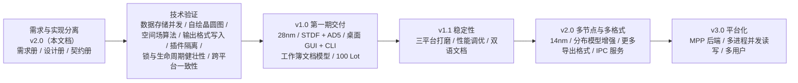

# SiliconDraft 需求规格说明书（What）

> **文档定位**：本文档**只回答"系统必须做到什么"**——功能目标、业务规则、输入输出、质量判据与验收标准。**不包含实现细节**（技术选型、工程结构、数据结构、接口签名、算法步骤）。
>
> **本次重构说明（2026-10-14）**：本文档由 `doc/requirements-merged.MD`（v1.0 合并版，4988 行）按 `doc/requirements-scope-review.MD`（需求与实现分离评审）**拆分重构**而成。拆分原则：
> - **保留并前置**：业务目标、范围边界、功能行为、输入输出契约、质量与验收判据。
> - **移出到 `doc/design.MD`**：技术选型、工程结构、数据结构（表/字段）、接口签名、算法公式、锁与生命周期机制、技术风险与 Spike 计划。
> - **移出到 `doc/contracts/`**：对外契约——CLI 命令/参数/退出码/日志、配置字段、工作簿包与清单格式、插件清单、STDF 与 AD5 输出规格。
> - **删除**：合并流程脚手架、已作废/已撤销需求的留档清单（历史决策改在 `design.MD` §1.1 记录）。
> - **编号不变**：`SD-*` / `DQ-*` / `AC-*` / `US-*` / `R-*` 编号在拆分过程中**保持不变**，与旧文档双向可追溯。

| 项 | 内容 |
| --- | --- |
| 项目名称 | SiliconDraft — 半导体测试数据生成工具 |
| 文档版本 | **v2.0（需求重构版 · 需求与实现分离）** |
| 文档状态 | 待评审 |
| 拆分日期 | 2026-10-14 |
| 前序文档 | `requirements.MD`（v0.1）→ `requirements-v2.MD`（v0.2）→ `requirements-v3.MD`（v0.3.2）→ `requirements-merged.MD`（v1.0 合并版） |
| 关联文档 | `design.MD`（技术设计，How） · `contracts/`（对外契约） · `requirements-scope-review.MD`（本次重构依据） |
| 目标读者 | 需求方 / 评审人 / 测试工程师 / YMS 集成方 |

---

## 更新后的目标、范围与关键约束（速览）

> 本节是本次重构后**产品定位的总结**，供评审快速对齐；详细需求见 §1 ~ §15。

**目标（Goals）**

| # | 目标 | 需求 |
| --- | --- | --- |
| G1 | 只配置晶圆尺寸等基础信息，即可批量生成**结构完整、分布可信**的 CP/WAT 测试数据 | `SD-SYS-010` |
| G2 | 生成的数据具有**真实的物理关联性**（WAT↔CP、die 间、wafer 间），使 YMS 的相关性分析产出显著且符合预期 | `SD-SYS-020` |
| G3 | 可**定向注入已知缺陷**，且缺陷在空间分布与参数影响上均可被 YMS 检出与量化 | `SD-SYS-030` |
| G4 | 支持导出为 STDF、AD5 等标准格式，可直接被主流 Yield Viewer / YMS 加载 | `SD-SYS-040` |
| G5 | 生成过程**完全可复现**（相同种子 + 配置 + 版本 → 完全相同的数据） | `SD-SYS-050` |
| G6 | 提供 GUI 与 CLI **双入口**，共享同一套核心能力与同一份数据 | `SD-SYS-060` |
| G7 | **生成与导出分离**：生成先落工作簿内的数据存储，导出为显式动作 | `SD-SYS-070` |
| G8 | 导出格式采用**可插拔架构**，新增格式零侵入核心 | `SD-SYS-080` |
| G9 | 以 **工作簿** 为数据交付单元：可存盘复用、可打包分发、可独立重放 | `SD-SYS-140` |

**范围（Scope）**

| 范围内（第一期 v1.0） | 范围外（明确不做） |
| --- | --- |
| CP → STDF；WAT → AD5（另附仅供调试的 CSV） | YMS 归属识别（`SD-SYS-150`） |
| 28nm 平面 CMOS 测试项库 + 多节点扩展机制 | 14nm / 7nm 库的**实际交付**（`SD-SYS-151`） |
| 100 Lot 规模（两种路径：单工作簿 100 Lot / 100 个单 Lot 工作簿） | 与真实 ATE 设备对接（`SD-SYS-153`） |
| GUI（桌面客户端）+ CLI + SDK 集成 | 云端多租户、公网 Web 服务（`SD-SYS-152`） |
| 单机本地工作簿，工作簿之间完全隔离 | 跨工作簿的分析能力（对比/汇总/联合查询，`SD-SYS-156`） |

**关键约束（Key Constraints）**——详见 §1.4

| # | 约束 | 需求 |
| --- | --- | --- |
| C1 | GUI 是**本地桌面应用**：不依赖浏览器、不监听网络端口、无远程访问面 | `SD-SYS-190` |
| C2 | 所有数据操作必须以**工作簿**为边界；系统中**不存在"全局数据库"**概念 | `SD-SYS-191` |
| C3 | **同一时刻只允许打开一个工作簿**；工作簿之间**完全隔离** | `SD-SYS-192`、`SD-SYS-270`~`272` |
| C4 | 应用自身数据（配置/插件/临时/恢复登记）与用户产出（工作簿）必须**分离存放** | `SD-SYS-193` |
| C5 | 输出必须**跨平台字节级一致**；工作簿目录包必须**跨平台可直接拷贝打开** | `SD-NFR-054`、`SD-NFR-056` |
| C6 | 必须**免安装运行**（不要求用户预装运行时），且必须在**离线环境**可用 | `SD-NFR-051`、`SD-NFR-055` |
| C7 | 用户数据**永不静默删除**；破坏性操作必须确认并优先进回收站 | `SD-NFR-128` |
| C8 | 对外契约（CLI / 配置 / 输出格式 / 工作簿包）**变更属破坏性变更**，必须公告 | `contracts/` |

---

## 0. 文档说明

### 0.1 术语表


| 术语 | 含义 |
| --- | --- |
| **CP**（Chip Probing / Final Test） | 芯片级测试（探针台测试 / 终测），针对单颗 die |
| **WAT**（Wafer Acceptance Test） | 晶圆级测试，测试 scribe line 上的工艺监控结构（T/C/R/M/S/D structures），又称 PCM / ET |
| **Scribe** | 划片道，芯片之间的切割通道，内嵌工艺监控器件 |
| **Die** | 芯片粒，取自 reticle 上的重复单元 |
| **Reticle / Shot** | 光掩模版 / 曝光单元 |
| **Site** | 测试机的一个测试通道位；同一批次可并行测试多 site |
| **Bin** | 良率分档（Pass/Fail 分档编号）；分 Hard Bin（硬失效）与 Soft/Func Bin（功能分档） |
| **Limit** | 测试限值：`LSL`/`USL` 规格硬限，`LSL_Warn`/`USL_Warn` 预警软限，`Target` 目标值 |
| **STDF** | Standard Test Data Format，SEMI 标准测试数据格式（E10 规范） |
| **AD5** | 代工厂/客户侧的 WAT（PCM/ET）表格型数据交换格式（**规格待冻结**，见 SD-Q-003） |
| **PTR / HDR / SMR / PIR / WIR / HBR / PCR / MRR / GDR / DIE** | STDF 记录类型（详见 §6.7） |
| **YMS** | Yield Management System，良率管理系统 |
| **Floor Plan** | 芯片在 wafer 上的排布规则（Full / Partial / Circle / SAW） |
| **Notch / Flat** | 晶圆定位缺口 / 平边 |
| **空间场（Spatial Field）** | 参数在 wafer 平面上的连续分布函数 |
| **良率（Yield）** | Pass die 数 / 总测试 die 数 |
| **D0** | 缺陷密度参数（单位面积缺陷数） |
| **工作簿（Workbook）** | SiliconDraft 的数据组织顶层单元：一次生成任务的完整载体（目录包 `.sdworkbook/`，内含一个独立的数据存储） |
| **单文件包（`.sdwb`）** | 工作簿目录包打包成的单文件（zip 容器），用于分发与归档 |
| **Cpk / Cp** | 过程能力指数 |
| **TIR** | Test Insertion Rate，测试插入率 |
| **Moran's I** | 空间自相关指数（本项目中用于判定参数的空间相关性是否达到"可被 YMS 检出"的水平） |
| **发布目标（RID）** | 发布产物的目标平台标识（操作系统 + 架构），如 `win-x64`、`osx-arm64` |


### 0.2 需求编号体系

```
SD-<模块码>-<三位序号>
```

- `SD` = SiliconDraft 固定前缀
- `<模块码>` = 三位大写字母模块标识（见下表）
- `<三位序号>` = 从 010 起，步长 10，便于后续插入

| 模块码 | 模块 | 本文档章节 |
| --- | --- | --- |
| `SYS` | 系统级 / 运行边界 / 工作簿数据组织 | §1、§2、§4 |
| `GEN` | 数据生成引擎（几何/物理场/联动/缺陷/执行） | §3 |
| `STO` | 存储容量与磁盘空间要求（**实现细节已移入设计册**） | §4.7 |
| `EXP` | 数据导出（触发/选择集/命名/批量/进度/重试/一致性） | §6 |
| `PLG` | 导出插件框架的**扩展性目标**（接口与机制已移入设计册） | §6.6 |
| `FMT` | 格式范围、校验与追溯（字段级规格已移入 `contracts/formats/`） | §6.6、§6.7 |
| `LIB` | 工艺节点与测试项库 | §8 |
| `GUI` | 图形界面 | §5 |
| `CLI` | 命令行与对外集成接口 | §7 |
| `SCL` | 规模与性能 | §10 |
| `NFR` | 非功能需求 | §11 |
| `EXT` | 后续扩展预留 | §15 |
| `Q` | 待确认事项 | §14 |

**独立编号族（保持原编号）**

| 编号族 | 含义 | 实际编号范围 | 章节 |
| --- | --- | --- | --- |
| `DQ-01` ~ `DQ-22` | 数据质量需求（本项目的**首要成功标准**） | 22 条 | §9 |
| `AC-01` ~ `AC-76` | 验收标准（判据，不是需求本身） | 76 条 | §12 |
| `US-1` ~ `US-5` | 典型使用场景 | 5 条 | §1.3 |
| `BR-1` ~ `BR-9` | 工程化背景问题 | 9 条 | §1.1 |
| `R-01` ~ `R-18` | 风险（技术风险的 `R-10`~`R-12`、`R-15`~`R-16` 见设计册 §14.1） | 13 条在本册 | §13 |
| `D-01` ~ `D-18` | 已确认决策记录（技术选型部分见设计册 §1.1） | 18 条 | §0.4、`design.MD` §1.1 |

> **编号使用规则**
> 1. **一条需求一个编号**，编号在项目生命周期内**永不复用**。作废/撤销的需求**保留编号**并标注，**不得回收给新需求**。
> 2. 需求强度使用 **必须（MUST）/ 应当（SHOULD）/ 可以（MAY）** 三级（RFC 2119 语义）。
> 3. 需求编号与测试用例编号一一对应（用例编号 = `TC-` + 需求编号后缀），保证可追溯。
> 4. 从 v0.1 的 `FR-xx` 到 `SD-GEN-xxx` 的历史映射见 `requirements-merged.MD` §16.1（过渡期参考，不在本册维护）。

### 0.3 需求强度与验收约定

**强度**

| 强度 | 含义 |
| --- | --- |
| **MUST** | 第一期必须交付；未达成不得发布 |
| **SHOULD** | 第一期尽量交付；延后需在评审中记录理由 |
| **MAY** | 列为规划，不纳入第一期验收 |

**验收方式**

每条需求列出至少一种验收方式：`自动化`（测试/断言）、`基准测试`（性能）、`人工审查`（界面/文档/可读性）。

### 0.4 产品行为约定（原"冻结决策"中的产品部分）

> **说明**：原文档把**技术选型**与**产品行为**混在同一张"冻结决策"表里。本次拆分后，技术选型（`D-01`、`D-03`、`D-04`、`D-16`、`D-17`）移入 `design.MD` §1.1，此处只保留**对外可观察的产品行为约定**——它们已在各功能章节中展开为可验收的需求。
> 这些约定**已经确认，不要再重新提出**。

| 编号 | 约定 | 展开章节 |
| --- | --- | --- |
| **D-02** | 同时提供 GUI 与 CLI 两种入口，共享同一核心引擎与同一份数据 | §1.4、§5、§7 |
| **D-05** | **一次生成任务 = 一个工作簿 = 一个独立的数据存储**（取代"全局单库累积所有历史数据"） | §2.1 |
| **D-06** | 工作簿与生成任务**严格 1:1**：「继续后续任务」指同库内聚合/查询/导出/补算，**不追加新轮次** | §2.1、§4 |
| **D-07** | 工作簿磁盘形态为**目录包** `<name>.sdworkbook/`；另提供打包/解包为单文件 `.sdwb` 用于分发 | §4.1、§4.4 |
| **D-08** | 单文件包 `.sdwb` 不可直接作为工作簿打开（需先解包） | §4.4 |
| **D-10** | **Excel 式文档模型**：通过文件选择对话框选路径打开；"新建 / 打开 / 最近打开"三个入口；**应用不维护文件清单、不扫描磁盘、不做文件管理** | §4.1 |
| **D-11** | 对外命名统一为 **工作簿 / `workbook` / `.sdworkbook`**；不再使用"工作区 / Workspace" | §0.1、§4.1 |
| **D-12** | 工作簿之间**完全隔离**：只允许单工作簿操作，**不提供**跨工作簿对比/汇总/查询/只读附加；同一时刻只打开一个工作簿 | §4.6 |
| **D-13** | **保留「最近打开」**：最多 20 项，仅存路径，不扫描磁盘、不读摘要、不做文件管理；可整体关闭；路径失效时提示而非静默移除 | §4.1 |
| **D-14** | 新建默认位置为**系统文档目录下的 SiliconDraft 子目录**；**默认目录只影响新建，不限制打开位置** | §4.1 |
| **D-15** | 临时工作簿放应用数据目录下的 `temp/`，关闭时提示"保存 / 丢弃 / 保留以备恢复"，默认 7 天保留期；清理必须确认 + 优先进回收站。**不得放系统临时目录** | §4.2 |
| **D-18** | 第一期格式范围：CP → STDF；WAT → AD5；另提供 CSV 仅供调试。**不做 YMS 归属识别** | §6.6 |

> **已被否决的方案**（不再重新提出）：托管工作区 + 索引（原 `D-09`，已撤销）、全盘扫描自动发现工作簿、跨工作簿联邦查询与双库对比、B/S 架构、Python 实现。历史决策与理由记录见 `design.MD` §1.1。

---

## 1. 产品目标与范围

### 1.1 项目背景与业务痛点


**背景**

良率管理系统（YMS）需要**真实且结构化**的测试数据才能验证其核心分析能力：

- **空间相关性分析**：die 间、wafer 间、lot 间的参数与良率相关性
- **缺陷特征识别**：中心/边缘异常、扇区失效、簇群缺陷、划痕
- **参数-良率关联分析**：哪些测试项是良率的主要驱动因子（KPI 归因）
- **趋势与预警分析**：批间漂移、机台/轨道偏移的横向对比

**业务痛点**

| 痛点 | 说明 |
| --- | --- |
| 真实数据不可得 | 量产数据涉及商业机密，无法用于开发测试 |
| 随机数据无结构 | 简单随机数生成的数据无法触发相关性分析，等于无效数据 |
| 缺陷不可控 | 真实数据中的缺陷无法定向复现，难以验证检测算法灵敏度 |
| 格式门槛高 | STDF 等格式手写复杂，多份测试数据格式不统一 |

**工程化痛点（源 v0.2 评审暴露）**

| 序号 | 问题 | 对策章节 |
| --- | --- | --- |
| B-1 | 只有 CLI，工程师无法直观查看生成的数据是否合理 | §8.1 GUI |
| B-2 | 数据生成后直接落盘成文件，重复生成/多次导出产生文件爆炸，且缺少"数据集"概念 | §2、§4 工作簿与内部数据库 |
| B-3 | 格式写死在代码里，新增一种格式要改核心代码 | §6 插件架构 |
| B-4 | 格式范围未收敛，第一期目标不清晰 | §6.1 第一期 STDF + AD5 |
| B-5 | 工艺节点只考虑 28nm，缺少跨节点扩展的结构化设计 | §7 节点与测试项库模型 |
| B-6 | 未定义规模与性能指标，无法验证是否支撑真实 YMS 测试场景 | §10 规模与性能 |
| B-7 | 无标准退出码与日志规范，无法接入自动化流水线 | §8.2 CLI |
| B-8 | 全局单库导致并发冲突域过大（任一进程打开库即锁住全部历史数据） | §2 工作簿模型 |
| B-9 | 工作簿无法按任务交付/归档，生命周期不可区分（试跑数据与回归基线混在一起） | §2.4、D-08 |

**项目目标**

| 编号 | 目标 |
| --- | --- |
| **SD-SYS-010** | 用户仅配置晶圆尺寸等基础信息，即可批量生成结构完整、分布可信的 CP/WAT 测试数据 |
| **SD-SYS-020** | 生成的数据必须具备**真实的物理关联性**（WAT↔CP、die 间、wafer 间），使 YMS 的相关性分析产出显著且符合预期的结果 |
| **SD-SYS-030** | 可定向注入已知缺陷特征，且缺陷在空间分布与参数影响上均可被 YMS 检出与量化 |
| **SD-SYS-040** | 支持导出为 STDF、AD5 等标准格式，可直接被主流 Yield Viewer / YMS 加载 |
| **SD-SYS-050** | 生成过程完全可复现（相同随机种子 + 相同配置 + 相同版本 → 完全相同的数据集），便于回归测试 |
| **SD-SYS-060** | 提供 GUI 与 CLI **双模式入口**，共享同一套核心引擎与同一份数据，能力对齐、无功能割裂 |
| **SD-SYS-070** | 实现**生成与导出分离**：生成数据先落工作簿内的嵌入式数据库，导出为显式动作，支持多次、多格式、多子集导出 |
| **SD-SYS-080** | 导出格式采用**可插拔插件架构**，新增格式零侵入核心代码 |
| **SD-SYS-090** | 第一期格式范围收敛为 **CP → STDF**、**WAT → AD5** |
| **SD-SYS-100** | 以 **28nm** 为第一期基准节点，测试项库采用**节点可继承的数据模型**，为 14nm/7nm 预留扩展机制 |
| **SD-SYS-110** | 支撑 **100 Lot 以上**规模的数据生成、存储、查询与导出，并定义量化性能指标与水平扩展路径 |
| **SD-SYS-120** | 明确 **YMS 归属识别不在第一期范围** |
| **SD-SYS-130** | 建立完整的**需求-验收-测试**可追溯体系，所有需求带编号与验收方式 |
| **SD-SYS-140** | 以 **工作簿** 为数据交付单元：可存盘复用、可打包分发、可独立重放 |


### 1.2 非目标与范围边界


| 编号 | 内容 | 说明 |
| --- | --- | --- |
| **SD-SYS-150** | YMS 归属识别（Which-lot / Which-product 归属推断） | 第一期不做。生成的数据**不写入 YMS 侧归属标识字段**，不模拟归属冲突场景 |
| **SD-SYS-151** | 14nm / 7nm 测试项库的实际交付 | 第一期只交付 28nm 库 + 多节点扩展机制（数据模型 + 接口 + 文档），不交付先进节点数据内容 |
| **SD-SYS-152** | 云端多租户、公网 Web 服务 | 不在范围。GUI 是本地桌面应用，不提供网络访问 |
| **SD-SYS-153** | 与真实 ATE 设备的物理对接（设备驱动、SECS/GEM 通信、针尖磨损、Handler 行程仿真） | 不在范围 |
| **SD-SYS-154** | 电路功能验证（DFT / ATPG 覆盖率仿真） | 不在范围 |
| **SD-SYS-155** | 量产数据分析本身 | 不在范围。工具只负责产出数据，分析交给 YMS |
| **SD-SYS-156** | 跨工作簿的分析能力（对比 / 汇总 / 联合查询） | 不在范围（D-12）。需要跨工作簿分析时，各自导出后在**外部工具**完成 |
| **SD-SYS-157** | 移动端 / WebAssembly 目标 | 不在范围（当前明确不做） |
| **SD-SYS-158** | 与客户实际量产数据分布的拟合精度 | 第一期不做参数拟合；预留 `fit` 扩展位 |


### 1.3 目标用户与典型场景


**目标用户**

| 角色 | 诉求 |
| --- | --- |
| **YMS 测试工程师** | 生成一批标准数据集，回归验证 YMS 分析模块（含历史版本对比） |
| **良率工程师（Yield Engineer）** | 生成指定缺陷场景的数据，验证缺陷检测与归因算法的灵敏度 |
| **YMS 演示 / 售前** | 生成"看起来像真数据"的演示数据集 |
| **工具链开发** | 需要可复现、可脚本化、可批量运行的数据生成器 |

**典型场景**

| 编号 | 场景 | 配置与预期 |
| --- | --- | --- |
| **US-1** | 基础回归数据集 | 200mm 晶圆、1 lot × 25 wafer、CP 30 项、WAT 15 项 → 导出的 STDF/AD5 可直接导入 YMS |
| **US-2** | 缺陷检出能力验证 | 注入「中心 Vth 偏高 15mV，覆盖中心 R=60mm」→ YMS 空间分析应识别出中心异常区域并给出半径估计 |
| **US-3** | 跨 wafer 相关性验证 | 分别生成「wafer 间 Vth 均值线性漂移」与「无相关性」两个工作簿 → 各自导出后在 YMS 中对比，前者应报出高相关、后者应报无相关 |
| **US-4** | 批量压力测试 | 用 `batch generate` 产出 100 个单 Lot 工作簿（或 1 个大工作簿含 100 Lot）→ 验证 YMS 大数据量处理与聚合正确性 |
| **US-5** | 数据交付 | `workbook pack` 打成 `.sdwb` 发给同事或归档，对方 `unpack` 后独立打开，可重放验证 |

---


### 1.4 运行边界与关键约束

> 本节把原先散落在架构章节（原 §1.4/§1.6）的**技术实现描述**抽象为**产品级约束**。技术选型见 `design.MD` §1。

**SD-SYS-190**（MUST，2026-10-14 改写）：GUI 必须是**本地桌面应用**——不依赖浏览器、不监听网络端口、不部署任何服务端组件、不暴露远程访问面。界面展示的数据必须与 CLI 输出**同源**（同一套统计实现），不得各自实现一套。

**SD-SYS-191**（MUST，2026-10-14 改写）：所有数据操作都必须**针对当前打开的工作簿**；系统中**不存在"全局数据库"**概念。未打开工作簿时，数据类操作必须给出明确提示与下一步指引，而不是执行。

**SD-SYS-192**（MUST，2026-10-14 改写）：**同一时刻只允许打开一个工作簿**（与 `D-12`、`SD-SYS-252` 同义，此处为总则）。

**SD-SYS-193**（MUST，➕ 新增）：应用自身数据（配置、插件、临时工作簿、崩溃恢复登记）与**用户产出**（工作簿）必须**分离存放**。目的：用户备份或迁移自己的实验数据时，无需连带应用内部状态；删除应用设置不得损失任何数据。

**关键约束一览（索引，非新需求）**

| 约束 | 需求编号 | 章节 |
| --- | --- | --- |
| 无网络暴露面（本地桌面应用） | `SD-SYS-190` | §1.4 |
| GUI / CLI 共享核心与数据、行为一致 | `SD-SYS-060`、`SD-NFR-122` | §1.4、§11.6 |
| 所有数据操作以工作簿为边界；无"全局数据库"概念 | `SD-SYS-191` | §1.4 |
| 同一时刻只允许打开一个工作簿 | `SD-SYS-192`、`SD-SYS-252` | §1.4、§4.5 |
| 工作簿之间完全隔离，不提供任何跨工作簿能力 | `SD-SYS-270`~`272` | §4.6 |
| 应用数据与用户产出分离存放 | `SD-SYS-193` | §1.4 |
| 导出格式可插拔、新增格式零侵入核心 | `SD-PLG-011`、`SD-SYS-080` | §6.6 |
| 生成与导出分离（导出只能显式触发、只读） | `SD-SYS-070`、`SD-EXP-010`、`SD-EXP-062` | §6.1 |
| 输出跨平台字节级一致 | `SD-NFR-054` | §11.2 |
| 工作簿跨平台可直接拷贝打开与重放 | `SD-NFR-056` | §11.2 |
| 免安装运行、离线可用 | `SD-NFR-051`、`SD-NFR-055` | §11.2 |
| 用户数据永不静默删除 | `SD-NFR-128` | §11.4 |
| 对外契约变更属破坏性变更 | `contracts/` | 见契约册 |

---

## 2. 核心概念

### 2.1 数据组织单元：工作簿


**SD-SYS-200**（MUST）：**工作簿（Workbook）** 是 SiliconDraft 的顶层数据组织单元：

> 一次生成任务的**完整载体** = 一个目录包（`<name>.sdworkbook/`）= 一个独立的数据存储 + 一份清单 + 该任务的日志 / 导出产物 / 报告 / 暂存区。

**SD-SYS-201**（MUST）：必须维护以下**不变量（Invariants）**，并在 `workbook verify` 中逐条检查：

| 编号 | 不变量 | 违反时的处理 |
| --- | --- | --- |
| INV-1 | 一个工作簿目录内**恰好一个** `workbook.duckdb` | 报错并拒绝打开 |
| INV-2 | 一个工作簿内 `sd_dataset` **恰好一条**记录（D-07 严格 1:1） | 0 条 = 尚未完成生成（允许，标记 `Incomplete`）；> 1 条 = 数据损坏（报错） |
| INV-3 | 同一时刻最多一个**读写**进程持有该工作簿（只读打开不受此限） | 见 §2.6 |
| INV-4 | 工作簿内数据的 `config_hash` 必须与其 `sd_config` 记录自洽，可重放 | 报错并标记 `unreproducible` |
| INV-5 | 除已声明的子目录/文件外，目录内不得出现未声明的顶层条目 | WARN（不阻止打开），提供 `workbook tidy` 迁移到 `extra/` |
| INV-6 | `workbook.json` 的 `schemaVersion` 与库内 `sd_schema_version` 必须一致 | 不一致 = 需要 `workbook migrate` |
| INV-7 | 工作簿的 `state` 字段必须反映真实状态（见 §2.3） | 异常残留状态由 `workbook repair` 修正 |

**SD-SYS-202**（MUST）：`workbook.json` 是工作簿的**自描述清单**：

| 要求 | 说明 |
| --- | --- |
| 人类可读 | 缩进 JSON，字段顺序稳定（`System.Text.Json` 源生成 + 固定属性顺序），保证可 diff |
| 冗余而非唯一 | 清单中的摘要统计是**缓存**，权威值在库内。清单损坏时可由 `workbook rebuild-manifest` 从库重建 |
| 路径分隔符统一 | 清单内路径一律使用 `/`，保证工作簿目录可跨 RID 直接拷贝使用 |
| 兼容演进 | 必须有 `schemaVersion`；新版读到旧清单必须能升级（只读打开时降级为只读） |
| 不存敏感信息 | 禁止出现凭据类信息；不得内嵌完整配置（配置在库内 `sd_config`） |

> 完整清单规范见 §16.4。


> **关于「不变量」的拆分说明**：上表中 `INV-1`（目录内恰好一个数据存储文件）、`INV-2`（轮次记录恰好一条）、`INV-6`（清单与库内 Schema 版本一致）属于**内部完整性规则**，其校验实现见 `design.MD` §3.3 与 `contracts/workbook-package.MD`；`INV-3`（同时最多一个读写进程）、`INV-4`（可重放）、`INV-5`（目录内无未声明条目）、`INV-7`（状态真实）为**对用户有影响的行为要求**，保留为本册需求（见 §4.2、§4.3、§4.5）。

### 2.2 数据层级与粒度

**SD-SYS-203**（MUST）：数据的层级必须为 **工作簿 → Lot → Wafer → Die**（WAT 数据在 Wafer 下为「结构 → 参数」两级）。所有界面文案、错误提示、导出路径回显都必须以该层级表述，**禁止出现"当前数据库"、"所有数据集"、"当前工作区"这类会让用户误以为数据全局共享的说法**。

**SD-SYS-204**（MUST）：数据必须同时包含 CP 与 WAT 两类：
- **CP（芯片级）**：粒度到 die，记录每个 die 的测试项值、判定结果、Bin、坐标与缺陷命中。
- **WAT（晶圆级）**：粒度到 scribe line 上的测试结构，记录结构位置（含径向/扇区信息）与结构级参数值。

**SD-SYS-205**（MUST）：每个 Die 必须记录以下信息（字段级定义见 `design.MD` §5.2 与附录 C）：Lot / Wafer / Die 标识、die 坐标与极坐标、reticle 归属、die 类型与状态、Bin（硬 Bin / 功能 Bin）、首要失败测试项、是否复测与复测次数、参数越限位图、命中的缺陷位图、测试耗时、site 编号。

---

## 3. 数据生成（功能需求）

> **本章是全文最核心的业务内容**，源自 v0.1 的 `FR-1` ~ `FR-16` 与 `FR-20`，已统一编号为 `SD-GEN-xxx`。
>
> **首要原则**：**禁止直接对测试项值加随机噪声**。必须先生成底层工艺物理量，再由物理量按物理关系推导测试项。这是本工具区别于"随机数生成器"的根本，也是"有意义的测试项"的技术保证。

### 3.1 晶圆与测试对象建模


#### 晶圆规格配置

**SD-GEN-010**（MUST）：用户必须可配置以下晶圆几何参数（原 `FR-1`）：

| 参数 | 说明 | 取值范围 |
| --- | --- | --- |
| `wafer_diameter_mm` | 晶圆直径 | 100 / 150 / 200 / 300（英寸：4 / 6 / 8 / 12） |
| `wafer_thickness_um` | 晶圆厚度 | 正数，默认 525 / 775 / 1425 |
| `edge_exclusion_mm` | 边缘排除宽度 | 0–10，默认 3 |
| `notch_direction_deg` | 缺口方向角 | 0–360，默认 270 |
| `flat_direction_deg` | 平边方向角 | 0–360 |
| `scribe_width_um` | 划片道宽度 | 正数 |
| `wafer_pitch_mm` | 掰边距离（Notch → 平边距离） | 正数 |
| `retention_zone_mm` | 工艺监控保留环宽度 | 0–10，默认 3.0 |
| `die.width_mm` / `die.height_mm` | Die 尺寸 | 正数 |
| `die.floor_plan` | 排布规则 | `full` / `partial` / `circle` / `saw` |
| `die.exclude_edge_dies` | 是否排除边缘不完整 Die | 布尔，默认 `true` |

#### Die Map 生成

**SD-GEN-020**（MUST）：支持 4 种 wafer floor plan，每种均以 die 原点坐标列表输出（原 `FR-2.1`）：

| Floor Plan | 说明 | 适用 |
| --- | --- | --- |
| `full` | 整片矩形 die 网格 | 长方形 die |
| `partial` | 最外圈 die 边缘缺失（cut-off die），标记为 `PARTIAL` | 所有工艺 |
| `circle` | 仅完整包含在晶圆圆内的 die | 圆形 die |
| `saw` | SAWING 半圆刀痕，末行半 die | SAW 工艺 |

**SD-GEN-021**（MUST）：每个 Die 必须记录以下字段（原 `FR-2.2`，与 §4.2 的 `sd_die` 表对应）：

`lot_id, wafer_id, wafer_slot, die_id, die_x_mm, die_y_mm, radius_mm, theta_deg, die_type, reticle_id, reticle_x, reticle_y, die_state, bin_num, hard_bin, func_bin, first_fail_item_id, is_retest, retest_count, param_fail_mask, defect_hit_mask, test_time_ms, site_id`

其中：
- `die_type` ∈ {`FULL`, `PARTIAL`, `EDGE`, `PROBE_FAIL`}
- `die_state` ∈ {`TESTED`, `SKIPPED`, `PROBE_FAIL`, `DROPPED`, `RETESTED`}

**SD-GEN-022**（MUST）：支持将 `edge_exclusion` 内的 die 标记为 `EXCLUDED` 且不参与测试（可在配置中关闭该行为）（原 `FR-2.3`）。

**SD-GEN-023**（MUST）：Die 坐标必须满足：**在晶圆圆内、编号唯一无缺失**（对应 `DQ-14`）。必须建立 `(dataset_id, lot_id, wafer_id, die_x_mm, die_y_mm)` 唯一约束保护。

**SD-GEN-024**（MUST）：提供 die map 可视化导出（PNG / SVG），用于人工核对空间布局正确性（原 `FR-2.4`）。

#### WAT 结构布局

**SD-GEN-030**（MUST）：必须在 scribe line 上沿环形路径生成 WAT 测试结构位置，每个结构包含（原 `FR-3.1`）：

| 字段 | 说明 |
| --- | --- |
| `structure_id` | 结构编号 |
| `measure_index` | 冗余结构的重复测量序号（默认 0） |
| `structure_type` | `T`(transistor) / `S`(spreading resistance) / `M`(metal/contact) / `C`(capacitor) / `R`(resistor) / `D`(diode) |
| `x_mm`, `y_mm`, `radius_mm`, `theta_deg` | 位置与极坐标 |
| `scribe_line_id` | 所属划片道（径向 / 环形 / 局部） |
| `ring_index` | 所属环序号 |

**SD-GEN-031**（MUST）：默认布局为**多半径同心环**（如 R = 10 / 25 / 40 / 55 / 70 / 85 mm，每环 16 个结构），保证中心与边缘均有足够采样点以支撑缺陷检出（原 `FR-3.2`）。

**SD-GEN-032**（MUST）：同一结构类型必须在多环上重复出现（multi-site / 同结构多位置测量），用于建立径向相关性（原 `FR-3.3`）。

**SD-GEN-033**（MUST）：WAT 布局模型必须**可插拔**（配置驱动 `wat_layout_model`）：

| 模型 | 适用 | 说明 |
| --- | --- | --- |
| `concentric_rings` | 28nm 默认 | 同心环多结构 |
| `reticle_based` | 先进节点 | 按 reticle 布局结构 |
| `shared_redundant` | 先进节点 | 共享结构 + 强冗余 |

**SD-GEN-034**（MUST）：必须支持 `redundant_structures` 配置：同一结构多次测量（`repeat_count`），生成独立记录（同一 `structure_id` 不同 `measure_index`），供 YMS 做重复性分析（repeatability）。

**SD-GEN-035**（SHOULD）：必须支持 `structure_sharing` 配置：多个器件/参数共享同一物理结构，影响 WAT 数据的结构-参数映射关系。


### 3.2 测试程序与测试项定义


**SD-GEN-040**（MUST）：每个测试程序由**测试项列表**组成，每个测试项必须可定义以下字段（原 `FR-4.1`；完整数据模型见 §7.2）：

| 字段 | 说明 | 必填 |
| --- | --- | --- |
| `test_name` / `item_id` | 测试项名称，如 `IDSAT_NCH` | 是 |
| `alias` | 物理别名 / 量纲说明 | 否 |
| `test_type` | `WAT` / `CP`（`SPICE` 预留为派生类型） | 是 |
| `site` | 测试通道位 | 否 |
| `unit` | 单位（mV、uA、nS、pF、ns…） | 是 |
| `target` | 目标值（中心值） | 是 |
| `LSL` / `USL` | 规格上下限（硬限） | 是（至少一个） |
| `LSL_Warn` / `USL_Warn` | 预警限（软限，用于产生 warning bin） | 否 |
| `sigma` | 目标标准差 | 是 |
| `corr_group` | 相关性分组标识（同组共享同一 latent 因子） | 否 |
| `fail_class` | `hard_fail` / `soft_fail` / `parametric` | 否 |
| `derived_from` | 派生链声明（见 §3.4） | 否 |
| `enabled` | 是否启用 | 否 |

**SD-GEN-050**（MUST）：必须内置**测试项模板库**（默认配置），用户可直接使用或修改（原 `FR-4.2`）。

**WAT 类（工艺监控）**

| 测试项 | 物理含义 | 单位 | 监控目标 |
| --- | --- | --- | --- |
| `VT_NCH_N1` | NMOS 驱动晶体管阈值电压 | mV | 光刻/CD、栅氧 |
| `VT_NCH_N2` | 应力 NMOS 阈值电压（TDDB 相关） | mV | 栅氧退化 |
| `IDSAT_N1` | NMOS 饱和电流 | uA | 剂量 / 沟道迁移率 |
| `ION_N1` | NMOS 线性区电流 | uA | 有效长度 |
| `IOFF_N1` | NMOS 关态漏电 | nA | 栅氧 / 结漏电 |
| `ROFF_N1` | 接触电阻（含硅化物） | ohm | 硅化 / 接触工艺 |
| `RSP_NMOD` | N+ 扩散体方块电阻 | ohm/sq | 激活 / 掺杂 |
| `RSP_PMOD` | P+ 扩散体方块电阻 | ohm/sq | 同上 |
| `RSP_POLY` | 多晶硅方块电阻 | ohm/sq | 多晶沉积 |
| `RUP_M1` ~ `RUP_M4` | 各层金属线电阻 | ohm/sq | 金属沉积 / 刻蚀 / 通孔 |
| `CAP_ACOV` | 栅氧电容（单位面积） | fF/um² | Tox |
| `TBD_VBD` | 漏-体结击穿电压 | V | 漏区边缘套刻 |
| `LEAKAGE_JUNC` | 体-结反向漏电 | nA | 结质量 |
| `VBIN_DIODE` | 二极管正向压降 | V | 掺杂浓度 |
| `TNOM` | 迁移率归一化指标 | — | 派生 |

**CP 类（芯片级）**

| 测试项 | 物理含义 | 单位 | 与 WAT 的联动源 |
| --- | --- | --- | --- |
| `VT_NCH_N1` / `VT_PCH_N1` | 器件阈值电压 | mV | `VT_NCH_N1`(WAT)、`RSP_NMOD` |
| `IDSAT_NCH` / `IDSAT_PCH` | 饱和电流 | uA | `IDSAT_N1`、`VT` |
| `ION_NCH` | 线性电流 | uA | `ION_N1`、`VT` |
| `IOFF_NCH` / `IOFF_PCH` | 关态漏电 | nA | `IOFF_N1`、`TBD_VBD` |
| `RDS_ON_NCH` / `PCH` | 导通电阻 | kΩ | `ROFF_N1`、`RUP_M1`、`IDSAT` |
| `DIBL` | 漏诱导势垒降低 | mV | `TBD_VBD`、`VT`、`Lpoly` |
| `SUBTHR_SLOPE` | 亚阈值摆幅 | mV/dec | `TBD_VBD`、`IOFF` |
| `GM_NCH` | 跨导 | mS | `IDSAT`、`VT` |
| `BV_DRAIN` | 漏-体击穿电压 | V | `TBD_VBD`、`RSP_NMOD` |
| `FREQ_MAX` | 最大工作频率 | MHz | 派生自 `IDSAT` + `CAP` |
| `LEAKAGE_TOTAL` | 总漏电 | nA | 各 `IOFF` 求和 |
| `RUP_M1_CP` | 芯片内金属电阻 | ohm/sq | `RUP_M1`(WAT) |
| `CP_RCONT` | 接触电阻（CP 结构） | ohm | `ROFF_N1`(WAT) |
| `STATIC_NOISE` | 热噪声电压密度 | nV/rtHz | 派生自 `GM` |
| `MISMATCH_CV` | 失配电压（Pelgrom） | mV | 局部工艺梯度 |
| `EM_RHO` | 电流密度（EM 评估） | A/cm² | 派生 |

**SD-GEN-051**（MUST）：支持用户自定义测试项（同一套 Schema 即可扩展到 BCD / CIS / DRAM / NOR 等工艺）（原 `FR-4.3`）。


### 3.3 物理参数与空间分布

#### 3.3.1 底层工艺物理量


**SD-GEN-060**（MUST）：每 wafer 必须生成一组底层物理量场（每物理量在 wafer 平面上是一个连续曲面）（原 `FR-6.1`）：

| 物理量 | 符号 | 单位 | 影响的下游测试项 |
| --- | --- | --- | --- |
| 有效栅氧厚度 | `tox` | nm | `CAP_ACOV`, `VT`, `IOFF`, `TBD` |
| 沟道有效长度 | `leff` | nm | `IDSAT`, `ION`, `DIBL`, `VT` |
| 沟道宽度 | `weff` | nm | `IDSAT`, `IOFF`, `GM` |
| 源漏剂量 | `dose_n/p` | cm⁻² | `RSP_*MOD`, `IDSAT`, `VT` |
| 激活掺杂浓度 | `dop_n/p` | cm⁻³ | `RSP`, `IOFF`, `VT` |
| 栅多晶长度 | `lpoly` | nm | `VT`, `RSP_POLY` |
| 套刻误差 | `overlay_ns/p` | nm | `DIBL`, `TBD_VBD`, `IOFF` |
| 接触电阻 | `rc` | ohm | `ROFF`, `RDS_ON`, `CP_RCONT` |
| 金属线电阻 | `rmetal_lN` | ohm/sq | `RUP_M*`, `RDS_ON`, `EM_RHO` |
| 界面态密度 | `nit` | cm⁻²eV⁻¹ | `SUBTHR_SLOPE`, `VT` |
| 迁移率因子 | `mob_factor` | — | `IDSAT`, `GM`, `RON` |
| 局部工艺梯度 | `grad_mag` | nm/mm | `MISMATCH_CV`、边缘异常 |

**SD-GEN-061**（MUST）：物理量模型必须**可扩展**：新增工艺节点时只需注册新物理量 + 定义派生关系，**不得修改已有节点的行为**。必须有一个单元测试证明"注册一个新物理量后，既有 28nm 库的输出字节级不变"。


#### 3.3.2 空间分布要求

> **说明**：本节原为"空间场模型"，含具体数学公式（`P(x,y) = μ + α·(r/R)^n + …`）与实现手段（FFT 谱合成、Perlin 噪声）。**公式与实现已移入 `design.MD` §7.1**；此处只保留"分布必须满足什么"。

**SD-GEN-074**（MUST，🔁 2026-10-14 改写，替代原 `SD-GEN-070` 的表述）：每个底层工艺物理量在晶圆平面上必须是一个**连续的空间分布**（而非逐 die 独立抽样）。该分布必须由以下成分叠加构成，且每个成分必须**可独立开关与调参**：

| 成分 | 物理含义 | 作用 |
| --- | --- | --- |
| **全局偏移** | 批次 / 机台级漂移 | 产生 lot 间、批间趋势 |
| **径向趋势** | 刻蚀均匀性、旋涂边缘效应 | 产生中心/边缘差异（支撑中心/边缘型缺陷与径向拟合） |
| **方位角（扇区）成分** | 旋涂/喷淋的方位角不均 | 产生扇区型异常 |
| **空间平滑随机成分** | 颗粒 / 工艺微区 | 产生可被空间自相关检出的平滑起伏 |
| **die 级微观随机噪声** | 随机测量误差 | 保证 die 间存在真实离散 |

**SD-GEN-075**（MUST）：各成分的**振幅必须按片独立抽取**（产生 wafer 间的变化），而**场形必须在单片 wafer 内保持自洽**（同一物理量在整个片上是一个确定曲面）。这是"**wafer 间相关性能被 YMS 检出**"的前提。

**SD-GEN-076**（MUST）：必须提供「**关闭空间平滑成分、仅保留 die 级独立噪声**」的开关，用于生成**无空间相关的对照组数据**，验证 YMS 不会误报相关性。

**SD-GEN-077**（MUST）：空间平滑成分必须具有**可被统计检出的空间自相关**；验收门槛为 `DQ-06`（**Moran's I > 0.3**）。具体生成算法见 `design.MD` §7.1。

#### 3.3.3 测试项推导要求

> **说明**：本节原为"物理量 → 测试项推导"，含九条示例公式。**公式与系数表已移入 `design.MD` §7.2**；此处只保留"推导必须满足什么"。

**SD-GEN-084**（MUST，🔁 2026-10-14 改写，替代原 `SD-GEN-080` 的表述）：测试项值**必须由底层物理量按物理关系推导**，**禁止直接对测试项值加随机噪声**。

**SD-GEN-085**（MUST）：每个测试项的物理量依赖关系与其系数必须**可配置**，以支持"不同工艺配方"场景（对应原 `SD-GEN-081`）。

**SD-GEN-086**（MUST）：必须支持在测试项层面声明**派生链**（如「CP 的 `IDSAT` ← WAT 的 `IDSAT` + 物理量 `weff` / `mob_factor`」）。该声明必须同时用于导出元数据，使 YMS 侧能够溯源每个 CP 项的数据来源（对应原 `SD-GEN-082`）。

**SD-GEN-087**（MUST）：同一相关性分组（`corr_group`）内的测试项必须共享同一份相关噪声（同一潜在因子），使相关性在统计上显著（对应原 `SD-GEN-083`）。

### 3.4 CP ↔ WAT 联动性设计


> 这是本项目区别于"随机数生成器"的核心。YMS 的相关性分析要有意义，必须让 WAT 与 CP 之间存在**可被统计检出的关联**。

#### 联动层级

**SD-GEN-090**（MUST）：必须实现以下六层联动（原 `FR-8`）：

| 层级 | 联动方式 | YMS 可分析出的结论 |
| --- | --- | --- |
| **L1 参数级** | WAT 项的 wafer/位置均值与 CP 项均值直接相关（如 CP 的 `VT` 均值 ≈ WAT 的 `VT` 均值 + 偏置） | 参数-参数相关性矩阵、回归关系 |
| **L2 空间级** | 同一 wafer 内，CP die 与邻近 WAT 结构共享同一物理场；CP die 的值与**径向距离**相关 | Die 与 WAT 点空间相关性、径向趋势拟合 |
| **L3 良率级** | WAT 参数偏移 → CP Limit 判定恶化 → 特定空间区域的 yield 塌陷 | WAT 早期预警、良率归因分析 |
| **L4 截面级** | 部分 wafer 存在明显的"边缘死区"，WAT `RSP` 边缘值异常高 → 对应 CP 边缘 ring 内 bin 恶化 | 边缘 vs 中心良率对比 |
| **L5 片间级** | 同一 lot 内 wafer 间存在机台/槽位相关偏移，WAT 与 CP 同向 | Wafer 间 / 槽位间相关性分析 |
| **L6 批间漂移** | 不同 lot 之间存在时间趋势（litho 漂移、维护后恢复等） | 批间趋势图、漂移告警 |

#### 联动性的强制约束

**SD-GEN-100**（MUST）：同一 wafer 内，CP die 与同一径向位置的 WAT 结构，其**底层物理场值必须一致**（同一场函数求值，**不允许独立抽样**）（原 `FR-9.1`）。

**SD-GEN-101**（MUST）：WAT 结构与 CP die 的映射规则必须可配置（原 `FR-9.2`）：

| 映射模式 | 说明 |
| --- | --- |
| `radial_bin` | 按径向距离分箱（默认 8 箱），箱内取该箱 WAT 均值 |
| `nearest` | 取空间距离最近的 WAT 结构 |
| `kriging` | IDW 反距离加权插值（权重 `idw_power` 可配） |
| `global` | 全 wafer WAT 均值（最弱联动，用于对照） |

**SD-GEN-102**（MUST）：必须提供 `correlation_strength` 参数（0–1）（原 `FR-9.3`）：

- `0` → 完全独立（WAT 视为不提供信息）
- `1` → 完全由 WAT 场决定（CP 值 = f(WAT 场) + 极小噪声）
- 中间值 → 按强度混合，便于生成"弱/中/强关联"多档数据集，测试 YMS 检出灵敏度

**SD-GEN-103**（MUST）：同一配置下，默认 `correlation_strength ≥ 0.6`，保证 YMS 能检出显著相关（原 `FR-9.4`）。该默认值必须**可按工艺节点配置**（28nm 默认 0.8；先进节点应更高，如 0.9）。

**SD-GEN-104**（MUST）：必须内置 **`CP_WAT_CORRELATION_MAP`** 元数据表（可导出为 JSON/CSV），明确声明"哪个 CP 项受哪个 WAT 项影响、影响方向、预期相关系数区间"。**该表即 YMS 相关性分析的 ground truth**（原 `FR-9.5`），并必须有对应的数据库视图 `v_corr_wat_cp` 用于对照。

#### 相关性预设（Preset）

**SD-GEN-110**（MUST）：必须内置以下预设数据集配方，一键生成典型场景（原 `FR-10.1`）：

| Preset ID | 名称 | 描述 | 预期 YMS 输出 |
| --- | --- | --- | --- |
| `P-BASE` | 基准健康数据 | 无缺陷，工艺参数受控，良率 98%+ | 低相关性、无缺陷告警 |
| `P-CENTER-HIGH` | 中心 Vth 偏高 | 中心 R<60mm Vth +15mV | 中心异常 + 中心 yield 轻微下降 |
| `P-CENTER-LOW` | 中心 Vth 偏低 | 中心 Vth −15mV | 中心异常 + 高 Vt 相关 bin 上升 |
| `P-EDGE-HIGH` | 边缘偏高（Radial） | r>0.8R 区域 Vth +20mV | 边缘环形 yield 塌陷 |
| `P-EDGE-LOW` | 边缘电阻偏高 | 边缘 `ROFF`/`RUP_M1` +30% | 边缘 RDS_ON bin 恶化 |
| `P-RING` | 环形失效 | R=70mm 环带参数严重异常 | 特定 ring yield=0，检验空间聚类能力 |
| `P-SECTOR` | 扇区失效 | 30°–90° 扇区整段失效 | 扇区级 yield 塌陷 |
| `P-SCRATCH` | 划痕 | 贯穿 wafer 的直线/曲线划痕 | 线状 yield 塌陷，检验轮廓分析 |
| `P-CLUSTER` | 簇群缺陷 | 5–10 处随机簇群（Poisson 盘） | 簇群缺陷检出与计数 |
| `P-PARTICLE` | 颗粒污染 | 随机颗粒导致的孤立失效 die | 随机缺陷率上升，空间随机性 |
| `P-GRADIENT` | 单向工艺梯度 | 沿 +X 方向单调漂移 | 线性梯度拟合，R² > 0.9 |
| `P-BOW` | Wafer 翘曲 | 弯曲应力导致环状/条状分布 | 复杂空间分布 |
| `P-DRIFT` | 批间漂移 | 10 lot 线性漂移 + 一次维护后阶跃恢复 | 批间趋势 + 阶跃点检测 |
| `P-TOOL-CLUSTER` | 机台簇群 | 同机台 wafer 参数整体偏移 | 机台/轨道间相关性 |
| `P-MULTI-DEFECT` | 复合缺陷 | 边缘 + 簇群 + 随机同时存在 | 综合能力验证 |
| `P-WEAK-CORR` | 弱相关对照 | `correlation_strength = 0.15` | 相关性分析应报"无显著相关"（**负向验证**） |
| `P-NO-CORR` | 无关对照 | `correlation_strength = 0` | 矩阵全随机，验证不误报（**负向验证**） |
| `P-FLOOR` | 极端良率 | 良率跌至 40–60% | 低良率数据处理鲁棒性 |

**SD-GEN-111**（MUST）：必须支持**用户自定义预设**（YAML），语义与内置预设一致。


### 3.5 缺陷特征注入引擎


#### 缺陷分类体系

**SD-GEN-120**（MUST）：必须支持以下**几何型缺陷（空间形貌类）**（原 `FR-11.1`）：

| 缺陷 ID | 名称 | 几何定义 | 默认参数 | 主要影响对象 |
| --- | --- | --- | --- | --- |
| `D-CENTER-HIGH` | 中心偏高 | 圆形：`r < R_center` | `R=60mm, Δ=+15mV` | `VT`, `IOFF` |
| `D-CENTER-LOW` | 中心偏低 | 圆形：`r < R_center` | `R=60mm, Δ=−15mV` | `VT`, `IDSAT` |
| `D-EDGE-HIGH` | 边缘偏高 | 圆环：`r > R_edge` | `R=0.8R, Δ=+20mV` | `VT`, `IOFF` |
| `D-EDGE-LOW` | 边缘偏低 | 圆环：`r > R_edge` | `R=0.8R, Δ=−20mV` | `IDSAT`, `RDS_ON` |
| `D-RING` | 环带异常 | 圆环：`R_ring ± W/2` | `R=70mm, W=8mm, Δ=3×` | `RSP`, `ROFF` |
| `D-SECTOR` | 扇区异常 | 角度区间 `[θ1, θ2]`，可含全半径或限定半径 | `θ∈[30°,90°]` | 全部 |
| `D-HALF` | 半片异常 | 平面半区 | `x > 0` | 全部 |
| `D-SCRATCH` | 划痕 | 直线/圆弧/贝塞尔，宽度 W | `W=0.3mm, 失效=100%` | 全部（沿路径） |
| `D-CLUSTER` | 簇群 | Poisson 盘随机圆斑 | `n=8, R=5–15mm` | 全部 |
| `D-PARTICLE` | 随机颗粒 | 完全随机孤立点 | `rate=1.5% die` | 随机 bin |
| `D-STREAK` | 扫描条纹 | 平行/同心条纹 | `pitch=8mm` | `RUP_M*` |
| `D-BUMP` | 局部鼓包 | 高斯凸起场 | `σ=20mm` | `tox`, `CAP` |

**SD-GEN-121**（MUST）：必须支持以下**参数型缺陷**（无空间形貌，影响全片或多片）（原 `FR-11.2`）：

| 缺陷 ID | 名称 | 影响 | 说明 |
| --- | --- | --- | --- |
| `D-GLOBAL-SHIFT` | 全局偏移 | 指定物理量整体均值偏移 | 模拟系统性工艺漂移 |
| `D-WAFER-OFFSET` | 单片偏移 | 指定 wafer 参数整体偏移 | 模拟单片异常 |
| `D-LOT-OFFSET` | 单批偏移 | 指定 lot 参数整体偏移 | 模拟批次问题 |
| `D-SIGMA-INFLATE` | 方差放大 | 指定 wafer 噪声放大 | 模拟工艺失控 |
| `D-LIMIT-TIGHTEN` | 限值收紧 | 收紧测试限值或目标值偏移 | 模拟规格变更 / 误设 |
| `D-BIN-SHIFT` | 分档偏移 | 修改 Bin 边界 | 模拟测试程序版本差异 |

**SD-GEN-122**（MUST）：缺陷类型必须**可注册扩展**，且可用的缺陷类型由工艺节点的 `capabilities.defect_types` 声明，核心引擎按能力开关自适应。

#### 缺陷-参数影响映射

**SD-GEN-130**（MUST）：每个缺陷必须可配置它影响的物理量及影响强度（原 `FR-12.1`）：

```yaml
defects:
  - id: D-CENTER-HIGH
    type: geometric
    shape: circle
    geometry: { radius_mm: 60 }
    apply_zone_only: true          # 仅在区域内生效
    transition_mm: 8               # 边界平滑过渡宽度
    effects:
      - quantity: vt_n
        delta: +15
        unit: mV
      - quantity: ioff_n
        multiplier: 1.6
      - quantity: ioff_p
        multiplier: 1.5
      - quantity: yield_bias       # 可选：直接给出区域内良率目标
        delta: -0.03
```

**SD-GEN-131**（MUST）：区域边界必须使用**平滑过渡**（`smoothstep` / 高斯核），**不得出现数学上的阶跃** —— 否则会生成物理上不可信的数据（原 `FR-12.2`）。

**SD-GEN-132**（MUST）：多个缺陷同时存在时，参数影响按**可乘叠加**（`multiplier` 相乘、`delta` 相加）合成，且必须在元数据与库中记录每个 die 命中的缺陷列表（`sd_die_defect_hit`），供 YMS 做归因验证（原 `FR-12.3`）。

#### 缺陷对良率的影响路径

**SD-GEN-140**（MUST）：缺陷**不得直接设置"该 die 为 Fail"**，必须通过以下路径产生良率影响（原 `FR-13.1`）：

```
缺陷 → 物理量偏移 → 测试项值偏移 → 与 LSL/USL 比较 → Fail → Bin 分配 → 良率变化
```

**SD-GEN-141**（SHOULD）：允许通过 `yield_bias` 做"极端场景强制干预"，但必须显式标记为 `forced` 并在元数据中单独记录，**默认关闭**（原 `FR-13.2`）。


> **配置示例说明**：原 `SD-GEN-130` 附带的完整 YAML 示例（缺陷定义与效果映射的字段结构）见 `design.MD` 附录 A；字段级规范见 `contracts/config.MD`。

### 3.6 测试执行模拟


#### CP 测试执行

**SD-GEN-150**（MUST）：CP 执行模拟必须满足以下要求（原 `FR-14`）：

| 子项 | 要求 |
| --- | --- |
| **良率模型** | 综合良率 = 基础良率（工艺/设计 limit）− 空间缺陷贡献 − 随机失效贡献。默认可设 `base_yield = 0.98`；必须支持按节点配置 `random_defect_density`（D0）与 `systematic_loss_ratio` |
| **Fail 判定** | 任一必需测试项超出 LSL/USL → die Fail；记录**首要失败测试项**（`first_fail_item_id`）用于 Fail 模式分析 |
| **Bin 分配** | 支持三种模式：`by_first_fail`（按首个失败项分组）/ `by_test`（按测试项分组）/ `custom_rule`（用户自定义规则） |
| **硬失效（Hard Fail）** | 分类为 `hard_fail` 的测试项（如 `BV_DRAIN < 0`、漏电超规格数个数量级）一旦失败直接进入 `bin 1`（Hard Fail Bin） |
| **软失效（Soft Fail）** | 分类为 `soft_fail` 的测试项失败进入功能 bin（如 `bin 10/11/12`） |
| **参数性失效（Parametric Fail）** | 不改变 Pass/Fail，仅越限并置 `param_fail_mask` 对应位，仍计为 Pass —— 用于验证 YMS 的"仅告警"分支 |
| **抽样（TIR）** | 支持 `random` / `sequential` / `pattern`（按 pattern 抽样）/ `full`，默认 `full`；未测 die 标记 `SKIPPED` |
| **Retest** | 支持配置 retest 概率与次数上限；重测 die 记录 `is_retest` / `retest_count` 与原始结果（对应 STDF `MRR`） |
| **测试时间** | 基于 `time_per_die_ms`（按测试项粒度）与 `site_count` 生成 `test_time_ms`，用于验证 YMS 的产能/工时分析 |
| **Site 分配** | 支持 `multi-site`（多 DUT 同时测试），数据中体现为同一 Die 记录的不同 `site_id` |
| **异常 die** | 支持按概率注入 `PROBE_FAIL`（针测接触失败）、`DROPPED`（未测/掉测）die，用于验证 YMS 的数据清洗能力 |

**SD-GEN-151**（MUST）：必须保证 **Limit 逻辑自洽**：所有 Fail die **至少有一个**越限项；所有 Pass die **无**越限项（对应 `DQ-12` / `DQ-13`，且属于硬性内部一致性自检）。

**SD-GEN-152**（SHOULD）：必须支持**测试时间模型**：`test_time = Σ(item.time_per_die_ms) + site_overhead + wafer_overhead`，并可按节点/程序调整。

**SD-GEN-153**（SHOULD）：必须支持 `cost_model`（可选）：按 site 数、针数、每小时成本估算测试成本，供 YMS 侧成本分析用例。

**SD-GEN-154**（MAY）：支持"测试项裁剪"场景：模拟因成本压力减少测试项后良率的变化（与缺陷注入联动）。

#### WAT 测试执行

**SD-GEN-160**（MUST）（原 `FR-15`）：

| 子项 | 要求 |
| --- | --- |
| **结构级测试** | 每个 WAT 结构按其类型对应的测试项组进行参数测试 |
| **结构级判定** | 支持 WAT 结构级 Pass/Fail 判定与 fail 标记（不直接决定 die 良率，但可通过 `wat_gate` 配置间接影响） |
| **径向信息输出** | 输出每个 WAT 结构的 `radius_mm`、所属 scribe 线、扇区角 `theta_deg`，供 YMS 直接做径向分析 |

#### 片内均匀性指标

**SD-GEN-170**（MUST）：工具必须计算并输出以下**空间统计量**（作为 `sd_wat_ring_stat` / `sd_radial_profile` / `sd_sector_profile` 表或导出列）（原 `FR-16`）：

- 径向均值曲线（按径向分箱）
- 方位角均值曲线（按扇区分箱）
- 环形（Ring）分布统计
- `sigma_within_wafer` / `sigma_between_wafer`
- 各测试项的 `Cp` / `Cpk` 过程能力指数
- Wafer 内 `n-sigma` 台阶指示（关键参数是否发生整体阶跃）


### 3.7 配置体系与可复现性

#### 3.7.1 配置文件


**SD-GEN-180**（MUST）：主配置使用 **YAML**（也支持 JSON），单文件即可完整描述一次生成任务（原 `FR-21.1`）。完整示例见 §16.3。

**SD-GEN-181**（MUST）：配置必须支持**继承与多文件组合**：`extends` 字段、YAML Anchor/别名、以及 `test_items: [{ file: … }]` 形式的引用（原 `FR-21.3`）。

**SD-GEN-182**（MUST）：配置中的引用解析必须满足（原 v0.2 `SD-LIB-102` 的实现细则）：
- 相对路径相对于**当前引用文件**所在目录（而非进程工作目录）
- 必须检测**循环引用**并报错（含完整引用链）
- `extends` 多继承必须显式声明合并顺序；字段级合并规则见 §7.4
- `--explain` 必须能指出每个最终值的**来源文件与行号**


#### 3.7.2 可复现性要求

> **说明**：本节原为"随机性与可复现"，含种子派生结构（`seed_root → {lot_seed, wafer_seed, …}`）等实现细节。**派生机制已移入 `design.MD` §7.3**；此处只保留"必须可复现到什么程度"。

**SD-GEN-197**（MUST，🔁 2026-10-14 改写，合并原 `SD-GEN-190`~`193`、`195`、`196`）：

| 编号 | 强度 | 要求 |
| --- | --- | --- |
| **SD-GEN-197a** | MUST | 所有随机数必须来自**显式种子管理**，禁止使用隐式全局随机状态 |
| **SD-GEN-197b** | MUST | 必须支持**分层种子派生**，使**分片并行与单进程串行的结果字节级一致** |
| **SD-GEN-197c** | MUST | 相同 `seed` + 相同配置 + 相同工具版本 → 输出**字节级一致**（含数据存储内容与导出文件校验和） |
| **SD-GEN-197d** | MUST | **同一配置拆成一个大工作簿或 N 个工作簿，对应 Lot/Wafer 的数据必须完全一致**。种子派生**不得依赖工作簿标识** |
| **SD-GEN-197e** | MUST | 必须提供种子重置策略：**固定 / 按 Lot 递增 / 从清单读取** |
| **SD-GEN-197f** | MUST | 数值输出必须统一舍入到配置的精度（默认按测试项单位自适应）。**这是跨平台输出字节级一致的前提之一**（见 §11.2 `SD-NFR-054`） |

#### 3.7.3 元数据与可追溯性


**SD-GEN-200**（MUST）：每次生成必须输出工作簿级 `metadata`（存于库内 `sd_dataset.metadata_json` + `workbook.json`），包含（原 `FR-20.1`）：

| 字段 | 说明 |
| --- | --- |
| `silicondraft_version` | 生成器版本号 |
| `timestamp_utc` | 生成时间（ISO 8601） |
| `config_full` / `config_hash` | 完整配置深拷贝 + SHA-256 配置哈希（判定两次生成是否同源） |
| `random_seed` / `derived_seeds` | 主随机种子与各模块派生的子种子 |
| `test_items` | 完整测试项清单（含 limit、unit、type、derived_from） |
| `cp_wat_correlation_map` | CP↔WAT 关联 ground truth 表 |
| `defects_applied` | 注入的缺陷列表及参数 |
| `generated_die_defect_hits` | die 级缺陷命中记录数 |
| `statistics` | 生成数据的实际统计量（用于与目标值核对） |
| `tool_versions` | 依赖库版本（含数据存储版本、插件 API 版本） |
| `is_synthetic` | 固定为 `true`（见 §11.4 `SD-NFR-110`） |

**SD-GEN-201**（MUST）：根据 metadata 中的配置，**能够精确复现**完全相同的数据集（原 `FR-20.2`）。

**SD-GEN-202**（MUST）：**工作簿必须自包含可重放**：仅凭一个工作簿目录包 + SiliconDraft 可执行程序，必须能重放出一模一样的数据（含 `nodes/` 快照、`sd_config`、种子、工具版本）。必须有端到端测试：在**另一台机器（不同 RID）**上 unpack 后重放并比对校验和（见 §11.2 `SD-NFR-056`）。


---

## 4. 工作簿与数据管理

> 本章把原 §2（工作簿模型）中的**内部实现**（目录树、状态机枚举、锁文件字段、心跳与 PID 判定）移入 `design.MD` §3.3 与 §8，只保留**用户可观察的行为**。
> 目录包与清单的**格式契约**见 `contracts/workbook-package.MD`。

### 4.1 工作簿的创建与打开


**SD-SYS-240**（MUST）：必须实现 **Excel 式文档模型**（D-10）。工作簿的打开与新建只有三个入口，且**应用不持有任何"工作簿清单"**：

| 入口 | 行为 | 是否需用户指定路径 |
| --- | --- | --- |
| **新建工作簿** | 走"新建向导"（§8.1.8），默认落点 `~/Documents/SiliconDraft/<自动名称>.sdworkbook`，用户可在文件对话框中改路径 | 是（可通过对话框确认/修改默认路径） |
| **打开工作簿** | 系统文件选择对话框选路径（`.sdworkbook` 目录 / `.sdwb` 单文件包）；也可在对话框外直接**输入/粘贴路径** | 是 |
| **最近打开** | MRU 列表中的路径直接打开 | 否（但可能失效，见 SD-SYS-242） |

**SD-SYS-241**（MUST）：**"按路径打开任意工作簿"是唯一主路径**，要求：

| 要求 | 说明 |
| --- | --- |
| 路径输入 | 除文件对话框外，GUI 必须提供**可直接粘贴路径的输入框**（工程师常从终端/邮件里复制路径） |
| `.sdwb` 单文件包 | 允许直接选择 `.sdwb`：必须提示"将解包到临时目录后打开"并**显示解包位置**；解包后的临时工作簿按临时工作簿生命周期管理 |
| 路径不存在 | 必须报 `ERR_WORKBOOK_NOT_FOUND (15)` 并给出可操作提示（检查路径 / 是否需先解包 `.sdwb`） |
| 不自动加入任何集合 | 打开一个外部工作簿**不得**触发"加入某处"之类的副作用（无集合概念） |

**SD-SYS-242**（MUST）：**MRU 最近打开列表**（D-13）：

| 编号 | 强度 | 需求 |
| --- | --- | --- |
| **SD-SYS-242a** | MUST | 最多 **20** 项，FIFO 淘汰；每项显示**名称 + 完整路径 + 最近打开时间 + 是否存在**；支持单条移除与"清空列表"；**可整体关闭**（关闭后起始页只显示"新建/打开"两个入口，并记住该偏好） |
| **SD-SYS-242b** | MUST | MRU **必须只存路径**，不得存任何工作簿内容（摘要、良率、标签等）。每次显示列表时可**按需读取命中的 `workbook.json` 清单**以展示名称与基本元信息（**不打开数据存储**）；读取失败（路径不可达）时该项标记为"不可用"而**不得**从列表移除 |
| **SD-SYS-242c** | SHOULD | 提供 `workbook list --dir <目录> [--glob <模式>] [--filter preset=...] [--output json]`：**一次性枚举**指定范围内的目录包并读取清单做展示/过滤 |
| **SD-SYS-242d** | SHOULD | GUI 起始页与菜单提供"**在文件管理器中打开默认目录**"与"**显示当前工作簿位置**"两个快捷操作 |

**SD-SYS-243**（MUST）：**应用不得扫描用户磁盘来发现工作簿**。唯一允许的按需枚举入口是显式的 `workbook list --dir` 与 `--glob`，其语义是"对指定目录做一次文件系统枚举并读取命中目录包的清单"，**结果不得缓存**、不得跨调用保留、不得写入任何索引文件。

**SD-SYS-244**（MUST）：`app-settings.json` 必须只保存**应用自身的设置与 MRU 路径**，禁止保存任何来自工作簿的数据（统计、摘要、标签、良率等）。这保证"设置文件"与"数据"的边界清晰，**删掉设置文件不损失任何数据**。

**SD-SYS-245**（MUST）：必须明确"**默认目录只影响新建，不影响打开**"：配置项 `workbook.default_dir` 仅用于"新建向导的初始路径"与"在文件管理器中打开默认目录"两个用途；**应用不得以任何方式限制或约束工作簿的实际存放位置**（可放在任意可读写路径，包括网络盘与外部硬盘）。


### 4.2 持久化与临时工作簿


**SD-SYS-230**（MUST）：两种生命周期的行为必须明确区分，且必须在界面上**恒可见**：

| 维度 | 持久化工作簿 | 临时工作簿 |
| --- | --- | --- |
| 默认位置 | `~/Documents/SiliconDraft/`（D-14，可配）；也允许任意路径 | `%SILICONDRAFT_HOME%/temp/` |
| 命名 | 用户指定（默认由预设 + lot + 日期生成，见 SD-Q-051） | `tmp_<yyyyMMdd_HHmmss>_<rand6>.sdworkbook` |
| 关闭时 | 直接关闭（已存盘） | **必须提示"保存 / 丢弃 / 保留以备恢复"** |
| GUI 标题栏 | `<工作簿名称> — SiliconDraft` | `未保存：<名称> — SiliconDraft`（必须带"未保存"前缀） |
| 是否被应用记录 | 仅进入 **MRU 最近打开列表**（上限 20 项路径） | 不进 MRU；进 `temp/` 恢复登记 |
| 自动清理 | **永不自动删除** | 超过保留期（默认 **7 天**，可配）自动清理 |
| 空间统计 | 无跨工作簿空间统计（D-12） | 单独计量，超出配额时提示（默认不限制，超出 20 GB WARN） |

**SD-SYS-231**（MUST）：临时工作簿的清理必须遵循：

1. **绝不静默删除**：清理前必须打印/显示将删除的清单（名称、路径、大小、创建时间）并要求确认（CLI 用 `--yes`；GUI 用对话框）
2. **不得删除已加锁的工作簿**（可能有其他进程正在用）
3. **优先移入回收站/垃圾箱**；无回收站机制时降级为直接删除并要求二次确认
4. `temp` 目录**不得**位于系统临时目录（`/tmp` / `%TEMP%`），必须是 `SILICONDRAFT_HOME/temp/` —— 理由：系统临时目录可能被 OS 或清理工具主动删除，且可能位于空间更小的卷
5. 必须提供 `workbook temp list` / `workbook temp clean [--older-than]` 与 GUI 的等价界面

**SD-SYS-232**（MUST）：必须实现**崩溃恢复**：

| 要求 | 说明 |
| --- | --- |
| 会话登记 | 打开/创建工作簿时，必须把 `(路径, 模式, PID, 主机, 启动时间, 最后心跳)` 写入 `%SILICONDRAFT_HOME%/recovery.json`；正常关闭时移除 |
| 心跳 | 必须周期性更新心跳（默认 10 s），用于区分"进程已死"与"进程仍在运行" |
| 恢复列表 | 下次启动时，把 `recovery.json` 中**心跳过期且锁文件仍存在**的工作簿列入"可恢复" |
| 恢复动作 | 清理残留锁 + 以读写模式打开 + `state` 置回 `Ready` 或 `Incomplete`；**必须保留原数据不做任何"自动修正"**（除残留锁文件外） |
| 不覆盖 | 恢复不得覆盖数据文件；未提交事务必须由存储层自行回滚 |

**SD-SYS-233**（MUST）：必须支持从临时转为持久：`workbook save-as <path>` 与 GUI 的"另存为"。转换必须按 **先复制到目标 → 校验通过 → 再删除源** 的顺序（避免中途失败导致数据丢失）；大工作簿的复制必须显示进度且可取消（取消时清理目标半成品）。

**SD-SYS-234**（SHOULD）：必须支持 `workbook duplicate <new-path>`：以文件级复制 + 新名称 / 新 ID 重置，用于"以本工作簿为基线做变体实验"。复制后必须**重写 `workbookId`** 并清空恢复登记，避免两个工作簿被认为是同一个。


> **实现说明**：临时工作簿的命名模式、保留期扫描与清理机制见 `design.MD`。

### 4.3 生命周期、校验与崩溃恢复

> **说明**：本节原为"生命周期与状态机"，含状态枚举与转移图。**状态机与锁机制实现见 `design.MD` §3.3、§8**；此处只保留用户可见的要求。

**SD-SYS-220**（MUST，🔁 2026-10-14 改写）：工作簿必须具有明确的生命周期状态，并向用户**如实反映**。必须区分以下两类，**禁止混为一谈**：

| 类别 | 含义 | 用户可见处理 |
| --- | --- | --- |
| **未完成（Incomplete）** | 生成被中断，数据不完整但**可恢复** | 必须可继续生成或修复；界面用**进度/待续**类视觉状态 |
| **损坏（Corrupt）** | 不变量被破坏，**需人工介入** | 必须明确告警并给出选项（修复 / 导出原始文件 / 删除）；界面用**警告**类视觉状态 |

**SD-SYS-221**（MUST）：工作簿的状态必须**如实反映真实情况**（`INV-7`）——不得出现"显示已完成但数据不完整"或"显示正常但不可打开"的状态。

**SD-SYS-222**（MUST）：必须提供**只读校验**能力：在**不取得读写占用**的前提下校验任意工作簿（含同事发来的包），并输出**结构化的逐项结论**（可供 CI 判定）。

**SD-SYS-223**（SHOULD）：必须提供**修复**能力：清理残留锁、重建清单、修正状态标记、清理已入库的残留暂存文件。**必须报告无法修复的问题，禁止静默修改**；修复前必须自动备份清单文件。

**SD-SYS-232**（MUST，🔁 改写，机制见设计册）：必须实现**崩溃恢复**：

| 要求 | 说明 |
| --- | --- |
| 会话登记 | 打开/创建工作簿时必须登记会话信息；正常关闭时移除 |
| 恢复列表 | 下次启动时，把"心跳过期且锁文件仍存在"的工作簿列入"可恢复"，**不得静默清理** |
| 恢复动作 | 恢复后工作簿必须可正常打开；**除残留锁文件外不得对原数据做任何"自动修正"** |
| 不覆盖 | 恢复不得覆盖数据文件；未提交事务必须由存储层自行回滚 |

### 4.4 打包、分发与重放

**SD-SYS-246**（MUST）：**必须提供 `workbook pack` / `workbook unpack`**：

| 命令 | 行为 |
| --- | --- |
| `workbook pack <wb> -o <file>.sdwb` | 把工作簿目录打包为单文件（zip 容器，含 `workbook.json` 与 `workbook.duckdb` 及选定子目录）。必须支持 `--exclude logs,staging` 之类的选择性打包；`--out-dir` 可批量打包一个目录下的全部工作簿 |
| `workbook unpack <file>.sdwb -o <dir> [--verify]` | 解包为目录，之后可正常打开。**必须校验**清单中的校验和（打包时写入），不一致则报错 |
| 可打开性 | **单文件包不可直接作为工作簿打开**（数据存储需要真实文件路径）。若用户直接打开 `.sdwb`，必须提示"将解包到临时目录后打开"，并说明解包位置 |
| 定位 | 由于**没有工作区索引**、且**没有跨库能力**，`pack`/`unpack` 是**唯一的跨机器/跨人交换方式**：把 `.sdwb` 发出去，对方解包后独立打开 |

**SD-SYS-247**（SHOULD）：`workbook pack` 必须默认包含 `exports/` 但显示包含项与体积，允许 `--exclude exports`（见 SD-Q-058）；默认排除 `logs/` 与 `staging/`。

### 4.5 并发与占用（用户可见行为）

> **说明**：原 §2.6 含锁文件字段、PID/心跳判定表、进程内互斥原语等实现细节，**已移入 `design.MD` §8**。此处只保留用户可观察的行为。

**SD-SYS-250**（MUST，🔁 2026-10-14 改写）：**同一工作簿在同一时刻只能被一个进程以读写方式打开**。被占用时：

- 第二个进程必须**立即失败**（不得无限等待）；可用配置选择"等待"或"立即失败"；
- 错误信息必须**指明被占用的工作簿**与**持有者信息**（主机、进程、打开时间）；
- 必须提供**可选动作**：「以只读方式打开」或「取消」。

**SD-SYS-251**（MUST）：**锁的作用范围只有一个工作簿**，其影响面必须显式呈现：

| 场景 | 用户可见行为 |
| --- | --- |
| 实例 A 打开工作簿 W1；实例 B 打开工作簿 W2 | **两者互不影响**，可同时读写 |
| 同一实例内：生成任务写入 W1 的同时查询 W1 | 允许（查询读已提交的快照） |
| 实例 A 以读写打开 W1；实例 B 尝试读写打开 W1 | B 得到"被占用"错误 + 持有者信息，并可选择只读打开 |
| 实例 B 以只读打开 W1 | 允许，但**只能查看**，不具备任何"与其他工作簿关联"的能力 |

**SD-SYS-252**（MUST）：**同一时刻只允许打开一个工作簿**（`D-12`）。只读是同一会话的一种模式，**不构成第二个会话**。

**SD-SYS-252a**（MUST）：打开第二个工作簿的行为必须明确：

| 当前状态 | 用户动作 | 行为 |
| --- | --- | --- |
| 无打开的工作簿 | 新建 / 打开 / 最近打开 | 直接进入该工作簿 |
| 已打开，**无未保存变更** | 新建 / 打开 / 最近打开 | **直接切换**（必须原子；失败则回滚到原工作簿或进入无工作簿状态） |
| 已打开，**有未保存变更** | 新建 / 打开 / 最近打开 | 弹出「**保存 / 丢弃 / 取消**」三选；选"取消"则停留在当前工作簿 |
| 已打开**临时**工作簿 | 新建 / 打开 / 最近打开 | 同上，但选项为「保存为…/ 丢弃 / 保留以备恢复 / 取消」四选 |

**SD-SYS-252b**（MUST）：**禁止**任何形式的"多工作簿同时打开"：禁止多标签页、禁止多窗口各开一个工作簿、禁止后台预打开。若需展示"另一个工作簿里的某个数字"，**只能由用户先切换过去、记下数值、再切回来**；工具不提供并排查看。

**SD-SYS-254**（MUST）：**"无当前工作簿"必须是一个合法的应用状态**（首次启动、关闭工作簿后）：此时界面显示**起始页**（新建 / 打开 / 最近打开 / 恢复）；CLI 的生成类命令必须报 `ERR_NO_WORKBOOK (16)` 并提示 `workbook new` 或 `--workbook <path>`；数据类命令（查询/导出/统计）必须强制显式指定工作簿。

**SD-SYS-256**（MUST）：**失效锁检测**必须遵守以下行为约定：

| 场景 | 处理 |
| --- | --- |
| 锁不存在 | 正常获取，进入读写 |
| 同主机、持有进程已死（或进程标识被复用） | 视为**失效锁**，允许清理后重新获取，但必须 **WARN 并记录**（不静默） |
| **跨主机**（网络共享目录场景） | **禁止自动清理**（对方可能真在另一台机器上运行）。必须报错并提示：显式强制解锁（需强确认）、或以只读打开、或改用只读归档 |

**SD-SYS-257**（MUST）：必须支持**只读打开**；只读打开**不获取独占锁**。若本机已有进程以读写打开该工作簿，同机只读也会失败——必须给出明确提示并建议改用只读归档。

**SD-SYS-258**（MUST）：必须明确并文档化**共享场景的唯一推荐模式**：**不要把工作簿放在网络共享目录上让多人同时打开**。推荐做法：① 生成完成后打包为单文件包或导出只读归档到共享目录；② 共享目录中只放**不可变的**打包文件/归档，接收方各自解包到本地打开；③ 若确需直接共享工作簿目录，必须使用**只读**方式打开，并接受失效锁无法判定的限制。

**SD-SYS-259**（MUST）：界面必须**恒显示**当前工作簿的名称、路径（悬停显示全文）与持久化状态（已保存 / 未保存 / 只读 / 被占用），并在被外部占用或只读打开时以显著方式标注。这是"用户必须随时知道自己在操作哪个工作簿、数据会落到哪里"的硬性要求。

**SD-SYS-260**（MUST）：进程退出（含异常退出、被终止）后必须保证该工作簿**可再次正常打开、无残留锁**。

**SD-SYS-261**（SHOULD）：必须提供**强制解锁**的诊断能力，用于清理"确认无进程持有"的残留锁（必须打印持有者信息与风险提示，并要求强确认）。

**SD-SYS-262**（MUST）：**被占用错误提示禁止表述为"数据库被占用"**这类会引起全局误解的措辞，必须表述为「**工作簿「<名称>」正被其他进程占用（PID nnnn，主机 xxx，于 xx:xx 打开）**」，并给出替代建议。

### 4.6 工作簿间完全隔离


**SD-SYS-270**（MUST）：必须实现并验证以下**隔离约束**（D-12 落地检查点）：

| 编号 | 约束 | 验证方式 |
| --- | --- | --- |
| **SD-SYS-270a** | 系统中**不得存在任何"附加 / 挂载其他工作簿"的能力或代码路径** | 架构测试 + 代码审查（断言全局只有一个工作簿会话、无附加外部工作簿的入口） |
| **SD-SYS-270b** | 不得存在任何"跨工作簿"的查询、聚合或比较 API。查询服务（`IQueryService` / `IStatsService`）的入参**不得包含第二个工作簿标识** | 接口审查 + 架构测试 |
| **SD-SYS-270c** | 不得实现多标签页 / 多窗口各开一个工作簿 / 后台预打开；GUI 的"打开另一个工作簿"必须是**替换当前会话** | GUI 代码审查 + 集成测试 |
| **SD-SYS-270d** | 需要在两个工作簿之间做对比时，唯一支持的做法是：**各自打开并导出结果，在 SiliconDraft 之外比较**。GUI 与 CLI **不得**为此提供任何内置的并排视图或自动对比产出 | 需求确认 + 人工审查 |

**SD-SYS-271**（SHOULD）：虽然不提供跨库能力，但必须**保证单库内的对比能力完整**，以尽量弥补隔离带来的分析缺口（这些能力都在**同一个工作簿内部**，不违反 D-12）：

| 单库内可做的对比 | 说明 |
| --- | --- |
| 同一工作簿内 Lot 之间对比 | 良率/Bin/参数统计的跨 Lot 对比与趋势图 |
| 同一工作簿内 Wafer 之间对比 | Wafer 间趋势、按 Wafer 的参数分布对比 |
| 同一工作簿内 Die 之间对比 | Die 明细对比、Wafer Map 着色切换 |
| 同一工作簿内 **双 Wafer Map 并排** | 这是**单个工作簿内**两个 Wafer 的并排，**不属于跨工作簿能力**（见 §8.1.6） |
| 同一工作簿内 WAT 与 CP 的关联分析 | CP↔WAT 六层联动与相关性矩阵（§3.5、`v_corr_wat_cp`），本来就是单库内分析 |

**SD-SYS-272**（MUST）：**必须由工具明确告知用户"如何对比两个场景"**。由于不做跨工作簿对比，GUI 必须在**帮助菜单**与**起始页的提示区**给出可操作的做法说明：

> "需要对比两个生成场景（例如不同缺陷注入）时：分别新建两个工作簿、各自生成与导出，然后用你自己的工具（Excel / Python / 你们现有的分析软件）对比两份导出文件。SiliconDraft 不提供跨工作簿对比，以保证每个工作簿都是自包含、可独立交付的。"

这条文案不是可选项 —— 它是隔离决策下避免用户困惑的必要补偿。

---

### 4.7 容量与磁盘空间要求

**SD-STO-090**（MUST，🔁 2026-10-14 改写）：必须给出**单个工作簿**的典型容量区间与上限告警阈值，并能输出实测的容量信息（典型值与上限阈值的具体数值属设计参数，见 `design.MD` §5.7）。

**SD-STO-091**（MUST）：容量规划必须提供可换算的估算能力，支持任意"Lot 数 / Wafer 数 / Die 数 / 测试项数 / 结构数"参数组合，用于生成前预估。

**SD-STO-092**（MUST）：必须能输出：文件总大小、各表实测行数与占用、磁盘可用空间，并在**剩余空间不足时给出警告**。

**SD-STO-093**（MUST）：**生成前必须检查目标卷的可用空间**，预估所需空间并留余量；空间不足时必须在**开始生成之前**报错，而不是写到一半失败。

**SD-STO-095**（MUST，🔁 改写）：**持久化工作簿永不自动删除**（删除必须显式）；临时工作簿按 §4.2 的保留期回收；必须支持配置保留提示，但**不得自动删除**。

### 4.8 数据库运维能力

**SD-STO-100**（MUST，🔁 改写）：必须提供初始化、版本迁移、信息查询、整理与回收空间、备份与恢复的运维能力；**迁移前必须自动备份**。

**SD-STO-101**（MUST）：数据结构版本不匹配时，写操作必须**拒绝**并提示迁移；读操作尽量兼容，跨 ≥ 3 个大版本之外拒绝。

**SD-STO-102**（MUST）：备份必须是**一致的**（不得在写入过程中产出半一致快照）。

**SD-STO-106**（MUST）：数据文件必须存放在工作簿目录内或用户显式指定的路径；**不得写入系统目录**。

**SD-STO-107**（MUST）：数据文件的默认权限必须为**仅属主可读写**。

---

## 5. 数据查看与可视化

> 本章把原 §8.1 中的**技术选型**（框架、控件类型、图表库、线程调度 API）移入 `design.MD` §1.3、§10，只保留**能力与信息架构**要求。

### 5.1 定位与设计原则


**定位**：GUI 面向**工程师人工核查**场景，核心目的是回答："我刚生成的数据，**看起来像不像真的**？" 因此 GUI 的优先级是**可读性与可视化**，而非完整的数据操作能力。

**SD-GUI-010**（MUST）：GUI 是**桌面客户端应用**（桌面客户端），随主程序发布，**不依赖浏览器、不监听网络端口、不部署任何服务端组件**。操作单位是 **工作簿**，且**同一时刻只打开一个**（D-12）。应用启动后处于"无工作簿"状态并显示**起始页**，用户新建或通过**文件对话框**打开一个工作簿后才进入数据视图。

**SD-GUI-011**（MUST）：GUI 必须遵循**展示与业务分离**：视图层只负责布局与视觉状态，视图模型层负责状态与命令，业务能力全部经核心引擎的服务接口调用。**视图与视图模型中禁止出现 SQL 语句、禁止直接持有数据存储连接、禁止重新实现统计逻辑。**

**SD-GUI-012**（MUST）：GUI 与 CLI 必须通过同一套服务门面（`IGenerationService` / `IQueryService` / `IExportService` / `ILibraryService` / `IStatsService` / `IWorkbookService` / `IRecentFilesService`）访问能力。禁止 GUI 使用任何 CLI 侧的类型或参数模型。

**SD-GUI-013**（MUST）：必须通过架构测试强制 `SD-GUI-011` 与 `SD-GUI-012`；违反即构建失败。

**SD-GUI-014**（MUST）：GUI 不提供任何"文件列表 / 工作区列表"式的导航 —— 除了"最近打开"（MRU，最多 20 项）。

**SD-GUI-015**（MUST）：所有资源（图标、字体、模板、示例配置）必须**内嵌打包**，运行时不得依赖外网 CDN 或外部文件。

**SD-GUI-016**（MUST）：必须做**中文渲染验证**：在 Windows / macOS / Linux 三平台验证中文界面文案、中文虚拟产品名 / 测试项名、以及 Die 明细表中的中英混排无缺字、无豆腐块、无错位。必须有截图对比测试（可在 CI 中用 headless 渲染断言，或纳入发布前人工核查清单）。

**SD-GUI-017**（MUST）：必须处理 Linux 缺少中文字体的环境：GUI 与图表必须内置或回退到可用的中文字体（不得出现豆腐块）；图表导出（PNG/SVG）必须在无系统中文字体的环境下也能正确渲染中文。


**SD-GUI-018**（MUST，🔁 2026-10-14 改写）：界面必须遵循**展示与业务分离**的原则：界面层只负责布局、状态与命令，业务能力必须经核心能力接口调用；**界面层禁止直接持有数据存储连接、禁止自行实现统计逻辑**。

### 5.2 视图与信息架构


**SD-GUI-030**（MUST）：必须实现以下视图（**共 15 个**），必须为**单主窗口 + 内容区切换**；对话框与文件选择器除外，**不使用多窗口，也不使用多标签页**：

| 视图 | 主要控件 | ViewModel |
| --- | --- | --- |
| **起始页** `StartPageView` | **新建 / 打开 / 最近打开 / 恢复** 四个区块 | `StartPageViewModel` |
| **临时工作簿管理** `TempWorkbooksView` | 临时 / 可恢复工作簿列表 + 恢复 / 删除 / 清理 | `TempWorkbooksViewModel` |
| **崩溃恢复** `RecoveryView` | 恢复候选清单 + 逐条恢复 / 忽略 | `RecoveryViewModel` |
| 数据集总览 `DatasetsView` | `TreeDataGrid`（或 `DataGrid`）+ 筛选栏 + 概览卡片 | `DatasetsViewModel` |
| 数据集详情 `DatasetDetailView` | 概览卡片 + Lot 列表 + 缺陷清单 | `DatasetDetailViewModel` |
| Lot 详情 `LotDetailView` | Wafer 列表 `DataGrid` + Wafer 间趋势 + Bin Pareto | `LotDetailViewModel` |
| Wafer 详情 `WaferDetailView` | **WaferMapControl** + 参数统计 `DataGrid` + 径向 / 扇区曲线 | `WaferDetailViewModel` |
| Die 详情 `DieDetailView` | Die 明细 `DataGrid`（全测试项 + 限值指示） | `DieDetailViewModel` |
| 测试项分析 `ItemAnalysisView` | 直方图 + 累积分布 + 跨 Lot 箱线图 | `ItemAnalysisViewModel` |
| 相关性分析 `CorrelationView` | 相关矩阵 `HeatMapSeries` + 点击单元格弹出散点 | `CorrelationViewModel` |
| 缺陷分析 `DefectAnalysisView` | 缺陷清单 `DataGrid` + **WaferMapControl 叠加缺陷轮廓** | `DefectAnalysisViewModel` |
| 生成任务 `TasksView` | 任务 `DataGrid` + 日志尾部 + 进度条 + 取消按钮 | `TasksViewModel` |
| 导出中心 `ExportCenterView` | 导出向导（格式 / 子集 / 路径模板 / 文件清单预览）+ 历史 + 进度 + 重试 | `ExportCenterViewModel` |
| 配置编辑 `ConfigEditorView` | 表单模式（由结构约束定义生成）+ 文本双模式 + 校验结果面板 | `ConfigEditorViewModel` |
| 自检报告 `QualityReportView` | DQ 检查项列表（PASS/WARN/FAIL）+ 详情展开 + 导出 HTML | `QualityReportViewModel` |

> **操作动线**：起始页 →（新建向导 / 文件对话框 / 最近打开）→ 打开工作簿 → 数据视图（数据集总览 → Lot → Wafer → Die）。**没有中间层**。

**SD-GUI-031**（MUST）：层级导航必须为 **Workbook → Lot → Wafer → Die**，必须用 `TreeDataGrid` 或等效的**虚拟化、支持懒加载**的控件实现；节点展开时才查询子层级，**禁止一次性加载整棵层级树**。

**SD-GUI-032**（MUST）：各层的展示内容：

| 层 | 必须展示 |
| --- | --- |
| 数据集总览 | 工作簿名称、创建时间、配置哈希、Lot 数、Wafer 数、Die 总数、整体良率、磁盘占用、DQ 结论（PASS/WARN/FAIL） |
| Lot 层 | Lot ID、Wafer 数、良率、各 Bin 占比、关键参数均值 / Sigma、Wafer 间趋势图（折线，每点一片 Wafer） |
| Wafer 层 | **Wafer Map 热力图**（着色维度可选：Bin / 指定测试项值 / 良率 / 缺陷命中），支持缩放与悬停显示该 Die 的详细值；参数统计表；径向 / 扇区曲线 |
| Die 层 | **Die 明细表** —— 该 Die 全部测试项的名称、值、单位、上下限、判定结果（Pass/Fail/超限警告）、Bin 号、坐标、是否复测、命中的缺陷列表 |
| Die 明细表增强 | SHOULD：**与限值对比的迷你条形 / 刻度指示**（在表中直观看出离限值多远） |
| 测试项分析 | 对任意测试项生成直方图 + 累积分布 + 规格限标注，支持切换统计范围（单 Wafer / 单 Lot / 全工作簿） |
| 参数统计表 | 全部测试项的 N、Mean、Sigma、Min、Max、Median、P1/P99、Cp、Cpk、超限率 |
| 相关性分析 | 测试项之间、以及 WAT 项与 CP 项之间的相关系数矩阵（热力图），支持点击单元格查看散点图 |
| 缺陷分析 | 本次生成注入的缺陷清单（ID、类型、几何参数、影响物理量），并在 Wafer Map 上叠加缺陷区域轮廓，便于核对"注入与呈现一致" |

**SD-GUI-033**（SHOULD）：缺陷分析必须提供**"缺陷 vs 实际数据"对比**：注入缺陷的预期区域与可检出的实际异常区域做叠加显示。


### 5.3 图表与可视化能力

> **说明**：本节原为"技术栈与图表要求"，含图表库选型与系列类型映射。**选型与实现见 `design.MD` §1.3**；此处只保留"必须能画出什么、必须标注什么"。

**SD-GUI-026**（MUST，🔁 2026-10-14 改写，承接原 `SD-GUI-021`）：必须支持以下图表，且**必须用同一套图表构建逻辑**同时服务界面展示与自检报告出图（禁止两套实现）：

| 图表 | 必须表达的信息 |
| --- | --- |
| 参数直方图 | 分布形态 + **规格限（LSL/USL）与目标值**标注 |
| 累积分布（CDF） | 累积曲线 + 规格限标注 |
| 箱线图 | 跨 Lot / 跨 Wafer 的分布对比 |
| Wafer 间趋势 | 每片一点的折线趋势 |
| Lot 间趋势 | 每 Lot 一点的折线趋势 |
| Bin Pareto | 各 Bin 计数 + 累计占比（次坐标轴） |
| 径向 / 扇区曲线 | 径向/扇区均值曲线 + 误差带 |
| 相关性矩阵 | 热力图（发散色阶，中心为 0） |
| 相关性散点 | 散点 + 回归线 |
| Wafer Map | 见 §5.4 |

**SD-GUI-027**（MUST）：所有图表必须支持**导出 PNG 与 SVG**，用于自检报告与用户手工取图。

**SD-GUI-028**（MUST，承接原 `SD-GUI-023`）：图表必须标注**规格限与预警限**，越限区域必须有视觉区分（颜色 / 阴影带），**不得只画数据分布**。这是"人工快速判断数据是否合理"的核心诉求。

**SD-GUI-029**（SHOULD）：图表配色必须对色盲友好，且必须在浅色 / 深色主题下均可读（**不得硬编码深色背景配深色文字**）。

**SD-GUI-091**（SHOULD）：大量数据点的图表必须做**抽稀或聚合**再渲染，禁止把百万级数据点直接交给渲染层。

### 5.4 Wafer Map 能力

> **说明**：自绘控件的实现（绘制方式、控件类型、与 ViewModel 的解耦方式）见 `design.MD` §10.1。

**SD-GUI-041**（MUST）：控件必须支持以下能力：

| 能力 | 要求 |
| --- | --- |
| 坐标系 | 真实 mm 坐标系（Die 的 `die_x_mm` / `die_y_mm`），叠加晶圆边界圆、`notch`/`flat` 标记、边缘排除环 |
| Die 形状 | 支持矩形与圆角 / 切角（用于区分 `FULL` / `PARTIAL` / `EDGE` Die） |
| 着色维度 | **Bin 号** / **指定测试项值（连续色阶）** / **Pass-Fail** / **缺陷命中** / **Die 状态** |
| 连续色阶 | 支持色阶上下限手动设置、对称 / 非对称、发散色阶（用于"相对目标值偏差"视图） |
| 叠加图层 | 缺陷区域轮廓（圆/环/扇区/划痕/簇群）、WAT 结构位置点、选中的 Die 高亮、坐标网格 |
| 交互 | 缩放（滚轮 + 框选）、平移、悬停 tooltip（显示该 Die 的完整信息）、点击选中并联动其他视图 |
| 图例 | 必须显示着色维度说明与色阶条；Bin 视图必须显示 Bin 名称 |
| 性能 | ≥ 5,000 Die 时必须保持流畅；≥ 20,000 Die 时允许降级为静态重绘但**不得崩溃** |
| 导出 | 支持复制为位图与导出 PNG/SVG（含图例） |
**SD-GUI-043**（SHOULD）：必须支持**同一工作簿内双 Wafer 对比模式**（左右并排同一着色维度，或差值视图），用于人工核查"注入缺陷的 Wafer 与正常 Wafer 的差异是否可见"。
> **边界澄清**：这是**单个工作簿内两个 Wafer** 的并排，**不属于跨工作簿能力**，不违反 D-12。跨工作簿的双库对比**不提供**。

### 5.5 工作簿会话与文件界面


**SD-GUI-060**（MUST）：GUI 的**入口是工作簿**。以下能力必须全部经服务调用（**禁止 ViewModel 直接读写文件系统、禁止 ViewModel 自己维护最近打开列表**）：

| 编号 | 强度 | 需求 |
| --- | --- | --- |
| **SD-GUI-061** | MUST | **起始页（Start Page）**：无打开工作簿时显示，**只有四个区块** —— ① 新建工作簿；② 打开工作簿（文件对话框 + 可直接粘贴路径的输入框）；③ 最近打开（MRU，最多 20 项）；④ 恢复未保存的工作簿（若有）。**不得包含"工作区列表"** |
| **SD-GUI-062** | MUST | **新建工作簿向导**：选择预设或自定义配置 → **指定保存位置**（`FilePickerSave` 对话框，**初始定位到 `workbook.default_dir`，默认 `~/Documents/SiliconDraft/`**，自动填入建议名称）→ 可选"仅临时使用，不保存"（走 `temp/`）→ 预览（Die Map、预估 Die 数、预估库大小、**目标卷可用空间检查**）→ 创建并开始生成。**必须在创建前明确告知数据将写到哪里**（显示完整绝对路径） |
| **SD-GUI-063** | MUST | **打开工作簿对话框**：使用系统文件选择对话框（**选择目录 `.sdworkbook`** 或**选择文件 `.sdwb`**，两种都必须支持）；同时提供"**直接粘贴路径**"的输入框。选择 `.sdwb` 时提示将解包到临时目录并给出解包位置。打开前必须执行锁判定与 `schemaVersion` 检查，失败时给出可操作的提示（含 `ERR_WORKBOOK_LOCKED` 的"以只读打开 / 取消"选项） |
| **SD-GUI-064** | MUST | **标题栏与状态栏**：恒显示工作簿名称、持久化状态（已保存 / 未保存 / 只读打开 / **被其他进程占用**）、脏标记（`●` 圆点）、**完整绝对路径**（悬停显示全文 + 提供"复制路径"）；**不得显示"当前工作区"** |
| **SD-GUI-065** | MUST | **保存 / 另存为 / 关闭**：`Ctrl+S` 保存；关闭非临时工作簿时若有未保存变更，必须弹「保存 / 丢弃 / 取消」；关闭**临时**工作簿时必须弹"保存 / 丢弃 / 保留以备恢复"；"另存为"必须显示进度且可取消。**打开另一个工作簿时同样走这套流程** |
| **SD-GUI-066** | SHOULD | **临时工作簿管理页**：列出 `temp/` 中的临时工作簿（名称、大小、创建时间、剩余保留天数、是否可恢复），支持手工"保存为…"转为持久化、手工删除（进回收站）、一键清理过期项（**必须确认**） |
| **SD-GUI-067** | MUST | **崩溃恢复入口**：启动时若检测到 `recovery.json` 中存在心跳过期且锁文件残留的工作簿，必须显示恢复页（**不静默清理**），逐条展示"工作簿名称 / 上次活动时间 / 状态（Incomplete 或未知）/ 预计可恢复的数据量"，由用户选择恢复或忽略 |
| **SD-GUI-068** | SHOULD | **打包 / 解包界面**：`workbook pack` 的 GUI 等价（选择工作簿 → 选择排除项 → 选择输出文件 → 进度）；`unpack` 的 GUI 等价。由于 `pack` 是**主要的跨机器交换方式**，界面必须把"打包发给同事"这条路径做得显眼 |
| **SD-GUI-069** | MUST | **文件系统集成**：提供"在文件管理器中显示当前工作簿"、"复制工作簿路径"、"在文件管理器中打开默认目录"；导出完成后提供"打开导出目录"按钮 |
| **SD-GUI-070** | MUST | **同步提示**：若检测到当前工作簿被其他进程请求写入、或自身以只读方式打开，必须立即以非阻塞方式提示，并说明"当前无法保存"的原因 |
| **SD-GUI-071** | MUST | **单工作簿模型的呈现**：同一时刻只有一个工作簿处于打开状态。GUI 必须：① 不提供多标签页、不提供"新窗口打开另一个工作簿"；② 打开新工作簿时若当前有未保存变更，必须走「保存 / 丢弃 / 取消」；③ 以只读模式打开时，**必须在标题栏与状态栏显著标注"只读"**，并**禁用全部写入入口**（生成、保存、导出登记等）并给出解释；**禁止让用户误以为正在编辑一个只读的工作簿** |
| **SD-GUI-072** | SHOULD | **最近打开（MRU）区块**：显示最多 20 项，每项含名称、完整路径、最近打开时间、可用性标记（路径不存在时标灰并提示）；支持单条移除、清空列表、**整体关闭该功能** |
| **SD-GUI-073** | MUST | **默认目录不可用时的处理**：若 `workbook.default_dir` 指向的位置不存在或不可写（如 Documents 被重定向、权限受限），启动时必须**静默降级到用户主目录并 WARN 一次**，不得阻止应用启动，也不得在每次新建时反复弹错 |

**SD-GUI-074**（MUST）：**必须移除对"全局数据集"与"工作区"的心智模型**：GUI 中所有涉及数据定位的文案（标题、面包屑、状态栏、导出路径回显、错误信息、对话框文案）都必须以 **工作簿 + Lot + Wafer + Die** 为层级，禁止出现"当前数据库"、"所有数据集"、"当前工作区"、"把工作簿加入工作区"这类表述。


### 5.6 文档操作（Excel 式）


**SD-GUI-080**（MUST）：GUI 的文档操作必须与 Excel 的操作直觉一致，**核心动作只有五个**：

| 动作 | 入口 | 快捷键 | 行为要点 |
| --- | --- | --- | --- |
| **新建** | 起始页按钮 / 菜单 文件→新建 | `Ctrl+N` | 走新建向导（SD-GUI-062），默认落 `~/Documents/SiliconDraft/` |
| **打开** | 起始页按钮 / 菜单 文件→打开 / 工具栏 | `Ctrl+O` | 系统文件对话框（支持选目录与选 `.sdwb`）+ 路径粘贴框 |
| **保存** | 菜单 文件→保存 / 工具栏 | `Ctrl+S` | 已存盘的工作簿直接写回原位；临时工作簿转"另存为" |
| **另存为** | 菜单 文件→另存为 | `Ctrl+Shift+S` | 显示进度、可取消；成功后**关闭原路径、切到新路径** |
| **关闭** | 菜单 文件→关闭 / 标题栏关闭按钮 | `Ctrl+W` | 按 SD-GUI-065 的规则处理未保存变更；关闭后回到起始页 |

**SD-GUI-081**（MUST）：必须提供**最小"安全性"保障**：

| 要求 | 说明 |
| --- | --- |
| 破坏性操作二次确认 | 删除工作簿、清空 MRU、清理临时工作簿、覆盖已存在文件 —— 全部需要显式确认，并显示绝对路径与大小 |
| **删除工作簿的最严确认** | 显示将删除的绝对路径与大小、**要求输入工作簿名称确认**、并优先移入回收站 |
| 优先回收站 | 删除工作簿与清理临时工作簿**必须优先移入回收站 / 垃圾箱**；无回收站时降级为 `extra/trash/` 软删除 |
| **外部修改检测** | 若工作簿在本次会话打开期间被**外部程序**修改（例如在文件管理器里删了 `workbook.duckdb`、或另有程序写了 `workbook.json`），必须在保存前检测到并提示冲突，**禁止静默覆盖** |
| 只读媒体保护 | 若工作簿位于只读卷（只读挂载的镜像、只读网络共享），必须允许以只读模式打开并明确提示"不可写入" |

**SD-GUI-082**（MUST）：**必须给出"如何对比两个场景"的明确指引**。由于不提供跨工作簿对比，GUI 必须在**帮助菜单**与**起始页的提示区**给出可操作的做法说明（文案见 §2.7 `SD-SYS-272`）。这条不是可选项 —— 它是隔离决策下避免用户困惑的必要补偿。

**SD-GUI-083**（SHOULD）：**配置预览影响** —— 修改晶圆尺寸 / Die 尺寸后实时预览 Die Map 图与预估 Die 数量，避免"生成完才发现配错"。

**SD-GUI-084**（SHOULD）：**任务列表**必须展示历史任务，含配置哈希、状态、耗时、产出统计；相同配置哈希的任务提示"已有相同工作簿，是否复用"。

**SD-GUI-085**（MUST）：GUI 必须支持**提交生成任务**（等同 CLI `generate`），展示任务状态与日志尾部，支持取消。

**SD-GUI-086**（MUST）：**任意表格视图**（Die 明细 / 参数统计 / 相关性矩阵）必须支持导出 CSV / XLSX（当前视图或全量）。

**SD-GUI-087**（MUST）：GUI 默认**只读优先**：修改已入库数据（重命名、删除数据集、覆盖导出文件）必须二次确认，并在本地操作日志中记录。

**SD-GUI-088**（MUST）：**GUI 无网络暴露面**。多用户共享按 §4.6 `SD-STO-082` 的三条推荐模式执行。

**SD-GUI-089**（MUST）：启动参数：

| 参数 | 行为 |
| --- | --- |
| `silicondraft`（无参数） | 打开 GUI **起始页**，**不自动打开任何工作簿** |
| `silicondraft gui --workbook <path>` | 直接打开指定路径的工作簿（**只接受真实路径**） |
| `silicondraft gui --open-latest` | 打开 MRU 中最近一项 |
| `silicondraft gui --read-only` | 以只读方式打开 |

**SD-GUI-090**（MUST）：GUI 的**导出默认输出目录**必须指向当前工作簿的 `exports/`，并把保留 `exports/` 内的目录结构作为默认路径模板。若用户改为工作簿外的路径，必须显著提示"导出产物将不在工作簿内，打包分发时会缺失"。


### 5.7 数据加载与交互

> **说明**：异步原语、线程调度与缓存实现见 `design.MD` §10.2。


**SD-GUI-050**（MUST）：所有数据查询必须**异步**（`async`/`await` + `CancellationToken`），**禁止在 UI 线程上执行任何数据库查询或统计计算**。

**SD-GUI-051**（MUST）：长任务（生成 / 导出 / 聚合）必须通过 `IProgress<T>` 或 `Channel<ProgressEvent>` 从 `Core` 推送到 ViewModel，View 层更新必须经 `Dispatcher.UIThread` 调度。

**SD-GUI-052**（MUST）：所有长任务必须支持**取消**（`CancellationToken` 贯穿 `Core` 全部 API），取消后必须保持数据一致性（当前分片提交或回滚、临时文件清理、任务标记 `interrupted`）；必须可 `--resume` 续跑。

**SD-GUI-053**（MUST）：进度展示必须包含：已完成 / 总数、当前对象标识、已写入行数 / 字节数、速率、预估剩余时间（ETA）。若 ETA 不可靠（样本不足），必须显示"计算中"**而非显示错误数字**。

**SD-GUI-054**（MUST）：必须实现**查询结果缓存**与**分页 / 流式加载**：大表（Die 明细、参数统计）不得一次性加载全量到内存；必须支持"仅加载当前视口"的虚拟滚动。

**SD-GUI-055**（SHOULD）：必须提供"工作簿正在被写入"的状态提示，此期间只展示已提交数据（快照语义），并提供刷新操作；不得因并发写导致界面报错或数据错乱。

**SD-GUI-056**（MUST）：必须提供排序、过滤、列裁剪、关键字搜索；所有列表操作必须在**已加载的数据范围内**执行，且必须对未加载数据提供"在全部数据上搜索"的显式按钮而非静默错漏。该"搜索"只作用于**当前打开工作簿内**的 Lot/Wafer/Die/测试项。

---

## 6. 数据导出

> **核心原则**：导出**仅由显式动作触发**，且**只读**（不改动工作簿数据）。
> CLI 命令与参数属**对外契约**，见 `contracts/cli.MD`；输出格式字段级规格见 `contracts/formats/`。

### 6.1 触发模型与选择集


**SD-EXP-010**（MUST）：导出**仅由显式动作触发**，触发方式包括：

| 触发源 | 方式 |
| --- | --- |
| CLI | `silicondraft export --workbook <path> --format <plugin> [选择集]` |
| GUI | 导出中心页面点选后执行（§8.1.8） |
| 类库 SDK | 以强类型接口调用导出能力（见 §7.3） |
| 本地 IPC | JSON-RPC 调用（见 §8.3） |
| 外部系统 | CLI 子进程调用 / SDK / IPC |

**SD-EXP-011**（MUST）：生成过程中**不得自动导出文件**（除非配置显式开启 `export.auto_after_generate: true`，且需同时指定格式与路径）。

**SD-EXP-012**（MUST）：同一次导出必须记录为一条 `sd_export_job`，其下每个产出文件记录一条 `sd_export_file`。

**SD-EXP-020**（MUST）：导出必须支持以下选择维度，可组合：

| 维度 | 语法 | 说明 |
| --- | --- | --- |
| 工作簿 | `--workbook <path>` | 必填 |
| Lot | `--select-lots A,B` / `--select-lots 1-10` | 默认全部 |
| Wafer | `--select-wafers 1,5,10-20` | 默认全部 |
| 测试类型 | `--select-test-type cp\|wat\|both` | 默认 both |
| 测试项 | `--select-items VT_NCH_N1,IDSAT_NCH` | 默认全部（STDF 需保留 `test_num` 稳定性，见 §6.7） |
| Die 状态 | `--select-die-state tested\|all` | 默认 `tested`（排除 SKIPPED/DROPPED） |
| Bin | `--select-bins 1,10,11` | 默认全部 |
| 时间 | `--select-created-after <ts>` | 按生成时间筛选 Lot |
| 分片 | `--split-per-wafer` / `--split-per-lot` | 控制文件粒度 |

**SD-EXP-021**（MUST）：选择集解析后必须生成**显式清单**（lot/wafer 展开列表），并在 `--dry-run` 下输出该清单，避免"猜"导出范围。

**SD-EXP-022**（MUST）：选择集为空（无匹配数据）时必须返回 `0` 并输出 `{"status":"no_match","matched":0}`，而非报错。


### 6.2 路径命名规则


**SD-EXP-030**（MUST）：导出路径必须由**模板表达式**生成，模板由 `--path-template` 或配置 `export.path_template` 指定。

**变量表（必须支持）**

| 变量 | 含义 | 示例 |
| --- | --- | --- |
| `{format}` | 插件名 | `stdf` |
| `{workbook}` / `{workbook_id}` | 工作簿名称 / ID | `centerhigh_25lot_20261014` / `wb_01J…` |
| `{workbook_path}` | 工作簿绝对路径（**必须做沙箱校验**） | `/Users/x/Documents/SiliconDraft/lot2026w42.sdworkbook` |
| `{workbook_exports}` | **当前工作簿的 `exports/` 目录**（推荐的默认根） | `<workbook>/exports` |
| `{dataset_id}` / `{dataset_name}` | 生成轮次标识 | `wb_01J…-r1` / `centerhigh_25lot` |
| `{preset}` | 本次生成使用的预设 | `P-CENTER-HIGH` |
| `{product}` | 产品型号 | `SOC_X` |
| `{node}` | 工艺节点 | `28nm` |
| `{lot_id}` | Lot ID | `LOT_A01` |
| `{wafer_id}` / `{wafer_slot}` | Wafer 编号 / 槽位（补零） | `W01` / `01` |
| `{test_type}` | `cp` / `wat` | `cp` |
| `{program}` | 测试程序名 | `tp_cp_28nm` |
| `{tester}` | 测试机 | `V93000_01` |
| `{date}` / `{time}` / `{timestamp}` | 日期时间 | `20261014` / `143012` / `20261014_143012` |
| `{job_id}` | 导出任务 ID | `exp_000123` |
| `{seq}` | 序号（补零 4 位） | `0007` |
| `{ext}` | 插件声明的扩展名 | `stdf` |

**SD-EXP-031**（MUST）：内置 4 套默认模板（可配置切换），**默认根目录为工作簿内的 `exports/`**：

| 模板名 | 表达式 |
| --- | --- |
| `flat`（默认） | `{workbook_exports}/{format}/{lot_id}_{wafer_id}_{test_type}_{program}.{ext}` |
| `hierarchical` | `{workbook_exports}/{format}/{lot_id}/{wafer_id}/{product}_{lot_id}_{wafer_slot}_{test_type}.{ext}` |
| `ymslike` | `{workbook_exports}/{format}/{lot_id}/{lot_id}_{wafer_id}.{ext}` |
| `timestamped` | `{workbook_exports}/{date}/{lot_id}_{wafer_id}_{job_id}_{seq}.{ext}` |

**SD-EXP-032**（MUST）：模板必须做**两段安全校验**：

| 段 | 校验 | 要求 |
| --- | --- | --- |
| **第一段：渲染结果约束** | 变量合法性 | 未知变量报错 `ERR_CONFIG` 并列出可用变量 |
| | 路径逃逸 | 禁止 `..` 及绝对路径片段；渲染后必须校验结果仍在允许根目录内 |
| | 非法字符 | 文件名非法字符（`/\:*?"<>|` 及控制字符）必须替换为 `_` 并告警 |
| | 长度限制 | 单段文件名 ≤ 200 字符（Windows 兼容）；超限必须报错要求简化模板 |
| | 跨平台 | 路径分隔符必须按目标 OS 处理 |
| | 保留名 | Windows 保留名（`CON`/`PRN`/`AUX`/`NUL`/`COM1`…）必须拒绝 |
| | 组件为空 | 任一渲染后组件为空时必须回退为占位符并 WARN |
| **第二段：落点策略** | 落点在**工作簿内** | 允许，且必须计入 `sd_export_file` |
| | 落点在**工作簿外**（用户显式指定） | 允许，但**必须显著提示**"导出产物不在工作簿内，`workbook pack` 时不会被包含，跨机分发会缺失"，并记录到 `workbook.json` 的 `externalExports` 列表，以便 `workbook verify` 能报告"本工作簿有 N 个外部导出产物" |
| | 落点在系统目录 / 工作簿根（会污染 INV-5） | **拒绝** |

**SD-EXP-033**（MUST）：命名冲突策略 `--on-conflict`：

| 策略 | 行为 |
| --- | --- |
| `overwrite`（默认） | 覆盖已存在文件（先写临时文件再原子替换） |
| `skip` | 跳过已存在文件，计入 `skipped` 统计 |
| `rename` | 自动追加 `_{seq}` 或 `_{timestamp}` 后缀 |
| `fail` | 检测到冲突立即失败，退出码 8 |


### 6.3 批量导出


**SD-EXP-040**（MUST）：必须支持批量导出：`--select-lots`、`--select-wafers` 展开后逐目标导出，等同多次单目标导出但共享一个 job。

**SD-EXP-041**（MUST）：支持并行导出 `--parallel N`，并行单位必须是**文件级**（不同 Wafer 的文件可并行，同一文件不允许并发写）。

**SD-EXP-042**（MUST）：并行导出必须保证结果与串行**完全一致**（文件内容与命名一致），且 `sd_export_file` 的登记顺序不影响最终清单。

**SD-EXP-043**（MUST）：必须支持"导出当前工作簿的全部 Lot"与"导出指定子集"两种批量模式。多工作簿的批量导出由 `batch export` 提供（见 §8.2.2），其语义是"对一组**显式指定**的工作簿逐个执行单文件导出"，**不建立任何跨工作簿关联**。

**SD-EXP-044**（MUST）：批量导出必须支持**限额保护**：`--max-files N`（默认 10,000），超出时需 `--yes` 确认，避免误操作产生海量文件。


### 6.4 进度、失败与重试


| 编号 | 强度 | 需求 |
| --- | --- | --- |
| **SD-EXP-050** | MUST | 必须输出进度：CLI 下为进度条（TTY）或 NDJSON（非 TTY），GUI 下为实时进度事件 |
| **SD-EXP-051** | MUST | 进度粒度至少为**文件级**，并额外提供 **Wafer 级 / Lot 级** 汇总进度；上报内容含 `done/total`、当前文件、已写字节、速率、ETA |
| **SD-EXP-052** | MUST | 进度事件必须可被中断（SIGINT）并优雅收尾（当前文件写完或删除临时文件，任务标记 `interrupted`） |
| **SD-EXP-053** | MUST | 失败重试：默认 `--retry 3`，退避策略 `exponential`（1s/2s/4s，上限 30s），仅对**可重试错误**（IO 瞬时错误、锁冲突、磁盘暂时不可用）重试；**不可重试错误**（路径非法、插件不支持、Schema 不兼容）立即失败不重试 |
| **SD-EXP-054** | MUST | 每个文件失败必须记录到 `sd_export_file`（`status='failed'`、`error`、`retry_count`） |
| **SD-EXP-055** | MUST | 部分失败时返回 **`ERR_PARTIAL (9)`**，并输出成功/失败清单（JSON 与文本双格式） |
| **SD-EXP-056** | MUST | 支持**断点续传** `--resume <job_id>`：跳过已 `ok` 的文件，仅重试 `failed` 与未处理的文件；续传必须校验目标文件校验和（若与记录一致则跳过） |
| **SD-EXP-057** | SHOULD | 支持**失败隔离与限额**：单 job 连续失败超过 `max_consecutive_failures`（默认 20）时中止整个 job，避免无效重试 |
| **SD-EXP-058** | MUST | 导出必须**原子**：写临时文件（`.tmp_<uuid>`）→ `FlushToDisk()` → 原子 `File.Move(tmp, final, overwrite: true)`；**不得产生半截文件**。必须考虑跨平台差异：Windows 上目标被占用时 `File.Move` 会抛异常（纳入可重试判定），Linux/macOS 上 `POSIX rename` 天然原子 |
| **SD-EXP-059** | MUST | 必须生成 `export_manifest.json`（可用 `--manifest` 指定路径），内容：job 元信息、工作簿与配置哈希、插件名/版本、选择集、文件清单（路径、大小、行数、校验和）、统计与耗时、失败清单 |
| **SD-EXP-060** | MUST | 导出可以"无文件产出"（选择集为空）并返回 0，manifest 中记录 `files: []` |
| **SD-EXP-061** | SHOULD | 导出完成后可 `--verify-after-export` 自动调用 `verify` 校验生成文件的格式正确性（默认关闭，因有性能开销） |
| **SD-EXP-062** | MUST | 导出不得修改工作簿中的数据（严格只读）；除 `sd_export_job` / `sd_export_file` 两张登记表外不得写入 |

**SD-EXP-063**（MUST）：文件校验和计算必须**流式**（`SHA256` 增量哈希，避免整文件读入内存），且必须验证对 1 GB 文件的内存占用恒定。

**SD-EXP-064**（MUST）：进度报告必须同时适配两种消费方（GUI 通过 `IProgress<ExportProgress>`；CLI 通过进度条或 NDJSON），**同一进度事件模型**驱动两者，不得各写一套。


### 6.5 与统计的一致性


**SD-EXP-070**（MUST）：导出内容必须与 GUI/CLI 展示的统计**同源** —— 统计基于同一批数据计算，**禁止导出时重新生成随机值**。

**SD-EXP-071**（MUST）：`export_manifest.json` 中必须记录工作簿标识、`config_hash` 与 `dataset_id`，保证"这份文件来自哪个工作簿"可追溯。

**SD-EXP-072**（MUST）：导出必须记录**数据快照语义**：工作簿在导出过程中被并发修改（不允许，通过读锁保证）或被删除时，必须报错而非产出不一致文件。

**SD-EXP-073**（MUST）：导出调度器必须由 GUI 与 CLI **共用**（`IExportScheduler`）。GUI 的导出向导与 CLI 的 `export` 子命令必须产出**完全一致**的文件（相同选择集 + 相同参数 ⇒ 相同文件与相同命名）。必须有一条集成测试直接比对"GUI 路径"与"CLI 路径"的产出校验和。

**SD-EXP-074**（SHOULD）：必须支持**导出到工作簿内并随包分发**的完整闭环：`export → workbook pack`（含 `exports/`）→ `workbook unpack`（在另一台机器上）→ 打开即可看到导出历史与产物。必须有端到端测试覆盖。

---

### 6.6 第一期格式范围与插件扩展性

> **说明**：插件的契约程序集、接口签名、注册发现与隔离机制见 `design.MD` §4.3、§4.4、§6；插件清单格式见 `contracts/plugin.MD`。


**SD-PLG-010**（MUST）：必须满足以下设计目标：

| 编号 | 强度 | 目标 |
| --- | --- | --- |
| **SD-PLG-011** | MUST | 新增格式**不得修改核心代码**，只需实现插件接口并注册 |
| **SD-PLG-012** | MUST | 插件必须能在**进程外分发**：以独立程序集 + 清单目录形式安装即可被发现并加载 |
| **SD-PLG-013** | MUST | 插件加载失败**不得导致主程序崩溃**，必须以 WARN 记录并在 `plugins list` 中标记 `load_error` |
| **SD-PLG-014** | MUST | 插件必须声明其**支持的测试类型**（CP/WAT）与**依赖的数据形状**，调度器据此做前置校验 |
| **SD-PLG-015** | MUST | 插件必须**流式处理**（按 Wafer 或按 Die 批量），不得要求一次性加载整个数据集 |
| **SD-PLG-016** | MUST | 插件 API 必须**版本化**（`api_version`），宿主与插件做 semver 兼容检查 |
| **SD-PLG-017** | MUST | 插件必须可**独立单元测试**：提供契约测试套件，可用构造数据驱动插件，无需数据库 |

**SD-PLG-018**（MUST）：**第一期格式范围收敛**：

| 编号 | 强度 | 需求 |
| --- | --- | --- |
| **SD-PLG-018a** | MUST | 第一期 CP 导出**仅支持 STDF**（SEMI E10）；其他 CP 格式（ATDF、CSV 模板等）延后 |
| **SD-PLG-018b** | MUST | 第一期 WAT 导出**仅支持 AD5**；其他 WAT 格式延后 |
| **SD-PLG-018c** | MUST | 第一期**不考虑 YMS 归属识别**（§0.7 `SD-SYS-150`）：不写入任何归属判定所需的自定义标识；不实现"归属冲突 / 归属推断"相关逻辑 |
| **SD-PLG-018d** | MUST | 第一期除 STDF/AD5 外，额外提供一个 `csv` 内置插件用于自检与调试（**不纳入对外格式承诺**） |
| **SD-PLG-018e** | SHOULD | 第二期起再考虑：STDF 的 E5/X8/X14 变体、AD5 变体、CSV 模板族、Parquet、JSON、XLSX、HTML |


### 6.7 格式校验、追溯与对照

> **说明**：STDF 与 AD5 的字段级规格见 `contracts/formats/stdf.MD` 与 `ad5.MD`。


**SD-FMT-040**（MUST）：必须有**独立实现**的格式校验器，且**校验器与 Writer 不得共享序列化 / 解析代码路径**（可在同一解决方案，但读写逻辑必须独立编写）。**目的：避免"自己写自己读"掩盖格式错误。**

必须覆盖的校验项：

| 校验项 | 说明 |
| --- | --- |
| STDF 结构 | 记录链完整性（`NEXT_REC` 一致、无截断）、`HDR` 计数与实际一致、`PTR` 必在某个 `PIR` 之后、数值字段长度与 `data_type` 匹配、`HDR` 唯一且位于文件首、`MRR` 唯一 |
| STDF 语义 | `WIR.WAFER_ID` / `SMR.LOT_ID` 与文件名模板渲染值一致、`TEST_FLG` 位语义正确、不存在 `NaN` |
| AD5 结构 | 行数与结构数 × 启用参数数一致、`(LOT,WAFER,SITE,KEY,PARAM)` 唯一、数值可解析、编码与分隔符可回读 |
| 交叉一致性 | 同 Wafer 的 CP 与 WAT 坐标系统一致；同一数据的 CSV / STDF / AD5 三者 limit 一致（对应 `DQ-19`） |

**SD-FMT-041**（MUST）：CI 中必须额外执行**外部交叉校验**：在 CI 环境（允许安装额外的第三方工具）使用**外部第三方解析器**对生成的 STDF 做一次独立解析并断言关键记录数与字段值。**该外部工具仅用于 CI 交叉验证，绝不作为产品运行时依赖。**

**SD-FMT-042**（MUST）：必须提供 `silicondraft verify --file <path> --format stdf|ad5`，且 `verify` 必须调用 `SD-FMT-040` 的**独立校验器**，而不是 Writer 内部的 `Finalize` 自检。

**SD-FMT-043**（MUST）：必须建立**金标准（golden file）测试**：一组固定的配置 + 固定种子 ⇒ 产出固定的 STDF/AD5 文件，把文件的 SHA-256 与关键字段抽样写入测试基线（用 Verify 快照测试框架）。任何导致输出变化的改动都必须显式更新基线并评审。

**SD-FMT-044**（MUST）：**导出产物必须可追溯到产生它的工作簿**，且不得破坏标准格式的兼容性：

| 格式 | 追溯方式 |
| --- | --- |
| STDF | ① 标准字段：`SMR` 的 job/setup 相关字段中写入工作簿名称与 `configHash` 短码（超长必须截断并记录告警）；② `strict` profile 下**只允许使用标准字段**，不得为了追溯而破坏兼容性；③ `yms_extended` profile 下可另写一条自定义 `GDR`（`TEST_TXT = SD_PROVENANCE`）承载 `workbookId` / `workbookName` / `configHash` / `preset` / 生成时间 / 工具版本；④ 无论如何，`export_manifest.json` 必须记录完整追溯信息 |
| AD5 | 在文件级 header block 与 / 或附加列中写入工作簿名称与 `configHash`（受 `options` 控制）；若 AD5 规格不允许扩展字段，则**必须**依赖旁路的 `export_manifest.json`，并在界面中说明"本格式不支持内嵌追溯信息" |

**SD-FMT-045**（MUST）：**必须明确"迁移与重放的追溯链"**：当工作簿由 `save-as` / `duplicate` / `pack-unpack` / `migrate` 产生时，`workbook.json` 与库内 `sd_workbook.derived_from` 必须保留来源信息，且该信息必须能体现在 `export_manifest.json` 的 `derivedFrom` 字段中。目的：同一批数据出现多份副本时，能判断哪份是原始、哪份是派生。

**SD-FMT-046**（MUST）：**格式对照总表**

| 数据 | 第一期格式 | 插件名 | 拆分默认 | 状态 |
| --- | --- | --- | --- | --- |
| CP | STDF (SEMI E10) | `stdf` | per_wafer | ✅ 第一期交付 |
| WAT | AD5 | `ad5` | per_lot | ⚠️ 需样例冻结规格（SD-Q-003） |
| 通用（调试） | CSV | `csv` | per_lot | ✅ 第一期交付（不对外承诺） |
| CP/WAT | Parquet / JSON / XLSX | — | — | 📅 第二期 |
| CP | STDF E5 / X8 / X14 变体 | — | — | 📅 第二期 |
| WAT | ATDF / 其他 PCM 格式 | — | — | 📅 第二期 |

---

---

## 7. 自动化与集成接口

> CLI 的**命令集、参数、退出码、日志字段、环境变量**属**对外契约**，定义在 `contracts/cli.MD`。本节只保留"必须提供什么能力"与契约稳定性要求。

### 7.1 CLI 能力与契约要求

**SD-CLI-090**（MUST，🔁 2026-10-14 改写）：必须提供完整的命令行接口，覆盖以下能力，供外部系统通过脚本与自动化流水线**无人值守**调用：

| 能力域 | 说明 |
| --- | --- |
| 初始化与校验 | 初始化项目目录、生成配置模板；校验配置（语法 + Schema + 语义 + 引用完整性） |
| 生成 | 在工作簿内生成数据（**不导出文件**） |
| 导出 | 从工作簿导出为指定格式（支持选择集） |
| 查询与统计 | 受控 SQL 查询与预定义命名查询；按 Lot / Wafer / Die / 测试项输出统计 |
| 格式校验 | 校验导出文件的格式正确性与可解析性 |
| 预览 | 仅生成 Die Map / WAT 布局预览图，不产生数据（用于配置试错） |
| 工作簿生命周期 | 新建 / 信息 / 校验 / 修复 / 解锁 / 重命名 / 删除 / 另存为 / 复制 / 打包 / 解包 / 迁移 / 临时管理 / 恢复 |
| 批量 | 对一组**显式指定**的工作簿逐个执行单文件操作（见 §7.4 边界说明） |
| 测试项库与节点 | 导入 / 导出 / 同步 / 差异对比；节点列表与对比 |
| 插件 | 列出 / 诊断 / 试运行 / 重新加载 |
| 元信息 | 版本信息、健康检查 |

**SD-CLI-091**（MUST）：**对外契约稳定性**——命令名、参数名、退出码语义、日志字段名、环境变量名一旦发布即视为**契约**：只增不改不删；破坏性变更必须在下述位置同时公告并保留至少一个大版本的兼容期：变更日志、`--help`、`contracts/cli.MD`。

**SD-CLI-092**（MUST）：**stdout 与 stderr 必须严格分离**——stdout **只放业务结果**（可被管道直接消费）；stderr 放日志、进度与警告。这是流水线可用的硬性前提（`stats --output csv > stats.csv` 必须得到纯净 CSV）。

**SD-CLI-093**（MUST）：必须提供**机器可解析的结果输出**（结构化格式），使流水线无需解析日志；退出码必须可被进程直接读取。

**SD-CLI-094**（MUST，🔁 改写）：参数优先级必须为 **命令行参数 > 环境变量 > 配置文件 > 内置默认值**，且该规则必须写入 `--help`。

**SD-CLI-095**（MUST）：所有命令在**非交互环境**下必须自动进入非交互模式，**不得因等待输入而挂起**。

**SD-CLI-096**（MUST）：配置文件校验失败时，错误信息必须包含：**字段路径 + 期望类型/约束 + 实际值 + 修复建议 + 涉及的文件与行号**。

**SD-CLI-097**（MUST）：必须能输出"解析后的完整配置 + 每个生效值的来源（哪个文件 / 环境变量 / 命令行参数 / 默认值）"。

**SD-CLI-098**（MUST）：必须支持生成**带中文注释的配置模板**，且模板必须与 Schema 保持同步（避免模板与代码漂移）。

### 7.2 幂等性与并发安全


| 编号 | 强度 | 需求 |
| --- | --- | --- |
| **SD-CLI-070** | MUST | 生成任务以 `task_id = hash(config_hash + scope + seed)` 作为幂等键；命中已有成功任务时**直接返回 0 并输出已有工作簿路径与 dataset_id**（除非 `--force`） |
| **SD-CLI-071** | MUST | 同一工作簿上的写操作必须加锁；跨进程冲突时返回 `ERR_WORKBOOK_LOCKED (14)`，并提示持有锁的进程信息 |
| **SD-CLI-072** | MUST | 中断（SIGINT/SIGTERM）时必须：提交或回滚当前事务 → 清理临时文件 → 保留已完成部分并标记任务为 `interrupted` → 支持 `--resume` 续跑 |
| **SD-CLI-073** | MUST | 任务状态机持久化在 `sd_task` 表，任何时刻可由状态恢复 |
| **SD-CLI-074** | SHOULD | 支持 `--shard-index i --shard-total n`，配合外部调度系统做**无中心协调的分片并行**（每片独立进程、**各自生成独立工作簿**） |
| **SD-CLI-075** | MUST | 分片并行结果必须与单进程串行结果**字节级一致** |
| **SD-CLI-076** | MUST | 所有 CLI 命令在**非 TTY 环境**下必须自动进入非交互模式，不得因等待输入而挂起 |
| **SD-CLI-077** | MUST | 提供 `--output json` 的结构化结果 Schema 文档，并保证字段**向后兼容**（只增不改不删） |


### 7.3 对外集成方式


**SD-CLI-080**（MUST）：必须提供以下三条对外集成通道，覆盖不同技术栈的外部系统：

| 通道 | 面向对象 | 形态 | 优先级 |
| --- | --- | --- | --- |
| **C1 SDK 类库** | 需要**同进程**调用的外部系统 | 提供**类库形式**的集成（发布为可引用的 SDK 包），暴露生成 / 导出 / 查询 / 统计等强类型接口 | MUST |
| **C2 CLI 子进程协议** | 任意语言（CI、调度系统、多语言编排） | 调用 `silicondraft` 可执行文件：结果走 **stdout（`--output json`/`csv`/`ndjson`）**，日志与进度走 **stderr（`--progress ndjson`）**；以退出码判定成败 | MUST |
| **C3 本地 IPC 服务（可选长驻）** | 需要避免反复起进程开销的外部系统 | `silicondraft ipc serve`：JSON-RPC 2.0 over **命名管道（Windows）** / **Unix Domain Socket（macOS/Linux）**，帧格式为 NDJSON。**不监听 TCP 端口** | SHOULD（第二期优先） |

**SD-CLI-081**（MUST）：C1 的 SDK 必须保证**字段与语义向后兼容**（只增不改不删），并提供 API 参考文档（XML 文档注释 + DocFX 或等价工具生成）。

**SD-CLI-082**（MUST）：C2 通道的 stdout 必须是**机器可解析的纯净内容**。

**SD-CLI-083**（MUST）：C3 的 IPC 必须提供：端点命名规范（含工作簿路径哈希以避免冲突）、并发连接上限、单请求超时、优雅关闭（收到 `shutdown` 后完成在途请求再退出）、以及"若已有实例在监听则复用或报明确错误"的策略。

**SD-CLI-084**（SHOULD）：必须提供 IPC 的客户端示例（至少两种主流语言各一），并说明为何**不采用 HTTP**（无端口占用、无跨用户暴露面、无 CORS / 鉴权复杂度）。

**SD-CLI-085**（SHOULD）：Docker 镜像仍**可**提供（用于流水线场景），但主要交付形态是**原生可执行程序**（§11.4）。镜像只含运行时与 CLI，不含 GUI。若需在无图形环境使用，必须走 `--headless` 或 CLI 子命令。

**SD-CLI-086**（MUST）：必须提供 `silicondraft healthcheck`，检查项包括：**当前工作簿的锁状态**、运行所需的原生依赖可加载、数据存储版本与清单版本一致、`temp/` 与暂存目录可写且有足够空间。

---


### 7.4 批量能力的边界说明

> **重要**：`batch`（批量创建 / 导出 / 打包）**不属于"跨工作簿能力"**，因此不违反 `D-12`。理由是它**只在"逐个执行单文件操作"的意义上工作**——每个目标工作簿独立处理，产物之间**不产生任何数据关联、不写任何清单或索引、不改变任何工作簿的内容**。它的价值仅仅是"省去把同一条命令敲 N 遍"。
> 相比之下，**跨库汇总分析**（如"这 100 个工作簿整体良率多少"）才是真正的跨工作簿能力，**已明确不提供**。
> **若认为连批量也应当去掉**，则需同时放弃 §10.1 的"日生成 100 Lot"目标（`SD-SCL-021`/`SD-SCL-022`）——该取舍登记为 **`SD-Q-060`**。

---

## 8. 测试项库与工艺节点

> 本章把原 §7.2 的**数据模型**（11 张表的字段定义与 ER 图）移入 `design.MD` §9，只保留"必须做到什么"。

### 8.1 基准节点与目标


| 编号 | 强度 | 需求 |
| --- | --- | --- |
| **SD-LIB-010** | MUST | 第一期以 **28nm 平面 CMOS（Planar CMOS）** 为唯一交付基准节点 |
| **SD-LIB-011** | MUST | 28nm 测试项库必须包含 §3.2 `SD-GEN-050` 定义的 WAT 与 CP 清单（可扩充），并为每项补齐 §7.2 的**完整数据模型字段** |
| **SD-LIB-012** | MUST | 测试项库必须**以数据（YAML + 数据库表）形式存在**，不得硬编码在代码中 |
| **SD-LIB-013** | MUST | 必须交付**多工艺节点扩展的机制**（数据模型 + 继承解析 + 命名规范接口 + 文档），可独立于 28nm 库验证 |


### 8.2 测试项库要求

**SD-LIB-080**（MUST，🔁 2026-10-14 改写，承接原 `SD-LIB-021`~`024`）：

| 编号 | 强度 | 要求 |
| --- | --- | --- |
| **SD-LIB-080a** | MUST | 测试项库必须**以数据形式存在**（可读的文本配置），**不得硬编码在代码中** |
| **SD-LIB-080b** | MUST | 必须提供**导入 / 导出 / 同步 / 差异对比**能力，且同步必须能检出"已修改但未同步"的项 |
| **SD-LIB-080c** | MUST | 数据定义**必须是唯一权威来源**，且必须有对应的**结构约束定义**用于校验、生成配置模板与驱动配置编辑界面 |
| **SD-LIB-080d** | MUST | 导出的人类可读文件必须**字段顺序稳定、可 diff**（不得每次重排导致无意义变更） |

**SD-LIB-081**（MUST）：测试项数量必须**可配置**（不硬编码），且在同一测试程序内，测试项的编号必须**稳定、连续、唯一**（这是导出格式中测试项编号可复现的前提，对应 `SD-LIB-054`）。

### 8.3 多工艺节点差异维度


> 本节是**说明性章节**，用于指导测试项库的可扩展设计。每个维度后附该维度对应的需求编号。

**（一）器件结构与测试覆盖率**

| 维度 | 28nm（Planar） | 14nm（FinFET） | 7nm（FinFET+/EUV） | 后续（GAA/3nm-） |
| --- | --- | --- | --- | --- |
| 器件结构 | 平面沟道 + HKMG(Last) | FinFET（多栅三面） | FinFET + 多重曝光/EUV | GAA 纳米片（四面环绕） |
| 关键结构参数 | `Leff`, `Weff`, `Tox`, `Lpoly` | + `FinHeight`, `FinWidth`, `FinPitch`, `FinCount` | + `Fin Profile`, `S/D Epi 应力`, `WFM 功函数金属厚度` | + `Nanosheet Width`, `Inner Spacer`, `Sheet Count` |
| 新增物理量 | — | `fin_h`, `fin_w`, `fin_pitch`, `fin_count`, `epi_rs` | `epi_stress`, `wfm_thk`, `euv_overlay`, `sdb_leak` | `ns_w`, `inner_spacer_thk`, `sheet_thk` |
| 新增测试项 | — | `FIN_H_*`, `FIN_W_*`, `EPI_RS_*`, `FIN_CAP_*` | `SDB_LEAK_*`, `EPI_STRESS_*`, `WFM_VT_*` | `NS_W_*`, `SHEET_UNIF_*` |
| 覆盖率差异 | 单器件模型覆盖度高 | 需覆盖 Fin 几何 + Epi + 应力组合 | 需覆盖多层金属 + EUV 对套刻的敏感性 | 需覆盖片数与内墙的组合维度 |

| 编号 | 强度 | 需求 |
| --- | --- | --- |
| **SD-LIB-030** | SHOULD | 测试项库必须支持 `device_type` 扩展（新增器件类型无需改代码） |
| **SD-LIB-031** | MUST | 测试项必须可声明**依赖的物理量**（`derivation.source_kind=process_quantity`），使新增节点只需扩展物理量模型与派生关系 |
| **SD-LIB-032** | SHOULD | 测试项必须可声明**覆盖率组**（`coverage_group`），用于统计"该节点关键结构的测试覆盖率" |

**（二）WAT 测试结构与冗余设计**

| 维度 | 28nm | 14nm | 7nm |
| --- | --- | --- | --- |
| Scribe 空间 | 相对充裕，标准宽度 | 紧张（多重曝光占用） | 极紧张，需共享结构 |
| 结构数量 | 多（可 ~100 结构/片） | 中（~60–80，部分结构合并） | 少（~30–50，大量共享） |
| 冗余设计 | 常规（少量冗余） | 需要冗余结构（redundant structure） | 强冗余 + Pad 复用 + on-die monitor |
| 结构与 Die 关系 | per-die-type 独立结构 | per-reticle 结构 | 跨 reticle 共享 + 内嵌监控 |
| 测量次数 | 结构数 × 1 | 结构数 × 1~2 | 结构数 × 2~4（以时间换空间） |
| 数据形态影响 | 结构数多、每结构项少 | 结构数中、项数增 | 结构数少、项数多、重复测量多 |

| 编号 | 强度 | 需求 |
| --- | --- | --- |
| **SD-LIB-033** | MUST | WAT 布局模型必须可插拔：`wat_layout_model` 支持 `concentric_rings`（28nm 默认）、`reticle_based`（先进节点）、`shared_redundant`（共享冗余），新模型以配置 / 插件形式加入（对应 §3.1.3 `SD-GEN-033`） |
| **SD-LIB-034** | MUST | 必须支持 `redundant_structures` 配置：同一结构多次测量（`repeat_count`），生成独立测量记录（见 §3.1.3 `SD-GEN-034`） |
| **SD-LIB-035** | SHOULD | 必须支持 `structure_sharing` 配置：多个器件 / 参数共享同一物理结构（`structure_map` 表），影响 WAT 数据的结构-参数映射关系 |
| **SD-LIB-036** | MUST | 上述能力通过 `process_node.capabilities` 声明，核心引擎按能力开关自适应，**不得硬编码"必须每结构测一次"** |

**（三）测试成本与时间**

| 维度 | 28nm | 14nm | 7nm |
| --- | --- | --- | --- |
| CP 测试项数 | 30–80 | 60–150 | 100–250 |
| 单 Die 测试时间 | 基准 | 1.3–1.8× | 1.8–2.5× |
| Multi-site | 8–32 site | 4–16 site（pad / 功耗限制） | 2–8 site |
| 探针卡针数 | 中等 | 高 | 很高（成本显著） |
| 测试成本占比 | 基准 | 上升 | 显著上升 |

| 编号 | 强度 | 需求 |
| --- | --- | --- |
| **SD-LIB-037** | MUST | 必须支持 `time_per_die_ms`（按测试项粒度）与 `site_count`，据此生成 `test_time_ms`（对应 §3.6.1 `SD-GEN-150`） |
| **SD-LIB-038** | SHOULD | 必须支持**测试时间模型**：`test_time = Σ(item.time_per_die_ms) + site_overhead + wafer_overhead`，并可按节点 / 程序调整 |
| **SD-LIB-039** | SHOULD | 必须支持 `cost_model`（可选）：按 site 数、针数、每小时成本估算测试成本，供 YMS 侧成本分析用例 |
| **SD-LIB-040** | MAY | 支持"测试项裁剪"场景：模拟因成本压力减少测试项后良率的变化（与缺陷注入联动） |

**（四）参数分布与良率特征**

| 维度 | 28nm | 14nm | 7nm |
| --- | --- | --- | --- |
| 工艺窗口 | 相对宽松 | 收紧 | 极紧 |
| 参数分布形态 | 接近正态 | 出现偏态（skew） | 明显偏态 + 右尾拖尾（heavy tail，如 Ioff） |
| 片内失配 | 中等 | 加剧（局部工艺波动） | 显著（Pelgrom 常数上升） |
| 随机缺陷敏感度 | 中 | 高（RDF/LER 影响占比上升） | 很高 |
| WAT-CP 相关性 | 中强 | 强（窗口小、传导直接） | 很强（几乎线性传导） |
| 良率水平 | 成熟期 95–99% | 成熟期 90–97% | 成熟期 85–95%（ramp 期更低） |

| 编号 | 强度 | 需求 |
| --- | --- | --- |
| **SD-LIB-041** | MUST（第一期） | 分布模型必须支持 `normal` 与 `lognormal`，且 `sigma`/`mean` 可按节点 / 器件配置 |
| **SD-LIB-042** | SHOULD（第二期） | 分布模型必须可扩展支持 **skew-normal / 广义极值 / 混合分布**，并新增节点级参数 `skew`、`tail_weight`、`tail_decay` |
| **SD-LIB-043** | MUST（第一期） | `correlation_strength` 默认值必须可按节点配置（28nm 默认 0.8；先进节点应更高，如 0.9）（对应 §3.4.2 `SD-GEN-103`） |
| **SD-LIB-044** | SHOULD | 必须支持**节点级良率特征配置**：`base_yield`、`random_defect_density`（D0）、`systematic_loss_ratio`，形成节点良率画像 |
| **SD-LIB-045** | MAY | 支持按节点提供"工艺爬坡曲线"（ramp curve）：良率随时间 / lot 序号提升的模板 |

**（五）测试项数量与命名规范差异**

| 维度 | 28nm | 14nm | 7nm |
| --- | --- | --- | --- |
| WAT 测试项数 | 15–30 | 25–45 | 40–70 |
| CP 测试项数 | 30–80 | 60–150 | 100–250 |
| 命名来源 | 代工厂定义 | 代工厂定义（更复杂） | 代工厂定义 + 内部映射层 |
| 命名示例（代工厂风格） | `B1100-1_VTN` / `N28_VT_N` | `B1400-2_FinH_N` | `N7_EPI_RS_P` |
| 内部规范 | `<NODE>_<DEV>_<PARAM>_<COND>` | 同 | 同 + `<FLAVOR>` |
| 变更频率 | 低 | 中 | 高（版本迭代快） |

| 编号 | 强度 | 需求 |
| --- | --- | --- |
| **SD-LIB-050** | MUST | 测试项必须支持**多命名别名**：`naming_variants`（代工厂名 ↔ 内部名 ↔ 客户名），并在导出时按 `options.naming_profile` 选择输出名 |
| **SD-LIB-051** | MUST | 必须提供**命名规则引擎**：`naming_rule` 模板化（`SD_<DEV>_<PARAM>_<COND>`），支持按节点覆写 |
| **SD-LIB-052** | MUST | 必须提供**命名映射表导入**能力：`items import-naming --file mapping.csv`，从代工厂提供的映射表批量建立别名（先进节点必需） |
| **SD-LIB-053** | SHOULD | 导出 STDF 时 `TEST_TXT` 应支持按 `naming_profile` 输出（`internal` / `foundry` / `customer`），便于不同 YMS 场景 |
| **SD-LIB-054** | MUST | 测试项数量必须**可配置**（不硬编码），且必须保证 `test_num` 在同一 program 内稳定、连续、唯一 |

**（六）节点差异汇总表**

| 维度 | 28nm | 14nm | 7nm | 扩展机制 |
| --- | --- | --- | --- | --- |
| 器件结构 | Planar | FinFET | FinFET+EUV | `device_type` 表 + `process_quantity` 扩展 |
| 覆盖率 | 单器件 | Fin 几何/应力 | 多层金属/EUV | `coverage_group` |
| WAT 结构 | 同心环多结构 | reticle-based | 共享冗余 | `wat_layout_model` 可插拔 |
| 测试成本 | 中 | 高 | 很高 | `time_per_die_ms` + `cost_model` |
| 分布形态 | 正态 | 偏态 | 偏态 + 拖尾 | `distribution` 可插拔（第二期） |
| 参数数量 | 少 | 中 | 多 | 节点库独立版本化 |
| 命名 | 简单 | 中 | 复杂 + 映射层 | `naming_variants` + 规则引擎 |


### 8.4 多节点扩展的设计预留


| 编号 | 强度 | 需求 |
| --- | --- | --- |
| **SD-LIB-060** | MUST | 必须支持**节点继承**：`process_node.parent_node` 指向父节点，子节点只定义差异项（新增 / 覆盖 / 废弃），解析时按 `base → override` 合并 |
| **SD-LIB-061** | MUST | 继承合并规则必须明确且可预测：① 同名项按 `node_version` 覆盖；② 子节点可通过 `deprecated_in` 废弃父项；③ **字段级合并**（只覆盖显式给出的字段）；④ 合并结果必须可导出（`items export --resolved`）供人工核查 |
| **SD-LIB-062** | MUST | 测试项库必须**独立版本化**（nodepack semver），且工作簿必须记录其使用的 nodepack 版本（写入 `sd_workbook.nodepack_ref`）。**该 nodepack 必须随工作簿固化到 `nodes/` 快照**（§2.2 `SD-SYS-212`） |
| **SD-LIB-063** | MUST | 必须提供 `items diff --node-a 28nm --node-b 14nm` 直观对比两个节点的测试项差异（新增 / 删除 / limit 变化 / 命名变化） |
| **SD-LIB-064** | MUST | 物理量模型必须可扩展：新增节点时只需注册新物理量 + 定义派生关系，**不得修改已有节点的行为**（对应 §3.3.1 `SD-GEN-061`） |
| **SD-LIB-065** | SHOULD | 必须支持**节点包热插拔**：`nodepack-14nm` 作为独立目录 / zip 安装后即可通过 `nodes list` 看到并用于生成 |
| **SD-LIB-066** | SHOULD | 必须提供**节点包脚手架**：`silicondraft nodes new 14nm --based-on 28nm` 生成可编辑的节点包骨架 |
| **SD-LIB-067** | MAY | 支持从真实量产数据**反向拟合**节点模型参数（`fit` 扩展），用于提升拟真度 |
| **SD-LIB-068** | MUST | 第一期必须**至少验证一次**扩展机制可用：用 `--based-on 28nm` 派生一个演示节点（如 `demo-node`），只改 3 个测试项并成功生成数据；`items diff` 与输出比对必须全部可自动化执行 |

> **节点包格式**：节点包的交付形态（目录 / 压缩包的内部结构）属格式契约，见 `contracts/workbook-package.MD`（原 `SD-LIB-069`）。

### 8.5 28nm 测试项库交付清单


**SD-LIB-070**（MUST）：第一期交付的 28nm 库必须包含：

| 类别 | 内容 | 数量 |
| --- | --- | --- |
| 测试项 - WAT | §3.2 `SD-GEN-050` 的 WAT 清单（可扩充） | ≥ 17 |
| 测试项 - CP | §3.2 `SD-GEN-050` 的 CP 清单（可扩充） | ≥ 16 |
| 器件类型 | `NMOS_LV`, `PMOS_LV`, `NMOS_IO18`, `PMOS_IO18`, `SRAM_6T`, `NMOS_HV`, `PMOS_HV` | ≥ 7 |
| 测试程序 | `tp_cp_28nm`, `tp_wat_28nm` | 2 |
| 测试机 | `V93000_01`, `T2000_01`（示例） | 2 |
| Bin 定义 | Pass(1)、Hard Fail(2)、Func bins(10–19)、Parametric(20) | ≥ 8 |
| 相关性分组 | `threshold`, `resistance`, `oxide`, `leakage`, `breakdown`, `mobility` | ≥ 6 |
| 派生关系 | CP ← WAT / CP ← 物理量 | ≥ 40 条 |
| 物理量 | §3.3.1 `SD-GEN-060` 的 12 个 | 12 |

---

---

## 9. 数据质量需求

> **数据质量是本项目的首要成功标准**。以下为**硬性要求**，需内置自动检查并在报告中输出 PASS/FAIL。
> 编号 `DQ-01` ~ `DQ-22` 保持原编号族（被大量交叉引用）。


> **数据质量是本项目的首要成功标准**。以下为**硬性要求**，需内置自动检查并在 HTML 报告中输出 PASS/FAIL。本章源 v0.1 §8，编号保持 `DQ-xx`（被大量交叉引用）。

| ID | 质量维度 | 检查项 | 判定标准 |
| --- | --- | --- | --- |
| **DQ-01** | 分布合理性 | 单参数分布形态 | 直方图接近正态 / 对数正态；无明显双峰（除故意注入） |
| **DQ-02** | 目标值达成 | 各测试项均值 | 与 `target` 偏差 ≤ 1%（可配置） |
| **DQ-03** | 目标 Sigma | 各测试项标准差 | 与配置 sigma 偏差 ≤ 10% |
| **DQ-04** | 良率准确 | 各 lot / wafer 良率 | 与 `target_base_yield` 偏差 ≤ 2% |
| **DQ-05** | 良率分布 | wafer 间良率分布 | 呈中心高边缘低的空间梯度，而非完全随机 |
| **DQ-06** | 空间自相关 | 相邻 die 参数差 vs 随机 die 参数差 | **Moran's I > 0.3** |
| **DQ-07** | 径向可检出 | 注入径向缺陷后，径向拟合 R² | **R² > 0.7** |
| **DQ-08** | CP↔WAT 联动 | 声明的关联项 Pearson 相关系数 | **≥ 0.6**（`strength ≥ 0.8` 时） |
| **DQ-09** | 无虚假相关 | 未声明关联的测试项相关系数绝对值 | **< 0.2** |
| **DQ-10** | 缺陷可检出 | 缺陷区域与正常区域参数均值差 | **> 3σ** |
| **DQ-11** | 良率归因一致性 | 高参数漂移区域 vs Fail 区域空间重合度 | **IoU > 0.6** |
| **DQ-12** | Limit 逻辑正确 | 所有 Fail die 至少有一个越限项 | 100% |
| **DQ-13** | Pass 逻辑正确 | 所有 Pass die 无越限项 | 100% |
| **DQ-14** | Wafer Map 正确 | die 坐标在晶圆圆内、编号唯一无缺失 | 100% |
| **DQ-15** | 记录完整性 | STDF 可被第三方解析器读取；记录数与 `HDR` 计数一致 | 100% |
| **DQ-16** | 可复现性 | 同 seed 两次生成的输出校验和 | 完全一致 |
| **DQ-17** | Bin 分布合理性 | Bin 分布符合预期（Hard Fail < 0.5%，功能 bin 集中） | 通过 |
| **DQ-18** | 无 NaN/Inf | 所有输出字段 | 0 个非法值 |
| **DQ-19** | 值-限值一致性 | CSV / STDF / AD5 中的 limit 三者一致 | 100% |
| **DQ-20** | 坐标可重建 | 由 STDF 重建的 wafer map 与 `die_map.csv` 一致 | 100% |
| **DQ-21** | 跨 RID 一致性 | 6 个 RID 上相同配置 + 相同种子的输出 | **字节级一致** |
| **DQ-22** | 工作簿不变量 | `workbook verify` 的 INV-1 ~ INV-7 | 全部通过 |

**SD-NFR-200**（MUST）：数据质量检查必须：

| 要求 | 说明 |
| --- | --- |
| 自动运行 | 生成任务结束时**自动**执行全部 DQ 检查 |
| 结构化输出 | 结果写入 `sd_dq_result` 表，并可 `--output json` 输出（供 CI 门禁使用） |
| HTML 报告 | 必须生成单文件 HTML 自检报告（内联样式与图片，可离线分发），含每项检查的结论、实测值、阈值、判定，失败项可展开详情 |
| 门禁 | 存在 FAIL 项时返回 `ERR_QUALITY (10)`（可由 `--skip-quality-gate` 降级为警告） |
| 失败可诊断 | 每项检查失败时必须给出**可操作的修复建议**（如"D-06 未达标 ⇒ 检查空间场振幅配置是否过低"） |

---

---

## 10. 规模与性能


### 规模目标

| 编号 | 强度 | 需求 |
| --- | --- | --- |
| **SD-SCL-010** | MUST | 必须支撑**单工作簿 ≥ 100 Lot** 的数据生成、存储与查询（基线目标），设计不得在该规模下破坏性能指标 |
| **SD-SCL-011** | MUST | 设计目标上限：**单工作簿 500 Lot**（约 12.5M Die、5 亿长表行，若开启长表），在此规模下查询需保持可用（可放宽若干倍） |
| **SD-SCL-012** | MUST | **100 Lot 规模支持两种实现路径，两条路径都必须达标**：① 一个大工作簿含 100 Lot；② `batch generate` 产出 100 个单 Lot 工作簿 |
| **SD-SCL-013** | MUST | 必须给出并实测**日生成量、并发写入、查询响应、导出响应**四类指标（下面各小节） |
| **SD-SCL-014** | MUST | 必须提供**规模基线配置文件**与可重复的基准脚本，CI 中定期跑小规模基准防止性能回退 |

### 量化性能指标

**（1）生成与写入**（基准机：8 核 / 16 GB / SSD）

| 编号 | 指标 | 目标值 |
| --- | --- | --- |
| **SD-SCL-020** | 单 Lot 生成（25 Wafer / 25k Die / 40 CP 项 / WAT 全量） | **≤ 30 s**（含入库与聚合） |
| **SD-SCL-021** | **日生成量（基线）** | **≥ 100 Lot / 日**（≈ 2.5M Die / 日；≈ 100M 长表行 / 日，若开启长表） |
| **SD-SCL-022** | **日生成量（峰值）** | **≥ 500 Lot / 日**（≈ 12.5M Die / 日） |
| **SD-SCL-023** | 宽表写入吞吐 | **≥ 100,000 Die/s** |
| **SD-SCL-024** | 长表写入吞吐 | **≥ 1,500,000 行/s** |
| **SD-SCL-025** | 生成阶段内存峰值 | **≤ 4 GB**（25 Wafer/Lot 规模） |
| **SD-SCL-026** | 100 Lot 全量生成耗时 | **≤ 45 min**（`-j 8`） |

**（2）并发**（详见 §4.4 `SD-STO-063`）

| 编号 | 指标 | 目标值 |
| --- | --- | --- |
| **SD-SCL-030** | 进程内并行分片任务数 | **≥ 16** |
| **SD-SCL-031** | 跨工作簿并行 | **≥ 4 个独立工作簿同时生成**（跨实例 / 跨进程，或 `batch` 并行创建） |
| **SD-SCL-032** | 并发写一致性 | 与串行**字节级一致** |
| **SD-SCL-033** | 并发只读连接数 | **≥ 32** |
| **SD-SCL-034** | 读写混合 | 写进行时读查询可用（读旧快照），延迟增加 ≤ 50% |
| **SD-SCL-035** | 占用冲突 | 返回 `ERR_WORKBOOK_LOCKED (14)`；不得死锁、不得静默丢数据 |

**（3）查询响应时间**（P95，100 Lot 规模）

| 编号 | 查询场景 | 目标 P95 | 走预聚合 |
| --- | --- | --- | --- |
| **SD-SCL-040** | 工作簿列表 / 起始页 MRU 渲染（20 项） | ≤ 200 ms | — |
| **SD-SCL-041** | 单 Wafer Die 明细（1,000 行 × 40 列） | ≤ 400 ms | 否 |
| **SD-SCL-042** | 单 Lot 汇总（良率 + Bin 分布 + 参数统计） | ≤ 800 ms | 是 |
| **SD-SCL-043** | 单测试项直方图（跨 100 Lot，2.5M 值） | ≤ 3 s | 否 |
| **SD-SCL-043a** | 同上（走预计算直方图） | ≤ 500 ms | 是 |
| **SD-SCL-044** | 相关矩阵（40 × 40，跨 100 Lot） | ≤ 15 s | 否 |
| **SD-SCL-044a** | 同上（走 `sd_corr_matrix`） | ≤ 1 s | 是 |
| **SD-SCL-045** | Wafer Map 渲染数据（1,000 Die） | ≤ 300 ms | 否 |
| **SD-SCL-046** | 径向 / 扇区曲线（单 Wafer × 单测试项） | ≤ 400 ms | 是 |
| **SD-SCL-047** | 跨 Lot 良率趋势（100 Lot） | ≤ 2 s | 是 |
| **SD-SCL-048** | 全工作簿聚合（100 Lot Bin Pareto） | ≤ 2 s | 是 |
| **SD-SCL-049** | Die 级明细导出为 CSV（单 Lot，25k 行） | ≤ 5 s | 否 |

**（4）导出响应**

| 编号 | 场景 | 目标值 |
| --- | --- | --- |
| **SD-SCL-050** | 单 Wafer STDF 写出（1,000 Die × 40 项 = 40k PTR） | ≤ 500 ms |
| **SD-SCL-051** | STDF 写入吞吐 | **≥ 200,000 PTR 记录/s** |
| **SD-SCL-052** | 单 Lot STDF（25 Wafer，`per_wafer`） | ≤ 12 s（串行）/ ≤ 3 s（`-j 8`） |
| **SD-SCL-053** | 100 Lot STDF 全量导出 | ≤ 8 min（`-j 8`） |
| **SD-SCL-054** | 单 Lot AD5 写出（25 Wafer × 96 结构 × 20 项 ≈ 48k 行） | ≤ 2 s |
| **SD-SCL-055** | AD5 写入吞吐 | **≥ 500,000 行/s** |
| **SD-SCL-056** | 导出内存峰值 | **≤ 1 GB**（流式，与数据规模无关） |
| **SD-SCL-057** | 导出吞吐（含校验和计算） | **≥ 100 MB/s**（本地 SSD） |

**（5）工作簿与启动层面**

| 编号 | 指标 | 目标值 |
| --- | --- | --- |
| **SD-SCL-060** | CLI 冷启动（免安装原生包） | **≤ 300 ms** |
| **SD-SCL-061** | CLI 冷启动（普通 JIT） | ≤ 800 ms |
| **SD-SCL-062** | GUI 首窗口显示 | **≤ 1.5 s**（冷启动）/ ≤ 600 ms（热启动） |
| **SD-SCL-063** | GUI 视图切换（已缓存数据） | ≤ 150 ms |
| **SD-SCL-064** | Wafer Map 首帧（1,000 Die） | ≤ 120 ms |
| **SD-SCL-065** | Wafer Map 交互帧率（5,000 Die，缩放 / 平移） | **≥ 45 FPS** |
| **SD-SCL-066** | 工作簿创建（空库 + 全部 Schema + 索引） | ≤ 500 ms |
| **SD-SCL-067** | 工作簿打开（含锁判定 + Schema 检查 + 清单校验） | ≤ 300 ms（25 Lot 规模） |
| **SD-SCL-068** | 工作簿关闭（checkpoint + 释放锁） | ≤ 1 s（25 Lot 规模） |
| **SD-SCL-069** | 文件对话框打开（默认目录含 ≤ 200 个工作簿目录） | ≤ 500 ms（GUI 侧不额外耗时） |
| **SD-SCL-070** | `workbook list --dir` 枚举（200 个工作簿目录） | ≤ 3 s |
| **SD-SCL-071** | `batch generate` 100 个单 Lot 工作簿（`--parallel 8`） | ≤ 45 min |
| **SD-SCL-072** | `workbook pack`（25 Lot 规模，含 exports） | ≤ 10 s |
| **SD-SCL-073** | `workbook verify`（25 Lot 规模，只读） | ≤ 5 s |
| **SD-SCL-074** | GC 影响 | 生成 25 Wafer/Lot 过程中 Gen2 GC 次数 ≤ 3 次，且无 > 100 ms 的 GC 停顿 |
| **SD-SCL-075** | 托管堆峰值 | ≤ 4 GB（含非托管） |

### 性能测量与验收

| 编号 | 强度 | 需求 |
| --- | --- | --- |
| **SD-SCL-080** | MUST | 每个生成任务结束时必须输出**性能报告**：各阶段耗时（几何 / 物理 / 缺陷 / 执行 / 入库 / 聚合）、行数、字节数、吞吐、内存峰值 |
| **SD-SCL-081** | MUST | `stats --perf` / `db info` 必须能回看历史任务的性能数据（`sd_task.perf_json`） |
| **SD-SCL-082** | MUST | 性能报告必须写入工作簿 metadata，便于横向对比不同配置的开销 |
| **SD-SCL-083** | MUST | 基准脚本必须可复现（固定 seed、固定机器配置说明），产出可比对的 JSON 报告 |
| **SD-SCL-084** | SHOULD | CI 中必须包含"性能回归门禁"：关键指标劣化 > 20% 时告警 |
| **SD-SCL-085** | MUST | 必须建立**可复现的性能基准工程**，覆盖：空间场生成、物理量→测试项推导、Bin 分配、批量序列化、STDF 写入、归档产出、数据入库、统计聚合、相关矩阵计算。基准必须纳入 CI（至少 nightly）并保留历史结果 |
| **SD-SCL-086** | MUST | 性能门禁必须在**三平台上分别建立基线并分别判定**。特别注意：Linux/macOS 的 TieredPGO / GC 模式差异、Windows 的文件系统语义差异可能导致同类操作耗时不同；三平台**各自达标**即可，不要求跨平台数值一致，但**功能输出必须跨平台一致**（`DQ-21`） |
| **SD-SCL-087** | MAY | 提供 `silicondraft benchmark --scale small\|medium\|large` 一键基准 |

### 水平扩展路径

**SD-SCL-090**（MUST）：必须按以下阶段预留扩展能力，且**第一期只实现 L1，但接口必须支持到 L3**。

| 阶段 | 名称 | 架构 | 触发条件 | 第一期投入 |
| --- | --- | --- | --- | --- |
| **L1** | 单机多进程 / 多工作簿分片 | 按工作簿 / Lot 分片；`batch` 并行创建独立工作簿；跨机时用只读归档 / 单文件包交换 | 1–500 Lot | ✅ 必须实现 |
| **L2** | 只读副本 | 工作簿快照 / 只读归档导出供只读分析；GUI 无状态、可多实例 | 读并发高 | 🔧 接口预留 |
| **L3** | 分库分区 + 路由层 | 按工作簿 / 时间分区（路由表）；查询层自动路由；冷数据落只读归档 + 对象存储 | 单库 > 1 TB 或单工作簿 > 5,000 Lot | 🔧 接口预留（存储后端已抽象） |
| **L4** | MPP 数仓 | 升级为 **MPP 分析型存储**；对象存储承载归档数据；导出服务无状态化；任务队列驱动导出 | 多机、多租户、TB 级 | 📅 需实现对应的存储后端 |
| **L5** | 云原生弹性 | 生成层 / 存储层 / 导出层独立扩缩容；元数据用 PostgreSQL | 云化 / 大规模并行 | 📅 |

**SD-SCL-091**（MUST）：**扩展就绪性要求（第一期必须满足）**：

| 编号 | 强度 | 需求 |
| --- | --- | --- |
| SD-SCL-092 | MUST | 所有数据访问必须经**存储抽象层**，核心业务逻辑中不得出现特定存储引擎的专有查询语法 |
| SD-SCL-093 | MUST | 主键设计必须**避免自增 ID 依赖**（用业务键复合主键），保证分库后键仍有意义 |
| SD-SCL-094 | MUST | 查询路径必须始终携带 `dataset_id` / `lot_id` / `wafer_id` 等路由键，保证未来可做分区裁剪 |
| SD-SCL-095 | MUST | 导出调度器必须支持**"无共享"（share-nothing）** 运行：多实例并行导出不同工作簿，无中心协调（依赖工作簿内登记表 + 幂等） |
| SD-SCL-096 | MUST | 生成引擎必须**无状态**（除种子与配置），可在不同机器上分片运行并产出独立工作簿。必须"不持有可变静态状态（除只读缓存）"，并由架构测试校验（禁止 `static` 可变字段） |
| SD-SCL-097 | MUST | 归档必须使用**分区目录规范**（按 Lot / Wafer 分层），与主流数据生态兼容 |
| SD-SCL-098 | MAY | 提供数据迁移工具 `db migrate-to --backend clickhouse --dsn ...` |

---

---

## 11. 非功能需求

> **说明**：原 §11.3（架构约束）、§11.8（工具与构建部分）、§11.9（打包实现方式）已移入 `design.MD` §11；此处只保留**可验收的**非功能要求。

### 11.1 确定性与可复现


| 编号 | 强度 | 类别 | 需求 | 验收 |
| --- | --- | --- | --- | --- |
| **SD-NFR-010** | MUST | 确定性 | 相同配置 + 相同种子 + 相同工具版本 → 输出**字节级一致**（含数据库内容与导出文件校验和） | 自动化 |
| **SD-NFR-011** | MUST | 确定性 | 并行 / 分片执行结果与串行一致 | 自动化 |
| **SD-NFR-012** | MUST | 可复现性 | `metadata` / `sd_config` 必须足以重放任意历史工作簿 | 自动化 |


### 11.2 平台与兼容

| 编号 | 强度 | 需求 | 验收 |
| --- | --- | --- | --- |
| **SD-NFR-050** | MUST | 支持 **macOS 12+** / **Linux（glibc 2.28+）** / **Windows 10+**；x86_64 与 arm64 均支持 | CI 矩阵 |
| **SD-NFR-051** | MUST | 被发布的可执行程序必须**免安装运行**（不要求用户预装任何运行时）；必须随包分发所需的原生依赖 | 自动化 |
| **SD-NFR-052** | MUST | 导出的 STDF 必须通过**独立实现的校验器**（§6.7 `SD-FMT-040`），且 CI 中必须额外用**第三方工具交叉验证**（`SD-FMT-041`）。**该外部工具仅用于 CI 交叉验证，绝不作为产品运行时依赖** | 自动化 |
| **SD-NFR-053** | MUST | 数据结构版本升级必须提供迁移能力；跨 ≥ 3 个大版本不兼容时明确拒绝并提示 | 自动化 |
| **SD-NFR-054** | MUST | **跨平台输出字节级一致**：相同配置 + 相同种子在不同平台 / 架构上必须产出**字节相同**的导出文件与相同的数据内容（含浮点结果）。必须有 CI 任务做跨平台输出比对 | 自动化 |
| **SD-NFR-055** | MUST | 必须支持在**无网络、无预装运行时**的干净环境中直接运行；原生依赖必须按平台正确分发 | 自动化 |
| **SD-NFR-056** | MUST | **跨平台工作簿互拷与重放**：工作簿目录包必须能在 Windows / macOS / Linux 之间**直接拷贝即可打开**（不做任何格式转换）；在另一台机器上解包后**重放必须得到完全相同的数据**（对应 §3.7.3 `SD-GEN-202`） | 自动化（跨平台） |
| **SD-NFR-057** | MUST | 必须遵循各平台的文件系统约定（路径分隔符、用户目录位置、大小写敏感差异）。**禁止硬编码路径分隔符**；**禁止假设文件名大小写不敏感** | 自动化 |

### 11.3 安全性与数据安全


| 编号 | 强度 | 需求 | 验收 |
| --- | --- | --- | --- |
| **SD-NFR-060** | MUST | 导出路径必须做沙箱校验（禁止 `..` 逃逸、禁止写系统目录）（详见 §5.2 `SD-EXP-032` 的两段校验） | 自动化 |
| **SD-NFR-061** | MUST | `query --sql` 默认只读白名单；写操作需显式开关 | 自动化 |
| **SD-NFR-062** | MUST | 数据库文件权限 `0600`；**GUI 无网络暴露面**（不监听端口） | 自动化 |
| **SD-NFR-063** | MUST | 日志不得输出凭据；不得输出完整配置中的敏感字段 | 人工审查 |
| **SD-NFR-064** | MUST | 本地 IPC（C3）必须使用**文件系统权限**保护端点（不监听 TCP） | 人工审查 |
| **SD-NFR-128** | MUST | **用户数据永不静默删除**：临时工作簿清理、工作簿删除、两者都必须显式确认、必须优先移入回收站 / 垃圾箱、必须打印 / 显示将删除的绝对路径与大小。无回收站机制时降级为直接删除但要求二次确认 | 自动化 + 人工审查 |
| **SD-NFR-129** | MUST | **任何破坏性操作前必须存在可回退点**：`workbook migrate` 前备份 `workbook.duckdb`；`workbook repair` 前备份 `workbook.json`；`save-as` 必须先复制成功再删除源；`pack` 不得修改源工作簿 | 自动化 |


### 11.4 可靠性与数据完整性


| 编号 | 强度 | 需求 | 验收 |
| --- | --- | --- | --- |
| **SD-NFR-040** | MUST | 任何异常不得产生**半截导出文件**（原子写 + 临时文件清理） | 自动化 |
| **SD-NFR-041** | MUST | 进程崩溃 / 中断后数据库必须可恢复（WAL），且任务状态可恢复续跑 | 自动化 |
| **SD-NFR-042** | MUST | 插件异常、单个 Lot 失败不得导致整任务数据损坏 | 自动化 |
| **SD-NFR-043** | MUST | 必须对生成结果做**内部一致性自检**：Fail 必越限、Pass 必不越限（`DQ-12` / `DQ-13`） | 自动化 |
| **SD-NFR-120** | MUST | 工作簿不变量（`INV-1`~`INV-7`）必须有自动化测试覆盖，包含**人为破坏构造**（删库文件、改 `schemaVersion`、写两条 `sd_dataset`、留残留锁、截断 duckdb）并断言 `workbook verify` 能逐条检出 | 自动化 |
| **SD-NFR-121** | MUST | 必须验证**崩溃安全**：在生成 / 导出 / 保存的随机时刻强杀进程（`SIGKILL`），随后必须满足：① 裸 `workbook.duckdb` 无损坏（WAL 回滚）；② `workbook verify` 能正确报告状态；③ `workbook recover` 能恢复到可用；④ **不得产生无法打开的工作簿** | 自动化 |
| **SD-NFR-125** | MUST | 必须明确工作簿 Schema 的**前向 / 后向兼容策略**：① 旧版程序打开新版工作簿 → 必须只读打开并明确提示，禁止写入；② 新版程序打开旧版工作簿 → 必须支持升级（`workbook migrate`），升级前备份、失败可回滚；③ 跨 ≥ 3 个大版本拒绝打开并给出明确说明 | 自动化 |


### 11.5 可观测性


| 编号 | 强度 | 需求 | 验收 |
| --- | --- | --- | --- |
| **SD-NFR-070** | MUST | 全部操作有结构化日志（§8.2.6） | 自动化 |
| **SD-NFR-071** | MUST | `healthcheck` 覆盖：当前工作簿的锁状态、原生库可加载、Schema 版本一致、暂存目录可写且有足够空间 | 自动化 |
| **SD-NFR-072** | SHOULD | 提供 Prometheus 文本格式 metrics（可选端点），含任务数、吞吐、失败率 | 人工 |
| **SD-NFR-073** | MUST | 工作簿目录内 `logs/` 必须记录该工作簿**全生命周期**的关键事件（创建 / 打开 / 关闭 / 生成 / 聚合 / 导出 / 保存 / 迁移 / 修复 / 校验 / 锁冲突），且必须与全局日志相互独立（打包分发时日志随之走） | 自动化 + 人工审查 |


### 11.6 可用性


| 编号 | 强度 | 需求 | 验收 |
| --- | --- | --- | --- |
| **SD-NFR-080** | MUST | 新用户 **3 条命令内**完成首次生成 + 查看（`init` → `workbook new` + `generate` → `gui` 或 `stats`） | 人工 |
| **SD-NFR-081** | MUST | 所有错误信息必须包含：错误码 + 原因 + **可操作的修复建议** | 人工审查 |
| **SD-NFR-082** | MUST | 配置文件模板、测试项库模板、插件模板必须带完整中文注释 | 人工审查 |
| **SD-NFR-083** | SHOULD | 提供中文与英文双语文档；CLI `--help` 支持中英切换或双语 | 人工审查 |
| **SD-NFR-126** | MUST | **"无工作簿"状态必须友好**：首次启动、关闭工作簿后、指定工作簿不存在时，GUI 必须显示起始页并给出下一步操作；CLI 必须给出**可直接复制的修复命令**（如 `silicondraft workbook new --preset P-BASE`），**禁止只报错误码** | 人工审查 |
| **SD-NFR-127** | MUST | 工作簿目录在文件名与路径长度上必须对 Windows 友好：**必须限制 `workbook.duckdb` 所在目录的绝对路径长度**（建议 ≤ 120 字符）。由于用户可把工作簿放在**任意路径**，该检查必须是**新建与打开时的强制检查** —— 超长时必须在**创建之前** WARN 并给出缩短路径的建议 | 自动化 + 人工审查 |
| **SD-NFR-122** | MUST | GUI 与 CLI 对同一工作簿的元信息、摘要统计、状态判定必须**完全一致**（同源服务方法）。必须有测试比对 GUI ViewModel 与 CLI `--output json` 的输出 | 自动化 |


### 11.7 可维护性

| 编号 | 强度 | 需求 | 验收 |
| --- | --- | --- | --- |
| **SD-NFR-090** | MUST | 模块边界清晰；核心算法必须有公式推导注释 | 代码审查 |
| **SD-NFR-091** | MUST | 单元测试覆盖率：核心引擎 ≥ 80%，插件框架 ≥ 85%，存储层 ≥ 75%，**工作簿模块 ≥ 85%**（生命周期与锁是高风险区），界面 ViewModel 层 ≥ 70% | CI 报告 |
| **SD-NFR-092** | MUST | 必须提供端到端集成测试：建工作簿 → 生成 → 入库 → 查询 → 导出 → 校验 → 存盘 → 重开 | CI |
| **SD-NFR-093** | MUST | 需求编号 ↔ 测试用例编号必须可追溯（至少覆盖全部 MUST 需求）；用例编号 = `TC-` + 需求编号后缀 | 人工审查 |
| **SD-NFR-094** | MUST | 必须启用严格的静态分析，并将关键规则（未处理异常、资源泄漏、不当异步）设为**构建失败**级别 | 构建 |
| **SD-NFR-098** | MUST | 必须提供**不带图形界面**的裁剪包，并实测其体积与启动时间应显著小于完整包 | 基准 |

### 11.8 交付形态

| 编号 | 强度 | 需求 | 验收 |
| --- | --- | --- | --- |
| **SD-NFR-100** | MUST | 必须提供以下交付形态：① **三平台原生免安装包**（主形态）；② **不带图形界面的裁剪包**；③ 供外部系统以类库方式集成的 **SDK 包**；④ 可选：容器镜像（仅命令行）。**不提供需要用户预装运行时的安装方式** | 人工 |
| **SD-NFR-101** | MUST | 发布产物必须**免安装运行**；图形界面与命令行**共享同一产物** | 人工 + 自动化 |
| **SD-NFR-102** | MAY | 代码签名与公证：内网分发可暂不做，但必须预留构建脚本位置 | 人工 |
| **SD-NFR-103** | SHOULD | 启动时间指标见 §10.2 | 基准 |

### 11.9 数据合规


| 编号 | 强度 | 需求 | 验收 |
| --- | --- | --- | --- |
| **SD-NFR-110** | MUST | 生成的数据必须**明确标注为合成数据**（`metadata.is_synthetic = true`，且 STDF 的 `SMR` 备注字段标注） | 自动化 |
| **SD-NFR-111** | MUST | 不得包含任何真实企业 / 产品 / 客户名称（示例数据使用虚构标识） | 人工审查 |
| **SD-NFR-112** | MUST | 默认保留策略：**已持久化的工作簿永不自动删除**（删除必须显式）；临时工作簿按 §2.4 的保留期回收，且必须确认 + 优先回收站 | 自动化 |

---

---

## 12. 验收标准

> 每条 AC 均可通过自动化测试验证。本章合并 v0.1 §10 的 `AC-01` ~ `AC-32` 与后续新增项。


> 每条 AC 均可通过自动化测试验证。本章合并 v0.1 §10 的 AC-01 ~ AC-32 与后续新增项。

### 生成引擎

| AC | 描述 | 验证方法 |
| --- | --- | --- |
| **AC-01** | 仅通过配置晶圆直径 / die 尺寸 / 测试项，即可生成完整 CP+WAT 数据集 | 运行 `generate` 无报错，产出齐全 |
| **AC-02** | 支持 100 / 150 / 200 / 300mm 四种晶圆尺寸 | 四份配置分别生成成功，die map 合理 |
| **AC-03** | 支持 full / partial / circle / saw 四种 floor plan | 生成的 die map 图形正确 |
| **AC-04** | 支持 `cp` / `wat` / `cp+wat` 三种任务 | 输出文件构成符合预期 |
| **AC-05** | WAT 测试项 ≥ 15 种且含义明确 | 对照 §3.2 |
| **AC-06** | CP 测试项 ≥ 20 种且含义明确 | 对照 §3.2 |
| **AC-07** | CP 与 WAT 的声明关联项相关系数 ≥ 0.6 | 计算 Pearson 相关系数（`DQ-08`） |
| **AC-08** | 未声明关联的测试项相关系数绝对值 < 0.2 | 计算相关系数矩阵（`DQ-09`） |
| **AC-09** | 支持中心偏高 / 偏低缺陷注入 | `P-CENTER-HIGH` / `P-CENTER-LOW` 可运行且 `DQ-10` 通过 |
| **AC-10** | 支持边缘偏高 / 偏低缺陷注入 | 同上 |
| **AC-11** | 支持环形 / 扇区 / 簇群 / 划痕 / 随机缺陷 | 5 种预设可运行且空间形态正确 |
| **AC-12** | 支持全局 / wafer / lot 级参数偏移缺陷 | `D-*-OFFSET` 可用 |
| **AC-13** | 缺陷影响通过物理路径产生良率变化，非硬编码 | `DQ-11`、`DQ-12`、`DQ-13` 通过 |
| **AC-14** | 空间自相关达标 | `DQ-06`：Moran's I > 0.3 |
| **AC-15** | 对照预设能正确"不误报" | `P-WEAK-CORR` / `P-NO-CORR` 生成后相关性分析均报无显著相关 |

### 工作簿模型

| AC | 描述 | 验证方法 |
| --- | --- | --- |
| **AC-20** | 新建工作簿默认落在 `~/Documents/SiliconDraft/`，且创建前显示完整路径 | 人工 + 自动化 |
| **AC-21** | 通过文件对话框打开任意路径的工作簿（含 `.sdwb` 包） | 人工 |
| **AC-22** | 临时工作簿关闭时提示"保存 / 丢弃 / 保留以备恢复" | 人工 |
| **AC-23** | 崩溃后可从恢复列表重新打开 | 自动化（`SIGKILL` 后重启） |
| **AC-24** | 两个实例各开不同工作簿互不影响 | 自动化 |
| **AC-25** | 同一工作簿被第二个实例打开时报 `ERR_WORKBOOK_LOCKED (14)` 且提示持有者信息 | 自动化 |
| **AC-26** | `workbook verify` 能检出全部 `INV-1`~`INV-7` 违反 | 自动化（含人为破坏构造） |
| **AC-27** | `workbook pack` → 另一台机器 `unpack` → 重放得到完全相同的数据 | 自动化（跨 RID） |
| **AC-28** | 同一配置拆成 1 个大工作簿或 N 个小工作簿，对应 Lot/Wafer 数据完全一致 | 自动化 |
| **AC-29** | 隔离约束：全局只有一个工作簿会话、无跨库查询能力、无多标签 | 架构测试 + 代码审查 |
| **AC-30** | MRU 上限 20 项、可关闭、路径失效时提示而非静默移除 | 人工 |

### 存储、导出与格式

| AC | 描述 | 验证方法 |
| --- | --- | --- |
| **AC-35** | 导出 STDF 且可被标准解析器读取 | 独立校验器 + CI 外部工具交叉校验 |
| **AC-36** | STDF 记录含 Die XY 坐标，可重建 wafer map | 由 STDF 重建 map 与 `die_map.csv` 一致（`DQ-20`） |
| **AC-37** | 导出 TXT/CSV（宽表 + 长表 + 汇总表） | 文件存在且列完整 |
| **AC-38** | 导出 JSON 元数据，含配置、种子、关联表、缺陷列表 | 结构约束校验通过 |
| **AC-39** | 支持 18 个内置预设 | `presets list` 输出完整 |
| **AC-40** | 支持自定义预设（YAML）并可运行 | 自定义预设生成成功 |
| **AC-41** | 相同 seed 两次生成输出一致 | `DQ-16` 校验和比对 |
| **AC-42** | 并行生成且结果与串行一致 | `-j 8` 与 `-j 1` 输出校验和相同 |
| **AC-43** | 提供 die map / bin map / 参数分布图 PNG | 图片文件存在且内容正确 |
| **AC-44** | 生成 HTML 自检报告，含全部 `DQ` 检查结果 | 报告存在且 DQ 项全部有结论 |
| **AC-45** | `verify` 命令可校验任意 STDF / AD5 | 命令可用 |
| **AC-46** | 导出原子性：中断不产生半截文件 | 自动化（中断注入） |
| **AC-47** | 导出断点续传 `--resume <job_id>` 只重试失败项 | 自动化 |
| **AC-48** | 导出路径模板的 7 项安全校验 + 两段落点策略全部生效 | 自动化（恶意模板用例集） |
| **AC-49** | GUI 与 CLI 导出同一选择集产出一致的文件 | 校验和比对 |
| **AC-50** | 插件零侵入：外部插件放入插件目录即被发现加载，且卸载重载可用 | 自动化 |

### 规模与性能

| AC | 描述 | 指标 |
| --- | --- | --- |
| **AC-55** | 生成 25 lot × 25 wafer（≈625 wafer） | ≤ 180 s（8 核） |
| **AC-56** | 生成 1 lot × 25 wafer | ≤ 10 s |
| **AC-57** | STDF 写入吞吐 | ≥ 20 万 PTR 记录/s |
| **AC-58** | 内存峰值（25 wafer/lot） | ≤ 4 GB |
| **AC-59** | 导出内存峰值 | ≤ 1 GB（与规模无关） |
| **AC-60** | `batch generate` 100 个单 Lot 工作簿 | ≤ 45 min（`--parallel 8`） |
| **AC-61** | 跨 RID 输出字节级一致 | 6 个 RID 比对通过 |
| **AC-62** | CLI 冷启动 | ≤ 300 ms |
| **AC-63** | Wafer Map 交互帧率（5,000 Die） | ≥ 45 FPS |

### 易用性与工程

| AC | 描述 |
| --- | --- |
| **AC-70** | 新用户从零到生成第一份数据 ≤ 3 条命令 |
| **AC-71** | 配置文件有完整的中文注释模板 |
| **AC-72** | 所有错误信息附带修复建议 |
| **AC-73** | 提供端到端示例配置（健康 / 中心缺陷 / 批间漂移） |
| **AC-74** | 覆盖率达标（`SD-NFR-091`） |
| **AC-75** | 架构测试全部通过（依赖方向 + 隔离约束 + 插件不引用 Core） |
| **AC-76** | 三平台 CI 矩阵全绿 |

---

> ⚠️ **发现的口径冲突**：上表中 `AC-55`（25 lot × 25 wafer ≤ 180 s）与 `AC-56`（1 lot × 25 wafer ≤ 10 s）之间不自洽，且与 §10.2 的 `SD-SCL-020`（单 Lot ≤ 30 s）/ `SD-SCL-026`（100 Lot ≤ 45 min）不一致。已登记为 **`SD-Q-063`**（见 §14.4）。

---

## 13. 风险与对策

> 产品与项目类风险。**技术风险**（`R-10`~`R-12`、`R-15`~`R-16`）见 `design.MD` §14.1。

| ID | 风险 | 影响 | 对策 |
| --- | --- | --- | --- |
| **R-01** | 物理模型公式不准确，生成的参数分布"看起来不像真的" | 中 | 先实现合理量级 + 正确相关性；后续用真实数据回归拟合系数（预留 `fit` 扩展位） |
| **R-02** | **STDF 格式细节出错，无法被目标 YMS 加载** | **高** | 早定目标 YMS 品牌/版本（`SD-Q-001`）；对 2~3 款主流工具做兼容性实测；独立校验器 + CI 外部交叉校验 |
| **R-03** | **AD5 规格无法冻结** | **极高** | 已列为**唯一开工阻塞项**（`SD-Q-003`）；规格冻结前，AD5 插件在导出前置校验中必须直接阻止导出；交付骨架 + 模板机制但不交付字段映射 |
| **R-04** | 大规模数据性能不足 | 中 | 从 M0 起就设计成分片并行；采用暂存入库通道；早做基准测试（性能基准工程 + CI 门禁） |
| **R-05** | 需求方对"有意义"的定义与实现不一致 | 中 | 提供 18 个预设 + `DQ` 量化标准，**验收以 DQ 指标为准而非主观判断** |
| **R-06** | 联动性过强导致数据"人造痕迹明显" | 中 | 提供 `correlation_strength` 分档与对照组（`P-WEAK-CORR` / `P-NO-CORR`） |
| **R-07** | STDF 扩展字段（XY）与标准冲突 | 中 | `strict` / `yms_extended` 双 profile |
| **R-08** | 缺陷注入后良率不可控 | 中 | `DQ-04` / `DQ-11` 自动校验并反馈调整 |
| **R-09** | 各 YMS 工具的 TXT 格式差异大 | 中 | 模板化 + 内置常见模板 + 用户自定义 |
| **R-13** | "完全隔离"决策导致用户无法在工具内对比两个场景 | 中 | **必须**在 GUI 与文档中给出"如何对比"的明确指引（`SD-SYS-272` / `SD-GUI-082`）；并在单库内保留完整的 Lot/Wafer/Die 对比能力 |
| **R-14** | 无索引导致用户找不到自己生成的数据 | 低 | 新建默认落 `~/Documents/SiliconDraft/`；MRU 20 项；标题栏恒显示完整路径；提供 `workbook list --dir` |
| **R-17** | Windows MAX_PATH 与深层导出目录叠加导致失败 | 中 | 强制路径长度检查（`SD-NFR-127`）+ 导出目录默认在工作簿内浅层 |
| **R-18** | 临时工作簿堆积占满磁盘 | 中 | 7 天保留期 + 配额 WARN + 一键清理界面 |

---

## 14. 待确认事项

> 编号 `SD-Q-xxx`。每条包含：问题、影响、建议默认值、需要的输入。
> **高影响项必须在详细设计前确认。**
> **技术类待确认**（选型 / 构建 / 流水线相关）见 `design.MD` §14.2。

### 14.1 高影响（阻塞设计）

| 编号 | 问题 | 影响 | 建议默认 | 需要用户提供 |
| --- | --- | --- | --- | --- |
| **SD-Q-003** | **AD5 格式的权威规范文档与样例文件**（公开检索未找到权威定义） | **极高：AD5 插件无法开工，是唯一的开工阻塞项** | 收到样例后冻结字段与排布 | ① AD5 样例文件（脱敏）② 字段定义 / 规格文档 ③ 编码与分隔符 ④ 是否需 header block ⑤ 单文件含整 Lot 还是按 Wafer |
| **SD-Q-001** | 目标 YMS 的具体产品与版本？（决定 STDF 兼容细节与导入行为） | 高：影响 STDF profile 选择、TXT 模板、验收方式 | 兼容主流解析器 + 至少一款主流 YMS | YMS 名称 / 版本、导入失败的典型报错 |
| **SD-Q-002** | 目标 YMS 是否要求 STDF 携带 Die XY 坐标？是否接受自定义 `GDR` 扩展？ | 高：决定 `strict` vs `yms_extended` 的默认值 | 默认 `strict`；若 YMS 依赖 Map 则切 `yms_extended` | YMS 的 Map 重建机制说明 |
| **SD-Q-004** | 28nm 基准的产品类型与工艺平台？（CMOS LP/ULP、是否含 SRAM/IO/HV/模拟器件） | 高：决定 28nm 测试项库内容与器件类型清单 | 28nm HKMG CMOS LP + SRAM + IO18 | 产品参数、器件类型清单 |
| **SD-Q-006** | 单次最大数据规模（lot 数上限）与典型日生成量？ | 高：决定性能目标与分片策略 | 100 Lot/日基线，峰值 500 | 实际业务量预估 |
| **SD-Q-060** | **`batch`（批量创建 / 导出 / 打包，逐个执行单文件操作）是否保留？** 它**不建立任何关联**、不写索引、不改变工作簿内容，只是省去重复调用；但字面上可被视为"跨文件操作" | **中高**：若不保留，与"日生成 100 Lot"目标（`SD-SCL-021`/`SD-SCL-022`）冲突 | **保留** | 见 §8.2.2 的边界说明 |

### 14.2 中影响（影响功能取舍）

| 编号 | 问题 | 影响 | 建议默认 |
| --- | --- | --- | --- |
| **SD-Q-005** | CP 测试项数（默认 40）与 WAT 测试项数（默认 25）是否符合预期？ | 中高：影响容量估算与性能指标 | CP 40 / WAT 25 |
| **SD-Q-007** | GUI 是否需要支持**编辑 / 删除**已入库数据？还是严格只读？ | 中高：影响权限模型与数据完整性设计 | 只读优先，删除需二次确认 |
| **SD-Q-008** | GUI 的具体功能取舍：配置编辑页、生成任务页是否都要？ | 中：影响 GUI 工作量 | 查看为核心；配置编辑与生成任务为 SHOULD |
| **SD-Q-051** | **工作簿的默认命名规则**？（影响主目录可读性与路径长度） | 中高 | `{预设简称}_{lot范围/数量}_{yyyyMMdd}`，如 `centerhigh_25lot_20261014` |
| **SD-Q-053** | **临时工作簿的默认保留期与配额**？ | 中 | 7 天；`temp/` 超过 20 GB 时 WARN，不自动删 |
| **SD-Q-054** | **`batch generate` 的默认拆分策略**（`--workbook-per` 的默认值）？ | 中高 | `lot_group`（每 5 个 Lot 一个工作簿）——兼顾"单库不过大"与"文件数不过多" |
| **SD-Q-010** | 工作簿的共享方式：单机本地？内网共享目录？每人独立？ | 中：影响并发模型 | **单机本地**；多用户共享仅限"共享只读归档"或"`.sdwb` 包 + 各自解包"；**不要把工作簿目录放网络盘多人同开** |
| **SD-Q-011** | 是否需要多用户权限 / 审计（谁生成了什么、谁导出了什么）？ | 中：影响元数据表设计 | 记录操作日志（单用户级），不做权限体系 |
| **SD-Q-012** | 导出文件的目标存储：本地磁盘？网络共享？对象存储（S3）？ | 中：影响导出后端的抽象 | 本地磁盘（默认工作簿内 `exports/`）+ 预留 `ExportSink` 抽象 |
| **SD-Q-013** | STDF 是否需要 `RDR` / `TCR` / `TSR` / `HIL` 等"可选但某些工具需要"的记录？ | 中 | 默认含 `RDR` 与 `DIE`，其余按 `records` 配置开关 |
| **SD-Q-014** | 是否需要 `per_lot` 单文件 STDF（25 Wafer 一个大文件）？还是只 `per_wafer`？ | 中 | 两者都支持，默认 `per_wafer` |
| **SD-Q-015** | 是否需要 STDF 记录的 `compression`？部分老解析器不支持 | 中 | 默认开启，提供关闭开关 |
| **SD-Q-016** | 测试机型号清单（用于 `tester` 表与程序关联） | 中 | 示例 `V93000` / `T2000`，按用户实际修改 |
| **SD-Q-018** | 是否需要 CSV/Excel 导出作为第一期对外承诺的格式？ | 中 | 内置 `csv` 插件仅供自检，**不对外承诺** |
| **SD-Q-056** | 是否需要"工作簿模板"（新建时继承某个工作簿的配置作为起点，而不只是预设）？ | 中 | SHOULD 提供：`workbook new --from <existing>` |
| **SD-Q-058** | `exports/` 是否应默认被 `workbook pack` 包含？ | 中 | 默认包含，`pack` 时显示包含项与体积，允许 `--exclude exports` |
| **SD-Q-061** | 新建向导的默认命名与默认目录是否需要联动（如在 `default_dir` 下按月份自动建子目录）？ | 中 | 不做自动子目录，保持扁平 |

### 14.3 低影响（可后续确认）

| 编号 | 问题 | 建议默认 |
| --- | --- | --- |
| **SD-Q-017** | 是否需要生成 Wafer Map 图片作为导出产物？ | 第一期提供 GUI 内查看与 PNG 导出（SHOULD） |
| **SD-Q-019** | 是否需要 Parquet 导出（便于大规模分析）？ | 第二期 |
| **SD-Q-020** | 插件是否允许第三方外部提供（需插件签名 / 准入）？ | 第一期不做签名，仅本地信任 |
| **SD-Q-021** | 是否需要 i18n（GUI 与文档双语）？ | 中文优先，英文为 SHOULD |
| **SD-Q-022** | 是否需要 CLI 内置定时调度？ | 不做，由外部调度系统负责 |
| **SD-Q-024** | 工作簿是否需要"标签 / 收藏"等组织功能？ | **不做**（与"应用不维护任何清单"冲突，见 D-10） |
| **SD-Q-025** | 是否需要"导入"能力（把外部 STDF/AD5 读回数据库）？ | 第二期（作为反向能力） |
| **SD-Q-026** | 是否需要支持 WAT 的 skew / 拖尾分布（先进节点特征）？ | 第二期（`SD-LIB-042`） |
| **SD-Q-027** | 是否需要成本模型与测试时间模型的精细化建模？ | 第二期 |
| **SD-Q-028** | 是否需要"复合缺陷 + 多变量联合缺陷"的高级注入？ | 第三期 |
| **SD-Q-029** | 是否需要实时协作（多人同时看同一工作簿并标注）？ | 不做 |
| **SD-Q-030** | 是否需要把 DQ 报告作为 CI 门禁的产出物（JSON 格式）？ | 提供 `--output json` 的 DQ 结果 |
| **SD-Q-033** | 是否需要本地 IPC 服务模式（C3，长驻进程供外部系统长连接调用）？ | 第二期优先实现 |
| **SD-Q-039** | 是否需要 GUI 内显示实时日志流？ | 提供任务日志视图，不做全局日志窗口 |
| **SD-Q-042** | Wafer Map 是否需要 3D / 立体展示（如叠加参数高度）？ | 不做；2D + 色阶足够 |
| **SD-Q-043** | GUI 是否需要多窗口（如同时对比两个工作簿）？ | **不做**（D-12 禁止）；单窗口 + 分屏用于**同一工作簿内**的对比 |
| **SD-Q-052** | 使用 MRU + 文件对话框后，是否还需要"在文件管理器中打开默认目录"之外的任何导航便利？ | 不需要额外导航 |
| **SD-Q-057** | 是否需要工作簿内多数据集（多轮生成）的将来扩展？ | 第一期不做；表结构已预留 `parent_dataset_id` |
| **SD-Q-059** | 是否需要工作簿的"基线写保护"能力（标记为基线 / 冻结，禁止一切写入）？ | SHOULD：`workbook lock --baseline` |

### 14.4 本次重构发现的文档内部不一致（新增）

> 以下两项是在"需求与实现分离"重构过程中发现的**文档自相矛盾**，需在评审中一并裁决。

| 编号 | 影响 | 问题 | 建议处理 | 需要的输入 |
| --- | --- | --- | --- | --- |
| **SD-Q-062** | 中高 | **测试项数量口径不一致**：§3.2 列出的清单为 WAT 15 项 / CP 16 项；§8.5 交付清单要求 WAT ≥ 17 / CP ≥ 16；验收标准 `AC-05`/`AC-06` 要求 WAT ≥ 15 / CP ≥ 20——**三处不一致** | 以 §8.5 交付清单为准（第一期实交付数量），统一修订 `AC-05` / `AC-06` 与 §3.2 的表述 | 确认第一期实际交付的测试项数量 |
| **SD-Q-063** | 中高 | **性能目标口径不一致**：`AC-55`（25 lot × 25 wafer ≤ 180 s）与 `AC-56`（1 lot × 25 wafer ≤ 10 s）自相矛盾；且与 §10.2 的 `SD-SCL-020`（单 Lot ≤ 30 s）与 `SD-SCL-026`（100 Lot ≤ 45 min）不一致 | 重新标定三处目标值使其彼此自洽（建议以 `SD-SCL-*` 的分级指标为唯一权威，`AC-55`/`AC-56` 改为引用） | 确认基线机配置（核数 / 内存 / 磁盘） |

---

## 15. 版本与扩展规划

### 15.1 路线图





### 15.2 第一期（v1.0）范围


| 编号 | 强度 | 范围项 |
| --- | --- | --- |
| **SD-EXT-010** | MUST | **数据生成引擎**：§3 全部（几何 + 物理场 + 联动 + 缺陷 + 执行模拟 + 预设 + 配置体系） |
| **SD-EXT-011** | MUST | **工作簿文档模型**：§2 全部（目录包 + 清单 + 状态机 + 锁 + 崩溃恢复 + 持久化/临时 + `pack`/`unpack`/`verify`/`repair`/`migrate`/`duplicate` + MRU + 隔离约束） |
| **SD-EXT-012** | MUST | **存储**：§4 全部（数据存储 + 连接管理 + 双入库通道 + 全部表/视图/索引 + 归档） |
| **SD-EXT-013** | MUST | **导出**：§5 全部（选择集 + 命名引擎 + 批量 + 重试 + 续传 + 原子写 + 清单 + 两段落点校验） |
| **SD-EXT-014** | MUST | **插件与格式**：§6 全部（插件框架 + ALC 隔离 + STDF + AD5（依赖 `SD-Q-003`）+ CSV + 独立校验器 + 金标准测试 + 跨 RID 一致性） |
| **SD-EXT-015** | MUST | **测试项库**：§7 全部（28nm 完整库 + 节点继承 + 演示节点验证 + 命名引擎 + `items` 命令） |
| **SD-EXT-016** | MUST | **GUI**：§8.1 全部（15 个视图） |
| **SD-EXT-017** | MUST | **CLI**：§8.2 全部（`workbook` / `batch` 命令域 + 20 档退出码 + 日志规范 + NDJSON 进度 + 幂等 + 分片） |
| **SD-EXT-018** | MUST | **DQ**：§9 全部（22 项检查 + HTML 报告 + CI JSON 输出 + 门禁） |
| **SD-EXT-019** | MUST | **规模与性能**：§10 全部（两条 100 Lot 路径 + 全部分级指标 + 性能基准工程 + 三平台基线） |
| **SD-EXT-020** | MUST | **工程**：三平台 CI 矩阵 + 架构测试 + 金标准测试 + 独立校验器 + 外部交叉校验 + 性能回归门禁 + 工作簿不变量与崩溃安全测试 |
| **SD-EXT-021** | MUST | **交付**：6 RID 原生包 + CLI 裁剪包 |
| **SD-EXT-022** | SHOULD | SDK 包 + 插件开发文档 + 中英双语文档 + 容器镜像（仅命令行） |
| **SD-EXT-023** | SHOULD | 本地 IPC 服务（C3） |
| **SD-EXT-024** | SHOULD | 工作簿模板（`workbook new --from <existing>`）与工作簿基线写保护（`workbook lock --baseline`） |
| **SD-EXT-025** | MUST | **隔离落地与用户指引**：隔离约束的架构测试 + GUI 与文档中的"如何对比两个场景"指引 |


### 15.3 第二期（v2.0）规划


| 编号 | 强度 | 规划项 | 依赖前置 |
| --- | --- | --- | --- |
| **SD-EXT-030** | SHOULD | **多工艺节点**：交付 14nm 节点包（FinFET），验证继承机制在真实差异下的可用性 | `SD-LIB-060`~`066` |
| **SD-EXT-031** | SHOULD | **分布模型增强**：skew-normal / 广义极值 / 混合分布，支持偏态与拖尾（先进节点特征） | `SD-LIB-042` |
| **SD-EXT-032** | SHOULD | **多格式扩展**：Parquet、JSON、XLSX、HTML 报告插件；STDF E5 变体 | 插件框架 |
| **SD-EXT-033** | SHOULD | **WAT 结构模型扩展**：`reticle_based` / `shared_redundant` 布局，支持冗余结构与结构共享 | `SD-LIB-033`~`036` |
| **SD-EXT-034** | SHOULD | **数据归档与冷热分层自动化**：定时归档、自动 attach、生命周期策略 | `SD-STO-047` / `SD-STO-095` |
| **SD-EXT-035** | SHOULD | **导入能力**：把外部 STDF/AD5 读回数据库，用于对比与回归 | `SD-Q-025` |
| **SD-EXT-036** | SHOULD | **成本与测试时间模型**：`cost_model`、ramp curve | `SD-LIB-039` / `SD-LIB-045` |
| **SD-EXT-037** | SHOULD | **本地 IPC 服务正式交付** + 多语言客户端示例 | §8.3 C3 |
| **SD-EXT-038** | SHOULD | **GUI 增强**：多标签（同一工作簿内多个视图）、视图布局持久化、快捷键体系、图形化配置向导 | — |
| **SD-EXT-039** | MAY | **插件市场 / 注册中心**：插件清单与版本管理 | `SD-PLG-066` |


### 15.4 第三期（v3.0）规划


| 编号 | 强度 | 规划项 |
| --- | --- | --- |
| **SD-EXT-040** | MAY | **MPP 存储后端**：实现对应的分析型存储后端，支持 TB 级与多机部署 |
| **SD-EXT-041** | MAY | **多进程并发读写**：评估并接入**多进程并发读写方案**（远程协议或带外部目录的数据湖方案），使多进程可并发读写同一数据仓（届时工作簿隔离约束可放宽） |
| **SD-EXT-042** | MAY | **对象存储导出**：`ExportSink` 抽象实现（S3 / OSS / MinIO），直接写远端 |
| **SD-EXT-043** | MAY | **多用户与权限**：用户 / 角色 / 项目隔离、审计日志、配额 |
| **SD-EXT-044** | MAY | **云原生弹性**：K8s Operator / Job 模板、HPA、任务队列驱动 |
| **SD-EXT-045** | MAY | **先进节点**：7nm 节点包 + GAA 结构模型（纳米片） |
| **SD-EXT-046** | MAY | **拟合能力**：从真实量产数据反向拟合节点模型参数，提升拟真度 |
| **SD-EXT-047** | MAY | **YMS 归属识别**（当前明确排除，若后续需要再评估）：模拟归属冲突、归属歧义、归属规则命中 |
| **SD-EXT-048** | MAY | **AI 辅助**：异常区域自动标注、缺陷模式识别对比、生成配置智能推荐 |


### 15.5 扩展能力承诺（需求侧）

> 本节给出**对扩展性的承诺**；对应的实现接缝（接口 / 位置）见 `design.MD` §13。

**SD-EXT-110**（MUST）：第一期必须满足以下**扩展就绪性**要求，使后续演进不需要破坏性改造：

| 编号 | 要求 |
| --- | --- |
| **SD-EXT-110a** | 新增**导出格式**不得修改核心代码，只需新增插件并注册 |
| **SD-EXT-110b** | 新增**工艺节点**只需注册新物理量与派生关系，**不得修改已有节点的行为**（`SD-GEN-061`、`SD-LIB-064`） |
| **SD-EXT-110c** | 新增**数值分布模型**（偏态 / 拖尾 / 混合）必须以注册方式加入，不改动既有分布 |
| **SD-EXT-110d** | 新增 **WAT 布局模型**必须以配置 / 插件形式加入（`SD-LIB-033`） |
| **SD-EXT-110e** | 新增**缺陷类型**必须可注册，并由节点能力声明控制可用范围（`SD-GEN-122`） |
| **SD-EXT-110f** | 存储后端必须可替换（当前方案不得渗入核心业务逻辑） |
| **SD-EXT-110g** | 表现层必须可替换：更换界面技术栈不得影响核心引擎 |
| **SD-EXT-110h** | 对外集成必须可扩展：必须支持后续新增集成方式（对象存储导出、任务队列驱动等）而不破坏既有集成 |

---

## 附录

### 附录 A. 需求编号索引与章节对照

| 编号族 | 章节 | 说明 |
| --- | --- | --- |
| `SD-SYS-010` ~ `SD-SYS-158` | §1.1 ~ §1.3 | 产品目标、背景痛点（`BR-1`~`BR-9`）、范围边界、用户与场景（`US-1`~`US-5`） |
| `SD-SYS-190` ~ `SD-SYS-193` | §1.4 | 运行边界与关键约束 |
| `SD-SYS-200` ~ `SD-SYS-205` | §2 | 工作簿概念、不变量、数据层级与粒度 |
| `SD-GEN-010` ~ `SD-GEN-202` | §3 | 数据生成（几何 / 测试项 / 物理场与空间分布 / 联动 / 缺陷 / 执行模拟 / 配置与可复现 / 元数据） |
| `SD-SYS-220` ~ `SD-SYS-262`、`SD-STO-090` ~ `SD-STO-107` | §4 | 工作簿生命周期、打包分发、并发与占用、隔离、容量与运维 |
| `SD-GUI-010` ~ `SD-GUI-091` | §5 | 界面：定位、视图架构、图表能力、Wafer Map、会话与文件界面、文档操作、数据加载 |
| `SD-EXP-010` ~ `SD-EXP-074`、`SD-PLG-010` ~ `SD-PLG-018`、`SD-FMT-010` ~ `SD-FMT-046` | §6 | 导出触发与选择集、命名、批量、进度重试、一致性、格式范围与校验追溯 |
| `SD-CLI-090` ~ `SD-CLI-098`、`SD-CLI-070` ~ `SD-CLI-086` | §7 | CLI 能力与契约、幂等与并发安全、集成方式 |
| `SD-LIB-010` ~ `SD-LIB-081` | §8 | 工艺节点与测试项库 |
| `DQ-01` ~ `DQ-22`、`SD-NFR-200` | §9 | 数据质量判据与检查要求 |
| `SD-SCL-010` ~ `SD-SCL-098` | §10 | 规模目标、量化性能指标、测量验收、水平扩展路径 |
| `SD-NFR-010` ~ `SD-NFR-129` | §11 | 非功能需求（确定性 / 平台兼容 / 安全 / 可靠 / 可观测 / 可用 / 可维护 / 交付 / 合规） |
| `AC-01` ~ `AC-76` | §12 | 验收标准 |
| `R-01` ~ `R-18` | §13 | 产品与项目风险 |
| `SD-Q-001` ~ `SD-Q-063` | §14 | 待确认事项（技术类见 `design.MD` §14.2） |
| `SD-EXT-010` ~ `SD-EXT-110` | §15 | 版本规划与扩展能力承诺 |

### 附录 B. 关联文档导航

| 需要什么 | 去哪里 |
| --- | --- |
| **系统必须做到什么**（本册） | `requirements-spec.MD` §1 ~ §15 |
| **用什么技术 / 什么结构 / 什么代码做到** | `design.MD` |
| **技术选型与决策理由（ADR）** | `design.MD` §1.1 ~ §1.5 |
| **存储表结构与 DDL** | `design.MD` §5、附录 C |
| **插件接口与隔离机制** | `design.MD` §4.3、§4.4、§6 |
| **算法与公式（空间场 / 推导 / 种子）** | `design.MD` §7 |
| **锁与生命周期机制** | `design.MD` §3.3、§8 |
| **技术验证计划（Spike）** | `design.MD` §12 |
| **CLI 命令 / 参数 / 退出码 / 日志 / 环境变量** | `contracts/cli.MD` |
| **配置文件字段与约束** | `contracts/config.MD` |
| **工作簿目录包与清单格式** | `contracts/workbook-package.MD` |
| **插件清单（`plugin.json`）格式** | `contracts/plugin.MD` |
| **STDF 输出规格** | `contracts/formats/stdf.MD` |
| **AD5 输出规格（未冻结）** | `contracts/formats/ad5.MD` |
| **拆分前的完整基线** | `requirements-merged.MD`（只读留档） |
| **本次拆分依据与逐项处置理由** | `requirements-scope-review.MD` |

### 附录 C. 文档维护与编号规则

1. **本册是需求的唯一权威来源**。新需求一律在本册就地修订，并在附录 D 追加版本记录。
2. **编号永不复用**：作废 / 撤销的需求保留编号并标注，不得回收给新需求。
3. **不得在本册写入实现细节**：技术选型、表结构、接口签名、算法公式、构建参数一律写入 `design.MD`；对外契约一律写入 `contracts/`。评审时把"是否描述了用户可观察的能力或可测的质量目标"作为准入判据。
4. **契约变更必须公告**：`contracts/` 下任何文件的破坏性变更，必须在变更日志、`--help` 与契约文件中同时公告，并保留至少一个大版本的兼容期。
5. 每次修订必须同步更新：受影响的 `DQ` / `AC` 判据、§14 待确认事项、以及本附录的索引表。

### 附录 D. 版本记录

| 版本 | 日期 | 说明 |
| --- | --- | --- |
| v0.1 | 2026-10-14 | 初版需求草案（业务与数据模型：物理场、CP↔WAT 联动、缺陷注入、DQ 指标、测试项库） |
| v0.2 | 2026-10-14 | 工程化需求（双模式入口、存储与导出分离、插件架构、格式范围、节点与测试项库、规模、扩展规划） |
| v0.3 / v0.3.1 | 2026-10-14 | 技术栈修订；引入工作簿模型（初版含工作区与索引） |
| v0.3.2 | 2026-10-14 | 撤销工作区与索引，改为 Excel 式文档模型；确定"完全隔离"；删除全部跨工作簿能力 |
| v1.0（合并版） | 2026-10-14 | 三份源文档合并为唯一权威版本；统一编号；消解 9 处冲突；去重与结构化重排 |
| **v2.0（本版）** | **2026-10-14** | **需求与实现分离重构**：① 技术实现细节移入 `design.MD`；② 对外契约移入 `contracts/`；③ 删除合并流程脚手架与作废留档；④ 将原"技术决策"拆分为"产品行为约定"与"技术选型"；⑤ 把被实现语言污染的表述改写为功能表述（锁与占用、空间分布、推导要求、可复现性、界面能力、图表能力、CLI 能力）；⑥ 新增运行边界与关键约束（`SD-SYS-190`~`193`）；⑦ 修正 §0.2 编号索引的 6 处过时表述；⑧ 新增 2 项文档内部不一致待确认（`SD-Q-062`、`SD-Q-063`） |

---

**文档结束。**

**下一步（按优先级）**：

1. 解决 **`SD-Q-003`（AD5 规格与样例）** —— **唯一开工阻塞项**。
2. 裁决本次新增的两项内部不一致：**`SD-Q-062`（测试项数量口径）**、**`SD-Q-063`（性能目标口径）**。
3. 确认 §14.1 其余高影响事项（尤其 **`SD-Q-060` `batch` 是否保留**、`SD-Q-001` 目标 YMS、`SD-Q-004` 28nm 产品与平台、`SD-Q-006` 数据规模）。
4. 评审 `design.MD` 的技术方案与 `design.MD` §12 的 Spike 计划。
5. 评审通过后进入详细设计，冻结 `design.MD` §5（存储）、§4.3/§4.4（接口）与 `contracts/` 下的全部契约文件。
