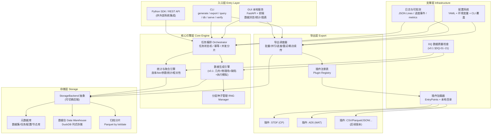
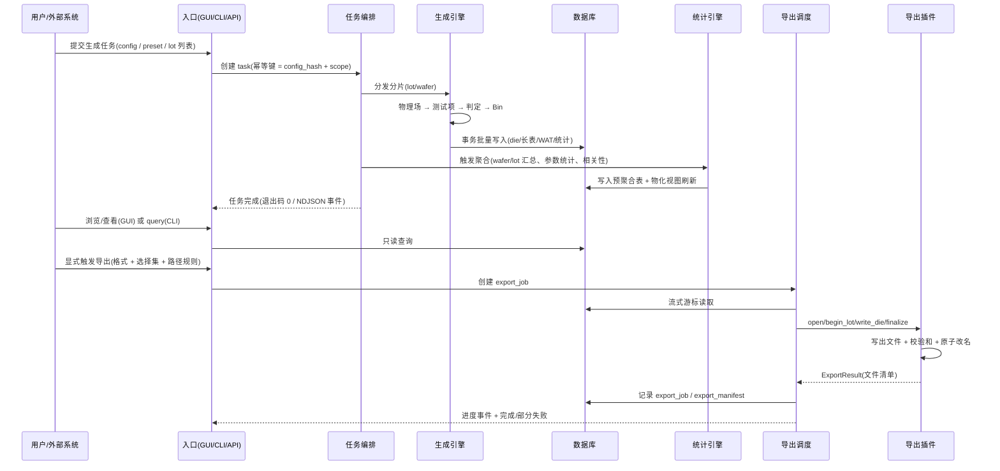
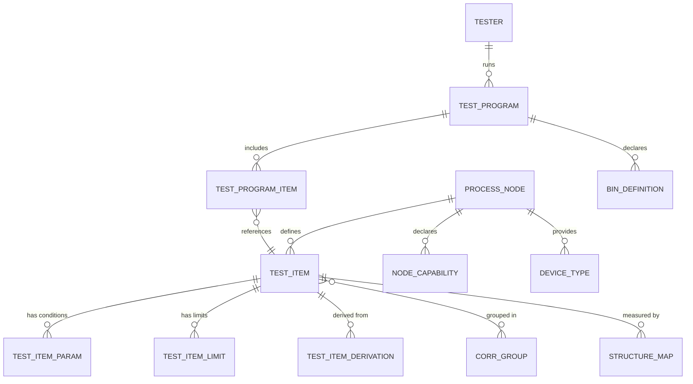

# SiliconDraft 需求规格说明书 v2 — 增强版

> **文档说明**：本文档是 `doc/requirements.MD`（v0.1）的**增补版本**，不替代也不修改原文档。
> v0.1 中已定义的内容（物理参数场建模、CP↔WAT 六层联动、缺陷注入、DQ 数据质量指标、测试项库样例等）继续有效，本文档不重复展开，仅在其基础上补充需求并标注章节引用。
> 阅读顺序建议：先读 v0.1 建立业务背景，再读本文档了解架构、入口、存储、格式与规模要求。

| 项目 | 内容 |
| --- | --- |
| 项目名称 | SiliconDraft — 半导体测试数据生成工具（增强版需求） |
| 文档版本 | **v0.2（增强版）** |
| 前序文档 | `doc/requirements.MD`（v0.1，需求草案） |
| 文档状态 | 待评审 |
| 编写日期 | 2026-10-14 |
| 本次增量 | 双模式入口（GUI + CLI）、存储与导出分离、插件式导出架构、第一期格式范围（STDF / AD5）、工艺节点与测试项库数据模型、100 Lot+ 规模与性能、扩展规划 |

---

## 目录

- [1. 需求编号规范](#1-需求编号规范)
- [2. 背景与目标](#2-背景与目标)
- [3. 总体架构](#3-总体架构)
- [4. 功能需求](#4-功能需求)
  - [4.1 双模式入口 — GUI](#41-双模式入口--gui)
  - [4.2 双模式入口 — CLI](#42-双模式入口--cli)
  - [4.3 内部数据存储](#43-内部数据存储)
  - [4.4 数据导出](#44-数据导出)
  - [4.5 导出格式插件式架构](#45-导出格式插件式架构)
  - [4.6 第一期格式支持范围](#46-第一期格式支持范围stdf--ad5)
  - [4.7 工艺节点与测试项库](#47-工艺节点与测试项库)
  - [4.8 规模与性能](#48-规模与性能)
- [5. 非功能需求](#5-非功能需求)
- [6. 待确认事项](#6-待确认事项)
- [7. 后续版本与扩展规划](#7-后续版本与扩展规划)
- [8. 附录](#8-附录)

---

## 1. 需求编号规范

### 1.1 编号格式

```
SD-<模块码>-<三位序号>
```

- `SD` = SiliconDraft 固定前缀
- `<模块码>` = 三位大写字母模块标识（见下表）
- `<三位序号>` = 从 010 起，步长 10，便于后续插入

### 1.2 模块码定义

| 模块码 | 模块 | 对应章节 |
| --- | --- | --- |
| `SYS` | 系统级 / 总体架构 | §3 |
| `GUI` | 图形界面入口 | §4.1 |
| `CLI` | 命令行入口 | §4.2 |
| `STO` | 内部数据存储（数据库） | §4.3 |
| `EXP` | 数据导出（调度/命名/进度/重试） | §4.4 |
| `PLG` | 导出插件框架 | §4.5 |
| `FMT` | 具体格式实现 | §4.6 |
| `LIB` | 工艺节点与测试项库 | §4.7 |
| `SCL` | 规模与性能 | §4.8 |
| `NFR` | 非功能需求 | §5 |
| `EXT` | 后续扩展预留 | §7 |
| `Q` | 待确认事项 | §6 |

### 1.3 编号使用规则

1. **一条需求一个编号**，编号在项目生命周期内**永不复用**（废弃需求保留编号并标记 `[已废弃]`）。
2. 需求文本使用 **必须 (MUST) / 应当 (SHOULD) / 可以 (MAY)** 三级强度（RFC 2119 语义）区分强制程度。
3. 每条需求列出 **验收方式**（自动化测试 / 人工核查 / 数据比对）。
4. v0.1 中已有需求编号沿用其 `FR-xx` / `DQ-xx` / `AC-xx` 体系，本文档新增需求使用 `SD-xxx-xxx` 体系，并在交叉引用处同时标注。
5. 需求编号与测试用例编号一一对应（用例编号 = `TC-` + 需求编号后缀），保证可追溯。

### 1.4 需求强度分布（本文档汇总）

| 强度 | 数量 | 说明 |
| --- | --- | --- |
| MUST | 本版共 **108** 条 | 第一期必须交付 |
| SHOULD | 本版共 **23** 条 | 第一期尽量交付，可延后至 v0.3 |
| MAY | 本版共 **14** 条 | 列为规划，不纳入第一期验收 |

---

## 2. 背景与目标

### 2.1 业务背景（承接 v0.1 §2.1）

SiliconDraft 的目标是为良率管理系统（YMS）的功能验证提供**结构完整、物理可信、缺陷可控**的 CP/WAT 测试数据。v0.1 已确定数据生成引擎的核心设计（物理量分层 → 测试项推导 → 空间场 → 缺陷注入 → 联动性模型）。

在方案评审过程中暴露出一组 v0.1 未覆盖的**工程化需求**，构成本次增强版的背景：

| 序号 | 评审暴露的问题 | 影响 | 本版对策章节 |
| --- | --- | --- | --- |
| B-1 | 只有 CLI，工程师无法直观查看生成的数据是否合理 | 数据可信度无法人工确认，调试成本高 | §4.1 GUI |
| B-2 | 数据生成后直接落盘成文件，重复生成/多次导出会产生文件爆炸，且缺少"数据集"概念 | 无法管理多批数据集，无法做二次查询与二次导出 | §4.3 内部数据库 |
| B-3 | 格式写死在代码里，新增一种格式要改核心代码 | 扩展成本高，无法应对外部系统格式要求变化 | §4.5 插件架构 |
| B-4 | 格式范围未收敛，第一期目标不清晰 | 范围蔓延，交付风险高 | §4.6 第一期 STDF + AD5 |
| B-5 | 工艺节点只考虑了 28nm，缺少跨节点扩展的结构化设计 | 无法快速支持 14nm/7nm，测试项库会散落成硬编码 | §4.7 节点与测试项库模型 |
| B-6 | 未定义规模与性能指标，无法验证是否支撑真实 YMS 测试场景 | 性能风险后置，可能推翻架构 | §4.8 规模与性能 |
| B-7 | 无标准退出码与日志规范，无法接入自动化流水线 | 无法用于 CI/流水线，自动化价值丢失 | §4.2 CLI |

### 2.2 本次增强目标

| 编号 | 目标 |
| --- | --- |
| **SD-SYS-010** | 提供 GUI 与 CLI **双模式入口**，二者共享同一套核心引擎与同一份数据存储，能力对齐、无功能割裂。 |
| **SD-SYS-020** | 实现**生成与导出分离**：所有生成数据先落内部嵌入式数据库，导出为显式动作，支持多次、多格式、多子集导出。 |
| **SD-SYS-030** | 导出格式采用**可插拔插件架构**，新增格式零侵入核心代码，支持第三方以 pip 包形式扩展。 |
| **SD-SYS-040** | 第一期格式范围收敛为 **CP → STDF**、**WAT → AD5**，其余格式延后。 |
| **SD-SYS-050** | 以 **28nm** 为第一期基准节点，测试项库采用**节点可继承的数据模型**，为 14nm/7nm 等节点预留扩展机制。 |
| **SD-SYS-060** | 支撑 **100 Lot 以上**规模的数据生成、存储、查询与导出，并定义量化性能指标与水平扩展路径。 |
| **SD-SYS-070** | 明确 **YMS 归属识别不在第一期范围**，数据不携带 YMS 侧归属信息，由导入端自行判定。 |
| **SD-SYS-080** | 建立完整的**需求-验收-测试**可追溯体系，所有需求带编号与验收方式。 |

### 2.3 明确的范围边界（Out of Scope）

| 编号 | 内容 | 说明 |
| --- | --- | --- |
| **SD-SYS-090** | YMS 归属识别（Which-lot / Which-product 归属推断） | 第一期不做。生成的数据**不写入 YMS 侧归属标识字段**，不模拟归属冲突场景 |
| **SD-SYS-100** | 14nm / 7nm 测试项库的实际交付 | 第一期只交付 28nm 库 + 多节点扩展机制（数据模型 + 接口 + 文档），不交付先进节点数据内容 |
| **SD-SYS-110** | 云端多租户、Web 公网服务 | 不在范围。GUI 是本机/内网单实例服务 |
| **SD-SYS-120** | 与真实 ATE 设备的物理对接（设备驱动、SECS/GEM 通信） | 不在范围 |

---

## 3. 总体架构

### 3.1 分层架构



### 3.2 关键架构决策

| 编号 | 决策 | 理由 |
| --- | --- | --- |
| **SD-SYS-130** | **生成与导出解耦**：生成阶段只写内部数据库，导出阶段只读数据库写文件 | 支持同一数据集多次/多子集/多格式导出；避免重复生成；支持失败重试不影响数据 |
| **SD-SYS-140** | **GUI 与 CLI 共享同一套服务层 API**，GUI 不直连数据库 | 保证双入口行为一致；GUI 可退化为纯展示层；便于后续替换 GUI 技术栈 |
| **SD-SYS-150** | GUI 采用**本地 Web 服务 + 浏览器**形态（非 Electron） | 跨平台一致、打包体积小、无需维护桌面端框架、可复用同一套 REST API |
| **SD-SYS-160** | 存储引擎采用**嵌入式列式数据库（首选 DuckDB）** | 零运维、单文件、列式聚合快、批量写入吞吐高、与 Parquet 天然互通 |
| **SD-SYS-170** | 导出采用**流式游标 + 插件**双抽象 | 插件无需了解数据库细节；大数据量下内存恒定（O(wafer) 而非 O(lot)） |
| **SD-SYS-180** | 测试项库采用**节点可继承的配置化数据模型** | 新增节点只加配置不改代码；满足 v0.1 FR-03 可扩展性诉求 |
| **SD-SYS-190** | 所有随机过程走**分层种子（SeedSequence.spawn）** | 并发分片与串行结果字节级一致（沿用 v0.1 FR-22） |

### 3.3 部署形态

| 形态 | 说明 | 适用 |
| --- | --- | --- |
| **D-A 单机 CLI** | 单进程，`silicondraft generate` 直接生成并入库 | 本地开发、CI、流水线 |
| **D-B 单机 CLI + GUI 服务** | CLI 生成，GUI 服务另起进程只读浏览 | 工程师日常使用（推荐） |
| **D-C 内网服务** | GUI 服务部署在内网服务器，多工程师通过浏览器访问；CLI 在服务器上运行 | 团队协作、大数据集共享 |
| **D-D 流水线节点** | 无 GUI，纯 CLI 由调度系统（Airflow/Jenkins/K8s Job）调用 | 自动化批产数据 |

**SD-SYS-200**：四种形态必须共用同一份代码与同一套数据库 Schema，形态差异只体现在启动参数与并发度上。

### 3.4 端到端数据流



### 3.5 建议代码结构

```
silicondraft/
├── pyproject.toml                  # entry points 声明（导出插件、CLI）
├── src/silicondraft/
│   ├── cli/                        # CLI 命令实现（§4.2）
│   ├── gui/                        # GUI 本地服务（§4.1）
│   │   ├── app.py                  # FastAPI 应用
│   │   ├── routers/                # datasets / lots / wafers / stats / export
│   │   ├── charts/                 # 服务端出图（matplotlib/plotly）
│   │   └── static/                 # 前端静态资源
│   ├── api/                        # 共享服务层（GUI/CLI 共用）
│   ├── core/
│   │   ├── orchestrator.py         # 任务编排、幂等、分片
│   │   ├── rng.py                  # 分层种子
│   │   └── console.py              # 进度事件、日志、退出码
│   ├── geometry/                   # v0.1: wafer / die_map / wat_layout
│   ├── physics/                    # v0.1: fields / quantities / models
│   ├── defects/                    # v0.1: geometric / parametric / effects
│   ├── execution/                  # v0.1: cp_exec / wat_exec / binning
│   ├── library/                    # 测试项库与节点（§4.7）
│   │   ├── schema.py               # pydantic 数据模型
│   │   ├── resolver.py             # 节点继承与覆盖解析
│   │   └── nodepacks/              # nodepack-28nm/ …
│   ├── storage/                    # 存储层（§4.3）
│   │   ├── backend.py              # StorageBackend 抽象
│   │   ├── duckdb_backend.py
│   │   ├── schema.sql              # DDL
│   │   ├── migrate.py              # Schema 版本迁移
│   │   └── queries.py              # 预定义查询注册表
│   ├── export/                     # 导出层（§4.4 / §4.5）
│   │   ├── protocol.py             # ExportPlugin 接口定义
│   │   ├── registry.py             # 插件注册表
│   │   ├── loader.py               # 插件发现与加载
│   │   ├── scheduler.py            # 批量/并行/重试/断点续传
│   │   └── naming.py               # 路径命名规则引擎
│   ├── export_plugins/             # 内置插件
│   │   ├── stdf/                   # SD-FMT-010 ~ 0x0
│   │   └── ad5/                    # SD-FMT-020 ~ 0x0
│   ├── quality/                    # DQ 检查与报告
│   └── presets/                    # 预设 YAML
└── tests/
```

---

## 4. 功能需求

### 4.1 双模式入口 — GUI

#### 4.1.1 定位

GUI 面向**工程师人工核查**场景，核心目的是回答："我刚生成的数据，**看起来像不像真的**？" 因此 GUI 的优先级是**可读性与可视化**，而非完整的数据操作能力。

#### 4.1.2 功能需求清单

| 编号 | 强度 | 需求 | 验收方式 |
| --- | --- | --- | --- |
| **SD-GUI-010** | MUST | 提供本地 GUI 服务，通过 `silicondraft gui`（或 `serve`）启动，默认绑定 `127.0.0.1:8765`，启动后自动打开浏览器 | 人工 |
| **SD-GUI-011** | MUST | 支持 `--host` / `--port` / `--no-browser` 参数；默认**只绑定回环地址**，绑定非回环地址时必须显式 `--allow-remote` 并打印安全警告 | 自动化 |
| **SD-GUI-020** | MUST | **数据集总览页**：列出所有数据集（dataset），展示名称、创建时间、配置哈希、Lot 数、Wafer 数、Die 总数、整体良率、磁盘占用、DQ 检查结论（PASS/WARN/FAIL） | 人工 |
| **SD-GUI-021** | MUST | 支持按名称、时间范围、产品、工艺节点、Preset 过滤与排序；支持分页（默认 20/页） | 自动化 |
| **SD-GUI-030** | MUST | **四层层级导航**：Dataset → Lot → Wafer → Chip/Die，任意一层可下钻，面包屑可回退 | 人工 |
| **SD-GUI-031** | MUST | Lot 层展示：Lot ID、Wafer 数、良率、各 Bin 占比、关键参数均值/Sigma、Wafer 间趋势图（折线，每个点一片 Wafer） | 人工 |
| **SD-GUI-032** | MUST | Wafer 层展示：**Wafer Map 热力图**（可选着色维度：Bin / 指定测试项值 / 良率 / 缺陷命中），支持缩放与悬停显示该 Die 的详细值 | 人工 |
| **SD-GUI-033** | MUST | Chip/Die 层展示：**Die 明细表**——该 Die 全部测试项的名称、值、单位、上下限、判定结果（Pass/Fail/超限警告）、Bin 号、坐标、是否复测、命中的缺陷列表 | 人工 |
| **SD-GUI-034** | SHOULD | Die 明细表支持**与限值对比的迷你条形/刻度指示**（在表中直观看出离限值多远） | 人工 |
| **SD-GUI-040** | MUST | **测试项分布视图**：对任意测试项生成直方图 + 累积分布 + 规格限标注（LSL/USL/Target），支持切换统计范围（单 Wafer / 单 Lot / 全数据集） | 人工 |
| **SD-GUI-041** | MUST | **参数统计表**：列出全部测试项的 N、Mean、Sigma、Min、Max、Median、P1/P99、Cp、Cpk、超限率 | 自动化 |
| **SD-GUI-042** | MUST | **相关性矩阵视图**：展示测试项之间、以及 WAT 项与 CP 项之间的相关系数矩阵（热力图），支持点击单元格查看散点图 | 人工 |
| **SD-GUI-043** | SHOULD | **径向/方位角曲线视图**：按半径分箱与扇区分箱绘出参数均值曲线，用于人工确认中心/边缘缺陷特征是否可见 | 人工 |
| **SD-GUI-044** | MAY | **良率趋势视图**：跨 Lot 的良率趋势线、Bin Pareto 图、Bin 堆叠趋势 | 人工 |
| **SD-GUI-050** | MUST | **缺陷分析视图**：列出本次生成注入的缺陷清单（ID、类型、几何参数、影响物理量），并在 Wafer Map 上叠加缺陷区域轮廓，便于人工核对"注入与呈现一致" | 人工 |
| **SD-GUI-051** | SHOULD | 提供**"缺陷 vs 实际数据"对比**：注入缺陷的预期区域与 YMS 可检出的实际异常区域做叠加显示 | 人工 |
| **SD-GUI-060** | MUST | **DQ 自检报告页**：呈现 v0.1 §DQ-01~21 全部检查项的结论、实测值、阈值、判定，失败项可展开详情 | 人工 |
| **SD-GUI-061** | MUST | DQ 报告支持导出为**单文件 HTML**（内联样式与图片，可离线分发给他人） | 自动化 |
| **SD-GUI-070** | MUST | **导出操作面板**：选择数据集 → 选择格式插件 → 选择子集（全部/指定 Lot/指定 Wafer/指定测试项）→ 设置输出目录与命名模板 → 预览将生成的文件清单 → 执行 | 人工 |
| **SD-GUI-071** | MUST | 导出过程中展示**实时进度**（已完成/总数、当前 Lot/Wafer、已写入字节数、预估剩余时间），支持取消 | 人工 |
| **SD-GUI-072** | SHOULD | 展示导出历史（export_job 列表），含状态、耗时、文件数、失败原因，支持重新导出与断点续传 | 人工 |
| **SD-GUI-080** | MUST | **配置编辑页**：提供 YAML 配置的可视化编辑（表单 + 原始文本双模式），支持语法校验、Schema 校验、保存为预设 | 人工 |
| **SD-GUI-081** | SHOULD | 提供**配置预览影响**：修改晶圆尺寸/Die 尺寸后实时预览 Die Map 图与预估 Die 数量，避免"生成完才发现配错" | 人工 |
| **SD-GUI-090** | MUST | **生成任务页**：从 GUI 直接提交生成任务（等同 CLI generate），展示任务状态与日志尾部，支持取消 | 人工 |
| **SD-GUI-091** | SHOULD | 任务列表展示历史任务，含配置哈希、状态、耗时、产出统计；相同配置哈希的任务提示"已有相同数据集，是否复用" | 人工 |
| **SD-GUI-100** | MUST | **数据导出能力**：任意表格视图（Die 明细/参数统计/相关性矩阵）支持导出 CSV / XLSX（当前视图或全量） | 自动化 |
| **SD-GUI-101** | SHOULD | Wafer Map 与图表支持导出 PNG / SVG | 人工 |
| **SD-GUI-110** | MUST | 所有列表支持**列裁剪、排序、过滤、关键字搜索**；大数据量下分页查询而非全量加载 | 自动化 |
| **SD-GUI-111** | MUST | 单页面响应时间满足 §4.8 的查询性能指标；聚合数据走预聚合表，禁止前端全量拉取后计算 | 自动化 |
| **SD-GUI-120** | MUST | GUI 为**只读优先**：默认不允许修改已入库数据；删除数据集等破坏性操作需二次确认并记录操作日志 | 人工 |
| **SD-GUI-121** | SHOULD | 支持多用户并发访问（内网形态）；提供简单的访问令牌（`--token`）保护，默认关闭 | 人工 |
| **SD-GUI-130** | MAY | 深色/浅色主题切换；图表配色对色盲友好 | 人工 |

#### 4.1.3 页面结构（信息架构）

| 页面 | 路由 | 主要内容 |
| --- | --- | --- |
| 数据集总览 | `/datasets` | 数据集卡片/表格、过滤、整体统计、DQ 结论 |
| 数据集详情 | `/datasets/{id}` | 四层导航、Lot 列表、整体统计概览、缺陷清单 |
| Lot 详情 | `/datasets/{id}/lots/{lot}` | Wafer 列表、Lot 汇总、Wafer 间趋势、Bin Pareto |
| Wafer 详情 | `/datasets/{id}/lots/{lot}/wafers/{w}` | Wafer Map、参数统计、径向曲线、Die 列表 |
| Die 详情 | `/datasets/{id}/.../dies/{d}` | Die 明细表（全测试项）、缺陷命中、邻近 Die 对比 |
| 测试项分析 | `/datasets/{id}/items/{item}` | 直方图、累积分布、跨 Lot/Wafer 箱线图、相关性散点 |
| 相关性分析 | `/datasets/{id}/correlation` | 相关矩阵热力图、CP↔WAT 对比 ground truth |
| 缺陷分析 | `/datasets/{id}/defects` | 缺陷清单、区域叠加、检出对比 |
| 生成任务 | `/tasks` | 任务列表、新建任务、日志与状态 |
| 导出中心 | `/exports` | 新建导出、导出历史、进度、重试 |
| 配置/预设 | `/config` | 配置编辑、预设管理、Dry-run 预览 |
| 自检报告 | `/datasets/{id}/quality` | DQ 20+ 项检查详情、导出 HTML |

**SD-GUI-140**：页面结构必须覆盖上表全部路由；第一期 MUST 交付带 ★ 的页面，其余 SHOULD。

★ 数据集总览、数据集详情、Lot 详情、Wafer 详情、Die 详情、测试项分析、相关性分析、缺陷分析、自检报告、导出中心、生成任务。

#### 4.1.4 技术形态要求

| 编号 | 强度 | 需求 |
| --- | --- | --- |
| **SD-GUI-150** | MUST | 采用**本地 Web 服务 + 浏览器**形态，服务端与前端通过 REST API 通信；服务端为 FastAPI（或等价 ASGI 框架） |
| **SD-GUI-151** | MUST | 图表渲染采用**服务端出图（matplotlib/plotly 静态图）+ 前端交互图（ECharts/Plotly.js）** 混合策略：大数据量聚合图服务端算，小数据量交互图前端画 |
| **SD-GUI-152** | MUST | 前端资源必须**内置打包**，运行时不依赖外网 CDN（离线环境可用） |
| **SD-GUI-153** | SHOULD | 支持打包为单文件可执行程序（PyInstaller/Nuitka），双击或单命令启动，无需用户安装 Python |
| **SD-GUI-154** | MUST | 不得在 GUI 中实现与 CLI 不同的业务逻辑；所有业务能力经共享服务层调用 |

---

### 4.2 双模式入口 — CLI

#### 4.2.1 定位

CLI 面向**自动化流水线**场景，核心目的是让外部系统（CI/CD、调度平台、YMS 测试框架）**无人值守地**调用。因此 CLI 的优先级是**确定性与可编排性**：参数稳定、退出码标准、日志结构化、stdout 与 stderr 严格分离。

#### 4.2.2 命令集

| 编号 | 强度 | 命令 | 用途 |
| --- | --- | --- | --- |
| **SD-CLI-010** | MUST | `silicondraft init [--dir] [--template]` | 初始化项目目录、生成配置模板与测试项库模板 |
| **SD-CLI-011** | MUST | `silicondraft validate -c <config>` | 校验配置文件（语法 + Schema + 语义 + 引用完整性），不产生数据 |
| **SD-CLI-012** | MUST | `silicondraft generate -c <config> [覆盖参数]` | 生成数据并写入内部数据库（**不导出文件**） |
| **SD-CLI-013** | MUST | `silicondraft export --dataset <id> --format <plugin> [选择集] [--out <dir>]` | 从数据库导出为指定格式文件 |
| **SD-CLI-014** | MUST | `silicondraft query [--sql \| --named <query>] [--dataset <id>] [--output csv\|json\|table]` | 查询数据库（受控 SQL / 预定义查询） |
| **SD-CLI-015** | MUST | `silicondraft stats --dataset <id> [--level lot\|wafer\|die\|item] [--output ...]` | 输出统计结果（良率/Bin/参数统计/相关性） |
| **SD-CLI-016** | MUST | `silicondraft dataset list \| show <id> \| delete <id> \| rename <id>` | 数据集管理 |
| **SD-CLI-017** | MUST | `silicondraft db init \| migrate \| info \| compact \| vacuum \| backup \| restore` | 数据库运维 |
| **SD-CLI-018** | MUST | `silicondraft serve [--host --port --no-browser]` | 启动 GUI 服务（CLI 形态启动 GUI） |
| **SD-CLI-019** | MUST | `silicondraft plugins list [--verbose] \| info <name> \| doctor` | 插件查看与诊断（§4.5） |
| **SD-CLI-020** | MUST | `silicondraft presets list \| show <name>`；`silicondraft nodes list \| show <node>` | 预设与工艺节点查看 |
| **SD-CLI-021** | MUST | `silicondraft items export|import|diff --node <node>` | 测试项库的导出/导入/差异对比（§4.7） |
| **SD-CLI-022** | MUST | `silicondraft verify --file <path> [--format stdf\|ad5]` | 校验导出文件的格式正确性与可解析性 |
| **SD-CLI-023** | SHOULD | `silicondraft diff --dataset-a <id> --dataset-b <id>` | 两个数据集的统计差异对比（回归验证） |
| **SD-CLI-024** | SHOULD | `silicondraft preview -c <config> --out preview.png` | 仅生成 Die Map / WAT 布局预览图，不产生数据（配置试错） |
| **SD-CLI-025** | MAY | `silicondraft schedule` | 内置简单定时任务（默认不提供，推荐由外部调度系统负责） |
| **SD-CLI-026** | MUST | `silicondraft version [--output json]` | 版本信息（含核心引擎、Schema、插件 API 版本） |
| **SD-CLI-027** | MUST | `silicondraft healthcheck [--output json]` | 健康检查（数据库可写、插件可加载、磁盘余量），供 K8s liveness/readiness 使用 |

#### 4.2.3 参数规范

**SD-CLI-030**：CLI 必须遵循统一的参数约定。

**全局参数（所有子命令可用）：**

| 参数 | 说明 | 默认 |
| --- | --- | --- |
| `--config, -c <path>` | 配置文件路径（YAML/JSON） | 自动查找 `./silicondraft.yaml`、`~/.silicondraft/config.yaml` |
| `--db <path>` | 数据库文件路径 | `~/.silicondraft/data/silicondraft.duckdb` |
| `--dataset <id>` | 数据集 ID 或名称 | — |
| `--set KEY=VALUE` | 覆盖任意配置项（点号路径 + 数组下标，可重复） | — |
| `--output, -o <mode>` | stdout 输出格式：`text` \| `json` \| `ndjson` \| `table` \| `csv` | `text` |
| `--log-level <lvl>` | `trace\|debug\|info\|warn\|error\|fatal` | `info` |
| `--log-file <path>` | 日志文件路径（开启后同时写文件） | 不写文件 |
| `--log-format <fmt>` | `human` \| `json`（JSON Lines） | `human`（TTY）/ `json`（非 TTY） |
| `--progress <mode>` | `auto` \| `bar` \| `ndjson` \| `none` | `auto`（TTY=bar，非 TTY=ndjson） |
| `--quiet, -q` | 仅输出错误 | — |
| `--verbose, -v` | 提升日志级别（可叠加） | — |
| `--non-interactive` | 禁止任何交互提示；需要确认时直接失败 | 非 TTY 时自动开启 |
| `--yes, -y` | 对所有确认提示回答"是" | — |
| `--parallel, -j <n>` | 并发度 | CPU 核数的一半，上限 16 |
| `--task-id <id>` | 幂等键；重复运行相同 task-id 直接返回已有结果 | 由 `config_hash + scope` 派生 |
| `--force` | 忽略幂等，强制重新生成/覆盖 | — |
| `--dry-run` | 只做规划与校验，不写数据库不写文件 | — |
| `--timeout <sec>` | 整体超时 | 0（不超时） |

**生成命令专有参数：**

| 参数 | 说明 |
| --- | --- |
| `--preset <name>` | 使用内置预设（与 `-c` 互斥） |
| `--lots <n>` / `--lot-ids A,B,C` | Lot 范围 |
| `--wafers <n>` / `--wafer-slots 1-25` | Wafer 范围 |
| `--seed <int>` | 覆盖随机种子 |
| `--test-type cp\|wat\|both` | 生成范围 |
| `--no-aggregate` | 跳过聚合统计（仅原始数据，加速） |
| `--shard-by lot\|wafer` | 分片粒度 |

**导出命令专有参数：**

| 参数 | 说明 |
| --- | --- |
| `--format, -f <plugin>` | 导出插件名（`stdf` / `ad5` / …） |
| `--select-lots A,B` / `--select-wafers 1-25` / `--select-items X,Y` | 子集选择 |
| `--path-template <tpl>` | 路径命名模板（§4.4.3） |
| `--on-conflict <strategy>` | `overwrite` \| `skip` \| `rename` \| `fail` |
| `--retry <n>` / `--retry-delay <dur>` / `--retry-backoff <linear\|exponential>` | 失败重试策略 |
| `--resume <job-id>` | 断点续传指定导出任务 |
| `--split-per-wafer` | 每片 Wafer 一个文件（默认按格式插件建议） |
| `--manifest <path>` | 导出清单输出路径 |
| `--checksum <algo>` | 文件校验和算法（`none`/`sha256`/`md5`），默认 `sha256` |

**SD-CLI-031**：参数优先级必须为 **CLI 参数 > 环境变量 > 配置文件 > 内置默认值**，且该优先级规则必须写入 `--help` 文档。

**SD-CLI-032**：环境变量统一使用 `SILICONDRAFT_` 前缀（如 `SILICONDRAFT_DB`、`SILICONDRAFT_LOG_LEVEL`、`SILICONDRAFT_DB_PATH`）。

**SD-CLI-033**：`silicondraft <cmd> --help` 必须提供完整帮助；`silicondraft --help` 列出全部命令与一句话说明。

#### 4.2.4 配置文件规范

| 编号 | 强度 | 需求 |
| --- | --- | --- |
| **SD-CLI-040** | MUST | 支持 YAML 与 JSON 两种配置格式（内容结构一致） |
| **SD-CLI-041** | MUST | 配置必须通过 **pydantic v2 Schema 强校验**，校验失败时输出**精确的字段路径 + 期望类型 + 实际值 + 修复建议** |
| **SD-CLI-042** | MUST | 支持 `extends` 引入基础配置（单继承或多继承，后者需显式声明合并顺序） |
| **SD-CLI-043** | MUST | 支持 YAML Anchor/别名，避免大配置重复 |
| **SD-CLI-044** | MUST | 支持配置中的**引用**：`test_items: [{ file: ./items/x.yaml }]`、`preset: P-CENTER-HIGH`、`node: 28nm`；引用缺失时给出明确错误 |
| **SD-CLI-045** | MUST | 配置文件必须支持注释（YAML 原生），并随 `init` 生成**带完整中文注释的模板** |
| **SD-CLI-046** | MUST | 生成时把**解析后的完整配置**（含所有继承与默认值）冻结写入 `meta_config` 表，保证可复现 |
| **SD-CLI-047** | SHOULD | 提供 `silicondraft validate --explain` 输出配置的"解析后结果 + 生效来源（哪个文件/哪层覆盖）"，便于排查 |
| **SD-CLI-048** | MUST | 配置文件必须支持**版本标记** `config_version: 1`，Schema 升级时提供自动迁移或明确不兼容提示 |

#### 4.2.5 退出码规范

**SD-CLI-050**：CLI 必须使用以下退出码，且退出码语义**在版本间保持稳定**（新增编码不改变既有语义）。

| 退出码 | 常量名 | 含义 | 触发电商 |
| --- | --- | --- | --- |
| **0** | `OK` | 成功（含"无操作需要执行"的幂等命中） | 正常完成 |
| **1** | `ERR_GENERAL` | 未分类的通用错误 | 未捕获异常 |
| **2** | `ERR_USAGE` | 命令行用法错误 | 未知参数、缺少必需参数、参数互斥冲突 |
| **3** | `ERR_CONFIG` | 配置错误 | 文件不存在、YAML 语法错、Schema 校验失败、引用缺失 |
| **4** | `ERR_GENERATE` | 数据生成失败 | 物理模型异常、缺陷参数非法、数值不收敛 |
| **5** | `ERR_STORAGE` | 存储层错误 | 数据库不可写、Schema 版本不匹配、磁盘满、锁冲突 |
| **6** | `ERR_EXPORT` | 导出失败（全部失败） | 插件异常、写文件失败、无写权限、空间不足 |
| **7** | `ERR_PLUGIN` | 插件错误 | 插件加载失败、API 版本不兼容、插件初始化异常 |
| **8** | `ERR_IO` | 文件系统/权限错误 | 目录不存在且无法创建、路径不可写、路径非法 |
| **9** | `ERR_PARTIAL` | **部分成功** | 批量导出中部分文件失败（≥1 成功且 ≥1 失败） |
| **10** | `ERR_QUALITY` | 数据质量自检未通过 | DQ 检查存在 FAIL 项（可由 `--skip-quality-gate` 降级为警告） |
| **11** | `ERR_TIMEOUT` | 超时终止 | `--timeout` 触发 |
| **12** | `ERR_VERIFY` | 格式校验未通过 | `verify` 命令发现文件结构错误 |
| **13** | `ERR_LOCKED` | 资源被占用 | 数据库被其他写任务占用 / 同一 task 正在运行 |
| **130** | `ERR_INTERRUPTED` | 用户中断（SIGINT） | Ctrl-C；必须完成当前原子操作并回滚未提交事务 |
| **143** | `ERR_TERMINATED` | 被 SIGTERM 终止 | 必须干净释放数据库连接与临时文件 |

**SD-CLI-051**：退出码必须可通过 `--output json` 在结果对象中读取（`{"exit_code": N, "status": "...", "errors": [...]}`），便于流水线无需解析 stderr。

**SD-CLI-052**：`ERR_PARTIAL` 必须在结果中列出**失败清单**（哪些 Lot/Wafer 失败、原因、是否可重试）以及**成功清单**。

**SD-CLI-053**：`--dry-run` 时若校验通过必须返回 `0`。

#### 4.2.6 日志规范

**SD-CLI-060**：CLI 必须严格区分两个输出流。

| 流 | 内容 | 要求 |
| --- | --- | --- |
| **stdout** | **仅业务结果**（查询结果、统计输出、文件清单、JSON 结果对象） | 必须可被管道直接消费；不得输出任何日志、进度条、警告 |
| **stderr** | **日志、进度、警告、错误详情** | 人类可读；非 TTY 时自动切换为结构化格式 |

> 这是流水线可用的硬性前提：`silicondraft stats ... --output csv > stats.csv` 必须得到纯净 CSV。

**SD-CLI-061**：日志必须包含以下字段（human 模式为紧凑文本，json 模式为字段）：

| 字段 | 说明 |
| --- | --- |
| `ts` | ISO 8601 带时区，毫秒精度 |
| `level` | `TRACE/DEBUG/INFO/WARN/ERROR/FATAL` |
| `logger` | 模块名（如 `storage.duckdb`、`export.scheduler`、`plugin.stdf`） |
| `msg` | 消息文本 |
| `task_id` | 任务 ID（有则必填） |
| `dataset_id` | 数据集 ID（有则必填） |
| `lot_id` / `wafer_id` | 当前处理对象（有则必填） |
| `plugin` | 插件名（导出相关日志必填） |
| `duration_ms` | 耗时（操作完成日志必填） |
| `error_code` | 错误码/异常类名（错误日志必填） |
| `detail` | 结构化附加信息（对象） |

**SD-CLI-062**：日志级别语义必须明确：

| 级别 | 使用场景 |
| --- | --- |
| `TRACE` | 逐 Die/逐记录的极细粒度追踪（默认关闭） |
| `DEBUG` | 分片边界、SQL 语句、插件调用时序 |
| `INFO` | 任务开始/结束、每 Lot 完成、导出文件写出 |
| `WARN` | 可恢复异常、降级行为（如跳过损坏记录）、DQ WARN |
| `ERROR` | 操作失败但进程可继续（单个 Wafer 失败） |
| `FATAL` | 进程必须终止的错误 |

**SD-CLI-063**：`--log-file` 写出时必须启用**轮转**（按大小，默认 100 MB × 5 份），且文件内容为 JSON Lines（便于日志采集）。

**SD-CLI-064**：日志中**必须脱敏**——不得输出完整数据库连接串中的凭据；导出路径按原样输出但需过滤 `..` 逃逸痕迹的警告。

**SD-CLI-065**：必须支持 `--progress ndjson`，以 **NDJSON 事件流**输出到 stderr，事件类型至少包含：

```json
{"event":"task_start","task_id":"...","total_units":25,"unit":"wafer","ts":"..."}
{"event":"unit_start","task_id":"...","unit_id":"LOT_A01/wafer_01","ts":"..."}
{"event":"progress","task_id":"...","done":12,"total":25,"percent":48.0,"rate_per_s":1.8,"eta_s":7.2}
{"event":"unit_done","task_id":"...","unit_id":"...","duration_ms":1180,"rows":1000}
{"event":"warning","code":"DQ_WARN","msg":"..."}
{"event":"task_done","task_id":"...","status":"ok","exit_code":0,"summary":{...}}
```

**SD-CLI-066**：进度事件必须**节流**（默认 ≥ 500 ms 一条，可配置），避免日志洪泛。

#### 4.2.7 幂等性与并发安全

| 编号 | 强度 | 需求 |
| --- | --- | --- |
| **SD-CLI-070** | MUST | 生成任务以 `task_id = hash(config_hash + scope + seed)` 作为幂等键；命中已有成功任务时**直接返回 0 并输出已有 dataset_id**（除非 `--force`） |
| **SD-CLI-071** | MUST | 同一数据集上的写操作必须加锁；并发冲突时返回 `ERR_LOCKED (13)`，并提示持有锁的进程信息 |
| **SD-CLI-072** | MUST | 中断（SIGINT/SIGTERM）时必须：提交或回滚当前事务 → 清理临时文件 → 保留已完成的 Lot 并标记任务为 `interrupted` → 支持 `--resume` 续跑 |
| **SD-CLI-073** | MUST | 任务状态机持久化在 `meta_task` 表（见 §4.3.3），任何时刻可由状态恢复 |
| **SD-CLI-074** | SHOULD | 支持 `--shard-index i --shard-total n`，配合外部调度系统做**无中心协调的分片并行**（每片独立进程） |
| **SD-CLI-075** | MUST | 分片并行结果必须与单进程串行结果**字节级一致**（沿用 v0.1 AC-21） |

#### 4.2.8 外部系统集成接口

| 编号 | 强度 | 需求 |
| --- | --- | --- |
| **SD-CLI-080** | MUST | 提供 **Python SDK**（`silicondraft.sdk`），暴露 `generate()`、`export()`、`query()`、`stats()` 等函数及返回值对象，供 YMS 测试框架直接 import 调用 |
| **SD-CLI-081** | MUST | 提供 **REST API**（与 GUI 同一套），端点覆盖数据集、统计、导出、任务；提供 OpenAPI 3.1 文档（`/openapi.json`） |
| **SD-CLI-082** | SHOULD | 提供 **Docker 镜像**（单镜像含 CLI 与 GUI 服务），并给出 K8s Job / Docker Compose 示例 |
| **SD-CLI-083** | MUST | 所有 CLI 命令在**非 TTY 环境**下必须自动进入非交互模式（`--non-interactive`），不得因等待输入而挂起 |
| **SD-CLI-084** | MUST | 提供 `--output json` 的结构化结果 Schema 文档，并保证字段**向后兼容**（只增不改不删） |

---

### 4.3 内部数据存储

#### 4.3.1 设计目标与原则

**SD-STO-010**：数据必须先持久化到内部数据库，**导出为独立的显式动作**。数据库作为"数据集的单一事实来源（Single Source of Truth）"。

**SD-STO-011**：存储选型必须满足以下原则：

| 原则 | 编号 | 说明 |
| --- | --- | --- |
| 嵌入式、零运维 | **SD-STO-012** | 不引入独立服务器进程；单文件或单目录可拷贝迁移 |
| 高吞吐批量写入 | **SD-STO-013** | 必须支持批量追加写入（Appender 类接口），满足 §4.8 的写入吞吐指标 |
| 列式分析性能 | **SD-STO-014** | 聚合查询（GROUP BY、直方图、相关系数）必须走列式向量化执行，禁止行式全表扫描 |
| 并发读、受控写 | **SD-STO-015** | 必须支持多进程/多线程并发只读；写入必须通过受控通道 |
| 与文件格式互通 | **SD-STO-016** | 必须能直接查询外部 Parquet/CSV（用于归档数据的联邦查询） |
| 跨平台 | **SD-STO-017** | 必须在 macOS / Linux / Windows x86_64 上行为一致 |
| Python 生态成熟 | **SD-STO-018** | 必须有稳定的 Python 绑定与活跃维护 |
| 可替换 | **SD-STO-019** | 必须有 `StorageBackend` 抽象层，允许未来替换为 ClickHouse / StarRocks 等 |

#### 4.3.2 选型评估

| 候选 | 优势 | 劣势 | 结论 |
| --- | --- | --- | --- |
| **DuckDB** | 嵌入式 OLAP；列式 + 向量化；Appender 批量写入吞吐极高；单文件；可直接 `SELECT ... FROM 'x.parquet'`；聚合性能接近专业数仓 | 单文件写并发受限（单写多读）；无原生分区表 | ✅ **主选** |
| SQLite | 极成熟；事务完善；单文件 | 行式存储；大规模聚合慢；写入吞吐低 | ⚠️ 仅作元数据/任务状态库的备选 |
| HDF5 | 科学数据友好 | 无 SQL；无索引；关系查询困难 | ❌ |
| Parquet only | 压缩率高；列式；生态好 | 无事务；无索引；不适合频繁小范围点查 | ⚠️ 作为**归档层**与冷数据分片 |
| RocksDB / LMDB | 极高 KV 吞吐 | KV 模型不适合分析型查询 | ❌ |
| PostgreSQL / ClickHouse | 能力最强 | 需独立服务部署，违背零运维 | ⚠️ 作为**水平扩展目标**（§4.8.5） |

**SD-STO-020**：第一期采用 **DuckDB 作为主数据引擎**，**Parquet 作为归档与冷数据分片格式**。

**SD-STO-021**：`StorageBackend` 必须抽象为接口，至少定义：`init_schema()`、`bulk_append(table, rows)`、`query(sql, params) -> cursor`、`stream(table, filters) -> iterator`、`aggregate(...)`、`vacuum()/compact()`、`backup(path)`、`restore(path)`、`attach_parquet(path)`、`info()`。

**SD-STO-022**：DuckDB 具体配置要求：

| 项 | 值 | 理由 |
| --- | --- | --- |
| `threads` | 可配，默认 `min(8, cpu/2)` | 查询并行度 |
| `memory_limit` | 可配，默认 4 GB | 防止内存失控 |
| `temp_directory` | 必须显式设置（默认 `<db_dir>/tmp`） | 控制溢写位置 |
| `checkpoint_threshold` | 可配（默认 256 MB） | 控制 WAL 合并频率 |
| `preserve_insertion_order` | `false`（写性能优先） | 写入吞吐 |
| WAL | 必须开启；提供 `db compact` 显式合并 | 崩溃可恢复 |
| 扩展 | 仅在**显式开启**时加载（如 `parquet`、`json`、`icu`） | 离线环境安全 |

#### 4.3.3 库表结构

**SD-STO-030**：必须实现以下表（表名前缀统一为 `sd_`，避免与用户数据冲突）。

**（1）元数据表**

| 表名 | 主键 | 说明 | 关键字段 |
| --- | --- | --- | --- |
| `sd_dataset` | `dataset_id` | 数据集 | `name, created_at, config_hash, seed_root, preset, node, product, lot_count, wafer_count, die_count, overall_yield, dq_status, size_bytes, status, parent_dataset_id` |
| `sd_task` | `task_id` | 任务与状态机 | `dataset_id, kind(generate/export/aggregate), status(pending/running/done/failed/interrupted), scope_json, progress_done, progress_total, started_at, ended_at, exit_code, error, shard_index, shard_total` |
| `sd_config` | `config_hash` | 配置快照（**内容寻址**） | `config_hash, config_yaml, config_json_resolved, tool_version, schema_version, created_at` |
| `sd_export_job` | `job_id` | 导出任务 | `dataset_id, plugin, plugin_version, options_json, path_template, status, total_files, done_files, failed_files, retry_count, started_at, ended_at, exit_code` |
| `sd_export_file` | `(job_id, rel_path)` | 导出文件清单 | `size_bytes, checksum, checksum_algo, rows, status(ok/failed), error, duration_ms` |
| `sd_schema_version` | `version` | Schema 版本 | `version, applied_at, note` |
| `sd_plugin` | `(name, version)` | 已加载插件快照 | `api_version, test_types, extension, source(package/path/builtin), enabled, load_error` |

**（2）实体表**

| 表名 | 主键 | 说明 | 关键字段 |
| --- | --- | --- | --- |
| `sd_lot` | `(dataset_id, lot_id)` | Lot | `product, node, route, fab, test_site, wafer_count, die_count, yield_rate, started_at` |
| `sd_wafer` | `(dataset_id, lot_id, wafer_id)` | Wafer | `wafer_slot, wafer_diameter_mm, die_total, die_tested, die_pass, yield_rate, bin_1_count, sigma_within, tester_id, probe_card_id, sort_time_s` |
| `sd_die` | `(dataset_id, lot_id, wafer_id, die_id)` | Die（CP 主体） | `die_x_mm, die_y_mm, radius_mm, theta_deg, reticle_id, reticle_x, reticle_y, die_type(FULL/PARTIAL/EDGE), die_state(TESTED/SKIPPED/PROBE_FAIL/DROPPED/RETESTED), bin_num, hard_bin, func_bin, first_fail_item_id, is_retest, retest_count, param_fail_mask, defect_hit_mask, test_time_ms, site_id` |
| `sd_wat_structure` | `(dataset_id, lot_id, wafer_id, structure_id)` | WAT 结构位置 | `structure_type, x_mm, y_mm, radius_mm, theta_deg, scribe_line_id, ring_index` |

**（3）测试项库表（§4.7 数据模型）**

| 表名 | 主键 | 说明 |
| --- | --- | --- |
| `sd_process_node` | `(node_id, node_version)` | 工艺节点 |
| `sd_test_item` | `(node_id, item_id)` | 测试项定义（含物理含义、单位、结构类型） |
| `sd_test_item_limit` | `(node_id, item_id, program_id)` | 判定上下限、目标值、Sigma、精度 |
| `sd_test_item_derivation` | `(node_id, item_id, source_kind, source_id)` | 派生关系（CP ← WAT / 物理量） |
| `sd_tester` | `tester_id` | 测试机型号与能力 |
| `sd_test_program` | `(program_id, program_version)` | 测试程序 |
| `sd_test_program_item` | `(program_id, test_num)` | 程序-测试项关联（顺序、启用、limit 覆盖） |
| `sd_bin_definition` | `(program_id, bin_num)` | Bin 定义（Hard/Soft、含义） |
| `sd_corr_group` | `(node_id, group_id)` | 相关性分组 |

**（4）结果表**

| 表名 | 粒度 | 说明 |
| --- | --- | --- |
| `sd_cp_result_wide` | die × 测试项（宽表） | 每 Die 一行，列为测试项值（`f32`）；**默认主存形式**，查询友好 |
| `sd_cp_result_flag` | die × 测试项（位图） | 每 Die 一行，每测试项 1 bit 的 Pass/Fail/未测 状态 |
| `sd_cp_result_long` | (die, item) 一行 | 长表，由配置 `store_long: true` 开启（体积约为宽表的 3–4 倍） |
| `sd_wat_result_wide` | structure × 测试项（宽表） | WAT 主体 |
| `sd_wat_result_long` | (structure, item) 一行 | WAT 长表（默认开启，因 WAT 结构数远少于 Die） |
| `sd_wat_ring_stat` | (wafer, ring_index) | 空间统计（GDR 内容：径向均值/Sigma/Cpk） |
| `sd_die_defect_hit` | (die_key, defect_id) | Die 级缺陷命中记录（归因 ground truth） |
| `sd_defect_injection` | `(dataset_id, defect_id)` | 注入缺陷定义与参数 |

**（5）统计与预聚合表**

| 表名 | 粒度 | 说明 |
| --- | --- | --- |
| `sd_yield_summary_wafer` | wafer | 良率与 Bin 分布 |
| `sd_yield_summary_lot` | lot | 良率与 Bin 分布 |
| `sd_bin_stat` | (lot/wafer, bin_num) | Bin 计数与占比 |
| `sd_param_stat` | (scope, scope_key, item_id) | N/Mean/Sigma/Min/Max/Median/P1/P99/Cp/Cpk/超限率 |
| `sd_param_hist` | (scope, scope_key, item_id, bin_idx) | 预计算直方图（用于 GUI 快速渲染） |
| `sd_corr_matrix` | (dataset_id, item_a, item_b) | 预计算相关系数与样本数 |
| `sd_radial_profile` | (wafer_id, item_id, ring_idx) | 径向分布（均值/Sigma） |
| `sd_sector_profile` | (wafer_id, item_id, sector_idx) | 扇区分布 |
| `sd_dq_result` | (dataset_id, check_id) | DQ 检查结果 |

**（6）视图**

| 视图 | 说明 |
| --- | --- |
| `v_die_full` | Die + Wafer + Lot + Bin 定义 + 缺陷命中的联合视图（GUI 与导出插件的统一读取入口） |
| `v_cp_item_long` | 宽表 UNPIVOT 为长表（按需，代价高，仅用于临时查询） |
| `v_yield_trend` | 跨 Lot 良率趋势 |
| `v_corr_wat_cp` | WAT 项与 CP 项的相关性（对应 v0.1 的 `CP_WAT_CORRELATION_MAP` ground truth 对照） |
| `v_pareto_bin` | Bin Pareto |

> **附**：完整 DDL 见 §8.1。

#### 4.3.4 索引、分区与查询

**SD-STO-040 索引策略**

| 编号 | 强度 | 需求 |
| --- | --- | --- |
| SD-STO-041 | MUST | `sd_die` 上建立复合主键索引 `(dataset_id, lot_id, wafer_id, die_id)` |
| SD-STO-042 | MUST | 建立 `(dataset_id, lot_id, wafer_id, die_x_mm, die_y_mm)` 唯一约束（保证 Die 坐标不重复，支撑 Map 重建） |
| SD-STO-043 | MUST | 建立 `(dataset_id, lot_id, wafer_id, bin_num)` 辅助索引（Bin 过滤与良率统计） |
| SD-STO-044 | MUST | 建立 `(dataset_id, first_fail_item_id)` 辅助索引（Fail 模式分析） |
| SD-STO-045 | MUST | `sd_wat_structure` 建立 `(dataset_id, wafer_id, radius_mm)` 索引（径向查询） |
| SD-STO-046 | SHOULD | `sd_die_defect_hit` 建立 `(dataset_id, defect_id)` 索引 |

**SD-STO-047 分区策略**：DuckDB 无原生分区表，采用**分库 + 联邦查询**替代：

| 层级 | 策略 | 说明 |
| --- | --- | --- |
| 热数据 | 单主库 `silicondraft.duckdb` 保存**元数据 + 最近 N 个数据集**（默认 N=20，可配） | 保证 GUI 常用查询性能 |
| 温数据 | 按**数据集或 Lot** 导出为独立 DuckDB 分片 `<archive>/ds_<id>/lot_<lotid>.duckdb` | 独立可查、可单独拷贝 |
| 冷数据 | 按 Lot / 月 归档为 Parquet（分区目录 `lot=<id>/`），并建立 `sd_archive_manifest` 登记 | 压缩率高、可被 DuckDB 直接 SQL 查询 |
| 联邦查询 | `StorageBackend` 必须支持 `ATTACH` 多个 DuckDB / Parquet，并在查询层**自动路由**：主库有则查主库，否则查归档 | 对上层（GUI/CLI/插件）透明 |

**SD-STO-048 查询方式**

| 编号 | 强度 | 需求 |
| --- | --- | --- |
| SD-STO-049 | MUST | 提供**参数化查询 API**（禁止字符串拼接 SQL，防注入） |
| SD-STO-050 | MUST | 提供**预定义查询注册表**（`queries.py`），以名称引用（如 `yield_by_wafer`、`hist_item`、`corr_matrix`），供 CLI `--named` 与 GUI 调用；预定义查询必须带参数校验 |
| SD-STO-051 | MUST | 支持**流式游标** `stream(table, filters, batch_size)`，为导出插件提供恒定内存的读取接口（§4.5.5） |
| SD-STO-052 | MUST | `query --sql` 必须**默认只读**（只允许 `SELECT`/`WITH`/`DESCRIBE`/`PRAGMA` 白名单），写操作需显式 `--allow-write` 且仅限管理员 |
| SD-STO-053 | MUST | 必须设置查询超时（默认 300 s，可配）与行数上限（默认 10,000,000 行，可配），超限需显式确认 |
| SD-STO-054 | SHOULD | 支持**查询结果缓存**：预定义查询 + 相同参数 + 数据集未变更 → 命中缓存（TTL 可配，默认 300 s） |
| SD-STO-055 | MUST | 必须定期 `ANALYZE` 更新统计信息（在数据集写入完成后自动触发） |
| SD-STO-056 | MUST | 所有针对大表的查询必须**先做谓词下推**（`dataset_id`/`lot_id`/`wafer_id` 必须作为 WHERE 前置条件），预定义查询必须内置该约束 |

#### 4.3.5 容量估算

**SD-STO-060**：必须基于以下模型给出容量估算，并在 `db info` 中输出实测值。

**估算参数（28nm 基准）**

| 参数 | 符号 | 基准值 |
| --- | --- | --- |
| 晶圆直径 | D | 300 mm |
| Die 尺寸 | — | 8.0 × 8.0 mm |
| 单片净可测 Die 数 | `N_die` | **1,000** |
| 每 Lot Wafer 数 | `N_wafer` | 25 |
| CP 测试项数 | `N_cp_item` | 40 |
| WAT 结构数/片 | `N_wat_struct` | 96（6 环 × 16） |
| WAT 测试项/结构（均值） | `N_wat_item` | 20 |

**Die 数与晶圆尺寸关系**

| 直径 | 面积 (mm²) | 8×8mm Die 理论数 | 含部分 Die | **净可测（默认 edge exclusion 3mm）** |
| --- | --- | --- | --- | --- |
| 150 mm | 17,671 | 276 | ~300 | **~260** |
| 200 mm | 31,416 | 490 | ~540 | **~470** |
| 300 mm | 70,686 | 1,104 | ~1,210 | **~1,000** |

**单记录字节估算（未压缩）**

| 表 | 行大小构成 | 字节/行 |
| --- | --- | --- |
| `sd_die` | 键与属性 ~48 B + 40 × f32(4B) = 160 B | **~208 B** |
| `sd_cp_result_flag` | ~8 B（位图 40 bit → 5 B） | **~13 B** |
| `sd_wat_result_long` | 键 ~16 B + value 4 B + flag 1 B | **~21 B** |
| `sd_cp_result_long`（可选） | 键 ~16 B + value 4 B + flag 1 B | **~21 B** |

**100 Lot 规模估算**

| 对象 | 数量（100 Lot） | 未压缩 | 列式压缩后（4–8×） |
| --- | --- | --- | --- |
| Lot | 100 | — | — |
| Wafer | 2,500 | — | — |
| Die（CP） | **2,500,000** | — | — |
| `sd_die` 宽表 | 2.5M 行 | **~520 MB** | **~70 – 130 MB** |
| `sd_cp_result_flag` | 2.5M 行 | ~33 MB | ~10 MB |
| `sd_cp_result_long`（若开启） | 100,000,000 行 | **~2.1 GB** | **~420 – 700 MB** |
| WAT 结构 | 240,000 | — | — |
| `sd_wat_result_*` | 4,800,000 行 | ~100 MB | ~25 – 40 MB |
| 统计 / 预聚合表 | — | ~80 MB | ~25 MB |
| 索引 + 元数据 + 视图 | — | ~60 MB | ~60 MB |

**结论（100 Lot，不含长表）**：压缩后约 **190 – 290 MB**；**建议按 ≤ 1 GB 规划**（含 WAL、临时文件、版本余量、统计膨胀）。

**若开启 CP 长表**：压缩后约 **0.6 – 1.0 GB**；**建议按 ≤ 2 GB 规划**。

**SD-STO-061**：容量规划必须提供换算公式，支持任意参数组合：

```
总行数(CP)      = N_lot × N_wafer × N_die
总字节(宽表)    = 总行数(CP) × (48 + 4 × N_cp_item)
总行数(WAT)     = N_lot × N_wafer × N_wat_struct × N_wat_item
总字节(WAT)     = 总行数(WAT) × 21
实际占用        ≈ (总字节 × 压缩比倒数) × 膨胀系数(1.35)
                  压缩比：宽表 6×，长表 5×，WAT 4×
                  膨胀系数：含索引/元数据/WAL/临时文件
```

**SD-STO-062**：`db info` 必须输出：文件总大小、各表实测行数与压缩后大小、压缩比、索引大小、WAL 大小、磁盘可用空间，并在**剩余空间 < 20% 时抛出 WARN**。

**SD-STO-063 容量预警**：单库文件超过配置阈值（默认 50 GB）时，`generate` 必须提示"建议归档历史数据集"并给出 `db compact` / 归档命令建议。

**SD-STO-064 数据保留策略**：支持配置保留策略（默认保留全部）：`retention.max_datasets`、`retention.max_age_days`、`retention.max_total_bytes`，超限时按"最旧优先"提示待归档/删除清单（**必须显式确认，不自动删除**）。

#### 4.3.6 数据库运维

| 编号 | 强度 | 需求 |
| --- | --- | --- |
| **SD-STO-070** | MUST | `db init` 创建库与 Schema；`db migrate` 按 `sd_schema_version` 执行版本迁移，迁移前**自动备份** |
| **SD-STO-071** | MUST | Schema 版本不匹配时，写操作必须拒绝并提示迁移命令（退出码 5）；读操作尽量兼容（≥ 3 个大版本之外拒绝） |
| **SD-STO-072** | MUST | 提供 `db backup <path>` / `db restore <path>`，备份必须是**一致的**（检查点 + 文件拷贝） |
| **SD-STO-073** | MUST | 提供 `db compact`（合并小文件、重建索引、VACUUM）与 `db vacuum`（回收空间） |
| **SD-STO-074** | SHOULD | 支持 `db archive --older-than <dur> --to parquet`，把冷数据集转入归档并更新 manifest |
| **SD-STO-075** | SHOULD | 支持 `db attach <path>` 临时挂载归档分片供查询 |
| **SD-STO-076** | MUST | 数据库文件必须存放在用户目录（默认 `~/.silicondraft/`）或显式 `--db` 指定路径；**不得写入系统目录** |
| **SD-STO-077** | MUST | 数据库文件的默认权限为 `0600`（仅属主可读写） |

---

### 4.4 数据导出

#### 4.4.1 触发模型

**SD-EXP-010**：导出必须**仅由显式动作触发**，触发方式包括：

| 触发源 | 方式 |
| --- | --- |
| CLI | `silicondraft export --dataset <id> --format <plugin> [选择集]` |
| GUI | 导出中心页面点选后执行（§4.1 SD-GUI-070） |
| Python SDK | `sd.export(dataset_id, plugin="stdf", select={...})` |
| REST API | `POST /api/exports` |
| 外部系统 | CLI 子进程调用 / SDK / API |

**SD-EXP-011**：生成过程中**不得自动导出文件**（除非配置显式开启 `export.auto_after_generate: true`，且需同时指定格式与路径）。

**SD-EXP-012**：同一次导出必须记录为一条 `sd_export_job`，其下每个产出文件记录一条 `sd_export_file`。

#### 4.4.2 子集选择（选择集）

**SD-EXP-020**：导出必须支持以下选择维度，可组合：

| 维度 | 语法 | 说明 |
| --- | --- | --- |
| 数据集 | `--dataset <id>` | 必填 |
| Lot | `--select-lots A,B` / `--select-lots 1-10` | 默认全部 |
| Wafer | `--select-wafers 1,5,10-20` | 默认全部 |
| 测试类型 | `--select-test-type cp\|wat\|both` | 默认 both |
| 测试项 | `--select-items VT_NCH_N1,IDSAT_NCH` | 默认全部（STDF 需保留 test_num 稳定性，见 SD-FMT-030） |
| Die 状态 | `--select-die-state tested\|all` | 默认 `tested`（排除 SKIPPED/DROPPED） |
| Bin | `--select-bins 1,10,11` | 默认全部 |
| 时间 | `--select-created-after <ts>` | 按数据集生成时间筛选 Lot |
| 分片 | `--split-per-wafer` / `--split-per-lot` | 控制文件粒度 |

**SD-EXP-021**：选择集解析后必须生成**显式清单**（lot/wafer 展开列表），并在 `--dry-run` 下输出该清单，避免"猜"导出范围。

**SD-EXP-022**：选择集为空（无匹配数据）时必须返回 `0` 并输出 `{"status":"no_match","matched":0}`，而非报错。

#### 4.4.3 路径命名规则

**SD-EXP-030**：导出路径必须由**模板表达式**生成，模板由 `--path-template` 或配置 `export.path_template` 指定。

**变量表（必须支持）：**

| 变量 | 含义 | 示例 |
| --- | --- | --- |
| `{format}` | 插件名 | `stdf` |
| `{dataset_id}` / `{dataset_name}` | 数据集 | `ds_20261014_001` / `demo_center_high` |
| `{product}` | 产品型号 | `SOC_X` |
| `{node}` | 工艺节点 | `28nm` |
| `{lot_id}` | Lot ID | `LOT_A01` |
| `{wafer_id}` / `{wafer_slot}` | Wafer 编号 / 槽位（补零） | `W01` / `01` |
| `{test_type}` | `cp` / `wat` | `cp` |
| `{program}` | 测试程序名 | `tp_cp_28nm` |
| `{tester}` | 测试机 | `V93000_01` |
| `{date}` / `{time}` / `{timestamp}` | 日期时间 | `20261014` / `143012` / `20261014_143012` |
| `{job_id}` | 导出任务 ID | `exp_000123` |
| `{seq}` | 序号（补零 4 位） | `0007` |
| `{ext}` | 插件声明的扩展名 | `stdf` |

**SD-EXP-031**：内置 4 套默认模板（可配置切换）：

| 模板名 | 表达式 | 适用 |
| --- | --- | --- |
| `flat` | `{output_dir}/{lot_id}_{wafer_id}_{test_type}_{program}.{ext}` | YMS 常见扁平结构（**默认**） |
| `hierarchical` | `{output_dir}/{format}/{lot_id}/{wafer_id}/{product}_{lot_id}_{wafer_slot}_{test_type}.{ext}` | 层级清晰，便于人工管理 |
| `ymslike` | `{output_dir}/{lot_id}/{test_type}/{lot_id}_{wafer_id}.{ext}` | 有些 YMS 按 Lot 目录组织 |
| `timestamped` | `{output_dir}/{dataset_name}/{date}/{lot_id}_{wafer_id}_{job_id}_{seq}.{ext}` | 多次导出不冲突 |

**SD-EXP-032**：模板必须做**安全校验**：

| 校验 | 要求 |
| --- | --- |
| 变量合法性 | 未知变量报错 `ERR_CONFIG` 并列出可用变量 |
| 路径逃逸 | 禁止 `..` 及绝对路径片段；渲染后必须校验结果仍在 `output_dir` 内 |
| 非法字符 | 文件名非法字符（`/\:*?"<>|` 及控制字符）必须替换为 `_` 并告警 |
| 长度限制 | 单段文件名 ≤ 200 字符（Windows 兼容）；超限必须报错要求简化模板 |
| 跨平台 | 路径分隔符必须按目标 OS 处理（Windows 用 `\`） |
| 保留名 | Windows 保留名（`CON`/`PRN`/`AUX`/`NUL`/`COM1`…）必须拒绝 |
| 组件为空 | 任一渲染后组件为空时必须回退为占位符（如 `UNKNOWN_LOT`）并 WARN |

**SD-EXP-033**：命名冲突策略 `--on-conflict`：

| 策略 | 行为 |
| --- | --- |
| `overwrite`（默认） | 覆盖已存在文件（先写临时文件再原子替换） |
| `skip` | 跳过已存在文件，计入 `skipped` 统计 |
| `rename` | 自动追加 `_{seq}` 或 `_{timestamp}` 后缀 |
| `fail` | 检测到冲突立即失败，退出码 8 |

#### 4.4.4 批量导出

**SD-EXP-040**：必须支持批量导出：`--select-lots`、`--select-wafers` 展开后逐目标导出，等同多次单目标导出但共享一个 job。

**SD-EXP-041**：支持并行导出 `--parallel N`，并行单位必须是**文件级**（不同 Wafer 的文件可并行，同一文件不允许并发写）。

**SD-EXP-042**：并行导出必须保证结果与串行**完全一致**（文件内容与命名一致），且 `sd_export_file` 的登记顺序不影响最终清单。

**SD-EXP-043**：必须支持"导出全部数据集"与"导出指定数据集的一个子集"两种批量模式。

**SD-EXP-044**：批量导出必须支持**限额保护**：`--max-files N`（默认 10,000），超出时需 `--yes` 确认，避免误操作产生海量文件。

#### 4.4.5 进度、失败与重试

| 编号 | 强度 | 需求 |
| --- | --- | --- |
| **SD-EXP-050** | MUST | 必须输出进度：CLI 下为进度条（TTY）或 NDJSON（非 TTY），GUI 下为实时进度事件（SSE 或轮询） |
| **SD-EXP-051** | MUST | 进度粒度至少为**文件级**，并额外提供 **Wafer 级 / Lot 级** 汇总进度；上报内容含 `done/total`、当前文件、已写字节、速率、ETA |
| **SD-EXP-052** | MUST | 进度事件必须可被中断（SIGINT）并优雅收尾（当前文件写完或删除临时文件，任务标记 `interrupted`） |
| **SD-EXP-053** | MUST | 失败重试：默认 `--retry 3`，退避策略 `exponential`（1s/2s/4s，上限 30s），仅对**可重试错误**（IO 瞬时错误、锁冲突、磁盘暂时不可用）重试；**不可重试错误**（路径非法、插件不支持、Schema 不兼容）立即失败不重试 |
| **SD-EXP-054** | MUST | 每个文件失败必须记录到 `sd_export_file`（`status='failed'`、`error`、`retry_count`） |
| **SD-EXP-055** | MUST | 部分失败时返回 **`ERR_PARTIAL (9)`**，并输出成功/失败清单（JSON 与文本双格式） |
| **SD-EXP-056** | MUST | 支持**断点续传** `--resume <job_id>`：跳过已 `ok` 的文件，仅重试 `failed` 与未处理的文件；续传必须校验目标文件校验和（若与记录一致则跳过） |
| **SD-EXP-057** | SHOULD | 支持**失败隔离与限额**：单 job 连续失败超过 `max_consecutive_failures`（默认 20）时中止整个 job，避免无效重试 |
| **SD-EXP-058** | MUST | 导出必须**原子**：写临时文件（`.tmp_<uuid>`）→ 校验 → 原子 rename；不得产生半截文件 |
| **SD-EXP-059** | MUST | 必须生成 `export_manifest.json`（可用 `--manifest` 指定路径），内容：job 元信息、数据集与配置哈希、插件名/版本、选择集、文件清单（路径、大小、行数、校验和）、统计与耗时、失败清单 |
| **SD-EXP-060** | MUST | 导出可以"无文件产出"（选择集为空）并返回 0，manifest 中记录 `files: []` |
| **SD-EXP-061** | SHOULD | 导出完成后校验和必须可与 `--verify-after-export` 联动，自动调用 `verify` 校验生成文件的格式正确性（默认关闭，因有性能开销） |
| **SD-EXP-062** | MUST | 导出不得修改数据库中的数据（严格只读）；除 `sd_export_job` / `sd_export_file` 两张登记表外不得写入 |

#### 4.4.6 导出与统计的一致性

**SD-EXP-070**：导出内容必须与 GUI/CLI 展示的统计**同源**——统计基于数据库中的同一批数据计算，禁止导出时重新生成随机值。

**SD-EXP-071**：`export_manifest.json` 中必须记录导出时数据集的 `config_hash` 与 `dataset_id`，保证"这份文件来自哪个数据集"可追溯。

**SD-EXP-072**：导出必须记录**数据快照语义**：若数据集在导出过程中被并发修改（不允许，通过读锁保证），或数据集被删除，必须报错而非产出不一致文件。

---

### 4.5 导出格式插件式架构

#### 4.5.1 设计目标

| 编号 | 强度 | 需求 |
| --- | --- | --- |
| **SD-PLG-010** | MUST | 新增格式**不得修改核心代码**，只需实现插件接口并注册 |
| **SD-PLG-011** | MUST | 插件必须能在**进程外分发**：以独立 PyPI 包形式安装即可被发现并加载 |
| **SD-PLG-012** | MUST | 插件加载失败**不得导致主程序崩溃**，必须以 WARN 记录并在 `plugins list` 中标记 `load_error` |
| **SD-PLG-013** | MUST | 插件必须声明其**支持的测试类型**（CP/WAT）与**依赖的数据形状**，调度器据此做前置校验 |
| **SD-PLG-014** | MUST | 插件必须**流式处理**（按 Wafer 或按 Die 批量），不得要求一次性加载整个数据集 |
| **SD-PLG-015** | MUST | 插件 API 必须**版本化**（`api_version`），宿主与插件做 semver 兼容检查 |
| **SD-PLG-016** | MUST | 插件必须可**独立单元测试**：提供 `ExportPluginTestHarness`，可用构造数据驱动插件，无需数据库 |

#### 4.5.2 插件接口定义

**SD-PLG-020**：插件必须实现以下抽象接口（Python 抽象基类）。

```python
from abc import ABC, abstractmethod
from dataclasses import dataclass
from typing import Iterable, Iterator, Sequence
from pathlib import Path

API_VERSION = "1.0"           # 宿主提供的插件 API 版本（semver）


# ---------- 上下文与数据对象（宿主提供，插件只读） ----------

@dataclass(frozen=True)
class DatasetInfo:
    dataset_id: str
    name: str
    node: str
    product: str
    lot_count: int
    wafer_count: int
    die_count: int
    config_hash: str
    created_at: str

@dataclass(frozen=True)
class LotInfo:
    lot_id: str
    product: str
    node: str
    route: str
    fab: str
    test_site: str
    wafer_count: int

@dataclass(frozen=True)
class WaferInfo:
    lot_id: str
    wafer_id: str
    wafer_slot: str
    diameter_mm: float
    die_total: int
    die_tested: int
    die_pass: int
    yield_rate: float
    tester_id: str
    probe_card_id: str

@dataclass(frozen=True)
class TestItemDef:
    item_id: str
    test_num: int              # 程序内序号（STDF 必需）
    name: str
    test_type: str             # "WAT" | "CP"
    unit: str
    target: float | None
    lsl: float | None
    usl: float | None
    lsl_warn: float | None
    usl_warn: float | None
    precision: int
    structure_type: str | None

@dataclass(frozen=True)
class DieRecord:
    die_key: str
    lot_id: str
    wafer_id: str
    die_id: str
    die_x_mm: float
    die_y_mm: float
    radius_mm: float
    theta_deg: float
    die_type: str
    die_state: str
    bin_num: int
    hard_bin: int
    func_bin: int
    first_fail_item_id: str | None
    is_retest: bool
    retest_count: int
    test_time_ms: int
    site_id: int | None
    defect_ids: tuple[str, ...]
    values: "dict[str, float | None]"       # item_id -> 值（None = 未测）
    flags: "dict[str, str]"                 # item_id -> "P"|"F"|"W"|"N"

@dataclass(frozen=True)
class WatRecord:
    structure_id: str
    lot_id: str
    wafer_id: str
    structure_type: str
    x_mm: float
    y_mm: float
    radius_mm: float
    theta_deg: float
    scribe_line_id: str
    values: "dict[str, float | None]"
    flags: "dict[str, str]"

@dataclass(frozen=True)
class ExportContext:
    """一次导出的完整上下文（不可变）"""
    dataset: DatasetInfo
    plugin_options: "dict"          # 插件私有配置
    path_template: str
    output_dir: Path
    test_items: Sequence[TestItemDef]
    test_program_id: str
    tester_id: str
    seed: int
    dry_run: bool
    progress: "ProgressReporter"


@dataclass
class Issue:
    severity: str        # "error" | "warning"
    code: str            # 机器可读错误码
    message: str
    hint: str | None = None

@dataclass
class ExportResult:
    files: "list[FileArtifact]"
    stats: "dict"                    # 行数、字节数、耗时等
    issues: "list[Issue]"

@dataclass
class FileArtifact:
    path: Path
    size_bytes: int
    rows: int
    checksum: str
    checksum_algo: str


# ---------- 插件接口 ----------

class ExportPlugin(ABC):
    # --- 元信息（类属性，必须声明） ---
    name: str                            # 唯一名，如 "stdf"
    version: str                         # 插件版本（semver）
    api_version: str = API_VERSION       # 声明所依赖的宿主 API 版本
    display_name: str                    # 人类可读名，如 "STDF (SEMI E10)"
    test_types: frozenset[str]           # {"CP"} | {"WAT"} | {"CP","WAT"}
    file_extension: str                  # "stdf"
    supports_split_per_wafer: bool = True
    supports_parallel: bool = True
    supports_streaming: bool = True
    default_path_template: str           # 见 §4.4.3

    # --- 生命周期 ---

    @classmethod
    @abstractmethod
    def options_schema(cls) -> dict:
        """返回插件私有配置的 JSON Schema（供 GUI 生成表单、CLI 校验）"""

    @abstractmethod
    def validate_context(self, ctx: ExportContext) -> list[Issue]:
        """导前校验：数据是否满足插件要求（如 CP 插件收到只有 WAT 的数据 → error）"""

    @abstractmethod
    def open(self, ctx: ExportContext) -> None:
        """初始化（打开句柄、预分配缓冲、写文件头占位）"""

    @abstractmethod
    def begin_lot(self, lot: LotInfo) -> None: ...

    @abstractmethod
    def begin_wafer(self, wafer: WaferInfo) -> None: ...

    @abstractmethod
    def write_die_batch(self, records: Iterable[DieRecord]) -> int:
        """批量写 Die，返回写入行数；宿主以 batch_size 调用，插件不得全量缓存"""

    @abstractmethod
    def write_wat_batch(self, records: Iterable[WatRecord]) -> int: ...

    @abstractmethod
    def end_wafer(self, wafer: WaferInfo, wafer_stats: "dict") -> None: ...

    @abstractmethod
    def end_lot(self, lot: LotInfo, lot_stats: "dict") -> None: ...

    @abstractmethod
    def finalize(self) -> ExportResult:
        """收尾：回填文件头（如 STDF 的 HDR 记录数）、flush、原子 rename、计算校验和"""

    @abstractmethod
    def abort(self) -> None:
        """异常/中断：关闭句柄、删除临时文件（不留下半截产物）"""

    # --- 可选钩子（默认空实现） ---

    def build_path(self, ctx: ExportContext, vars: "dict") -> Path:
        """默认用宿主命名引擎（§4.4.3）；插件可覆盖以强制自己的命名规则"""
        ...
```

**SD-PLG-021**：`ExportPlugin` 接口必须同时提供**同步版本**；若插件需要异步 IO，由宿主在 `write_*_batch` 内部做线程池包装，避免插件引入事件循环。

**SD-PLG-022**：`write_die_batch` 必须允许返回 `0`（表示全部跳过，例如 Die 状态过滤），宿主据此继续推进。

**SD-PLG-023**：`finalize()` 必须返回 `ExportResult`；若存在 `severity="error"` 的 Issue，宿主视为文件失败。

**SD-PLG-024**：插件内部**不得直接访问数据库**，只能消费宿主推送的记录对象或通过 `ExportContext` 提供的 `DataCursor`（见 SD-PLG-052）读取。目的是保证插件可测试、可复用、可迁移。

#### 4.5.3 注册与发现机制

**SD-PLG-030**：宿主必须按以下**优先级顺序**发现插件（高优先级先注册，同名插件高优先级覆盖低优先级并 WARN）：

| 优先级 | 来源 | 说明 | 路径 / 声明 |
| --- | --- | --- | --- |
| 1 | **内置插件** | 随主程序发布 | `silicondraft.export_plugins.*` |
| 2 | **项目本地插件** | 项目目录下，便于项目级定制 | `<project>/plugins/<name>/plugin.py` |
| 3 | **用户级插件目录** | 用户自己的私有格式 | `~/.silicondraft/plugins/<name>/plugin.py` |
| 4 | **CLI 显式指定** | 临时加载 | `--plugin-path <path>` |
| 5 | **Entry Points（已安装包）** | 第三方 pip 包 | group = `silicondraft.export_plugins` |

**SD-PLG-031**：Entry Points 声明方式（写在第三方包的 `pyproject.toml`）：

```toml
[project.entry-points."silicondraft.export_plugins"]
myformat = "myformat_plugin.plugin:MyFormatPlugin"
```

**SD-PLG-032**：本地插件目录方式必须支持两种形态：

```
~/.silicondraft/plugins/stdf_custom/
├── plugin.yaml        # 可选元信息覆盖（name/version/enabled/priority）
└── plugin.py          # 必须导出至少一个 ExportPlugin 子类
```
或单文件 `~/.silicondraft/plugins/myformat.py`。

**SD-PLG-033**：发现流程必须：

1. 扫描全部来源，构建候选列表
2. 对每个候选执行**导入校验**：可导入、能实例化、`name`/`version`/`api_version` 声明完整、抽象方法全部实现
3. 校验 `api_version` 与本宿主 semver 兼容（主版本相同；次版本插件 ≤ 宿主；修补版本不限）
4. 不兼容/加载失败的插件记入 `sd_plugin` 表，`plugins list` 中显示 `status=error` 与 `load_error`
5. 兼容的插件实例化后注册到注册表

**SD-PLG-034**：注册表必须提供以下查询能力：

| 能力 | 说明 |
| --- | --- |
| `list(filter_by_test_type=None, enabled_only=True)` | 列出插件 |
| `get(name)` | 按名取插件 |
| `resolve_for(test_type, dataset)` | 为某数据集推荐可用插件（按 test_types 与数据形状过滤） |
| `describe(name)` | 返回插件元信息 + options_schema（供 GUI 渲染表单） |

**SD-PLG-035**：必须提供 `silicondraft plugins list --verbose` 输出以下字段：

```
name | display_name | version | api_version | test_types | extension |
source(builtin/package/path) | location | enabled | status | load_error
```

**SD-PLG-036**：必须提供 `silicondraft plugins doctor` 输出诊断：插件目录是否存在、各插件导入是否成功、API 版本是否兼容、依赖包是否齐全、options_schema 是否合法。

**SD-PLG-037**：必须支持**禁用单个插件**：`~/.silicondraft/plugins.yaml` 中 `disabled: [ad5]`。

**SD-PLG-038**：必须支持**插件优先级覆盖**（同名时用 `priority: 100` 覆盖内置），用于在不改主程序的前提下替换内置实现。

#### 4.5.4 插件配置

**SD-PLG-040**：插件私有配置统一放在 `export.plugins.<plugin_name>` 下，宿主必须按插件的 `options_schema()` 做校验：

```yaml
export:
  path_template: "{output_dir}/{lot_id}_{wafer_id}_cp.{ext}"
  plugins:
    stdf:
      version: E10            # 或 E5
      data_type: R4
      compression: true
      records: [HDR, SMR, PIR, HBR, WIR, PCR, RDR, MRR, GDR, PTR, DIE]
      include_xy_in_ptr: false
      profile: strict         # strict | yms_extended
    ad5:
      encoding: gbk           # utf-8 | gbk
      delimiter: "\t"
      decimal_places: 4
      include_header_block: true
      template_file: null     # 若指定则用外部模板
```

**SD-PLG-041**：`options_schema()` 必须返回合法 JSON Schema；GUI 据此自动渲染配置表单（§4.1 SD-GUI-080），CLI 据此校验，无需为核心代码硬编码插件参数。

**SD-PLG-042**：插件配置必须支持 `--set export.plugins.stdf.version=E5` 命令行覆盖。

**SD-PLG-043**：插件的 `options_schema()` 变化（版本升级）时，已保存的插件配置必须做兼容处理：新增字段用默认值补齐，删除字段保留并 WARN。

#### 4.5.5 数据供给（DataCursor）

**SD-PLG-050**：宿主必须为插件提供统一数据入口，屏蔽存储细节：

```python
class DataCursor(ABC):
    @abstractmethod
    def iter_dies(self, *, lot_id: str | None = None,
                  wafer_id: str | None = None,
                  batch_size: int = 5000) -> Iterator[Sequence[DieRecord]]: ...
    @abstractmethod
    def iter_wats(self, *, lot_id: str | None = None,
                  wafer_id: str | None = None,
                  batch_size: int = 2000) -> Iterator[Sequence[WatRecord]]: ...
    @abstractmethod
    def iter_lots(self, batch_size: int = 100) -> Iterator[Sequence[LotInfo]]: ...
    @abstractmethod
    def iter_wafers(self, *, lot_id: str | None = None,
                    batch_size: int = 100) -> Iterator[Sequence[WaferInfo]]: ...
    @abstractmethod
    def test_items(self, test_type: str) -> Sequence[TestItemDef]: ...
    @abstractmethod
    def wafer_stats(self, lot_id: str, wafer_id: str) -> "dict": ...
    @abstractmethod
    def lot_stats(self, lot_id: str) -> "dict": ...
```

**SD-PLG-051**：`DataCursor` 必须保证**恒定内存**：内部按 `batch_size` 从数据库流式读取（DuckDB `fetchmany` + 服务端游标），不得一次性物化全量结果。

**SD-PLG-052**：`DataCursor` 必须**预关联**所有需要的数据（Die 值、flags、Bin 定义、缺陷命中），使插件无需再做多次查询。

**SD-PLG-053**：`DataCursor` 的实现必须支持**归档数据的联邦读取**（§4.3.4 SD-STO-047），对插件透明。

**SD-PLG-054**：`DataCursor` 必须可被 mock，供插件单元测试使用（`InMemoryDataCursor`）。

#### 4.5.6 插件开发与交付要求

| 编号 | 强度 | 需求 |
| --- | --- | --- |
| **SD-PLG-060** | MUST | 提供**插件脚手架生成器**：`silicondraft plugins new <name> --test-type cp` 生成完整插件工程（含 `pyproject.toml`、`plugin.py`、`tests/`、`README`） |
| **SD-PLG-061** | MUST | 提供**插件开发文档**：接口说明、生命周期时序图、命名引擎用法、错误码规范、示例插件完整代码 |
| **SD-PLG-062** | MUST | 提供**一致性测试套件** `silicondraft plugins test <name>`：用标准构造数据跑插件，校验文件可生成、可被 `verify` 读取、行数与输入一致 |
| **SD-PLG-063** | SHOULD | 提供**参考插件**（`csv` 插件）作为教学样例，代码量小、注释完整 |
| **SD-PLG-064** | MAY | 插件签名与准入校验（避免加载不可信代码） | 
| **SD-PLG-065** | MUST | 插件不得访问网络、不得写数据库、不得修改宿主全局状态（通过接口设计保证，`DataCursor` 为只读） |

---

### 4.6 第一期格式支持范围（STDF + AD5）

#### 4.6.1 第一期范围界定

| 编号 | 强度 | 需求 |
| --- | --- | --- |
| **SD-FMT-010** | MUST | **第一期 CP 导出仅支持 STDF**（SEMI E10），其他 CP 格式（ATDF、CSV 模板等）延后 |
| **SD-FMT-011** | MUST | **第一期 WAT 导出仅支持 AD5**，其他 WAT 格式延后 |
| **SD-FMT-012** | MUST | 第一期**不考虑 YMS 归属识别**（SD-SYS-090）：不写入任何归属判定所需的自定义标识；不实现"归属冲突/归属推断"相关逻辑 |
| **SD-FMT-013** | MUST | 第一期除 STDF/AD5 外，额外提供一个 `csv` 内置插件用于自检与调试（不纳入对外格式承诺） |
| **SD-FMT-014** | SHOULD | 第二期起再考虑：STDF 的 E5/X8/X14 变体、AD5 变体、CSV 模板族、Parquet、JSON、XLSX、HTML |

#### 4.6.2 STDF 插件（CP）

**SD-FMT-020 记录集合**：必须输出以下 STDF 记录（沿用 v0.1 §FR-17.1）。

| 记录 | 必需性 | 说明 |
| --- | --- | --- |
| `HDR` | 必需（必须唯一，必须在文件首） | 版本、创建时间、记录计数 |
| `SMR` | 必需 | 产品、客户、作业、测试机、程序 |
| `PIR` | 必需 | 每 Wafer 一条 Part Information |
| `HBR` | 必需 | 测试机/探针台配置 |
| `WIR` | 必需 | Wafer 信息（wafer_id、lot_id、wafer 计数） |
| `PCR` | SHOULD | Pin 配置 |
| `RDR` | SHOULD | 复测信息 |
| `MRR` | 必需（必须唯一） | 多结果汇总（含 Retest） |
| `PTR` | 必需（核心） | 参数测试结果；每个 Die × 每个测试项一条 |
| `GDR` | SHOULD | 通用数据（WAT 空间统计；CP 场景下的扩展元数据） |
| `DIE` | SHOULD（默认开启） | 部分 YMS 需要 part 级摘要 |
| `TCR` / `TSR` | 可选 | 测试计时汇总 |

**SD-FMT-021 字段映射**：必须严格按 E10 规范实现字段顺序与类型。

| PTR 字段 | 来源 | 备注 |
| --- | --- | --- |
| `TEST_NUM` | `TestItemDef.test_num` | **必须稳定**（同一 program 多次导出数值一致） |
| `HEAD_NUM` | 固定 `1` | — |
| `SITE_NUM` | `DieRecord.site_id` | — |
| `TEST_FLG` | 判定/告警位（bit0=alarm, bit1=invalid, bit3=not executed, bit4=result invalid, bit6=fail） | 必须正确使用 bit 语义 |
| `PARM_FLG` | 参数标志（超限、异常等） | — |
| `RESULT` | `DieRecord.values[item]` | 按 `data_type` 转换 |
| `TEST_TXT` | `TestItemDef.item_id` | 测试项名 |
| `ALARM_ID` | 空 | — |
| `OPT_FLAG` | 空 | — |
| `RES_SCAL` | 由 `precision` 推导（数量级缩放） | 必须与 `LLM/HLM` 一致 |
| `LLM / HLM` | `lsl / usl` | 按 `RES_SCAL` 缩放 |
| `LO_SPEC / HI_SPEC` | `lsl_warn / usl_warn` | 预警限 |
| `UNITS` | `TestItemDef.unit` | — |
| `OPT_FLAG`… | — | — |

**SD-FMT-022 XY 坐标扩展**：标准 PTR 不含 XY 坐标（坐标在 `WIR`/`PIR` 层级不适用 Die）。必须按以下策略之一实现 Wafer Map 可重建，通过 `profile` 配置选择：

| profile | 策略 | 兼容性 |
| --- | --- | --- |
| `strict`（默认） | 只写标准记录；Die 坐标通过 `PIR` 的 `PART_ID` + `X_COORD/Y_COORD` 字段（若 YMS 支持）或由 `WIR` + Die 序号隐式恢复 | 最强兼容，但部分 YMS 无法直接出 Map |
| `yms_extended` | 在标准记录之外，追加自定义 **`GDR`** 记录承载 `DIE_XY` 表（`GDR` 的 `TEST_TXT` 定义为 `SD_DIE_XY`，值域自定义） | 兼容性略低但可被自定义解析器读取 |

**SD-FMT-023**：`profile: yms_extended` 时必须保证：自定义记录**不破坏标准记录的字段顺序与长度**（`GDR` 是标准记录，仅语义自定义），且解析器忽略未知 `GDR` 仍可正常读取标准部分。

**SD-FMT-024 数值与舍入**：必须统一：

| 项 | 要求 |
| --- | --- |
| 内部计算 | 全程 `f64` |
| 序列化 | 按 `data_type`（`R4`/`R8`/`U4`/`I2`）转换；默认 `R4` |
| 舍入 | 按 `TestItemDef.precision` 舍入（避免跨平台差异导致不可复现） |
| 单位与刻度 | `RES_SCAL` 必须与 `LLM/HLM/LO_SPEC/HI_SPEC` 保持一致 |
| 非法值 | 未测/无效必须使用 `TEST_FLG` 标记，不得写入 `NaN`（STDF 无 NaN 语义） |

**SD-FMT-025 HDR 一致性**：`HDR` 中的各类记录计数（`C_CNT` 之外）必须与实际写入的记录数一致。实现要求：**写文件头时预留位置，`finalize()` 时回填**（两遍写或随机访问回填）。

**SD-FMT-026 字节序与压缩**：默认 `little_endian`；`compression: true` 时按 E10 压缩规则（各数值字段前带 1 字节长度）实现，且必须与 `false` 模式产出**语义等价**的可解析文件。

**SD-FMT-027 文件名与内容一致性**：STDF 内部的 `WIR.WAFER_ID` / `SMR.LOT_ID` 必须与文件名模板渲染出的 `lot_id`/`wafer_id` 一致（防止人工改名后内容不匹配）。

**SD-FMT-028 拆分粒度**：支持 `per_wafer`（默认，一片一个 STDF）与 `per_lot`（一个 Lot 一个 STDF，含多 Wafer 的 `WIR`/`PIR` 序列）两种模式；两种模式的**记录链必须都合法**。

**SD-FMT-029 自检**：插件必须内置结构自检：
- 记录链完整性（`NEXT_REC` 一致、无截断）
- `HDR` 计数与实际一致
- 每条 `PTR` 必在某个 `PIR` 之后
- `WIR` 之前必须有 `PIR`（部分规范要求）
- 数值字段长度与 `data_type` 匹配
- 必须能被至少一个第三方 STDF 解析器读取（CI 中接入 `pylibstdf`）

#### 4.6.3 AD5 插件（WAT）

> **⚠️ 重要前置**：AD5 属于**代工厂/客户侧的私有或行业约定 WAT 数据交换格式**，公开渠道未能检索到权威的格式规范文档。因此本节定义**接口契约与占位规格**，**具体字段规格冻结依赖用户提供样例文件**（见 §6 Q-006）。在规格冻结前，AD5 插件的 `validate_context()` 必须返回错误阻止导出，避免产出错误格式。

**SD-FMT-040 格式定位**：AD5 是 WAT（PCM/ET）数据的**表格型交换格式**，典型组织维度为：

```
Lot → Wafer → Site(测试点) → Test Key(测试结构) → Parameter(参数)
```

**SD-FMT-041 必须支持的字段集**（依据 WAT 数据通用字段约定，最终以样例为准）：

| 分组 | 字段 | 来源 |
| --- | --- | --- |
| 归属 | `LOT_ID`, `WAFER_ID`, `WAFER_SLOT` | `sd_lot` / `sd_wafer` |
| 位置 | `SITE_ID`, `X_COORD`, `Y_COORD`, `RADIUS` | `sd_wat_structure` |
| 结构 | `TEST_KEY_ID`, `STRUCTURE_TYPE`, `DUT_TYPE` | `sd_wat_structure` |
| 程序 | `TEST_PROGRAM_REV`, `TESTER_ID`, `PROBE_CARD_ID` | 元数据 |
| 条件 | `TEMPERATURE`, `BIAS_CONDITION` | 测试项参数（§4.7） |
| 参数 | `PARAMETER_NAME`, `MEASURED_VALUE`, `UNIT` | `sd_test_item` / 结果 |
| 判定 | `LOWER_SPEC_LIMIT`, `UPPER_SPEC_LIMIT`, `PASS_FAIL` | `sd_test_item_limit` |
| 其他 | `RETEST_FLAG`, `TIMESTAMP` | 派生 |

**SD-FMT-042 排布形态**：AD5 通常有两种排布，插件必须两种都支持（通过 `options.layout` 选择）：

| layout | 说明 | 典型列 |
| --- | --- | --- |
| `long`（默认） | 每行一个（Site, Parameter）测量值 | `LOT,WAFER,SITE,KEY,PARAM,VALUE,UNIT,LSL,USL,PF` |
| `wide` | 每行一个 Site，列为各 Params | `LOT,WAFER,SITE,X,Y,<Param1>,<Param2>,...` |

**SD-FMT-043 文件组织**：

| 模式 | 说明 |
| --- | --- |
| `per_lot`（默认） | 一个 Lot 一个文件（WAT 数据惯例：一个文件含 25 片 Wafer） |
| `per_wafer` | 一片一个文件 |
| `per_lot_per_test` | 按参数拆文件（部分老工具要求） |

**SD-FMT-044 编码与格式细节**（默认值，以样例为准）：

| 项 | 默认 |
| --- | --- |
| 编码 | `gbk`（国内代工厂常见）/ 可切 `utf-8` |
| 分隔符 | `\t`（可切 `,` / 空格） |
| 换行 | `\r\n`（Windows 兼容）/ 可切 `\n` |
| 小数位 | 4（可配） |
| 表头块 | 可选的文件级 Key-Value 头（`options.include_header_block`），含产品、节点、日期、程序版本 |
| 缺失值 | 空串或 `NA`（可配） |
| 科学计数 | 小值必须用科学计数（阈值可配，默认 `<1e-4`） |

**SD-FMT-045 AD5 插件必须提供模板机制**：`options.template_file` 指向外部模板文件（表头文本 + 列顺序声明），使同一插件可适配不同代工厂的 AD5 变体，无需改代码。

**SD-FMT-046 AD5 自检**：必须校验：
- 行数 = 结构数 × 启用参数数（long 布局）
- 每个 `(LOT, WAFER, SITE, KEY, PARAM)` 组合唯一
- 数值可被解析为浮点（或为约定的缺失标记）
- 编码与分隔符与声明一致（重新读回验证）
- `PASS_FAIL` 与 `LSL/USL` 判定一致

**SD-FMT-047 与 STDF 的坐标一致性**：AD5 的 Site 坐标必须与 `sd_wat_structure` 一致，且同 Wafer 的 CP STDF 与 WAT AD5 必须共享同一 Wafer 坐标系（保证 YMS 侧空间叠加正确）。

#### 4.6.4 格式对照总表

| 数据 | 第一期格式 | 插件名 | 拆分默认 | 状态 |
| --- | --- | --- | --- | --- |
| CP | STDF (SEMI E10) | `stdf` | per_wafer | ✅ 第一期交付 |
| WAT | AD5 | `ad5` | per_lot | ⚠️ 需样例冻结规格（Q-006） |
| 通用（调试） | CSV | `csv` | per_lot | ✅ 第一期交付（不对外承诺） |
| CP/WAT | Parquet / JSON / XLSX | — | — | 📅 第二期 |
| CP | STDF E5 / X8 / X14 变体 | — | — | 📅 第二期 |
| WAT | ATDF / 其他 PCM 格式 | — | — | 📅 第二期 |

---

### 4.7 工艺节点与测试项库

#### 4.7.1 第一期基准

| 编号 | 强度 | 需求 |
| --- | --- | --- |
| **SD-LIB-010** | MUST | 第一期以 **28nm 平面 CMOS（Planar CMOS）** 为唯一交付基准节点 |
| **SD-LIB-011** | MUST | 28nm 测试项库必须包含 v0.1 §6.1 FR-4.2 定义的 WAT 17 项、CP 16 项（可扩充），并为每项补齐本节的**完整数据模型字段**（原先只有部分字段） |
| **SD-LIB-012** | MUST | 测试项库必须**以数据（YAML + 数据库表）形式存在**，不得硬编码在 Python 中 |
| **SD-LIB-013** | MUST | 必须交付**多工艺节点扩展的机制**（数据模型 + 继承解析 + 命名规范接口 + 文档），可独立于 28nm 库验证 |

#### 4.7.2 测试项库数据模型

**SD-LIB-020**：必须实现以下实体及其关系。



**（1）`process_node` — 工艺节点**

| 字段 | 类型 | 说明 | 28nm 示例 |
| --- | --- | --- | --- |
| `node_id` | str | 节点标识 | `28nm` |
| `node_version` | str | 库版本 | `1.0.0` |
| `display_name` | str | 展示名 | `28nm 平面 CMOS (Poly/SiON → HKMG)` |
| `device_architecture` | enum | 器件结构 | `planar`（`finfet`/`gaa` 为后续） |
| `gate_stack` | enum | 栅极堆叠 | `hkmg_last` |
| `vdd_nominal_v` | float | 标称电压 | `1.0` |
| `vdd_io_v` | float | IO 电压 | `1.8 / 2.5 / 3.3` |
| `min_metal_layers` | int | 金属层数 | `9` |
| `route_options` | list[str] | 工艺路线 | `LP, ULP` |
| `parent_node` | str\|null | 继承父节点 | `null` |
| `nodepack_ref` | str | 节点包引用 | `nodepack-28nm@1.0.0` |
| `capabilities` | json | 能力开关 | 见下 |

**`capabilities`（节点能力声明）** 用于让核心引擎按节点能力自适应：

```json
{
  "defect_types": ["circle", "annulus", "sector", "scratch", "cluster", "particle", "ring"],
  "distribution_shapes": ["normal", "lognormal"],
  "supports_skew": false,
  "supports_local_mismatch": true,
  "supports_multi_vt": true,
  "supports_redundant_structure": false,
  "wat_layout_model": "concentric_rings",
  "naming_rule": "SD_<DEV>_<PARAM>_<COND>"
}
```

**（2）`device_type` — 器件类型**

| 字段 | 说明 | 示例 |
| --- | --- | --- |
| `device_id` | 器件标识 | `NMOS_LV`, `PMOS_LV`, `NMOS_HV`, `PMOS_IO`, `SRAM_6T`, `NMOS_IO18` |
| `node_id` | 归属节点 | `28nm` |
| `category` | 类别 | `core` / `io` / `sram` / `analog` / `esd` |
| `vt_flavor` | 阈值档 | `SVT` / `HVT` / `LVT` / `ULVT` |
| `geom_w_um` / `geom_l_um` | 器件尺寸 | `1.0 / 0.03` |
| `structure_types` | 关联 WAT 结构类型 | `["T"]` |

**（3）`test_item` — 测试项（核心表）**

| 字段 | 类型 | 说明 | 示例 |
| --- | --- | --- | --- |
| `item_id` | str | 内部唯一 ID | `VT_NCH_N1` |
| `node_id` | str | 归属节点 | `28nm` |
| `device_id` | str\|null | 关联器件 | `NMOS_LV` |
| `test_type` | enum | `WAT` / `CP` | `WAT` |
| `structure_type` | enum\|null | WAT 结构类型 `T/S/M/C/R/D` | `T` |
| `physical_quantity` | str | 物理含义 | `threshold_voltage` |
| `description` | str | 中文说明 | `NMOS 驱动管阈值电压` |
| `unit` | str | 单位 | `mV` |
| `measurement_condition` | json | 测试条件（见 `test_item_param`） | `{"Vd":0.05,"Vs":0,"Vb":0,"W":10,"L":0.03,"T":25}` |
| `test_method` | str | 测试方法说明 | `Vg 扫描取固定电流点` |
| `naming_variants` | json | 命名映射（见 §4.7.5） | `{"foundry_a":"B1100-1_VTN","internal":"VT_NCH_N1"}` |
| `priority` | enum | 关键度 | `critical` / `monitor` / `informational` |
| `fail_class` | enum | 失效分类（沿用 v0.1） | `hard_fail` / `soft_fail` / `parametric` |
| `corr_group_id` | str\|null | 相关性分组 | `threshold` |
| `enabled` | bool | 是否启用 | `true` |
| `since_node_version` | str | 引入版本 | `1.0.0` |
| `deprecated_in` | str\|null | 废弃版本 | `null` |
| `tags` | list[str] | 标签（FEOL/BEOL、等） | `["FEOL","core"]` |

**（4）`test_item_param` — 测试条件参数**（测试项可有多组条件，每组一个测量值）

| 字段 | 说明 | 示例 |
| --- | --- | --- |
| `(item_id, cond_index)` | 条件序号 | `(VT_NCH_N1, 1)` |
| `param_name` | 参数名 | `Vd` |
| `param_value` | 参数值 | `0.05` |
| `param_unit` | 单位 | `V` |
| `is_corner` | 是否工艺角 | `false` |
| `temperature_c` | 温度 | `25` |

**（5）`test_item_limit` — 判定上下限**（**按测试程序维度**，因为不同程序的 limit 可能不同）

| 字段 | 说明 | 示例 |
| --- | --- | --- |
| `(node_id, item_id, program_id)` | 复合主键 | — |
| `target` | 目标值 | `420.0` |
| `lsl` / `usl` | 规格上下限（硬限） | `380 / 460` |
| `lsl_warn` / `usl_warn` | 预警限（软限） | `395 / 445` |
| `sigma` | 目标标准差 | `8.0` |
| `limit_type` | 限值类型 | `two_sided` / `one_sided_upper` / `one_sided_lower` |
| `res_scal` | 刻度（STDF 用） | `0` |
| `precision` | 小数位 | `1` |
| `sample_size` | 用于统计的样本数（null=全部） | `null` |
| `effective_from` / `effective_to` | 生效区间 | `2026-01-01` / `null` |
| `limit_version` | 限值版本 | `v1` |

**（6）`test_item_derivation` — 派生关系**（v0.1 FR-7.3 的结构化落库）

| 字段 | 说明 | 示例 |
| --- | --- | --- |
| `(node_id, item_id, source_kind, source_id)` | 复合主键 | — |
| `source_kind` | 源类型 | `wat_item` / `process_quantity` / `cp_item` / `constant` |
| `source_id` | 源标识 | `VT_NCH_N1`（WAT）/ `tox`（物理量） |
| `relation` | 关系类型 | `linear` / `exp` / `poly` / `inverse` / `derived` |
| `coefficient` | 系数 | `1.0` |
| `offset` | 偏置 | `5.0` |
| `weight` | 权重（多源时） | `0.6` |
| `confidence` | 预期相关系数区间 | `[0.7, 0.95]` |

**（7）`tester` — 测试机与程序关联**

| 字段 | 说明 | 示例 |
| --- | --- | --- |
| `tester_id` | 测试机标识 | `V93000_01` |
| `vendor` | 厂商 | `Advantest` |
| `model` | 型号 | `V93000 SmarTest` |
| `max_sites` | 最大并行 site 数 | `32` |
| `supported_test_types` | 支持类型 | `["CP","WAT"]` |
| `channel_count` | 通道数 | `1024` |
| `builtin_items` | 内置测试项能力（枚举） | — |

**（8）`test_program` / `test_program_item` — 测试程序**

| `test_program` 字段 | 说明 | 示例 |
| --- | --- | --- |
| `program_id` | 程序 ID | `tp_cp_28nm` |
| `program_version` | 版本 | `1.3.2` |
| `test_type` | `CP` / `WAT` | `CP` |
| `node_id` | 节点 | `28nm` |
| `product_id` | 产品 | `SOC_X` |
| `tester_ids` | 可用测试机 | `["V93000_01"]` |
| `probe_card_id` | 探针卡 | `PC_28N_A` |
| `temperature_c` | 测试温度 | `25` |
| `site_count` | site 数 | `2` |
| `tir` | 测试插入率 | `1.0` |
| `base_yield` | 基础良率（v0.1） | `0.985` |
| `bin_rule` | Bin 分配规则 | `by_first_fail` |

| `test_program_item` 字段 | 说明 |
| --- | --- |
| `(program_id, test_num)` | **test_num 在此定义并保证稳定** |
| `item_id` | 引用测试项 |
| `enabled` | 是否启用 |
| `limit_override` | 覆盖 limit（json，null 表示用 `test_item_limit`） |
| `order` | 执行顺序 |
| `time_per_die_ms` | 单 die 测试耗时（用于测试时间建模） |
| `required` | 是否必需（false 表示可跳过） |

**（9）`bin_definition`**：`(program_id, bin_num)` → `bin_type(hard/soft)`、`name`、`description`、`related_hard_bin`。

**（10）`corr_group`**：`(node_id, group_id)` → `name`、`description`、`member_items`、`expected_internal_corr`（组内预期相关系数）。

**SD-LIB-021**：所有实体必须提供 **YAML 序列化/反序列化**（`items export` / `items import`），YAML 是**权威来源**，数据库中的 `sd_test_item*` 表是**解析后的缓存/查询视图**。

**SD-LIB-022**：YAML → 数据库的同步必须支持 `items sync --node 28nm`，且必须做**差异对比与冲突提示**（YAML 修改后未 sync 的项）。

#### 4.7.3 多工艺节点差异维度

> 本节是需求文档的**说明性章节**，用于指导测试项库的可扩展设计。含 SHOULD/MAY 级需求编号供后续节点落地。

**（一）器件结构与测试覆盖率**

| 维度 | 28nm（Planar） | 14nm（FinFET） | 7nm（FinFET+/EUV） | 后续（GAA/3nm-） |
| --- | --- | --- | --- | --- |
| 器件结构 | 平面沟道 + HKMG(Last) | FinFET（多栅三面） | FinFET + 多重曝光/EUV | GAA 纳米片（四面环绕） |
| 关键结构参数 | `Leff`, `Weff`, `Tox`, `Lpoly` | + `FinHeight`, `FinWidth`, `FinPitch`, `FinCount` | + `Fin Profile`, `S/D Epi 应力`, `WFM 功函数金属厚度` | + `Nanosheet Width`, `Inner Spacer`, `Sheet Count` |
| 新增物理量 | — | `fin_h`, `fin_w`, `fin_pitch`, `fin_count`, `epi_rs` | `epi_stress`, `wfm_thk`, `euv_overlay`, `sdb_leak` | `ns_w`, `inner_spacer_thk`, `sheet_thk` |
| 新增测试项 | — | `FIN_H_*`, `FIN_W_*`, `EPI_RS_*`, `FIN_CAP_*` | `SDB_LEAK_*`, `EPI_STRESS_*`, `WFM_VT_*` | `NS_W_*`, `SHEET_UNIF_*` |
| 覆盖率差异 | 单器件模型覆盖度 高 | 需覆盖 Fin 几何 + Epi + 应力 组合 | 需覆盖多层金属 + EUV 对套刻的敏感性 | 需覆盖片数与内墙的组合维度 |
| **SD-LIB-030**（SHOULD） | 测试项库必须支持 `device_type` 扩展（新增器件类型无需改代码） |
| **SD-LIB-031**（MUST） | 测试项必须可声明**依赖的物理量**（`derivation.source_kind=process_quantity`），使新增节点只需扩展物理量模型与派生关系 |
| **SD-LIB-032**（SHOULD） | 测试项必须可声明**覆盖率组**（`coverage_group`），用于统计"该节点关键结构的测试覆盖率" |

**（二）WAT 测试结构与冗余设计**

| 维度 | 28nm | 14nm | 7nm |
| --- | --- | --- | --- |
| Scribe 空间 | 相对充裕，标准宽度 | 紧张（多重曝光占用） | 极紧张，需共享结构 |
| 结构数量 | 多（可 ~100 结构/片） | 中（~60–80，部分结构合并） | 少（~30–50，大量共享） |
| 冗余设计 | 常规（少量冗余） | 需要冗余结构（redundant structure）提高良率 | 强冗余 + Pad 复用 + on-die monitor |
| 结构与 Die 关系 | per-die-type 独立结构 | per-reticle 结构 | 跨 reticle 共享 + 内嵌监控 |
| 测量次数 | 结构数 × 1 | 结构数 × 1~2 | 结构数 × 2~4（以时间换空间） |
| 数据形态影响 | 结构数多、每结构项少 | 结构数中、项数增 | 结构数少、项数多、重复测量多 |
| **SD-LIB-033**（MUST） | WAT 布局模型必须可插拔：`wat_layout_model` 支持 `concentric_rings`（28nm 默认）、`reticle_based`（先进节点）、`shared_redundant`（共享冗余），新模型以插件/配置形式加入 |
| **SD-LIB-034**（MUST） | 必须支持 `redundant_structures` 配置：同一结构多次测量（`repeat_count`），并生成独立的测量记录（同一 `structure_id` 不同 `measure_index`），供 YMS 做重复性分析（repeatability） |
| **SD-LIB-035**（SHOULD） | 必须支持 `structure_sharing` 配置：多个器件/参数共享同一物理结构（`structure_shares` 表），影响 WAT 数据的结构-参数映射关系 |
| **SD-LIB-036**（MUST） | 上述能力通过 `process_node.capabilities` 声明，核心引擎按能力开关自适应，不得硬编码"必须每结构测一次" |

**（三）测试成本与时间**

| 维度 | 28nm | 14nm | 7nm |
| --- | --- | --- | --- |
| CP 测试项数 | 30–80 | 60–150 | 100–250 |
| 单 Die 测试时间 | 基准 | 1.3–1.8× | 1.8–2.5× |
| Multi-site | 8–32 site | 4–16 site（pad/功耗限制） | 2–8 site |
| 探针卡针数 | 中等 | 高 | 很高（成本显著） |
| 测试成本占比 | 基准 | 上升 | 显著上升 |
| **SD-LIB-037**（MUST） | 必须支持 `time_per_die_ms`（按测试项粒度）与 `site_count`，据此生成 `test_time_ms`（v0.1 FR-14.9） |
| **SD-LIB-038**（SHOULD） | 必须支持**测试时间模型**：`test_time = Σ(item.time_per_die_ms) + site_overhead + wafer_overhead`，并可按节点/程序调整 |
| **SD-LIB-039**（SHOULD） | 必须支持 `cost_model`（可选）：按 site 数、针数、每小时成本估算测试成本，供 YMS 侧成本分析用例 |
| **SD-LIB-040**（MAY） | 支持"测试项裁剪"场景：模拟因成本压力减少测试项后良率的变化（与 v0.1 缺陷注入联动） |

**（四）参数分布与良率特征**

| 维度 | 28nm | 14nm | 7nm |
| --- | --- | --- | --- |
| 工艺窗口 | 相对宽松 | 收紧 | 极紧 |
| 参数分布形态 | 接近正态 | 出现偏态（skew） | 明显偏态 + 右尾拖尾（heavy tail，如 Ioff） |
| 片内失配 | 中等 | 加剧（局部工艺波动） | 显著（Pelgrom 常数上升） |
| 随机缺陷敏感度 | 中 | 高（RDF/LER 影响占比上升） | 很高 |
| WAT-CP 相关性 | 中强 | 强（窗口小、传导直接） | 很强（几乎线性传导） |
| 良率水平 | 成熟期 95–99% | 成熟期 90–97% | 成熟期 85–95%（ramp 期更低） |
| **SD-LIB-041**（MUST，第一期） | 分布模型必须支持 `normal` 与 `lognormal`，且 `sigma`/`mean` 可按节点/器件配置 |
| **SD-LIB-042**（SHOULD，第二期） | 分布模型必须可扩展支持 **skew-normal / 广义极值 / 混合分布**，并新增节点级参数 `skew`、`tail_weight`、`tail_decay` |
| **SD-LIB-043**（MUST，第一期） | `correlation_strength` 默认值必须可按节点配置（28nm 默认 0.8；先进节点应更高，如 0.9） |
| **SD-LIB-044**（SHOULD） | 必须支持**节点级良率特征配置**：`base_yield`、`random_defect_density`（D0）、`systematic_loss_ratio`，形成节点良率画像 |
| **SD-LIB-045**（MAY） | 支持按节点提供"工艺爬坡曲线"（ramp curve）：良率随时间/lot 序号提升的模板 |

**（五）测试项数量与命名规范差异**

| 维度 | 28nm | 14nm | 7nm |
| --- | --- | --- | --- |
| WAT 测试项数 | 15–30 | 25–45 | 40–70 |
| CP 测试项数 | 30–80 | 60–150 | 100–250 |
| 命名来源 | 代工厂定义 | 代工厂定义（更复杂） | 代工厂定义 + 内部映射层 |
| 命名示例（代工厂风格） | `B1100-1_VTN` / `N28_VT_N` | `B1400-2_FinH_N` | `N7_EPI_RS_P` |
| 内部规范 | `<NODE>_<DEV>_<PARAM>_<COND>` | 同 | 同 + `<FLAVOR>` |
| 变更频率 | 低 | 中 | 高（版本迭代快） |
| **SD-LIB-050**（MUST） | 测试项必须支持**多命名别名**：`naming_variants`（代工厂名 ↔ 内部名 ↔ 客户名），并在导出时按 `options.naming_profile` 选择输出名 |
| **SD-LIB-051**（MUST） | 必须提供**命名规则引擎**：`naming_rule` 模板化（`SD_<DEV>_<PARAM>_<COND>`），支持按节点覆写 |
| **SD-LIB-052**（MUST） | 必须提供**命名映射表导入**能力：`items import-naming --file mapping.csv`，从代工厂提供的映射表批量建立别名（先进节点必需） |
| **SD-LIB-053**（SHOULD） | 导出 STDF 时 `TEST_TXT` 应支持按 `naming_profile` 输出（`internal` / `foundry` / `customer`），便于不同 YMS 场景 |
| **SD-LIB-054**（MUST） | 测试项数量必须**可配置**（不硬编码），且必须保证 `test_num` 在同一 program 内稳定、连续、唯一 |

**（六）节点差异汇总表（供快速查阅）**

| 维度 | 28nm | 14nm | 7nm | 扩展机制 |
| --- | --- | --- | --- | --- |
| 器件结构 | Planar | FinFET | FinFET+EUV | `device_type` 表 + `process_quantity` 扩展 |
| 覆盖率 | 单器件 | Fin 几何/应力 | 多层金属/EUV | `coverage_group` |
| WAT 结构 | 同心环多结构 | reticle-based | 共享冗余 | `wat_layout_model` 插件 |
| 测试成本 | 中 | 高 | 很高 | `time_per_die_ms` + `cost_model` |
| 分布形态 | 正态 | 偏态 | 偏态 + 拖尾 | `distribution` 插件（第二期） |
| 参数数量 | 少 | 中 | 多 | 节点库独立版本化 |
| 命名 | 简单 | 中 | 复杂 + 映射层 | `naming_variants` + 规则引擎 |

#### 4.7.4 多节点扩展的设计预留

| 编号 | 强度 | 需求 |
| --- | --- | --- |
| **SD-LIB-060** | MUST | 必须支持**节点继承**：`process_node.parent_node` 指向父节点，子节点只定义差异项（新增/覆盖/废弃），解析时按 `base → override` 合并 |
| **SD-LIB-061** | MUST | 继承合并规则必须明确且可预测：① 同名项按 `node_version` 覆盖；② 子节点可通过 `deprecated_in` 废弃父项；③ 字段级合并（只覆盖显式给出的字段）；④ 合并结果必须可导出（`items export --resolved`）供人工核查 |
| **SD-LIB-062** | MUST | 测试项库必须**独立版本化**（nodepack semver），且数据集必须记录其使用的 nodepack 版本（写入 `metadata`） |
| **SD-LIB-063** | MUST | 必须提供 `items diff --node-a 28nm --node-b 14nm` 直观对比两个节点的测试项差异（新增/删除/limit 变化/命名变化） |
| **SD-LIB-064** | MUST | 物理量模型必须可扩展：新增节点时只需在 `physics/quantities` 注册新物理量 + 定义派生关系，**不得修改已有节点的行为** |
| **SD-LIB-065** | SHOULD | 必须支持**节点包热插拔**：`nodepack-14nm` 作为独立 pip 包安装后即可通过 `nodes list` 看到并用于生成 |
| **SD-LIB-066** | SHOULD | 必须提供**节点包脚手架**：`silicondraft nodes new 14nm --based-on 28nm` 生成可编辑的节点包骨架 |
| **SD-LIB-067** | MAY | 支持从真实量产数据**反向拟合**节点模型参数（`fit` 扩展），用于提升拟真度 |
| **SD-LIB-068** | MUST | 第一期必须**至少验证一次**扩展机制可用：用 `--based-on 28nm` 派生一个演示节点（如 `demo-node`），只改 3 个测试项并成功生成数据 |

#### 4.7.5 28nm 测试项库交付清单（第一期）

**SD-LIB-070**：第一期交付的 28nm 库必须包含：

| 类别 | 内容 | 数量 |
| --- | --- | --- |
| 测试项 - WAT | v0.1 §6.1 FR-4.2 WAT 清单（可扩充） | ≥ 17 |
| 测试项 - CP | v0.1 §6.1 FR-4.2 CP 清单（可扩充） | ≥ 16 |
| 器件类型 | `NMOS_LV`, `PMOS_LV`, `NMOS_IO18`, `PMOS_IO18`, `SRAM_6T`, `NMOS_HV`, `PMOS_HV` | ≥ 7 |
| 测试程序 | `tp_cp_28nm`, `tp_wat_28nm` | 2 |
| 测试机 | `V93000_01`, `T2000_01`（示例） | 2 |
| Bin 定义 | Pass(1)、Hard Fail(2)、Func bins(10–19)、Parametric(20) | ≥ 8 |
| 相关性分组 | `threshold`, `resistance`, `oxide`, `leakage`, `breakdown`, `mobility` | ≥ 6 |
| 派生关系 | CP ← WAT / CP ← 物理量 | ≥ 40 条 |
| 物理量 | v0.1 §FR-6.1 的 12 个 | 12 |

---

### 4.8 规模与性能

#### 4.8.1 规模目标

| 编号 | 强度 | 需求 |
| --- | --- | --- |
| **SD-SCL-010** | MUST | 必须支撑**单库 ≥ 100 Lot** 的数据生成、存储与查询（基线目标），设计不得在 100 Lot 规模下破坏性能指标 |
| **SD-SCL-011** | MUST | 设计目标上限：**单库 500 Lot**（约 12.5M Die、5 亿长表行，若开启长表），在此规模下查询需保持可用（可放宽若干倍） |
| **SD-SCL-012** | MUST | 必须给出并实测**日生成量、并发写入、查询响应、导出响应**四类指标（下表） |
| **SD-SCL-013** | MUST | 必须提供**规模基线配置文件**（`benchmarks/` 下的可重复基准脚本），CI 中定期跑小规模基准防止性能回退 |

#### 4.8.2 量化性能指标

**（1）生成与写入**

| 编号 | 指标 | 目标值（8 核 / 16 GB / SSD 基准机） | 说明 |
| --- | --- | --- | --- |
| **SD-SCL-020** | 单 Lot 生成（25 Wafer / 25k Die / 40 CP 项 / WAT 全量） | **≤ 30 s**（含入库与聚合） | 端到端 |
| **SD-SCL-021** | **日生成量（基线）** | **≥ 100 Lot / 日**（≈ 2.5M Die / 日；≈ 100M 长表行 / 日，若开启长表） | 单机单进程折算 |
| **SD-SCL-022** | **日生成量（峰值，`-j 8` 分片并行）** | **≥ 500 Lot / 日**（≈ 12.5M Die / 日） | 峰值吞吐 |
| **SD-SCL-023** | 宽表写入吞吐 | **≥ 100,000 Die/s** | `sd_die` 批量 Appender |
| **SD-SCL-024** | 长表写入吞吐 | **≥ 1,500,000 行/s** | `sd_cp_result_long` / `sd_wat_result_long` |
| **SD-SCL-025** | 生成阶段内存峰值 | **≤ 4 GB**（25 Wafer/Lot 规模） | 单进程 |
| **SD-SCL-026** | 100 Lot 全量生成耗时 | **≤ 45 min**（`-j 8`） | 端到端含聚合 |

**（2）并发写入**

| 编号 | 指标 | 目标值 | 说明 |
| --- | --- | --- | --- |
| **SD-SCL-030** | 并发写 worker 数 | **≥ 16**（分片模式） | 每 worker 写独立分片，后台 merge |
| **SD-SCL-031** | 并发写一致性 | 与串行**字节级一致** | 沿用 v0.1 AC-21 |
| **SD-SCL-032** | 并发写冲突处理 | 必须返回 `ERR_LOCKED (13)` 或自动排队（可配 `--on-lock wait\|fail`） | 不得死锁、不得静默丢数据 |
| **SD-SCL-033** | 并发只读连接数 | **≥ 32**（GUI + 多 CLI query） | 只读不阻塞 |
| **SD-SCL-034** | 读写混合场景 | 写进行时读查询可用（读旧快照），延迟增加 ≤ 50% | DuckDB MVCC 语义 |

**（3）查询响应时间**（P95，100 Lot 数据集）

| 编号 | 查询场景 | 目标 P95 | 走预聚合 |
| --- | --- | --- | --- |
| **SD-SCL-040** | GUI 数据集列表（≤ 100 数据集） | ≤ 300 ms | 是 |
| **SD-SCL-041** | 单 Wafer Die 明细（1,000 行 × 40 列） | ≤ 400 ms | 否 |
| **SD-SCL-042** | 单 Lot 汇总（良率 + Bin 分布 + 参数统计） | ≤ 800 ms | 是 |
| **SD-SCL-043** | 单测试项直方图（跨 100 Lot，2.5M 值） | ≤ 3 s | 否 |
| **SD-SCL-043a** | 同上（走预计算直方图） | ≤ 500 ms | 是 |
| **SD-SCL-044** | 相关矩阵（40 × 40，跨 100 Lot） | ≤ 15 s | 否 |
| **SD-SCL-044a** | 同上（走 `sd_corr_matrix`） | ≤ 1 s | 是 |
| **SD-SCL-045** | Wafer Map 渲染数据（1,000 Die） | ≤ 300 ms | 否 |
| **SD-SCL-046** | 径向/扇区曲线（单 Wafer × 单测试项） | ≤ 400 ms | 是 |
| **SD-SCL-047** | 跨 Lot 良率趋势（100 Lot） | ≤ 2 s | 是 |
| **SD-SCL-048** | 全库聚合（100 Lot Bin Pareto） | ≤ 2 s | 是 |
| **SD-SCL-049** | Die 级明细导出为 CSV（单 Lot，25k 行） | ≤ 5 s | 否 |

**（4）导出响应**

| 编号 | 场景 | 目标值 |
| --- | --- | --- |
| **SD-SCL-050** | 单 Wafer STDF 写出（1,000 Die × 40 项 = 40k PTR） | ≤ 500 ms |
| **SD-SCL-051** | STDF 写入吞吐 | **≥ 200,000 PTR 记录/s** |
| **SD-SCL-052** | 单 Lot STDF（25 Wafer，`per_wafer`） | ≤ 12 s（串行）/ ≤ 3 s（`-j 8`） |
| **SD-SCL-053** | 100 Lot STDF 全量导出 | ≤ 8 min（`-j 8`） |
| **SD-SCL-054** | 单 Lot AD5 写出（25 Wafer × 96 结构 × 20 项 ≈ 48k 行） | ≤ 2 s |
| **SD-SCL-055** | AD5 写入吞吐 | **≥ 500,000 行/s** |
| **SD-SCL-056** | 导出内存峰值 | **≤ 1 GB**（流式，与数据规模无关） |
| **SD-SCL-057** | 导出吞吐（含校验和计算） | **≥ 100 MB/s**（本地 SSD） |

#### 4.8.3 水平扩展路径

**SD-SCL-060**：必须按以下阶段预留扩展能力，且**第一期只实现 L1，但接口必须支持到 L3**。

| 阶段 | 名称 | 架构 | 触发条件 | 第一期投入 |
| --- | --- | --- | --- | --- |
| **L1** | 单机多进程分片 | 按 Lot/Wafer 分片，每 worker 写独立 DuckDB 分片，主库 attach 联邦查询 | 1–500 Lot | ✅ 必须实现 |
| **L2** | 读写分离 | 主库只写；只读副本（定期 snapshot 或 Parquet 导出）供 GUI/查询；GUI 服务无状态、可多实例 | 并发查询 > 32 或 GUI 多用户 | 🔧 接口预留 |
| **L3** | 分库分区 + 路由层 | 按数据集/时间分库（`dataset_partition` 路由表）；查询层自动路由与跨库聚合；冷数据落 Parquet + 对象存储 | 单库 > 1 TB 或单库 > 5,000 Lot | 🔧 接口预留（`StorageBackend` 已抽象） |
| **L4** | MPP 数仓 | DuckDB → **ClickHouse / StarRocks**（列式 MPP）；对象存储（S3 兼容）承载 Parquet；导出服务无状态化；任务队列（Kafka/RabbitMQ）驱动导出 | 多机、多租户、TB 级 | 📅 需实现 `ClickHouseBackend` |
| **L5** | 云原生弹性 | 生成层（K8s Job 弹性）、存储层（MPP + 对象存储）、导出层（无状态 + HPA）三层独立扩缩容；元数据用 PostgreSQL | 云化 / 大规模并行 | 📅 |

**SD-SCL-061 — 扩展就绪性要求（第一期必须满足）**：

| 编号 | 强度 | 需求 |
| --- | --- | --- |
| SD-SCL-062 | MUST | 所有数据访问必须经 `StorageBackend` 抽象，**核心逻辑中不得出现 DuckDB 专有 SQL**（方言差异通过 backend 适配） |
| SD-SCL-063 | MUST | 主键设计必须**避免自增 ID 依赖**（用业务键复合主键），保证分库后键仍有意义 |
| SD-SCL-064 | MUST | 查询路径必须始终携带 `dataset_id` 等路由键，保证未来可做分区裁剪 |
| SD-SCL-065 | MUST | 导出调度器必须支持**"无共享"（share-nothing）** 运行：多实例并行导出不同 Lot，无中心协调（依赖数据库登记 + 幂等） |
| SD-SCL-066 | SHOULD | 生成引擎必须无状态（除种子与配置），可在不同机器上分片运行并合并结果 |
| SD-SCL-067 | SHOULD | 必须提供 `--shard-index/--shard-total`，支持外部调度系统无中心协调地分片 |
| SD-SCL-068 | MUST | 归档（Parquet）必须使用**分区目录规范**（`dataset_id=.../lot_id=...`），与 Hive/ClickHouse/S3 生态兼容 |
| SD-SCL-069 | MAY | 提供数据迁移工具 `db migrate-to --backend clickhouse --dsn ...` |

#### 4.8.4 性能测量与验收

| 编号 | 强度 | 需求 |
| --- | --- | --- |
| **SD-SCL-070** | MUST | 每个生成任务结束时必须输出**性能报告**：各阶段耗时（几何/物理/缺陷/执行/入库/聚合）、行数、字节数、吞吐、内存峰值 |
| **SD-SCL-071** | MUST | `stats --perf` / `db info` 必须能回看历史任务的性能数据（`sd_task` 中记录 `perf_json`） |
| **SD-SCL-072** | MUST | 性能报告必须写入数据集 metadata，便于横向对比不同配置的开销 |
| **SD-SCL-073** | MUST | 基准脚本必须可复现（固定 seed、固定机器配置说明），产出可比对的 JSON 报告 |
| **SD-SCL-074** | SHOULD | CI 中必须包含"性能回归门禁"：关键指标劣化 > 20% 时告警 |
| **SD-SCL-075** | MAY | 提供 `silicondraft benchmark --scale small\|medium\|large` 一键基准 |

---

## 5. 非功能需求

| 编号 | 强度 | 类别 | 需求 | 验收方式 |
| --- | --- | --- | --- | --- |
| **SD-NFR-010** | MUST | 确定性 | 相同配置 + 相同种子 + 相同工具版本 → 输出**字节级一致**（含数据库内容与导出文件校验和） | 自动化 |
| **SD-NFR-011** | MUST | 确定性 | 并行/分片执行结果与串行一致 | 自动化 |
| **SD-NFR-012** | MUST | 可复现性 | `metadata.json` / `sd_config` 必须足以重放任意历史数据集 | 自动化 |
| **SD-NFR-020** | MUST | 性能 | 满足 §4.8 全部量化指标 | 基准测试 |
| **SD-NFR-021** | MUST | 性能 | 内存占用有硬上限（可配），不得因数据规模增长而无界增长（导出流式、生成分片） | 自动化 |
| **SD-NFR-030** | MUST | 可扩展性 | 新增导出格式 = 新增插件，零核心改动（SD-PLG-010） | 人工 + 自动化 |
| **SD-NFR-031** | MUST | 可扩展性 | 新增工艺节点 = 新增 nodepack，零核心改动（SD-LIB-060~065） | 人工 + 自动化 |
| **SD-NFR-032** | MUST | 可扩展性 | 新增存储后端 = 实现 `StorageBackend`，零上层改动 | 人工 |
| **SD-NFR-040** | MUST | 可靠性 | 任何异常不得产生**半截导出文件**（原子写 + 临时文件清理） | 自动化 |
| **SD-NFR-041** | MUST | 可靠性 | 进程崩溃/中断后数据库必须可恢复（WAL），且任务状态可恢复续跑 | 自动化 |
| **SD-NFR-042** | MUST | 可靠性 | 插件异常、单个 Lot 失败不得导致整任务数据损坏 | 自动化 |
| **SD-NFR-043** | MUST | 可靠性 | 必须对生成结果做**内部一致性自检**（DQ-12/13：Fail 必越限、Pass 必不越限） | 自动化 |
| **SD-NFR-050** | MUST | 兼容性 | 支持 macOS 12+ / Linux (glibc 2.28+) / Windows 10+，x86_64 与 arm64 | 人工 |
| **SD-NFR-051** | MUST | 兼容性 | Python 3.10 / 3.11 / 3.12 / 3.13 全部支持 | CI 矩阵 |
| **SD-NFR-052** | MUST | 兼容性 | 导出的 STDF 必须可被 ≥ 1 个第三方解析器读取（CI 接入 `pylibstdf`） | 自动化 |
| **SD-NFR-053** | MUST | 兼容性 | 数据库 Schema 升级必须提供迁移脚本；跨 ≥ 3 个大版本不兼容时明确拒绝并提示 | 自动化 |
| **SD-NFR-060** | MUST | 安全性 | 导出路径必须做沙箱校验（禁止 `..` 逃逸、禁止写系统目录） | 自动化 |
| **SD-NFR-061** | MUST | 安全性 | `query --sql` 默认只读白名单；写操作需显式开关 | 自动化 |
| **SD-NFR-062** | MUST | 安全性 | 数据库文件权限 `0600`；GUI 默认仅回环绑定 | 自动化 |
| **SD-NFR-063** | MUST | 安全性 | 日志不得输出凭据；不得输出完整配置中的敏感字段 | 人工 |
| **SD-NFR-064** | SHOULD | 安全性 | GUI 可启用访问令牌；`--allow-remote` 时必须强制告警 | 自动化 |
| **SD-NFR-070** | MUST | 可观测性 | 全部操作有结构化日志（§4.2.6） | 自动化 |
| **SD-NFR-071** | MUST | 可观测性 | `healthcheck` 覆盖：DB 可写、插件可加载、磁盘余量、Schema 版本 | 自动化 |
| **SD-NFR-072** | SHOULD | 可观测性 | 提供 Prometheus 文本格式 metrics（可选端点），含任务数、吞吐、失败率 | 人工 |
| **SD-NFR-080** | MUST | 可用性 | 新用户 3 条命令内完成首次生成 + 查看（`init` → `generate` → `serve`） | 人工 |
| **SD-NFR-081** | MUST | 可用性 | 所有错误信息必须包含：错误码 + 原因 + **可操作的修复建议** | 人工审查 |
| **SD-NFR-082** | MUST | 可用性 | 配置文件模板、测试项库模板、插件模板必须带完整注释 | 人工审查 |
| **SD-NFR-083** | SHOULD | 可用性 | 提供中文与英文双语文档；CLI `--help` 支持中英切换或双语 | 人工审查 |
| **SD-NFR-090** | MUST | 可维护性 | 模块边界清晰；核心算法必须有公式推导注释（沿用 v0.1 NFR-10） | 代码审查 |
| **SD-NFR-091** | MUST | 可维护性 | 单元测试覆盖率：核心引擎 ≥ 80%，插件框架 ≥ 85%，存储层 ≥ 75% | CI 报告 |
| **SD-NFR-092** | MUST | 可维护性 | 必须提供端到端集成测试（生成 → 入库 → 查询 → 导出 → 校验） | CI |
| **SD-NFR-093** | MUST | 可维护性 | 需求编号 ↔ 测试用例编号必须可追溯（至少覆盖全部 MUST 需求） | 人工审查 |
| **SD-NFR-100** | MUST | 交付形态 | 提供 pip 包（`pip install silicondraft`）、单文件可执行程序、Docker 镜像 | 人工 |
| **SD-NFR-101** | SHOULD | 交付形态 | CLI 启动时间 ≤ 1.5 s；GUI 首屏 ≤ 1 s（数据集 ≤ 100） | 基准 |
| **SD-NFR-110** | MUST | 数据合规 | 生成的数据必须**明确标注为合成数据**（`metadata` 中 `is_synthetic: true`，STDF 的 `SMR` 备注字段标注） | 自动化 |
| **SD-NFR-111** | MUST | 数据合规 | 不得包含任何真实企业/产品/客户名称（示例数据使用虚构标识） | 人工审查 |
| **SD-NFR-112** | MUST | 数据合规 | 默认保留策略为**不自动删除**任何数据集（删除必须显式） | 自动化 |

---

## 6. 待确认事项

> 编号 `SD-Q-xxx`。每条包含：问题、影响、建议默认值、需要的输入。**高影响项必须在详细设计前确认。**

### 6.1 高影响（阻塞设计）

| 编号 | 问题 | 影响 | 建议默认 | 需要用户提供 |
| --- | --- | --- | --- | --- |
| **SD-Q-001** | 目标 YMS 的具体产品与版本？（决定 STDF 兼容细节与导入行为） | 高：影响 STDF profile 选择、TXT 模板、验收方式 | 兼容 `pylibstdf` + 至少一款主流 YMS | YMS 名称/版本、导入失败的典型报错 |
| **SD-Q-002** | 目标 YMS 是否要求 STDF 携带 Die XY 坐标？是否接受自定义 `GDR` 扩展？ | 高：影响 `strict` vs `yms_extended` profile 的默认为哪个 | 默认 `strict`；若 YMS 依赖 Map 则切 `yms_extended` | YMS 的 Map 重建机制说明 |
| **SD-Q-003** | **AD5 格式的权威规范文档与样例文件**（本次公开检索未找到权威定义） | **极高：AD5 插件无法开工** | 收到样例后冻结字段与排布 | ① AD5 样例文件（脱敏）② 字段定义/规格文档 ③ 编码与分隔符 ④ 是否需 header block |
| **SD-Q-004** | 28nm 基准的产品类型与工艺平台？（CMOS LP/ULP、是否含 SRAM/IO/HV/模拟器件） | 高：决定 28nm 测试项库内容与器件类型清单 | 28nm HKMG CMOS LP + SRAM + IO18 | 产品参数、器件类型清单 |
| **SD-Q-005** | CP 测试项数（第一期默认 40）与 WAT 测试项数（默认 25）是否符合预期？ | 中高：影响容量估算与性能指标 | CP 40 / WAT 25 | 期望数量或真实程序清单 |
| **SD-Q-006** | 单次最大数据规模（lot 数上限）与典型日生成量？ | 高：决定性能目标与分片策略 | 100 Lot/日基线，峰值 500 | 实际业务量预估 |
| **SD-Q-007** | 是否需要 GUI 支持**编辑/删除**数据？还是严格只读？ | 中高：影响权限模型与数据完整性设计 | 只读优先，删除需二次确认 | 使用规范 |

### 6.2 中影响（影响实现细节）

| 编号 | 问题 | 影响 | 建议默认 |
| --- | --- | --- | --- |
| **SD-Q-008** | GUI 的具体功能取舍：是否需要配置编辑页、生成任务页，还是只做查看？ | 中：影响 GUI 工作量 | 查看为核心，配置编辑与生成任务为 SHOULD |
| **SD-Q-009** | 是否需要 GUI 提供"缺陷注入 vs 检出效果"的对比可视化？ | 中 | SHOULD 交付 |
| **SD-Q-010** | 数据库路径与共享方式：单机本地？内网共享目录？每人独立库？ | 中：影响并发模型 | 默认单机本地库；内网形态支持 `--db` 指向共享路径（需说明 SQLite/DuckDB 网络文件系统的限制） |
| **SD-Q-011** | 是否需要多用户权限/审计（谁生成了什么、谁导出了什么）？ | 中：影响元数据表设计 | 记录操作日志（单用户级），不做权限体系 |
| **SD-Q-012** | 导出文件的目标存储：本地磁盘？网络共享？对象存储（S3）？ | 中：影响导出后端的抽象 | 本地磁盘 + 预留 `ExportSink` 抽象 |
| **SD-Q-013** | STDF 是否需要 `RDR`/`TCR`/`TSR`/`HIL` 等"可选但某些工具需要"的记录？ | 中 | 默认含 `RDR`，其余按 `records` 配置开关 |
| **SD-Q-014** | 是否需要 `per_lot` 单文件 STDF（25 Wafer 一个大文件）？还是只 `per_wafer`？ | 中 | 两者都支持，默认 `per_wafer` |
| **SD-Q-015** | 是否需要 STDF 记录的 `compression`（压缩）？部分老解析器不支持 | 中 | 默认开启，提供关闭开关 |
| **SD-Q-016** | 测试机型号清单（用于 `tester` 表与程序关联） | 中 | 示例 `V93000` / `T2000`，按用户实际修改 |
| **SD-Q-017** | 是否需要生成 Wafer Map 图片（PNG/SVG）作为导出产物？ | 低 | 第一期提供 GUI 内查看，PNG 导出为 SHOULD |
| **SD-Q-018** | 是否需要 CSV/Excel 导出作为第一期对外承诺的格式？ | 中 | 内置 `csv` 插件仅供自检，不对外承诺 |
| **SD-Q-019** | 是否需要 Parquet 导出（便于大规模分析）？ | 低 | 第二期 |
| **SD-Q-020** | 插件是否允许第三方外部提供（需插件签名/准入）？ | 低 | 第一期不做签名，仅本地信任 |

### 6.3 低影响（可后续确认）

| 编号 | 问题 | 建议默认 |
| --- | --- | --- |
| **SD-Q-021** | 是否需要 i18n（GUI 与文档双语）？ | 中文优先，英文为 SHOULD |
| **SD-Q-022** | 是否需要 CLI 内置定时调度？ | 不做，由外部调度系统负责 |
| **SD-Q-023** | 是否需要与 Git/LFS 协同管理配置与预设？ | 提供预设目录规范，不强制 |
| **SD-Q-024** | 数据集是否需要"标签/分组/收藏"等组织功能？ | 提供 tag 字段（MAY） |
| **SD-Q-025** | 是否需要数据集的"导入"能力（把外部 STDF/AD5 导入内部库）？ | 第二期（作为反向能力） |
| **SD-Q-026** | 是否需要支持 WAT 的 skew/拖尾分布（先进节点特征）？ | 第二期（SD-LIB-042） |
| **SD-Q-027** | 是否需要成本模型与测试时间模型的精细化建模？ | 第二期 |
| **SD-Q-028** | 是否需要"复合缺陷 + 多变量联合缺陷"的高级注入？ | 第三期 |
| **SD-Q-029** | 是否需要实时协作（多人同时看同一数据集并标注）？ | 不做 |
| **SD-Q-030** | 是否需要把 DQ 报告作为 CI 门禁的产出物（JSON 格式）？ | 提供 `--output json` 的 DQ 结果 |

---

## 7. 后续版本与扩展规划

### 7.1 版本路线图


### 7.2 第一期（v1.0）范围

| 编号 | 强度 | 范围项 |
| --- | --- | --- |
| **SD-EXT-010** | MUST | GUI：数据集总览/详情、Lot/Wafer/Die 层级查看、测试项分布、参数统计、相关矩阵、缺陷分析、DQ 报告、导出面板 |
| **SD-EXT-011** | MUST | CLI：全部命令（§4.2.2），含退出码、日志、NDJSON 进度、幂等、分片 |
| **SD-EXT-012** | MUST | 存储：DuckDB 主库 + Parquet 归档 + `StorageBackend` 抽象 + 全部表与视图 + 索引策略 |
| **SD-EXT-013** | MUST | 导出：STDF（CP）、AD5（WAT，**依赖 SD-Q-003**）、CSV（调试）三个插件 + 插件框架 + 命名引擎 + 重试/断点续传 |
| **SD-EXT-014** | MUST | 测试项库：28nm 完整库 + 节点继承机制 + nodepack 脚手架 + `items` 系列命令 |
| **SD-EXT-015** | MUST | 规模：100 Lot 基线指标达成 + 分片并行 + 性能报告 |
| **SD-EXT-016** | MUST | 工程：pytest 覆盖率达标 + CI（含 STDF 第三方解析器校验 + 性能回归门禁） |
| **SD-EXT-017** | SHOULD | Docker 镜像 + Python SDK 文档 + 插件开发文档 + 中英双语文档 |

### 7.3 第二期（v2.0）规划

| 编号 | 强度 | 规划项 | 依赖前置 |
| --- | --- | --- | --- |
| **SD-EXT-020** | SHOULD | **多工艺节点**：交付 14nm 节点包（FinFET），验证继承机制在真实差异下的可用性 | SD-LIB-060~066 |
| **SD-EXT-021** | SHOULD | **分布模型增强**：skew-normal / 广义极值 / 混合分布，支持偏态与拖尾（先进节点特征） | SD-LIB-042 |
| **SD-EXT-022** | SHOULD | **多格式扩展**：Parquet、JSON、XLSX、HTML 报告插件；STDF E5 变体 | SD-PLG-020 |
| **SD-EXT-023** | SHOULD | **WAT 结构模型扩展**：`reticle_based` / `shared_redundant` 布局，支持冗余结构与结构共享 | SD-LIB-033~036 |
| **SD-EXT-024** | SHOULD | **数据归档与冷热分层自动化**：定时归档、自动 attach、生命周期策略 | SD-STO-047 / SD-STO-064 |
| **SD-EXT-025** | SHOULD | **导入能力**：把外部 STDF/AD5 导入内部库，用于对比与回归 | SD-Q-025 |
| **SD-EXT-026** | SHOULD | **成本与测试时间模型**：`cost_model`、ramp curve | SD-LIB-039 / SD-LIB-045 |
| **SD-EXT-027** | MAY | **插件市场/注册中心**：插件清单与版本管理 | SD-PLG-064 |

### 7.4 第三期（v3.0）规划

| 编号 | 强度 | 规划项 |
| --- | --- | --- |
| **SD-EXT-030** | MAY | **MPP 存储后端**：实现 `ClickHouseBackend` / `StarRocksBackend`，支持 TB 级与多机部署 |
| **SD-EXT-031** | MAY | **对象存储导出**：`ExportSink` 抽象实现（S3/OSS/MinIO），直接写远端 |
| **SD-EXT-032** | MAY | **多用户与权限**：用户/角色/项目隔离、审计日志、配额 |
| **SD-EXT-033** | MAY | **云原生弹性**：K8s Operator/Job 模板、HPA、任务队列驱动 |
| **SD-EXT-034** | MAY | **先进节点**：7nm 节点包 + GAA 结构模型（纳米片） |
| **SD-EXT-035** | MAY | **拟合能力**：从真实量产数据反向拟合节点模型参数，提升拟真度 |
| **SD-EXT-036** | MAY | **YMS 归属识别**（当前明确排除，若后续需要再评估）：模拟归属冲突、归属歧义、归属规则命中 |
| **SD-EXT-037** | MAY | **AI 辅助**：异常区域自动标注、缺陷模式识别对比、生成配置智能推荐 |

### 7.5 架构扩展点汇总（设计时须保留的接缝）

| 扩展点 | 接口 / 位置 | 支持的目标 | 编号 |
| --- | --- | --- | --- |
| 导出格式 | `ExportPlugin` + Entry Points | 新增任意格式 | SD-PLG-010 |
| 数据供给 | `DataCursor` | 新存储后端下插件无感 | SD-PLG-050 |
| 存储后端 | `StorageBackend` | DuckDB → ClickHouse → 对象存储 | SD-STO-019 / SD-SCL-062 |
| 工艺节点 | `nodepack` + `process_node` 继承 | 14nm / 7nm / GAA | SD-LIB-060 |
| 物理量模型 | `physics/quantities` 注册 + `derivation` | 新器件结构的物理量 | SD-LIB-064 |
| WAT 布局 | `wat_layout_model` 插件 | 同心环 / reticle-based / 共享冗余 | SD-LIB-033 |
| 分布模型 | `distribution` 插件 | 正态 / 对数正态 / 偏态 / 拖尾 | SD-LIB-042 |
| 缺陷类型 | `defects` 注册 | 新几何/参数缺陷 | v0.1 FR-11 + SD-LIB（capabilities.defect_types） |
| 导出落地 | `ExportSink` | 本地 / 共享目录 / 对象存储 | SD-EXT-031 |
| 认证与权限 | 中间件 | 单用户 → 多用户 | SD-EXT-032 |
| 任务调度 | `sd_task` + 幂等 | 内置 → 外部调度系统 | SD-CLI-074 |

---

## 8. 附录

### 8.1 核心表 DDL 草案（DuckDB 方言）

> 仅列出关键表与关键字段作为设计基线，完整 DDL 在详细设计阶段冻结。

```sql
-- ========== Schema 版本 ==========
CREATE TABLE sd_schema_version (
  version     INTEGER PRIMARY KEY,
  applied_at  TIMESTAMP NOT NULL,
  note        VARCHAR
);

-- ========== 元数据 ==========
CREATE TABLE sd_dataset (
  dataset_id   VARCHAR PRIMARY KEY,
  name         VARCHAR NOT NULL,
  created_at   TIMESTAMP NOT NULL,
  config_hash  VARCHAR NOT NULL,
  seed_root    BIGINT,
  preset       VARCHAR,
  node         VARCHAR,
  product      VARCHAR,
  lot_count    INTEGER,
  wafer_count  INTEGER,
  die_count    BIGINT,
  overall_yield DOUBLE,
  dq_status    VARCHAR,      -- PASS | WARN | FAIL
  size_bytes   BIGINT,
  status       VARCHAR,      -- building | ready | archived | failed
  parent_dataset_id VARCHAR,
  is_synthetic BOOLEAN DEFAULT TRUE,
  metadata_json JSON
);

CREATE TABLE sd_config (
  config_hash    VARCHAR PRIMARY KEY,
  config_yaml    VARCHAR NOT NULL,
  config_resolved JSON NOT NULL,
  tool_version   VARCHAR NOT NULL,
  schema_version INTEGER NOT NULL,
  created_at     TIMESTAMP NOT NULL
);

CREATE TABLE sd_task (
  task_id        VARCHAR PRIMARY KEY,
  dataset_id     VARCHAR,
  kind           VARCHAR NOT NULL,   -- generate | export | aggregate
  status         VARCHAR NOT NULL,   -- pending|running|done|failed|interrupted
  scope_json     JSON,
  progress_done  BIGINT DEFAULT 0,
  progress_total BIGINT,
  shard_index    INTEGER,
  shard_total    INTEGER,
  exit_code      INTEGER,
  error          VARCHAR,
  perf_json      JSON,
  started_at     TIMESTAMP,
  ended_at       TIMESTAMP
);

-- ========== 实体 ==========
CREATE TABLE sd_lot (
  dataset_id  VARCHAR NOT NULL,
  lot_id      VARCHAR NOT NULL,
  product     VARCHAR,
  node        VARCHAR,
  route       VARCHAR,
  fab         VARCHAR,
  test_site   VARCHAR,
  wafer_count INTEGER,
  die_count   BIGINT,
  yield_rate  DOUBLE,
  started_at  TIMESTAMP,
  PRIMARY KEY (dataset_id, lot_id)
);

CREATE TABLE sd_wafer (
  dataset_id       VARCHAR NOT NULL,
  lot_id           VARCHAR NOT NULL,
  wafer_id         VARCHAR NOT NULL,
  wafer_slot       VARCHAR,
  diameter_mm      DOUBLE,
  die_total        INTEGER,
  die_tested       INTEGER,
  die_pass         INTEGER,
  yield_rate       DOUBLE,
  tester_id        VARCHAR,
  probe_card_id    VARCHAR,
  sort_time_s      DOUBLE,
  PRIMARY KEY (dataset_id, lot_id, wafer_id)
);

CREATE TABLE sd_die (
  dataset_id        VARCHAR NOT NULL,
  lot_id            VARCHAR NOT NULL,
  wafer_id          VARCHAR NOT NULL,
  die_id            VARCHAR NOT NULL,
  die_x_mm          DOUBLE,
  die_y_mm          DOUBLE,
  radius_mm         DOUBLE,
  theta_deg         DOUBLE,
  reticle_id        VARCHAR,
  die_type          VARCHAR,          -- FULL | PARTIAL | EDGE
  die_state         VARCHAR,          -- TESTED | SKIPPED | PROBE_FAIL | DROPPED | RETESTED
  bin_num           SMALLINT,
  hard_bin          SMALLINT,
  func_bin          SMALLINT,
  first_fail_item_id VARCHAR,
  is_retest         BOOLEAN,
  retest_count      SMALLINT,
  param_fail_mask   BIGINT,           -- 位图：哪些参数仅越限告警
  defect_hit_mask   BIGINT,           -- 位图：命中的缺陷（对应 sd_defect_injection.seq）
  test_time_ms      INTEGER,
  site_id           SMALLINT,
  PRIMARY KEY (dataset_id, lot_id, wafer_id, die_id),
  UNIQUE (dataset_id, lot_id, wafer_id, die_x_mm, die_y_mm)
);

-- WAT 结构
CREATE TABLE sd_wat_structure (
  dataset_id    VARCHAR NOT NULL,
  lot_id        VARCHAR NOT NULL,
  wafer_id      VARCHAR NOT NULL,
  structure_id  VARCHAR NOT NULL,
  measure_index SMALLINT DEFAULT 0,   -- 冗余结构重复测量序号
  structure_type VARCHAR,             -- T | S | M | C | R | D
  x_mm          DOUBLE,
  y_mm          DOUBLE,
  radius_mm     DOUBLE,
  theta_deg     DOUBLE,
  scribe_line_id VARCHAR,
  ring_index    SMALLINT,
  PRIMARY KEY (dataset_id, lot_id, wafer_id, structure_id, measure_index)
);

-- ========== 测试项库 ==========
CREATE TABLE sd_process_node (
  node_id        VARCHAR NOT NULL,
  node_version   VARCHAR NOT NULL,
  display_name   VARCHAR,
  device_architecture VARCHAR,       -- planar | finfet | gaa
  gate_stack     VARCHAR,
  vdd_nominal_v  DOUBLE,
  parent_node    VARCHAR,
  nodepack_ref   VARCHAR,
  capabilities   JSON,
  PRIMARY KEY (node_id, node_version)
);

CREATE TABLE sd_test_item (
  item_id         VARCHAR NOT NULL,
  node_id         VARCHAR NOT NULL,
  device_id       VARCHAR,
  test_type       VARCHAR NOT NULL,   -- WAT | CP
  structure_type  VARCHAR,
  physical_quantity VARCHAR,
  description     VARCHAR,
  unit            VARCHAR,
  measurement_condition JSON,
  test_method     VARCHAR,
  naming_variants JSON,
  priority        VARCHAR,            -- critical | monitor | informational
  fail_class      VARCHAR,            -- hard_fail | soft_fail | parametric
  corr_group_id   VARCHAR,
  coverage_group  VARCHAR,
  enabled         BOOLEAN DEFAULT TRUE,
  since_node_version VARCHAR,
  deprecated_in   VARCHAR,
  tags            VARCHAR[],
  PRIMARY KEY (item_id, node_id)
);

CREATE TABLE sd_test_item_limit (
  node_id      VARCHAR NOT NULL,
  item_id      VARCHAR NOT NULL,
  program_id   VARCHAR NOT NULL,
  target       DOUBLE,
  lsl          DOUBLE,
  usl          DOUBLE,
  lsl_warn     DOUBLE,
  usl_warn     DOUBLE,
  sigma        DOUBLE,
  limit_type   VARCHAR,               -- two_sided | one_sided_upper | one_sided_lower
  res_scal     SMALLINT DEFAULT 0,
  precision    SMALLINT DEFAULT 3,
  limit_version VARCHAR,
  effective_from DATE,
  effective_to   DATE,
  PRIMARY KEY (node_id, item_id, program_id)
);

CREATE TABLE sd_test_program (
  program_id       VARCHAR NOT NULL,
  program_version  VARCHAR NOT NULL,
  test_type        VARCHAR NOT NULL,
  node_id          VARCHAR,
  product_id       VARCHAR,
  tester_ids       VARCHAR[],
  probe_card_id    VARCHAR,
  temperature_c    DOUBLE,
  site_count       SMALLINT,
  tir              DOUBLE,
  base_yield       DOUBLE,
  bin_rule         VARCHAR,
  PRIMARY KEY (program_id, program_version)
);

CREATE TABLE sd_test_program_item (
  program_id     VARCHAR NOT NULL,
  test_num       INTEGER NOT NULL,     -- STDF TEST_NUM，必须稳定
  item_id        VARCHAR NOT NULL,
  enabled        BOOLEAN DEFAULT TRUE,
  required       BOOLEAN DEFAULT TRUE,
  exec_order     INTEGER,
  time_per_die_ms DOUBLE,
  limit_override JSON,
  PRIMARY KEY (program_id, test_num)
);

-- ========== 结果 ==========
-- 宽表（列随测试项库动态生成，由 migrate/ensure_columns 保证存在）
CREATE TABLE sd_cp_result_wide (
  dataset_id  VARCHAR NOT NULL,
  lot_id      VARCHAR NOT NULL,
  wafer_id    VARCHAR NOT NULL,
  die_id      VARCHAR NOT NULL,
  vt_nch_n1   FLOAT, idsat_nch FLOAT, ioff_nch FLOAT, /* … 40+ 列 … */
  PRIMARY KEY (dataset_id, lot_id, wafer_id, die_id)
);

CREATE TABLE sd_wat_result_long (
  dataset_id    VARCHAR NOT NULL,
  lot_id        VARCHAR NOT NULL,
  wafer_id      VARCHAR NOT NULL,
  structure_id  VARCHAR NOT NULL,
  measure_index SMALLINT DEFAULT 0,
  item_id       VARCHAR NOT NULL,
  value         FLOAT,
  flag          VARCHAR,             -- P | F | W | N
  PRIMARY KEY (dataset_id, lot_id, wafer_id, structure_id, measure_index, item_id)
);

-- 统计
CREATE TABLE sd_param_stat (
  dataset_id  VARCHAR NOT NULL,
  scope       VARCHAR NOT NULL,      -- dataset | lot | wafer | ring | sector
  scope_key   VARCHAR NOT NULL,
  item_id     VARCHAR NOT NULL,
  n           BIGINT, mean DOUBLE, sigma DOUBLE,
  min_val DOUBLE, max_val DOUBLE, median DOUBLE,
  p1 DOUBLE, p99 DOUBLE, cp DOUBLE, cpk DOUBLE,
  out_of_limit_rate DOUBLE,
  PRIMARY KEY (dataset_id, scope, scope_key, item_id)
);

CREATE TABLE sd_corr_matrix (
  dataset_id VARCHAR NOT NULL,
  item_a     VARCHAR NOT NULL,
  item_b     VARCHAR NOT NULL,
  n          BIGINT,
  pearson    DOUBLE,
  spearman   DOUBLE,
  scope      VARCHAR,               -- dataset | lot
  scope_key  VARCHAR,
  PRIMARY KEY (dataset_id, item_a, item_b, scope, scope_key)
);

CREATE TABLE sd_defect_injection (
  dataset_id VARCHAR NOT NULL,
  defect_id  VARCHAR NOT NULL,
  seq        SMALLINT NOT NULL,      -- 与 defect_hit_mask 位序对应
  defect_type VARCHAR,
  shape      VARCHAR,
  geometry   JSON,
  effects    JSON,
  PRIMARY KEY (dataset_id, defect_id)
);

-- ========== 视图 ==========
CREATE VIEW v_die_full AS
SELECT d.*, w.wafer_slot, l.product, l.node
FROM sd_die d
JOIN sd_wafer w USING (dataset_id, lot_id, wafer_id)
JOIN sd_lot   l USING (dataset_id, lot_id);

CREATE VIEW v_pareto_bin AS
SELECT dataset_id, lot_id, wafer_id, bin_num, COUNT(*) AS cnt
FROM sd_die GROUP BY 1,2,3,4;
```

### 8.2 CLI 退出码速查表

| 码 | 常量 | 场景 | 流水线建议处理 |
| --- | --- | --- | --- |
| 0 | `OK` | 成功 / 幂等命中 / 无匹配 | 继续 |
| 1 | `ERR_GENERAL` | 未分类异常 | 上报缺陷 |
| 2 | `ERR_USAGE` | 参数错误 | 修脚本 |
| 3 | `ERR_CONFIG` | 配置错误 | 修配置 |
| 4 | `ERR_GENERATE` | 生成失败 | 上报缺陷 |
| 5 | `ERR_STORAGE` | 存储失败 | 检查磁盘/权限/迁移 |
| 6 | `ERR_EXPORT` | 导出全失败 | 检查路径/权限/空间 |
| 7 | `ERR_PLUGIN` | 插件错误 | 检查插件版本 |
| 8 | `ERR_IO` | 文件系统错误 | 检查路径 |
| 9 | `ERR_PARTIAL` | 部分成功 | 读 JSON 取失败清单后 `--resume` |
| 10 | `ERR_QUALITY` | DQ 未通过 | 查看 DQ 报告；必要时 `--skip-quality-gate` |
| 11 | `ERR_TIMEOUT` | 超时 | 调大 `--timeout` 或分片 |
| 12 | `ERR_VERIFY` | 格式校验失败 | 上报缺陷 |
| 13 | `ERR_LOCKED` | 资源占用 | 等待后重试 |
| 130 | `ERR_INTERRUPTED` | Ctrl-C | 用 `--resume` 续跑 |
| 143 | `ERR_TERMINATED` | SIGTERM | 用 `--resume` 续跑 |

### 8.3 导出插件最小示例（CSV 参考插件）

```python
"""silicondraft.export_plugins.csv — 参考插件（教学用）"""
from __future__ import annotations
import csv
from typing import Iterable

from silicondraft.export.protocol import (
    API_VERSION, ExportPlugin, ExportContext, ExportResult, FileArtifact,
    Issue, LotInfo, WaferInfo, DieRecord, WatRecord,
)


class CsvExportPlugin(ExportPlugin):
    name = "csv"
    version = "1.0.0"
    api_version = API_VERSION
    display_name = "CSV (调试/自检)"
    test_types = frozenset({"CP", "WAT"})
    file_extension = "csv"
    supports_split_per_wafer = True
    supports_parallel = True
    supports_streaming = True
    default_path_template = "{output_dir}/{lot_id}_{wafer_id}_{test_type}.{ext}"

    @classmethod
    def options_schema(cls) -> dict:
        return {
            "type": "object",
            "properties": {
                "delimiter": {"type": "string", "enum": [",", "\t"], "default": ","},
                "include_limits": {"type": "boolean", "default": True},
                "float_format": {"type": "string", "default": "%.6g"},
            },
            "additionalProperties": False,
        }

    # ---------- 生命周期 ----------
    def __init__(self) -> None:
        self._ctx: ExportContext | None = None
        self._fh = None
        self._writer = None
        self._path = None
        self._rows = 0

    def validate_context(self, ctx: ExportContext) -> list[Issue]:
        issues: list[Issue] = []
        if not ctx.test_items:
            issues.append(Issue("error", "CSV_NO_ITEMS", "测试项清单为空", "检查测试程序配置"))
        return issues

    def open(self, ctx: ExportContext) -> None:
        self._ctx = ctx
        self._opts = ctx.plugin_options or {}

    def begin_lot(self, lot: LotInfo) -> None:
        self._lot = lot

    def begin_wafer(self, wafer: WaferInfo) -> None:
        # 每 wafer 一个文件；原子写：先写 .tmp
        assert self._ctx is not None
        self._path = self._ctx.output_dir / f"{self._lot.lot_id}_{wafer.wafer_id}.csv"
        self._tmp = self._path.with_suffix(self._path.suffix + ".tmp")
        self._tmp.parent.mkdir(parents=True, exist_ok=True)
        self._fh = open(self._tmp, "w", newline="", encoding="utf-8")
        self._rows = 0

    def write_die_batch(self, records: Iterable[DieRecord]) -> int:
        assert self._ctx is not None
        delim = self._opts.get("delimiter", ",")
        items = [it.item_id for it in self._ctx.test_items if it.test_type == "CP"]
        header = ["LOT_ID", "WAFER_ID", "DIE_ID", "X", "Y", "RADIUS", "BIN",
                  "HARD_BIN", "FUNC_BIN", "FIRST_FAIL", *items]
        w = csv.DictWriter(self._fh, fieldnames=header, delimiter=delim,
                           extrasaction="ignore")
        if self._rows == 0:
            w.writeheader()
        n = 0
        for r in records:
            row = {
                "LOT_ID": r.lot_id, "WAFER_ID": r.wafer_id, "DIE_ID": r.die_id,
                "X": f"{r.die_x_mm:g}", "Y": f"{r.die_y_mm:g}",
                "RADIUS": f"{r.radius_mm:.3f}", "BIN": r.bin_num,
                "HARD_BIN": r.hard_bin, "FUNC_BIN": r.func_bin,
                "FIRST_FAIL": r.first_fail_item_id or "",
            }
            fmt = self._opts.get("float_format", "%.6g")
            for it in items:
                v = r.values.get(it)
                row[it] = "" if v is None else (fmt % v)
            w.writerow(row)
            n += 1
        self._rows += n
        return n

    def write_wat_batch(self, records: Iterable[WatRecord]) -> int:
        return 0   # 本参考插件只处理 CP

    def end_wafer(self, wafer: WaferInfo, wafer_stats: dict) -> None:
        self._fh.close()
        self._tmp.replace(self._path)          # 原子替换

    def end_lot(self, lot: LotInfo, lot_stats: dict) -> None:
        pass

    def finalize(self) -> ExportResult:
        size = self._path.stat().st_size
        return ExportResult(
            files=[FileArtifact(self._path, size, self._rows, "", "none")],
            stats={"rows": self._rows, "bytes": size},
            issues=[],
        )

    def abort(self) -> None:
        try:
            if self._fh and not self._fh.closed:
                self._fh.close()
            if getattr(self, "_tmp", None) and self._tmp.exists():
                self._tmp.unlink()
        except OSError:
            pass
```

### 8.4 YAML 配置示例（含新增章节）

```yaml
config_version: 1
extends: ./base_28nm.yaml

run:
  name: batch_100lot_center_high
  preset: P-CENTER-HIGH
  seed: 20261014
  parallel_workers: 8
  shard_by: lot

# ---- 存储（§4.3）----
storage:
  backend: duckdb
  path: ~/.silicondraft/data/silicondraft.duckdb
  threads: 8
  memory_limit: 4GB
  temp_directory: ~/.silicondraft/tmp
  checkpoint_threshold: 256MB
  store_long: false            # CP 是否额外存长表
  archive:
    enabled: true
    dir: ~/.silicondraft/archive
    format: parquet
  retention:
    max_datasets: null
    max_age_days: null
    max_total_bytes: 50GB

# ---- 导出（§4.4）----
export:
  auto_after_generate: false   # 显式导出（默认）
  path_template: "{output_dir}/{lot_id}_{wafer_id}_{test_type}.{ext}"
  on_conflict: overwrite
  retry: 3
  retry_delay: 1s
  retry_backoff: exponential
  checksum: sha256
  manifest: true
  verify_after_export: false
  max_files: 10000
  plugins:
    stdf:
      version: E10
      data_type: R4
      compression: true
      profile: strict          # strict | yms_extended
      split: per_wafer
      records: [HDR, SMR, PIR, HBR, WIR, PCR, RDR, MRR, PTR, DIE]
      naming_profile: internal
    ad5:
      layout: long
      split: per_lot
      encoding: gbk
      delimiter: "\t"
      decimal_places: 4
      include_header_block: true
      template_file: null
      naming_profile: internal

# ---- 工艺节点与测试项库（§4.7）----
library:
  node: 28nm
  nodepack: nodepack-28nm@1.0.0
  programs:
    cp: tp_cp_28nm@1.3.2
    wat: tp_wat_28nm@1.0.0
  item_overrides: []           # 项目级覆盖
  naming_profile: internal

# ---- 规模与性能（§4.8）----
scale:
  benchmark: false
  perf_report: true
  query_timeout_s: 300
  max_query_rows: 10000000

# ---- 质量门禁 ----
quality:
  enabled: true
  fail_on: WARN               # PASS | WARN | FAIL
  skip_gate: false
```

### 8.5 环境变量表

| 变量 | 等价参数 | 说明 |
| --- | --- | --- |
| `SILICONDRAFT_DB` | `--db` | 数据库路径 |
| `SILICONDRAFT_CONFIG` | `--config` | 默认配置路径 |
| `SILICONDRAFT_LOG_LEVEL` | `--log-level` | 日志级别 |
| `SILICONDRAFT_LOG_FORMAT` | `--log-format` | `human` / `json` |
| `SILICONDRAFT_OUTPUT` | `--output` | 默认输出格式 |
| `SILICONDRAFT_PROGRESS` | `--progress` | 进度模式 |
| `SILICONDRAFT_PLUGIN_PATH` | `--plugin-path` | 额外插件目录（`:` 分隔） |
| `SILICONDRAFT_HOME` | — | 用户数据根目录（默认 `~/.silicondraft`） |
| `SILICONDRAFT_CACHE_DIR` | — | 缓存目录 |
| `SILICONDRAFT_PARALLEL` | `--parallel` | 默认并发度 |
| `SILICONDRAFT_NO_COLOR` | — | 禁用彩色输出 |

### 8.6 需求追溯矩阵（示例片段）

| 需求编号 | 需求摘要 | 来源 | 本期交付 | 验收方式 | 对应测试用例 |
| --- | --- | --- | --- | --- | --- |
| SD-SYS-130 | 生成与导出解耦 | §2.1 B-2 | ✅ | 自动化 | TC-SYS-130 |
| SD-GUI-032 | Wafer Map 热力图 | §2.1 B-1 | ✅ | 人工 | TC-GUI-032 |
| SD-CLI-050 | 退出码规范 | §2.1 B-7 | ✅ | 自动化 | TC-CLI-050 |
| SD-STO-020 | DuckDB 主存储 | §2.1 B-2 | ✅ | 人工+基准 | TC-STO-020 |
| SD-EXP-058 | 导出原子性 | §2.1 B-2 | ✅ | 自动化 | TC-EXP-058 |
| SD-PLG-010 | 零侵入插件 | §2.1 B-3 | ✅ | 人工+自动化 | TC-PLG-010 |
| SD-FMT-010 | CP 仅 STDF | §2.1 B-4 | ✅ | 自动化 | TC-FMT-010 |
| SD-FMT-011 | WAT 仅 AD5 | §2.1 B-4 | ⚠️ 依赖 Q-003 | 自动化 | TC-FMT-011 |
| SD-LIB-010 | 28nm 基准 | §2.1 B-5 | ✅ | 人工 | TC-LIB-010 |
| SD-LIB-060 | 节点继承 | §2.1 B-5 | ✅ | 自动化 | TC-LIB-060 |
| SD-SCL-021 | 100 Lot/日 | §2.1 B-6 | ✅ | 基准测试 | TC-SCL-021 |
| SD-NFR-010 | 字节级可复现 | v0.1 FR-22 | ✅ | 自动化 | TC-NFR-010 |

---

## 9. 变更记录

| 版本 | 日期 | 说明 |
| --- | --- | --- |
| v0.1 | 2026-10-14 | 初版需求草案（`doc/requirements.MD`）：数据生成引擎、物理模型、缺陷注入、联动性、DQ 指标 |
| **v0.2** | 2026-10-14 | **增强版（本文档）**：新增双模式入口（GUI+CLI）、存储与导出分离、导出插件架构、第一期格式范围（STDF/AD5）、工艺节点与测试项库数据模型与多节点差异维度、100 Lot+ 规模与性能指标、扩展规划；建立 `SD-xxx-xxx` 需求编号体系；新增 30 项待确认事项 |

---

**文档结束。** 本文档需与 `doc/requirements.MD`（v0.1）配合阅读。评审通过后进入 v0.3 详细设计阶段（冻结接口与 Schema）。