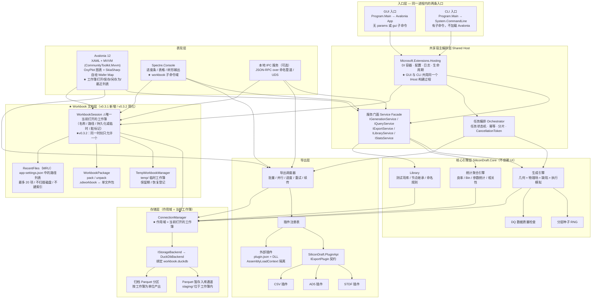
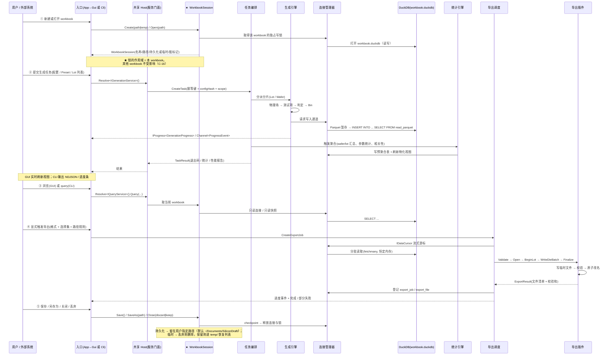
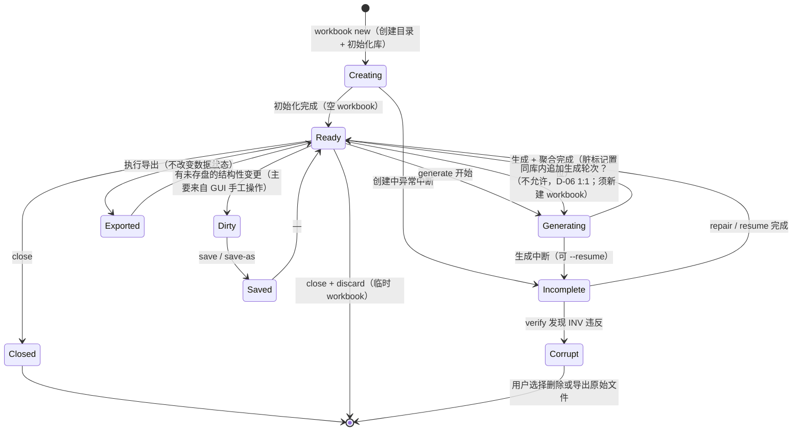
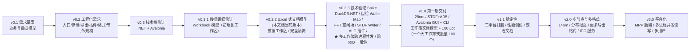

# SiliconDraft 需求规格说明书 v3 — .NET / Avalonia 技术栈修订版（含 Workbook 文档模型）

> **文档定位**：本文档是 `doc/requirements-v2.MD`（v0.2）的**技术栈修订版**，不是增补。
> v0.2 中把 GUI 假设为「本地 Web 服务 + 浏览器（B/S）」，核心引擎假设为 Python。本版按下列已确认决策**整体修订技术栈**，并逐条给出需求变更状态。
>
> **v0.3.1 增量**：引入 **Workbook（工作簿）模型**——每次生成任务对应一个 workbook，一个 workbook 内含一个独立 DuckDB 库；workbook 可持久化复用或作为临时任务。
>
> **v0.3.2 增量（本次）**：**撤销"工作区（Workspace）"概念与工作区索引**。workbook 完全按 **Excel 文档**的方式处理——用**文件对话框**选路径打开，彼此之间**不存在任何关联**，应用不维护任何文件清单或索引。详见 ADR-006（§1.6）与 §3.7。
>
> **文档关系（三份文档各自的角色，不要混淆）**
>
> | 文档 | 版本 | 角色 | 状态 |
> | --- | --- | --- | --- |
> | `doc/requirements.MD` | v0.1 | 业务与数据模型需求（生成引擎、物理场、联动性、缺陷注入、DQ 指标） | 有效，未修改 |
> | `doc/requirements-v2.MD` | v0.2 | 工程化需求（入口/存储/导出/插件/格式/节点/规模） | 部分有效（见 §8.6 有效章节索引） |
> | `doc/requirements-v3.MD` | **v0.3.2** | **技术栈修订版 + Workbook 文档模型（本文档）** | **当前有效版本** |
>
> **阅读方式**：如需完整需求全集 = v0.1（业务与数据模型）+ v0.2（工程化，按 §8.6 索引取用未变更章节）+ v0.3.2（技术栈、Workbook 模型与受影响章节的替代版本）。§8.5 给出 v0.2 → v0.3 的逐条变更对照，§8.6 给出 v0.2 中继续有效的章节索引，§9 记录 v0.3 → v0.3.2 的增量。

| 项目 | 内容 |
| --- | --- |
| 项目名称 | SiliconDraft — 半导体测试数据生成工具 |
| 文档版本 | **v0.3.2（.NET / Avalonia 技术栈修订版 + Workbook 文档模型）** |
| 前序文档 | `doc/requirements.MD`（v0.1）、`doc/requirements-v2.MD`（v0.2） |
| 文档状态 | 待评审 |
| 编写日期 | 2026-10-14 |
| 变更性质 | v0.3：**技术栈颠覆性变更**（B/S → 桌面客户端；Python → C#/.NET）<br>v0.3.1：**数据组织模型变更**（全局单库 → Workbook 模型）<br>v0.3.2：**撤销工作区与索引，改为 Excel 式文档模型**（消除一层间接） |

---

## 目录

- [0. 变更摘要](#0-变更摘要)
- [1. 技术栈决策记录（ADR）](#1-技术栈决策记录adr)
  - [1.6 ADR-006：撤销工作区概念，改为 Excel 式文档模型（v0.3.2）](#16-adr-006撤销工作区概念改为-excel-式文档模型v032-新增)
- [2. 需求编号与变更状态约定](#2-需求编号与变更状态约定)
- [3. 总体架构（修订）](#3-总体架构修订)
  - [3.6 进程内并发与 DuckDB 单写者约束](#36-进程内并发与-duckdb-单写者约束的处理v031-修订)
  - [3.7 Workbook 模型（架构级概念）](#37-workbook-模型架构级概念)
    - [3.7.5 文档模型与最近打开（v0.3.2 重写）](#375-文档模型与最近打开v032-重写替代工作区与索引)
    - [3.7.7 工作簿间隔离约束（v0.3.2 重写）](#377-工作簿间隔离约束v032-重写替代跨-workbook-联邦查询与对比)
- [4. 功能需求（修订）](#4-功能需求修订)
  - [4.1 GUI（Avalonia）— 完整重写](#41-guiavalonia--完整重写)
    - [4.1.8 工作簿会话与文件界面](#418-工作簿会话与文件界面v032-修订)
    - [4.1.9 工作簿文档界面](#419-工作簿文档界面v032-重写替代跨-workbook-对比界面)
  - [4.2 CLI — 修订](#42-cli--修订)
    - [4.2.2 工作簿命令域与批量命令域](#422-工作簿命令域与批量命令域v032-修订)
  - [4.3 存储 — 修订](#43-存储--修订)
  - [4.4 导出 — 变更点](#44-导出--变更点)
  - [4.5 插件架构（.NET）— 完整重写](#45-插件架构net--完整重写)
  - [4.6 一期格式（STDF / AD5）— 修订](#46-一期格式stdf--ad5--修订)
  - [4.7 工艺节点与测试项库 — 变更点](#47-工艺节点与测试项库--变更点)
  - [4.8 规模与性能 — 修订](#48-规模与性能--修订)
- [5. 非功能需求（修订）](#5-非功能需求修订)
- [6. 新增待确认事项](#6-新增待确认事项)
- [7. 版本与扩展规划（修订）](#7-版本与扩展规划修订)
- [8. 附录](#8-附录)
  - [8.5.1 v0.3 → v0.3.1 变更对照](#851-v03--v031-需求变更对照workbook-模型)
  - [8.5.2 v0.3.1 → v0.3.2 变更对照](#852-v031--v032-需求变更对照撤销工作区与跨库能力)
- [9. 变更记录](#9-变更记录)

---

## 0. 变更摘要

### 0.1 一句话概括

SiliconDraft 从「Python 核心 + 本地 Web/B-S GUI + 全局单库」改为「**C#/.NET 10 核心 + Avalonia 桌面 GUI，单一可执行程序双入口，以 Workbook 为文档单元**」，GUI 图表使用 **OxyPlot**（统计图表）与 **SkiaSharp 自绘**（Wafer Map），交付目标为 **Windows / macOS / Linux 三平台对等**。

**一句话理解 Workbook**：**完全像 Excel 打开文档那样**——SiliconDraft 没有"数据库"也没有"文件列表"，用户通过**文件对话框**选择 `.sdworkbook` 目录（或 `.sdwb` 单文件包）打开，一次生成任务产出一个工作簿（内含一个独立 DuckDB 库 + 清单 + 日志 + 导出产物），可存盘下次继续用，也可不存盘当临时任务用完即弃。**工作簿彼此之间不存在任何关联**，应用不维护任何索引或清单。

### 0.2 已确认决策

| 编号 | 决策项 | 选定方案 | 被否决的主要备选 |
| --- | --- | --- | --- |
| **D-01** | 核心引擎技术栈 | **全 .NET / C#**（单一语言、单一运行时、单一进程） | Python 核心 + Avalonia GUI（IPC）；C# 核心 + Python 算数值 |
| **D-02** | GUI 与 CLI 交付形态 | **单一程序 + 双入口**（无参数启动 GUI，带子命令走 CLI） | 两个独立程序；GUI 内嵌命令行 |
| **D-03** | 图表库 | **OxyPlot（MIT）** + SkiaSharp 自绘 Wafer Map | LiveCharts2；ScottPlot；Avalonia Pro 商业图表 |
| **D-04** | 目标平台 | **Windows / macOS / Linux 三平台对等** | Windows 优先；仅 Windows |
| **D-05** | 数据组织单元 | **Workbook 模型**：一次生成任务 = 一个 workbook = **一个独立 DuckDB 库**（v0.3.1） | 全局单库累积所有历史数据 |
| **D-06** | Workbook 与任务粒度 | **严格 1:1**：一个 workbook 对应一轮生成；「继续后续任务」指同库内聚合/查询/导出/补算，不追加新轮次 | 工程容器（一个 workbook 含多轮生成、多 dataset）；两者兼容 |
| **D-07** | Workbook 磁盘形态 | **目录包** `<name>.sdworkbook/`（内含 `workbook.duckdb` + `workbook.json` + `logs/` `exports/` `staging/`），另提供 `pack`/`unpack` 打包为单文件用于分发 | 单文件 zip 容器；裸 `.duckdb` 文件 |
| ~~**D-08**~~ | ~~Workbook 发现方式~~ | ❌ **已撤销（v0.3.2）** —— 原方案为"托管工作区 + 轻量索引（`workspaces/<ws>/` + `workspace.json`）"，现改为**纯文件对话框选路径**，不维护任何索引。撤销理由见 **ADR-006（§1.6）** | 由 **D-10** 替代 |
| **D-09** | 临时 workbook 生命周期 | **关闭时提示保存/丢弃 + 保留可恢复**：放 `SILICONDRAFT_HOME/temp/`，异常退出后可从「恢复」列表重开，超期（默认 7 天）自动清理 | 退出即删；永不自动删 |
| **D-10** | Workbook 打开方式（v0.3.2 新增，替代 D-08） | **Excel 式文档模型**：通过**文件选择对话框**选路径打开；支持"新建 / 打开 / 最近打开"三个入口；**应用不维护文件清单、不做磁盘扫描、不做文件管理** | 托管工作区 + 索引；全盘扫描自动发现 |
| **D-11** | 对外名称（v0.3.2 确认） | **工作簿（Workbook）**，文件后缀 **`.sdworkbook`**，单文件分发包后缀 **`.sdwb`**。全文档、GUI 文案、CLI 命令名统一使用 `workbook` | 工作区（Workspace，与 IDE 的"目录集合"语义冲突）；项目（Project，易误解为长期工程） |
| **D-12** | 工作簿间关系（v0.3.2 新增） | **完全隔离**：只允许单工作簿操作。**不提供**跨工作簿对比、跨工作簿汇总、跨工作簿查询、只读附加会话、任何形式的关联 | 保留双工作簿对比；对比 + 批量汇总 |
| **D-13** | 最近打开（v0.3.2 新增） | **保留 MRU 列表**（最多 20 项，纯 `app-settings.json` 中的路径记录；不扫描磁盘、不读摘要、不做文件管理，条目失效时提示"文件不存在，是否移除"），**可关闭** | 不保留（纯文件对话框） |
| **D-14** | 新建默认位置（v0.3.2 新增） | **系统文档目录下的 SiliconDraft 子目录**：macOS/Linux `~/Documents/SiliconDraft/`，Windows `%USERPROFILE%\Documents\SiliconDraft\`（首次打开对话框时定位到此；可在配置中改） | 记住上次位置；应用数据目录 `~/.silicondraft/documents/` |

### 0.3 核心变更清单

| 序号 | 变更 | 影响章节 |
| --- | --- | --- |
| C-01 | GUI 形态：本地 Web（FastAPI + 浏览器）→ **Avalonia 桌面应用** | §3、§4.1 |
| C-02 | 核心引擎语言：Python → **C#/.NET 10** | §3、§4.3、§4.5、§4.6、§5 |
| C-03 | 进程模型：多进程（生成器 / GUI 服务 / CLI）→ **单进程单容器** | §3.3、§3.6 |
| C-04 | 对外集成：REST + OpenAPI → **.NET SDK 类库 + CLI 子进程协议 +（可选）本地 IPC 服务** | §4.2.2 |
| C-05 | 插件机制：Python Entry Points / `plugin.py` → **.NET 程序集 + `plugin.json` 清单 + `AssemblyLoadContext` 隔离** | §4.5 |
| C-06 | 存储访问：Python `duckdb` → **DuckDB.NET + 进程内连接管理器 + Parquet 暂存入库通道** | §4.3 |
| C-07 | 数值与统计：NumPy / SciPy / matplotlib → **MathNet.Numerics + FFT 谱合成空间场 + SIMD/`Span<T>`** | §4.3、§4.8 |
| C-08 | 配置校验：pydantic v2 → **JsonSchema.Net（Schema 生成与校验）+ YamlDotNet** | §4.2.1、§4.7 |
| C-09 | CLI 框架：Python Click/argparse → **System.CommandLine + Spectre.Console** | §4.2 |
| C-10 | 图表：ECharts / matplotlib → **OxyPlot.Avalonia + SkiaSharp 自绘控件** | §4.1.5 |
| C-11 | 打包：pip / PyInstaller → **`dotnet publish`（self-contained 单文件 + ReadyToRun）** | §5 |
| C-12 | 测试与校验：pytest + pylibstdf → **xUnit + Verify（金标准快照）+ 独立实现的格式校验器 + CI 外部交叉校验** | §4.6、§5 |
| C-13 | 平台目标：macOS/Linux/Windows 可运行 → **三平台对等（含 arm64），完整测试矩阵** | §5 |
| C-14 | DuckDB 单写者约束的处理方式明确化（`Quack` 远程协议处于 beta，第一期不采用） | §3.6 |
| C-15 | 数据组织：全局单库 → **Workbook 模型**（一次生成 = 一个 workbook = 一个 DuckDB 库）（v0.3.1） | §3.7 |
| C-16 | 并发冲突域收缩：跨进程写锁的爆炸半径从"整个工具"降级为"单个工作簿"——**多实例 / 多进程可各自打开不同工作簿并行工作**（v0.3.1） | §3.6、§3.7.6 |
| ~~C-17~~ | ❌ **已撤销（v0.3.2）**：原"新增工作区与索引层（`workspace.json`）"——因 D-10 改为纯文件对话框模型，工作区与索引层整体删除 | §3.7.5、§4.1.8 |
| C-18 | **`sd_dataset` 语义收窄为"生成轮次标识"**：一个 workbook 内固定一条（D-06 严格 1:1）（v0.3.1，v0.3.2 保留） | §4.3.3、§3.7.8 |
| **C-19** | **删除工作区与索引层**：`workspace.json`、工作区列表/浏览器/统计页、`rescan`、跨工作区概念、`{workspace}` 路径变量、`sd_foreign_workbook` 表全部移除（v0.3.2） | §3.7.5、§4.1.8、§4.2.2、§4.3、§4.4 |
| **C-20** | **删除全部跨工作簿能力**：`workbook compare`、跨工作簿只读附加（`ATTACH` 外部工作簿）、`batch stats`、对比视图与可比性警告机制全部移除；并发模型简化为"同一时刻只打开一个工作簿"（v0.3.2） | §3.6、§3.7.6、§3.7.7、§4.1.9、§4.2.2、§4.8 |
| **C-21** | **打开方式改为 Excel 式文档模型**：文件对话框 + 新建/打开/最近打开三入口；新建默认落系统文档目录；MRU 上限 20 项存 `app-settings.json`（v0.3.2） | §3.7.5、§4.1.8、§4.2.2 |
| **C-22** | **对外命名统一为 `workbook` / `.sdworkbook`**（v0.3.2） | 全文 |

### 0.4 不受影响的既有需求

以下内容是本项目的**业务核心，与语言/UI 技术栈及数据组织方式无关，整体保留**：

- v0.1 全部：物理参数场建模（12 个底层物理量）、`P(x,y) = μ + α·(r/R)ⁿ + β·g_θ + γ·L(x,y) + ε` 空间场模型、CP↔WAT 六层联动、缺陷注入的物理路径约束、18 个 Preset、20 项 DQ 数据质量指标。
- v0.2 的：**存储表结构（§4.3.3 全部表/视图/索引，仅 `sd_dataset` 语义收窄）**、容量估算模型（§4.3.5，改为按 workbook 计量）、导出调度语义（§4.4 子集选择/命名规则/批量/重试/断点续传/原子写/清单）、插件架构的**设计原则**（§4.5.1）、第一期格式范围界定（§4.6.1）、测试项库数据模型与多节点差异维度（§4.7 大部分）、规模目标与水平扩展路径（§4.8 大部分）、非功能需求的大部分类别。


> 细节见 §8.6「v0.2 中继续有效的章节索引」。

---

## 1. 技术栈决策记录（ADR）

### 1.1 ADR-001：核心引擎采用全 .NET / C#

**状态**：已接受（2026-10-14）

**背景**：GUI 框架选定 Avalonia，Avalonia 是 .NET 生态的原生 UI 框架（XAML + C# + MVVM，Skia 渲染）。这使「GUI 用什么语言」与「核心引擎用什么语言」产生强耦合。

**决策**：核心引擎（几何建模、物理参数场、缺陷注入、执行模拟、存储、导出、测试项库、DQ 检查）全部用 **C# 实现**，与 GUI、CLI 处于同一 .NET 解决方案、同一进程。

**决策依据**：

| 依据 | 说明 |
| --- | --- |
| A1 消除跨语言边界 | 单一语言 ⇒ 无 IPC、无序列化开销、无类型映射、无两套日志/配置/错误模型 |
| A2 单一运行时与单一发布包 | 用户只需装一个可执行程序，不需要 Python 环境；三平台分发简单 |
| A3 GUI 可直接调用核心 | 生成任务、进度、取消、查询都能用同一套对象与 `CancellationToken` 传递，不需要把进度打平成 JSON |
| A4 规避 DuckDB 跨进程写锁问题 | DuckDB 不支持多进程并发写（见 §1.3 R-1），单进程架构天然规避 |
| A5 性能充足 | .NET 10 的 JIT/SIMD/`Span<T>`/`ArrayPool` 对"向量化数值计算 + 百万级行入库"这类负载表现良好；预期相对 Python 有数倍余量 |
| A6 团队与生态契合 | 桌面工程工具（Windows 为主战场）通常已有 .NET/WPF 资产与技能，XAML/MVVM 可迁移 |
| A7 数值缺口可控 | 所需数学（正态/对数正态分布、FFT、相关矩阵、IDW、变差函数、SIMD）在 MathNet.Numerics 与 BCL 内均可覆盖；缺少数值分布（skew-normal / GEV）需自研，量不大 |

**代价与对冲**：

| 代价 | 对冲措施 |
| --- | --- |
| 失去 NumPy/SciPy/matplotlib 生态 | 用 MathNet.Numerics + OxyPlot + SkiaSharp 替代；建立 §8.1 的包选型表并在 M1 阶段做技术验证（spike） |
| DuckDB 的 C# 客户端是官方 **Secondary 支持级**（社区维护） | ① 通过 `IStorageBackend` 抽象隔离（v0.2 SD-STO-019）；② 增加 Parquet 暂存入库通道作为备用路径（§4.3.7）；③ CI 固定 DuckDB 版本并做升级演练 |
| 缺少数值分布（skew-normal、GEV、混合分布） | 自研实现并单测（§8.1 备注） |
| .NET 桌面打包在 macOS 需公证、Windows 需签名 | 列为 MAY 级需求（§5 SD-NFR-125），内网分发可先不做 |

### 1.2 ADR-002：单一程序 + 双入口

**状态**：已接受

**决策**：交付一个可执行程序（`silicondraft` / `SiliconDraft.exe`）。`Main(string[] args)` 先做参数判定：

- 无子命令（或 `gui`）→ 初始化 Avalonia 并进入桌面应用
- 有子命令 → **不初始化 Avalonia / Skia**，直接走 CLI 路径（保证 CLI 冷启动快、无 GUI 依赖副作用）
- 支持 `--help` / `--version` 在任一路径下均可快速返回

**收益**：

- 核心代码、DI 容器、配置系统、日志系统 **100% 共享**，不存在"GUI 与 CLI 行为不一致"的可能（v0.2 SD-SYS-140 / SD-GUI-154 的诉求被结构性满足）
- 只发布一份产物 ⇒ 无版本漂移风险
- 天然规避 DuckDB 跨进程写锁（同一时刻只有一个进程持有该文件）

**风险与对冲**：

| 风险 | 对冲 |
| --- | --- |
| CLI 场景可能被动引入 GUI 相关的原生依赖体积（SkiaSharp、字体等） | ① 发布**裁剪包**（CLI-only，`PublishTrimmed` + 只引用 Core），列为 SHOULD（SD-NFR-127）；② 单一程序内支持 `--headless` 以保证无图形环境可运行（SD-CLI-093） |
| CLI 冷启动若被 Avalonia 拖慢 | 参数判定置于最前，Avalonia 程序集仅在 GUI 路径下加载（用延迟加载/独立方法避免 JIT 预热） |

### 1.3 ADR-003：明确拒绝的备选方案及原因

**R-1｜拒绝「Python 核心 + Avalonia GUI，两进程各自直连同一个 DuckDB 文件」**

**实证依据**（DuckDB 官方并发文档）：

> DuckDB 的并发模型是二选一：**（1）单进程可读可写**；**（2）多进程只读**（`access_mode='READ_ONLY'`），此时**没有任何进程可以写**。

含义：一旦 Python CLI 以读写模式持有数据库文件，另一个进程（Avalonia GUI）**连只读都打不开**，会直接报 "Database ... is already opened by another process"（DuckDB 使用文件锁，包括 `.wal` 与锁文件）。文档同时明确指出：**从多进程写 DuckDB 不被自动支持，也不是其设计目标**，需要应用层自行实现跨进程互斥锁 + 打开/关闭连接的模式。

因此"两个进程各自直连同一库文件"的方案在 GUI 需要**实时展示生成进度与统计**的场景下不可行——GUI 要么必须等生成结束才能打开库（体验不可接受），要么必须所有读取都走 IPC（那就失去了让 GUI 直连数据库的简单性，退化为下一方案）。

**R-2｜拒绝「Python 核心 + Avalonia GUI，通过本地 HTTP 服务通信」**

用户已明确否决 B/S 架构。本地 HTTP + 浏览器是 B/S 的退化形式；若为了跨语言通信再引入一个本地 HTTP 服务，则等于同时承担"两套运行时 + 进程间协议 + 端口/鉴权/生命周期管理"三重成本，而收益仅是复用 Python 数值栈。

**R-3｜拒绝「C# 核心 + Python 仅做数值计算」**

跨语言边界只为了使用 NumPy 而存在，但所需数学在 .NET 上均可实现，且这种拆分会让"物理模型 → 测试项推导"这一最核心、最需要可读性与可调试性的链路被切碎在两个语言里。

**R-4｜记录：DuckDB 跨进程读写的未来路径（第一期不采用）**

| 方案 | 状态（2026-10） | 说明 |
| --- | --- | --- |
| `Quack` 远程协议 | **beta**，官方预期 DuckDB v2.0（2026 年秋）成熟 | 把 DuckDB 变成 client-server 数据库，从而支持多进程并发读写 |
| `DuckLake` + PostgreSQL catalog | v1.0 规范与实现已于 2026-04 发布，面向生产 | 通过中心化 PostgreSQL catalog 协调，DuckDB 实例间可实现并发读写 |
| 单进程多线程（MVCC） | 稳定可用 | **第一期采用的模型**：单进程内多线程并发写（追加永不冲突） |

**结论**：第一期采用"单进程 + 进程内多线程 + 追加语义"，把多进程并发读写留给 v3.0 的 L4/L5 扩展阶段（对应 v0.2 §4.8.3 的扩展路径），并在 `IStorageBackend` 抽象与主键设计上预留（v0.2 SD-SCL-062~069 继续有效）。

### 1.4 ADR-004：OxyPlot + SkiaSharp 自绘的图表分工

**状态**：已接受

**决策**：图表能力分两层，避免用一个库硬扛所有需求。

| 层 | 技术 | 覆盖场景 | 理由 |
| --- | --- | --- | --- |
| **统计图表层** | **OxyPlot.Avalonia** | 直方图、累积分布、箱线图、折线/趋势图、散点图、Pareto、相关矩阵热力图、径向/扇区曲线 | MIT 协议、成熟稳定、系列类型覆盖全、**原生支持 PNG/SVG/PDF 导出**（DQ 报告出图与 GUI 导出共用一条代码路径） |
| **专用视图层** | **SkiaSharp 自绘控件**（Avalonia 本身即 Skia 渲染，用 `ICustomDrawOperation`） | **Wafer Map / Bin Map**（含缺陷区域叠加、缩放平移、悬停提示、图例） | Wafer Map 不是标准图表：需要按 Die 离散坐标绘制、按 Bin/参数/缺陷多维度着色、支持万级元素流畅交互与叠加图层。OxyPlot 的热力图是规则网格模型，不适合 wafer 的不规则 die 布局（含 partial die）。 |

**否决说明**：

| 备选 | 否决原因 |
| --- | --- |
| LiveCharts2 | MVVM 绑定与观感好，但面向"动态美观"优化，大静态数据集性能一般；且我们要的能力 OxyPlot 已覆盖 |
| ScottPlot | 大数组渲染最快，但 Avalonia 支持相对较新、成熟度不如 OxyPlot；导出能力亦不及 OxyPlot 完整 |
| Avalonia Pro 商业图表 | 70+ 图表类型与官方 SLA 有价值，但引入商业授权依赖；列为 MAY（SD-Q-037） |

### 1.5 ADR-005：Workbook 模型（v0.3.1 新增）

**状态**：已接受
**决策**：引入 **Workbook（工作簿）** 作为数据组织的顶层单元。**一次生成任务 = 一个 workbook = 一个独立的 DuckDB 库文件**。workbook 可持久化为磁盘上的目录包（`<name>.sdworkbook/`），下次打开继续使用；也可不保存，作为临时任务（产出放入 `SILICONDRAFT_HOME/temp/`，退出时提示保存或丢弃）。

**背景**：v0.3 采用「单一全局 DuckDB 库累积所有历史数据集」的模型，存在三个问题：

| 问题 | 说明 |
| --- | --- |
| 并发冲突域过大 | 全局单库意味着**任何一个进程打开库都会锁住全部历史数据**。用户在 GUI 里浏览旧数据集时，另一个实例（CLI 批量生成）就无法打开库。跨进程写锁的爆炸半径是"整个工具" |
| 数据无法按任务交付/归档 | YMS 测试场景常需"把这一批测试数据交给某人"，全局单库里没有天然的交付边界；删除、备份、迁移都只能整库操作 |
| 生命周期不可区分 | 一次性试跑产生的数据与需要长期保留的基准数据混在一起，无法区分"这个可以随时删"和"这个必须留着做回归基线" |

**决策依据**：

| 依据 | 说明 |
| --- | --- |
| B1 **冲突域收缩**（最重要） | 每个工作簿是独立文件。**多个实例 / 多个进程可以各自打开不同工作簿互不影响**：实例 A 在生成 W1 的同时，实例 B 可以生成或浏览 W2；CI 流水线批量产出 N 个工作簿时也不会互相阻塞。跨进程写锁的爆炸半径从"整个工具"降为"单个工作簿"。这是在**不改动 DuckDB 单写者模型**的前提下能做到的最优解（对比 §1.3 R-4 的 `Quack`/`DuckLake` 方案：后者仍是 beta 或需要引入 PostgreSQL，成本高得多）。<br>⚠️ **v0.3.2 修正**：本条原表述包含"GUI 可以一边浏览工作簿 A、一边让生成任务写工作簿 B"——那是**单实例内多工作簿**的情形，已随 D-12「完全隔离」（同一时刻只打开一个工作簿）**不再成立**。收益的正确表述是**跨实例/跨进程**的并行隔离，而非单实例内并行。 |
| B2 天然的交付与归档边界 | workbook 目录包 = 可直接拷贝、压缩、邮件发送、放入归档的单元。`.sdworkbook/` 内含库、清单、日志、导出产物，接收方解包即可打开 |
| B3 生命周期可区分 | 持久化 workbook（需要留存）与临时 workbook（用完即弃）在物理上分离，清理策略清晰互不干扰 |
| B4 与用户心智一致 | Excel / Jupyter Notebook / MATLAB 工程都是"打开一个工作单元 → 做事 → 保存/丢弃"。用户不需要理解"数据库"这一概念 |
| B5 单库规模显著变小 | 单库从"100 Lot 全量"降为"一次任务"（典型 1–25 Lot），单库压缩体积从数百 MB 降至数十 MB 量级；查询更快、备份更快、崩溃恢复更快 |
| B6 与 v0.3 既有设计兼容 | 表结构不需要改动（每个 workbook 内都建同一套表）；`sd_dataset` 语义从"多数据集集合"收窄为"本次任务的轮次标识"（D-06 严格 1:1，一个 workbook 内固定一条）；导出、插件、DQ 检查全部逻辑不变 |
| B7 与既有可复现性要求一致 | `sd_config` 的内容寻址配置快照随 workbook 一起走，`metadata` 足以重放，独立于其他 workbook |

**代价与对冲**：

| 代价 | 对冲措施 |
| --- | --- |
| ~~跨 workbook 的对比分析（如"两个缺陷场景的良率差异"）无法用一个 `SELECT` 完成~~ | 🚫 **v0.3.2 撤销**：原对冲方案（联邦查询 `ATTACH` + `workbook compare` + 结果物化）已随 D-12「完全隔离」全部删除。现在对比两个场景的**唯一做法**是各自打开并导出，在 SiliconDraft **之外**比较（SD-WB-074d / SD-GUI-222）。这是明知的代价：换取"每个工作簿自包含、可独立交付"与"零跨库复杂度" |
| 文件数量增长（100 次生成 = 100 个工作簿） | ① ~~工作区索引提供统一的列表/搜索/统计/批量操作~~（🚫 v0.3.2 撤销）→ 改为：**MRU 最近打开**（最多 20 项，D-13）+ **文件管理器**（用户按自己的习惯建目录）+ `workbook list --dir` 按需枚举；② `workbook pack` 可把工作簿打成单文件包用于归档/交付；③ 批量场景用 `batch generate --out-dir` 一次产出多个独立工作簿 |
| 用户可能不知数据存哪了 | ① GUI 标题栏恒显示 workbook 名称与路径，未保存时显示"未保存"标记；② 每次导出/生成结束在界面回显绝对路径；③ 提供"在文件管理器中显示"操作 |
| 单次任务若横跨 100 Lot，则该 workbook 会变大 | 生成任务的 Lot 范围仍可自由配置（一个 task 可含 1–N 个 Lot）；100 Lot 级基线场景对应"一个大 workbook"或"100 个小 workbook"，由用户的批量策略决定。两种情况都在 v0.3 的容量模型覆盖范围内（§4.3.5） |
| 跨进程仍不能同时写同一个 workbook | 这是 DuckDB 的固有约束（§1.3 R-1），**不能也不需要在第一期解决**。必须明确提示"该 workbook 正被其他进程占用"（SD-WB-070），引导用户改用其他 workbook |

**否决说明**：

| 备选 | 否决原因 |
| --- | --- |
| 保持全局单库 | 并发冲突域过大（B1）、无交付边界（B2）、生命周期不可区分（B3） |
| 全局单库 + 按数据集分目录存放导出产物 | 只解决了交付问题（B2），库锁与生命周期问题依旧；且"数据在库里、产物在目录里"造成两处管理 |
| 每任务一个库文件，但用裸 `.duckdb` | 与 D-07 的目录包方案相比缺少清单、日志、导出产物的安放位置；元信息只能塞进库内表，且用户在文件管理器里看到的是一个不透明的二进制文件 |
| 一个 workbook 含多轮生成（多 dataset，工程容器） | 经确认选择 D-06 严格 1:1，以换取模型最简与语义最清晰 |

> **对 v0.3 前文的影响**：§3.6「进程内并发与 DuckDB 单写者约束的处理」中的"数据库文件进程独占是架构前提"表述升级为"**每个 workbook 文件的进程独占**"；`IConnectionManager` 的作用域从"全局单库"改为"**当前打开的 workbook**"。详见 §3.6 修订版与 §3.7。
>
> **⚠️ 本条在 v0.3.1 中的一处副产物已被 v0.3.2 撤销**：原文"多轮对比改由**跨 workbook 联邦查询**承担"——该跨库能力在 v0.3.2 随 D-12「完全隔离」一并删除。现在多轮对比的做法是：分别打开两个工作簿、各自导出结果，在 SiliconDraft **之外**做对比。见 ADR-006（§1.6）。

### 1.6 ADR-006：撤销工作区概念，改为 Excel 式文档模型（v0.3.2 新增）

**状态**：已接受（2026-10-14，**撤销 D-08 / C-17**）

**背景**：v0.3.1 引入了"托管工作区 + 轻量索引"（D-08）：`SILICONDRAFT_HOME/workspaces/<ws>/` 存放一组工作簿，配 `workspace.json` 索引，GUI 启动即列出全部工作簿并支持搜索/标签/批量操作。

经评审后判定：**这一层是多余的间接**。工作簿本身已经是一个自包含的目录包（D-07），用户完全可以像对待 Excel 文件一样用文件管理器管理它；额外引入的索引层带来了一连串**本不必要的复杂度**：

| 索引层引入的复杂度 | 说明 |
| --- | --- |
| 第二份真相 | `workspace.json` 与各工作簿的 `workbook.json` 可能出现不一致，必须设计"可重建/损坏容忍/原子写/并发写冲突降级"（原 SD-WB-051） |
| 状态失效问题 | 索引中的摘要统计是缓存，必须设计缓存失效、强制刷新、"统计待刷新"标记（原 SD-WB-084） |
| 规模问题 | 500 个工作簿时索引体积与读写耗时成为新的性能风险（原 SD-SCL-124/125/129）与新的 Spike（原 SD-EXT-108） |
| 心智负担 | 用户必须理解"工作簿"与"工作区"两个概念、两层归属关系，以及"工作簿在哪个工作区里" |
| 与需求冲突 | 用户明确表示"工作区和工作区不需要有关联性"，而工作区概念本身就在建立归属关联 |

**决策**：**删除整个工作区与索引层**。工作簿改为**纯文档模型**（D-10）：

| 维度 | v0.3.1（工作区 + 索引） | v0.3.2（文档模型） |
| --- | --- | --- |
| 打开方式 | 从工作区列表中点选，或按路径打开 | **文件选择对话框选路径**（主路径）；另提供"新建"与"最近打开"两个入口 |
| 应用维护的状态 | `workspace.json` 索引（可含标签/收藏/摘要缓存） | **仅一份 MRU 路径列表**（最多 20 项，存 `app-settings.json`），**不扫描磁盘、不读摘要、不做文件管理** |
| 新建落点 | `workspaces/<当前工作区>/` | **`~/Documents/SiliconDraft/`**（可在配置中改，D-14） |
| 工作簿之间 | 同工作区有归属关系；可联邦查询与对比 | **完全隔离（D-12）**：无对比、无汇总、无跨库查询、无只读附加 |
| 批量操作 | 在工作区范围内 | 对**显式给出的路径列表/通配符**逐个执行单文件操作（不建立关联） |
| 发现的失效方式 | 索引损坏、摘要过期 | 路径失效（文件被移动/删除）→ 提示"文件不存在，是否从最近列表移除" |

**决策依据**：

| 依据 | 说明 |
| --- | --- |
| E1 消除第二份真相 | 应用不再持有任何"文件清单"，唯一真相就是磁盘上的目录包本身。索引一致性、缓存失效、原子写、并发写冲突这一整类问题**直接消失** |
| E2 用户操作习惯 | 工程师管理几十上百个实验结果目录时，本就习惯用文件管理器（按项目/日期建目录）。工具强行提供一套"工作区"反而与其既有习惯冲突 |
| E3 心智更简单 | 只有"工作簿"一个概念，没有"它在哪个工作区"这一层。与 Excel / Word / Jupyter Notebook 一致 |
| E4 与"完全隔离"（D-12）自洽 | 既然工作簿之间不需要关联，那么"把它们组织进工作区"这件事本身就没有需求支撑 |
| E5 移除的风险大于收益 | 被删掉的能力（跨库对比、批量汇总）在"完全隔离"决策下本就已定为不提供；索引层剩下唯一的服务对象是"列表展示"，而这个展示可以由 MRU + 文件对话框覆盖 |

**代价与对冲**：

| 代价 | 对冲措施 |
| --- | --- |
| 无法在应用内浏览"我一共有哪些工作簿" | ① MRU 列表最多 20 项（D-13）；② 提供 `workbook list --dir <目录>` 与 `--glob` 让 CLI/脚本按目录或通配符枚举（纯文件系统枚举，不建索引）；③ GUI 提供"在文件管理器中打开默认目录"的快捷操作 |
| 无法在工作区内做批量选择 | 批量命令改为接受**显式路径列表、目录或通配符**（`batch generate --out-dir`、`batch pack <dir>/*.sdworkbook`），仍是"逐个执行单文件操作"，不建立关联 |
| 用户可能把工作簿放在混乱的位置 | ① 新建时默认落到 `~/Documents/SiliconDraft/`（D-14）；② 配置可改默认目录；③ GUI 标题栏与状态栏恒显示完整路径（原 SD-GUI-204 保留） |
| 失去"按 Preset/产品/节点筛选工作簿"能力 | 由 CLI 实现：`workbook list --dir <d> --filter preset=P-EDGE-HIGH`（读取各目录包的 `workbook.json` 清单做过滤，**按需读取、结果不缓存**）。这不是索引，只是一次性枚举 |

**否决说明**：

| 备选 | 否决原因 |
| --- | --- |
| 保留工作区与索引 | 用户明确否决（"不需要工作区列表"）；且索引维护的全部复杂度换来的只是列表展示 |
| 用 SQLite 轻量索引替代 `workspace.json` | 只把"第二份真相"从 JSON 换成 DB，问题性质不变（原 SD-EXT-108 的备选）；且引入额外依赖 |
| 全盘扫描自动发现工作簿 | 与"不维护任何清单"的精神不符，且对用户磁盘是侵入性行为（扫描范围不可控）；明确不做 |
| 保留跨工作簿对比（仅去掉工作区） | 用户选择"完全隔离"（D-12），跨库对比一并移除 |

> **本节对前文的影响**：§3.7.5「工作区与索引」被重写为「文档模型与最近打开」；§3.7.7「跨 workbook 联邦查询与对比」整节删除并改为「工作簿间隔离约束」；§3.2 架构图中的 `WorkspaceIndex` 与 `跨 workbook 联邦查询` 组件移除；§4.1.9「跨 Workbook 对比界面」整节删除；§4.2.2 的 `workspace` 命令域删除；`sd_foreign_workbook` 表删除。逐条对照见 §8.5.2。


---

## 2. 需求编号与变更状态约定

### 2.1 编号体系（沿用 v0.2）

```
SD-<模块码>-<三位序号>
```

模块码：`SYS` `WB` `GUI` `CLI` `STO` `EXP` `PLG` `FMT` `LIB` `SCL` `NFR` `EXT` `Q`。
其中 **`WB`（Workbook）为 v0.3.1 新增模块码**，专用于工作簿文档模型相关需求（§3.7）。
编号在项目生命周期内**永不复用**：作废需求保留编号并标记 `[作废]` 并注明替代项。**v0.3.2 删除的编号（原工作区与跨库相关）一律保留为 `[已撤销]`，不回收使用。**

### 2.2 变更状态标记

本文档与 §8.5 的对照表中，每条需求标注以下状态之一：

| 标记 | 含义 |
| --- | --- |
| ✅ **保留** | v0.2 原文继续有效，未变更（正文不再重复） |
| 🔁 **修订** | 语义或技术实现发生变化，本文档给出替代文本 |
| ❌ **作废** | 不再适用，注明原因与替代需求编号（若有） |
| ➕ **新增** | v0.3 新增需求，含新编号 |
| 🚫 **已撤销** | v0.3.1 曾新增，v0.3.2 因 ADR-006 删除（编号保留，标注原因，不回收） |

### 2.3 变更统计

**v0.3（技术栈修订）**

| 状态 | 数量 | 说明 |
| --- | --- | --- |
| ✅ 保留（v0.2 原文有效） | 96 | 业务核心、表结构、导出调度、节点数据模型等 |
| 🔁 修订 | 31 | 主要集中于 §3 架构、§4.1 GUI、§4.5 插件、§4.6 格式实现、§5 NFR |
| ❌ 作废 | 14 | B/S 相关（REST/端口/前端资源/访问令牌）、Python 生态相关（EntryPoints/`plugin.py`/Python 版本矩阵） |
| ➕ 新增 | 47 | .NET 解决方案结构、依赖方向、双入口实现、连接管理、插件 ALC 隔离、SDK/IPC 集成、打包与平台矩阵、启动时间等 |

**v0.3.1（Workbook 模型，本次净额已扣除 v0.3.2 撤销部分）**

| 状态 | 数量 | 说明 |
| --- | --- | --- |
| 🔁 修订 | 9 | `SD-SYS-250`（锁作用域）、`SD-STO-100`（库路径）、`SD-STO-104/105`（暂存随 workbook）、`SD-STO-107`（归档以 workbook 为单位）、`SD-GUI-168`（层级导航）、`SD-SCL-*`（按 workbook 计量）等 |
| ➕ 新增（仍有效） | 24 | 不变量、目录包结构、生命周期状态机、持久化/临时、崩溃恢复、锁与失效锁检测、`sd_workbook` 表、导出 workbook 变量与落点策略、插件 `WorkbookInfo`、追溯字段、工作簿层面性能指标、Workbook 相关非功能需求 |
| 🚫 **已撤销（v0.3.2）** | **14** | 工作区与索引层（`workspace.json`、工作区浏览器/管理/统计、`rescan`、`{workspace}` 变量、`sd_foreign_workbook`、工作区规模指标与 Spike），以及全部跨工作簿能力（`compare`、只读附加会话、`batch stats`、对比视图、可比性报告）。逐条见 §8.5.2 |

**v0.3.2（Excel 式文档模型）增量**

| 状态 | 数量 | 说明 |
| --- | --- | --- |
| ➕ 新增 | 6 | 文件对话框为主路径、新建默认落系统文档目录、MRU 最近打开列表（上限 20、可关闭、失效提示）、工作簿间隔离约束的显式声明、`workbook list --dir/--glob` 枚举、无工作区时的 GUI 文案一致性 |
| 🚫 已撤销 | 14 | 见上表 |

| 汇总 | 数量 |
| --- | --- |
| **v0.3.2 有效需求合计** | **198** |
| 其中 MUST | **138** |
| 其中 SHOULD | **40** |
| 其中 MAY | **20** |

---

## 3. 总体架构（修订）

### 3.1 解决方案与项目结构

**SD-SYS-210**（➕ MUST）：采用单一 .NET 解决方案，项目划分必须保证**依赖方向单向**：`Core` 不依赖任何 UI/CLI/插件实现。

```
SiliconDraft.sln
├── Directory.Build.props            # 统一 TFM / LangVersion / Nullable / TreatWarningsAsErrors
├── Directory.Packages.props         # 中央包版本管理（CPM）
├── src/
│   ├── SiliconDraft.PluginApi/          # ★ 插件契约程序集（极薄，仅接口 + DTO）
│   │                                    #   多目标 net8.0;net10.0，独立版本号（见 §4.5.3）
│   ├── SiliconDraft.Core/               # 核心引擎（net10.0，不引用 Avalonia / CLI）
│   │   ├── Workbook/                    # ★ v0.3.1 新增：Workbook 文档模型
│   │   │                                #   WorkbookDescriptor, WorkbookSession（唯一会话）
│   │   │                                #   WorkbookPackage (pack/unpack), TempWorkbookManager
│   │   │                                #   RecentFiles（MRU，v0.3.2）
│   │   │                                #   ★ v0.3.2 移除：WorkspaceIndex / 跨库联邦查询
│   │   ├── Geometry/                    #   Wafer / DieMap / Scribe / WatLayout
│   │   ├── Physics/                     #   空间场 / 物理量 / 推导模型 / 数值分布
│   │   ├── Defects/                     #   缺陷注入（几何型 + 参数型）
│   │   ├── Execution/                   #   CP/WAT 执行模拟 / Bin 分配 / Retest
│   │   ├── Library/                     #   测试项库 / 节点继承解析 / 命名规则
│   │   ├── Storage/                     #   IStorageBackend / DuckDbBackend / 连接管理
│   │   ├── Export/                      #   IExportPlugin / Registry / Scheduler / Naming
│   │   ├── Quality/                     #   DQ 检查与报告
│   │   ├── Orchestration/               #   任务编排 / 分片 / 幂等 / 取消
│   │   └── Rng/                         #   分层种子（种子派生 + PCG64）
│   ├── SiliconDraft.Plugins.Stdf/       # 内置插件：STDF（CP）
│   ├── SiliconDraft.Plugins.Ad5/        # 内置插件：AD5（WAT）
│   ├── SiliconDraft.Plugins.Csv/        # 内置插件：CSV（调试/自检参考实现）
│   ├── SiliconDraft.Sdk/                # 对外 SDK 门面（供外部 .NET 系统引用）
│   ├── SiliconDraft.Cli/                # CLI 层（System.CommandLine + Spectre.Console）
│   ├── SiliconDraft.Gui/                # Avalonia 桌面应用
│   └── SiliconDraft.App/                # ★ 双入口宿主（唯一发布产物）
├── plugins/                             # 外部插件放置目录（开发期）
├── nodes/                               # 工艺节点包目录（nodepack，SD-LIB-105）
└── tests/
    ├── SiliconDraft.Core.Tests/         # xUnit + FluentAssertions（含 Workbook 生命周期测试）
    ├── SiliconDraft.Plugins.Tests/      # 含 Verify 金标准快照测试
    ├── SiliconDraft.Gui.Tests/          # ViewModel 层单测（headless）
    ├── SiliconDraft.E2E.Tests/          # 端到端：建 workbook → 生成 → 入库 → 查询 → 导出 → 校验 → 存盘 → 重开
    └── SiliconDraft.Benchmarks/         # BenchmarkDotNet 性能基准
```

**运行期目录布局**（用户机器上）：

```
%SILICONDRAFT_HOME%/                    # 默认 ~/.silicondraft —— 只放"应用自身"的东西
├── config.yaml                      # 应用级默认配置（可被 CLI/GUI 参数覆盖）
├── app-settings.json                # GUI 应用设置（主题、窗口尺寸、默认目录、最近打开 MRU）
├── plugins/                         # 用户级插件目录（§4.5.3）
├── nodes/                           # 用户级节点包目录
├── temp/                            # ★ 临时工作簿目录（D-09，默认 7 天保留期）
│   └── tmp_20261014_113012_a1b2c3.sdworkbook/
└── recovery.json                    # ★ 异常退出时的会话登记（用于"恢复"列表）

%USERPROFILE%/Documents/SiliconDraft/   # ★ 新建工作簿的默认落点（D-14）
├── centerhigh_25lot_20261014.sdworkbook/
└── baseline_25lot_20261014.sdworkbook/
                                         # 用户也可把工作簿放在任意位置
                                         # （项目目录、网络盘、外部硬盘……应用不关心）
```

> **v0.3.2 变更（ADR-006）**：删除了 `%SILICONDRAFT_HOME%/workspaces/` 与其中的 `workspace.json`。应用**不再持有任何"工作簿清单"**——工作簿放在哪里完全由用户决定，应用只在 `app-settings.json` 中记录一份 MRU 路径列表用于「最近打开」。
> `%SILICONDRAFT_HOME%` 与"文档目录"是**两个不同的位置**：前者是应用自己的数据（配置/插件/临时/恢复登记），后者是用户的产出。这样用户备份/迁移自己的实验数据时不必连带应用状态。

**SD-SYS-216**（➕ MUST，v0.3.2）：**应用不得扫描用户磁盘来发现工作簿**。唯一允许的按需枚举入口是显式的 `workbook list --dir <目录>` 与 `--glob <模式>`（§4.2.2），其语义是"**对指定目录做一次文件系统枚举并读取命中目录包的清单**"，结果**不得缓存**、不得跨调用保留、不得写入任何索引文件。

**SD-SYS-217**（➕ MUST，v0.3.2）：`app-settings.json` 必须只保存**应用自身的设置与 MRU 路径**，禁止在其中保存任何来自工作簿的数据（统计、摘要、标签、良率等）。这保证"设置文件"与"数据"的边界清晰，删掉设置文件不损失任何数据。


**SD-SYS-211**（➕ MUST）：`SiliconDraft.App` 是唯一的可执行发布单元。它引用 `Gui` 与 `Cli`，由 `Main` 做双入口分派（§3.3）。`Gui` 与 `Cli` 之间**不得相互引用**。

**SD-SYS-212**（➕ MUST）：`SiliconDraft.Core` 的项目文件中**禁止出现** `Avalonia*`、`System.CommandLine`、`Spectre.Console` 等 UI/终端类包引用。必须通过架构测试（`ArchUnitNET` 或自定义 xUnit 断言）在 CI 中强制校验依赖方向，违反即构建失败。

### 3.2 分层架构（修订）



**SD-SYS-213**（➕ MUST）：GUI 与 CLI **必须共用同一个 `IHost` 构建过程**（`HostBuilder` + 统一的 `ConfigureServices` / `ConfigureAppConfiguration` / `ConfigureLogging` 扩展方法），差异只能通过"是否注册 UI 相关服务"体现。禁止在 GUI 与 CLI 中各自 `new` 一套服务或各自解析配置。

**SD-SYS-214**（🔁 修订 v0.3.2）**：`WorkbookSession` 是**全应用唯一的工作簿上下文**（单例服务），所有数据访问都必须经由它取得绑定。禁止任何组件自行拼接数据库文件路径、自行打开 `DuckDBConnection`。
**v0.3.2 变更（D-12 完全隔离）**：`WorkbookSession` **同一时刻只持有一个工作簿**——删除 v0.3.1 的"1 个读写 + N 个只读附加"模型，删除 `ATTACH` 外部工作簿的能力。打开另一个工作簿时，必须先释放当前会话的全部连接与锁，再建立新会话，且必须**原子**（失败时回滚到原会话或进入无工作簿状态）；若当前会话有未保存变更，必须先走「保存 / 丢弃 / 取消」流程（SD-GUI-214）。

**SD-SYS-215**（🔁 修订 v0.3.2）：**"无当前工作簿"必须是一个合法的应用状态**（首次启动、关闭工作簿后）：此时 GUI 显示**起始页**（新建工作簿 / 打开工作簿（文件对话框）/ 最近打开 / 恢复未保存的工作簿 —— 承接 D-10、D-13），CLI 的生成类命令必须报 `ERR_NO_WORKBOOK` 并提示 `workbook new` 或 `--workbook <path>`。数据类命令（`query` / `export` / `stats`）必须强制显式指定 `--workbook`。
**v0.3.2 变更**：起始页**不再包含"工作区列表"**——只有"最近打开"（MRU，最多 20 项）。

### 3.3 单一程序双入口的实现要求

**SD-SYS-220**（➕ MUST）：`Program.Main` 必须按以下顺序分派，且 **CLI 路径不得触发 Avalonia/渲染栈的初始化**：

```csharp
// SiliconDraft.App/Program.cs（示意，最终以实现为准）
[STAThread]
public static int Main(string[] args)
{
    // 1) 纯 CLI 判定：不触碰 Avalonia 程序集
    if (CliEntry.ShouldHandle(args))            // 有子命令 / --help / --version
        return CliEntry.Run(args);              // 返回进程退出码

    // 2) GUI 路径
    return GuiEntry.Run(args);                  // BuildAvaloniaApp().StartWithClassicDesktopLifetime
}
```

**SD-SYS-221**（➕ MUST）：CLI 路径必须通过**独立的类型与方法边界**实现（`CliEntry` 类不得引用任何 Avalonia 类型），以保证 JIT 不会在 CLI 场景下加载 Avalonia 程序集、不产生 GUI 相关初始化开销。必须有性能测试证明 CLI 冷启动达标（§5 SD-NFR-121）。

**SD-SYS-222**（➕ MUST）：退出码必须由 `Main` 原样返回（Linux/macOS 下取 `& 0xFF` 语义），保证流水线可读取（承接 v0.2 SD-CLI-050 的 16 档退出码，语义不变）。

**SD-SYS-223**（➕ SHOULD）：必须支持 `silicondraft gui` 显式子命令（在无参数行为可能被脚本包装改变的场景下提供确定性入口）；必须支持 `silicondraft --headless <cmd>` 显式声明无图形环境运行。

### 3.4 依赖方向硬约束

**SD-SYS-230**（➕ MUST）：以下依赖方向是**不可违反的架构约束**，由 CI 强制：

| 允许 | 禁止 |
| --- | --- |
| `App` → `Gui`、`Cli` | `Core` → `Gui` / `Cli` / `Avalonia*` |
| `Gui` → `Core`、`Sdk`、`PluginApi` | `Gui` ↔ `Cli` 互相引用 |
| `Cli` → `Core`、`Sdk`、`PluginApi` | `Core` → `System.CommandLine` / `Spectre.Console` |
| `Core` → `PluginApi`（仅契约） | `Core` → 任何插件的**实现**程序集 |
| `Plugins.*` → `PluginApi`（仅契约） | 插件 → `Core`（见 §4.5.3，插件只能引用契约程序集） |

**SD-SYS-231**（➕ MUST）：`Core` 向表现层汇报进度与状态的唯一通道是**抽象接口**（`IProgress<T>`、`Channel<T>`、`CancellationToken`），禁止 `Core` 中出现任何 UI 线程调度、`Dispatcher`、事件订阅等 UI 概念。

### 3.5 端到端数据流（修订）



**SD-SYS-240**（🔁 修订 SD-SYS-140/SD-SYS-150）：端到端路径中**不存在** HTTP 服务、端口、浏览器、前端静态资源。GUI 的数据来自 `IQueryService` 的直接调用（同进程、强类型、无序列化）。

**SD-SYS-241**（🔁 修订 v0.3.2）：端到端流程必须以 **Workbook 会话**为边界（见上图 ①⑤ 两步）：**所有数据操作都必须发生在某个已打开的工作簿会话之内**。禁止存在"隐式打开某个数据库"的代码路径。
**v0.3.2 补充**：由于 D-12 完全隔离，流程中**不存在**"打开第二个工作簿"这条路径；任何需要两库数据的比较都必须由用户在工具之外完成（各自导出后另用工具比较）。

### 3.6 进程内并发与 DuckDB 单写者约束的处理（v0.3.1 修订）

> 本节直接回应 §1.3 R-1 的约束，并按 D-05 把**锁的作用域从"全局单库"收缩为"单个 workbook"**。

**SD-SYS-250**（🔁 修订）：**workbook 文件的进程独占**是架构前提（原表述为"数据库文件的进程独占"）。`DuckDbBackend` 必须在打开 workbook 时获取**进程内互斥 + 进程间文件锁双重保护**：

| 层级 | 机制 | 行为 |
| --- | --- | --- |
| 进程间 | 独占文件锁（`<workbook>/workbook.lock`）+ 打开时的 DuckDB 原生文件锁 | 若该 workbook 已被其他进程占用，立即以 `ERR_WORKBOOK_LOCKED (14)` 退出，并在提示中给出**持有者信息**（PID、主机、进程启动时间）与**可选替代方案**（改用其他 workbook / 等待 / 只读打开见下条）；**不得重试等待死等**（可用 `--on-lock wait\|fail` 配置） |
| 进程内 | `SemaphoreSlim(1,1)` 守护的写事务队列（作用域 = 当前 workbook） | 所有写操作串行化（追加语义下不冲突，见 SD-SYS-252） |

**SD-SYS-250a**（🔁 修订 v0.3.2）：**锁的粒度与影响面必须显式呈现**（v0.3.2 随 D-12 完全隔离简化，删除所有跨工作簿场景）：

| 场景 | 预期行为 |
| --- | --- |
| 实例 A 打开工作簿 W1；实例 B 打开工作簿 W2 | **两者互不影响**，可同时读写（C-16 的核心收益）。这是把锁作用域收缩到单个工作簿的主要目的 |
| 同一实例内：生成任务写入 W1 的同时 GUI 查询 W1 | 允许（同一 `IConnectionManager`，读走快照） |
| 实例 A 打开 W1；实例 B 尝试打开 W1 | B 报 `ERR_WORKBOOK_LOCKED (14)`，提示持有者信息。GUI 给出两个可选动作：**以只读方式打开**（仅查看，不可写入）或**取消** |
| 实例 B 以只读打开 W1 | 允许（`--read-only` / 只读对话框显式声明）。**只允许查看**——v0.3.2 明确：只读打开**不产生任何"与其他工作簿关联"的能力**，跨库查询已删除（D-12） |

**SD-SYS-250b**（✅ 保留）：新增退出码 **`14 = ERR_WORKBOOK_LOCKED`**，并把原 v0.2 的 `13 = ERR_LOCKED` 语义收窄为"同进程内的资源占用"（如任务级互斥、文件句柄冲突）。退出码表（v0.2 §8.2）已同步更新，且原 13 号语义变更必须在 CHANGELOG 与 `--help` 文档中显式说明（避免流水线脚本误判）。

**SD-SYS-251**（🔁 修订 v0.3.2）：必须实现 `IConnectionManager`，作为**当前工作簿内**唯一的数据访问入口（作用域由"全局单库"收窄为"当前会话"，由 `WorkbookSession` 持有并随会话创建/销毁）：

```csharp
public interface IConnectionManager : IAsyncDisposable
{
    /// 绑定的工作簿（只读属性，会话创建后不可变更）
    WorkbookHandle Workbook { get; }

    /// 写作用域：会话内唯一，串行使用；内部为短事务
    ValueTask<IWriteScope> BeginWriteAsync(CancellationToken ct);

    /// 读连接：可并发；DuckDB 在同一进程内按路径复用同一 Database 实例，
    /// 因此同进程多连接是安全的（跨进程则不安全）
    ValueTask<DuckDBConnection> RentReadAsync(CancellationToken ct);

    /// 当前工作簿内归档 Parquet 的只读挂载（无需额外锁）
    Task AttachArchiveAsync(string parquetGlob, CancellationToken ct);

    Task<StorageInfo> GetInfoAsync(CancellationToken ct);
    Task CheckpointAsync(CancellationToken ct);
}
```

> **v0.3.2 删除**：原 `AttachForeignWorkbookAsync(...)`（只读挂载**其他**工作簿）**已删除**。理由是 D-12「完全隔离」——不提供任何跨工作簿能力。若将来确需跨库对比，须先经评审恢复该能力与其对应的可比性校验机制（原 SD-WB-071~073）。

**SD-SYS-252**（✅ 保留 + 作用域说明）：写入必须采用**追加（append）语义**，禁止对已写入行做 `UPDATE` / `DELETE` 的热路径操作。依据：DuckDB 保证"追加永不冲突，即使在同一张表上"，这使进程内多线程并发追加是安全的；而并发 `UPDATE` 同一行会因乐观并发控制抛事务冲突。若确需修正数据，必须走"写入新行 + 标记版本"或"整 workbook 重建"（原表述为"整数据集重建"）。

**SD-SYS-253**（✅ 保留）：必须验证并固化**同进程多连接的可见性与快照语义**（写连接已提交的事务对读连接是否立即可见、读连接是否看到一致快照）。验证脚本纳入 CI。若实测不满足预期，必须退化为「单连接 + 读写串行队列（读优先，读查询限时）」策略，且该退化路径必须同样通过全部功能与性能测试。

**SD-SYS-254**（✅ 保留）：GUI 的长查询（相关矩阵、跨 Lot 直方图等）必须受**查询超时**与**结果行数上限**保护（沿用 v0.2 SD-STO-053），且不得长时间占用写事务队列。

**SD-SYS-255**（🔁 修订）：`App` 退出（含异常退出、SIGTERM）时必须按顺序释放：**取消在途任务 → 读连接 → 写事务队列 → checkpoint → 释放 workbook 锁**。必须有集成测试覆盖"强杀后再次启动可正常打开该 workbook 且无残留锁"。

**SD-SYS-256**（🔁 修订）：必须提供 `workbook unlock --force` 诊断命令，用于清理**确认无进程持有**情况下的残留锁文件（必须打印持有者信息与风险提示，并要求 `--yes`）。原 `db unlock --force` 更名为 `workbook unlock`（`db` 命令域保留但语义改为"对当前 workbook 操作"）。

**SD-SYS-257**（✅ 保留）：预留 `IStorageBackend` 的**多进程后端**实现位置（`QuackServerBackend` / `DuckLakePostgresBackend`），作为 v3.0 的 L4 扩展路径；第一期不得依赖其存在。

**SD-SYS-258**（➕ MUST，v0.3.1）：**必须在文档与界面中明确"锁的作用域只有一个 workbook"**：`ERR_WORKBOOK_LOCKED` 的错误提示禁止表述为"数据库被占用"这类会引起全局误解的措辞，必须表述为"**workbook「<名称>」正被其他进程占用（PID nnnn，主机 xxx，于 xx:xx 打开）**"，并给出替代建议。这是 D-05 相对全局单库的核心收益，不能让用户在错误信息里把它丢掉。


---

### 3.7 Workbook 模型（架构级概念）

> 本节由 **ADR-005（§1.5）** 派生，是 v0.3.1 的核心新增章节。对应决策 D-05～D-09。

#### 3.7.1 概念定义与不变量

**SD-WB-010**（➕ MUST）：**Workbook（工作簿）** 是 SiliconDraft 的顶层数据组织单元，其定义为：

> 一次生成任务的**完整载体** = 一个目录包（`<name>.sdworkbook/`）= 一个独立 DuckDB 库 + 一份清单 + 该任务的日志/导出产物/报告/暂存区。

**SD-WB-011**（➕ MUST）：必须维护以下**不变量（Invariants）**，并在 `workbook verify` 中逐条检查：

| 编号 | 不变量 | 违反时的处理 |
| --- | --- | --- |
| INV-1 | 一个 workbook 目录内**恰好一个** `workbook.duckdb` | 报错并拒绝打开 |
| INV-2 | 一个 workbook 内 `sd_dataset` **恰好一条**记录（D-06 严格 1:1） | 0 条 = 尚未完成生成（允许，标记 `incomplete`）；> 1 条 = 数据损坏（报错） |
| INV-3 | 同一时刻最多一个**读写**进程持有该 workbook（读只读挂载不受限） | 见 §3.7.6 |
| INV-4 | workbook 内数据的 `config_hash` 必须与其 `sd_config` 记录自洽，可重放 | 报错并标记 `unreproducible` |
| INV-5 | 除已声明的子目录/文件外，workbook 目录内不得出现未声明的顶层条目 | WARN（不阻止打开），提供 `workbook tidy` 迁移到 `extra/` |
| INV-6 | `workbook.json` 的 `schemaVersion` 与库内 `sd_schema_version` 必须一致 | 不一致 = 需要 `workbook migrate` |
| INV-7 | workbook 的 `state` 字段必须反映真实状态（见 §3.7.3） | 异常残留状态由 `workbook repair` 修正 |

**SD-WB-012**（➕ MUST）：`workbook.json` 是 workbench 的**自描述清单**，必须：

| 要求 | 说明 |
| --- | --- |
| 人类可读 | 缩进 JSON，字段顺序稳定（用 `System.Text.Json` 源生成 + 固定属性顺序），保证可 diff |
| 冗余而非唯一 | 清单中的摘要统计（Lot 数 / Wafer 数 / Die 数 / 良率 / 大小）是**缓存**，权威值在库内。清单损坏时可由 `workbook rebuild-manifest` 从库重建 |
| 兼容演进 | 必须有 `schemaVersion`；新版本读到旧清单必须能升级（只读打开时降级为只读） |
| 不存敏感信息 | 清单中禁止出现绝对路径以外的凭据类信息；不得内嵌完整配置（配置在库内 `sd_config`） |

#### 3.7.2 目录包结构

**SD-WB-020**（➕ MUST）：`<name>.sdworkbook/` 目录结构必须如下（★ = 必需，○ = 按需创建）：

```
<name>.sdworkbook/
├── workbook.json          ★ 清单（naming 见 SD-WB-012）
├── workbook.duckdb        ★ 数据（含 v0.2 §4.3.3 全部 sd_* 表/视图/索引）
├── workbook.lock          ○ 运行时独占锁（关闭时删除；进程崩溃遗留由失效检测处理）
├── logs/                  ○ 日志（JSON Lines，轮转）
│   ├── generate_20261014_113012.jsonl
│   └── export_20261014_120500.jsonl
├── exports/               ○ 导出产物根（默认输出目录，见 §4.4）
│   ├── stdf/…
│   └── ad5/…
├── staging/               ○ Parquet 暂存（运行时；入库成功后清空，中断时保留供 --resume）
├── reports/               ○ DQ 自检报告 HTML、图表 PNG/SVG
├── preview/               ○ 缩略图（wafer map 概览 / bin 分布条形图），供 GUI 列表卡片与离线查看
├── nodes/                 ○ 固化本次使用的节点包快照（保证可重放，不随全局 nodes/ 变化）
└── extra/                 ○ 用户自由放置（不参与任何校验，不进入 INV-5 检查）
```

**SD-WB-021**（➕ MUST）：`logs/` `exports/` `staging/` `reports/` `preview/` 的路径必须**可重定向**（配置项），默认指向 workbook 内；禁止把 staging 放在系统临时目录（否则中断后无法 `--resume`）。

**SD-WB-022**（➕ MUST）：`nodes/` 中必须固化本次生成所用的节点包快照（承接 v0.2 SD-LIB-062 的 nodepack 版本记录，升级为内容固化）。理由：全局 `nodes/` 目录可能被升级或删除，而 workbook 必须能独立重放。存储成本低（YAML 文本）。

#### 3.7.3 生命周期与状态机

**SD-WB-030**（➕ MUST）：workbook 的生命周期状态必须持久化在 `workbook.json` 的 `state` 字段与库内 `sd_workbook.state` 中，状态机如下：



**SD-WB-031**（➕ MUST）：**必须区分"数据未完成（Incomplete）"与"数据损坏（Corrupt）"**：前者是可恢复的（`workbook resume` / `workbook repair`），后者需要人工介入。GUI 必须用不同视觉状态呈现（如进度图标 vs 警告图标），禁止混为一谈。

**SD-WB-032**（➕ MUST）：`workbook verify` 必须可在**不打开为读写**的前提下执行（以只读模式打开库 + 读取清单），用于校验任意外部收到的 workbook 包。必须输出结构化结果（`--output json`），含逐条 INV 的结论。

**SD-WB-033**（➕ SHOULD）：`workbook repair` 必须能处理以下情形：① 清理残留锁；② 重建清单（`rebuild-manifest`）；③ 修正 `state` 字段；④ 清理 staging 中已入库的残留文件；⑤ 报告无法修复的问题而非静默修改。**修复必须写操作日志**（`logs/repair_*.jsonl`），且必须在修复前自动备份 `workbook.json`。

#### 3.7.4 持久化与临时

**SD-WB-040**（➕ MUST）：两种生命周期的行为必须明确区分，且必须**在界面上恒可见**：

| 维度 | 持久化 workbook | 临时 workbook（D-09） |
| --- | --- | --- |
| 默认位置 | **`~/Documents/SiliconDraft/`**（D-14，可配）；用户也可放在任意路径 | `%SILICONDRAFT_HOME%/temp/` |
| 命名 | 用户指定（默认由 preset + lot + 日期生成，见 SD-Q-051） | `tmp_<yyyyMMdd_HHmmss>_<rand6>.sdworkbook` |
| 关闭时 | 直接关闭（已存盘） | **必须提示"保存 / 丢弃 / 保留以备恢复"** |
| GUI 标题栏 | `<工作簿名称> — SiliconDraft` | `未保存：<名称> — SiliconDraft`（必须带"未保存"前缀） |
| 是否被应用记录 | 仅进入 **MRU 最近打开列表**（D-13，最多 20 项路径） | 不进 MRU；进 `temp/` 恢复登记 |
| 自动清理 | **永不自动删除**（承接 v0.2 SD-NFR-112） | 超过保留期（默认 **7 天**，可配）自动清理 |
| 空间统计 | **不再有任何跨工作簿的空间统计**（随工作区统计一并删除） | 单独计量，超出 `temp` 配额时提示（默认不限制，超出 20 GB WARN） |

**SD-WB-041**（➕ MUST）：临时 workbook 的清理必须遵循：

1. **绝不静默删除**：清理前必须打印/显示将要删除的清单（名称、路径、大小、创建时间），并要求确认（CLI 用 `--yes`；GUI 用对话框）
2. **不得删除已加锁的 workbook**（可能有其他进程正在用）
3. **优先移入回收站/垃圾箱**（而非直接删除），无回收站机制时降级为直接删除并要求二次确认（与 `<personal_files_safety>` 原则一致：用户数据不直接 `rm`）
4. `temp` 目录**不得**位于系统临时目录（`/tmp` / `%TEMP%`），必须是 `SILICONDRAFT_HOME/temp/`——理由：系统临时目录可能被 OS 或清理工具主动删除，且可能位于空间更小的卷
5. 必须提供 `workbook temp list` / `workbook temp clean [--older-than]` 与 GUI 的等价界面

**SD-WB-042**（➕ MUST）：必须实现**崩溃恢复**：

| 要求 | 说明 |
| --- | --- |
| 会话登记 | 打开/创建 workbook 时，必须把 `(workbook 路径, 模式, PID, 主机, 启动时间, 最后心跳时间)` 写入 `%SILICONDRAFT_HOME%/recovery.json`；正常关闭时移除 |
| 心跳 | 必须周期性更新心跳（默认 10 s），用于区分"进程已死"与"进程仍在运行" |
| 恢复列表 | 下次启动时，把 `recovery.json` 中**心跳过期且锁文件仍存在**的 workbook 列入"可恢复"，GUI 显示恢复页，CLI 用 `workbook recover --list` |
| 恢复动作 | 选择恢复 = 清理残留锁 + 以读写模式打开 + `state` 置回 `Ready` 或 `Incomplete`；**必须保留原数据不做任何"自动修正"**（除残留锁文件外） |
| 不覆盖 | 恢复不得覆盖 `workbook.duckdb`；DuckDB 的 WAL 会自行完成未提交事务的回滚（ACID 保证） |

**SD-WB-043**（➕ MUST）：必须支持从临时转为持久：`workbook save-as <path>` 与 GUI 的"另存为"。转换必须是**先复制到目标、校验通过、再删除源**的顺序（避免中途失败导致数据丢失）；大 workbook 的复制必须显示进度且可取消（取消时清理目标半成品）。

**SD-WB-044**（➕ SHOULD）：必须支持 `workbook duplicate <new-path>`：使用 DuckDB 的 `ATTACH` + `COPY FROM DATABASE` 或文件级复制 + 新名称/新 ID 重置，用于"以本 workbook 为基线做变体实验"。复制后必须**重写 `workbookId`** 并清空恢复登记，避免两个 workbook 被认为是同一个。

#### 3.7.5 文档模型与最近打开（v0.3.2 重写，替代"工作区与索引"）

> **本节由 ADR-006（§1.6）驱动，重写 v0.3.1 的原「工作区与索引」小节。** 原小节的工作区概念、`workspace.json` 索引、索引重建与缓存失效机制**全部删除**；工作簿改为**纯文档模型**——用文件对话框打开，应用不维护任何清单。

**SD-WB-050**（🔁 修订 v0.3.2）：必须实现**Excel 式文档模型**（D-10）。工作簿的打开与新建只有三个入口，且**应用不持有任何"工作簿清单"**：

| 入口 | 行为 | 是否需用户指定路径 |
| --- | --- | --- |
| **新建工作簿** | 走"新建向导"（§4.1.8 SD-GUI-202），默认落点 `~/Documents/SiliconDraft/<自动名称>.sdworkbook`（D-14），用户可在文件对话框中改路径 | 是（可通过对话框确认/修改默认路径） |
| **打开工作簿** | 系统文件选择对话框选路径（`.sdworkbook` 目录 / `.sdwb` 单文件包）；也可在对话框外直接输入/粘贴路径（GUI 提供路径输入框） | 是 |
| **最近打开** | MRU 列表中的路径直接打开（D-13） | 否（但可能失效，见 SD-WB-052） |

**SD-WB-051**（🚫 已撤销 v0.3.2）：**原"索引必须可重建且不得成为单点真相"整条删除**。理由：索引本身被删除，第二份真相、损坏容忍、增量更新、并发写索引冲突这一整类问题随之消失（ADR-006 依据 E1）。替代约束见 SD-SYS-216（禁止扫描磁盘与缓存枚举结果）与 SD-SYS-217（`app-settings.json` 不得保存工作簿数据）。

**SD-WB-052**（🔁 修订 v0.3.2）：**"按路径打开任意工作簿"从补充能力升级为唯一主路径**。补充要求：

| 要求 | 说明 |
| --- | --- |
| 路径输入 | 除文件对话框外，GUI 必须提供**可直接粘贴路径的输入框**（工程师常从终端/邮件里复制路径） |
| `.sdwb` 单文件包 | 允许直接选择 `.sdwb`：必须提示"将解包到临时目录后打开"并**显示解包位置**；解包后的临时工作簿按临时工作簿生命周期管理（D-09） |
| MSR 失效处理 | MRU 中的路径不存在时，必须显示"文件不存在"并在用户确认后从列表移除；**禁止静默移除**（用户可能是外置盘未挂载、网络盘暂时不可达） |
| 不存在的路径 | 打开不存在的路径必须报 `ERR_WORKBOOK_NOT_FOUND (15)` 并给出可操作提示（检查路径 / 是否需先解包 `.sdwb`） |

**SD-WB-053**（🔁 修订 v0.3.2）：原"工作区过滤/排序/搜索/标签/收藏"**整条删除**（无列表可过滤）。替代要求：

| 编号 | 强度 | 需求 |
| --- | --- | --- |
| **SD-WB-053a** | MUST | **MRU 最近打开列表**（D-13）：最多 **20** 项，FIFO 淘汰；每项显示**名称 + 完整路径 + 最近打开时间 + 是否存在**；支持单条移除与"清空列表"；**可整体关闭**（关闭后起始页只显示"新建/打开"两个入口） |
| **SD-WB-053b** | MUST | MRU **必须只存路径**，不得存任何工作簿内容（摘要、良率、标签等）。每次显示列表时可**按需读取命中的 `workbook.json` 清单**以展示名称与基本元信息（不打开 DuckDB 库）；读取失败（路径不可达）时该项标记为"不可用"而**不得**从列表移除 |
| **SD-WB-053c** | SHOULD | 提供 `workbook list --dir <目录> [--glob <模式>] [--filter preset=...] [--output json]`：**一次性枚举**指定范围内的目录包并读取清单做展示/过滤。**结果不缓存**（SD-SYS-216）。这是"想看看某个目录里有哪些工作簿"的 CLI 入口，也是 GUI"在文件管理器中打开"按钮的补充 |
| **SD-WB-053d** | SHOULD | GUI 起始页与菜单提供"**在文件管理器中打开默认目录**"（`~/Documents/SiliconDraft/`）与"**显示当前工作簿位置**"两个快捷操作，替代原"工作区浏览器"的导航作用 |

**SD-WB-054**（🚫 已撤销 v0.3.2）：`workspace stats`（跨工作簿汇总）**整条删除**。理由：D-12 完全隔离——不提供任何跨工作簿的汇总/统计/分析能力。若用户需要"这批实验整体良率"，做法是各自导出后**在 SiliconDraft 之外**汇总。

**SD-WB-055**（🔁 修订 v0.3.2）：**必须提供 `workbook pack` / `workbook unpack`**（D-07 的补充；v0.3.2 增加"打包是主要的交换方式"这一新定位）：

| 命令 | 行为 |
| --- | --- |
| `workbook pack <wb> -o <file>.sdwb` | 把工作簿目录打包为单文件（zip 容器，含 `workbook.json` 与 `workbook.duckdb` 及选定子目录），用于分发/归档。必须支持 `--exclude logs,staging` 之类的选择性打包；`--out-dir` 可批量打包一个目录下的全部工作簿 |
| `workbook unpack <file>.sdwb -o <dir>` | 解包为目录，之后可正常打开。**必须校验**清单中的校验和（打包时写入），不一致则报错 |
| 可打开性 | **单文件包（`.sdwb`）不可直接作为工作簿打开**（DuckDB 需要真实文件路径）。若用户直接打开 `.sdwb`，必须提示"将解包到临时目录后打开"，并说明解包位置 |
| **v0.3.2 定位变化** | 由于**没有工作区索引**、且**没有跨库能力**，`pack`/`unpack` 成为**唯一的跨机器/跨人交换方式**：把 `.sdwb` 发出去，对方解包后独立打开。这使它的重要性上升为 SHOULD 之上的常规路径 |

**SD-WB-055a**（➕ MUST，v0.3.2）：必须明确"**默认目录只影响新建，不影响打开**"：配置项 `workbook.default_dir` 仅用于"新建向导的初始路径"与"在文件管理器中打开默认目录"这两个用途；**应用不得以任何方式限制或约束工作簿的实际存放位置**（用户可以放在任意可读写路径，包括网络盘与外部硬盘，见 SD-NFR-150 的路径长度提示）。

#### 3.7.6 并发与锁

**SD-WB-060**（🔁 修订 v0.3.2）：**同一时刻只允许打开一个工作簿**（D-12 完全隔离）：

| 会话类型 | 数量 | 说明 |
| --- | --- | --- |
| 工作簿会话 | **1** | 由 `WorkbookSession` 持有；所有生成/查询/导出都必须走它。**v0.3.2 删除了原"0–N 个只读附加会话（Foreign Workbook）"** |
| 只读模式 | 同一会话的一种模式 | 以 `--read-only` 打开时，该工作簿可被查看但**禁止一切写入**；这是"另一个人打开了同一文件"时的降级查看方式（SD-WB-063），**不构成第二个会话** |

**SD-WB-060a**（➕ MUST，v0.3.2）：打开第二个工作簿的行为必须明确：

| 当前状态 | 用户动作 | 行为 |
| --- | --- | --- |
| 无打开的工作簿 | 新建 / 打开 / 最近打开 | 直接进入该工作簿 |
| 已打开工作簿，**无未保存变更** | 新建 / 打开 / 最近打开 | **直接切换**（先释放当前会话的连接与锁，再建立新会话；SD-SYS-214 的原子性要求） |
| 已打开工作簿，**有未保存变更**（脏标记置位） | 新建 / 打开 / 最近打开 | 必须弹出「**保存 / 丢弃 / 取消**」三选对话框；选"取消"则停留在当前工作簿 |
| 已打开**临时**工作簿 | 新建 / 打开 / 最近打开 | 同上，但选项文案为「保存为…/ 丢弃 / 保留以备恢复 / 取消」四选（承接 SD-WB-040） |

**SD-WB-060b**（➕ MUST，v0.3.2）：必须**明确禁止**任何形式的"多工作簿同时打开"实现路径：禁止多标签页、禁止多窗口各开一个工作簿、禁止后台预打开。GUI 若需要展示"另一个工作簿里的某个数字"（例如用户自己想做对比），**只能由用户先切换过去、记下数值、再切回来**；工具不提供并排查看。这条约束是"完全隔离"在实现层的落地检查点，必须由架构测试或 GUI 代码审查确认（不存在第二个 `WorkbookSession` 实例）。

**SD-WB-061**（➕ MUST）：锁文件（`workbook.lock`）必须包含足以定位持有者的信息，并支持**失效锁检测**：

```json
{
  "workbookId": "wb_01J...",
  "pid": 41234,
  "host": "dev-mac-01",
  "user": "shaokp",
  "startedAt": "2026-10-14T11:30:12+08:00",
  "heartbeatAt": "2026-10-14T11:42:05+08:00",
  "mode": "readwrite",
  "appVersion": "1.0.0",
  "appProcessStartTicks": 63835…   // 用于区分同 PID 复用
}
```

**SD-WB-062**（➕ MUST）：打开时的锁判定逻辑必须为：

| 锁文件 | 持有进程状态 | 处理 |
| --- | --- | --- |
| 不存在 | — | 正常获取锁，进入读写 |
| 存在，主机名相同，PID 存活且启动时间匹配 | 活着 | 报 `ERR_WORKBOOK_LOCKED (14)`，提示持有者信息与替代方案 |
| 存在，主机名相同，PID 不存在 **或** 启动时间不匹配（PID 被复用） | 已死 | 视为**失效锁**，允许清理后重新获取；必须 **WARN 并记录**（不静默） |
| 存在，主机名不同（网络共享目录/共享归档场景） | **无法判定** | **禁止自动清理**（对方可能在另一台机器上活着）。必须报错并提示：① 显式 `--force-unlock`（打印强烈警告 + 要求 `--yes`）；② 或改用只读打开；③ 或使用 Parquet 只读归档（推荐路径，见 SD-WB-063） |

**SD-WB-063**（➕ MUST）：**必须支持只读打开**（`--read-only` / GUI 只读对话框），且只读打开**不获取独占锁**、不受写入方影响（DuckDB 只读多进程共存；但注意 §1.3 R-1：若本机已有进程以读写打开，同机只读会失败——必须给出明确提示并建议改用共享 Parquet 归档）。

**SD-WB-064**（➕ MUST）：必须明确并文档化**共享场景的唯一推荐模式**（承接 v0.2 SD-STO-108）：多用户/多机共享时，**不要把 workbook 放在网络共享目录上让多人打开**（DuckDB 官方明确警告文件锁在跨文件系统/网络存储上不可靠）。推荐做法：

1. 生成完成后执行 `workbook pack` 或导出 Parquet 归档到共享目录
2. 共享目录中只放**不可变的**打包文件/Parquet，接收方各自解包到本地打开
3. 若确需直接共享 workbook 目录，必须使用**只读**方式打开（SD-WB-063）且接受失效锁无法判定的限制

**SD-WB-065**（➕ MUST）：GUI 必须在**标题栏与状态栏恒显示**当前 workbook 的名称、路径（悬停显示全文）与持久化状态，并在被外部占用/只读打开时以显著方式标注（图标 + 状态栏文字）。这是 D-06/D-07 之下"用户必须随时知道自己在操作哪个 workbook、数据会落到哪里"的硬性要求。

#### 3.7.7 工作簿间隔离约束（v0.3.2 重写，替代"跨 workbook 联邦查询与对比"）

> **本节由 ADR-006（§1.6）驱动。** v0.3.1 的原「跨 workbook 联邦查询与对比」小节（`ATTACH` 只读挂载、`workbook compare` 五维度对比、可比性警告、结果物化）**整节删除**。原因：D-12 选择「完全隔离」，不提供任何跨工作簿能力。

**SD-WB-070**（🚫 已撤销 v0.3.2）：跨工作簿联邦查询（`ATTACH '<other>/workbook.duckdb' AS fwN (READ_ONLY)`、别名规范、挂载前锁状态与版本校验、`DETACH` 管理）**整条删除**。`IConnectionManager` 中的 `AttachForeignWorkbookAsync` 一并删除（§3.6 SD-SYS-251）。

**SD-WB-071**（🚫 已撤销 v0.3.2）：`workbook compare` 命令与五维度对比（元信息/良率/Bin/参数/空间/缺陷）**整条删除**。

**SD-WB-072**（🚫 已撤销 v0.3.2）：对比结果物化（`sd_compare_result` 表 + `reports/` HTML）**整条删除**。

**SD-WB-073**（🚫 已撤销 v0.3.2）：跨工作簿可比性警告机制（`config_hash` / 节点包 / 测试项库 / 种子策略一致性检查 + 逐字段 diff）**整条删除**。

**SD-WB-074**（➕ MUST，v0.3.2，替代上述四条）：必须实现并验证以下**隔离约束**，作为"完全隔离"决策在实现层的落地检查点：

| 编号 | 约束 | 验证方式 |
| --- | --- | --- |
| **SD-WB-074a** | `WorkbookSession` **只允许存在一个实例**，且同一时刻只绑定一个工作簿；不存在任何"附加/挂载其他工作簿"的 API 或内部路径 | 架构测试：断言 `IConnectionManager` 无附加外部库的方法；断言全局只有一个会话实例 |
| **SD-WB-074b** | 不得存在任何"跨工作簿"的查询、聚合或比较 API。查询服务（`IQueryService` / `IStatsService`）的入参**不得包含第二个工作簿标识** | 接口审查 + 架构测试 |
| **SD-WB-074c** | 不得实现多标签页 / 多窗口各开一个工作簿 / 后台预打开；GUI 的"打开另一个工作簿"必须是**替换当前会话**（SD-WB-060a） | GUI 代码审查 + 集成测试 |
| **SD-WB-074d** | 需要在两个工作簿之间做对比时，唯一支持的做法是：**各自打开并导出结果，在 SiliconDraft 之外比较**。GUI 与 CLI **不得**为此提供任何内置的并排视图或自动对比产出 | 需求确认 + 人工审查 |

**SD-WB-075**（➕ SHOULD，v0.3.2）：虽然不提供跨库能力，但必须**保证单库内的对比能力完整**，以尽量弥补隔离带来的分析缺口（这些能力都在**同一个工作簿内部**，不违反 D-12）：

| 单库内可做的对比 | 说明 |
| --- | --- |
| 同一工作簿内 Lot 之间对比 | 良率/Bin/参数统计的跨 Lot 对比（v0.2 §4.1.3 的 Lot 详情视图与趋势图） |
| 同一工作簿内 Wafer 之间对比 | Wafer 间趋势、按 Wafer 的参数分布对比 |
| 同一工作簿内 Die 之间对比 | Die 明细对比、Wafer Map 着色切换 |
| 同一工作簿内 **双 Wafer Map 并排**（原 SD-GUI-183） | 这是**单个工作簿内**两个 Wafer 的并排，**不属于跨工作簿能力**，保留为 SHOULD |
| 同一工作簿内 WAT 与 CP 的关联分析 | v0.1 的 CP↔WAT 六层联动与相关性矩阵（`v_corr_wat_cp`），本来就是单库内分析 |

> **给用户的提示（必须做）**：由于不做跨工作簿对比，**必须由工具明确告知用户"要对比两个场景，请分别生成两个工作簿、各自导出，然后在外部工具中比较"**——即在 GUI 与文档中给出这条指引，而不是让用户自己摸索"为什么没有对比功能"。这是隔离约束下避免用户困惑的必要补偿。

#### 3.7.8 与既有表结构的关系

**SD-WB-080**（🔁 修订 v0.3.2，表结构增量）：v0.2 §4.3.3 的全部 `sd_*` 表/视图/索引**继续逐工作簿建立**（每个工作簿一套完整 Schema）。v0.3.1 新增**一张**每库内的小表（v0.3.2 删除了原 `sd_foreign_workbook`）：

```sql
-- 每个工作簿内的自描述表（冗余于 workbook.json，便于 SQL 直接查询与自检比对）
CREATE TABLE sd_workbook (
  workbook_id     VARCHAR PRIMARY KEY,   -- ULID，全局唯一
  name            VARCHAR NOT NULL,
  created_at      TIMESTAMP NOT NULL,
  modified_at     TIMESTAMP NOT NULL,
  app_version     VARCHAR,
  schema_version  INTEGER,               -- 对应 sd_schema_version.version
  state           VARCHAR,               -- Ready | Generating | Incomplete | Dirty | Corrupt
  is_temporary    BOOLEAN DEFAULT FALSE,
  origin_path     VARCHAR,               -- 临时→持久化、duplicate、unpack 的来源路径（追溯用）
  derived_from    VARCHAR,               -- 派生链：来源 workbook_id（SD-FMT-110）
  preset          VARCHAR,
  node            VARCHAR,
  nodepack_ref    VARCHAR,
  config_hash     VARCHAR,
  seed_root       BIGINT,
  notes           VARCHAR
);
```

> **v0.3.2 删除**：原 `sd_foreign_workbook` 表（记录曾只读挂载过的外部工作簿，用于跨库对比的可追溯性）**已删除** —— 跨库能力不存在，该表无意义。
> **v0.3.2 新增字段**：`sd_workbook.derived_from`，用于表达 `duplicate` / `unpack` 的派生来源（承接 SD-FMT-110 的派生链追溯）。

**SD-WB-081**（🔁 修订 v0.2 §4.3.3 的 `sd_dataset`）：`sd_dataset` 语义收窄为"本次任务的轮次标识"：一个工作簿内**固定一条**记录（D-06）。其字段含义相应收窄：

| 字段 | v0.3.1 起语义 |
| --- | --- |
| `dataset_id` | 保留，但值等于工作簿的主生成轮次 ID（`<workbookId>-r1`）；为向后兼容不复用/不删除该列 |
| `parent_dataset_id` | 预留（若将来允许一个工作簿多轮生成，用于表达轮次血缘） |
| `lot_count` / `wafer_count` / `die_count` / `overall_yield` | 语义不变 |

**SD-WB-082**（🔁 修订 v0.3.2）：**容量与性能指标按工作簿计量**（承接 C-18）：

| 项 | v0.3.2 基准 |
| --- | --- |
| 单个工作簿典型规模 | 1–25 Lot（25–625 Wafer） |
| 单个工作簿库文件典型大小 | 25 Lot 不含长表 ≈ 50–80 MB（压缩后）；含长表 ≈ 150–250 MB |
| 单个工作簿上限告警 | 库文件 > 2 GB 或 die 数 > 2000 万时 WARN 并建议拆分为多个工作簿 |
| ~~工作区典型规模~~ | 🚫 **已撤销**（无工作区；应用不感知"用户一共存了多少工作簿"） |
| ~~工作区磁盘占用排行~~ | 🚫 **已撤销**（`workspace stats --disk` 随工作区统计删除）。替代：`workbook info --output json` 输出单库体积；用户需要总量统计时由外部工具对目录做 `du`/`dir` 式统计 |
| **磁盘空间提示（v0.3.2 新增）** | 生成前必须检查**目标卷**的可用空间，预估所需空间并留 20% 余量；不足时**必须在开始生成前**报错（而不是写到一半失败） |

**SD-WB-083**（🔁 修订 v0.3.2）：必须提供：

| 命令 | 行为 |
| --- | --- |
| `workbook info <path>` | 输出单个工作簿的元信息与摘要统计（人类可读 + `--output json`） |
| `workbook list --dir <目录> [--glob <模式>] [--filter <条件>]` | **一次性枚举**指定范围内的目录包并读取清单做展示/过滤；**结果不缓存**（SD-SYS-216） |
| `workbook current` | 输出当前会话打开的工作簿（路径 / 名称 / 状态）；无打开时返回 `ERR_NO_WORKBOOK (16)` |

三者的输出内容必须与 GUI 对应视图**同源**（同一服务方法），避免 CLI 与 GUI 显示不一致（承接 SD-NFR-145）。

---

## 4. 功能需求（修订）

### 4.1 GUI（Avalonia）— 完整重写

> **本节取代 v0.2 §4.1 全部内容。** v0.2 §4.1 中关于"本地 Web 服务 / REST API / 浏览器 / 前端静态资源 / --host --port / 访问令牌"的需求全部作废（见 §8.5）。
> GUI 的**功能目标与页面信息架构**保持不变（工程师人工核查"数据像不像真的"），变更的是**实现形态与技术选型**。
> **v0.3.1 追加**：GUI 的入口语义从"打开数据库查看数据集"改为"**打开工作簿**"（D-05）。新增 §4.1.8（工作簿文档界面）。
> **v0.3.2 变更（ADR-006）**：删除原 §4.1.8 中的**工作区列表/浏览器/管理/统计**相关视图，删除原 §4.1.9「跨 Workbook 对比界面」整节；新增 §4.1.9「工作簿文档界面（v0.3.2 修订版）」覆盖 Excel 式打开流程与 MRU。原 §4.1.8 顺延为 §4.1.10。

#### 4.1.1 定位与设计原则

**SD-GUI-160**（🔁 修订 v0.3.2）：GUI 是**桌面客户端应用**（Avalonia 12 + XAML + C#），随主程序发布，不依赖浏览器、不监听网络端口、不部署任何服务端组件。**v0.3.2 补充**：GUI 的操作单位是 **工作簿**，且**同一时刻只打开一个**（D-12）。应用启动后处于"无工作簿"状态并显示**起始页**，用户新建或通过**文件对话框**打开一个工作簿后才进入数据视图（承接 §3.2 SD-SYS-215）。**GUI 不提供任何"文件列表/工作区列表"式的导航**——除了"最近打开"（MRU，最多 20 项，D-13）。

**SD-GUI-161**（➕ MUST）：GUI 必须遵循 MVVM 分层：View（XAML）只负责布局与视觉状态，ViewModel 负责状态与命令，业务能力全部经 `SiliconDraft.Core` 的服务门面调用。**View 与 ViewModel 中禁止出现 SQL 语句、禁止直接持有数据库连接、禁止重新实现统计逻辑。**

**SD-GUI-162**（➕ MUST）：GUI 与 CLI 必须通过同一套服务门面（`IGenerationService` / `IQueryService` / `IExportService` / `ILibraryService` / `IStatsService`）访问能力。禁止 GUI 使用任何 CLI 侧的类型或参数模型。

**SD-GUI-163**（🔁 修订 SD-GUI-154）：必须通过架构测试强制 SD-GUI-161 与 SD-GUI-162；违反即构建失败。这替代了 v0.2 "GUI 不得有独立业务逻辑"的软性要求，改为可自动验证的硬约束。

#### 4.1.2 技术栈要求

**SD-GUI-164**（➕ MUST）：技术选型与版本基线：

| 项 | 选型 | 说明 |
| --- | --- | --- |
| UI 框架 | **Avalonia 12.x** | 需 .NET 8 SDK+；本方案目标 .NET 10 |
| MVVM 框架 | **CommunityToolkit.Mvvm 8.x** | 源生成器（`[ObservableProperty]` / `[RelayCommand]`），团队学习成本低，无需 Reactive 心智模型（备选：ReactiveUI，见 SD-Q-040） |
| 依赖注入 | `Microsoft.Extensions.DependencyInjection` | 与 CLI 共用同一容器配置 |
| 宿主与配置 | `Microsoft.Extensions.Hosting` / `.Configuration` | GUI 与 CLI 共用 `IHost`（SD-SYS-213） |
| 日志 | `Microsoft.Extensions.Logging` + `Serilog`（Compact JSON formatter） | 结构化日志，与 CLI 同格式 |
| 表格 | `Avalonia.Controls.DataGrid`（明细表）+ `Avalonia.Controls.TreeDataGrid`（四层层级导航） | 两者均需**开启虚拟化**，配合分页/流式加载 |
| 统计图表 | **OxyPlot.Avalonia** + **OxyPlot.SkiaSharp**（导出 PNG/SVG） | 见 §4.1.5 |
| Wafer Map | **SkiaSharp 自绘自定义控件**（`ICustomDrawOperation`） | 见 §4.1.6 |
| 主题 | Avalonia `FluentTheme`（浅色 / 深色） | 必须跟随系统主题并可手动切换 |
| 图标 | `FluentIcons.Avalonia` 或内嵌 SVG 资源 | 必须离线可用 |
| 本地化 | `.resx` + Avalonia 本地化绑定（中文默认，英文 SHOULD） | 见 SD-NFR-083 |

**SD-GUI-165**（➕ MUST）：所有资源（图标、字体、模板、示例配置）必须**内嵌打包**，运行时不得依赖外网 CDN 或外部文件（承接原 SD-GUI-152 的离线诉求，但不再涉及前端资源）。

**SD-GUI-166**（➕ MUST）：必须做**中文渲染验证**：在 Windows / macOS / Linux 三平台验证中文界面文案、中文虚拟产品名/测试项名、以及 Die 明细表中的中英混排无缺字、无豆腐块、无错位。必须有截图对比测试（可在 CI 中用 headless 渲染断言，或纳入发布前人工核查清单）。

#### 4.1.3 页面与导航（信息架构，沿用 v0.2 §4.1.3）

**SD-GUI-167**（🔁 修订 v0.3.2，替代 v0.2 SD-GUI-140）：必须实现以下视图，全部为 Avalonia `Window`/`UserControl`（**单主窗口 + 内容区切换**；对话框与文件选择器除外，不使用多窗口，也不使用多标签页 —— 对应"同一时刻只打开一个工作簿"，SD-WB-060b）：

| 视图 | 主要控件 | ViewModel |
| --- | --- | --- |
| **起始页** `StartPageView` ★ | **新建 / 打开 / 最近打开 / 恢复** 四个区块（SD-GUI-201 / SD-GUI-216）；工作区列表区块 **v0.3.2 删除** | `StartPageViewModel` |
| ~~工作区浏览器 `WorkspaceView`~~ | 🚫 **已撤销 v0.3.2**（无工作区列表；改由"最近打开" + 文件对话框覆盖） | — |
| ~~工作区统计 `WorkspaceStatsView`~~ | 🚫 **已撤销 v0.3.2**（D-12 完全隔离，无跨工作簿汇总） | — |
| **临时工作簿管理** `TempWorkbooksView` ★ | 临时/可恢复工作簿列表 + 恢复/删除/清理（SD-GUI-208） | `TempWorkbooksViewModel` |
| **崩溃恢复** `RecoveryView` ★ | 恢复候选清单 + 逐条恢复/忽略（SD-GUI-209） | `RecoveryViewModel` |
| ~~跨 Workbook 对比 `WorkbookCompareView`~~ | 🚫 **已撤销 v0.3.2**（D-12 完全隔离，无跨库对比） | — |
| 数据集总览 `DatasetsView` | `TreeDataGrid`（或 `DataGrid`）+ 筛选栏 + 概览卡片 | `DatasetsViewModel` |
| 数据集详情 `DatasetDetailView` | 概览卡片 + Lot 列表 + 缺陷清单 | `DatasetDetailViewModel` |
| Lot 详情 `LotDetailView` | Wafer 列表 `DataGrid` + Wafer 间趋势（OxyPlot `LineSeries`）+ Bin Pareto（`BarSeries`+`LineSeries`） | `LotDetailViewModel` |
| Wafer 详情 `WaferDetailView` | **WaferMapControl** + 参数统计 `DataGrid` + 径向/扇区曲线（OxyPlot） | `WaferDetailViewModel` |
| Die 详情 `DieDetailView` | Die 明细 `DataGrid`（全测试项 + 限值指示） | `DieDetailViewModel` |
| 测试项分析 `ItemAnalysisView` | 直方图 `HistogramSeries` + 累积分布 `LineSeries` + 跨 Lot 箱线图 `BoxPlotSeries` | `ItemAnalysisViewModel` |
| 相关性分析 `CorrelationView` | 相关矩阵 `HeatMapSeries` + 点击单元格弹出散点 `ScatterSeries` | `CorrelationViewModel` |
| 缺陷分析 `DefectAnalysisView` | 缺陷清单 `DataGrid` + **WaferMapControl 叠加缺陷轮廓** | `DefectAnalysisViewModel` |
| 生成任务 `TasksView` | 任务 `DataGrid` + 日志尾部（虚拟化文本视图）+ 进度条 + 取消按钮 | `TasksViewModel` |
| 导出中心 `ExportCenterView` | 导出向导（格式/子集/路径模板/文件清单预览）+ 历史 `DataGrid` + 进度 + 重试 | `ExportCenterViewModel` |
| 配置编辑 `ConfigEditorView` | Schema 表单（由 JSON Schema 生成）+ YAML 文本双模式 + 校验结果面板 | `ConfigEditorViewModel` |
| 自检报告 `QualityReportView` | DQ 检查项列表（PASS/WARN/FAIL）+ 详情展开 + 导出 HTML 按钮 | `QualityReportViewModel` |

> ★ = 因 Workbook 文档模型新增的视图。**v0.3.2 后视图总数为 15 个**（原 18 个减去被撤销的 3 个：WorkspaceView / WorkspaceStatsView / WorkbookCompareView）。
> **操作动线**：起始页 →（新建向导 / 文件对话框 / 最近打开）→ 打开工作簿 → 数据视图（数据集总览 → Lot → Wafer → Die）。**没有中间层**（无工作区/统计页作为跳板）。

> ★v0.3.1 = 因 Workbook 模型（D-05）新增的视图。**前 6 个视图以"工作簿"为入口顺序排在前面**，反映 GUI 的实际操作动线：起始页 → 工作区/统计 → 打开 workbook → 数据视图。

**SD-GUI-167a**（🔁 修订，v0.3.1）：导出中心的默认输出目录必须**默认指向当前 workbook 的 `exports/`**（而非任意路径），并把保留 `exports/` 内的目录结构作为默认路径模板（`{workbook_exports}/{format}/{lot_id}/...`）。若用户改为 workbook 外的路径，必须显著提示"导出产物将不在 workbook 内，打包分发时会缺失"。

**SD-GUI-168**（🔁 修订 SD-GUI-030）：层级导航必须为 **Workbook → Lot → Wafer → Die**（v0.3.1 把最外层由"Dataset"改为"Workbook"，与 D-05 一致），必须用 `TreeDataGrid` 或等效的**虚拟化、支持懒加载**的控件实现；节点展开时才查询子层级，禁止一次性加载整棵层级树。

#### 4.1.4 数据加载、进度与取消

**SD-GUI-169**（➕ MUST）：所有数据查询必须**异步**（`async`/`await` + `CancellationToken`），**禁止在 UI 线程上执行任何数据库查询或统计计算**。

**SD-GUI-170**（➕ MUST）：长任务（生成 / 导出 / 聚合）必须通过 `IProgress<T>` 或 `Channel<ProgressEvent>` 从 `Core` 推送到 ViewModel，View 层更新必须经 `Dispatcher.UIThread` 调度（或 `await` 回到 UI 上下文）。

**SD-GUI-171**（➕ MUST）：所有长任务必须支持**取消**（`CancellationToken` 贯穿 `Core` 全部 API），取消后必须保持数据一致性（当前分片提交或回滚、临时文件清理、任务标记 `interrupted`）；必须可 `--resume` 续跑（承接 v0.2 SD-CLI-072 / SD-EXP-056）。

**SD-GUI-172**（➕ MUST）：进度展示必须包含：已完成/总数、当前对象标识、已写入行数/字节数、速率、预估剩余时间（ETA）。若 ETA 不可靠（样本不足），必须显示"计算中"而非显示错误数字。

**SD-GUI-173**（➕ MUST）：必须实现**查询结果缓存**与**分页/流式加载**：大表（Die 明细、参数统计）不得一次性加载全量到内存；默认每页大小可配，且必须支持"仅加载当前视口"的虚拟滚动。

**SD-GUI-174**（➕ SHOULD）：必须提供"数据集正在被写入"的状态提示，此期间 GUI 只展示已提交数据（快照语义），并提供刷新操作；不得因并发写导致界面报错或数据错乱（承接 SD-SYS-253）。

#### 4.1.5 图表要求（OxyPlot 分工）

**SD-GUI-175**（➕ MUST）：必须使用 OxyPlot 实现下列图表，且**必须使用同一套图表构建代码**为 GUI 展示与 DQ/HTML 报告出图服务（避免两套图表逻辑）：

| 图表 | OxyPlot 系列 | 数据源 |
| --- | --- | --- |
| 参数直方图 | `HistogramSeries`（+ `LineSeries` 叠加规格限与目标值） | `sd_param_hist` 预计算直方图（v0.2 §4.3.3） |
| 累积分布 | `LineSeries`（CDF） | 预聚合 + 增量计算 |
| 箱线图 | `BoxPlotSeries` | `sd_param_stat`（Min/P1/Median/P99/Max） |
| Wafer 间趋势 | `LineSeries`（每 Wafer 一点，可多测试项） | `sd_yield_summary_wafer` / `sd_param_stat` |
| Bin Pareto | `BarSeries` + `LineSeries`（累计占比，次坐标轴） | `sd_bin_stat` |
| 径向 / 扇区曲线 | `LineSeries`（含误差带 `AreaSeries`） | `sd_radial_profile` / `sd_sector_profile` |
| 相关性矩阵 | `HeatMapSeries`（发散色阶，中心为 0） | `sd_corr_matrix` |
| 相关性散点 | `ScatterSeries`（+ 回归线） | 按需查询 |
| Wafer Map（Bin / 参数分布 / 缺陷叠加） | **不适用** —— 由自绘控件实现，见 §4.1.6 | `sd_die` / `sd_die_defect_hit` |

**SD-GUI-176**（➕ MUST）：所有图表必须支持**导出 PNG 与 SVG**（通过 `OxyPlot.SkiaSharp` / `OxyPlot.SvgExporter`），用于 DQ 自检报告（v0.2 SD-GUI-061 的单文件 HTML 报告）与用户手工取图。

**SD-GUI-177**（➕ MUST）：图表必须标注**规格限（LSL/USL）与预警限**，越限区域必须有视觉区分（颜色/阴影带），不得只画数据分布。这是"人工快速判断数据是否合理"的核心诉求。

**SD-GUI-178**（➕ SHOULD）：图表配色必须对色盲友好，且必须支持浅色/深色主题下的可读性（坐标轴、网格、文字颜色随主题切换，不得硬编码深色背景配深色文字）。

**SD-GUI-179**（➕ SHOULD）：大量数据点的图表（如跨 100 Lot 的散点）必须做**抽稀或聚合**再渲染，禁止把百万点直接交给图表控件。

#### 4.1.6 Wafer Map 自绘控件要求

**SD-GUI-180**（➕ MUST）：必须实现独立的 `WaferMapControl`（Avalonia 自定义控件，基于 `ICustomDrawOperation` + SkiaSharp 绘制），职责单一：把 Die 数组渲染成 wafer 图。

**SD-GUI-181**（➕ MUST）：控件必须支持以下能力：

| 能力 | 要求 |
| --- | --- |
| 坐标系 | 真实 mm 坐标系（Die 的 `die_x_mm` / `die_y_mm`），叠加晶圆边界圆、`notch`/`flat` 标记、边缘排除环 |
| Die 形状 | 支持矩形与圆角/切角（用于区分 `FULL` / `PARTIAL` / `EDGE` Die） |
| 着色维度 | **Bin 号** / **指定测试项值（连续色阶）** / **Pass-Fail** / **缺陷命中** / **Die 状态（TESTED/SKIPPED/PROBE_FAIL/DROPPED/RETESTED）** |
| 连续色阶 | 支持色阶上下限手动设置、对称/非对称、发散色阶（用于"相对目标值偏差"视图） |
| 叠加图层 | 缺陷区域轮廓（圆/环/扇区/划痕/簇群）、WAT 结构位置点、选中的 Die 高亮、坐标网格 |
| 交互 | 缩放（滚轮 + 框选）、平移、悬停 tooltip（显示该 Die 的完整信息）、点击选中并联动其他视图 |
| 图例 | 必须显示着色维度说明与色阶条；Bin 视图必须显示 Bin 名称 |
| 性能 | ≥ 5,000 Die 时必须保持流畅（缩放/平移无卡顿）；≥ 20,000 Die 时允许降级为静态重绘但不得崩溃 |
| 导出 | 支持复制为位图与导出 PNG/SVG（含图例） |

**SD-GUI-182**（➕ MUST）：`WaferMapControl` 必须与 `WaferDetailViewModel` / `DefectAnalysisViewModel` 解耦：控件只接受"Die 渲染模型数组 + 渲染选项"，不查询数据库、不持有业务状态。

**SD-GUI-183**（🔁 修订 v0.3.2）：必须支持**同一工作簿内双 Wafer 对比模式**（左右并排同一着色维度，或差值视图），用于人工核查"注入缺陷的 Wafer 与正常 Wafer 的差异是否可见"。
**v0.3.2 澄清**：这是**单个工作簿内两个 Wafer** 的并排（该工作簿内的 25 片 Wafer 之间），**不属于跨工作簿能力**，因此不违反 D-12，保留为 SHOULD。跨工作簿的双库对比**已随 D-12 删除**（原 SD-GUI-223 / SD-WB-071）。

#### 4.1.7 桌面能力与本地化

**SD-GUI-184**（🔁 修订 SD-GUI-110/111）：必须提供排序、过滤、列裁剪、关键字搜索；所有列表操作必须在**已加载的数据集范围内**执行，且必须对未加载数据提供"在全部数据上搜索"的显式按钮（触发服务端查询）而非静默错漏。
**v0.3.2 注意**：本条的"搜索"只作用于**当前打开工作簿内**的 Lot/Wafer/Die/测试项，**不涉及跨工作簿搜索**（无工作区列表可搜）。

**SD-GUI-185**（➕ MUST）：必须提供文件/文件夹选择对话框（新建工作簿的位置、打开工作簿、导出目录、配置文件、输出清单），使用 Avalonia `StorageProvider`，且路径必须回显在界面上（避免用户不知道写到了哪里）。

**SD-GUI-186**（🔁 修订 v0.3.2）：必须提供系统级能力：**单实例运行**（第二次启动激活已有窗口，可配 `--allow-multi-instance`）、窗口尺寸/位置持久化（**不在退出时保存"打开了哪个工作簿"，下次启动仍从起始页开始**——这与"应用不持久化工作簿状态"的整体定位一致，但 MRU 列表会保留路径）、**最近打开（MRU）列表**（D-13，由 SD-GUI-216 定义）。

**SD-GUI-187**（🔁 修订 v0.3.2）：GUI 默认**只读优先**：修改已入库数据（重命名、删除数据集、覆盖导出文件）必须二次确认，并在本地操作日志中记录（承接 v0.2 SD-GUI-120）。**删除工作簿（整个目录）必须是最严格的确认等级**——必须显示将删除的绝对路径与大小、要求输入工作簿名称确认、并**优先移入回收站**（承接 §3.7.4 SD-WB-041 第 3 条与 SD-GUI-221）。

**SD-GUI-188**（🔁 修订 SD-GUI-121，替代远程访问与访问令牌）：**作废网络访问相关需求**。GUI 为本地桌面应用，不提供远程访问。多用户共享的**唯一推荐模式**（承接 §3.7.6 SD-WB-064）：
1. 各用户在本机运行各自实例、打开各自的**本地**工作簿；
2. 需要交换数据时通过 `workbook pack` 的**单文件包**（v0.3.2 起这是主要交换方式，SD-WB-055）或 Parquet 只读归档目录；
3. **不要把工作簿目录放在网络共享盘上让多人同时打开**——DuckDB 的文件锁在跨文件系统/网络存储上不可靠（§1.3 R-1），且跨主机的失效锁无法自动判定（SD-WB-062）。

**SD-GUI-189**（🔁 修订 v0.3.2）：启动参数改为以工作簿为中心：

| 参数 | 行为 |
| --- | --- |
| `silicondraft`（无参数） | 打开 GUI **起始页**（新建 / 打开 / 最近打开 / 恢复），**不自动打开任何工作簿** |
| `silicondraft gui --workbook <path>` | 直接打开指定路径的工作簿（**只接受真实路径**；v0.3.2 删除了"按名称在当前工作区索引中解析"） |
| `silicondraft gui --open-latest` | 打开 MRU 中最近一项（便捷入口，等价于在起始页点第一项） |
| `silicondraft gui --read-only` | 以只读方式打开（SD-WB-063） |
| ~~`silicondraft gui --workspace <name>`~~ | 🚫 **已撤销 v0.3.2**（工作区概念不存在） |
| ~~`--db <path>`~~ | **作废**（全局单库概念已取消）；`--db` 保留为隐藏的兼容别名，解析后给出迁移提示 |

#### 4.1.8 工作簿会话与文件界面（v0.3.2 修订）

**SD-GUI-200**（🔁 修订 v0.3.2）：GUI 的**入口是工作簿而不是数据库**。必须实现以下与工作簿相关的界面能力，且全部经 `WorkbookSession` / `IWorkbookService` / `IRecentFilesService` 服务调用（**禁止 ViewModel 直接读写文件系统、禁止 ViewModel 自己维护最近打开列表**）：

| 编号 | 强度 | 需求 |
| --- | --- | --- |
| **SD-GUI-201** | MUST | **起始页（Start Page）**：无打开工作簿时显示，**只有四个区块**——① 新建工作簿；② 打开工作簿（文件对话框 + 可直接粘贴路径的输入框）；③ 最近打开（MRU，最多 20 项）；④ 恢复未保存的工作簿（若有）。**不得包含"工作区列表"**（v0.3.2 删除） |
| **SD-GUI-202** | MUST | **新建工作簿向导**：选择 Preset 或自定义配置 → **指定保存位置**（`FilePickerSave` 对话框，**初始定位到 `workbook.default_dir`，默认 `~/Documents/SiliconDraft/`**，自动填入建议名称，见 SD-Q-051）→ 可选"仅临时使用，不保存"（勾选后不落 Documents，走 `temp/`）→ 预览（Die Map、预估 Die 数、预估库大小、**目标卷可用空间检查**）→ 创建并开始生成。**必须在创建前明确告知数据将写到哪里**（显示完整绝对路径） |
| **SD-GUI-203** | MUST | **打开工作簿对话框**：使用 Avalonia `StorageProvider` 的文件选择器（**选择目录 `.sdworkbook`** 或**选择文件 `.sdwb`**，两种都必须支持）；同时提供"**直接粘贴路径**"的输入框。选择 `.sdwb` 时提示将解包到临时目录并给出解包位置。打开前必须执行锁判定与 `schemaVersion` 检查，失败时给出可操作的提示（含 `ERR_WORKBOOK_LOCKED` 的"以只读打开 / 取消"选项） |
| **SD-GUI-204** | MUST | **标题栏与状态栏**：恒显示工作簿名称、持久化状态（已保存 / 未保存 / 只读打开 / **被其他进程占用**）、脏标记（`●` 圆点）、**完整绝对路径**（悬停显示全文 + 提供"复制路径"）；**不得再显示"当前工作区"**（v0.3.2 删除） |
| **SD-GUI-205** | MUST | **保存 / 另存为 / 关闭**：`Ctrl+S` 保存；关闭非临时工作簿时若有未保存变更，必须弹「保存 / 丢弃 / 取消」；关闭**临时**工作簿时必须弹"保存 / 丢弃 / 保留以备恢复"（SD-WB-040）；"另存为"必须显示进度且可取消（SD-WB-043）。**打开另一个工作簿时同样走这套流程**（SD-WB-060a） |
| ~~**SD-GUI-206**~~ | 🚫 已撤销 | ~~工作区浏览器（列出当前工作区的全部 workbook + 缩略图卡片 + 标签/收藏）~~ —— 无工作区列表，整条删除。**替代**：SD-GUI-201 的"最近打开"区块（只显示路径与名称，不做文件管理）、SD-GUI-212 的"在文件管理器中打开"、以及 CLI 的 `workbook list --dir`（SD-WB-053c） |
| ~~**SD-GUI-207**~~ | 🚫 已撤销 | ~~工作区管理（新建/重命名/删除/切换/`rescan`）~~ —— 概念不存在 |
| **SD-GUI-208** | SHOULD | **临时工作簿管理页**：列出 `temp/` 中的临时工作簿（名称、大小、创建时间、剩余保留天数、是否可恢复），支持手工"保存为…"转为持久化、手工删除（进回收站）、一键清理过期项（**必须确认**，SD-WB-041） |
| **SD-GUI-209** | MUST | **崩溃恢复入口**：启动时若检测到 `recovery.json` 中存在心跳过期且锁文件残留的工作簿，必须显示恢复页（**不静默清理**），逐条展示"工作簿名称 / 上次活动时间 / 状态（Incomplete 或未知）/ 预计可恢复的数据量"，由用户选择恢复或忽略 |
| ~~**SD-GUI-210**~~ | 🚫 已撤销 | ~~工作区统计页（跨 workbook 汇总良率分布与磁盘排行）~~ —— D-12 完全隔离，整条删除 |
| **SD-GUI-211** | SHOULD | **打包/解包界面**：`workbook pack` 的 GUI 等价（选择工作簿 → 选择排除项 → 选择输出文件 → 进度）；`unpack` 的 GUI 等价。v0.3.2 起这是**主要的跨机器交换方式**（SD-WB-055），界面必须把"打包发给同事"这条路径做得显眼 |
| **SD-GUI-212** | MUST | **文件系统集成**：提供"在文件管理器中显示当前工作簿"、"复制工作簿路径"、"在文件管理器中打开默认目录（`~/Documents/SiliconDraft/`）"；导出完成后提供"打开导出目录"按钮 |
| **SD-GUI-213** | MUST | **同步提示**：若 GUI 检测到当前工作簿被其他进程请求写入、或自身以只读方式打开，必须立即以非阻塞方式提示，并说明"当前无法保存"的原因 |
| ~~**SD-GUI-214**~~ | 🔁 已修订为 **SD-GUI-214**（见下） | ~~"一个活动工作簿 + 若干只读附加工作簿"的多工作簿呈现~~ —— v0.3.2 改为单工作簿模型 |
| **SD-GUI-214** | MUST | **单工作簿模型的呈现（v0.3.2 修订）**：同一时刻只有一个工作簿处于打开状态（D-12 / SD-WB-060）。GUI 必须：① 不提供多标签页、不提供"新窗口打开另一个工作簿"；② 打开新工作簿时若当前有未保存变更，必须走「保存 / 丢弃 / 取消」（SD-WB-060a）；③ 以只读模式打开时，**必须在标题栏与状态栏显著标注"只读"**，并**禁用全部写入入口**（生成、保存、完成导出后登记等）并给出解释；**禁止让用户误以为正在编辑一个只读的工作簿** |
| **SD-GUI-216** | SHOULD | **最近打开（MRU）区块**（D-13）：显示最多 20 项，每项含名称、完整路径（可省略中段显示）、最近打开时间、可用性标记（路径不存在时标灰并提示）；支持单条移除、清空列表、**整体关闭该功能**（关闭后起始页只保留"新建/打开"两个入口，并记住该偏好） |
| **SD-GUI-217** | MUST | **默认目录不可用时的处理**：若 `workbook.default_dir` 指向的位置不存在或不可写（如 Documents 被重定向、权限受限），启动时必须**静默降级到用户主目录并 WARN 一次**，不得阻止应用启动，也不得在每次新建时反复弹错 |

**SD-GUI-215**（🔁 修订 v0.3.2）：**必须移除对"全局数据集"与"工作区"的心智模型**：GUI 中所有涉及数据定位的文案（标题、面包屑、状态栏、导出路径回显、错误信息、对话框文案）都必须以 **工作簿 + Lot + Wafer + Die** 为层级，禁止出现"当前数据库"、"所有数据集"、"当前工作区"、"把工作簿加入工作区"这类表述。这是 D-05 / D-08 / D-12 落地的关键一致性要求。

#### 4.1.9 工作簿文档界面（v0.3.2 重写，替代"跨 Workbook 对比界面"）

> **本节由 ADR-006（§1.6）驱动。** v0.3.1 的原「跨 Workbook 对比界面」整节删除；本节改为描述 **Excel 式文档操作流程** 的界面要求。

**SD-GUI-220**（🔁 修订 v0.3.2）：GUI 的文档操作必须与 Excel 的操作直觉一致，**核心动作只有五个**：

| 动作 | 入口 | 快捷键 | 行为要点 |
| --- | --- | --- | --- |
| **新建** | 起始页按钮 / 菜单 文件→新建 | `Ctrl+N` | 走新建向导（SD-GUI-202），默认落 `~/Documents/SiliconDraft/` |
| **打开** | 起始页按钮 / 菜单 文件→打开 / 工具栏按钮 | `Ctrl+O` | 系统文件对话框（支持选目录与选 `.sdwb`）+ 路径粘贴框 |
| **保存** | 菜单 文件→保存 / 工具栏 | `Ctrl+S` | 已存盘的工作簿直接写回原位；临时工作簿转"另存为" |
| **另存为** | 菜单 文件→另存为 / 快捷键 | `Ctrl+Shift+S` | 显示进度、可取消；成功后**关闭原路径、切到新路径**（承接 SD-WB-043） |
| **关闭** | 菜单 文件→关闭 / 标题栏关闭按钮 | `Ctrl+W` | 按 SD-GUI-205 的规则处理未保存变更；关闭后回到起始页 |

**SD-GUI-221**（➕ MUST，v0.3.2）：必须提供**撤销/重做之外的最小"安全性"保障**（因为工作簿集合用户全部心血，且是普通文件目录）：

| 要求 | 说明 |
| --- | --- |
| 破坏性操作二次确认 | 删除工作簿、清空 MRU、清理临时工作簿、覆盖已存在文件——全部需要显式确认，并显示绝对路径与大小 |
| 优先回收站 | 删除工作簿与清理临时工作簿**必须优先移入回收站/垃圾箱**（承接 SD-WB-041 第 3 条与 `personal_files_safety` 原则）；无回收站时降级为 `extra/trash/` 软删除 |
| 外部修改检测 | 若工作簿在本次会话打开期间被**外部程序**修改（例如用户在文件管理器里删了 `workbook.duckdb`、或另有程序写了 `workbook.json`），必须在保存前检测到并提示冲突，**禁止静默覆盖** |
| 只读媒体保护 | 若工作簿位于只读卷（如只读挂载的光盘镜像、只读网络共享），必须允许以只读模式打开并明确提示"不可写入" |

**SD-GUI-222**（➕ MUST，v0.3.2）：**必须给出"如何对比两个场景"的明确指引**。由于 D-12 不提供跨工作簿对比，GUI 必须在**帮助菜单**与**起始页的提示区**给出可操作的做法说明：

> "需要对比两个生成场景（例如不同缺陷注入）时：分别新建两个工作簿、各自生成与导出，然后用你自己的工具（Excel / Python / 你们现有的分析软件）对比两份导出文件。SiliconDraft 不提供跨工作簿对比，以保证每个工作簿都是自包含、可独立交付的。"

这条文案不是可选项——**它是隔离决策下避免用户困惑的必要补偿**（承接 §3.7.7 末尾的提示要求）。

#### 4.1.10 作废的 v0.2 GUI 需求（明确列出）

**SD-GUI-190**（❌ 作废）：以下 v0.2 需求**不再适用**，正文中不再保留：

| 作废编号 | 原需求 | 作废原因 | 替代 |
| --- | --- | --- | --- |
| SD-GUI-010 | `silicondraft gui` 启动本地服务并自动打开浏览器 | 不再是 Web 服务 | SD-GUI-160、SD-SYS-223 |
| SD-GUI-011 | `--host` / `--port` / `--allow-remote` | 无监听端口 | — |
| SD-GUI-070～072 | 导出面板（保留功能） | **功能保留**，实现形态改为 Avalonia 向导页 | SD-GUI-167（ExportCenterView） |
| SD-GUI-100/101 | 表格与图表导出（保留功能） | **功能保留** | SD-GUI-176、§8.2 |
| SD-GUI-120/121 | 只读优先 / 访问令牌（部分保留） | 令牌与多用户访问作废 | SD-GUI-187、SD-GUI-188 |
| SD-GUI-140 | 页面结构覆盖表 | 由 SD-GUI-167 替代 | SD-GUI-167 |
| SD-GUI-150 | 本地 Web 服务 + REST + FastAPI | 技术栈变更 | SD-GUI-160 |
| SD-GUI-151 | 服务端出图 + 前端交互图 | 无前端 | OxyPlot + 自绘（§4.1.5、§4.1.6） |
| SD-GUI-152 | 前端资源内置、不依赖外网 CDN | 无前端资源 | SD-GUI-165 |
| SD-GUI-153 | PyInstaller / Nuitka 单文件打包 | 打包方式变更 | §5 SD-NFR-124 |

---

### 4.2 CLI — 修订

> **本节修订 v0.2 §4.2 的技术实现与对外集成部分。**
> v0.2 §4.2 的**命令集（SD-CLI-010～027）、全局参数规范（SD-CLI-030～033）、配置文件规范（SD-CLI-040～048）、退出码规范（SD-CLI-050～053，16 档）、日志规范（SD-CLI-060～066）、幂等与并发安全（SD-CLI-070～075）全部保留有效，语义不变。**
> 变更点：实现框架、命令行渲染库、配置校验实现、以及**对外集成接口**（作废 REST，改为 SDK + 子进程协议 + 可选本地 IPC）。

#### 4.2.1 实现技术栈

**SD-CLI-100**（➕ MUST）：CLI 必须基于以下实现，且不得引入 Python 运行时：

| 项 | 选型 | 说明 |
| --- | --- | --- |
| 参数解析 | **System.CommandLine** | 提供子命令、参数、`--help`、Tab 补全、`--set` 覆盖等能力 |
| 终端渲染 | **Spectre.Console** | 进度条（`Progress`）、表格（`Table`）、树（`Tree`）、彩色错误、`--no-color` 支持 |
| 日志 | `Microsoft.Extensions.Logging` + `Serilog`（Compact JSON） | 与 GUI 同格式（SD-CLI-061 的字段要求不变） |
| YAML 解析 | **YamlDotNet** | 配置文件、预设、节点包、测试项库 |
| Schema 校验 | **JsonSchema.Net** + **JsonSchema.Net.Generation** | 由 C# 配置类型**生成** JSON Schema（供校验与 GUI 表单）；YAML → JSON → Schema 校验 |
| 进程退出 | `Environment.ExitCode` / `Main` 返回值 | 必须与 v0.2 的 16 档退出码一一对应 |

**SD-CLI-101**（➕ MUST）：配置文件校验失败时，错误信息必须包含：**字段路径（JSON Pointer 形式）+ 期望类型/约束 + 实际值 + 修复建议 + 涉及的文件与行号**（YamlDotNet 提供行号）。这替代 v0.2 SD-CLI-041 中 pydantic 的等价能力。

**SD-CLI-102**（➕ MUST）：`silicondraft validate --explain` 必须输出"解析后的完整配置 + 每个生效值的来源（哪个文件 / 环境变量 / CLI 参数 / 默认值）"，替代 v0.2 SD-CLI-047。

**SD-CLI-103**（➕ MUST）：必须支持生成完整的**带中文注释的配置文件模板**（`silicondraft init --template`），模板内容必须与 Schema 保持同步（由 Schema 生成的注释与字段顺序驱动，避免模板与代码漂移）。

#### 4.2.2 工作簿命令域与批量命令域（v0.3.2 修订）

**SD-CLI-120**（🔁 修订 v0.3.2）：CLI 必须提供 **`workbook`** 顶级命令域（D-05 / D-10）与 **`batch`** 批量域。原 `workspace` 命令域**已删除**（工作区概念不存在，ADR-006）。两者必须与 GUI 的服务方法**同源**（承接 SD-WB-083），且必须严格执行 §4.2 的 stdout/stderr 分离、退出码与日志规范。

**SD-CLI-121**（🔁 修订 v0.3.2）：`workbook` 子命令集必须至少包含：

| 子命令 | 说明 | 关键参数 | v0.3.2 备注 |
| --- | --- | --- | --- |
| `workbook new` | 创建工作簿 | `--name` / `--path`（默认 `<workbook.default_dir>/<auto>`，即 `~/Documents/SiliconDraft/…`）/ `--preset` / `--temp`（创建临时工作簿）/ `--config` / `--from <existing>` | `--temp` 与 `--path` 互斥 |
| `workbook generate` | 在现有工作簿内生成数据（等价 `generate --workbook`） | `-c` / 覆盖参数 / `--resume` | D-06 严格 1:1：**若该工作簿已有完成的数据集，必须拒绝并要求新建工作簿**（除非 `--force-recreate`） |
| `workbook info <path>` | 输出元信息与摘要统计 | `--output json` | 接受**路径** |
| `workbook current` | 输出当前会话打开的工作簿 | `--output json` | 新增（SD-WB-083） |
| `workbook list` | **枚举**指定范围内的工作簿 | `--dir <目录>`（必需）/ `--glob <模式>` / `--filter preset=…` / `--sort` / `--output json` | 🔁 **不再有 `--workspace` / `--all-workspaces`**；语义为"一次性目录枚举 + 读清单过滤"，**结果不缓存**（SD-SYS-216 / SD-WB-053c） |
| `workbook save-as` | 另存为（临时 → 持久化） | `<new-path>` / `--move` / `--copy` | 见 SD-WB-043 |
| `workbook duplicate` | 复制为变体实验基线 | `<new-path>` | 见 SD-WB-044 |
| `workbook rename` | 重命名 | `<new-name>` | 🔁 不再需要"同步更新工作区索引" |
| `workbook delete` | 删除工作簿 | `--to-trash`（默认）/ `--purge` | **必须二次确认**（输入名称）；默认进回收站 |
| `workbook verify` | 校验不变量（只读打开） | `--output json` | 见 SD-WB-032 |
| `workbook repair` | 修复 | `--what lock,manifest,state,staging` | 见 SD-WB-033；**修复前自动备份清单** |
| `workbook unlock` | 清理残留锁 | `--force` / `--yes` | 见 SD-SYS-256；跨主机锁禁止自动清理（SD-WB-062） |
| `workbook pack` | 打包为单文件 | `-o <file>.sdwb` / `--exclude logs,staging` / `--out-dir`（批量） | 见 SD-WB-055 |
| `workbook unpack` | 解包 | `-o <dir>` / `--verify` | 校验和校验 |
| `workbook migrate` | Schema 迁移 | `--to <schemaVersion>` / `--dry-run` | 迁移前自动备份 `workbook.duckdb` |
| `workbook temp list` | 列出临时工作簿 | `--output json` | 见 SD-WB-041 |
| `workbook temp clean` | 清理临时工作簿 | `--older-than 7d` / `--to-trash` / `--yes` | **绝不静默删除**；默认进回收站 |
| `workbook recover` | 崩溃恢复 | `--list` / `--all` / `<path>` | 见 SD-WB-042 |
| ~~`workbook compare`~~ | 🚫 **已撤销 v0.3.2** | — | 见 SD-WB-071（D-12 完全隔离，跨库对比整条删除） |

**SD-CLI-122**（🚫 已撤销 v0.3.2）：原 `workspace` 子命令集（`list` / `create` / `use` / `rename` / `remove` / `rescan` / `stats` / `paths`）**整条删除**。工作区概念不存在（ADR-006 / D-10）。

**SD-CLI-123**（🔁 修订 v0.3.2）：**必须新增 `--workbook <path>` 全局参数**：

| 规则 | 说明 |
| --- | --- |
| 取值 | **只接受路径**（`.sdworkbook` 目录或 `.sdwb` 单文件包）。🔁 **不再按名称解析**（无索引可查名）。相对路径按当前工作目录解析 |
| 与 `workbook` 命令的关系 | `workbook` 子命令自带路径参数；全局 `--workbook` 用于 `generate` / `query` / `export` / `stats` 等数据类命令 |
| 缺省行为 | 未指定 `--workbook` 时，读取 `app-settings.json` 中的"当前工作簿"（CLI 侧仅在显式 `workbook open` 后设置）；若不存在则报 `ERR_NO_WORKBOOK (16)` 并提示 `workbook new` 或 `--workbook <path>` |
| 互斥 | `--workbook` 与 `--temp` 互斥；`--read-only` 可与 `--workbook` 同用 |
| `.sdwb` 直开 | 若 `--workbook` 指向 `.sdwb` 单文件包，必须解包到临时目录后打开，并打印解包位置（SD-WB-055） |
| 不存在 | 路径不存在时报 `ERR_WORKBOOK_NOT_FOUND (15)`，提示检查路径或是否需先 `unpack` |

**SD-CLI-124**（🔁 修订 v0.3.2）：必须新增以下退出码，并把 v0.2 的 `13 = ERR_LOCKED` 语义收窄（承接 SD-SYS-250b）：

| 退出码 | 常量 | 含义 |
| --- | --- | --- |
| **14** | `ERR_WORKBOOK_LOCKED` | 目标工作簿被其他进程以读写方式占用（原 13 号的主要场景迁移到此） |
| **15** | `ERR_WORKBOOK_NOT_FOUND` | 指定路径不存在（🔁 已删除"名称在多工作区中歧义"这一情形——无工作区） |
| **16** | `ERR_NO_WORKBOOK` | 未指定工作簿且无默认工作簿 |
| **17** | `ERR_WORKBOOK_INVALID` | 工作簿不变量校验失败（`workbook verify` 发现问题，或 `sd_schema_version` 不兼容） |
| 13 | `ERR_LOCKED`（**语义收窄**） | 仅表示**同进程内**的资源占用（任务级互斥、文件句柄冲突），不再表示跨进程库锁 |

**SD-CLI-125**（🔁 修订 v0.3.2）：**必须提供 `workbook new … && generate … && export …` 的一行式批处理路径**，且必须支持"一条命令生成 N 个工作簿"的批量场景（对应 100 Lot 规模拆分为多个工作簿的用法）：

```bash
# 单工作簿：一个任务含 25 个 Lot（路径显式给出，默认落 ~/Documents/SiliconDraft/）
silicondraft workbook new --name lot2026w42 --preset P-CENTER-HIGH -c cfg.yaml
silicondraft generate --workbook ~/Documents/SiliconDraft/lot2026w42.sdworkbook --resume
silicondraft export   --workbook ~/Documents/SiliconDraft/lot2026w42.sdworkbook \
                      --format stdf

# 批量：按策略拆成多个工作簿（100 个 Lot → 默认每 5 个 Lot 一个工作簿，见 SD-Q-054）
silicondraft batch generate --preset P-EDGE-HIGH --lots LOT_A01..LOT_A100 \
  --workbook-per lot_group --lot-group-size 5 \
  --out-dir ~/Documents/SiliconDraft --parallel 8 --continue-on-error

# 枚举某个目录下有哪些工作簿（一次性枚举，不建索引）
silicondraft workbook list --dir ~/Documents/SiliconDraft --filter preset=P-EDGE-HIGH

# 交付：打包发给同事（v0.3.2 起这是主要交换方式）
silicondraft workbook pack ~/Documents/SiliconDraft/lot2026w42.sdworkbook -o lot2026w42.sdwb
```

**SD-CLI-126**（🔁 修订 v0.3.2）：必须提供 `silicondraft batch` 命令域，用于"对一组**显式指定**的工作簿逐个执行单文件操作"（这是工作簿模型下取代"单库 100 Lot"的主要用法）。

> **⚠️ 边界说明（v0.3.2，重要）**：`batch` **不属于"跨工作簿能力"**，因此不违反 D-12「完全隔离」。理由是它**只在"逐个执行单文件操作"的意义上工作**——每个目标工作簿都是独立处理的，产物之间不产生任何数据关联、不写入任何清单或索引、不改变任何工作簿的内容。它的价值仅仅是"省去把同一条命令敲 N 遍"。相比之下 `batch stats`（跨库汇总**分析**）才是真正的跨工作簿能力，已删除。
> **如果用户认为连批量也应当去掉**，则可直接删除本节（SD-CLI-126/127/128）与 §4.8 的 SD-SCL-126；但这会与 v0.2 的"日生成 100 Lot"规模目标（SD-SCL-021/022）冲突——届时需由用户在 100 次手工调用与保留批量之间取舍。

| 子命令 | 说明 |
| --- | --- |
| `batch generate` | 按 `--workbook-per lot\|lot_group\|all_in_one` 策略批量创建 + 生成；必须支持 `--out-dir`、`--parallel`、`--resume`、`--continue-on-error`。**每个产物是独立工作簿**，彼此无关联 |
| `batch export` | 对一批工作簿执行导出；支持选择集与并行 |
| `batch verify` | 对一批工作簿执行校验，输出失败清单 |
| `batch pack` | 批量打包（用于整批归档/交付） |
| ~~`batch stats`~~ | 🚫 **已撤销 v0.3.2** —— 跨工作簿汇总分析属于"跨工作簿能力"，与 D-12 冲突，整条删除 |
| `batch clean` | 批量清理（对一批路径执行删除，默认进回收站，需确认） |

**SD-CLI-127**（🔁 修订 v0.3.2）：`batch` 部分失败必须返回 **`ERR_PARTIAL (9)`**（承接 v0.2 SD-CLI-052），并在结果中输出"成功清单 + 失败清单 + 各自失败原因 + 是否可重试"，且必须支持 `batch generate --resume` 只重试失败项（**依赖失败工作簿自身 `workbook.json.state` 的判定，不依赖任何外部索引**）。

**SD-CLI-128**（🔁 修订 v0.3.2）：必须提供 `silicondraft batch init` 从 CSV/YAML 清单批量定义工作簿（每行的 Lot 范围、Preset、缺陷配置、目标路径），使"一次定义 100 个实验条件"无需手写 100 份配置。**清单是输入，不是索引**——读取后即丢弃，不缓存（SD-SYS-216）。

#### 4.2.3 对外集成接口（作废 REST，改为三通道）

**SD-CLI-110**（❌ 作废 SD-CLI-081）：**作废** v0.2 中"提供 REST API + OpenAPI 文档"的要求。GUI 不再是服务端，因此不存在"与 GUI 共用同一套 REST API"的前提；为跨语言通信而单独引入 HTTP 服务违背 D-02 的单一进程决策。

**SD-CLI-111**（➕ MUST）：必须提供以下三条对外集成通道，覆盖不同技术栈的外部系统：

| 通道 | 面向对象 | 形态 | 优先级 |
| --- | --- | --- | --- |
| **C1 .NET SDK 类库** | .NET 外部系统（YMS 测试框架本身很可能是 .NET） | 发布 `SiliconDraft.Sdk` NuGet 包，暴露 `GenerateAsync` / `ExportAsync` / `QueryAsync` / `GetStatsAsync` 等强类型 API，内部委托给 `Core` 服务门面。外部系统可在**同进程**调用 | MUST |
| **C2 CLI 子进程协议** | 任意语言（CI、调度系统、Java/Go/Python 编排） | 调用 `silicondraft` 可执行文件：结果走 **stdout（`--output json` / `csv` / `ndjson`）**，日志与进度走 **stderr（`--progress ndjson`）**；以退出码判定成败（16 档） | MUST |
| **C3 本地 IPC 服务（可选长驻）** | 需要避免反复起进程开销的外部系统 | `silicondraft ipc serve`：JSON-RPC 2.0 over **命名管道（Windows）** / **Unix Domain Socket（macOS/Linux）**，帧格式为 NDJSON。**不监听 TCP 端口** | SHOULD（第二期优先） |

**SD-CLI-112**（➕ MUST）：C2 通道的 stdout 必须是**机器可解析的纯净内容**（承接 v0.2 SD-CLI-060 的硬性要求）：`silicondraft stats --dataset X --output csv > stats.csv` 必须得到无污染 CSV。

**SD-CLI-113**（➕ MUST）：C1 的 SDK 必须保证**字段与语义向后兼容**（只增不改不删），并提供 OpenAPI 等价的**API 参考文档**（.NET XML 文档注释 + DocFX 或等价工具生成）。

**SD-CLI-114**（➕ MUST）：C3 的 IPC 必须提供：端点命名规范（含数据库路径哈希以避免冲突）、并发连接上限、单请求超时、优雅关闭（收到 `shutdown` 后完成在途请求再退出）、以及"若已有实例在监听则复用或报明确错误"的策略。

**SD-CLI-115**（➕ SHOULD）：必须提供 IPC 的客户端示例（至少 C# 与 Python 各一），并说明为何不采用 HTTP（无端口占用、无跨用户暴露面、无 CORS/鉴权复杂度）。

**SD-CLI-116**（🔁 修订 SD-CLI-082）：Docker 镜像仍**可**提供（用于流水线场景），但主要交付形态改为**原生可执行程序**（§5）。镜像只含运行时与 CLI，不含 GUI（GUI 为桌面应用）。若需在无图形环境使用，必须走 `--headless` 或 CLI 子命令（SD-SYS-223）。

**SD-CLI-117**（🔁 修订）：必须提供 `silicondraft healthcheck` 的 CLI 实现（承接 v0.2 SD-CLI-027），检查项调整为：**当前 workbook 的锁状态（是否被其他进程持有）**、原生库（DuckDB / Skia）可加载、`sd_schema_version` 与 `workbook.json.schemaVersion` 一致、工作区索引可读、`temp/` 与暂存目录可写且有足够空间。

---

### 4.3 存储 — 修订

> **本节修订 v0.2 §4.3 的实现技术部分。**
> v0.2 §4.3 的**表结构（§4.3.3 全部表与视图）、索引策略（SD-STO-040～046）、分区与归档策略（SD-STO-047）、查询方式（SD-STO-048～056）、容量估算模型（§4.3.5）、运维命令（SD-STO-070～077）全部保留有效**，因为它们描述的是 SQL 层与数据模型，与编程语言无关。
> 变更点：客户端库、连接与并发模型、大批量入库通道。
> **v0.3.1 追加（C-18 / §3.7）**：**存储的作用域从"一个全局库"改为"一个 workbook"**。v0.2 的全部表结构在每个 workbook 内**逐库建立**；`sd_dataset` 语义收窄为轮次标识（§3.7.8 SD-WB-081）；新增 `sd_workbook` / `sd_foreign_workbook` 两张每库内的表（§3.7.8 SD-WB-080）；容量与性能指标改为**按 workbook 计量**（§3.7.8 SD-WB-082）。

#### 4.3.1 客户端库与版本

**SD-STO-100**（🔁 修订）：必须使用 **DuckDB.NET**（`DuckDB.NET.Data.Full`，含原生库）访问 DuckDB。版本策略：

| 项 | 要求 |
| --- | --- |
| 绑定的 DuckDB 版本 | 必须**显式固定**（如 1.5.x），禁止浮动升级；升级必须走"读旧 workbook → 写入新 workbook → 校验 → 切换"的演练流程 |
| **库文件路径** | **v0.3.1**：库文件路径不再是全局单一路径，而是**由当前打开的 workbook 决定**（`<workbook>/workbook.duckdb`）。`IStorageBackend` 的初始化入口必须改为接收 `WorkbookHandle`，**禁止存在"从配置读库路径后直接打开"的路径**（承接 SD-SYS-214） |
| 支持级别认知 | DuckDB 官方将 C# 客户端列为 **Secondary 支持级**（由社区维护，非核心团队，不提供 community support）。因此必须通过 `IStorageBackend` 抽象隔离风险，并保留 Parquet 备份路径（§4.3.3） |
| 原生库分发 | 必须随 RID 分发对应原生库（`win-x64` / `win-arm64` / `linux-x64` / `linux-arm64` / `osx-x64` / `osx-arm64`），并验证 self-contained 单文件发布下的原生库可加载（§5 SD-NFR-123） |
| 扩展加载 | 仅在显式开启时加载（`parquet` / `json` / `icu`）；离线环境不得触发扩展下载 |
| 已知问题规避 | DuckDB.NET 在调试器下可能抛 `AccessViolationException`（官方已知问题，源于 native memory 与调试器交互）。必须在开发文档中记录规避方式，并确保**生产运行不受影响** |
| **同一进程内的多库持有** | **v0.3.2 修订**：原 v0.3.1 要求验证"1 个读写工作簿 + N 个只读附加工作簿"，**该场景已随 D-12「完全隔离」取消**。现在需要验证的是：**同一进程在 `batch` 场景下依次/并行创建多个独立工作簿时，DuckDB.NET 对不同路径的库能正确创建、持有与释放**（每个工作簿在任一时刻只被一个会话打开，创建完成即关闭句柄）。纳入 §7.3 Spike（SD-EXT-100） |

#### 4.3.2 分片、并发与连接（承接 §3.6，此处给出存储侧要求）

**SD-STO-101**（🔁 修订 v0.2 SD-SCL-030）：并发写入模型由"**多进程各写独立 DuckDB 分片**"修订为"**单进程内多线程并行分片**（作用域 = 当前 workbook）"：

| 原 v0.2 表述 | v0.3 / v0.3.1 修订 |
| --- | --- |
| ≥ 16 个 worker **进程**，每 worker 写独立 DuckDB 分片，后台 merge | ≥ 16 个并行**分片任务**（`Parallel.For` / `Task`），每分片先写 **Parquet 暂存**，再由单写通道合并入当前 workbook（§4.3.3） |
| 依赖跨进程文件隔离 | 依赖**进程内追加永不冲突**的 DuckDB 语义（SD-SYS-252）+ 单写通道串行化 |
| 冲突时返回 `ERR_LOCKED` | 冲突仅可能来自**其他进程占用同一个 workbook**，返回 `ERR_WORKBOOK_LOCKED (14)`；同进程内不产生锁冲突 |
| **（v0.3.1 新增）** 100 Lot 规模的横向拆分 | 由 `batch generate --workbook-per lot` 拆为 **N 个 workbook**（SD-CLI-126），每个 workbook 内再走进程内并行分片。两层并行叠加时必须以 `--parallel` 全局配额约束总并发，避免核数超订 |

**SD-STO-102**（🔁 修订）：必须保留 `--shard-index / --shard-total` 能力（承接 v0.2 SD-CLI-074 / SD-SCL-067），语义明确为**跨机/跨进程分片**：

| 场景 | 要求 |
| --- | --- |
| 同一 workbook 跨机分片 | **禁止**（两个进程不能同时写同一个 workbook）。必须改为由外部调度系统各自生成**独立的 workbook**，最后在应用层汇总 |
| 跨 workbook 交换 | 必须使用 **Parquet** 或 `workbook pack` 单文件包作为交换格式 |
| 合并 | 🚫 **v0.3.2 变更**：原"用 `batch stats` 做应用层汇总"已删除（D-12）。**明确不提供任何跨工作簿的合并或汇总**——各工作簿独立存在，若用户需要跨库统计请在外部工具汇总。**禁止**实现任何形式的库文件合并工具 |

**SD-STO-103**（🔁 修订）：分片并行与串行必须产出**字节级一致**的结果（承接 v0.1 AC-21 / v0.2 SD-SCL-031）。实现要求：分片的种子派生必须与执行顺序无关（`SeedSequence` 等价的分层派生需在 C# 中自行实现，见 §8.1）。**v0.3.1 追加**：分片种子派生的输入必须包含 `workbookId` 之外的稳定成分（建议用 `seed_root + lot_id + wafer_id`），以免"同一配置拆成不同数量的 workbook"时结果不可比——**同一配置 + 同一种子，无论是一个 workbook 还是拆成 N 个，对应 Lot/Wafer 的数据必须完全一致**。

#### 4.3.3 大批量入库通道（Parquet 暂存）

**SD-STO-104**（🔁 修订）：必须实现两条入库通道，可配置选择，且两者必须产出**完全相同的数据**：

| 通道 | 机制 | 适用 |
| --- | --- | --- |
| **A. 直写通道** | 通过 `IConnectionManager` 的写作用域，使用 DuckDB 批量 `INSERT` / Appender（若 DuckDB.NET 提供 Appender API）逐批写入**当前 workbook** | 中小规模（单 workbook ≤ 10 Lot）、需要立即可查 |
| **B. Parquet 暂存通道（推荐用于大规模）** | 分片 worker 写出 `shard_<n>.parquet` → 单写通道执行 `INSERT INTO sd_die SELECT * FROM read_parquet('<staging>/*.parquet')` → 删除暂存 | 单 workbook ≥ 10 Lot、需要规避长事务 |

**SD-STO-105**（🔁 修订）：通道 B 必须满足：① 暂存目录**默认指向当前 workbook 的 `staging/`**（承接 §3.7.2 SD-WB-021，可通过配置重定向，但**禁止**落到系统临时目录）；② 暂存文件在成功入库后必须删除，失败或中断时保留并记录（供 `--resume` 复用）；③ 入库必须是**事务性**的（按 Lot 或按分片组提交），中断后可续，且 `workbook.json.state` 必须同步标记 `Incomplete`；④ 必须校验入库行数与暂存文件行数一致，不一致即报错；⑤ 若用户在生成中断后选择丢弃临时 workbook，必须连同 `staging/` 一并清理。

**SD-STO-106**（🔁 修订）：通道 B 的 Parquet 暂存必须使用与归档相同的**分区目录规范**（`lot_id=.../wafer_id=...`，承接 v0.2 SD-SCL-068），使暂存文件在异常情况下可直接作为可用归档被 `ATTACH` 查询。**v0.3.1 变更**：分区键中不再需要 `dataset_id`（一个 workbook 内只有一个数据集），改为以 `workbookId` 作为目录包外的天然分区。

#### 4.3.4 冷数据归档与联邦查询（保留，修订实现细节）

**SD-STO-107**（🔁 修订）：v0.2 SD-STO-047 的分层归档策略（热数据 / 温数据 / 冷数据 Parquet 分区 + `ATTACH` 联邦查询）**继续有效**，但归档的**单位改为 workbook**：

| 层级 | v0.3.1 形态 |
| --- | --- |
| 热数据 | 当前打开的 workbook 的 `workbook.duckdb`（可读写） |
| 温数据 | 其他已存盘的 workbook（按需以只读方式 `ATTACH`，见 SD-WB-070） |
| 冷数据 | workbook 内 `exports/` 或外置归档目录中的 **Parquet 分区**；大 workflow 可直接 `workbook pack` 成单文件包后移出本地 |
| 无需"温数据独立 DuckDB 分片"这一形态 | 因为 workbook 目录包本身就是天然的独立单元，温数据层由此消失，架构简化 |

**SD-STO-108**（✅ 保留 + v0.3.1 强化）：归档目录必须可被**只读方式**多实例共享（多用户共享归档的场景）：归档为不可变 Parquet，任意数量的实例以 `read_parquet()` 只读访问，无锁协调。**这正是不共享可变 `.duckdb` 文件的设计目的**（对应 §1.3 R-1 引用的官方建议：写入方产出不可变 Parquet 分区，读取方只读打开）。**v0.3.1 补充**：D-05 让这条建议在**默认工作方式**下即被满足——workbook 各自独立，用户不是在"绕过"约束，而是本来就按推荐模式工作。

#### 4.3.5 容量估算（✅ 保留，补充验证要求与按 workbook 计量）

**SD-STO-109**（🔁 修订 v0.2 §4.3.5）：容量估算的参数、公式与结论**继续有效**（不含长表压缩后 190–290 MB / 100 Lot，规划 ≤ 1 GB；含 CP 长表压缩后 0.6–1.0 GB，规划 ≤ 2 GB），因为数据模型未变。**v0.3.1 追加：计量单位由"全局库"改为"单个 workbook"**——同一套公式按"该 workbook 的 Lot/Wafer/Die 数"求值即可，并须满足 §3.7.8 SD-WB-082 给出的按 workbook 基准（单 workbook 典型 1–25 Lot；库文件 > 2 GB 或 die 数 > 2000 万时 WARN）。

**SD-STO-110**（🔁 修订 v0.3.2）：必须用**实测**验证容量估算，并扩展为两个层级：

| 层级 | 验证方法 | 门槛 |
| --- | --- | --- |
| 单工作簿 | M5 阶段用 25 Lot 真实生成数据实测压缩比与磁盘占用 | 与估算偏差 > 30% 必须修正估算模型与文档 |
| 多工作簿（批量场景） | M8 阶段用 `batch generate` 产出 100 个单 Lot 工作簿，实测**总体磁盘占用**与**单工作簿平均体积** | 单工作簿体积落在 §3.7.8 SD-WB-082 的典型区间内，且总体积 ≈ 单库体积 × 数量（偏差 ≤ 15%） |
| ~~工作区索引开销~~ | 🚫 **v0.3.2 撤销**（无索引层，无需验证索引体积/`rescan`/`workspace stats`） | — |

---

### 4.4 导出 — 变更点

> v0.2 §4.4 的**导出触发模型、子集选择、路径命名规则（含模板变量与 7 项安全校验）、批量导出、进度/失败/重试/断点续传/原子写/清单、导出与统计一致性**全部**保留有效**（SD-EXP-010～072 不变）。这些是调度语义与文件系统语义，与语言无关。
> 本节只列实现层面的变更点。

**SD-EXP-100**（➕ MUST）：导出调度器必须基于 `SiliconDraft.Core` 的 `IExportScheduler`，由 GUI 与 CLI 共用。GUI 的导出向导与 CLI 的 `export` 子命令必须产出**完全一致**的文件（相同选择集 + 相同参数 ⇒ 相同文件与相同命名）。必须有一条集成测试直接比对"GUI 路径"与"CLI 路径"的产出校验和。

**SD-EXP-101**（➕ MUST）：原子写必须使用 .NET 语义实现：写 `<name>.tmp_<guid>` → `FlushToDisk()`（`FileStream.Flush(flushToDisk: true)`）→ `File.Move(tmp, final, overwrite: true)`。**必须考虑跨平台差异**：Windows 上 `File.Move` 覆盖目标文件在目标被占用时会抛异常（必须给出明确错误并纳入重试判定），Linux/macOS 上 `POSIX rename` 天然原子。必须有测试覆盖三平台。

**SD-EXP-102**（➕ MUST）：进度报告必须同时适配两种消费方：GUI 通过 `IProgress<ExportProgress>`；CLI 通过 `spectre.console.Progress`（TTY）或 NDJSON（非 TTY）。**同一进度事件模型**驱动两者，不得各写一套。

**SD-EXP-103**（➕ MUST）：文件校验和计算必须流式计算（`SHA256` 增量哈希，避免整文件读入内存），且必须验证对 1 GB 文件的内存占用恒定。

**SD-EXP-104**（➕ SHOULD）：`export_manifest.json` 必须由**强类型模型 + `System.Text.Json` 源生成器**序列化（源生成可在 AOT/裁剪下工作，且保证字段顺序与命名稳定）。

**SD-EXP-105**（➕ MUST，v0.3.1）：**路径命名引擎必须新增 workbook 相关变量**（v0.2 §4.4.3 的变量表扩充，其余变量不变）：

| 变量 | 含义 | 示例 |
| --- | --- | --- |
| `{workbook}` / `{workbook_id}` | 当前工作簿名称 / ID | `lot2026w42_centerhigh` / `wb_01J…` |
| `{workbook_path}` | 工作簿绝对路径（**必须做沙箱校验**，见下条） | `/Users/x/Documents/SiliconDraft/lot2026w42.sdworkbook` |
| `{workbook_exports}` | **当前工作簿的 `exports/` 目录**（推荐的默认根） | `<workbook>/exports` |
| `{preset}` | 本次生成使用的 Preset | `P-CENTER-HIGH` |
| ~~`{workspace}`~~ | 🚫 **已撤销 v0.3.2**（工作区概念不存在） | — |

**SD-EXP-106**（➕ MUST，v0.3.1）：导出默认根目录必须改为 **`{workbook_exports}`**（即 workbook 内的 `exports/`），内置默认模板相应调整为：

| 模板名 | v0.3.1 表达式 |
| --- | --- |
| `flat`（默认） | `{workbook_exports}/{format}/{lot_id}_{wafer_id}_{test_type}_{program}.{ext}` |
| `hierarchical` | `{workbook_exports}/{format}/{lot_id}/{wafer_id}/{product}_{lot_id}_{wafer_slot}_{test_type}.{ext}` |
| `ymslike` | `{workbook_exports}/{format}/{lot_id}/{lot_id}_{wafer_id}.{ext}` |
| `timestamped` | `{workbook_exports}/{date}/{lot_id}_{wafer_id}_{job_id}_{seq}.{ext}` |

**SD-EXP-107**（➕ MUST，v0.3.1）：**导出路径沙箱必须扩展为两段校验**：

| 校验段 | 规则 |
| --- | --- |
| 第一段：渲染结果约束 | 沿用 v0.2 SD-EXP-032 的全部校验（变量合法性、`..` 逃逸、非法字符、长度、Windows 保留名、空组件） |
| 第二段：落点策略 | ① 若落点在 **workbook 内** → 允许，且必须计入 `sd_export_file`；② 若落点在 **workbook 外**（用户显式指定） → 允许，但**必须显著提示"导出产物不在 workbook 内，`workbook pack` 时不会被包含，跨机分发会缺失"**，并记录到 `workbook.json` 的 `externalExports` 列表以便 `workbook verify` 能报告"本 workbook 有 N 个外部导出产物"；③ 落点在系统目录 / workbook 的 `workbook.duckdb` 同级目录（避免污染 INV-5） → **拒绝** |

**SD-EXP-108**（➕ MUST，v0.3.1）：`export` 命令必须接受 `--workbook <path|name>`（SD-CLI-123），并新增 **`batch export`**（SD-CLI-126）。导出的 `export_manifest.json` 中必须包含 `workbook`（名称与 ID）字段，使"这份文件来自哪个 workbook"可追溯（承接 v0.2 SD-EXP-071 的配置哈希追溯）。

**SD-EXP-109**（➕ SHOULD，v0.3.1）：必须支持**导出到 workbook 内并随包分发**的完整闭环：`export → workbook pack`（含 `exports/`）→ `workbook unpack`（在另一台机器上）→ 打开即可看到导出历史与产物。这条闭环必须有端到端测试覆盖。

---

### 4.5 插件架构（.NET）— 完整重写

> **本节取代 v0.2 §4.5 全部内容。**
> v0.2 §4.5.1 的**设计目标（零侵入、进程外分发、失败隔离、声明支持的测试类型、流式处理、API 版本化、可独立单测）继续有效**，但接口定义、注册发现机制、隔离方式、脚手架与交付要求全部按 .NET 重写。

#### 4.5.1 契约程序集（PluginApi）

**SD-PLG-100**（➕ MUST）：必须存在独立的、极薄的契约程序集 `SiliconDraft.PluginApi`，**只包含**：

- `IExportPlugin` 接口
- 只读数据模型（`WorkbookInfo` ★v0.3.1 / `DatasetInfo` / `LotInfo` / `WaferInfo` / `TestItemDef` / `DieRecord` / `WatRecord` / `ExportContext` / `ExportResult` / `FileArtifact` / 问题类型 `ExportIssue`）

> ★v0.3.1：新增 `WorkbookInfo`（`WorkbookId` / `Name` / `Path` / `IsTemporary` / `Preset` / `Node` / `NodepackRef` / `ConfigHash` / `SeedRoot`）并**必须由 `ExportContext.Workbook` 暴露**（详见下条）。`DatasetInfo` 保留但语义收窄为"本次生成轮次"（§3.7.8 SD-WB-081）。
> 🚫 **v0.3.2**：`WorkbookInfo` 的 `Workspace` 字段**已删除**（工作区概念不存在，ADR-006）。
- 抽象数据游标 `IDataCursor`
- 插件元信息特性（`[ExportPlugin]` 特性或等价声明）
- 进度与取消的抽象（`IProgress<T>` / `CancellationToken`，直接使用 BCL 类型）

**SD-PLG-101**（➕ MUST）：`PluginApi` 必须：

| 要求 | 说明 |
| --- | --- |
| 独立版本号 | 与主程序版本**解耦**，用 `PluginApiVersion`（semver）表达；宿主与插件做兼容检查 |
| 多目标框架 | `net8.0;net10.0`，使插件作者可基于任一 LTS 构建 |
| 零依赖 | 除 BCL 外**不得**依赖任何第三方包（含 Core 的包），避免版本冲突（这是插件能稳定加载的前提） |
| 不引用 Core | `PluginApi` **不得**引用 `SiliconDraft.Core`；只定义"宿主推送给插件什么"和"插件必须实现什么" |
| API 兼容承诺 | 在同一主版本内只增不改不删；破坏性变更必须升主版本并在 `plugins doctor` 中明确报错 |

**SD-PLG-102**（🔁 修订 v0.2 SD-PLG-024）：插件**只能引用 `PluginApi`**，不得引用 `SiliconDraft.Core`。这比 v0.2 的"插件不得直接访问数据库"更强：从根本上杜绝插件耦合内部实现。插件所需的一切数据由宿主通过 `IDataCursor` 与推送的记录对象提供。

#### 4.5.2 接口定义（C#）

**SD-PLG-110**（🔁 修订 v0.2 SD-PLG-020/021/022/023）：

```csharp
namespace SiliconDraft.PluginApi;

/// <summary>插件 API 版本（宿主提供，见 SD-PLG-101）。</summary>
public static class PluginApi
{
    public const string Version = "1.0";
}

/// <summary>导出插件契约。实现类必须无参可构造（或由宿主 DI 构造，见 SD-PLG-140）。</summary>
public interface IExportPlugin
{
    // ---------- 元信息（必须声明） ----------
    string Name { get; }                       // 唯一名，如 "stdf"
    string Version { get; }                    // 插件版本（semver）
    string ApiVersion { get; }                 // 依赖的宿主 API 版本
    string DisplayName { get; }                // 人类可读名
    IReadOnlySet<string> TestTypes { get; }    // {"CP"} / {"WAT"} / {"CP","WAT"}
    string FileExtension { get; }              // "stdf"
    bool SupportsSplitPerWafer { get; }
    bool SupportsParallel { get; }
    bool SupportsStreaming { get; }
    ExportPathTemplate DefaultPathTemplate { get; }

    // ---------- 配置 Schema ----------
    /// <summary>插件私有配置的 JSON Schema，供 GUI 生成表单与 CLI 校验。</summary>
    JsonSchema OptionsSchema { get; }

    // ---------- 生命周期 ----------
    IReadOnlyList<ExportIssue> ValidateContext(ExportContext context);

    void Open(ExportContext context);

    void BeginLot(LotInfo lot);
    void BeginWafer(WaferInfo wafer);

    /// <summary>批量写入 Die；宿主按 batchSize 调用，插件不得全量缓存。</summary>
    int WriteDieBatch(IReadOnlyList<DieRecord> records);

    int WriteWatBatch(IReadOnlyList<WatRecord> records);

    void EndWafer(WaferInfo wafer, WaferStats stats);
    void EndLot(LotInfo lot, LotStats stats);

    /// <summary>收尾：回填文件头、flush、原子改名、计算校验和。</summary>
    ExportResult Finalize();

    /// <summary>异常/取消：关闭句柄、删除临时文件。不得抛出。</summary>
    void Abort();
}

/// <summary>宿主提供的数据入口；插件通过它订购额外数据（如统计、Bin 定义）。</summary>
public interface IDataCursor
{
    IAsyncEnumerable<IReadOnlyList<DieRecord>> IterDiesAsync(
        string? lotId = null, string? waferId = null, int batchSize = 5000,
        CancellationToken ct = default);

    IAsyncEnumerable<IReadOnlyList<WatRecord>> IterWatsAsync(
        string? lotId = null, string? waferId = null, int batchSize = 2000,
        CancellationToken ct = default);

    IReadOnlyList<TestItemDef> GetTestItems(string testType);
    Task<WaferStats> GetWaferStatsAsync(string lotId, string waferId, CancellationToken ct = default);
    Task<LotStats> GetLotStatsAsync(string lotId, CancellationToken ct = default);
    IReadOnlyList<BinDefinition> GetBinDefinitions();
}
```

**SD-PLG-110a**（➕ MUST，v0.3.1）：`ExportContext` 必须新增以下成员，使插件能够按 workbook 组织输出并遵守落点策略：

```csharp
public sealed class ExportContext
{
    public WorkbookInfo Workbook { get; init; }        // ★v0.3.1：当前 workbook（只读）
    public DatasetInfo Dataset { get; init; }          // 本次生成轮次（语义收窄，§3.7.8）
    public string OutputRoot { get; init; }            // ★v0.3.1：本次导出的根目录（默认 {workbook_exports}）
    public bool OutputRootIsInsideWorkbook { get; init; } // ★v0.3.1：决定是否提示"产物不在包内"
    public ExportPathTemplate PathTemplate { get; init; }
    public ExportPathVariables PathVariables { get; init; } // ★含 workbook 变量（SD-EXP-105）
    public IReadOnlyList<TestItemDef> TestItems { get; init; }
    public string TestProgramId { get; init; }
    public string TesterId { get; init; }
    public long Seed { get; init; }
    public bool DryRun { get; init; }
    public IProgress<ExportProgress> Progress { get; init; }
    public T GetOptions<T>() where T : class;          // 插件私有配置（由宿主按 OptionsSchema 校验后注入）
}
```

**SD-PLG-111**（🔁 修订）：接口语义约束与 v0.2 一致，明确为：

| 约束 | 说明 |
| --- | --- |
| 批量写 | `WriteDieBatch` / `WriteWatBatch` 必须支持批量；允许返回 0（全部跳过） |
| 流式 | 插件必须能在不缓存全量数据的前提下工作；`IDataCursor` 内部按 `batchSize` 流式读取 |
| 不得直连数据库 | 插件不得引用 Core、不得打开数据库、不得访问网络、不得修改宿主全局状态 |
| **不得自行决定落点**（v0.3.1） | 插件必须使用 `context.OutputRoot` 与 `context.PathTemplate` 渲染输出路径；**禁止插件硬编码绝对路径或写到 workbook 之外**。若要写到 workbook 外的位置，必须由用户在配置中指定并由宿主校验（SD-EXP-107 第二段） |
| **不得依赖 workbook 内部细节**（v0.3.1） | 插件只能通过 `WorkbookInfo` 读取元信息，禁止假设 `workbook.duckdb` 的存在路径或直接访问 `<workbook>/` 下的目录（除 `OutputRoot` 外） |
| 失败表达 | `ValidateContext` 返回的 `ExportIssue` 中 `severity == Error` ⇒ 宿主阻止导出并返回相应退出码 |
| `Finalize` | 若存在 `Error` 级问题，宿主视为该文件失败（可重试判定） |
| `Abort` | 必须幂等且不得抛异常 |
| 异步边界 | 接口为同步（避免插件引入事件循环）；异步读取由宿主在内部完成，**禁止插件内 `.Result` / `.Wait()`**（必须通过 `IDataCursor` 的异步接口或宿主已预取的批次） |

**SD-PLG-112**（➕ MUST）：`ExportIssue` 必须包含机器可读的 `Code`（如 `ERR_STDF_NO_ITEMS`）、`Message`、`Hint`（修复建议）、`Severity`，以支撑 v0.2 SD-NFR-081 的"错误必须带修复建议"。

#### 4.5.3 注册与发现（.NET 机制）

**SD-PLG-120**（🔁 修订 v0.2 SD-PLG-030）：发现顺序与优先级如下（高优先级先注册；同名时高优先级**覆盖**低优先级并记录 WARN）：

| 优先级 | 来源 | 形式 | 加载方式 |
| --- | --- | --- | --- |
| 1 | **内置插件** | `SiliconDraft.Plugins.Stdf` / `.Ad5` / `.Csv` 程序集 | 普通引用，DI 注册 |
| 2 | **项目本地插件** | `<project>/plugins/<name>/` | `AssemblyLoadContext` 隔离加载 |
| 3 | **用户级插件目录** | `%SILICONDRAFT_HOME%/plugins/<name>/`（默认 `~/.silicondraft/plugins/`） | `AssemblyLoadContext` 隔离加载 |
| 4 | **CLI/GUI 显式指定** | `--plugin-path <dir>` / 环境变量 `SILICONDRAFT_PLUGIN_PATH`（`:`/`;` 分隔） | `AssemblyLoadContext` 隔离加载 |
| 5 | **配置启用/禁用与优先级覆盖** | `~/.silicondraft/plugins.json` 中的 `disabled` / `priority` | 影响注册表装配 |

**SD-PLG-121**（🔁 修订，替代 v0.2 SD-PLG-031 的 Python Entry Points）：插件目录形态必须为：

```
plugins/
└── stdf_custom/                 # 目录名 = 插件名（约定）
    ├── plugin.json              # ★ 清单（必需）
    ├── StdfCustom.dll           # 程序集（必需；可多个）
    └── *.dll / *.json           # 依赖（可多个，含插件自带的 deps.json）
```

**SD-PLG-122**（➕ MUST）：`plugin.json` 清单规范见 §8.4，至少包含：`name`、`version`、`apiVersion`、`assembly`（相对路径）、`entryType`（实现 `IExportPlugin` 的完整类型名）、`displayName`、`testTypes`、`fileExtension`、`enabled`、`priority`、`author`、`description`、`dependencies`（可选）。

**SD-PLG-123**（➕ MUST）：发现流程必须：

1. 扫描全部来源，构建"候选插件（清单路径 + 元信息）"列表
2. 按优先级与同名覆盖规则得到最终候选集合
3. 对每个候选：创建**独立可卸载的 `AssemblyLoadContext`** → 加载程序集（含依赖解析）→ 反射找到 `entryType` → 校验实现了 `IExportPlugin` 且**无参可构造**（或可经 DI 解析）→ 校验 `ApiVersion` 与宿主 semver 兼容 → 校验必需元信息完整 → 实例化
4. **任何一步失败**：只记录到 `sd_plugin` 表（`status=error`、`loadError`），**不得影响主程序启动**，并在 `plugins list` / `plugins doctor` 中显式呈现
5. 成功的插件注册到 `PluginRegistry`

**SD-PLG-124**（➕ MUST）：必须使用 `AssemblyLoadContext`（可回收）实现插件隔离：

| 要求 | 说明 |
| --- | --- |
| 隔离加载 | 每个插件目录一个独立 ALC（或在检测到依赖冲突时按插件分组），避免插件间依赖版本互相污染 |
| `PluginApi` 共享 | 插件对 `SiliconDraft.PluginApi` 的引用必须由**默认 ALC** 提供（通过 `Resolving` 事件重定向），保证 `IExportPlugin` 类型标识一致（否则无法转型） |
| 依赖解析 | 优先使用插件目录内的依赖；缺失时回退到宿主已加载的依赖（仅限 `PluginApi` 与 BCL） |
| 卸载 | 必须支持 `plugins reload` 卸载并重新加载指定插件（`AssemblyLoadContext.Unload()` + GC 确认），用于开发迭代 |
| 异常边界 | 插件抛出的异常必须在宿主侧捕获、包装为带插件名的错误、记录日志，并按"该文件失败/该任务失败"处理（决不允许插件异常穿透导致进程崩溃） |

**SD-PLG-125**（🔁 修订 v0.2 SD-PLG-035/036/037/038）：

| 命令 | 要求 |
| --- | --- |
| `silicondraft plugins list [--verbose]` | 输出 `name / displayName / version / apiVersion / testTypes / extension / source(builtin\|path) / location / enabled / status / loadError` |
| `silicondraft plugins doctor` | 诊断：插件目录是否存在且可读、各插件清单是否合法、程序集是否可加载、`PluginApi` 版本是否兼容、依赖是否齐全、`OptionsSchema` 是否合法、`entryType` 是否可实例化 |
| `silicondraft plugins test <name>` | 用内置构造数据驱动插件，校验：可生成文件、文件可被 `verify` 读取、行数与输入一致（承接 v0.2 SD-PLG-062） |
| `plugins.json` 配置 | 支持 `disabled: ["ad5"]` 与 `priority: {"stdf": 100}` |

**SD-PLG-126**（➕ MUST）：**禁止**从 NuGet.org 在线安装插件（离线与供应链安全考虑）；插件必须由用户手工放置到插件目录。是否支持在线安装列为 MAY（SD-Q-038）。

#### 4.5.4 插件配置

**SD-PLG-130**（✅ 保留 + 实现修订）：v0.2 SD-PLG-040～043 的插件配置语义**保留**（配置放在 `export.plugins.<name>`、必须按插件 schema 校验、支持 `--set` 覆盖、schema 变化时的兼容处理）。实现修订：

| 项 | v0.3 实现 |
| --- | --- |
| Schema 来源 | 插件的 `OptionsSchema` 属性返回 `JsonSchema`（推荐用 `JsonSchema.Net.Generation` 从插件的 Options 类型自动生成，避免手写） |
| 校验 | `JsonSchema.Net` 按 Schema 校验配置对象；错误必须带 JSON Pointer 路径与修复建议 |
| GUI 表单 | `ConfigEditorView` 依据 Schema 生成表单（受支持的 Schema 子集：`type`/`properties`/`required`/`enum`/`default`/`minimum`/`maximum`/`pattern`/`description`），不支持的高级关键字降级为 JSON 文本编辑并给出提示 |
| 未知字段 | 必须按 Schema 的 `additionalProperties` 语义处理；默认 `false`（拒绝未知字段并报错），避免拼写错误的配置静默失效 |

#### 4.5.5 插件开发与交付

**SD-PLG-140**（🔁 修订 v0.2 SD-PLG-060）：必须提供**插件脚手架**：`silicondraft plugins new <name> --test-type cp` 生成完整插件工程（`.csproj` + `Plugin.cs` 实现骨架 + `plugin.json` + `Options.cs` + xUnit 测试工程 + README），且生成后能 `dotnet build` 直接产出可被宿主发现的插件。

**SD-PLG-141**（🔁 修订 v0.2 SD-PLG-061）：必须提供**插件开发文档**：契约程序集说明、生命周期时序图、`IDataCursor` 用法、命名引擎用法（`ExportPathTemplate` 渲染 API）、错误码规范、`AssemblyLoadContext` 注意事项（哪些依赖会被隔离、为何不能引用 Core）、完整示例插件代码。

**SD-PLG-142**（➕ MUST）：必须提供 `SiliconDraft.PluginApi.Testing`（或等价测试助手包）：`InMemoryDataCursor`（构造数据驱动插件）+ `PluginContractTestSuite`（一组标准契约测试，插件作者一行引用即可跑通全部合规性检查）。这替代 v0.2 SD-PLG-016 的手工测试助手要求，并提升为可复用的测试套件。

**SD-PLG-143**（🔁 修订 v0.2 SD-PLG-063）：内置 **`csv` 参考插件**必须作为教学样例交付，代码量小、注释完整、覆盖 `OptionsSchema` / 批量写 / 原子写 / 校验和全流程。

**SD-PLG-144**（➕ MUST）：必须提供至少一个**通过 `AssemblyLoadContext` 隔离加载的外部插件示例**（可与 csv 插件同源但作为独立 DLL 放在 `plugins/` 下），用于验证隔离加载、依赖解析、卸载重载、异常边界四项能力。这是插件架构能否真正"零侵入"的验收前提。

**SD-PLG-145**（➕ SHOULD）：必须验证**恶意/错误插件的边界**：① 抛异常不崩溃；② 死循环/超长执行须有超时中断手段（宿主对插件的单次调用必须有超时保护或可强制中止策略）；③ 尝试访问网络/写系统目录必须被阻止或至少被审计记录。

---

### 4.6 一期格式（STDF / AD5）— 修订

> v0.2 §4.6 的**范围界定（SD-FMT-010～014，第一期 CP→STDF、WAT→AD5、不含 YMS 归属识别）、STDF 记录集合与字段映射（SD-FMT-020～029 的语义要求）、AD5 的接口契约与字段集（SD-FMT-040～047）全部保留有效**。
> 变更点：实现语言、校验方式、以及"独立校验器"这一新增硬要求。

**SD-FMT-100**（➕ MUST）：STDF Writer 与 AD5 Writer 必须用 C# 实现。**性能要求**：必须使用 `Span<byte>` / `ArrayPool<byte>` / 预分配缓冲区，避免逐字段装箱与 GC 压力；STDF 写入吞吐目标见 §4.8（维持 v0.2 目标，预期有平台余量）。

**SD-FMT-101**（➕ MUST）：STDF E10 的**记录头与两遍写/回填**必须精确实现（承接 v0.2 SD-FMT-025：`HDR` 中各类记录计数必须与实际写入数一致）。实现方式：文件起始处预留头部区，`Finalize()` 时用 `Seek` 回填；必须处理"输出流不可 Seek"的情况（若目标为管道/网络流，则必须先在临时文件完成再搬运）。

**SD-FMT-102**（➕ MUST）：数值序列化必须**逐字节可控**：字节序（默认小端）、`data_type`（`R4`/`R8`/`U4`/`I2`）、`RES_SCAL` 与 `LLM/HLM/LO_SPEC/HI_SPEC` 的一致性、按 `precision` 舍入以保证跨平台一致（承接 v0.2 SD-FMT-024）。必须使用 `BinaryPrimitives` 而非 `BitConverter`（`BitConverter` 依赖主机字节序，会导致跨平台字节不一致，破坏可复现性）。

**SD-FMT-103**（➕ MUST，新增硬要求）：必须有**独立实现**的格式校验器 `IFormatVerifier`，且**校验器与 Writer 不得共享序列化/解析代码路径**（可以在同一解决方案，但读写逻辑必须独立编写）。目的：避免"自己写自己读"掩盖格式错误。校验器必须覆盖：

| 校验项 | 说明 |
| --- | --- |
| STDF 结构 | 记录链完整性（`NEXT_REC` 一致、无截断）、`HDR` 计数与实际一致、`PTR` 必在某个 `PIR` 之后、数值字段长度与 `data_type` 匹配、`HDR` 唯一且位于文件首、`MRR` 唯一 |
| STDF 语义 | `WIR.WAFER_ID` / `SMR.LOT_ID` 与文件名模板渲染值一致（SD-FMT-027）、`TEST_FLG` 位语义正确、不存在 `NaN` |
| AD5 结构 | 行数与结构数 × 启用参数数一致、`(LOT,WAFER,SITE,KEY,PARAM)` 唯一、数值可解析、编码与分隔符可回读 |
| 交叉一致性 | 同 Wafer 的 CP 与 WAT 坐标系统一致（SD-FMT-047）、同一数据集的 TXT/CSV/STDF 三者的 limit 一致（承接 v0.2 DQ-19） |

**SD-FMT-104**（➕ MUST）：CI 中必须额外执行**外部交叉校验**：在 CI 环境（允许安装 Python 等）使用第三方 STDF 解析器（如 `pylibstdf` 或等价工具）对生成的 STDF 做一次独立解析并断言关键记录数与字段值。**该外部工具仅用于 CI 交叉验证，绝不作为产品运行时依赖**（产品不得依赖 Python 运行时，SD-NFR-120）。

**SD-FMT-109**（➕ MUST，v0.3.1）：**导出产物必须可追溯到产生它的 workbook**，且不得破坏标准格式的兼容性：

| 格式 | 追溯方式 |
| --- | --- |
| STDF | ① 标准字段：`SMR` 的 job/setup 相关字段中写入 `<workbook 名称>` 与 `configHash` 短码（保持长度在规范限内，超长必须截断并记录告警）；② `strict` profile 下**只允许使用标准字段**，不得为了追溯而破坏兼容性；③ `yms_extended` profile 下可另写一条自定义 `GDR`（`TEST_TXT = SD_PROVENANCE`）承载 `workbookId` / `workbookName` / `configHash` / `preset` / 生成时间 / 工具版本；④ 无论如何，`export_manifest.json` 必须记录完整追溯信息（SD-EXP-108） |
| AD5 | 在文件级 header block 与/或附加列中写入 workbook 名称与 `configHash`（受 `options` 控制）；若 AD5 规格不允许扩展字段，则**必须**依赖旁路的 `export_manifest.json`，并在 GUI/CLI 中说明"本格式不支持内嵌追溯信息" |

**SD-FMT-110**（➕ MUST，v0.3.1）：**必须明确"迁移与重放的追溯链"**：当 workbook 由 `save-as` / `duplicate` / `pack-unpack` / `migrate` 产生时，`workbook.json` 与库内 `sd_workbook.origin_path` 必须保留来源信息，且该信息必须能体现在导出产物的追溯字段中（至少体现在 `export_manifest.json` 的 `derivedFrom` 字段）。目的：当同一批数据出现多份副本时，能判断哪份是原始、哪份是派生。

**SD-FMT-105**（➕ MUST）：插件必须内置 `Verify` 能力（或宿主提供 `silicondraft verify --file <path> --format stdf|ad5`），且 `verify` 必须调用 SD-FMT-103 的**独立校验器**，而不是 Writer 内部的 `Finalize` 自检。

**SD-FMT-106**（➕ MUST）：必须建立**金标准（golden file）测试**：一组固定的配置 + 固定种子 ⇒ 产出固定的 STDF/AD5 文件，把文件的 SHA-256 与关键字段抽样写入测试基线（用 `Verify` 快照测试框架）。任何导致输出变化的改动都必须显式更新基线并评审（这是"数据不可漂移"的护栏，也是 .NET 侧替代 v0.1 AC-20 可复现性验收的主要手段）。

**SD-FMT-107**（🔁 修订 v0.2 SD-FMT-029）：STDF 自检从"插件内置结构自检"修订为"**插件内置 + 独立校验器 + CI 外部工具**三重校验"，三者必须在 CI 中全部通过。

**SD-FMT-108**（⚠️ 未决）：**AD5 规格仍未冻结**（承接 v0.2 SD-Q-003，优先级升至最高）。在拿到样例与字段定义之前：

- AD5 插件的 `ValidateContext` 必须返回 `Error` 阻止导出
- AD5 插件只交付"骨架 + 规格占位 + 模板机制"，不交付可用的字段映射
- **AD5 是本期唯一的开工阻塞项**（见 §6.1）

---

### 4.7 工艺节点与测试项库 — 变更点

> v0.2 §4.7 的**数据模型（10 张实体表 + ER 图）、YAML 为权威来源、多节点差异五维度（器件结构/覆盖率、WAT 冗余、测试成本、分布特征、命名规范）、扩展预留机制（继承 / nodepack / 脚手架 / diff）、28nm 交付清单**全部**保留有效**——这些是数据与业务语义，与语言无关。
> 本节只列实现变更点。

**SD-LIB-100**（🔁 修订 v0.2 SD-LIB-020 实现）：测试项库的 YAML Schema 必须有对应的 C# 强类型模型（`TestItemLibrary` / `ProcessNode` / `TestItem` / `TestProgram` 等），并用 `JsonSchema.Net.Generation` 从类型**生成 JSON Schema**。Schema 是唯一权威，用于：① YAML 校验；② 生成配置模板；③ GUI 的 `ConfigEditorView` 表单。

**SD-LIB-101**（🔁 修订 v0.2 SD-LIB-021/022）：`items export` / `items import` / `items sync` / `items diff` 的语义保留。实现要求：YAML 序列化必须保证**字段顺序与注释稳定**（导出的 YAML 必须可 diff，不得每次重排字段导致无意义变更）；`JsonSchema.Net.Generation` 生成的 Schema 必须排除内部字段。

**SD-LIB-102**（➕ MUST）：YAML 中的引用解析（`extends`、`test_items: [{file: ...}]`、`preset: ...`、`node: ...`）必须支持：

| 要求 | 说明 |
| --- | --- |
| 相对路径 | 相对于**当前引用文件**所在目录（而非进程工作目录），否则多文件组合必然出错 |
| 循环引用检测 | 必须检测并报错（含完整引用链） |
| 合并顺序 | `extends` 多继承必须显式声明合并顺序；字段级合并规则沿用 v0.2 SD-LIB-061 |
| 来源追溯 | `--explain` 必须能指出每个最终值的来源文件与行号 |

**SD-LIB-103**（➕ MUST）：物理量模型的可扩展性（v0.2 SD-LIB-064）在 C# 上的落实方式必须明确：新增物理量 = 新增 `IProcessQuantity` 实现或注册项 + 在派生关系表中声明；**不得修改既有节点的行为**。必须有一个单元测试证明"注册一个新物理量后，既有 28nm 库的输出字节级不变"。

**SD-LIB-104**（➕ MUST）：v0.2 SD-LIB-068（用 `--based-on 28nm` 派生演示节点验证扩展机制）继续有效，并升级为**第一期验收硬指标**：`nodes new demo-node --based-on 28nm` → 修改 3 个测试项 → 生成数据 → 与 28nm 基线做 `items diff` 与输出比对，全部可自动化执行。

**SD-LIB-105**（➕ MUST）：节点包（nodepack）的交付形态在 .NET 下明确为：**一个目录 / 一个 zip**，含 `nodepack.json`（清单：`nodeId` / `version` / `parentNode` / `itemsFile` / `programsFile` / `binsFile`）+ YAML 文件。**不采用 NuGet 包形态**（避免插件式的程序集加载复杂度，节点包是纯数据）。安装 = 解压到 `nodes/` 目录。

---

### 4.8 规模与性能 — 修订

> v0.2 §4.8 的**规模目标（100 Lot 基线 / 500 Lot 设计上限）、四类量化指标的目标值、水平扩展路径 L1–L5、扩展就绪性要求（SD-SCL-062～069）、性能测量与验收（SD-SCL-070～075）全部保留有效，目标数值不作调整**（保守门禁，便于跨版本对比）。
> **v0.3.1 追加**：在 Workbook 模型下，"100 Lot 规模"有两种实现路径——① 一个大 workbook（1 task 含 100 Lot）；② 100 个小 workbook（`batch generate --workbook-per lot`）。**两条路径都必须满足同一套性能指标**，且必须额外验证工作区层面的开销（新增 SD-SCL-120～126）。

**SD-SCL-100**（🔁 修订并发模型）：并发写入指标（原 SD-SCL-030「≥16 个 worker 进程」）修订为：

| 指标 | v0.3 / v0.3.1 修订值 |
| --- | --- |
| 进程内并行分片任务数 | **≥ 16**（`Parallel.For` / `Task` 并行度，可配 `--parallel`，上限为 CPU 核数 × 2） |
| 跨工作簿并行（v0.3.1，v0.3.2 澄清） | **≥ 4 个独立工作簿同时生成** —— **必须是跨实例/跨进程的并行**（4 个进程各写自己的工作簿），或 `batch` 场景下单进程**并行创建**多个独立工作簿（每个工作簿任一时刻只被一个会话打开）。**不是**"一个实例里同时打开 4 个工作簿"（后者被 D-12 禁止）。彼此不受锁影响（C-16） |
| 跨机跨进程分片 | **≥ 4 台机器**，各自生成独立 workbook，用 Parquet / `workbook pack` 交换（禁止共写同一 workbook，SD-STO-102） |
| 结果一致性 | 与串行执行**字节级一致**（目标不变）；且**同一配置拆为一个 workbook 或 N 个 workbook，对应 Lot/Wafer 的数据必须完全一致**（SD-STO-103） |
| workbook 占用冲突 | 返回 `ERR_WORKBOOK_LOCKED (14)`（v0.3.1 起由 13 号迁移，SD-CLI-124） |
| 总并发配额 | `--parallel` 必须是**全局配额**：进程内分片并行度 × 跨 workbook 并行度 不得超过配额，避免核数/内存超订（v0.3.1） |

**SD-SCL-101**（➕ MUST）：必须新增并验证以下 **.NET 平台特有**的性能指标：

| 编号 | 指标 | 目标值 | 说明 |
| --- | --- | --- | --- |
| SD-SCL-102 | CLI 冷启动（ReadyToRun） | **≤ 300 ms** | 明显优于 v0.2 给 Python 定的 1.5 s（SD-NFR-101） |
| SD-SCL-103 | CLI 冷启动（普通 JIT） | ≤ 800 ms | 兜底 |
| SD-SCL-104 | GUI 首窗口显示 | **≤ 1.5 s**（含 Avalonia 初始化与 Skia 渲染栈） | 冷启动；热启动 ≤ 600 ms |
| SD-SCL-105 | GUI 视图切换（已缓存数据） | ≤ 150 ms | 用户可感知的流畅度门槛 |
| SD-SCL-106 | Wafer Map 首帧（1,000 Die） | ≤ 120 ms | 自绘控件性能 |
| SD-SCL-107 | Wafer Map 交互帧率（5,000 Die，缩放/平移） | ≥ 45 FPS | 自绘控件性能 |
| SD-SCL-108 | GC 影响 | 生成 25 Wafer/Lot 过程中的 **Gen2 GC 次数 ≤ 3 次**，且不得出现 > 100 ms 的 GC 停顿 | 需用 `ArrayPool` / `Span` / 结构化复用控制分配 |
| SD-SCL-109 | 托管堆峰值 | ≤ 4 GB（承接 v0.2 SD-SCL-025，含非托管） | 原生库内存需一并统计 |
| SD-SCL-110 | 导出内存峰值 | ≤ 1 GB（流式，承接 v0.2 SD-SCL-056） | 与数据规模无关 |

**SD-SCL-120**（🔁 修订 v0.3.2）：必须新增并验证**工作簿与批量层面的性能指标**（标题由"工作区层面"改为"工作簿与批量层面"）：

| 编号 | 指标 | 目标值 | 说明 |
| --- | --- | --- | --- |
| SD-SCL-121 | 工作簿创建（空库 + 全部 Schema + 索引） | **≤ 500 ms** | `workbook new` 的开销；批量场景（100 个）会累积，是 `batch generate` 的主要固定成本 |
| SD-SCL-122 | 工作簿打开（含锁判定 + Schema 检查 + 清单校验） | **≤ 300 ms**（25 Lot 规模） | GUI 打开体验 |
| SD-SCL-123 | 工作簿关闭（checkpoint + 释放锁） | **≤ 1 s**（25 Lot 规模） | 含 DuckDB checkpoint |
| ~~SD-SCL-124~~ | 🚫 **已撤销** | — | ~~工作区索引读取与展示（500 个工作簿）~~ —— 无索引层（ADR-006）。**替代**：`workbook.default_dir` 含大量目录时，文件对话框的列出性能由 OS 负责，不属于本工具指标 |
| ~~SD-SCL-125~~ | 🚫 **已撤销** | — | ~~`workspace rescan` ≤ 30 s~~ —— 无索引可重建 |
| SD-SCL-126 | `batch generate` 100 个单 Lot 工作簿（`--workbook-per lot --parallel 8`） | **≤ 45 min**（端到端含聚合） | 与"一个大工作簿含 100 Lot"的 SD-SCL-026 目标对齐；**每个产物是独立工作簿，彼此无关联** |
| SD-SCL-127 | `workbook pack`（25 Lot 规模，含 exports） | **≤ 10 s** | 交付体验（v0.3.2 起 pack 是主要交换方式） |
| SD-SCL-128 | `workbook verify`（25 Lot 规模，只读） | **≤ 5 s** | 收到外部包后的校验开销 |
| ~~SD-SCL-129~~ | 🚫 **已撤销** | — | ~~索引开销上限 ≤ 数据总量的 1%~~ —— 无索引 |
| ~~SD-SCL-130~~ | 🚫 **已撤销** | — | ~~`workbook compare` ≤ 30 s~~ —— 无跨库对比（D-12） |
| **SD-SCL-131** | 文件对话框打开（默认目录含 ≤ 200 个工作簿目录时） | **≤ 500 ms**（GUI 侧不额外耗时） | v0.3.2 新增：确保"没有索引"不会让打开变慢——GUI 只是把目录交给系统对话框，不得自己先枚举或读清单 |
| **SD-SCL-132** | `workbook list --dir` 枚举（200 个工作簿目录） | **≤ 3 s** | v0.3.2 新增：一次性枚举 + 读清单的 CLI 开销；**结果不缓存**（SD-SYS-216） |
| **SD-SCL-133** | MRU 列表渲染（20 项，含按需读清单） | **≤ 200 ms** | v0.3.2 新增：起始页最近打开区块的响应 |


**SD-SCL-111**（➕ MUST）：必须用 **BenchmarkDotNet** 建立基准工程，覆盖：空间场生成、物理量→测试项推导、Bin 分配、批量序列化、STDF 写入、Parquet 产出、DuckDB 入库、统计聚合、相关矩阵计算。基准必须纳入 CI（至少 nightly）并保留历史结果以检测性能回归（承接 v0.2 SD-SCL-074，劣化 > 20% 告警）。

**SD-SCL-112**（➕ MUST）：性能门禁必须在三平台上分别建立基线并分别判定（三平台对等，见 D-04）。**特别注意**：Linux/macOS 的 `DOTNET_TieredPGO` / GC 模式差异、Windows 的文件系统语义差异，可能导致同类操作耗时不同；三平台各自达标即可，不要求跨平台数值一致，但**功能输出必须跨平台一致**（SD-NFR-110）。

**SD-SCL-113**（🔁 修订 v0.2 SD-SCL-036 的实现）：生成引擎必须无状态（除种子与配置）并可跨机分片运行（承接不变）；在 .NET 下要求"生成引擎不持有可变静态状态（除只读缓存）"，并由架构测试校验（禁止 `static` 可变字段）。

**SD-SCL-114**（➕ SHOULD）：必须支持 **AOT 实验路径**：CLI 尝试 `PublishAot`（若 DuckDB.NET / SkiaSharp 的 AOT 兼容性不满足则明确记录并放弃），以获取更好的启动时间与更小的体积。AOT 是 SHOULD 而非 MUST，因为原生依赖的 AOT 兼容性不受我们控制（见 SD-NFR-126）。

---

## 5. 非功能需求（修订）

> 本节取代 v0.2 §5 中与技术栈相关的条目。**保留**的类别：确定性（SD-NFR-010～012）、可靠性（SD-NFR-040～043）、安全性（SD-NFR-060～064，其中 064 修订）、可观测性（SD-NFR-070～072）、可用性（SD-NFR-080～083）、可维护性（SD-NFR-090～093）、数据合规（SD-NFR-110～112）。

### 5.1 平台与运行时（修订）

| 编号 | 强度 | 需求 | 验收 |
| --- | --- | --- | --- |
| **SD-NFR-120** | MUST | （❌ 作废 SD-NFR-051 的 Python 版本矩阵）运行时基线为 **.NET 10 (LTS)**；被发布的可执行程序必须为 **self-contained**（不要求用户预装 .NET 运行时） | 自动化 |
| **SD-NFR-121** | MUST | 三平台对等支持：**Windows（x64, arm64）/ macOS（x64, arm64）/ Linux（x64, arm64）** 共 6 个 RID。三平台均必须能构建、能生成数据、能导出、能通过全部 MUST 级验收 | CI 矩阵 |
| **SD-NFR-122** | MUST | 必须验证**跨平台输出一致性**：相同配置 + 相同种子在 6 个 RID 上产出**字节级相同**的 STDF / AD5 / CSV 文件与相同的数据库内容。**特别注意浮点数**：必须避免 FMA 差异导致的末位漂移（用 `Math.FusedMultiplyAdd` 的**禁用**策略、或统一使用 `double` 中间精度、或对结果按 `precision` 显式舍入后再序列化）。必须有 CI 任务做跨 RID 输出比对 | 自动化 |
| **SD-NFR-123** | MUST | 原生依赖（DuckDB 原生库、SkiaSharp 原生库、ICU）必须随 RID 正确分发；必须验证 `PublishSingleFile` + `SelfContained` 模式下原生库可加载；必须验证在**无网络、无预装运行时**的干净环境中可运行 | 自动化 |
| **SD-NFR-124** | MUST | （🔁 修订 SD-GUI-153 / SD-NFR-100）打包方式：`dotnet publish -r <rid> --self-contained -p:PublishSingleFile=true -p:PublishReadyToRun=true`。GUI 与 CLI 为同一产物；**必须额外提供 CLI 裁剪包**（`PublishTrimmed`，不含 Avalonia）以减小流水线部署体积（SD-NFR-127） | 人工 + 自动化 |
| **SD-NFR-125** | MAY | 代码签名与公证：Windows Authenticode 签名；macOS Developer ID 签名 + notarization + staple。内网分发可暂不做，但必须预留构建脚本位置 | 人工 |
| **SD-NFR-126** | SHOULD | 必须评估并记录 `PublishAot` / `PublishTrimmed` 的可行性（原生依赖与反射使用会限制裁剪；`System.Text.Json` 与配置绑定必须使用**源生成器**以支持裁剪/AOT） | 自动化 |
| **SD-NFR-127** | SHOULD | 必须提供 CLI-only 发布配置（不引用 `SiliconDraft.Gui`），并实测其体积与启动时间；体积应显著小于含 GUI 的完整包 | 基准 |
| **SD-NFR-128** | MUST | 配置文件、YAML 解析、JSON Schema、日志、数据库路径等**必须遵循各平台的文件系统约定**（路径分隔符、用户目录位置、大小写敏感差异）。禁止硬编码 `/` 或 `\`；禁止假设文件名大小写不敏感（macOS/Linux 上大小写敏感）。必须有跨平台路径测试 | 自动化 |
| **SD-NFR-129** | MUST | 必须处理 Linux 缺少中文字体的环境：GUI 与图表必须内置或回退到可用的中文字体（不得出现豆腐块）；图表导出（PNG/SVG）必须在无系统中文字体的环境下也能正确渲染中文（考虑内嵌字体子集） | 自动化 + 人工 |

### 5.2 架构约束（新增）

| 编号 | 强度 | 需求 | 验收 |
| --- | --- | --- | --- |
| **SD-NFR-130** | MUST | `SiliconDraft.Core` 不得引用任何 UI / CLI / 终端渲染包（见 SD-SYS-212）；必须由架构测试在 CI 中强制 | 自动化 |
| **SD-NFR-131** | MUST | 依赖方向必须单向（SD-SYS-230 / SD-SYS-231）；必须有架构测试覆盖全部禁止项 | 自动化 |
| **SD-NFR-132** | MUST | 插件只能引用 `SiliconDraft.PluginApi`（SD-PLG-102）；必须有测试加载一个"引用了 Core 的错误插件"并断言被拒绝加载且不影响启动 | 自动化 |
| **SD-NFR-133** | MUST | 不得使用 `async void`（除事件处理器）；不得在 UI 线程执行 IO 或计算（SD-GUI-169）；不得使用 `.Result` / `.Wait()` 阻塞（除 `Main` 的顶层与明确标注处） | 静态分析（Roslyn 分析器 + `TreatWarningsAsErrors`） |
| **SD-NFR-134** | MUST | Codestyle 与静态分析：必须启用 `Nullable`、`TreatWarningsAsErrors`、`AnalysisLevel=latest`，并将关键规则（未处理异常、资源泄漏、不当异步）设为错误 | 构建 |

### 5.2a Workbook 相关非功能需求（v0.3.1 新增）

| 编号 | 强度 | 类别 | 需求 | 验收 |
| --- | --- | --- | --- | --- |
| **SD-NFR-140** | MUST | 数据安全 | **用户数据永不静默删除**：临时 workbook 清理、workbook 删除、工作区删除——三者都必须显式确认、必须优先移入回收站/垃圾箱、必须打印/显示将删除的绝对路径与大小。无回收站机制时降级为直接删除但要求二次确认 | 自动化 + 人工审查 |
| **SD-NFR-141** | MUST | 数据安全 | **任何破坏性操作前必须存在可回退点**：`workbook migrate` 前备份 `workbook.duckdb`；`workbook repair` 前备份 `workbook.json`；`save-as` 必须先复制成功再删除源；`pack` 不得修改源 workbook | 自动化 |
| **SD-NFR-142** | MUST | 数据完整性 | workbook 不变量（§3.7.1 INV-1～7）必须有自动化测试覆盖，包含**人为破坏构造**（删库文件、改 schemaVersion、写两条 `sd_dataset`、留残留锁、截断 duckdb）并断言 `workbook verify` 能逐条检出 | 自动化 |
| **SD-NFR-143** | MUST | 数据完整性 | 必须验证**崩溃安全**：在生成/导出/保存的随机时刻强杀进程（`SIGKILL`），随后必须满足：① 裸 `workbook.duckdb` 无损坏（DuckDB WAL 回滚）；② `workbook verify` 能正确报告状态；③ `workbook recover` 能恢复到可用；④ **不得产生无法打开的 workbook** | 自动化 |
| **SD-NFR-144** | MUST | 可复现性 | **workbook 必须自包含可重放**：仅凭一个 `workbook` 目录包 + SiliconDraft 可执行程序，必须能重放出一模一样的数据（含 `nodes/` 快照、`sd_config`、种子、工具版本）。必须有端到端测试：在**另一台机器**（不同 RID）上 unpack 后重放并比对校验和 | 自动化（跨 RID） |
| **SD-NFR-145** | MUST | 一致性 | GUI 与 CLI 对同一 workbook 的元信息、摘要统计、状态判定必须**完全一致**（同源服务方法）。必须有测试比对 GUI ViewModel 与 CLI `--output json` 的输出 | 自动化 |
| **SD-NFR-146** | MUST | 可观测性 | workbook 目录内 `logs/` 必须记录该 workbook 全生命周期的关键事件（创建/打开/关闭/生成/聚合/导出/保存/迁移/修复/校验/锁冲突），且必须与全局日志相互独立（打包分发时日志随之走） | 自动化 |
| **SD-NFR-147** | SHOULD | 可移植性 | workbook 目录包必须可跨 RID 直接使用（不做任何格式转换即可在 Windows/macOS/Linux 之间拷贝并打开）。**特别注意**：路径中不得出现依赖宿主 OS 的分隔符写入清单（清单内一律用 `/`），必须有三平台互拷测试 | 自动化 |
| **SD-NFR-148** | MUST | 兼容性 | 必须明确 workbook Schema 的**前向/后向兼容策略**：① 旧版程序打开新版 workbook（更高 `schemaVersion`）→ 必须只读打开并明确提示，禁止写入；② 新版程序打开旧版 workbook → 必须支持升级（`workbook migrate`），且升级前备份、升级失败可回滚；③ 跨 ≥ 3 个大版本拒绝打开并给出明确说明 | 自动化 |
| **SD-NFR-149** | MUST | 可用性 | **"无 workbook"状态必须友好**：首次启动、关闭 workbook 后、指定 workbook 不存在时，GUI 必须显示起始页并给出下一步操作；CLI 必须给出可直接复制的修复命令（如 `silicondraft workbook new --preset P-BASE`），**禁止只报错误码** | 人工审查 |
| **SD-NFR-150** | SHOULD→**MUST**（v0.3.2） | 性能/可用性 | 工作簿目录在文件名与路径长度上必须对 Windows 友好：**必须限制 `workbook.duckdb` 所在目录的绝对路径长度**（建议 ≤ 120 字符，给内部文件留余量）。**v0.3.2 强化**：由于用户可把工作簿放在**任意路径**（D-10 / SD-WB-055a），该检查从"建议"升为**新建与打开时的强制检查**——超长时必须在**创建之前** WARN 并给出缩短路径的建议（新建向导的默认路径已较短，但用户可能手动改到深层目录；Windows MAX_PATH 与 `exports/` 下深层子目录叠加是真实风险） | 自动化 + 人工审查 |

### 5.3 修订的既有条目

| 编号 | 状态 | 说明 |
| --- | --- | --- |
| SD-NFR-051 | ❌ 作废 | Python 3.10/3.11/3.12/3.13 CI 矩阵 → SD-NFR-120/121 |
| SD-NFR-052 | 🔁 修订 | "导出的 STDF 必须可被 ≥1 个第三方解析器读取" 修订为：必须通过**独立校验器（SD-FMT-103）**，且 CI 中额外用**外部工具交叉验证**（SD-FMT-104） |
| SD-NFR-064 | 🔁 修订 | 原"GUI 可启用访问令牌 / `--allow-remote` 强制告警" 作废（无网络服务）；替代：GUI 无网络暴露面（SD-GUI-188），本地 IPC（C3）必须使用文件系统权限保护端点 |
| SD-NFR-091 | 🔁 修订 | 测试覆盖率目标沿用（核心引擎 ≥ 80%、插件框架 ≥ 85%、存储层 ≥ 75%），**新增**：GUI ViewModel 层 ≥ 70%、**Workbook 模块 ≥ 85%**（生命周期与锁是高风险区）；覆盖率工具为 coverlet |
| SD-NFR-100 | 🔁 修订 | 交付形态：删除"pip 包"，替换为 `dotnet tool`（可选）、原生 self-contained 包、Docker 镜像（CLI-only）；SDK 以 NuGet 包交付 |
| SD-NFR-101 | 🔁 修订 | 启动时间目标由 SD-SCL-102/103/104 替代（.NET 下更严格） |
| SD-NFR-112 | 🔁 修订 | （v0.3.1）"默认保留策略为不自动删除任何数据集"修订为：**已持久化的 workbook 永不自动删除**；**临时 workbook 默认 7 天保留期后清理，且必须确认 + 进回收站**（SD-WB-041、SD-NFR-140）。原要求中"删除必须显式"的精神不变，但临时数据的默认行为从"永不删"调整为"限期回收"——因为临时数据若不自动清理会导致磁盘无限累积，而"确认 + 回收站"已提供足够的安全网 |
| SD-NFR-083 | ✅ 保留 | 中英双语文档与 `--help` 双语（SHOULD） |

---

## 6. 新增待确认事项

### 6.1 高影响（阻塞设计）

| 编号 | 问题 | 影响 | 建议默认 | 需要提供 |
| --- | --- | --- | --- | --- |
| **SD-Q-003** | **AD5 格式样例与字段定义**（自 v0.2 起仍未决，现已升级为**唯一开工阻塞项**） | **极高**：AD5 插件无法实现字段映射 | 收到样例后冻结 | ① AD5 样例文件（脱敏）② 字段定义/规格文档 ③ 编码与分隔符 ④ 是否含 header block ⑤ 单文件含整 Lot 还是按 Wafer |
| **SD-Q-031** | .NET 版本基线确认 | 高：影响 TFM、包版本、CI 镜像 | **.NET 10 (LTS)** | 团队已有 .NET 版本 / 部署环境约束 |
| **SD-Q-032** | 是否需要"CLI-only 裁剪包"单独发布 | 中高：影响发布流水线 | 需要（SD-NFR-127） | 流水线部署环境是否允许装完整包 |
| **SD-Q-040** | MVVM 框架选型确认 | 中高：影响全部 GUI 代码风格 | **CommunityToolkit.Mvvm** | 团队是否有 WPF/ReactiveUI 既有资产与偏好 |
| **SD-Q-041** | 团队 .NET 技能与既有资产盘点 | 中高：影响架构复杂度决策（是否引入更重的抽象） | 假设团队熟悉 C# 与 XAML | 主力开发者的 WPF/WinForms/ASP.NET 经验 |

### 6.2 中影响

| 编号 | 问题 | 建议默认 |
| --- | --- | --- |
| **SD-Q-033** | 是否需要本地 IPC 服务模式（C3，长驻进程供外部系统长连接调用）？ | 第二期优先实现（SD-CLI-111 C3） |
| **SD-Q-034** | 分发渠道：winget / Homebrew Cask / apt+deb / 企业内网共享 / 直接给 zip | 内网 zip 发布为第一期；包管理器为 SHOULD |
| **SD-Q-035** | 是否需要代码签名证书与 macOS 公证（涉及采购与流程）？ | 内网先不做（SD-NFR-125 为 MAY） |
| **SD-Q-036** | 是否需要 Avalonia 的移动端 / WebAssembly 目标？ | 明确**不做**；仅桌面三平台 |
| **SD-Q-037** | 是否有预算采购 Avalonia Pro 或商业图表组件？ | 不采购；OxyPlot + 自绘已覆盖需求（后可加） |
| **SD-Q-038** | 插件是否需支持从 NuGet 在线安装？ | 第一期**不支持**（SD-PLG-126），手工放置 |
| **SD-Q-042** | Wafer Map 是否需要 3D / 立体展示（如叠加参数高度）？ | 不做；2D + 色阶足够 |
| **SD-Q-043** | GUI 是否需要多窗口（如同时对比两个数据集）？ | 单窗口 + 多标签/分屏；多窗口为 MAY |
| **SD-Q-044** | 是否需要 DQ 报告的 HTML 之外的形式（PDF 导出）？ | HTML 为 MUST；PDF 为 MAY（OxyPlot 可出 PDF 图，HTML→PDF 需额外组件） |
| **SD-Q-045** | 是否需要 GUI 内嵌 WebView 展示某些内容（如报告）？ | 不需要；报告用系统默认浏览器打开 |

### 6.3 低影响

| 编号 | 问题 | 建议默认 |
| --- | --- | --- |
| **SD-Q-046** | 是否采用中央包版本管理（CPM / `Directory.Packages.props`）？ | 采用 |
| **SD-Q-047** | 是否需要 UI 自动化测试（如 Avalonia headless 测试驱动器）？ | ViewModel 层单测为 MUST；UI 层自动化测试为 SHOULD |
| **SD-Q-048** | 是否需要在 GUI 内显示日志流（实时日志视图）？ | 提供任务日志视图（SD-GUI-167 TasksView），不做全局日志窗口 |
| **SD-Q-049** | 是否需要深色/浅色之外的第三主题（如高对比度）？ | 不做 |
| **SD-Q-050** | CI 平台选型（GitHub Actions / GitLab CI / Jenkins）？ | 需用户确认，影响流水线脚本形态 |

### 6.4 Workbook 模型相关待确认（v0.3.1 新增，v0.3.2 修订）

| 编号 | 影响 | 问题 | 建议默认 | 备注 |
| --- | --- | --- | --- | --- |
| **SD-Q-051** | 中高 | **工作簿的默认命名规则**？（影响主目录可读性与路径长度，见 SD-NFR-150） | `{preset简称}_{lot范围/数量}_{yyyyMMdd}`，如 `centerhigh_25lot_20261014`；用户可在新建向导中修改 | 🔁 v0.3.2：原表述提到"工作区列表可读性"，改为"主目录可读性"（无工作区列表）。需要用户给出命名习惯 |
| **SD-Q-053** | 中 | **临时工作簿的默认保留期与配额**？（7 天 / 无总量上限是当前默认） | 7 天；`temp/` 超过 20 GB 时 WARN，不自动删 | 需按团队实际磁盘情况调整 |
| **SD-Q-054** | 中高 | **`batch generate` 的默认拆分策略**（`--workbook-per` 的默认值）？ | `lot_group`（每 5 个 Lot 一个工作簿）——兼顾"单一工作簿不过大"与"文件数不过多" | 直接影响 100 Lot 场景产出 1 个 / 20 个 / 100 个工作簿 |
| **SD-Q-056** | 中 | **是否需要"工作簿模板"**（新建时继承某个工作簿的配置作为起点，而不只是 Preset）？ | SHOULD 提供：`workbook new --from <existing>` | 与 Preset 的定位需要区分清楚 |
| **SD-Q-057** | 低 | **是否需要工作簿内多数据集（多轮生成）的将来扩展**？（当前 D-06 严格 1:1，但 `sd_dataset.parent_dataset_id` 已预留） | 第一期不做；表结构已预留 | 与 D-06 的关系需明确：将来若改为容器模型，是破坏性变更还是增强 |
| **SD-Q-058** | 中 | **`exports/` 是否应默认被 `workbook pack` 包含**？（当前建议包含，但大导出会让包膨胀） | 默认包含，`pack` 时显示包含项与体积，允许 `--exclude exports` | 影响交付包的体积与完整性权衡 |
| **SD-Q-059** | 低 | **是否需要工作簿的"基线写保护"能力**（标记为基线/冻结，禁止一切写入，用于回归基线保护）？ | SHOULD：`workbook lock --baseline` | 与运行时文件锁是不同概念：一个是运行时互斥，一个是持久化的写保护 |
| **SD-Q-060** | **中高**（v0.3.2 新增） | **`batch`（批量创建/导出/打包，逐个执行单文件操作）是否保留**？它**不建立任何关联**、不写索引、不改变工作簿内容，只是省去重复调用；但字面上可被视为"跨文件操作" | **保留**（否则与 v0.2 的"日生成 100 Lot"目标 SD-SCL-021/022 冲突） | 见 §4.2.2 SD-CLI-126 的边界说明。若用户认为应去掉，需同时放弃 100 Lot 的批量能力 |
| **SD-Q-061** | 中（v0.3.2 新增） | **新建向导的默认命名与默认目录是否需要联动**？（例如在 `default_dir` 下按月份自动建子目录 `2026-10/`） | 不做自动子目录，保持扁平（用户可自己改路径） | 影响长期使用时的目录组织 |
| ~~**SD-Q-052**~~ | — | 🚫 **已撤销 v0.3.2**（原问：默认工作区是否唯一入口）—— 无工作区概念 | — | — |
| ~~**SD-Q-055**~~ | — | 🚫 **已撤销 v0.3.2**（原问：跨工作簿联邦挂载上限与跨工作区挂载）—— D-12 完全隔离，无跨库能力 | — | — |


> **v0.2 的 SD-Q-001 ～ SD-Q-030 继续有效**（见 v0.2 §6），其中 SD-Q-002（YMS 是否要求 STDF 带 XY 坐标）、SD-Q-004（28nm 产品与工艺平台）、SD-Q-006（数据规模）、SD-Q-007（GUI 是否可编辑数据）优先级不变。
> **注意**：v0.2 SD-Q-010（数据库路径与共享方式）因 v0.3 的进程独占模型**语义收窄**，又因 v0.3.1 的 Workbook 模型**进一步明确**：一期为**单机本地 workbook**；多用户共享仅限"共享只读 Parquet 归档"或"`workbook pack` 单文件包 + 各自解包"（SD-WB-064）；**不要把 workbook 目录放在网络共享盘上多人同时打开**。

---

## 7. 版本与扩展规划（修订）

### 7.1 路线图



### 7.2 第一期（v1.0）范围（修订）

| 编号 | 强度 | 范围项 | 相对 v0.2 / v0.3 的变化 |
| --- | --- | --- | --- |
| **SD-EXT-010** | MUST | GUI：**15 个视图**（§4.1.3，含起始页/临时管理/恢复；**不含**工作区浏览器/工作区统计/跨库对比——三条已于 v0.3.2 撤销），Avalonia 实现 | 实现形态变更 + 视图增加（12→15） |
| **SD-EXT-011** | MUST | CLI：全部命令（v0.2 §4.2.2 + v0.3.2 的 **`workbook` / `batch` 两个命令域**）+ 退出码 16 档 + 日志 + NDJSON 进度 + 幂等 + 分片 | 命令域扩充（`workspace` 域已于 v0.3.2 撤销） |
| **SD-EXT-012** | MUST | 存储：DuckDB.NET + `IConnectionManager`（作用域 = **当前打开的工作簿**）+ 双入库通道 + 全部表/视图/索引 + `sd_workbook`（**已删除 `sd_foreign_workbook`**） | 客户端库、并发模型与作用域变更 |
| **SD-EXT-012a** | MUST | **Workbook 模型**：目录包 + 清单 + 生命周期状态机 + 锁与失效锁检测 + 崩溃恢复 + 持久化/临时 + `pack`/`unpack`/`verify`/`repair`/`migrate`/`duplicate`（§3.7 全部） | **v0.3.1 新增** |
| ~~**SD-EXT-012b**~~ | 🚫 已撤销 | ~~工作区与索引~~ —— 见 ADR-006（v0.3.2） | 删除 |
| ~~**SD-EXT-012c**~~ | 🚫 已撤销 | ~~跨工作簿联邦查询与对比~~ —— 见 D-12 / SD-WB-070～073（v0.3.2） | 删除 |
| **SD-EXT-012d** | MUST | **工作簿文档模型（v0.3.2 新增）**：文件对话框打开 + 新建默认落系统文档目录 + MRU 最近打开 + 隔离约束落地检查（SD-WB-074a～d） | **v0.3.2 新增** |
| **SD-EXT-013** | MUST | 导出：STDF（CP）、AD5（WAT，**依赖 SD-Q-003**）、CSV（调试）+ 插件框架 + ALC 隔离 + 命名引擎（含 workbook 变量）+ 重试/续传 | 插件机制与命名变量变更 |
| **SD-EXT-014** | MUST | 测试项库：28nm 完整库 + 节点继承 + 演示节点验证（SD-LIB-104）+ `nodes/` 快照随工作簿固化（SD-WB-022） | 基本不变 + 快照固化 |
| **SD-EXT-015** | MUST | 规模：**两条路径都达标**——① 一个大工作簿含 100 Lot；② `batch generate` 产出 100 个单 Lot 工作簿；并满足工作簿与批量层面指标（SD-SCL-121～128、131～133） | 并发模型变更 + 指标集调整（撤销 124/125/129/130，新增 131/132/133） |
| **SD-EXT-016** | MUST | 工程：三平台 CI 矩阵 + 架构测试（含隔离约束 SD-WB-074a～d）+ 金标准测试 + 独立校验器 + 外部交叉校验 + 性能回归门禁 + **工作簿不变量与崩溃安全测试**（SD-NFR-142/143/144） | 工程要求进一步增强 |
| **SD-EXT-017** | MUST | 交付：6 RID 原生包 + CLI 裁剪包 | 不变 |
| **SD-EXT-018** | SHOULD | SDK NuGet 包 + 插件开发文档 + 中英双语文档 + Docker（CLI-only） | 不变 |
| **SD-EXT-019** | SHOULD | 本地 IPC 服务（C3） | 不变 |
| **SD-EXT-020** | ❌ 作废 | v0.2 SD-EXT-017 中的"Python SDK 文档" | 由 SDK NuGet 文档替代 |
| **SD-EXT-021a** | SHOULD | **工作簿模板**（`workbook new --from <existing>`，SD-Q-056）与 **工作簿基线写保护**（`workbook lock --baseline`，SD-Q-059） | **v0.3.1 新增** |
| **SD-EXT-021b** | MUST | **隔离落地与用户指引（v0.3.2 新增）**：隔离约束的架构测试（SD-WB-074a～d）+ GUI 与文档中的"如何对比两个场景"指引（SD-GUI-222） | **v0.3.2 新增** |

### 7.3 v0.3.3 技术验证（Spike，建议在第一期开工前完成）

> **版本号说明**：本节标题原为"v0.3.2 技术验证"，但 v0.3.2 已被占用为**文档版本**（Excel 式文档模型修订）。为避免混淆，Spike 里程碑顺延为 **v0.3.3**。
>
> 这是一组**降低技术风险的验证任务**，每项都必须有可运行的 Demo 与结论记录。任一项失败的应对必须提前写明。
>
> **编号说明**：Spike 项统一使用 **`SD-EXT-100`～`SD-EXT-109`** 块。这样**修正了 v0.3 中的一个编号冲突**——v0.3 曾把 Spike 项编为 `SD-EXT-030～037`，与 §7.5 三期规划的既有编号（继承自 v0.2）重复。`SD-EXT-030～037` 现在唯一表示三期规划项。

| 编号 | 强度 | Spike 项 | 验证内容 | 失败应对 |
| --- | --- | --- | --- | --- |
| **SD-EXT-100** | MUST | DuckDB.NET 入库吞吐与并发语义 | ① 实测批量入库吞吐是否达标（§4.8）；② 验证同进程多连接的可见性与快照语义（SD-SYS-253）；③ 验证 Parquet 暂存通道（SD-STO-104 通道 B）；④ **v0.3.2：验证 `batch` 场景下同一进程依次/并行创建并释放多个独立工作簿时，DuckDB.NET 对不同路径的库能正确创建、持有与释放**（SD-STO-100 末行）；⑤ **验证"多实例各写不同工作簿"互不阻塞**（C-16 的核心收益） | 若直写通道不达标 ⇒ 定为通道 B 为默认；若并发语义不满足 ⇒ 退化为单连接读写串行队列；若并行创建多库不稳定 ⇒ `batch` 退化为串行创建（仅保留并行**生成**阶段） |
| **SD-EXT-101** | MUST | **Workbook 生命周期与锁的健壮性**（v0.3.1 新增） | ① 跨进程锁与失效锁检测（含 PID 复用与跨主机场景）；② 随机时刻 `SIGKILL` 后的可恢复性（SD-NFR-143）；③ 三平台上的文件锁行为差异（Windows 独占 vs POSIX 建议锁）；④ `File.Move` 原子替换在三平台的表现（SD-EXP-101）；⑤ 回收站机制在三平台的可用性与降级路径 | 若 Windows 文件锁行为与 POSIX 差异过大 ⇒ 统一改为"锁文件 + 心跳"的纯应用层锁（不依赖 OS 锁），并接受更弱的互斥保证但更强的跨平台一致性；若无回收站 ⇒ 降级为 `extra/trash/` 软删除 + 定期清理 |
| **SD-EXT-102** | MUST | Avalonia + SkiaSharp 自绘 Wafer Map | 5,000 Die 下的缩放/平移帧率、tooltip、缺失/部分 Die 渲染、中文文本渲染 | 若帧率不达标 ⇒ 引入位图缓存（按缩放级别预渲染）+ 分层绘制 |
| **SD-EXT-103** | MUST | C# 实现 STDF Writer | 记录结构、HDR 回填、压缩模式、字节序、第三方解析器可读 | 若第三方解析器拒绝 ⇒ 逐字段对齐 E10 规范并用外部工具定位差异 |
| **SD-EXT-104** | MUST | FFT 谱合成空间场 + MathNet 数值 | 生成的场是否具有期望的空间自相关（Moran's I > 0.3，对应 v0.1 DQ-06）；性能是否满足 | 若谱合成实现复杂 ⇒ 退化为 Perlin/Simplex 噪声叠加（质量略降但可控） |
| **SD-EXT-105** | MUST | AssemblyLoadContext 插件隔离 | 外部 DLL 被发现、加载、卸载重载、异常隔离、`PluginApi` 类型统一 | 若卸载不可靠 ⇒ 放弃热重载，改为重启生效（功能不受影响） |
| **SD-EXT-106** | MUST | 跨 RID 输出一致性 | 6 个 RID 上相同配置种子的输出是否字节级相同（SD-NFR-122）；**v0.3.1 追加**：跨 RID 拷贝 workbook 目录后重放（SD-NFR-144/147） | 若浮点差异不可消除 ⇒ 输出全部经 `precision` 舍入并在序列化层统一（这是设计上已预留的对策） |
| **SD-EXT-107** | SHOULD | OxyPlot 在 Avalonia 12 上的集成 | 系列类型、导出 PNG/SVG、深色主题、中文字体 | 若某系列缺失 ⇒ 用自绘补充该图表 |
| ~~**SD-EXT-108**~~ | 🚫 已撤销 | ~~工作区索引在规模下的表现~~ —— 索引层已删除（ADR-006）。**替代**：无需新的 Spike；文件枚举性能由 SD-SCL-131/132 以常规性能测试覆盖 | — |

### 7.4 第二期（v2.0）规划（修订）

| 编号 | 状态 | 规划项 | 变化 |
| --- | --- | --- | --- |
| SD-EXT-020 | SHOULD（不变） | 多工艺节点：交付 14nm 节点包 | — |
| SD-EXT-021 | SHOULD（不变） | 分布模型增强：skew-normal / GEV / 混合分布 | 需 C# 自研实现（§8.1） |
| SD-EXT-022 | SHOULD（修订） | 多格式扩展：Parquet、JSON、XLSX、HTML 报告插件；STDF E5 变体 | 用 .NET 库实现（XLSX 需引入 ClosedXML 等） |
| SD-EXT-023 | SHOULD（不变） | WAT 结构模型扩展：reticle-based / shared-redundant | — |
| SD-EXT-024 | SHOULD（不变） | 归档与冷热分层自动化 | — |
| SD-EXT-025 | SHOULD（不变） | 导入能力：外部 STDF/AD5 导入内部库 | — |
| SD-EXT-026 | SHOULD（不变） | 成本与测试时间模型 | — |
| **SD-EXT-040** | SHOULD（新增） | 本地 IPC 服务（C3）正式交付 + 客户端示例（C#/Python） | 替代 v0.2 的 REST 规划 |
| **SD-EXT-041** | SHOULD（新增） | GUI 增强：双 Wafer 对比、多标签、视图布局持久化、快捷键体系 | — |
| **SD-EXT-042** | MAY（新增） | 图形化配置向导（完整的新建数据集流程，无需手写 YAML） | — |

### 7.5 第三期（v3.0）规划（修订）

| 编号 | 状态 | 规划项 | 变化 |
| --- | --- | --- | --- |
| SD-EXT-030 | MAY（修订） | MPP 存储后端：`ClickHouseBackend` / `StarRocksBackend`（用 .NET 官方/社区驱动） | 实现语言变更 |
| **SD-EXT-050** | MAY（新增） | **多进程并发读写**：接入 DuckDB `Quack` 远程协议（待其 v2.0 成熟）或 `DuckLake` + PostgreSQL catalog，使 GUI 与生成器可分进程运行、或支持多实例共享一个数据仓 | 对应 §1.3 R-4 |
| SD-EXT-031 | MAY（不变） | 对象存储导出：`ExportSink` 实现（S3/OSS/MinIO） | — |
| SD-EXT-032 | MAY（不变） | 多用户与权限、审计日志、配额 | — |
| SD-EXT-033 | MAY（不变） | 云原生弹性（K8s Job / HPA / 任务队列） | CLI-only 容器化 |
| SD-EXT-034 | MAY（不变） | 先进节点：7nm + GAA 结构模型 | — |
| SD-EXT-035 | MAY（不变） | 从真实量产数据反向拟合节点模型参数 | — |
| SD-EXT-036 | MAY（不变） | YMS 归属识别（当前明确排除） | — |
| SD-EXT-037 | MAY（不变） | AI 辅助：异常区域自动标注、缺陷模式识别对比 | — |
| **SD-EXT-051** | MAY（新增） | Avalonia 移动端 / WebAssembly 目标（若届时确有需求） | 当前明确不做（SD-Q-036） |

### 7.6 架构扩展点汇总（修订）

| 扩展点 | 接口 / 位置 | 支持目标 | 编号 |
| --- | --- | --- | --- |
| 导出格式 | `IExportPlugin` + `plugin.json` + ALC | 新增任意格式（含第三方 DLL） | SD-PLG-110 / SD-PLG-120 |
| 插件契约 | `SiliconDraft.PluginApi`（多目标、零依赖） | 契约稳定、跨 .NET 版本 | SD-PLG-100 |
| 数据供给 | `IDataCursor` | 插件与存储解耦 | SD-PLG-110 |
| 存储后端 | `IStorageBackend` + `IConnectionManager` | DuckDB → MPP → 多进程协议 | SD-STO-100 / SD-SYS-251 / SD-EXT-050 |
| 表格式分层 | 归档 Parquet 分区规范 | 只读多实例共享、生态兼容 | SD-STO-108 |
| 工艺节点 | `nodepack.json` + 目录包 + `parentNode` 继承 | 14nm / 7nm / GAA | SD-LIB-105 |
| 物理量模型 | `IProcessQuantity` 注册 + 派生关系表 | 新器件结构 | SD-LIB-103 |
| 数值分布 | `IDistribution` 注册 | 正态 / 对数正态 / 偏态 / 拖尾 | SD-EXT-021 |
| WAT 布局 | `IWatLayoutModel` 注册 | 同心环 / reticle-based / 共享冗余 | SD-EXT-023 |
| 缺陷类型 | `IDefectShape` / `IDefectEffect` 注册 | 新几何/参数缺陷 | v0.1 FR-11 + 节点 capabilities |
| 表现层 | 服务门面（`IGenerationService` 等） | GUI 技术栈再变更（如迁到 Web）时 Core 不受影响 | SD-SYS-213 / SD-NFR-130 |
| 对外集成 | `Sdk` 门面 + CLI 子进程协议 + IPC | .NET / 非 .NET 外部系统 | SD-CLI-111 |
| 导出落地 | `ExportSink` | 本地 / 共享目录 / 对象存储 | SD-EXT-031 |
| 认证与权限 | 中间件 | 单用户 → 多用户 | SD-EXT-032 |
| 任务调度 | `sd_task` + 幂等 | 内置 → 外部调度系统 | v0.2 SD-CLI-074 |

---

## 8. 附录

### 8.1 .NET 包选型表

| 用途 | 包 | 许可 | 备注 |
| --- | --- | --- | --- |
| UI 框架 | `Avalonia` 12.x | MIT | 需 .NET 8 SDK+（本项目 .NET 10） |
| MVVM | `CommunityToolkit.Mvvm` | MIT | 源生成器；备选 `Avalonia.ReactiveUI`（SD-Q-040） |
| 表格 | `Avalonia.Controls.DataGrid`、`Avalonia.Controls.TreeDataGrid` | MIT | TreeDataGrid 适合层级导航 |
| 统计图表 | `OxyPlot.Avalonia`、`OxyPlot.SkiaSharp` | MIT | SkiaSharp 包提供 PNG/SVG 导出 |
| 2D 图形 | `SkiaSharp`（Avalonia 已传递依赖） | MIT | 自绘 Wafer Map |
| 宿主/DI/配置 | `Microsoft.Extensions.Hosting`、`.DependencyInjection`、`.Configuration.*` | MIT | GUI 与 CLI 共用 |
| 日志 | `Microsoft.Extensions.Logging` + `Serilog` + `Serilog.Formatting.Compact` + `Serilog.Sinks.File` | MIT/Apache-2.0 | JSON Lines 轮转日志 |
| 结构化日志字段 | （同上） | — | 满足 v0.2 SD-CLI-061 字段要求 |
| CLI 解析 | `System.CommandLine` | MIT | — |
| 终端渲染 | `Spectre.Console` | MIT | 进度条、表格、树、`--no-color` |
| YAML | `YamlDotNet` | MIT | 含行号信息（用于校验错误定位） |
| JSON | `System.Text.Json`（源生成器） | MIT (BCL) | 必须用源生成以支持裁剪/AOT |
| JSON Schema | `JsonSchema.Net` + `JsonSchema.Net.Generation` | MIT | 配置校验 + 模板生成 + GUI 表单 |
| 数值与统计 | `MathNet.Numerics` | MIT | 分布（Normal/LogNormal）、FFT、线性代数、Stat 模块 |
| 空间场谱合成 | 自研（基于 `MathNet.Numerics` 的 FFT） | — | 见 SD-EXT-104 |
| 变差函数 / 克里金 | 自研 | — | 需要时才做；一期用 IDW（自研，极简） |
| 缺失分布 | **自研**：skew-normal、GEV、混合分布、广义 Pareto | — | 第二期（SD-EXT-021）所需 |
| 数据库 | `DuckDB.NET.Data.Full` | MIT（Secondary 支持级） | 含原生库；必须固定版本 |
| Parquet 直写（可选） | `ParquetSharp` | Apache-2.0 | 仅在需要绕开 DuckDB 写 Parquet 时使用 |
| XLSX（第二期） | `ClosedXML` 或 `DocumentFormat.OpenXml` | MIT | 第二期格式扩展 |
| 单测 | `xUnit`、`FluentAssertions` | Apache-2.0 / MIT | — |
| 快照/金标准测试 | `Verify`（VerifyTests） | MIT | 适合 STDF/AD5/CSV 产物的金标准比对 |
| 架构测试 | `ArchUnitNET` 或自研 xUnit 断言 | Apache-2.0 | 强制依赖方向（SD-NFR-130/131） |
| 性能基准 | `BenchmarkDotNet` | MIT | SD-SCL-111 |
| 覆盖率 | `coverlet` | MIT | — |
| 模拟/桩 | `NSubstitute` 或 `Moq` | BSD/MIT | — |
| 依赖漏洞扫描 | `dotnet list package --vulnerable` + CI 集成 | — | 供应链安全 |
| **打包/压缩**（v0.3.1） | `System.IO.Compression`（ZipArchive，BCL） | MIT (BCL) | `workbook pack` / `unpack` 的 zip 容器；**不需要引入第三方压缩库** |
| **文件锁**（v0.3.1） | `FileStream` 带 `FileShare.None` + 自研锁文件与心跳机制（`workbook.lock`） | MIT (BCL) | 跨平台文件锁行为差异较大（Windows 独占 vs POSIX 建议锁），必须做 Spike 验证（SD-EXT-101）；**建议以应用层"锁文件 + 心跳 + 失效检测"为主，OS 锁为辅** |
| **回收站/垃圾箱**（v0.3.1） | 平台相关：Windows `SHFileOperation`/`IFileOperation`、macOS `NSFileManager.TrashItem`、Linux 尝试 Freedesktop Trash 规范（`~/.local/share/Trash`） | — | **无统一跨平台库**，需自研薄封装 + 降级路径（`extra/trash/` 软删除）。必须在 Spike 中验证（SD-EXT-101） |
| **状态机**（v0.3.1，可选） | 自研（枚举 + 显式转移表） | — | workbook 生命周期状态机不复杂，**不建议引入第三方状态机库** |
| ~~**JSON 补丁/差异**~~ | 🚫 **已撤销 v0.3.2** | — | ~~用于 `workbook compare` 的配置逐字段 diff~~ —— 无跨库对比（D-12）。配置校验所需的 Schema 能力由 `JsonSchema.Net` 覆盖，无需 diff 库 |

**许可合规**：全部首选包均为 MIT / Apache-2.0 等宽松许可，与项目 Apache-2.0 兼容。引入任何 GPL/AGPL 或商业授权包必须先评审。

### 8.2 Avalonia 视图 / ViewModel / 服务映射

| 视图 | ViewModel | 调用的服务 | 主要 `Core` 类型 |
| --- | --- | --- | --- |
| ★`StartPageView`（v0.3.1，v0.3.2 修订） | `StartPageViewModel` | `IWorkbookService`、`IRecentFilesService` | `WorkbookDescriptor`、`RecentEntry[]`、`RecoveryCandidate[]` |
| ~~★`WorkspaceView`~~ | 🚫 **已撤销 v0.3.2**（无工作区列表） | — | — |
| ~~★`WorkspaceStatsView`~~ | 🚫 **已撤销 v0.3.2**（D-12 无跨工作簿汇总） | — | — |
| ★`TempWorkbooksView`（v0.3.1） | `TempWorkbooksViewModel` | `IWorkbookService` | `TempWorkbookEntry[]` |
| ★`RecoveryView`（v0.3.1） | `RecoveryViewModel` | `IWorkbookService` | `RecoveryCandidate[]` |
| ~~★`WorkbookCompareView`~~ | 🚫 **已撤销 v0.3.2**（D-12 无跨库对比） | — | — |
| `DatasetsView` | `DatasetsViewModel` | `IQueryService` | `DatasetSummary` |
| `DatasetDetailView` | `DatasetDetailViewModel` | `IQueryService`、`IQualityService` | `DatasetDetail`、`DqReport` |
| `LotDetailView` | `LotDetailViewModel` | `IQueryService`、`IStatsService` | `LotSummary`、`BinStat`、`ParamStat` |
| `WaferDetailView` | `WaferDetailViewModel` | `IQueryService`、`IStatsService` | `WaferSummary`、`DieRenderModel[]`、`RadialProfile` |
| `DieDetailView` | `DieDetailViewModel` | `IQueryService` | `DieDetail`、`TestItemResult[]` |
| `ItemAnalysisView` | `ItemAnalysisViewModel` | `IStatsService` | `Histogram`、`ParamStat` |
| `CorrelationView` | `CorrelationViewModel` | `IStatsService` | `CorrelationMatrix` |
| `DefectAnalysisView` | `DefectAnalysisViewModel` | `IQueryService` | `DefectInjection[]`、`DieDefectHit[]` |
| `TasksView` | `TasksViewModel` | `IGenerationService`、`ITaskQueryService` | `GenerationTask`、`ProgressEvent` |
| `ExportCenterView` | `ExportCenterViewModel` | `IExportService` | `ExportJob`、`ExportFile`、`IExportPlugin`（仅元信息） |
| `ConfigEditorView` | `ConfigEditorViewModel` | `IValidationService`、`ILibraryService` | `ResolvedConfig`、`JsonSchema`、`ProcessNode` |
| `QualityReportView` | `QualityReportViewModel` | `IQualityService` | `DqReport`、`DqCheckResult` |
| `WaferMapControl`（自定义控件） | 无 VM（仅绑定渲染模型 + 选项） | 无 | `DieRenderModel[]`、`WaferMapRenderOptions` |

**约束**：ViewModel 中不得出现 `DuckDBConnection`、SQL 字符串、`OxyPlot` 类型（图表构建应下沉到 `Core` 或独立的图表构建服务，使 DQ 报告与 GUI 共用，承接 SD-GUI-175）。

### 8.3 C# 导出插件示例（CSV 参考插件）

```csharp
// SiliconDraft.Plugins.Csv/CsvExportPlugin.cs
using System.Text;
using Json.Schema;
using Json.Schema.Generation;
using SiliconDraft.PluginApi;

namespace SiliconDraft.Plugins.Csv;

/// <summary>插件私有配置；OptionsSchema 由本类型生成。</summary>
public sealed class CsvOptions
{
    [Description("字段分隔符")]
    public string Delimiter { get; set; } = ",";

    [Description("是否输出限值列")]
    public bool IncludeLimits { get; set; } = true;

    [Description("浮点格式")]
    public string FloatFormat { get; set; } = "%.6g";
}

public sealed class CsvExportPlugin : IExportPlugin
{
    public string Name => "csv";
    public string Version => "1.0.0";
    public string ApiVersion => PluginApi.Version;
    public string DisplayName => "CSV（调试/自检）";
    public IReadOnlySet<string> TestTypes { get; } = new HashSet<string> { "CP", "WAT" };
    public string FileExtension => "csv";
    public bool SupportsSplitPerWafer => true;
    public bool SupportsParallel => true;
    public bool SupportsStreaming => true;

    public ExportPathTemplate DefaultPathTemplate { get; } =
        ExportPathTemplate.Parse("{workbook_exports}/{format}/{lot_id}_{wafer_id}_{test_type}.{ext}");

    public JsonSchema OptionsSchema { get; } =
        new JsonSchemaBuilder().FromType<CsvOptions>().Build();

    private CsvOptions _opt = new();
    private ExportContext? _ctx;
    private WaferInfo? _wafer;
    private LotInfo? _lot;
    private StreamWriter? _writer;
    private string? _tmpPath;
    private string? _finalPath;
    private int _rows;
    private readonly List<FileArtifact> _files = new();

    public IReadOnlyList<ExportIssue> ValidateContext(ExportContext context) =>
        context.TestItems.Count == 0
            ? [new ExportIssue("ERR_CSV_NO_ITEMS", ExportSeverity.Error,
                 "测试项清单为空", "请检查测试程序配置中是否启用了测试项")]
            : [];

    public void Open(ExportContext context)
    {
        _ctx = context;
        _opt = context.GetOptions<CsvOptions>() ?? new CsvOptions();
    }

    public void BeginLot(LotInfo lot) => _lot = lot;

    public void BeginWafer(WaferInfo wafer)
    {
        _wafer = wafer;
        // ★ v0.3.1：落点由宿主决定（OutputRoot 默认 = 当前 workbook 的 exports/）。
        //   插件只负责用宿主的模板与变量渲染，不得自行拼绝对路径。
        _finalPath = _ctx!.PathTemplate.Render(
            _ctx.PathVariables with
            {
                WaferId = wafer.WaferId,
                LotId = wafer.LotId,
                Workbook = _ctx.Workbook.Name,
                WorkbookId = _ctx.Workbook.WorkbookId,
                Root = _ctx.OutputRoot,
            });
        _tmpPath = _finalPath + ".tmp_" + Guid.NewGuid().ToString("N");
        Directory.CreateDirectory(Path.GetDirectoryName(_finalPath)!);
        _writer = new StreamWriter(_tmpPath, append: false, new UTF8Encoding(false));
        _rows = 0;
    }

    public int WriteDieBatch(IReadOnlyList<DieRecord> records)
    {
        var sb = new StringBuilder(64 * 1024);
        var delim = _opt.Delimiter;
        var items = _ctx!.TestItems.Where(i => i.TestType == "CP").ToArray();

        if (_rows == 0)
            sb.Append("LOT_ID").Append(delim).Append("WAFER_ID").Append(delim)
              .Append("DIE_ID").Append(delim).Append("X").Append(delim).Append("Y")
              .Append(delim).Append("BIN").Append(delim).Append("HARD_BIN")
              .Append(delim).Append("FIRST_FAIL");
        if (_rows == 0)
        {
            foreach (var it in items) sb.Append(delim).Append(it.ItemId);
            sb.Append('\n');
        }

        var n = 0;
        foreach (var r in records)
        {
            sb.Append(r.LotId).Append(delim).Append(r.WaferId).Append(delim)
              .Append(r.DieId).Append(delim)
              .Append(r.DieXMm.ToString("0.###", CultureInfo.InvariantCulture)).Append(delim)
              .Append(r.DieYMm.ToString("0.###", CultureInfo.InvariantCulture)).Append(delim)
              .Append(r.BinNum).Append(delim).Append(r.HardBin).Append(delim)
              .Append(r.FirstFailItemId ?? "");
            foreach (var it in items)
            {
                sb.Append(delim);
                var v = r.Values.GetValueOrDefault(it.ItemId);
                // 关键：必须用 InvariantCulture 与固定精度，否则跨平台/跨区域输出不一致（SD-NFR-122）
                if (v is not null) sb.Append(v.Value.ToString("G6", CultureInfo.InvariantCulture));
            }
            sb.Append('\n');
            n++;
        }
        _writer!.Write(sb);
        _rows += n;
        return n;
    }

    public int WriteWatBatch(IReadOnlyList<WatRecord> records) => 0; // 本参考插件只处理 CP

    public void EndWafer(WaferInfo wafer, WaferStats stats)
    {
        _writer!.Flush();
        _writer.Dispose();
        // 原子替换：跨平台差异见 SD-EXP-101（Windows 上目标被占用会抛异常，需按可重试错误处理）
        File.Move(_tmpPath!, _finalPath!, overwrite: true);
        _files.Add(new FileArtifact(_finalPath!, new FileInfo(_finalPath!).Length, _rows, "", "none"));
    }

    public void EndLot(LotInfo lot, LotStats stats) { }

    public ExportResult Finalize() => new(_files, new Dictionary<string, object>
    {
        ["rows"] = _rows,
        ["files"] = _files.Count,
    }, []);

    public void Abort()
    {
        try
        {
            _writer?.Dispose();
            if (_tmpPath is not null && File.Exists(_tmpPath)) File.Delete(_tmpPath);
        }
        catch (IOException) { /* Abort 必须不抛异常 */ }
    }
}
```

### 8.4 插件清单 `plugin.json` 规范

```json
{
  "name": "stdf_custom",
  "version": "1.2.0",
  "apiVersion": "1.0",
  "displayName": "STDF 定制版（某 YMS 专用）",
  "assembly": "StdfCustom.dll",
  "entryType": "Acme.StdfCustom.StdfCustomPlugin",
  "testTypes": ["CP"],
  "fileExtension": "stdf",
  "enabled": true,
  "priority": 100,
  "author": "Acme Yield Team",
  "description": "针对某 YMS 的 STDF 输出扩展（含 XY 坐标自定义 GDR）",
  "dependencies": ["Acme.Yield.Common.dll"],
  "optionsSchemaFile": null,
  "minHostVersion": "1.0.0",
  "notes": "optionsSchemaFile 为 null 表示由 entryType 的 OptionsSchema 属性提供"
}
```

| 字段 | 必需 | 说明 |
| --- | --- | --- |
| `name` | ✔ | 唯一名；必须与目录名一致（约定） |
| `version` | ✔ | 插件 semver |
| `apiVersion` | ✔ | 依赖的 `PluginApi` 版本；宿主做 semver 兼容检查 |
| `assembly` | ✔ | 相对于插件目录的程序集路径 |
| `entryType` | ✔ | 实现 `IExportPlugin` 的完整类型名 |
| `testTypes` | ✔ | `CP` / `WAT` 的组合；宿主据此在导出向导中过滤可选插件 |
| `fileExtension` | ✔ | 扩展名（不含点） |
| `enabled` | ○ | 默认 `true`；`false` 表示不注册 |
| `priority` | ○ | 同名覆盖优先级，默认 `0`；> 内置插件优先级即可覆盖内置实现 |
| `minHostVersion` | ○ | 最低宿主版本；不满足则拒绝加载并给出明确提示 |
| `optionsSchemaFile` | ○ | 若指定，从该 JSON 文件读取 Schema（与 `OptionsSchema` 属性二选一，文件优先） |
| `dependencies` | ○ | 需要预加载的依赖 DLL 列表（按顺序加载，避免解析顺序问题） |

### 8.5 v0.2 → v0.3 需求变更对照表

**图例**：✅ 保留 ｜ 🔁 修订 ｜ ❌ 作废 ｜ ➕ 新增

| v0.2 编号 | v0.2 需求摘要 | 状态 | v0.3 处理 |
| --- | --- | --- | --- |
| SD-SYS-130（生成与导出解耦） | 生成只写库，导出显式触发 | ✅ | 不变 |
| SD-SYS-140（GUI/CLI 共享服务层，GUI 不直连 DB） | — | 🔁 | 由 SD-SYS-213 + SD-GUI-162 强化为"共用同一 `IHost` + 同一服务门面 + 架构测试强制" |
| SD-SYS-150（GUI 采用本地 Web + 浏览器） | — | ❌ | 由 SD-GUI-160（Avalonia 桌面）替代 |
| SD-SYS-160（存储用嵌入式列式库，首选 DuckDB） | — | ✅ | 不变（客户端库改 DuckDB.NET，见 SD-STO-100） |
| SD-SYS-170（流式游标 + 插件双抽象） | — | ✅ | 不变（C# 实现：`IDataCursor` / `IExportPlugin`） |
| SD-SYS-180（测试项库配置化数据模型） | — | ✅ | 不变（SD-LIB-100 补充 Schema 生成实现） |
| SD-SYS-190（分层种子） | — | ✅ | 不变（C# 需自行实现等价的分层派生，SD-SCL-103 备注） |
| SD-SYS-010～080 / 090 / 100 / 110 / 120 | 目标与范围边界 | ✅ | 不变（SD-SYS-090「不做 YMS 归属识别」继续有效） |
| SD-GUI-010/011 | 本地服务 + host/port 参数 | ❌ | 无网络服务；见 SD-GUI-160 / SD-SYS-223 |
| SD-GUI-020/021/030～034/040～044/050/051/060/061 | 页面与视图功能 | ✅ | 全部保留（实现为 Avalonia 视图，见 SD-GUI-167） |
| SD-GUI-070～072 | 导出操作面板/进度/历史 | ✅（功能保留） | 实现形态改为 Avalonia 向导（SD-GUI-167、SD-EXP-100/102） |
| SD-GUI-080/081 | 配置编辑页 / Dry-run 预览 | ✅ | 不变（表单由 JSON Schema 生成，SD-PLG-130） |
| SD-GUI-090/091 | 生成任务页 | ✅ | 不变 |
| SD-GUI-100/101 | 表格与图表导出 | ✅（功能保留） | SD-GUI-176（OxyPlot 导出 PNG/SVG） |
| SD-GUI-110/111 | 排序过滤分页、性能指标 | 🔁 | SD-GUI-169/173/184（异步 + 虚拟化 + 未加载数据显式查询） |
| SD-GUI-120 | 只读优先、破坏性操作二次确认 | 🔁 | SD-GUI-187 |
| SD-GUI-121 | 多用户并发 + 访问令牌 | ❌ | 无网络服务；由 SD-GUI-188 / SD-STO-108 替代（多用户 = 多实例 + 共享只读归档） |
| SD-GUI-130（主题） | 深色/浅色、色盲友好 | ✅ | 不变（SD-GUI-178 补充主题可读性硬要求） |
| SD-GUI-140（页面路由表） | — | 🔁 | SD-GUI-167 |
| SD-GUI-150 | 本地 Web + REST + FastAPI | ❌ | SD-GUI-160 |
| SD-GUI-151 | 服务端出图 + 前端交互图 | ❌ | OxyPlot + SkiaSharp 自绘（SD-GUI-175/176/180） |
| SD-GUI-152 | 前端资源内置、不依赖 CDN | ❌ | SD-GUI-165（改为全资源内嵌打包，无前端概念） |
| SD-GUI-153 | PyInstaller/Nuitka 单文件 | ❌ | SD-NFR-124（`dotnet publish`） |
| SD-GUI-154 | GUI 不得有独立业务逻辑 | 🔁 | SD-GUI-163（升级为架构测试强制） |
| SD-CLI-010～027 | 命令集 | ✅ | 不变（技术实现改 System.CommandLine + Spectre.Console，SD-CLI-100） |
| SD-CLI-030～033 | 全局参数与优先级 | ✅ | 不变 |
| SD-CLI-040～048 | 配置文件规范 | 🔁 | SD-CLI-101/102/103（实现改 JsonSchema.Net + YamlDotNet；语义不变） |
| SD-CLI-050～053 | 退出码 16 档 | ✅ | 不变（SD-SYS-222 补充进程返回语义） |
| SD-CLI-060～066 | stdout/stderr 分离、日志字段、NDJSON 进度 | ✅ | 不变（SD-CLI-112 强化；实现用 Serilog + Spectre.Console） |
| SD-CLI-070～075 | 幂等、锁、中断恢复、分片 | 🔁 | 并发与锁语义修订（SD-SYS-250～256、SD-STO-101/102）；其余不变 |
| SD-CLI-080 | Python SDK | 🔁 | SD-CLI-111 C1（`SiliconDraft.Sdk` NuGet 包） |
| SD-CLI-081 | REST API + OpenAPI | ❌ | SD-CLI-110 作废说明；替代 SD-CLI-111（SDK + 子进程 + IPC） |
| SD-CLI-082 | Docker 镜像 | 🔁 | SD-CLI-116（改为 CLI-only 镜像，主要形态为原生包） |
| SD-CLI-083 | 非 TTY 自动非交互 | ✅ | 不变 |
| SD-CLI-084 | JSON 输出 Schema 向后兼容 | ✅ | 不变（SD-CLI-113 补充 SDK 层面的兼容承诺） |
| SD-STO-010～019 | 存储设计目标与选型原则、`StorageBackend` 抽象 | ✅ | 不变 |
| SD-STO-020（DuckDB + Parquet） | — | ✅ | 不变（SD-STO-100 指定 C# 客户端与版本策略） |
| SD-STO-021/022 | 后端接口与 DuckDB 配置项 | ✅ | 不变（SD-SYS-251 增补 `IConnectionManager`） |
| SD-STO-030～046 | 全部表结构、视图、索引 | ✅ | **完全不变** |
| SD-STO-047 | 分层归档 + ATTACH 联邦查询 | 🔁 | SD-STO-107/108（温/冷两层统一为 Parquet；强调只读共享） |
| SD-STO-048～056 | 查询方式（参数化、预定义查询、流式游标、只读白名单、超时、ANALYZE、谓词下推） | ✅ | 不变（SD-SYS-254 补充长查询保护） |
| SD-STO-060～064 | 容量估算模型与保留策略 | ✅ | 不变（SD-STO-110 增补实测验证要求） |
| SD-STO-070～077 | 数据库运维命令 | ✅ | 不变（SD-SYS-256 增补 `db unlock`） |
| SD-EXP-010～072 | 导出触发/子集/命名/批量/进度/重试/续传/原子写/清单/一致性 | ✅ | 全部保留；SD-EXP-100～104 补充 .NET 实现要求 |
| SD-PLG-010～016 | 插件设计目标 | ✅ | 不变（SD-PLG-100～102 补充机制） |
| SD-PLG-020～024 | Python 插件接口 | 🔁 | SD-PLG-110（C# `IExportPlugin`） |
| SD-PLG-030～032 | Entry Points / `plugin.py` 发现 | ❌ | SD-PLG-120/121（`plugin.json` + ALC） |
| SD-PLG-033～038 | 发现流程、注册表、禁用与优先级 | 🔁 | SD-PLG-123～126（.NET 机制） |
| SD-PLG-040～043 | 插件配置（`export.plugins.<name>`） | ✅ | 不变（SD-PLG-130 补充 Schema 生成与 `additionalProperties` 语义） |
| SD-PLG-050～054 | `DataCursor` 数据供给 | 🔁 | SD-PLG-110（`IDataCursor`，异步枚举） |
| SD-PLG-060 | 插件脚手架 | 🔁 | SD-PLG-140（生成 .NET 插件工程） |
| SD-PLG-061 | 插件开发文档 | 🔁 | SD-PLG-141 |
| SD-PLG-062 | 一致性测试套件 | 🔁 | SD-PLG-142（`PluginApi.Testing` 契约测试套件） |
| SD-PLG-063 | CSV 参考插件 | 🔁 | SD-PLG-143（C# 实现） |
| SD-PLG-064 | 插件签名 | ✅ | 不变（MAY，SD-Q-038 相关） |
| SD-PLG-065 | 插件不得访问网络/写库/改全局状态 | 🔁 | SD-PLG-102（升级为"不得引用 Core"）+ SD-PLG-145（边界验证） |
| SD-FMT-010 / 011 | 一期 CP→STDF、WAT→AD5 | ✅ | 不变 |
| SD-FMT-012 | 不考虑 YMS 归属识别 | ✅ | 不变 |
| SD-FMT-013 | csv 内置插件仅调试 | ✅ | 不变 |
| SD-FMT-014 | 二期格式扩展清单 | ✅ | 不变（SD-EXT-022 修订实现方式） |
| SD-FMT-020～029 | STDF 记录集合、字段映射、XY 扩展、数值舍入、HDR 一致性、字节序、命名一致、拆分粒度、自检 | 🔁 | 语义全部保留；SD-FMT-100～107 给出 C# 实现与三重校验要求 |
| SD-FMT-040～047 | AD5 契约与字段集、排布、编码、模板、自检、坐标一致性 | ✅（规格未冻结） | SD-FMT-108：**仍未决，唯一开工阻塞项** |
| SD-LIB-010～013 | 28nm 基准与配置化 | ✅ | 不变 |
| SD-LIB-020～022 | 测试项库数据模型、YAML 权威、同步 | 🔁 | SD-LIB-100/101/102（Schema 生成、稳定序列化、引用解析细则） |
| SD-LIB-030～036 | 器件结构与覆盖率、WAT 冗余 | ✅ | 不变 |
| SD-LIB-037～040 | 测试成本与时间 | ✅ | 不变 |
| SD-LIB-041～045 | 参数分布与良率特征 | ✅ | 不变（SD-EXT-021 实现语言变更） |
| SD-LIB-050～054 | 命名规范差异与引擎 | ✅ | 不变 |
| SD-LIB-060～068 | 节点继承、版本化、diff、物理量扩展、脚手架、演示节点验证 | 🔁 | SD-LIB-103/104/105（实现方式明确；演示节点验证升级为硬指标） |
| SD-LIB-070 | 28nm 交付清单 | ✅ | 不变 |
| SD-SCL-010～019 | 规模目标 | ✅ | 不变 |
| SD-SCL-020～029 | 生成与写入性能指标 | ✅ | 不变（目标数值不调整，保守门禁） |
| SD-SCL-030～034 | 并发写入指标 | 🔁 | SD-STO-101/103、SD-SCL-100（多进程分片 → 进程内并行分片 + Parquet 暂存） |
| SD-SCL-040～057 | 查询与导出性能指标 | ✅ | 不变 |
| SD-SCL-060～069 | 水平扩展路径与就绪性要求 | ✅ | 不变（SD-STO-102 补充跨进程分片的 Parquet 交换约束） |
| SD-SCL-070～075 | 性能测量与验收 | ✅ | 不变（SD-SCL-111/112 补充 BenchmarkDotNet 与三平台基线） |
| SD-NFR-010～012 | 确定性、可复现 | 🔁 | 不变 + SD-NFR-122 补充**跨 RID** 一致性验证 |
| SD-NFR-020/021 | 性能与内存上限 | ✅ | 不变（SD-SCL-108/109/110 细化） |
| SD-NFR-030～032 | 可扩展性 | ✅ | 不变 |
| SD-NFR-040～043 | 可靠性 | ✅ | 不变（SD-EXP-101 补充原子写的跨平台差异） |
| SD-NFR-050/052/053 | 平台/格式兼容/Schema 迁移 | 🔁 | SD-NFR-051 作废改 SD-NFR-121；SD-NFR-052 改三重校验；053 不变 |
| SD-NFR-051 | Python 版本矩阵 | ❌ | SD-NFR-120 |
| SD-NFR-060～063 | 安全（路径沙箱、只读 SQL、文件权限、日志脱敏） | ✅ | 不变 |
| SD-NFR-064 | GUI 访问令牌 | ❌ | SD-NFR-064（修订版）→ 无网络暴露面 + IPC 端点文件权限 |
| SD-NFR-070～072 | 可观测性 | ✅ | 不变 |
| SD-NFR-080～083 | 可用性 | ✅ | 不变（SD-NFR-129 补充 Linux 中文字体） |
| SD-NFR-090～093 | 可维护性 | 🔁 | 091 补充 GUI VM 覆盖率；新增 SD-NFR-133/134（静态分析） |
| SD-NFR-100/101 | 交付形态与启动时间 | 🔁 | 100 改原生包/SDK/IPC；101 由 SD-SCL-102～104 替代 |
| SD-NFR-110～112 | 数据合规 | ✅ | 不变 |
| SD-EXT-010～019 | 一期范围 | 🔁 | 见 §7.2（实现形态变更，SD-EXT-020 作废） |
| SD-EXT-020～027 | 二期规划 | 🔁 | 见 §7.4（新增 SD-EXT-040/041/042） |
| SD-EXT-028～029 | （未使用） | — | — |
| **SD-EXT-030～037** | **三期规划（v0.2 继承编号）** | ✅ | **编号保留，仅表示三期规划**；v0.3 中误用同号的 Spike 项已改为 SD-EXT-100～108（见下行） |
| **SD-EXT-100～108** | **v0.3.2 技术验证 Spike** | ➕ | 新增编号块（修正 v0.3 的编号冲突） |
| SD-Q-001～030 | 待确认事项 | ✅ | 继续有效（优先重排见 §6.1；SD-Q-010 语义再收窄，见 §6.4 末注） |

#### 8.5.1 v0.3 → v0.3.1 需求变更对照（Workbook 模型）

> 仅列出**因 Workbook 模型（D-05～D-09）发生状态变化**的条目。未列出的条目状态同前表。

| 编号 | v0.3 内容摘要 | v0.3.1 状态 | v0.3.1 处理 |
| --- | --- | --- | --- |
| SD-SYS-140 | GUI/CLI 共享服务层，GUI 不直连 DB | ✅ | 不变 |
| SD-SYS-214 | （新增）`WorkbookSession` 单例 | ➕ | §3.2 新增 |
| SD-SYS-215 | （新增）"无当前工作簿"为合法状态 | ➕ | §3.2 新增 |
| SD-SYS-240 | 端到端无 HTTP | ✅ | 不变 |
| SD-SYS-241 | （新增）数据操作必须以 workbook 会话为边界 | ➕ | §3.5 新增 |
| **SD-SYS-250** | 数据库文件进程独占 | 🔁 | 改为 **workbook 文件**进程独占；新增 SD-SYS-250a（锁作用域与影响面）/ 250b（退出码 14） |
| SD-SYS-251 | `IConnectionManager` 全局唯一入口 | 🔁 | 作用域收窄为"当前 workbook"；接口增加 `Workbook` 属性与 `AttachForeignWorkbookAsync` |
| SD-SYS-252 | 追加语义 | ✅ | 不变（"整数据集重建"改为"整 workbook 重建"） |
| SD-SYS-253 | 同进程多连接语义验证 | ✅ | 不变 |
| SD-SYS-254 | 长查询保护 | ✅ | 不变 |
| SD-SYS-255 | 退出释放顺序 | 🔁 | 释放对象改为 workbook 锁；测试改为"强杀后重开该 workbook" |
| **SD-SYS-256** | `db unlock --force` | 🔁 | 改为 `workbook unlock --force`；跨主机锁禁止自动清理 |
| SD-SYS-257 | 多进程后端预留 | ✅ | 不变 |
| SD-SYS-258 | （新增）锁错误提示必须点名 workbook | ➕ | §3.6 新增 |
| SD-WB-010～084 | （新增）Workbook 模型全部需求 | ➕ | §3.7 全新章节（SD-WB-010～084，共 36 条） |
| SD-GUI-160 | GUI 为桌面应用 | 🔁 | 补充"以 workbook 为操作单位" |
| SD-GUI-167 | 视图清单（12 个） | 🔁 | 扩为 18 个（新增起始页/工作区/工作区统计/临时管理/崩溃恢复/跨库对比）；新增 SD-GUI-167a（导出默认落 `exports/`） |
| **SD-GUI-168** | 层级导航 Dataset→Lot→Wafer→Die | 🔁 | 改为 **Workbook→Lot→Wafer→Die** |
| SD-GUI-186 | 最近打开的数据集列表 | 🔁 | 改为最近打开的 **workbook** 列表 |
| SD-GUI-187 | 只读优先、二次确认 | 🔁 | 删除 workbook 提升为最严格确认等级 |
| SD-GUI-188 | 无网络访问、多用户共享 | 🔁 | 明确唯一推荐共享模式（pack / 只读 Parquet） |
| **SD-GUI-189** | `gui --db <path>` | 🔁 | 改为 `--workbook` / `--workspace` / `--read-only`；`--db` 作废为隐藏兼容别名 |
| SD-GUI-200～215 | （新增）Workbook 与工作区界面 | ➕ | §4.1.8 新增（16 条） |
| SD-GUI-220～223 | （新增）跨 Workbook 对比界面 | ➕ | §4.1.9 新增（4 条） |
| SD-GUI-190 | 作废清单 | 🔁 | 章节号由 §4.1.8 顺延为 §4.1.10 |
| SD-CLI-100 | CLI 技术栈 | ✅ | 不变 |
| SD-CLI-101～103 | 配置校验与模板 | ✅ | 不变 |
| SD-CLI-110～117 | 对外集成三通道 | ✅ | 不变 |
| SD-CLI-117 | `healthcheck` 检查项 | 🔁 | 检查项改为以 workbook 为中心 |
| SD-CLI-120～128 | （新增）`workbook` / `workspace` / `batch` 命令域 | ➕ | §4.2.2 新增（9 条）；新增退出码 14/15/16/17 |
| SD-STO-100 | DuckDB.NET 与版本策略 | 🔁 | 库路径改为由 workbook 决定；新增多库同开验证 |
| SD-STO-101 | 并发写入模型 | 🔁 | 增加"跨 workbook 并行"与"全局 `--parallel` 配额" |
| SD-STO-102 | 跨机分片 | 🔁 | 明确禁止同 workbook 跨机分片；改为独立 workbook + Parquet 交换 |
| SD-STO-103 | 分片一致性 | 🔁 | 追加"一个 workbook 或 N 个 workbook 的结果必须一致" |
| SD-STO-104 | 双入库通道 | ✅ | 不变 |
| SD-STO-105 | 通道 B 约束 | 🔁 | 暂存目录默认指向 workbook 内 `staging/` |
| SD-STO-106 | 暂存分区规范 | 🔁 | 分区键去掉 `dataset_id` |
| SD-STO-107 | 分层归档 | 🔁 | 归档单位改为 workbook；温数据层消失（架构简化） |
| SD-STO-108 | 只读共享归档 | ✅ | 不变（补充：D-05 让推荐模式成为默认工作方式） |
| SD-STO-109 | 容量估算 | 🔁 | 计量单位改为单个 workbook；追加 SD-WB-082 基准 |
| SD-STO-110 | 容量实测验证 | 🔁 | 扩展为"单 workbook + 工作区"两层验证 |
| SD-EXP-100～104 | 导出实现要求 | ✅ | 不变 |
| SD-EXP-105～109 | （新增）workbook 路径变量、默认落点、两段沙箱、批量导出与追溯、打包闭环 | ➕ | §4.4 新增（5 条） |
| SD-FMT-100～108 | 格式实现与校验 | ✅ | 不变 |
| SD-FMT-109～110 | （新增）产物追溯与派生链追溯 | ➕ | §4.6 新增（2 条） |
| SD-PLG-100～110 | 插件契约与接口 | 🔁 | 新增 `WorkbookInfo`；新增 SD-PLG-110a（`ExportContext` 成员） |
| SD-PLG-111 | 接口语义约束 | 🔁 | 新增"不得自行决定落点""不得依赖 workbook 内部细节" |
| SD-PLG-112～145 | 其余插件需求 | ✅ | 不变 |
| SD-SCL-100 | 并发模型指标 | 🔁 | 新增跨工作簿并行与全局配额（v0.3.2 澄清：指"跨实例/跨进程"，非单实例内多开） |
| SD-SCL-101～119 | .NET 平台性能指标 | ✅ | 不变 |
| SD-SCL-120～130 | （新增）工作簿与批量层面性能指标 | 🔁 | §4.8 新增；**v0.3.2 撤销 SD-SCL-124/125/129/130，新增 SD-SCL-131/132/133**（净 10 条） |
| SD-NFR-140～150 | （新增）Workbook 相关非功能需求 | ➕ | §5.2a 新增（11 条，全部保留） |
| **SD-NFR-112** | 默认保留策略"不自动删除任何数据集" | 🔁 | 修订为"持久化工作簿永不自动删；临时工作簿限期回收（确认 + 回收站）" |
| SD-NFR-091 | 覆盖率目标 | 🔁 | 新增 Workbook 模块 ≥ 85% |
| SD-NFR-122 / 128 / 129 | 跨 RID 一致性 / 路径约定 / 中文字体 | ✅ | 不变（SD-NFR-144/147 追加跨 RID 工作簿互拷验证） |
| SD-EXT-012a / ~~012b~~ / ~~012c~~ / 021a | 一期范围：Workbook 模型、（原）工作区索引、（原）跨库联邦与对比、模板与基线保护 | 🔁 | §7.2 新增；**v0.3.2 撤销 012b / 012c，新增 012d** |
| SD-Q-051～059 | （新增）Workbook 相关待确认 | 🔁 | §6.4 新增 9 条；**v0.3.2 撤销 SD-Q-052 / SD-Q-055**（余 7 条有效） |

#### 8.5.2 v0.3.1 → v0.3.2 需求变更对照（撤销工作区与跨库能力）

> 仅列出**因 ADR-006（撤销工作区）与 D-12（完全隔离）发生状态变化**的条目。

| 编号 | v0.3.1 内容摘要 | v0.3.2 状态 | v0.3.2 处理 |
| --- | --- | --- | --- |
| D-08 | 托管工作区 + 轻量索引 | ❌ 撤销 | 由 D-10（Excel 式文档模型）替代（§0.2） |
| C-17 | 新增工作区与索引层 | ❌ 撤销 | 见 ADR-006 |
| **SD-WB-050** | 托管工作区（工作区定义 / `workspace.json` / 默认工作区 / 多工作区） | 🔁 重写 | 改为"Excel 式文档模型：新建 / 打开 / 最近打开三入口"，§3.7.5 |
| **SD-WB-051** | 索引必须可重建、不得成为单点真相 | 🚫 撤销 | 索引本身删除；替代约束为 SD-SYS-216 / SD-SYS-217 |
| **SD-WB-052** | 按路径打开任意工作簿（补充能力） | 🔁 升级 | 升级为**唯一主路径**；补充路径粘贴框、`.sdwb` 直开、MRU 失效处理 |
| **SD-WB-053** | 工作区过滤/排序/搜索/标签/收藏 | 🚫 撤销 | 拆为 SD-WB-053a（MRU）/ 053b（MRU 只存路径）/ 053c（`workbook list --dir` 枚举）/ 053d（文件管理器快捷） |
| **SD-WB-054** | `workspace stats` 跨工作簿汇总 | 🚫 撤销 | D-12 冲突；跨库统计改由外部工具完成 |
| **SD-WB-055** | `pack` / `unpack` | 🔁 修订 | 定位上升为**唯一的跨机器/跨人交换方式**；新增 `--out-dir` 批量打包 |
| **SD-WB-055a** | （新增）默认目录只影响新建 | ➕ | 新增 |
| **SD-WB-060** | 1 个读写会话 + N 个只读附加会话 | 🔁 重写 | 改为"**同一时刻只打开一个工作簿**"；新增 SD-WB-060a（切换流程）/ 060b（禁止多开与多标签） |
| **SD-WB-070** | 跨工作簿联邦查询（`ATTACH` 只读挂载） | 🚫 撤销 | `AttachForeignWorkbookAsync` 一并删除（SD-SYS-251） |
| **SD-WB-071** | `workbook compare` 五维度对比 | 🚫 撤销 | CLI 与 GUI 的能力一并删除 |
| **SD-WB-072** | 对比结果物化（`sd_compare_result`） | 🚫 撤销 | — |
| **SD-WB-073** | 跨库可比性警告机制 | 🚫 撤销 | — |
| **SD-WB-074a～d** | （新增）隔离约束的落地检查点 | ➕ | 新增（含架构测试与 GUI 审查项） |
| **SD-WB-075** | （新增）单库内对比能力的完整性 + 用户指引 | ➕ | 新增（明确"跨库对比请在外部工具做"） |
| **SD-WB-080** | 新增 `sd_workbook` 与 `sd_foreign_workbook` 两张表 | 🔁 修订 | 只保留 `sd_workbook`；删除 `sd_foreign_workbook`；`sd_workbook` 新增 `derived_from` 字段 |
| **SD-WB-082** | 工作簿容量基准 + 工作区典型规模 + 磁盘排行 | 🔁 修订 | 删除工作区两行；新增"生成前检查目标卷可用空间" |
| **SD-WB-083** | `workbook info` / `workbook list`（当前工作区） | 🔁 修订 | 改为 `info` / `list --dir`（枚举）/ `current`（当前会话） |
| **SD-WB-084** | 摘要缓存的失效与刷新（`workspace rescan` 强制刷新） | 🔁 修订 | 保留摘要缓存机制（服务于 MRU 与 `info` 的展示），删除 `workspace rescan` 相关表述 |
| **SD-SYS-214** | `WorkbookSession` 单例（1 读写 + N 只读附加） | 🔁 修订 | 改为"同一时刻只持有 1 个工作簿"；切换前须处理未保存变更 |
| **SD-SYS-215** | "无工作簿"为合法状态；起始页含工作区列表 | 🔁 修订 | 起始页改为四区块（新建/打开/最近/恢复） |
| **SD-SYS-216 / 217** | （新增）禁止扫描磁盘与缓存枚举；`app-settings.json` 边界 | ➕ | 新增 |
| **SD-SYS-250a** | 锁影响面场景表（含跨库只读场景） | 🔁 修订 | 删除跨工作簿场景，保留"多实例各开不同工作簿"与"同一工作簿冲突" |
| **SD-SYS-251** | `IConnectionManager` 含 `AttachForeignWorkbookAsync` | 🔁 修订 | 删除该方法 |
| **SD-SYS-241** | 数据操作以工作簿会话为边界 | 🔁 补充 | 补充"不存在打开第二个工作簿的路径" |
| **SD-GUI-160** | GUI 以工作簿为操作单位 | 🔁 补充 | 补充"同一时刻只打开一个""无工作区列表式导航" |
| **SD-GUI-167** | 18 个视图 | 🔁 修订 | 减为 15 个（删除 WorkspaceView / WorkspaceStatsView / WorkbookCompareView） |
| **SD-GUI-183** | 双 Wafer 对比 | 🔁 澄清 | 明确这是"同一工作簿内两片 Wafer"，不属于跨库能力，保留 |
| **SD-GUI-186** | 最近打开列表 | 🔁 修订 | 明确为 MRU（上限 20、可关闭、不扫描磁盘），且退出不保存"上次打开的工作簿" |
| **SD-GUI-187** | 只读优先与二次确认 | 🔁 补充 | 删除工作簿要求输入名称确认 + 优先回收站 |
| **SD-GUI-188** | 多用户共享模式 | 🔁 修订 | 明确三条：各开本地文件 / 用 `pack` 交换 / **不要把工作簿放网络盘多人开** |
| **SD-GUI-189** | `gui --workbook <path或名称>` / `--workspace` | 🔁 修订 | `--workbook` 只接受路径；删除 `--workspace`；新增 `--open-latest` |
| **SD-GUI-201** | 起始页五区块（含工作区列表） | 🔁 修订 | 改为四区块 |
| **SD-GUI-202** | 新建向导默认落 `workspaces/<ws>/` | 🔁 修订 | 改为 `~/Documents/SiliconDraft/`（D-14），并新增目标卷空间检查 |
| **SD-GUI-203** | 打开对话框（从工作区列表选择） | 🔁 修订 | 改为文件对话框 + 路径粘贴框；删除工作区列表来源 |
| **SD-GUI-204** | 标题栏含"当前工作区" | 🔁 修订 | 删除工作区；强调显示完整绝对路径 + 复制路径 |
| **SD-GUI-206 / 207 / 210** | 工作区浏览器 / 工作区管理 / 工作区统计页 | 🚫 撤销 | 三条视图需求整体删除 |
| **SD-GUI-208 / 209** | 临时工作簿管理 / 崩溃恢复 | ✅ 保留 | 逻辑不变（本就基于 `temp/` 目录扫描与 `recovery.json`，不依赖索引） |
| **SD-GUI-211** | 打包/解包界面 | 🔁 补充 | 定位上升为"主要跨机器交换方式"，界面需显眼 |
| **SD-GUI-214** | 多工作簿呈现（活动 + 只读附加） | 🔁 重写 | 改为单工作簿模型；明确禁止多标签/多窗口各开一个 |
| **SD-GUI-215** | 移除"全局数据集"心智模型 | 🔁 补充 | 补充禁止"当前工作区""加入工作区"等表述 |
| **SD-GUI-216 / 217** | （新增）MRU 区块 / 默认目录不可用时的降级 | ➕ | 新增 |
| **SD-GUI-220** | 跨工作簿对比视图 | 🔁 重写 | 改为"Excel 式五个核心文档动作" |
| **SD-GUI-221** | （新增）文档模型的安全性保障 | ➕ | 新增（二次确认 / 优先回收站 / 外部修改检测 / 只读卷保护） |
| **SD-GUI-222** | （新增）"如何对比两个场景"的用户指引 | ➕ | 新增（隔离决策的必要补偿） |
| **SD-GUI-223** | 双 Wafer Map 并排 + 差值视图（跨库） | 🚫 撤销 | 跨库部分删除；单库内的双 Wafer 并排由 SD-GUI-183 覆盖 |
| **SD-CLI-120** | 新增 `workbook` 与 `workspace` 两个命令域 | 🔁 修订 | 删除 `workspace` 域 |
| **SD-CLI-121** | `workbook` 子命令集 | 🔁 修订 | 删除 `compare`；`list` 改为 `--dir` 枚举；新增 `current` |
| **SD-CLI-122** | `workspace` 子命令集 | 🚫 撤销 | 整条删除 |
| **SD-CLI-123** | `--workbook <path\|name>` | 🔁 修订 | 只接受路径；缺省值改读 `app-settings.json` 的"当前工作簿" |
| **SD-CLI-124** | 退出码 14/15/16/17 | 🔁 修订 | 15 号删除"名称歧义"情形 |
| **SD-CLI-125** | 一行式批处理示例 | 🔁 修订 | 示例改为显式路径 + `--dir` 枚举 + `pack` 交付 |
| **SD-CLI-126** | `batch` 命令域（含 `batch stats`） | 🔁 修订 | 删除 `batch stats`；新增 `batch clean`；补充"不违反 D-12"的边界说明 |
| SD-CLI-127 / 128 | batch 部分失败 / batch init | ✅ 保留 | 微调（不依赖索引） |
| **SD-STO-100** | 多工作簿同时打开验证 | 🔁 修订 | 改为"同一工作簿 + `batch` 并行创建多个独立工作簿"的验证 |
| **SD-STO-102** | 跨机分片取数 | 🔁 修订 | 明确不提供任何跨工作簿合并/汇总工具 |
| **SD-STO-107** | 分层归档（contains 温数据） | 🔁 修订 | 归档单位改为工作簿；温数据层消失 |
| **SD-STO-110** | 容量实测（单库 + 工作区） | 🔁 修订 | 第二层级由"工作区索引开销"改为"批量多工作簿总体占用" |
| **SD-EXP-105** | 路径变量含 `{workspace}` | 🔁 修订 | 删除 `{workspace}` |
| **SD-PLG-100 / 110a** | `WorkbookInfo` 含 `Workspace` | 🔁 修订 | 删除该字段 |
| **SD-SCL-120** | 工作区层面性能指标 | 🔁 修订 | 改标题为"工作簿与批量层面"；撤销 124/125/129/130；新增 131/132/133 |
| **SD-EXT-012b / 012c** | 工作区与索引 / 跨库联邦与对比 | 🚫 撤销 | 新增 SD-EXT-012d（文档模型）替代 |
| **SD-EXT-108** | 工作区索引规模 Spike | 🚫 撤销 | 索引层删除，无需 Spike |
| **SD-Q-052 / SD-Q-055** | 默认工作区入口 / 跨库挂载上限 | 🚫 撤销 | 问题前提不存在 |
| **SD-NFR-150** | 路径长度提示 | 🔁 补充 | 因用户可自选任意路径，从"建议"升为**新建/打开时的强制检查 + WARN** |

### 8.6 v0.2 中继续有效的章节索引

> 使用方式：当需要查看某条需求的完整上下文时，按本索引直接翻到 `doc/requirements-v2.MD` 对应章节。**未列入下表的 v0.2 章节已被本文档替代。**
>
> **v0.3.1 重要提示**：v0.2 §4.3.3 的全部表结构**继续逐工作簿建立**（Schema 本身不变），但**存储的物理组织方式**已改为 Workbook 模型（§3.7）。因此读 §4.3.3 时必须同时读 §3.7.8（`sd_dataset` 语义收窄 + 新增 `sd_workbook`；**`sd_foreign_workbook` 已于 v0.3.2 删除**）。同理 v0.2 §4.3.5 的容量估算读法改为"按单个工作簿求值"。
>
> **v0.3.2 重要提示**：v0.2 中**没有任何关于"文件发现方式/索引/工作区"的章节**（该概念是 v0.3.1 引入、v0.3.2 撤销的），因此本索引表**不受 ADR-006 影响**，下表逐行有效性不变。ADR-006 只影响本文档自身的章节（§3.7、§4.1、§4.2、§4.3、§4.4、§4.8、§5、§6、§7、§8），不影响对 v0.2 的引用。

| v0.2 章节 | 标题 | 有效范围 | 本文档对应 |
| --- | --- | --- | --- |
| §1 | 需求编号规范 | **全部有效**（编号体系、强度语义、使用规则） | §2 补充变更状态标记 |
| §2.1 | 业务背景（B-1～B-7） | **全部有效** | §0.1、§1 |
| §2.2 / §2.3 | 增强目标 / 范围边界 | **全部有效** | — |
| §3.1 / §3.2 | 分层架构 / 关键架构决策 | **❌ 被替代** | §3.1、§3.2 |
| §3.3 | 部署形态 D-A～D-D | **❌ 被替代** | §3.3（单进程四形态收窄） |
| §3.4 | 端到端数据流 | **❌ 被替代** | §3.5 |
| §3.5 | 建议代码结构（Python） | **❌ 被替代** | §3.1（.NET 解决方案） |
| §4.1 | GUI 全部 | **❌ 被替代** | §4.1（Avalonia） |
| §4.2.2～7 | CLI 命令集 / 参数 / 配置 / 退出码 / 日志 / 幂等 | **✅ 全部有效** | §4.2 仅修订实现与集成 |
| §4.2.8 | 外部系统集成接口 | **❌ 部分被替代** | §4.2.2（SD-CLI-110～117） |
| §4.3.1 / §4.3.2 | 存储设计目标与选型评估 | **✅ 有效**（选型结论不变；客户端库另定） | §4.3.1 |
| §4.3.3 | 全部库表结构（表/视图/索引） | **✅ 完全有效** | 未变更 |
| §4.3.4 | 索引、分区与查询 | **🔁 部分修订** | §4.3.4（温/冷统一 Parquet） |
| §4.3.5 | 容量估算 | **✅ 完全有效** | §4.3.5 |
| §4.3.6 | 数据库运维 | **✅ 完全有效** | 未变更 |
| §4.4 | 导出全部 | **✅ 完全有效** | §4.4 仅补充实现要求 |
| §4.5.1 | 插件设计目标 | **✅ 有效** | §4.5 引言 |
| §4.5.2～§4.5.6 | 插件接口/发现/配置/数据供给/交付 | **❌ 被替代** | §4.5.2～§4.5.5 |
| §4.6.1 | 一期格式范围界定 | **✅ 完全有效** | 未变更 |
| §4.6.2 / §4.6.3 | STDF / AD5 规格要求 | **✅ 有效**（规格不变，实现与校验方式见本文档） | §4.6 |
| §4.6.4 | 格式对照总表 | **✅ 有效** | 未变更 |
| §4.7.2 | 测试项库数据模型（10 实体 + ER 图） | **✅ 完全有效** | 未变更（SD-LIB-100 补充 Schema 实现） |
| §4.7.3 | 多节点差异五维度 | **✅ 完全有效** | 未变更 |
| §4.7.4 | 多节点扩展预留 | **✅ 有效** | SD-LIB-103/105 补充实现 |
| §4.7.5 | 28nm 交付清单 | **✅ 完全有效** | 未变更 |
| §4.8.1 / §4.8.2 | 规模目标 / 量化性能指标 | **✅ 完全有效**（目标数值不调整） | §4.8 |
| §4.8.3 | 水平扩展路径 L1–L5 | **✅ 完全有效** | §7.6 |
| §4.8.4 | 性能测量与验收 | **✅ 有效** | SD-SCL-111/112 |
| §5 | 非功能需求（大部分类别） | **✅ 大部分有效** | §5（按状态标记） |
| §6 | 待确认事项 SD-Q-001～030 | **✅ 全部有效** | §6（新增 031～050） |
| §7.1～§7.5 | 版本路线图与规划 | **🔁 被修订** | §7 |
| §7.6 | 架构扩展点汇总 | **✅ 有效** | §7.6（增补） |
| §8.1 | 核心表 DDL 草案 | **✅ 完全有效**（DuckDB SQL 方言，与语言无关） | 未变更 |
| §8.2 | CLI 退出码速查表 | **✅ 完全有效** | 未变更 |
| §8.3 | Python 插件最小示例 | **❌ 被替代** | §8.3（C# 示例） |
| §8.4 | YAML 配置示例 | **🔁 部分修订** | 原字段全部有效；新增 `runtime` / `storage.ingest` / `storage.lock` / `plugins` / `ipc` 配置节（详见本文档 §8.7） |
| §8.5 | 环境变量表 | **✅ 完全有效** | 全部保留；新增 `SILICONDRAFT_PLUGIN_PATH`（已含） |
| §8.6 | 需求追溯矩阵 | **✅ 有效**（工具从 pytest 改为 xUnit） | 未变更 |

### 8.7 配置增补节

在 v0.2 §8.4 的 YAML 配置基础上，新增/修订以下配置节（其余字段不变）：

```yaml
# ---- 运行时与宿主 ----
runtime:
  parallel: 0                # 0 = 自动（CPU 核数）；上限 2×核心数
                             # ★v0.3.1：全局配额，进程内分片并行度 × 跨 workbook 并行度不得超过此值
  parallel_workbooks: 4      # ★ 批量创建时的并行度（batch 场景），见 SD-SCL-100
                             #   注意：这是"同时创建/处理 4 个独立工作簿"，
                             #   不是"一个实例里同时打开 4 个工作簿"（后者不允许，D-12）
  gc:
    server: true             # 服务端 GC（吞吐优先，生成阶段建议开启）
    latency_mode: Batch      # Batch | InteractiveLowLatency
  invariant_globalization: true   # ★ 强制 InvariantCulture，保证跨平台数值格式一致（SD-NFR-122）

# ---- ★v0.3.2 修订：工作簿文档模型（无工作区） ----
home: ~/.silicondraft         # SILICONDRAFT_HOME（也可用环境变量覆盖）
workbook:
  default_dir: ~/Documents/SiliconDraft        # ★ 新建工作簿的默认落点（D-14）
                                               #   Windows: %USERPROFILE%\Documents\SiliconDraft
  default_path_template: "{default_dir}/{name}.sdworkbook"   # SD-Q-051
  temp_dir: ~/.silicondraft/temp                # 临时工作簿目录（必须在 HOME 下，SD-WB-041）
  recent:
    enabled: true             # MRU 最近打开（D-13，纯路径列表，不是索引）
    max_entries: 20
  auto_save_on_close: true    # GUI 关闭时是否先保存（false 则每次询问）
  lock:
    on_locked: fail           # fail | wait | readonly（SD-SYS-250 / SD-WB-062）
    wait_timeout_s: 30
    heartbeat_interval_s: 10  # 恢复登记心跳（SD-WB-042）
  temp_retention:
    max_age_days: 7           # 临时工作簿保留期（SD-WB-041 / SD-Q-053）
    max_total_bytes: 20GB     # 超出仅 WARN，不自动删
    on_clean: trash           # trash（默认）| delete（需二次确认）
  pack:
    include: [workbook.json, workbook.duckdb, reports, preview, nodes]
    optional: [exports]       # 默认包含但可 --exclude（SD-Q-058）
    exclude_default: [logs, staging]
  baseline_lock: false        # 新工作簿是否默认基线写保护（SD-Q-059）
  # ---- 以下已删除（v0.3.2，ADR-006）----
  # workspace: default                    # 🚫 无工作区概念
  # workspaces_dir: ~/.silicondraft/...   # 🚫 无工作区目录
  # max_foreign_attached: 4               # 🚫 无跨工作簿只读附加（D-12）

# ---- 存储（工作域 = 当前打开的工作簿） ----
storage:
  backend: duckdb
  # path: 已作废 —— 库路径由当前打开的工作簿决定（SD-STO-100）；保留仅为兼容旧配置并给出迁移提示
  threads: 8
  memory_limit: 4GB
  temp_directory: ~/.silicondraft/tmp
  ingest:
    channel: parquet_staging  # direct | parquet_staging（默认 parquet_staging，SD-STO-104）
    staging_dir: null         # null = 用当前工作簿的 staging/（SD-STO-105，推荐保持 null）
    commit_scope: per_lot     # per_lot | per_shard_group
  archive:
    enabled: true
    dir: null                 # null = 用当前工作簿的 exports/ 旁；可指向共享只读归档目录
    format: parquet
  retention:
    max_datasets: null
    max_age_days: null
    max_total_bytes: null     # 已作废（无全局库）；改由 workspace 层面控制

# ---- 批量（★v0.3.2 修订，对应 SD-CLI-126/128） ----
batch:
  workbook_per: lot_group     # lot | lot_group | all_in_one（SD-Q-054）
  lot_group_size: 5           # lot_group 策略下每组几个 Lot
  out_dir: "{workbook.default_dir}"   # ★ 批量的输出目录；每个产物是独立工作簿，彼此无关联
  continue_on_error: true
  manifest: null              # 从 CSV/YAML 清单批量定义（batch init）；清单是输入不是索引
  # 注意：batch 只做"对一组显式路径逐个执行单文件操作"，
  #       不提供 batch stats（跨工作簿汇总分析已删除，D-12）

# ---- 插件 ----
plugins:
  search_paths:
    - ./plugins
    - ~/.silicondraft/plugins
  disabled: []                # 例：["ad5"]
  priority: {}                # 例：{"stdf": 100}
  isolation:
    enabled: true             # AssemblyLoadContext 隔离（SD-PLG-124）
    allow_hot_reload: true    # 支持 plugins reload

# ---- 导出（★v0.3.1 修订默认落点） ----
export:
  path_template: "{workbook_exports}/{format}/{lot_id}_{wafer_id}_{test_type}_{program}.{ext}"   # SD-EXP-106
  allow_outside_workbook: true   # 允许但必须提示（SD-EXP-107 第二段）
  record_external_exports: true  # 记录到 workbook.json.externalExports，供 verify 报告

# ---- 本地 IPC（可选） ----
ipc:
  enabled: false
  endpoint: default           # default = 按 workbook 路径哈希生成端点名（SD-CLI-114/123）
  protocol: ndjson-jsonrpc
  max_connections: 8
  request_timeout_s: 600
```

### 8.8 `workbook.json` 清单规范

**SD-WB-012 的具体化**。字段顺序固定（由 `System.Text.Json` 源生成器保证），路径一律使用 `/`（SD-NFR-147）。

```json
{
  "schemaVersion": 1,
  "workbookId": "wb_01JQ7X3K9M2P4R6T8V0W1XYZAB",
  "name": "centerhigh_25lot_20261014",
  "state": "Ready",
  "isTemporary": false,
  "createdAt": "2026-10-14T11:30:12+08:00",
  "modifiedAt": "2026-10-14T12:05:31+08:00",
  "appVersion": "1.0.0",
  "generator": {
    "engineVersion": "1.0.0",
    "duckdbVersion": "1.5.5",
    "pluginApiVersion": "1.0"
  },
  "originPath": null,
  "derivedFrom": null,
  "preset": "P-CENTER-HIGH",
  "product": "SOC_X",
  "node": "28nm",
  "nodepackRef": "nodepack-28nm@1.0.0",
  "configHash": "sha256:9f2c…",
  "seedRoot": 20261014,
  "summary": {
    "lotCount": 25,
    "waferCount": 625,
    "dieCount": 625000,
    "overallYield": 0.9612,
    "bin1Count": 24250,
    "dbSizeBytes": 73400320,
    "totalSizeBytes": 91226112,
    "dqStatus": "PASS",
    "cachedAt": "2026-10-14T12:05:31+08:00"
  },
  "counts": {
    "testItemsCp": 40,
    "testItemsWat": 25,
    "watStructures": 60000,
    "exportJobs": 2,
    "exportFiles": 50
  },
  "defectsApplied": [
    { "defectId": "D-CENTER-HIGH", "shape": "circle",
      "geometry": { "radiusMm": 60 },
      "effects": [{ "quantity": "vt_n", "delta": 15 }] }
  ],
  "externalExports": [],
  "tags": [],
  "favorite": false,
  "notes": null,
  "checksums": {
    "workbook.duckdb": "sha256:1b7d…"
  }
}
```

| 字段组 | 说明 |
| --- | --- |
| 标识 | `schemaVersion` / `workbookId`（ULID，全局唯一）/ `name` / `state` / `isTemporary` |
| 时间与版本 | `createdAt` / `modifiedAt` / `appVersion` / `generator.*`（用于复现与兼容判定） |
| 归属 | `originPath`（临时→持久化/解包的来源） / `derivedFrom`（派生链，SD-FMT-110）。~~`workspace`~~ 已删除（v0.3.2，ADR-006） |
| 生成语义 | `preset` / `product` / `node` / `nodepackRef` / `configHash` / `seedRoot` |
| `summary` | **缓存**（可由 `workbook rebuild-manifest` 从库重建）；`cachedAt` 表示缓存时间；`state ∈ {Dirty, Incomplete}` 或缓存过期时 GUI 必须提示"统计待刷新" |
| `counts` / `defectsApplied` | 便于工作区列表与对比视图**不打开库**即可读取（性能关键） |
| `externalExports` | 记录落在 workbook 之外的导出产物（SD-EXP-107），供 `workbook verify` 报告 |
| `checksums` | `workbook.duckdb` 的校验和；**仅在 `pack` / `save-as` / 显式 `workbook seal` 时写入**（日常生成不重算，避免每次关闭都付大文件哈希开销） |

**SD-WB-084**（🔁 修订 v0.3.2）：清单摘要（`workbook.json.summary`）的**失效与刷新**策略必须明确：`modifiedAt > cachedAt` 或 `state ∈ {Dirty, Incomplete}` 时，**任何展示该工作簿摘要的地方**（起始页 MRU 条目、`workbook info`、`workbook list --dir` 的输出）**必须显示"统计待刷新"标记而非展示可能错误的数字**；`workbook verify` 必须校验 `summary.dieCount` 与库内 `COUNT(*)` 是否一致并对不一致给出 WARN；必须提供 `workbook rebuild-manifest <path>` 从库重建摘要。
**v0.3.2 变更**：删除原"`workspace rescan` 必须强制刷新全部摘要"一条（无索引层）。由于不再有全局索引，摘要的刷新只发生在"该工作簿被打开/被显式要求重建"时——这意味着 MRU 中**长期未打开**的工作簿，其摘要可能陈旧（甚至因为用户手工改了目录名而与实际不符）。因此：**MRU 与 `workbook list` 的展示必须只依赖 `workbook.json` 这一处，且必须容忍其缺失或过期，不得因此报错**（读不到清单时只显示"名称 + 路径"，不显示统计）。

### 8.9 退出码 v0.3.1 增补

v0.2 §8.2 的退出码表（0～9、10～13、130、143）**继续有效**，v0.3.1 增补与修订如下：

| 码 | 常量 | 语义 | 变化 |
| --- | --- | --- | --- |
| 13 | `ERR_LOCKED` | **语义收窄**：仅表示同进程内的资源占用（任务级互斥、文件句柄冲突） | 🔁 v0.3.1 |
| **14** | `ERR_WORKBOOK_LOCKED` | 目标 workbook 被其他进程以读写方式占用（原 13 号的主要场景迁移至此） | ➕ v0.3.1 |
| **15** | `ERR_WORKBOOK_NOT_FOUND` | 指定 workbook 不存在，或名称在多工作区中歧义 | ➕ v0.3.1 |
| **16** | `ERR_NO_WORKBOOK` | 未指定 workbook 且无默认 workbook（SD-SYS-215） | ➕ v0.3.1 |
| **17** | `ERR_WORKBOOK_INVALID` | workbook 不变量校验失败 / `schemaVersion` 不兼容（SD-WB-032 / SD-NFR-148） | ➕ v0.3.1 |

**流水线迁移提示**：脚本若依赖"13 = 库被占用"的判定，必须改为判定 **13 或 14**（推荐只判 14）。此项变更必须在 `CHANGELOG`、`--help` 与文档中同时标注，并在 v1.0 前保留至少一个大版本的双判兼容期。v0.2 SD-CLI-050 的"退出码语义在版本间保持稳定"原则在此**被有意打破一次**，原因见 SD-SYS-250b，必须显式公告。

### 8.10 CLI 命令域速查（v0.3.1）

```bash
# ── 工作簿生命周期（只按路径操作） ──
silicondraft workbook new --name <n> [--path <p>] [--preset P-...] [--temp] [-c cfg.yaml]
silicondraft workbook info <path> | current | verify <path> | repair <path>
silicondraft workbook unlock <path> --force --yes
silicondraft workbook rename <path> <new-name> | delete <path> [--to-trash]
silicondraft workbook save-as <path> <new-path> [--move|--copy]
silicondraft workbook duplicate <path> <new-path>
silicondraft workbook pack <path> -o <f>.sdwb [--exclude logs,staging]
silicondraft workbook unpack <f>.sdwb -o <dir> [--verify]
silicondraft workbook migrate <path> [--to <v>] [--dry-run]
silicondraft workbook temp list|clean [--older-than 7d] [--yes]
silicondraft workbook recover [--list|--all|<path>]
# ── 一次性枚举（不建索引，结果不缓存） ──
silicondraft workbook list --dir ~/Documents/SiliconDraft [--glob '*.sdworkbook'] [--filter preset=P-...]
# 🚫 已删除：workbook compare（D-12 完全隔离）

# 🚫 ── workspace 命令域整个已删除（v0.3.2，ADR-006） ──
# silicondraft workspace list|create|use|rename|remove|rescan|stats|paths

# ── 数据操作（须指定工作簿路径） ──
silicondraft generate --workbook <path> [-c cfg.yaml] [--resume] [-j 8]
silicondraft query    --workbook <path> --named yield_by_wafer --output csv
silicondraft stats    --workbook <path> --level wafer --output json
silicondraft export   --workbook <path> --format stdf --out <dir>

# ── 批量（对一组显式路径逐个执行单文件操作，不建立关联） ──
silicondraft batch generate --preset P-EDGE-HIGH --lots A01..A100 \
  --workbook-per lot_group --out-dir ~/Documents/SiliconDraft --parallel 8 --continue-on-error
silicondraft batch init -f plan.csv
silicondraft batch export|verify|pack|clean [--select ...]
# 🚫 已删除：batch stats（跨工作簿汇总分析，D-12）

# ── 其他 ──
silicondraft validate -c cfg.yaml [--explain]
silicondraft verify --file <path> [--format stdf|ad5]
silicondraft plugins list|doctor|test|new <n>
silicondraft nodes list|new|diff
silicondraft items export|import|sync|diff
silicondraft healthcheck [--output json]
```

**环境变量补充**（v0.3.2；v0.2 §8.5 的变量全部继续有效）：

| 变量 | 等价参数 | 说明 |
| --- | --- | --- |
| `SILICONDRAFT_HOME` | — | 应用数据根目录，默认 `~/.silicondraft`（配置/插件/临时/恢复登记；**不含工作簿**） |
| `SILICONDRAFT_DOCUMENTS` | — | 新建工作簿的默认目录，默认 `~/Documents/SiliconDraft`（D-14） |
| `SILICONDRAFT_WORKBOOK` | `--workbook` | 默认工作簿**路径**（v0.3.2：只接受路径，不再按名称解析） |
| `SILICONDRAFT_TEMP_DIR` | — | 临时工作簿目录覆盖（**必须在 HOME 下，SD-WB-041**） |
| `SILICONDRAFT_ALLOW_TEMP` | — | 是否允许创建临时工作簿（流水线可设为 `0`，强制持久化以避免产出无主数据） |
| ~~`SILICONDRAFT_WORKSPACE`~~ | — | 🚫 **已撤销 v0.3.2**（工作区概念不存在） |

---

## 9. 变更记录

| 版本 | 日期 | 说明 |
| --- | --- | --- |
| v0.1 | 2026-10-14 | 初版需求草案（`doc/requirements.MD`）：数据生成引擎、物理模型、缺陷注入、CP↔WAT 联动性、DQ 指标、测试项库样例 |
| v0.2 | 2026-10-14 | 增强版（`doc/requirements-v2.MD`）：双模式入口（GUI+CLI）、存储与导出分离、导出插件架构、一期格式范围（STDF/AD5）、工艺节点与测试项库数据模型与多节点差异五维度、100 Lot+ 规模与性能、扩展规划；建立 `SD-xxx-xxx` 编号体系；30 项待确认事项 |
| **v0.3** | 2026-10-14 | **技术栈修订版**：① GUI 由 B/S（本地 Web + 浏览器）改为 **Avalonia 12 桌面应用**；② 核心引擎由 Python 改为 **C#/.NET 10**；③ 交付形态确定为 **单一程序 + 双入口**；④ 图表确定为 **OxyPlot + SkiaSharp 自绘 Wafer Map**；⑤ 目标平台确定为 **Windows/macOS/Linux 三平台对等（6 个 RID）**；⑥ 对外集成由 REST 改为 **.NET SDK + CLI 子进程协议 + 可选本地 IPC**；⑦ 插件机制改为 **`plugin.json` + DLL + `AssemblyLoadContext` 隔离**；⑧ 存储改为 **DuckDB.NET + `IConnectionManager` + Parquet 暂存入库通道**；⑨ 明确 DuckDB **单写者**约束的处理方式（含官方文档实证）与未来多进程路径（`Quack` / `DuckLake`）；⑩ 新增**独立格式校验器**、**金标准测试**、**跨 RID 输出一致性**、**架构依赖方向测试**等硬性工程要求；⑪ 新增技术验证 Spike（§7.3）与 20 项待确认事项（SD-Q-031～050）；⑫ 给出 v0.2 → v0.3 的**逐条需求变更对照表**（§8.5）与**有效章节索引**（§8.6） |
| **v0.3.1** | 2026-10-14 | **Workbook 模型修订版（本文档当前版本）**：① 引入 **Workbook（工作簿）** 作为数据组织顶层单元——**一次生成任务 = 一个 workbook = 一个独立 DuckDB 库**，取代"全局单库累积所有历史数据"（ADR-005 / §1.5）；② 关键收益：**跨进程写锁的冲突域从"整个工具"收缩为"单个 workbook"**，GUI 可浏览 workbook A 同时生成 workbook B，多实例互不影响（C-16）；③ 明确 workbook 的**不变量（INV-1～7）**、**目录包结构**、**生命周期状态机**、**持久化 vs 临时双生命周期**、**崩溃恢复**、**锁与失效锁检测**、**工作区与可重建索引**、**跨 workbook 联邦查询与对比**（§3.7 全新章节，SD-WB-010～084 共 36 条）；④ GUI 入口语义改为"打开工作簿"，新增 6 个视图（起始页/工作区浏览器/工作区统计/临时管理/崩溃恢复/跨库对比），视图总数 12→18（§4.1.8、§4.1.9）；⑤ CLI 新增 `workbook` / `workspace` / `batch` 三个命令域与 `--workbook` 全局参数（§4.2.2，SD-CLI-120～128）；⑥ 新增退出码 **14/15/16/17** 并**收窄 13 的语义**（§8.9，含流水线迁移公告）；⑦ 存储作用域由"全局库"改为"当前 workbook"，`sd_dataset` 语义收窄，新增 `sd_workbook` / `sd_foreign_workbook` 表（§3.7.8、§4.3）；⑧ 导出默认落点改为 workbook 内 `exports/`，路径模板新增 workbook 变量，沙箱校验扩为两段（§4.4）；⑨ 插件契约新增 `WorkbookInfo` 与 `ExportContext` 成员（§4.5.2）；⑩ 导出产物新增 workbook 追溯字段与派生链追溯（§4.6）；⑪ 新增工作区层面性能指标（SD-SCL-120～130）与 Workbook 相关非功能需求（SD-NFR-140～150）；⑫ 新增 9 项 Workbook 待确认（SD-Q-051～059）与 2 项 Spike（SD-EXT-101/108）；⑬ **修正 v0.3 的编号冲突**：Spike 项由 `SD-EXT-030～037` 改为 `SD-EXT-100～108`（原编号与三期规划重复）；⑭ 新增附录 §8.8（`workbook.json` 清单规范）、§8.9（退出码增补）、§8.10（CLI 命令速查）与 §8.5.1（v0.3 → v0.3.1 逐条变更对照） |

**v0.3.1 生效后的有效需求总量**：MUST 148 / SHOULD 45 / MAY 19，合计 **212 条**（详见 §2.3）。

| **v0.3.2** | 2026-10-14 | **Excel 式文档模型（本文档当前版本）**：① **撤销工作区（Workspace）概念与工作区索引**（ADR-006 / §1.6）——原"托管工作区 + `workspace.json` 索引"整体删除，理由是它引入了"第二份真相 + 缓存失效 + 规模风险 + 两层归属的心智负担"，而换来的只是"列表展示"，可由 MRU + 文件对话框完全覆盖；② **改为纯文档模型**（D-10）：工作簿通过**文件对话框选路径**打开（也支持粘贴路径），新建默认落 **`~/Documents/SiliconDraft/`**（D-14），另保留 **MRU 最近打开**（上限 20 项、只存路径、可关闭、失效不静默移除，D-13）；③ **对外命名统一为「工作簿 / `workbook` / `.sdworkbook`」**（D-11），单文件分发包为 `.sdwb`；④ **确定"完全隔离"**（D-12）：**删除全部跨工作簿能力**——`workbook compare`、跨工作簿只读附加（`ATTACH` 外部工作簿 + `AttachForeignWorkbookAsync`）、`batch stats`、对比视图与可比性警告机制、`sd_foreign_workbook` 表全部移除；并发模型由"1 读写 + N 只读附加"简化为"**同一时刻只打开一个工作簿**"（新增 SD-WB-060a 切换流程与 SD-WB-060b 禁止多开/多标签）；⑤ 新增 **SD-WB-074a～d 隔离约束落地检查点**与 **SD-WB-075 单库内对比能力完整性**，并**强制要求 GUI 给出"如何对比两个场景"的用户指引**（SD-GUI-222，隔离决策的必要补偿）；⑥ GUI 视图由 18 减为 **15**（撤销 WorkspaceView / WorkspaceStatsView / WorkbookCompareView）；新增 §4.1.9「工作簿文档界面」（Excel 式五动作 + 安全性保障）；⑦ CLI 删除 `workspace` 命令域与 `workbook compare`；`--workbook` **只接受路径**；`workbook list` 改为 `--dir` **一次性枚举（不缓存）**；新增 `workbook current`；新增退出码 15 的语义收窄；⑧ 存储侧新增 `SD-SYS-216/217`（**禁止扫描磁盘、禁止缓存枚举结果**；`app-settings.json` 只存应用设置与 MRU 路径）；`sd_workbook` 新增 `derived_from`，删除 `sd_foreign_workbook`；⑨ 性能指标：撤销 SD-SCL-124/125/129/130，新增 **SD-SCL-131/132/133**（文件对话框 / `workbook list --dir` / MRU 渲染）；⑩ 新增 **§8.5.2**（v0.3.1 → v0.3.2 逐条变更对照，共 50+ 行）；⑪ 撤销 SD-Q-052 / SD-Q-055；SD-NFR-150 由 SHOULD 升为 **MUST**（用户可自选任意路径，需在创建前强制做路径长度检查）；⑫ 修正 ADR-005 与 C-16 中"单实例内同时操作两个工作簿"的表述（该场景已随 D-12 不成立，收益的正确表述是**跨实例/跨进程**隔离）|

**v0.3.2 生效后的有效需求总量**：MUST 138 / SHOULD 40 / MAY 20，合计 **198 条**（详见 §2.3）。

---

**文档结束。**
本文档需与 `doc/requirements.MD`（v0.1）与 `doc/requirements-v2.MD`（v0.2，按 §8.6 索引取用）配合阅读。
**下一步**：① 优先解决 **SD-Q-003（AD5 规格）**；② 确认 SD-Q-031～041、**SD-Q-051～059 中仍有效的 7 条**（尤其 **SD-Q-051 默认命名规则**、**SD-Q-053 临时保留期与配额**、**SD-Q-054 `batch` 默认拆分策略**）；③ 执行 §7.3 的 Spike（重点 **SD-EXT-101 锁与生命周期健壮性**、**SD-EXT-100 多进程并行写不同工作簿**）；④ **重点确认 §4.2.2 SD-CLI-126 的边界说明**——`batch`（批量创建/导出/打包，逐个执行单文件操作）在"完全隔离"下是否保留；若不保留，则与 v0.2 的"日生成 100 Lot"目标（SD-SCL-021/022）冲突，需重新取舍；⑤ 评审通过后进入 v0.4 详细设计（冻结接口与 Schema，含 `workbook.json`、`ExportContext`、`IConnectionManager`、`WorkbookSession`、`IRecentFilesService`）。
