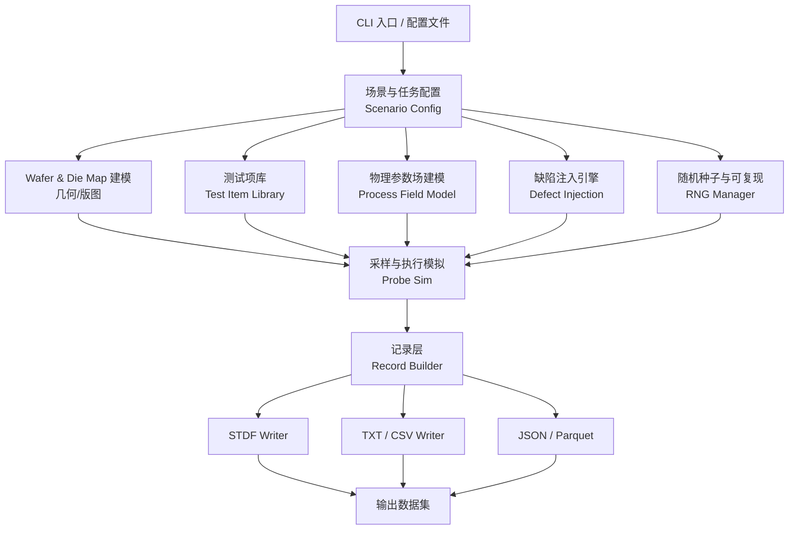

# SiliconDraft 需求规格说明书

| 项目 | 内容 |
| --- | --- |
| 项目名称 | SiliconDraft — 半导体测试数据生成工具 |
| 文档版本 | v0.1（需求草案） |
| 文档状态 | 待评审 |
| 编写日期 | 2026-10-14 |
| 目标读者 | 良率管理系统（YMS）开发/测试团队、SiliconDraft 开发团队 |

---

## 1. 文档目的与范围

本文档将 SiliconDraft 的口述需求整理为可设计、可编码、可验收的结构化需求描述。

**本文档定义：**

- SiliconDraft 需要做什么（功能需求 FR）
- 生成数据需要满足什么质量标准（数据质量需求 DQ）
- 如何判断需求被满足（验收标准 AC）

**本文档暂不定义（需后续补充）：**

- 具体技术栈与语言选型（见 §14 建议）
- GUI/前端形态（当前按 CLI + 配置文件优先设计）
- 与客户实际量产数据分布的拟合精度
- 与 ATE 厂商设备联动的仿真（Tester 通信、Handler 行程仿真）

---

## 2. 项目背景与目标

### 2.1 背景

良率管理系统（Yield Management System, YMS）需要真实且结构化的测试数据才能验证其核心分析能力：

- **空间相关性分析**：die 间、wafer 间、lot 间的参数与良率相关性
- **缺陷特征识别**：中心/边缘异常、扇区失效、簇群缺陷、划痕
- **参数-良率关联分析**：哪些测试项是良率的主要驱动因子（KPI 归因）
- **趋势与预警分析**：批间漂移、机台/轨道偏移的横向对比

当前痛点：

| 痛点 | 说明 |
| --- | --- |
| 真实数据不可得 | 量产数据涉及商业机密，无法用于开发测试 |
| 随机数据无结构 | 简单随机数生成的数据无法触发相关性分析，等于无效数据 |
| 缺陷不可控 | 真实数据中的缺陷无法定向复现，难以验证检测算法灵敏度 |
| 格式门槛高 | STDF 等格式手写复杂，多份测试数据格式不统一 |

### 2.2 项目目标

**G-1**：用户仅配置晶圆尺寸等基础信息，即可在一次运行中批量生成结构完整、分布可信的 CP/WAT 测试数据集。

**G-2**：生成的数据必须具备**真实的物理关联性**（WAT 与 CP 测试项之间、die 之间、wafer 之间），能够使 YMS 的相关性分析算法产出显著且符合预期的结果。

**G-3**：可定向注入已知缺陷特征（中心/边缘偏高偏低等），且缺陷在空间分布与参数影响上均可被 YMS 检出与量化。

**G-4**：支持导出为 STDF、TXT 等标准测试数据格式，可直接被主流 Yield Viewer / YMS 工具加载。

**G-5**：生成过程完全可复现（相同随机种子 + 相同配置 → 完全相同的数据集），便于回归测试。

### 2.3 非目标（Out of Scope）

- 不做 ATE 设备的物理仿真（探针接触、针尖磨损、测试时间物理约束）
- 不做电路功能验证（DFT/ATPG 覆盖率仿真）
- 不做量产数据分析本身（只负责产出数据，分析交给 YMS）
- V1 不做图形界面（以 CLI + 声明式配置文件为主）

---

## 3. 术语表

| 术语 | 含义 |
| --- | --- |
| **CP** (Chip Probing / Final Test) | 芯片级测试（探针台测试 / 终测），针对单颗 die |
| **WAT** (Wafer Acceptance Test) | 晶圆级测试，测试 scribe line 上的工艺监控结构（T/S/M structures） |
| **Scribe** | 划片道，芯片之间的切割通道，内嵌工艺监控器件 |
| **Die** | 芯片粒，取自 reticle 上的重复单元 |
| **Reticle / Shot** | 光掩模版 / 曝光单元 |
| **TIR** (Test Insertion Rate) | 测试插入率 |
| **TIL** (Test Information Log) | 测试信息日志 |
| **DUT** (Device Under Test) | 被测器件 |
| **Site** | 测试机的一个测试通道位，同一 DUT 可并行测试多 site |
| **Bin** | 良率分档（Pass/Fail 分档编号） |
| **Limit** | 测试限值（LSL / USL / SL 上下限），与目标值 Target 相对 |
| **STDF** (Standard Test Data Format) | SEMI 标准测试数据格式（E10 规范） |
| **PTR** | Parametric Test Record，STDF 中的参数测试结果记录类型 |
| **GDR** | General Data Record，通用数据记录（如 WAT 汇总） |
| **MRR** | Masking Record / Multiple Result Record，含 Retest 信息 |
| **DIE** (Data Information Exchange / 摘要记录) | 测试汇总信息 |
| **Floor Plan** | 芯片在 wafer 上的排布规则（Full / Partial / Circle / SAW） |
| **Notch / Flat** | 晶圆定位缺口 / 平边 |
| **空间场 (Spatial Field)** | 参数在 wafer 平面上的连续分布函数 |
| **良率 (Yield)** | Pass die 数 / 总测试 die 数 |
| **D0 / DWL** | 缺陷密度参数（单位面积缺陷数） |

---

## 4. 用户与使用场景

### 4.1 目标用户

| 角色 | 诉求 |
| --- | --- |
| **YMS 测试工程师** | 生成一批标准数据集，回归验证 YMS 分析模块（含历史版本对比） |
| **良率工程师（Yield Engineer）** | 生成指定缺陷场景的数据，验证缺陷检测与归因算法的灵敏度 |
| **YMS 演示/售前** | 生成"看起来像真数据"的演示数据集 |
| **工具链开发** | 需要可复现、可脚本化、可批量运行的数据生成器 |

### 4.2 典型使用场景

**US-1：基础回归数据集**
用户配置：8 英寸晶圆，1 个 lot，25 wafer，CP 30 个测试项，WAT 15 个测试项。
输出：25 个 wafer 的 STDF 文件 + 汇总 TXT/Yield 文件，可直接导入 YMS。

**US-2：缺陷检出能力验证**
用户配置：注入「中心 Vth 偏高 15mV，覆盖中心 R=60mm」缺陷。
预期：YMS 的空间分布分析模块应识别出中心异常区域并给出半径估计。

**US-3：跨 wafer 相关性验证**
用户配置：生成 wafer 间 Vth 均值呈线性漂移 + 无相关性两种对照组。
预期：YMS 的 wafer 间相关性模块在 A 组报出高相关，在 B 组报出无相关。

**US-4：批量压力测试**
用户配置：生成 100 lot × 25 wafer 的数据集，验证 YMS 大数据量处理性能与聚合正确性。

---

## 5. 系统总体架构

### 5.1 模块划分



### 5.2 数据生成流水线（核心流程）


---

## 6. 功能需求

### 6.1 晶圆与测试对象建模

#### FR-1 晶圆规格配置

用户必须可配置以下晶圆几何参数：

| 参数 | 说明 | 取值范围 |
| --- | --- | --- |
| `wafer_diameter_mm` | 晶圆直径 | 100 / 150 / 200 / 300（英寸：2/4/6/8/12） |
| `wafer_thickness_um` | 晶圆厚度 | 正数，默认 525/775/1425 |
| `edge_exclusion_mm` | 边缘排除宽度 | 0–10，默认 3 |
| `notch_direction_deg` | 缺口方向角 | 0–360，默认 270 |
| `flat_direction_deg` | 平边方向角 | 0–360 |
| `scribe_width_um` | 划片道宽度 | 正数 |
| `wafer_pitch_mm` | 掰边距离（Notch → 平边距离） | 正数 |

#### FR-2 Die Map 生成

**FR-2.1**：支持 4 种 wafer floor plan，每种均以 die 原点坐标列表输出：

| Floor Plan | 说明 | 适用 |
| --- | --- | --- |
| `full` | 整片矩形 die 网格 | 长方形 die |
| `partial` | 最外圈 die 边缘缺失（cut-off die），标记为 `PARTIAL` | 所有工艺 |
| `circle` | 仅完整包含在晶圆圆内的 die | 圆形 die |
| `saw` | SAWING 半圆刀痕，末行半 die | SAW 工艺 |

**FR-2.2**：每个 die 记录字段：
`lot_id, wafer_id, wafer_slot, die_x_mm, die_y_mm, die_id, die_type(FULL/PARTIAL/EDGE/PROBE_FAIL), reticle_id, reticle_x, reticle_y, die_state(TESTED/SKIPPED/RETESTED)`。

**FR-2.3**：支持 `edge_exclusion` 内的 die 标记为 `EXCLUDED` 且不参与测试（可在配置中关闭该行为）。

**FR-2.4**：提供 die map 可视化导出（PNG/SVG），用于人工核对空间布局正确性。

#### FR-3 WAT 结构布局

**FR-3.1**：在 scribe line 上沿环形路径生成 WAT 测试结构位置，每个结构包含：

| 字段 | 说明 |
| --- | --- |
| `wat_structure_id` | 结构编号 |
| `structure_type` | `T`(transistor) / `S`(spreading resistance) / `M`(metal/contact) / `C`(capacitor) / `R`(resistor) / `D`(diode) |
| `x_mm, y_mm, radius_mm` | 位置与距晶圆中心距离 |
| `scribe_line_id` | 所属划片道编号（径向 / 环形 / 局部） |
| `lot_id, wafer_id` | 归属 |

**FR-3.2**：默认布局为**多半径同心环**（如 R = 10 / 25 / 40 / 55 / 70 / 85 mm），每环放置固定数量结构，保证中心与边缘均有足够采样点以支撑缺陷检出。

**FR-3.3**：同一结构类型在多环上重复出现（multi-site / 同结构多位置测量），用于建立径向相关性。

#### FR-4 测试程序（Test Program）定义

**FR-4.1**：每个测试程序由**测试项列表**组成，每个测试项包含：

| 字段 | 说明 | 必填 |
| --- | --- | --- |
| `test_name` | 测试项名称，如 `IDSAT_N1` | 是 |
| `alias` | 物理别名/量纲说明 | 否 |
| `test_type` | `WAT` / `CP` / `SPICE`（派生） | 是 |
| `site` | 测试通道位 | 否 |
| `unit` | 单位（mV、uA、nS、pF、ns…） | 是 |
| `target` | 目标值（中心值） | 是 |
| `LSL, USL` | 规格上下限 | 是（至少一个） |
| `LSL_Warn, USL_Warn` | 预警限（可选，用于产生 warning bin） | 否 |
| `sigma` | 目标标准差（相对 target） | 是 |
| `corr_group` | 相关性分组标识（同组测试项共享同一随机因子） | 否 |
| `enabled` | 是否启用 | 否 |

**FR-4.2**：内置测试项模板库（默认配置），用户可直接使用或修改：

**WAT 类（工艺监控）**

| 测试项 | 物理含义 | 单位 | 典型场景 |
| --- | --- | --- | --- |
| `VT_NCH_N1` | NMOS 驱动晶体管阈值电压 | mV | 监控光刻/CD、栅氧 |
| `VT_NCH_N2` | 应力 NMOS 阈值电压（TDDB 相关） | mV | 监控栅氧退化 |
| `IDSAT_N1` | NMOS 饱和电流 | uA | 监控剂量/沟道迁移率 |
| `ION_N1` | NMOS 线性区电流 | uA | 监控有效长度 |
| `IOFF_N1` | NMOS 关态漏电 | nA | 监控栅氧/结漏电 |
| `ROFF_N1` | 接触电阻（含 Pt silicide） | ohm | 监控硅化/接触工艺 |
| `RSP_NMOD` | N+ 扩散体方块电阻 | ohm/sq | 监控激活/掺杂 |
| `RSP_PMOD` | P+ 扩散体方块电阻 | ohm/sq | 同上 |
| `RSP_POLY` | 多晶硅方块电阻 | ohm/sq | 监控多晶沉积 |
| `RUP_M1` | 第一层金属线电阻 | ohm/sq | 监控金属沉积/刻蚀 |
| `RUP_M2 / M3 / M4...` | 各层金属线电阻 | ohm/sq | 监控通孔与金属 |
| `CAP_ACOV` | 栅氧电容（单位面积） | fF/um² | 监控 Tox |
| `TBD_VBD` | 漏-体结击穿电压 | V | 监控漏区边缘套刻 |
| `LEAKAGE_JUNC` | 体-结反向漏电 | nA | 监控结质量 |
| `VBIN_DIODE` | 二极管正向压降 | V | 监控掺杂浓度 |
| `TNOM` | 迁移率归一化指标 | — | 派生 |

**CP 类（芯片级）**

| 测试项 | 物理含义 | 单位 | 与 WAT 的联动源 |
| --- | --- | --- | --- |
| `VT_NCH_N1 / VT_PCH_N1` | 器件阈值电压 | mV | `VT_NCH_N1`(WAT)、`RSP_NMOD` |
| `IDSAT_NCH / IDSAT_PCH` | 饱和电流 | uA | `IDSAT_N1`、`VT` |
| `ION_NCH` | 线性电流 | uA | `ION_N1`、`VT` |
| `IOFF_NCH / IOFF_PCH` | 关态漏电 | nA | `IOFF_N1`、`TBD_VBD` |
| `RDS_ON_NCH / PCH` | 导通电阻 | kΩ | `ROFF_N1`、`RUP_M1`、`IDSAT` |
| `DIBL` | 漏诱导势垒降低 | mV | `TBD_VBD`、`VT`、`Lpoly` |
| `SUBTHR_SLOPE` | 亚阈值摆幅 | mV/dec | `TBD_VBD`、`IOFF` |
| `GM_NCH` | 跨导 | mS | `IDSAT`、`VT` |
| `BV_DRAIN` | 漏-体击穿电压 | V | `TBD_VBD`、`RSP_NMOD` |
| `FREQ_MAX` | 最大工作频率 | MHz | 派生自 `IDSAT`+`CAP` |
| `LEAKAGE_TOTAL` | 总漏电 | nA | 各 `IOFF` 求和 |
| `RUP_M1_CP` | 芯片内金属电阻 | ohm/sq | `RUP_M1`(WAT) |
| `CP_RCONT` | 接触电阻（CP 结构） | ohm | `ROFF_N1`(WAT) |
| `STATIC_NOISE` | 热噪声电压密度 | nV/rtHz | 派生自 `GM` |
| `MISMATCH_CV` | 失配电压（Pelgrom） | mV | 局部工艺梯度 |
| `EM_RHO` | 电流密度（EM 评估） | A/cm² | 派生 |

**FR-4.3**：支持用户自定义测试项（同一套 Schema 即可扩展到 BCD / CIS / DRAM / NOR 等工艺）。

#### FR-5 批量任务与目录输出

**FR-5.1**：支持以下任务类型：

| 任务 | 说明 |
| --- | --- |
| `cp` | 仅生成 CP 数据 |
| `wat` | 仅生成 WAT 数据 |
| `cp+wat`（默认） | 同一 wafer 同时生成 CP 与 WAT（推荐，联动性最强） |

**FR-5.2**：输出目录结构约定：

```
<output_root>/
  lot_<LOTID>/
    wafer_<SLOT>/
      cp_<LOTID>_<SLOT>.stdf
      wat_<LOTID>_<SLOT>.stdf
      cp_summary_<LOTID>_<SLOT>.txt     # 含 die 级明细 CSV
      die_map_<LOTID>_<SLOT>.csv
      wafer_map_<LOTID>_<SLOT>.png
    lot_summary.csv                     # lot 级良率汇总
    lot_meta.json                       # 配置快照 + 随机种子
  manifest.json                         # 数据集总清单与统计
```

---

### 6.2 物理参数场生成引擎（核心）

这是保证数据"有意义"的关键模块。**禁止直接对测试项值加随机噪声**，必须先生成底层工艺物理量，再由物理量推导测试项。

#### FR-6 底层工艺物理量模型

**FR-6.1**：每 wafer 必须生成一组底层物理量场（每物理量在 wafer 平面上是一个连续曲面）：

| 物理量 | 符号 | 单位 | 影响的下游测试项 |
| --- | --- | --- | --- |
| 有效栅氧厚度 | `tox` | nm | `CAP_ACOV`, `VT`, `IOFF`, `TBD` |
| 沟道有效长度 | `leff` | nm | `IDSAT`, `ION`, `DIBL`, `VT` |
| 沟道宽度 | `weff` | nm | `IDSAT`, `IOFF`, `GM` |
| 源漏剂量 | `dose_n/p` | cm⁻² | `RSP_*MOD`, `IDSAT`, `VT` |
| 激活掺杂浓度 | `dop_n/p` | cm⁻³ | `RSP`, `IOFF`, `VT` |
| 栅多晶长度 | `lpoly` | nm | `VT`, `RSP_POLY` |
| 套刻误差 | `overlay_ns/p` | nm | `DIBL`, `TBD_VBD`, `IOFF` |
| 接触电阻 | `rc` | ohm | `ROFF`, `RDS_ON`, `CP_RCONT` |
| 金属线电阻 | `rmetal_lN` | ohm/sq | `RUP_M*`, `RDS_ON`, `EM_RHO` |
| 界面态密度 | `nit` | cm⁻²eV⁻¹ | `SUBTHR_SLOPE`, `FPN`, `VT` |
| 迁移率因子 | `mob_factor` | — | `IDSAT`, `GM`, `RON` |
| 局部工艺梯度 | `grad_mag` | nm/mm | `MISMATCH_CV`, 边缘异常 |

**FR-6.2 空间场模型**：每个物理量在 wafer 平面上的分布由以下成分线性叠加（默认权重可配置）：

```
P(x, y) = μ_P                                  # 全局均值偏移（lot/wafer 级）
        + α · (r / R)^n                         # 径向趋势（n=1 线性 / n=2 中心对称）
        + β · g_θ                               # 扇区/方位角成分（θ=atan2(y,x)）
        + γ · L(x, y)                          # 平滑随机场（Perlin/Simplex 或低阶傅里叶）
        + ε                                    # 微观随机项（die 级高斯噪声）
```

| 成分 | 物理含义 | 默认参数 |
| --- | --- | --- |
| `μ` | 全局偏移：批次/机台级漂移 | lot 级 N(0, drift_sigma) |
| `α, n` | 径向趋势：刻蚀均匀性、旋涂边缘效应 | α 由 wafer 抽取 |
| `β, g_θ` | 扇区成分：旋涂/喷淋的方位角不均 | β 小，默认 0.1 |
| `γ, L` | 空间平滑随机场：颗粒/工艺微区 | γ 略大于 die 噪声 |
| `ε` | die 级微观噪声：随机测量误差 | σ = 目标 sigma 的一部分 |

**FR-6.3**：成分振幅按 wafer 抽取（wafer 间变化），而场形在单 wafer 内保持自洽 —— 这是制造 wafer 间相关性能被检出的前提。

**FR-6.4**：必须提供"关闭平滑场、仅保留 die 级独立噪声"的开关，用于生成对照组（验证 YMS 是否会误报相关）。

#### FR-7 物理参数 → 测试项的推导模型

**FR-7.1**：测试项值必须由底层物理量按物理公式计算，示例：

```
VT_n       = VT0 + K_tox·(tox - tox_nom) + K_dose·ln(dose_n/dose_nom)
              + K_ovl·overlay_ns - K_grad·grad_mag

IDSAT_n    = (W/L_eff) · µ_eff · C_ox · (VG - VT)/2 · mob_factor
              · FF(overlay, weff)

DIBL       = K_ovl2·overlay_ns / L_eff + K_grad2·grad_mag

RDS_ON     = (rsh·leff + rc·2)/(weff·ox) + rmetal_lN·rpath

IOFF_n     = I_leak·exp(−Vsd/…)·tox_factor·dop_factor + tbd_factor·overlay_ns

RSP_NMOD   = 1 / (q·µ·dose_n)

RUP_M1     = rho_M1·thickness_M1 / width_M1

CAP_ACOV   = ε_ox / tox

SUBTHR_S   = kT·ln10 / (q·√(2·φ_F·nit·ε_ox·ε_0/t))

MISMATCH_CV = K_φ·grad_mag·leff/√Area
```

**FR-7.2**：每个公式的系数 K 必须可通过配置文件覆盖（用于"不同工艺配方"场景）。

**FR-7.3**：支持在测试项层面追加 `derived_from` 声明，表达派生链：`IDSAT_CP ← [IDSAT_WAT, VT_CP, weff, mob_factor]`。该声明同时用于导出为元数据，标注每个 CP 项的数据来源，便于 YMS 侧做溯源。

**FR-7.4**：每组 `corr_group` 内的测试项共享同一份相关噪声实现（同一 latent 因子），使相关性在统计上显著。

---

### 6.3 CP ↔ WAT 联动性设计（重点需求）

> 这是本项目区别于"随机数生成器"的核心。YMS 的相关性分析要有意义，必须让 WAT 与 CP 之间存在**可被统计检出的关联**。

#### FR-8 联动层级

| 层级 | 联动方式 | YMS 可分析出的结论 |
| --- | --- | --- |
| **L1 参数级** | WAT 项的 wafer/位置均值与 CP 项均值直接相关（如 CP 的 `VT` 均值 ≈ WAT 的 `VT` 均值 + 偏置） | 参数-参数相关性矩阵、回归关系 |
| **L2 空间级** | 同一 wafer 内，CP die 与邻近 WAT 结构共享同一物理场；CP die 的值与**径向距离**相关 | Die 与 WAT 点空间相关性、径向趋势拟合 |
| **L3 良率级** | WAT 参数偏移 → CP Limit 判定恶化 → 特定空间区域的 yield 塌陷 | WAT 早期预警、良率归因分析 |
| **L4 截面级** | 部分 wafer 存在明显的"边缘死区"，WAT `RSP` 边缘值异常高 → 对应 CP 边缘 ring 内 bin 恶化 | 边缘 vs 中心良率对比 |
| **L5 批间级** | 同一 lot 内 wafer 间存在机台/槽位相关偏移，WAT 与 CP 同向 | Wafer 间 / 槽位间相关性分析 |
| **L6 批间漂移** | 不同 lot 之间存在时间趋势（litho 漂移、维护后恢复等） | 批间趋势图、漂移告警 |

#### FR-9 联动性的强制约束

**FR-9.1**：同一 wafer 内，CP die 与同一径向位置的 WAT 结构，其**底层物理场值必须一致**（同一场函数求值，不允许独立抽样）。

**FR-9.2**：WAT 结构与 CP die 的映射规则必须可配置：

| 映射模式 | 说明 |
| --- | --- |
| `radial_bin` | 按径向距离分箱（默认 8 箱），box 内取该箱 WAT 均值 |
| `nearest` | 取空间距离最近的 WAT 结构 |
| `kriging` | IDW 反距离加权插值（权重可配） |
| `global` | 全 wafer WAT 均值（最弱联动，用于对照） |

**FR-9.3**：必须提供 `correlation_strength` 参数（0–1）：
- `0` → 完全独立（WAT 视为不提供信息）
- `1` → 完全由 WAT 场决定（CP 值 = f(WAT 场) + 极小噪声）
- 中间值 → 按强度混合，便于生成"弱/中/强关联"多档数据集，测试 YMS 检出灵敏度

**FR-9.4**：同一配置下，默认 `correlation_strength ≥ 0.6`，保证 YMS 能检出显著相关。

**FR-9.5**：必须内置 `CP_WAT_CORRELATION_MAP` 元数据表（可导出为 JSON/CSV），明确声明"哪个 CP 项受哪个 WAT 项影响、影响方向、预期相关系数区间"。该表即 YMS 相关性分析的 ground truth。

#### FR-10 可配置的相关性矩阵（相关性预设）

**FR-10.1**：提供若干预设数据集配方（Preset），一键生成典型场景：

| Preset ID | 名称 | 描述 | 预期 YMS 输出 |
| --- | --- | --- | --- |
| `P-BASE` | 基准健康数据 | 无缺陷，工艺参数受控，良率 98%+ | 低相关性、无缺陷告警 |
| `P-CENTER-HIGH` | 中心 Vth 偏高 | 中心 R<60mm Vth +15mV | 中心异常 + 中心 yield 轻微下降 |
| `P-CENTER-LOW` | 中心 Vth 偏低 | 中心 Vth −15mV | 中心异常 + 高 Vt 相关 bin 上升 |
| `P-EDGE-HIGH` | 边缘偏高（Radial） | r>0.8R 区域 Vth +20mV | 边缘环形 yield 塌陷 |
| `P-EDGE-LOW` | 边缘电阻偏高 | 边缘 `ROFF`/`RUP_M1` +30% | 边缘 RDS_ON bin 恶化 |
| `P-RING` | 环形失效 | R=70mm 环带参数严重异常 | 特定 ring yield=0，检验空间聚类能力 |
| `P-SECTOR` | 扇区失效 | 30°–90° 扇区整段失效 | 扇区级 yield 塌陷 |
| `P-SCRATCH` | 划痕 | 贯穿 wafer 的直线/曲线划痕 | 线状 yield 塌陷，检验轮廓分析 |
| `P-CLUSTER` | 簇群缺陷 | 5–10 处随机簇群（Poisson 盘） | 簇群缺陷检出与计数 |
| `P-PARTICLE` | 颗粒污染 | 随机颗粒导致的孤立失效 die | 随机缺陷率上升，空间随机性 |
| `P-GRADIENT` | 单向工艺梯度 | 沿 +X 方向单调漂移 | 线性梯度拟合，R² > 0.9 |
| `P-BOW` | Wafer 翘曲/翘曲弯曲 | 弯曲应力导致环状/条状分布 | 复杂空间分布 |
| `P-DRIFT` | 批间漂移 | 10 lot 线性漂移 + 一次维护后阶跃恢复 | 批间趋势 + 阶跃点检测 |
| `P-TOOL-CLUSTER` | 机台簇群 | 同机台 wafer 参数整体偏移 | 机台/轨道间相关性 |
| `P-MULTI-DEFECT` | 复合缺陷 | 边缘 + 簇群 + 随机同时存在 | 综合能力验证 |
| `P-WEAK-CORR` | 弱相关对照 | `correlation_strength = 0.15` | 相关性分析应报"无显著相关"（负向验证） |
| `P-NO-CORR` | 无关对照 | `correlation_strength = 0` | 矩阵全随机，验证不误报 |
| `P-FLOOR` | 极端良率 | 良率跌至 40–60% | 低良率数据处理鲁棒性 |

---

### 6.4 缺陷特征注入引擎

#### FR-11 缺陷分类体系

**FR-11.1 几何型缺陷（空间形貌类）**

| 缺陷 ID | 名称 | 几何定义 | 默认参数 | 主要影响对象 |
| --- | --- | --- | --- | --- |
| `D-CENTER-HIGH` | 中心偏高 | 圆形：`r < R_center` | `R=60mm, Δ=+15mV` | `VT`, `IOFF` |
| `D-CENTER-LOW` | 中心偏低 | 圆形：`r < R_center` | `R=60mm, Δ=−15mV` | `VT`, `IDSAT` |
| `D-EDGE-HIGH` | 边缘偏高 | 圆环：`r > R_edge` | `R=0.8R, Δ=+20mV` | `VT`, `IOFF` |
| `D-EDGE-LOW` | 边缘偏低 | 圆环：`r > R_edge` | `R=0.8R, Δ=−20mV` | `IDSAT`, `RDS_ON` |
| `D-RING` | 环带异常 | 圆环：`R_ring ± W/2` | `R=70mm, W=8mm, Δ=3×` | `RSP`, `ROFF` |
| `D-SECTOR` | 扇区异常 | 角度区间 `[θ1, θ2]`，可含全半径或限定半径 | `θ∈[30°,90°]` | 全部 |
| `D-HALF` | 半片异常 | 平面半区 | `x > 0` | 全部 |
| `D-SCRATCH` | 划痕 | 直线/圆弧/贝塞尔，宽度 W | `W=0.3mm, 失效=100%` | 全部（沿路径） |
| `D-CLUSTER` | 簇群 | Poisson 盘随机圆斑 | `n=8, R=5–15mm` | 全部 |
| `D-PARTICLE` | 随机颗粒 | 完全随机孤立点 | `rate=1.5% die` | 随机 bin |
| `D-STREAK` | 扫描条纹 | 平行/同心条纹 | `pitch=8mm` | `RUP_M*` |
| `D-BUMP` | 局部鼓包 | 高斯凸起场 | `σ=20mm` | `tox`, `CAP` |

**FR-11.2 参数型缺陷（无空间形貌，影响全片或多片）**

| 缺陷 ID | 名称 | 影响 | 说明 |
| --- | --- | --- | --- |
| `D-GLOBAL-SHIFT` | 全局偏移 | 指定物理量整体均值偏移 | 模拟系统性工艺漂移 |
| `D-WAFER-OFFSET` | 单片偏移 | 指定 wafer 参数整体偏移 | 模拟单片异常 |
| `D-LOT-OFFSET` | 单批偏移 | 指定 lot 参数整体偏移 | 模拟批次问题 |
| `D-SIGMA-INFLATE` | 方差放大 | 指定 wafer 噪声放大 | 模拟工艺失控 |
| `D-LIMIT-TIGHTEN` | 限值收紧 | 收紧测试限值或目标值偏移 | 模拟规格变更/误设 |
| `D-BIN-SHIFT` | 分档偏移 | 修改 Bin 边界 | 模拟测试程序版本差异 |

#### FR-12 缺陷-参数影响映射表

**FR-12.1**：每个缺陷必须可配置它影响的物理量及影响强度：

```yaml
defects:
  - id: D-CENTER-HIGH
    type: geometric
    shape: circle
    geometry: { radius_mm: 60 }
    apply_zone_only: true          # 仅在区域内生效，区域边界用 smoothstep 过渡
    transition_mm: 8                # 平滑过渡宽度，避免物理上不可能的硬跳变
    effects:
      - quantity: vt_n
        delta: +15
        unit: mV
      - quantity: ioff_n
        multiplier: 1.6
      - quantity: ioff_p
        multiplier: 1.5
      - quantity: yield_bias      # 可选：直接给出区域内良率目标
        delta: -0.03
```

**FR-12.2**：区域边界必须使用平滑过渡（`smoothstep` / 高斯核），不得出现数学上的阶跃 —— 否则会生成物理上不可信的数据。

**FR-12.3**：多个缺陷同时存在时，参数影响按**可乘叠加**（multiplier 相乘、delta 相加）合成，且必须在元数据中记录每个 die 命中的缺陷列表（`die_defect_hits.csv`），供 YMS 做归因验证。

#### FR-13 缺陷对良率的影响路径

**FR-13.1**：缺陷不得直接设置"该 die 为 Fail"，必须通过以下路径产生良率影响：

```
缺陷 → 物理量偏移 → 测试项值偏移 → 与 LSL/USL 比较 → Fail → Bin 分配 → 良率变化
```

**FR-13.2**：允许通过 `yield_bias` 做"极端场景强制干预"，但必须显式标记为 `forced` 并在元数据中单独记录，默认关闭。

---

### 6.5 测试执行模拟

#### FR-14 CP 测试执行

| 需求 | 说明 |
| --- | --- |
| **FR-14.1 良率模型** | 综合良率 = 基础良率(工艺/设计 limit) − 空间缺陷贡献 − 随机失效贡献。默认可设 `base_yield=0.98` |
| **FR-14.2 Fail 判定** | 任一必需测试项超出 LSL/USL → die Fail；记录**首要失败测试项**（`first_fail_test`）用于 Fail 模式分析 |
| **FR-14.3 Bin 分配** | 支持三种模式：`by_first_fail`（按首个失败项分组）/ `by_test`（按测试项分组）/ `custom_rule`（用户自定义规则） |
| **FR-14.4 硬失效 (Hard Fail)** | 分类为 `hard_fail` 的测试项（如 `BV_DRAIN < 0`、漏电超规格数个数量级）一旦失败直接进入 `bin 1`（Hard Fail Bin） |
| **FR-14.5 软失效 (Soft Fail)** | 分类为 `soft_fail` 的测试项失败进入功能 bin（如 `bin 10/11/12`） |
| **FR-14.6 参数性失效 (Parametric Fail)** | 不改变 Pass/Fail，仅越限并置 `param_limit_flag`，仍计为 Pass —— 用于验证 YMS 的"仅告警"分支 |
| **FR-14.7 抽样 (TIR)** | 支持 `random` / `sequential` / `pattern`（按 pattern 抽样）/ `full`，默认 `full`；未测 die 标记 `SKIPPED` |
| **FR-14.8 Retest** | 支持配置 retest 概率与 retest 次数上限；重测 die 记录 `retest_flag` 与原始结果（对应 STDF MRR） |
| **FR-14.9 测试时间** | 可基于 site 数与测试项数量生成 `test_time`，用于验证 YMS 的产能/工时分析 |
| **FR-14.10 Site 分配** | 支持 `multi-site`（多 DUT 同时测试），数据中体现为同一 `test_num` 的多组结果 |
| **FR-14.11 异常 die** | 支持按概率注入 `PROBE_FAIL`（针测接触失败）、`DROPPED`（未测/掉测）die，用于验证 YMS 的数据清洗能力 |

#### FR-15 WAT 测试执行

| 需求 | 说明 |
| --- | --- |
| **FR-15.1** | 每个 WAT 结构按其类型对应的测试项组进行参数测试 |
| **FR-15.2** | 支持 WAT 结构级 Pass/Fail 判定与 fail 标记（不直接决定 die 良率，但可通过 `wat_gate` 配置间接影响） |
| **FR-15.3** | 输出每个 WAT 结构的径向位置 `radius_mm`、所属 scribe 线、扇区角 `theta_deg`，供 YMS 直接做径向分析 |

#### FR-16 片内均匀性指标

为增强 YMS 分析维度，工具应在 WAT 结果中计算并输出以下**空间统计量**（作为 GDR 或导出列）：

- 径向均值曲线（按径向分箱）
- 方位角均值曲线（按扇区分箱）
- 环形（Ring）分布统计
- `sigma_within_wafer` / `sigma_between_wafer`
- 各测试项的 `Cp` / `Cpk` 过程能力指数
- Wafer 内 `n-sigma` 台阶指示（关键参数是否发生整体阶跃）

---

### 6.6 输出模块

#### FR-17 STDF 输出

**FR-17.1 记录类型**：必须支持以下 STDF 记录（Semi E10 标准）：

| 记录 | 名称 | 用途 |
| --- | --- | --- |
| `HDR` | 文件头 | 文件版本、创建时间、STDF 版本号 |
| `SMR` | Summary/Master Header | 产品/客户/作业/设备信息 |
| `PIR` | Part Information | Part 描述 |
| `HBR` | Hardware Configuration | 测试机/探针台配置 |
| `WIR` | Workload Information | 测试计划信息 |
| `PCR` | Pin Configuration | Pin Map |
| `PMR` | Pin Multiplexing | 多工位引脚复用 |
| `RDR` | Retest Data | 测试循环信息 |
| `MRR` | Masking Record | 多结果汇总（含 Retest） |
| `GDR` | General Data Record | WAT 结果 / 元数据 |
| `PTR` | Parametric Test Record | 参数测试结果（核心记录） |
| `HIL` | Hardware Instance | 硬件实例（可选） |

**FR-17.2 兼容性**：
- 目标 STDF 版本：**E10（可配置到 E5 以兼容老工具）**
- 数据类型：支持 `R4`（默认）/ `R8` / `U4` / `I2` / `I4`
- 字节序：`little_endian`（默认）
- 支持 `compressed records` 以减小文件体积

**FR-17.3 字段映射**：

| STDF 字段 | 来源 |
| --- | --- |
| `PTR.TEST_NUM` | 测试项序号 |
| `PTR.TEST_TYP` | `P` = Parametric |
| `PTR.SRES_FLG` / `PASS_FLG` | Pass/Fail 判定结果 |
| `PTR.TEST_VAL / TEST_LLM / TEST_HLM` | 测试值与低/高限值 |
| `PTR.TEST_TXT` | 测试项名称 |
| `PTR.CYCL_CNT` | 测试循环数（retest 时递增） |
| `PTR.RSLT_CNT` | 结果编号（对应 retest） |
| `PTR.XYRCNT + XY` | die 的 X/Y 坐标（用于 wafer map 重建）⚠️ 必须生成 |
| `GDR.TEST_TXT` | 记录名（如 `WAT_RING_STAT`） |
| `HDR` | 记录级页眉 |

**FR-17.4 可选记录**（通过配置开关）：
- `DIE` 记录（E10）：部分 YMS 工具需要，建议默认开启
- `CLR`：探针机接触电阻信息
- `CNR`：通道 pin 状态
- `PPS`：设备性能数据

**FR-17.5 校验**：
- 导出后必须内置 STDF 结构自检（记录链完整性、`HDR` 页计数、`D_LIN` 数量与实际记录数一致）
- 提供 `verify` 子命令，输入 STDF 输出解析统计，验证可读性

#### FR-18 TXT / CSV 输出

**FR-18.1 Die 级明细文件**（`.csv`，列可配置/裁剪）

```
LOT_ID, WAFER_SLOT, DIE_ID, DIE_X_MM, DIE_Y_MM, RADIUS_MM, THETA_DEG, DIE_STATE, BIN_NUM, HARD_BIN, FUNC_BIN, FIRST_FAIL_TEST, IS_EDGE, IS_RETEST, RETEST_COUNT, TEST_NUM, TEST_NAME, TEST_VAL, LSL, USL, RESULT, PARAMETRIC_FLAG, TEST_TIME_MS
```

**FR-18.2 宽表（Wide Format）** —— YMS 导入最常用形式，每个 die 一行，列为各测试项的值：

```csv
LOT_ID,WAFER_SLOT,DIE_ID,DIE_X,DIE_Y,RADIUS_MM,BIN,HARD_BIN,FUNC_BIN,
VT_NCH_N1,IDSAT_NCH,IOFF_NCH,RDS_ON_NCH,DIBL,SUBTHR_SLOPE,...,VT_NCH_N1_RESULT,...
```

必须同时提供：
- `wide_value.csv`（仅数值，NaN 表示未测）
- `wide_flag.csv`（0/1 或 Pass/Fail 标记）
- `wafer_summary.csv`（每 wafer 一行：总测数、Pass 数、各 bin 数、良率、关键参数均值/sigma/max/min）
- `lot_summary.csv`（每 lot 一行：wafer 数、总 die 数、总良率、参数 sigma）

**FR-18.3 定制的 YMS 友好 TXT 格式**：
- 大量国产/自研 YMS 与 Yield Viewer 使用自定义 TXT，需提供 `template` 机制：用户可配置列名、列顺序、分隔符（`\t` / `,` / `space`）、表头格式
- 提供至少 2 个内置模板：`default_tab`、`meritus_like`、`custom_csv`

#### FR-19 其他导出格式

| 格式 | 用途 | 优先级 |
| --- | --- | --- |
| `json` | 单次运行的完整结构化数据（便于调试与二次开发） | P0 |
| `parquet` | 大规模数据的高效分析格式 | P1 |
| `wafer_map png/svg` | die map 与 bin map 可视化 | P0 |
| `html_report` | 数据集自检报告（含分布直方图、径向曲线、map 图） | P1 |
| `stdf.tdr` | TDR 定义文件（若使用 SEMI 标准库） | P2 |

#### FR-20 元数据与可追溯性

**FR-20.1**：每次生成必须输出 `metadata.json`，包含：

| 字段 | 说明 |
| --- | --- |
| `silicondraft_version` | 生成器版本号 |
| `timestamp_utc` | 生成时间（ISO 8601） |
| `config_full` | 完整配置的深拷贝 |
| `config_hash` | 配置哈希（SHA-256），用于判断两次生成是否同源 |
| `random_seed` | 主随机种子 |
| `derived_seeds` | 各模块派生的子种子（保证并行/分片可复现） |
| `test_items` | 完整测试项清单（含 limit、unit、type、derived_from） |
| `cp_wat_correlation_map` | CP↔WAT 关联 ground truth 表 |
| `defects_applied` | 注入的缺陷列表及参数 |
| `generated_die_defect_hits` | die 级缺陷命中记录数 |
| `statistics` | 生成数据的实际统计量（用于与目标值核对） |
| `tool_versions` | 依赖库版本（保证复现性） |

**FR-20.2**：根据 `metadata.json` 中的配置，**能够精确复现**完全相同的数据集。

---

### 6.7 配置体系与可复现性

#### FR-21 配置文件

**FR-21.1**：主配置使用 **YAML**（也支持 JSON），单文件即可完整描述一次生成任务。

**FR-21.2 配置文件结构**：

```yaml
# ============ 运行配置 ============
run:
  name: demo_center_high
  preset: P-CENTER-HIGH        # 可选：使用内置预设
  output_dir: ./out/demo
  seed: 20261014              # 主随机种子，null 则随机
  parallel_workers: 8

# ============ 生产计划 ============
production:
  lots:
    - lot_id: LOT_A01
      wafers: 25
      wafer_slots: [1,2,3,5,6,7,8,9,10,11,12,13,14,15,16,17,18,19,20,21,22,23,24,25,26]
      product: PROD_X           # 产品型号
      test_program: tp_prod_x   # 测试程序
      route: ROUTE_A            # 工艺路线
      fab: FAB1
      test_site: SITE_1
  wafer_slots: 1..25

# ============ 工艺 / 产品基础信息 ============
process:
  node: 28nm
  product: SOC_X
  device_family: CMOS
  design_tweaks:
    vt_offset_mv: 0
    target_base_yield: 0.985

# ============ 晶圆规格 ============
wafer:
  diameter_mm: 300
  thickness_um: 775
  edge_exclusion_mm: 3
  notch_direction_deg: 270
  flat_direction_deg: 0
  scribe_width_um: 60
  pitch_mm: 2.0              # 掰边距离
  die:
    width_mm: 8.0
    height_mm: 8.0
    floor_plan: partial      # full | partial | circle | saw
    exclude_edge_dies: true
  retention_zone_mm: 3.0    # 工艺监控保留环（生产监控 die）

# ============ 测试项定义 ============
test_items:
  - file: ./items/wat_items.yaml      # 支持引用外部文件
  - file: ./items/cp_items.yaml
  # 或内联定义，详见 §6.1 FR-4

# ============ WAT 布局 ============
wat:
  enabled: true
  rings_mm: [10, 25, 40, 55, 70, 85]
  structures_per_ring: 16
  types: [T_NMOS, T_PMOS, RS_NMOD, RS_PMOD, RS_POLY, RUP_M1, CAP_ACOV, BD_DRAIN, DIODE]

# ============ CP ↔ WAT 联动 ============
linkage:
  cp_wat:
    enabled: true
    strength: 0.8             # 0~1
    mapping: kriging          # radial_bin | nearest | kriging | global
    radial_bins: 8
    idw_power: 2
    enforce_correlation_groups: true

# ============ 缺陷注入 ============
defects:
  - id: D-CENTER-HIGH
    type: geometric
    shape: circle
    geometry: { radius_mm: 60 }
    transition_mm: 10
    effects:
      - { quantity: vt_n, delta: 15, unit: mV }
      - { quantity: ioff_n, multiplier: 1.6 }
  - id: D-CLUSTER
    type: geometric
    shape: poisson_cluster
    geometry: { clusters: 8, radius_min_mm: 5, radius_max_mm: 15 }
    effects:
      - { quantity: tox, multiplier: 1.8 }
      - { quantity: leakage, multiplier: 5 }

# ============ 测试执行 ============
execution:
  cp:
    enabled: true
    tir: 1.0
    tir_mode: full
    retest: { enabled: true, max_count: 2, probability: 0.35 }
    multi_site: 2
    probe_fail_rate: 0.002
    dropped_rate: 0.001
  wat:
    enabled: true
    retest: { enabled: false, max_count: 1 }

# ============ 输出 ============
output:
  formats: [stdf, csv, json, png]
  stdf:
    version: E10
    data_type: R4
    compression: true
    records: [HDR, SMR, PIR, HBR, WIR, PCR, RDR, MRR, GDR, PTR, DIE]
  csv:
    wide_format: true
    long_format: true
    template: default_tab
  png:
    bin_map: true
    die_map: true
    param_map: true      # 关键参数空间分布图
  html_report: true
```

**FR-21.3**：配置必须支持继承（YAML anchor / `extends` 字段）与多文件组合，便于大型项目维护。

#### FR-22 随机性与可复现

| 需求 | 说明 |
| --- | --- |
| **FR-22.1** | 所有随机数必须来自显式种子管理的 RNG 实例，禁止使用全局 `random`/`numpy.random` 隐式状态 |
| **FR-22.2** | 采用**分层种子**派生：`seed_root → {lot_seed, wafer_seed, cp_seed, wat_seed, defect_seed}`，分片并行时结果与串行一致 |
| **FR-22.3** | 相同 `seed` + 相同配置 + 相同工具版本 → 输出字节级一致（浮点需按固定精度舍入，保证跨平台一致） |
| **FR-22.4** | 提供 `reseed` 策略：`fixed` / `increment_by_lot` / `from_manifest` |
| **FR-22.5** | 数值输出统一舍入到配置的 `precision`（默认按测试项 `unit` 自适应：mV→3位，uA→4位，ohm/sq→4位） |

#### FR-23 CLI 接口

```bash
# 生成数据（使用配置文件）
silicondraft generate -c config.yaml

# 使用内置预设快速生成
silicondraft generate --preset P-CENTER-HIGH --lots 1 --wafers 25 -o ./out/

# 覆盖单个参数
silicondraft generate -c config.yaml --set defects[0].geometry.radius_mm=80

# 校验 STDF 输出
silicondraft verify --stdf out/lot_A01/wafer_01/cp_A01_01.stdf

# 预览 die map（不生成全量数据，快速验证配置）
silicondraft preview -c config.yaml --out preview.png

# 查看内置预设
silicondraft list-presets

# 生成测试项模板
silicondraft init-items --type wat -o items/wat_items.yaml

# 比较两次生成结果的差异（回归验证）
silicondraft diff --dir1 out_a --dir2 out_b

# 查看/校验配置
silicondraft validate -c config.yaml
```

---

## 8. 数据质量需求（DQ）

> 数据质量是本项目的**首要成功标准**。以下为硬性要求，需内置自动检查并在 HTML 报告中输出 PASS/FAIL。

| ID | 质量维度 | 检查项 | 判定标准 |
| --- | --- | --- | --- |
| **DQ-01** | 分布合理性 | 单参数分布形态 | 直方图接近正态/对数正态；无明显双峰（除故意注入） |
| **DQ-02** | 目标值达成 | 各测试项均值 | 与 `target` 偏差 ≤ 1%（可配置） |
| **DQ-03** | 目标 Sigma | 各测试项标准差 | 与配置 sigma 偏差 ≤ 10% |
| **DQ-04** | 良率准确 | 各 lot/wafer 良率 | 与 `target_base_yield` 偏差 ≤ 2% |
| **DQ-05** | 良率分布 | wafer 间良率分布 | 呈中心高边缘低的空间梯度，而非完全随机 |
| **DQ-06** | 空间自相关 | 相邻 die 参数差 vs 随机 die 参数差 | Moran's I > 0.3 |
| **DQ-07** | 径向可检出 | 注入径向缺陷后，径向拟合 R² | R² > 0.7 |
| **DQ-08** | CP↔WAT 联动 | 声明的关联项 Pearson 相关系数 | ≥ 0.6（`strength≥0.8` 时） |
| **DQ-09** | 无虚假相关 | 未声明关联的测试项相关系数绝对值 | < 0.2 |
| **DQ-10** | 缺陷可检出 | 缺陷区域与正常区域参数均值差 | > 3σ |
| **DQ-11** | 良率归因一致性 | 高参数漂移区域 vs Fail 区域空间重合度 | IoU > 0.6 |
| **DQ-12** | Limit 逻辑正确 | 所有 Fail die 至少有一个越限项 | 100% |
| **DQ-13** | Pass 逻辑正确 | 所有 Pass die 无越限项 | 100% |
| **DQ-14** | Wafer Map 正确 | die 坐标在晶圆圆内、编号唯一无缺失 | 100% |
| **DQ-15** | 记录完整性 | STDF 可被第三方解析器读取；记录数与 `D_LIN` 一致 | 100% |
| **DQ-16** | 可复现性 | 同 seed 两次生成的输出校验和 | 完全一致 |
| **DQ-17** | Bin 分布合理性 | Bin 分布符合预期（Hard Fail < 0.5%，功能 bin 集中） | 通过 |
| **DQ-18** | 无 NaN/Inf | 所有输出字段 | 0 个非法值 |
| **DQ-19** | 值-限值一致性 | TXT/CSV 中的 limit 与 STDF 中一致 | 100% |
| **DQ-20** | 坐标可重建 | 由 PTR 的 XY 重建的 wafer map 与 die_map.csv 一致 | 100% |

**DQ-21 过程能力要求**：
- 25 wafer × 25 lot 的数据集生成耗时 ≤ 60s（单机 8 核）
- 内存峰值 ≤ 4 GB（25 wafer/lot 规模）
- 支持 `--parallel`，并行度不影响输出结果

---

## 9. 非功能性需求

| ID | 类别 | 要求 |
| --- | --- | --- |
| NFR-01 | **确定性** | 所有随机过程受种子控制，输出完全可复现 |
| NFR-02 | **性能** | 见 DQ-21；字段级 NumPy 向量化计算，禁止逐 die 的 Python 循环 |
| NFR-03 | **可扩展性** | 新工艺/新产品只需新增 YAML 配置，无需改代码；测试项库与物理模型解耦 |
| NFR-04 | **可配置性** | 所有物理系数、限值、分布参数、几何参数均可配置 |
| NFR-05 | **可观测性** | 每次运行输出结构化日志与 HTML 自检报告 |
| NFR-06 | **离线可用** | 完全离线运行，无外部服务依赖（可选联网获取时间戳） |
| NFR-07 | **可移植性** | 支持 macOS / Linux / Windows x86_64 |
| NFR-08 | **可测试性** | 每个模块可独立单元测试；提供内置自检套件 |
| NFR-09 | **易用性** | 3 条命令内完成首次生成；错误信息给出可操作的修复建议 |
| NFR-10 | **可维护性** | 遵循清晰的模块边界；核心算法有公式推导注释 |
| NFR-11 | **数据安全** | 不产生任何真实企业数据；生成的 metadata 明确标注 `SYNTHETIC_TEST_DATA` |
| NFR-12 | **版本化** | 配置文件中记录工具版本；生成的数据随 `metadata.json` 可追溯 |

---

## 10. 验收标准（AC）

> 每条 AC 均可通过自动化测试验证。

### 10.1 功能验收

| AC | 描述 | 验证方法 |
| --- | --- | --- |
| **AC-01** | 仅通过配置 wafer 直径/die 尺寸/测试项，即可生成完整 CP+WAT 数据集 | 运行 `generate` 无报错，产出文件齐全 |
| **AC-02** | 支持 100/150/200/300mm 四种晶圆尺寸 | 四份配置分别生成成功，die map 合理 |
| **AC-03** | 支持 full/partial/circle/saw 四种 floor plan | 生成的 die map 图形正确 |
| **AC-04** | 支持 `cp` / `wat` / `cp+wat` 三种任务 | 输出文件构成符合预期 |
| **AC-05** | WAT 测试项 ≥ 15 种且含义明确 | 对照 §6.1 FR-4.2 清单 |
| **AC-06** | CP 测试项 ≥ 20 种且含义明确 | 同上 |
| **AC-07** | CP 与 WAT 的声明关联项相关系数 ≥ 0.6 | 计算 Pearson 相关系数 |
| **AC-08** | 未声明关联的测试项相关系数绝对值 < 0.2 | 计算相关系数矩阵 |
| **AC-09** | 支持中心偏高/偏低缺陷注入 | `P-CENTER-HIGH` / `P-CENTER-LOW` 预设可运行，DQ-10 通过 |
| **AC-10** | 支持边缘偏高/偏低缺陷注入 | 同上 |
| **AC-11** | 支持环形/扇区/簇群/划痕/随机缺陷 | 5 种 Preset 可运行且空间形态正确 |
| **AC-12** | 支持全局/wafer/lot 级参数偏移缺陷 | `D-*-OFFSET` 可用 |
| **AC-13** | 缺陷影响通过物理路径产生良率变化，非硬编码 | DQ-11、DQ-12、DQ-13 通过 |
| **AC-14** | 导出 STDF 且可被标准解析器读取 | 用 `pylibstdf` / 自研 `verify` 解析成功 |
| **AC-15** | STDF PTR 记录含 XY 坐标，可重建 wafer map | 由 STDF 重建 map 与 CSV 一致（DQ-20） |
| **AC-16** | 导出 TXT/CSV（宽表 + 长表 + 汇总表） | 文件存在且列完整 |
| **AC-17** | 导出 JSON 元数据，含配置、种子、关联表、缺陷列表 | JSON schema 校验通过 |
| **AC-18** | 支持至少 18 个内置预设 | `list-presets` 输出完整 |
| **AC-19** | 支持自定义预设（YAML）并可运行 | 自定义 Preset 生成成功 |
| **AC-20** | 相同 seed 两次生成输出一致 | DQ-16 校验和比对 |
| **AC-21** | 支持并行生成且结果与串行一致 | `-j 8` 与 `-j 1` 输出校验和相同 |
| **AC-22** | 提供 die map / bin map / 参数分布图 PNG | 图片文件存在且内容正确 |
| **AC-23** | 生成 HTML 自检报告，含 20 项 DQ 检查结果 | 报告存在且 DQ 项全部有结论 |
| **AC-24** | `verify` 命令可校验任意 STDF | 命令可用 |

### 10.2 性能验收

| AC | 描述 | 指标 |
| --- | --- | --- |
| **AC-25** | 生成 25 lot × 25 wafer（≈625 wafer、≈1.5 亿 die 记录） | ≤ 180 s（8 核） |
| **AC-26** | 生成 1 lot × 25 wafer | ≤ 10 s |
| **AC-27** | STDF 写入吞吐 | ≥ 20 万 PTR 记录/秒 |
| **AC-28** | 内存峰值（25 wafer/lot） | ≤ 4 GB |

### 10.3 易用性验收

| AC | 描述 |
| --- | --- |
| **AC-29** | 新用户从零到生成第一份数据 ≤ 3 条命令 |
| **AC-30** | 配置文件有完整的中文/英文注释模板 |
| **AC-31** | 所有错误信息附带修复建议 |
| **AC-32** | 提供 3 个端到端示例配置（健康/中心缺陷/批间漂移） |

---

## 11. 技术方案建议

### 11.1 架构分层

```
silicondraft/
├── cli/                 # 命令行入口
│   ├── generate.py
│   ├── validate.py
│   ├── verify.py
│   └── preview.py
├── config/              # 配置 Schema (pydantic) + 继承解析
├── geometry/            # 晶圆几何、die map、scribe、WAT 布局
│   ├── wafer.py
│   ├── die_map.py
│   └── wat_layout.py
├── physics/             # 物理模型层
│   ├── fields.py        # 空间场（径向/扇区/随机场/平滑）
│   ├── quantities.py    # 底层物理量
│   ├── models.py        # 物理量 → 测试项 公式
│   └── rng.py           # 分层随机数
├── items/               # 测试项库（内置 + 用户扩展）
├── execution/           # 执行模拟
│   ├── cp_exec.py
│   ├── wat_exec.py
│   └── binning.py
├── defects/             # 缺陷注入
│   ├── geometric.py
│   ├── parametric.py
│   └── effects.py
├── writers/             # 输出
│   ├── stdf_writer.py   # 自研（推荐，可控）或基于 Semi E10 库
│   ├── csv_writer.py
│   ├── json_writer.py
│   └── visualizer.py
├── quality/             # DQ 检查与 HTML 报告
├── presets/             # 内置预设 YAML
└── tests/
```

### 11.2 关键选型建议

| 领域 | 建议 | 理由 |
| --- | --- | --- |
| 语言 | **Python**（核心）+ 可选 Rust 加速 | 数据生成生态好；纯 Python 在亿级记录上可能吃力，建议先用 NumPy 向量化，必要时用 Numba 或 Cython 加速 |
| 数值计算 | NumPy（必需）、SciPy（分布/插值/IDW） | 向量化是性能关键 |
| 随机数 | NumPy `Generator` + `SeedSequence.spawn` | 原生支持分层种子派生，天然可并行可复现 |
| 空间场 | 自研（径向/扇区/FFT 随机场） | 完全可控，避免引入 GIS 依赖 |
| 配置 | pydantic v2 | 强类型校验 + 自动生成模板文档 |
| STDF | **建议自研 writer**（`struct.pack` + 记录级） | 完全控制字段与兼容性；可选 `pylibstdf` 做读回校验 |
| 数据校验 | 自研 DQ 模块 + `numpy.testing` | 与生成逻辑同源，便于维护 |
| 可视化 | matplotlib（离线出图） | 无需 GUI，支持 headless |
| HTML 报告 | Jinja2 模板 + 内联静态资源 | 单文件报告，便于分发 |
| 并行 | `multiprocessing` / `concurrent.futures.ProcessPoolExecutor` | 按 wafer/lot 分片，种子隔离保证一致性 |
| 测试 | pytest | 行业标准 |
| 打包 | `pyproject.toml` + `uv`/`pipx` | CLI 工具分发 |

### 11.3 STDF 实现要点

1. **记录结构**：每条记录 = 4 字节头（`REC_TYP[2] | REC_SUB[2]`）+ 2 字节页号 + 4 字节 `NEXT_REC` + 4 字节数据长度 + payload；开启压缩时 payload 内各数值字段前带 1 字节长度。
2. **字段顺序必须严格遵循 E10 规范**，任何字段顺序错误会导致严格解析器报错。
3. **数值宽度自适应**：每个数值字段在内存中统一用 `f64` 计算，序列化时按 `data_type`（`R4`/`U4`/`I2` 等）转换，保证精度可预期。
4. **必须实现的记录**：`HDR, SMR, PIR, HBR, WIR, PCR, RDR, MRR, GDR, PTR`，其中 `HDR` 与 `MRR` 是必须且唯一的。
5. **`HDR` 内部一致性**：各记录类型的记录数必须与 `HDR` 中对应字段一致（`D_CNT`, `H_CNT`, `P_CNT`, `R_CNT`, `T_CNT` 等），否则解析器会报错。
6. **`PTR` 的 `XYRCNT` 扩展字段**（非标准，通过 `GDR` 或自定义方式携带 XY）是重建 wafer map 的关键 —— 建议同时写标准 PTR + 一个 `DIE` 或自定义 `GDR` 记录保存完整坐标表，兼容性最好。

> **建议**：先实现"标准严格模式"输出（不含私有扩展），确保能被 PyPI 上的 `pylibstdf`、Semi 官方工具读取；再提供 `--profile yms-extended` 模式追加 XY 坐标扩展。

---

## 12. 里程碑规划

| 里程碑 | 内容 | 交付标准 | 预估 |
| --- | --- | --- | --- |
| **M0 骨架** | 项目结构、配置 Schema、CLI 框架、seed 管理 | `init` + `validate` 可用，配置可校验 | 3 d |
| **M1 几何层** | wafer/die map/scribe/WAT 布局 | `preview` 输出正确 die map 图（AC-02/03） | 5 d |
| **M2 物理引擎** | 空间场、物理量模型、测试项推导 | 单测试项分布符合 DQ-01/02/03 | 8 d |
| **M3 执行模拟** | CP/WAT 执行、limit 判定、bin 分配、retest | DQ-12/13 通过 | 5 d |
| **M4 缺陷引擎** | 12 种几何缺陷 + 6 种参数缺陷 + Presets | AC-09~12 通过，DQ-10/11 通过 | 8 d |
| **M5 输出层** | STDF writer（自研）+ CSV + JSON + PNG | AC-14~17、AC-22 通过 | 10 d |
| **M6 质量与报告** | 20 项 DQ 检查 + HTML 报告 + `verify` | AC-23/24 通过 | 5 d |
| **M7 联动强化** | CP↔WAT 映射、相关组、强度调节、相关性表 | AC-07/08 通过（相关系数达标） | 6 d |
| **M8 优化交付** | 并行化、性能优化、文档、示例 | AC-25~32 通过 | 6 d |
| **合计** | | | **约 56 人日** |

### 优先级

| 优先级 | 范围 |
| --- | --- |
| **P0（MVP）** | M0–M6 + M7 基础 → 可生成可导出可校验 |
| **P1** | M8 + 复合缺陷 + 过程能力指标 + 更多预设 |
| **P2** | GUI、参数拟合（用真实数据反推工艺模型）、STDF TDR、更多格式 |

---

## 13. 风险与对策

| ID | 风险 | 影响 | 对策 |
| --- | --- | --- | --- |
| R-01 | 物理模型公式不准确，生成的参数分布"看起来不像真的" | 中 | 先实现合理量级 + 正确相关性；后续用真实数据回归拟合系数（预留 `fit` 扩展） |
| R-02 | STDF 格式细节出错，无法被目标 YMS 加载 | 高 | 早定目标 YMS 品牌/版本；对 2~3 款主流工具做兼容性实测；提供 `verify` |
| R-03 | 大规模数据性能不足 | 中 | 从 M0 起就设计成分片并行；避免逐 die 循环；早做基准测试 |
| R-04 | 需求方对"有意义"的定义与实现不一致 | 中 | 提供 18 个预设 + DQ 量化标准，验收以 DQ 指标为准而非主观判断 |
| R-05 | 联动性过强导致数据"人造痕迹明显" | 中 | 提供 `strength` 分档与对照组（`WEAK-CORR`/`NO-CORR`） |
| R-06 | STDF 扩展字段（XY）与标准冲突 | 中 | 标准模式 + 扩展模式双轨 |
| R-07 | 缺陷注入后良率不可控 | 中 | DQ-04/11 自动校验并反馈调整 |
| R-08 | 各 YMS 工具的 TXT 格式差异大 | 中 | 模板化 + 内置 2 个常见模板 + 用户自定义 |

---

## 14. 待确认问题（Open Questions）

| ID | 问题 | 建议默认 | 影响 |
| --- | --- | --- | --- |
| **Q-01** | 目标 YMS 的具体产品/品牌与版本？（决定 STDF 兼容目标与 TXT 模板） | — | **高**，影响 M5 设计 |
| **Q-02** | 目标工艺节点与产品类型？（28nm CMOS？BCD？CIS？DRAM？） | 28nm CMOS | **高**，影响测试项库默认值 |
| **Q-03** | 是否需要 GUI？还是 CLI + YAML 足够？ | CLI + YAML | 中 |
| **Q-04** | 数据规模预期？（最大 lot × wafer 数） | 25 lot × 25 wafer | 中，影响性能目标 |
| **Q-05** | 是否需要模拟 retest / 复测的具体策略（重测良率提升曲线）？ | 简化版 | 中 |
| **Q-06** | 是否需要模拟晶圆厂的其他数据（缺陷扫描 SEM/光学扫描、量测 metrology）？ | V1 范围外 | 中，影响范围 |
| **Q-07** | 是否需要生成 lot 间追溯数据（lot → wafer → reticle → die 的父子关系）用于 SPC？ | 需要 | 中 |
| **Q-08** | 是否需要支持 STDF E10 的 `DIE` 记录（含部分工具必需的 lot/wafer 摘要）？ | 默认开启 | 中 |
| **Q-09** | 是否需要"数据脱敏/拟真"模式（生成高度拟真的假数据用于演示）？ | 不需要 | 低 |
| **Q-10** | 是否需要 Python API（供其他程序调用）？ | 需要 | 低 |
| **Q-11** | 多站点 (multi-site) 并行测试是否需要精确建模（同 site 共享 DUT 存在相关性）？ | 简化建模 | 低 |
| **Q-12** | WAT 数据是否需要同时生成"结构测试值"和"空间统计汇总值（GDR）"？ | 两者都生成 | 低 |

---

## 15. 附录

### 15.1 术语速查（英文缩写）

| 缩写 | 全称 | 中文 |
| --- | --- | --- |
| CP | Chip Probing | 芯片探针测试 |
| WAT | Wafer Acceptance Test | 晶圆验收测试 |
| STDF | Standard Test Data Format | 标准测试数据格式 |
| YMS | Yield Management System | 良率管理系统 |
| ATE | Automatic Test Equipment | 自动测试设备 |
| Vt | Threshold Voltage | 阈值电压 |
| Idsat | Saturation Current | 饱和电流 |
| Ioff | Off-state Leakage | 关态漏电 |
| DIBL | Drain-Induced Barrier Lowering | 漏致势垒降低 |
| TBD | Body-Drain Diode | 体漏二极管击穿电压 |
| Rsp | Spreading Resistance | 方块电阻 |
| Tup | Metal Line Resistance | 金属线电阻 |
| Nirf | Noise Floor / RF | — |
| Bin | Failure Category | 良率分档 |
| TIR | Test Insertion Rate | 测试插入率 |
| FA | Failure Analysis | 失效分析 |

### 15.2 端到端示例

**最小配置示例（`minimal.yaml`）：**

```yaml
run:
  name: minimal_demo
  output_dir: ./out/minimal
  seed: 42

production:
  lots:
    - lot_id: LOT_DEMO_01
      wafers: 5

wafer:
  diameter_mm: 200
  die: { width_mm: 5.0, height_mm: 5.0, floor_plan: partial }

test_items:
  - file: ./items/wat_28nm.yaml
  - file: ./items/cp_28nm.yaml

linkage:
  cp_wat: { enabled: true, strength: 0.8, mapping: kriging }

output:
  formats: [stdf, csv, json, png]
```

**命令行：**

```bash
silicondraft generate -c minimal.yaml
```

### 15.3 测试项配置示例

```yaml
# items/wat_28nm.yaml
test_program: tp_wat_28nm
items:
  - test_name: VT_NCH_N1
    test_type: WAT
    structure_type: T
    unit: mV
    target: 420.0
    sigma: 8.0
    LSL: 380.0
    USL: 460.0
    corr_group: threshold
    derived_from: [tox, dose_n, overlay_ns]

  - test_name: RSP_NMOD
    test_type: WAT
    structure_type: S
    unit: ohm/sq
    target: 85.0
    sigma: 2.5
    LSL: 70.0
    USL: 105.0
    corr_group: resistance
    derived_from: [dose_n, mob_factor]

  - test_name: CAP_ACOV
    test_type: WAT
    structure_type: C
    unit: fF/um2
    target: 1.72
    sigma: 0.03
    LSL: 1.60
    USL: 1.85
    corr_group: oxide
    derived_from: [tox]
```

```yaml
# items/cp_28nm.yaml
test_program: tp_cp_28nm
base_yield: 0.985
items:
  - test_name: VT_NCH_N1
    test_type: CP
    unit: mV
    target: 425.0
    sigma: 12.0
    LSL: 385.0
    USL: 465.0
    fail_class: soft_fail     # hard_fail | soft_fail | parametric
    corr_group: threshold
    derived_from: [VT_NCH_N1_WAT, dose_n, overlay_ns, grad_mag]

  - test_name: BV_DRAIN
    test_type: CP
    unit: V
    target: 4.6
    sigma: 0.25
    LSL: 4.0
    USL: 5.5
    fail_class: hard_fail
    corr_group: breakdown
    derived_from: [tbd_vbd, tox]
```

### 15.4 缺陷配置示例

```yaml
# 中心 Vth 偏高 + 边缘 ROFF 偏高 + 3 处随机簇群
defects:
  - id: D-CENTER-HIGH
    type: geometric
    shape: circle
    geometry: { radius_mm: 55 }
    transition_mm: 12
    effects:
      - { quantity: dose_n, multiplier: 0.92 }
      - { quantity: tox, multiplier: 1.02 }

  - id: D-EDGE-ROFF-HIGH
    type: geometric
    shape: annulus
    geometry: { inner_radius_mm: 78, outer_radius_mm: 100 }
    transition_mm: 8
    effects:
      - { quantity: rc, multiplier: 1.45 }
      - { quantity: rmetal_m1, multiplier: 1.20 }

  - id: D-CLUSTER
    type: geometric
    shape: poisson_cluster
    geometry: { clusters: 3, radius_min_mm: 6, radius_max_mm: 14 }
    transition_mm: 5
    effects:
      - { quantity: tox, multiplier: 2.5 }
      - { quantity: gradient, multiplier: 8 }
```

---

## 16. 变更记录

| 版本 | 日期 | 修改人 | 说明 |
| --- | --- | --- | --- |
| v0.1 | 2026-10-14 | — | 初版，基于口述需求整理 |

---

**文档结束。** 待评审后进入详细设计（Detailed Design）阶段。